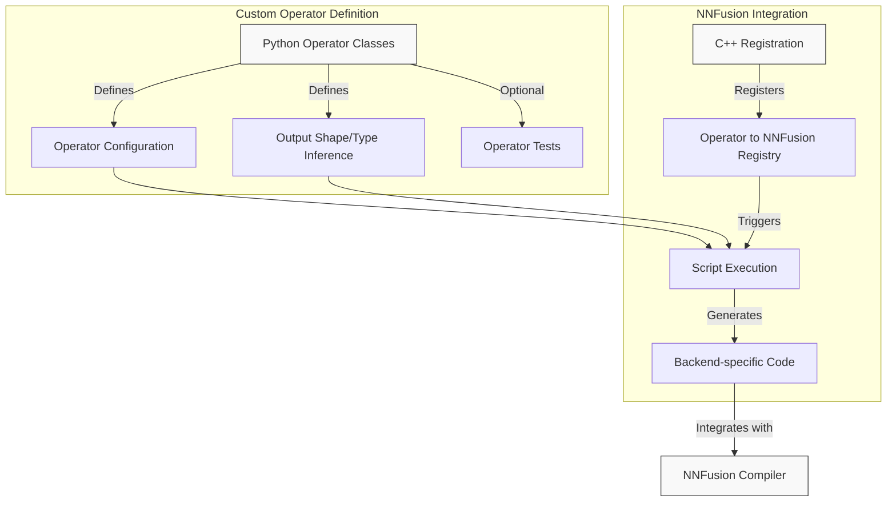
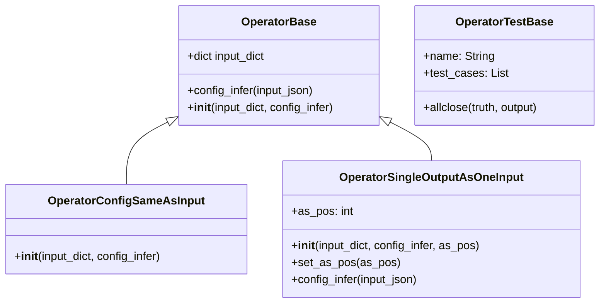
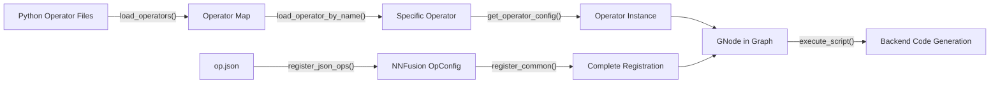
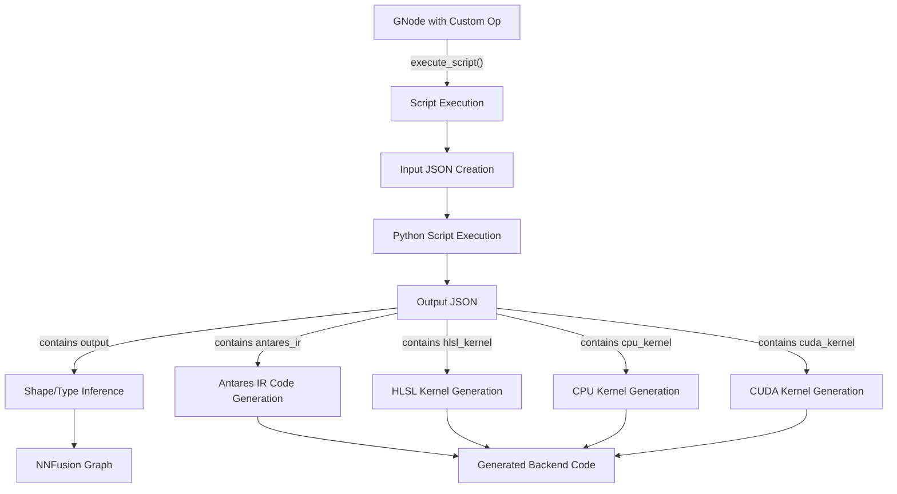
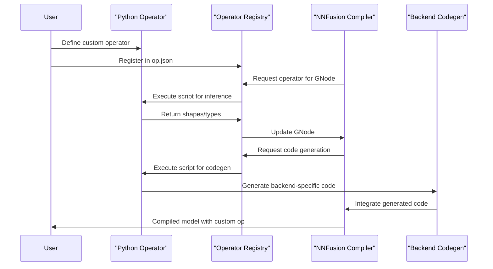

<!-- source: DeepWiki mcp.deepwiki.com · repo microsoft/nnfusion · page 7.1 Custom Operator Framework · fetched 2026-10-26 -->

# Custom Operator Framework

<details>
<summary>Relevant source files</summary>

The following files were used as context for generating this wiki page:

- [src/contrib/custom_op/custom_op.cpp](src/contrib/custom_op/custom_op.cpp)
- [src/contrib/custom_op/script/__operator__.py](src/contrib/custom_op/script/__operator__.py)
- [src/contrib/custom_op/script/op.json](src/contrib/custom_op/script/op.json)
- [src/nnfusion/common/util.cpp](src/nnfusion/common/util.cpp)

</details>


## Introduction

The Custom Operator Framework enables users to extend NNFusion with new operations beyond the built-in operators. This framework provides a structured way to define, register, and integrate custom operators with the NNFusion compiler, supporting various backends like CUDA, CPU, and DirectX (HLSL). This page describes the architecture, components, and processes involved in creating and using custom operators in NNFusion.

For detailed examples of implementing specific custom operators, see [Example: TopK and ArgMax Operators](#7.2).

Sources: [src/contrib/custom_op/script/__operator__.py:14-18]()

## Architecture Overview

The Custom Operator Framework bridges Python-defined operators with the core C++ NNFusion engine through a script-based interface. This design allows for flexible operator definition while maintaining performance by generating optimized backend code.



The framework consists of two main components:
1. **Python-based operator definitions**: Allows defining operator behavior, shape inference, and test cases
2. **C++ registration mechanism**: Integrates custom operators into NNFusion's operator registry

Sources: [src/contrib/custom_op/script/__operator__.py:19-71](), [src/contrib/custom_op/custom_op.cpp:6-23]()

## Core Components

### Operator Base Classes

The framework provides several base classes for defining custom operators:



- **`OperatorBase`**: Base class for all custom operators that includes:
  - Input/output shape and type handling
  - Default configuration inference
  
- **`OperatorConfigSameAsInput`**: Specialized operator that maintains the same shape/type as input

- **`OperatorSingleOutputAsOneInput`**: Operator that produces output with the same shape/type as a specific input

- **`OperatorTestBase`**: Base class for testing custom operators

Sources: [src/contrib/custom_op/script/__operator__.py:19-71]()

### Operator Loading and Registration

The framework dynamically loads operator definitions from Python files and registers them with NNFusion:



Key functions:
- `load_operators()`: Discovers and loads all Python operator definitions
- `load_operator_by_name()`: Retrieves a specific operator class by name
- `get_operator_config()`: Creates an instance of an operator with specific configuration
- `register_json_ops()`: Registers operators from a JSON configuration file

Sources: [src/contrib/custom_op/script/__operator__.py:74-109](), [src/contrib/custom_op/custom_op.cpp:6-23](), [src/contrib/custom_op/custom_op.cpp:134-256]()

## Integration with NNFusion

### Script Execution and Code Generation

The custom operator framework generates backend-specific code by executing the associated Python script:



The framework supports multiple backends:
- CUDA kernels for NVIDIA GPUs
- CPU kernels for general purpose processors
- HLSL kernels for DirectX Compute
- Antares IR for auto-tuned kernels

Sources: [src/contrib/custom_op/custom_op.cpp:74-132](), [src/contrib/custom_op/custom_op.cpp:207-256]()

### Shape and Type Inference

For custom operators, output shapes and types are inferred by:

1. Creating a JSON representation of inputs
2. Executing the associated Python script
3. Parsing the output JSON to extract shape and type information
4. Setting the output shape and type on the operator's GNode

This allows custom operators to have flexible output configurations based on their inputs.

Sources: [src/contrib/custom_op/custom_op.cpp:137-204]()

## Creating a Custom Operator

### Steps to Create a Custom Operator

1. Create a Python class that derives from one of the operator base classes
2. Implement the required shape and type inference logic
3. Add backend-specific kernel implementations
4. Register the operator in the `op.json` file

### Example Custom Operator Registration

Here's how custom operators are registered in the `op.json` file:

```json
{
    "ops": [
        {
            "op": "TopK",
            "script": "python <NNFUSION_CONTRIB>/custom_op/script --operator-name=\"<OP_NAME>\" --input-config=<OP_JSON>"
        }
    ]
}
```

This configuration specifies:
- The operator name ("TopK")
- The script to execute for shape inference and code generation

Sources: [src/contrib/custom_op/script/op.json:1-20]()

### Operator Testing

The framework includes a testing mechanism to verify operator correctness:

1. Define a test class that inherits from both your operator class and `OperatorTestBase`
2. Implement `create_*` methods that generate test cases
3. Use `allclose()` method to verify output correctness against reference values

When a custom operator is used, the test cases can be automatically generated and executed to verify proper implementation.

Sources: [src/contrib/custom_op/script/__operator__.py:38-50](), [src/contrib/custom_op/script/__operator__.py:117-139]()

## Custom Operator Workflow

The overall workflow for using a custom operator in NNFusion is:



Sources: [src/contrib/custom_op/custom_op.cpp:74-132](), [src/contrib/custom_op/custom_op.cpp:134-256]()

## Configuration and Environment

The framework uses environment variables to locate necessary files:

- `NNFUSION_CONTRIB`: Base directory for custom operators
- If not set, falls back to `$HOME/.nnfusion/`

This allows for a flexible installation while maintaining a consistent operator discovery mechanism.

Sources: [src/contrib/custom_op/custom_op.cpp:52-72](), [src/nnfusion/common/util.cpp:37-61]()

## Summary

The Custom Operator Framework in NNFusion provides a flexible way to extend the compiler with new operations. By combining Python-based operator definitions with C++ integration mechanisms, it offers both ease of use and performance. The framework supports multiple backends and provides a testing mechanism to ensure operator correctness.

---

