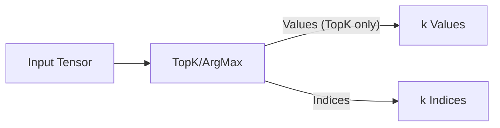
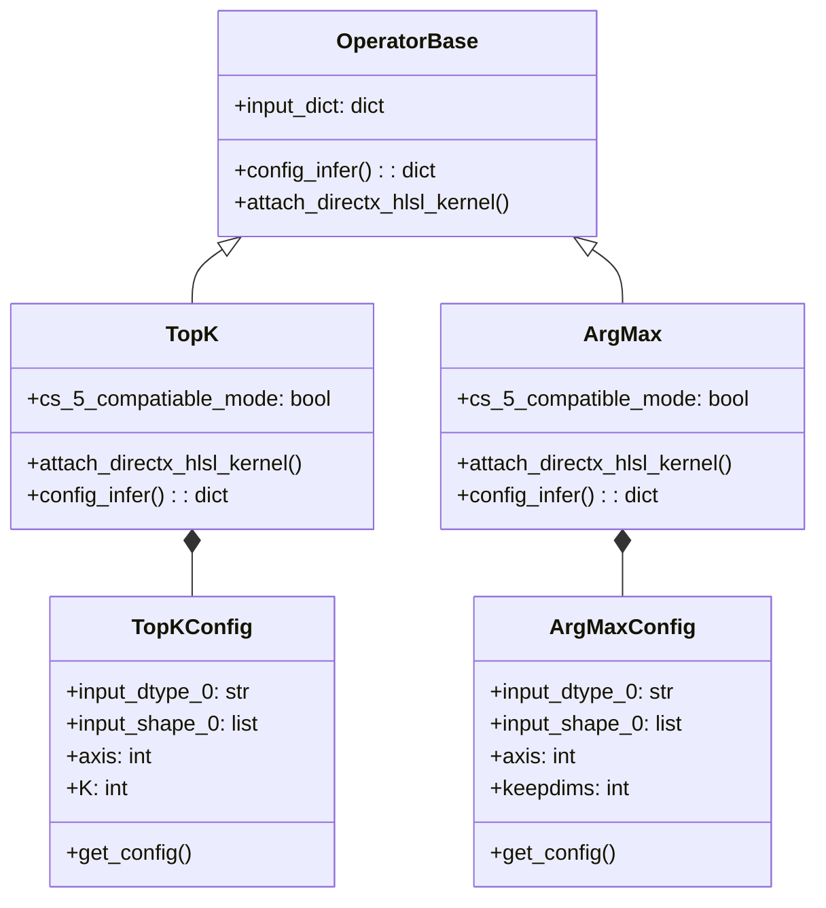
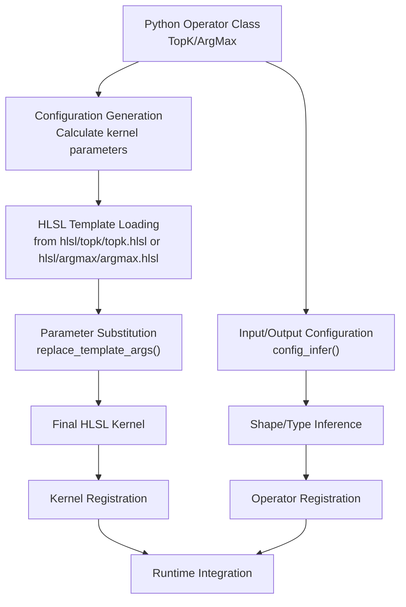
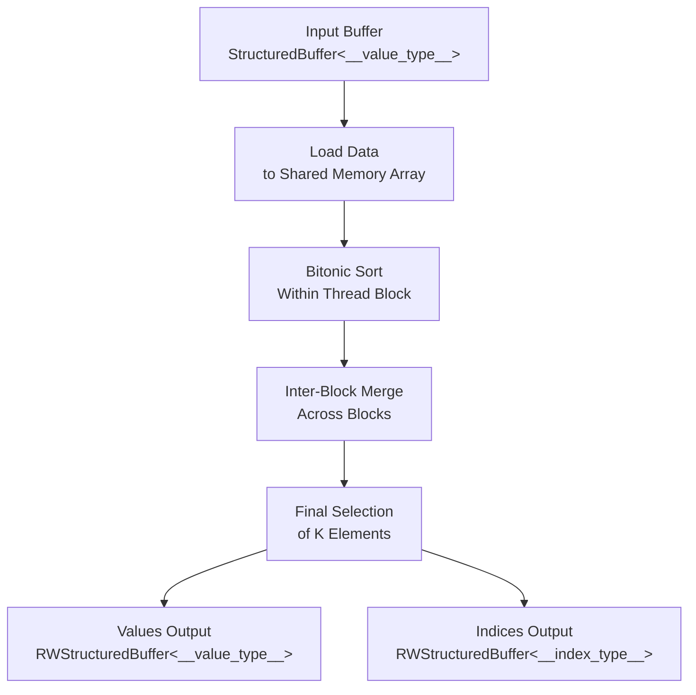
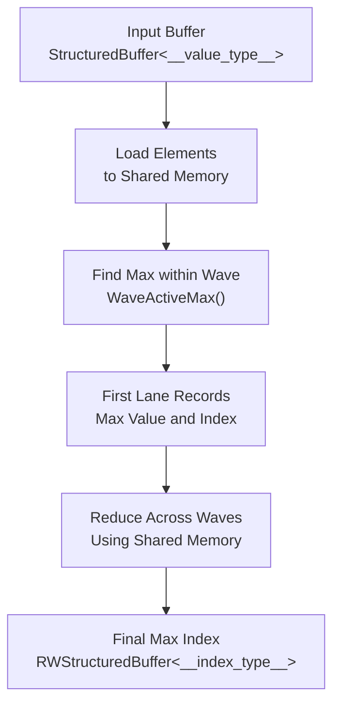
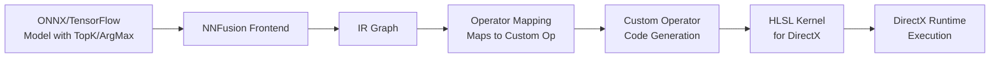

<!-- source: DeepWiki mcp.deepwiki.com · repo microsoft/nnfusion · page 7.2 Example: TopK and ArgMax Operators · fetched 2026-10-26 -->

# Example: TopK and ArgMax Operators

<details>
<summary>Relevant source files</summary>

The following files were used as context for generating this wiki page:

- [src/contrib/custom_op/script/ArgMax.py](src/contrib/custom_op/script/ArgMax.py)
- [src/contrib/custom_op/script/TopK.py](src/contrib/custom_op/script/TopK.py)
- [src/contrib/custom_op/script/hlsl/argmax/argmax.hlsl](src/contrib/custom_op/script/hlsl/argmax/argmax.hlsl)
- [src/contrib/custom_op/script/hlsl/topk/topk.hlsl](src/contrib/custom_op/script/hlsl/topk/topk.hlsl)

</details>


This document provides a detailed walkthrough of implementing custom TopK and ArgMax operators in NNFusion using HLSL (High-Level Shader Language) for DirectX compute support. These implementations serve as practical examples of extending NNFusion with custom operators, particularly when targeting hardware platforms that require specialized implementations like DirectX.

For information about the overall custom operator framework architecture, see [Custom Operator Framework](#7.1).

## Operator Functionality Overview

**TopK**: Finds the k largest (or smallest) elements along a specified axis of a tensor and returns both their values and indices.

**ArgMax**: Returns the indices of the maximum values along a specified axis of a tensor.

Both operators are fundamental building blocks in deep learning models, especially for tasks like classification (finding highest probability classes) and object detection (selecting strongest predictions).



Sources: [src/contrib/custom_op/script/TopK.py:10-11](), [src/contrib/custom_op/script/ArgMax.py:11-12]()

## Custom Operator Architecture

The implementation of both operators follows a consistent architecture pattern that combines Python configuration classes with HLSL kernel templates:



Sources: [src/contrib/custom_op/script/TopK.py:10-108](), [src/contrib/custom_op/script/ArgMax.py:11-97]()

### Implementation Flow

The custom operator implementation follows this workflow:



Sources: [src/contrib/custom_op/script/TopK.py:78-108](), [src/contrib/custom_op/script/ArgMax.py:51-75]()

## TopK Operator Implementation

### TopK Configuration

The `TopKConfig` inner class handles all parameter calculations needed for the HLSL kernel:

```python
def get_config(self):
    # Maximum elements processed by one block of threads
    self.__block_max_element__ = self.get_block_max_element(self.input_dtype_0)
    # Maximum elements for one sequence in one block
    self.__block_max_seq_element__ = self.__block_max_element__ // 2
    # Stride between two elements in original 
    self.__axis_stride__ = 1 
    for r in range(self.axis+1, len(self.input_shape_0)):
        self.__axis_stride__ *= self.input_shape_0[r]
    # "Greater block" is which process one batch of data
    self.__greater_blocks__ = 1
    for r in range(0, len(self.input_shape_0)):
        if r == self.axis:
            continue
        self.__greater_blocks__ *= self.input_shape_0[r]
    # Thread parameters for processing topK
    self.__thread_max_element__ = 1
    while self.__thread_max_element__ < self.__K__:
        self.__thread_max_element__ *= 2
```

Sources: [src/contrib/custom_op/script/TopK.py:37-56]()

Key parameters include:
- `block_max_element`: Maximum elements in shared memory (constrained by 4096 bytes in DirectX)
- `axis_stride`: Stride calculation for navigating the tensor memory layout
- `greater_blocks` and `smaller_blocks`: Block divisions for parallel processing
- `thread_max_element`: Sizing thread blocks to handle at least K elements

### TopK HLSL Kernel Structure

The TopK HLSL kernel implements a parallel bitonic sort algorithm:



Sources: [src/contrib/custom_op/script/hlsl/topk/topk.hlsl:1-146]()

The kernel uses:
- Structured buffers for input and output
- Shared memory for thread block communication
- Bitonic sorting network for efficient parallel sorting
- A two-phase approach that first sorts within blocks then merges

The bitonic sort function implements a butterfly pattern for parallel comparison and swap:

```hlsl
void bitonic_sort(uint element_id, uint step, uint gstep, uint largest)
{
    uint pos = element_id % step + (element_id / step) * step * 2;
    if((((pos/gstep>>1 & 1) == largest) && buf[pos].val > buf[pos+step].val) || 
       (((pos/gstep>>1 & 1) == (largest^1) && (buf[pos].val < buf[pos+step].val))))
    {
        type t = buf[pos + step];
        buf[pos + step] = buf[pos];
        buf[pos] = t;
    }
}
```

Sources: [src/contrib/custom_op/script/hlsl/topk/topk.hlsl:25-34]()

## ArgMax Operator Implementation

### ArgMax Configuration

The `ArgMaxConfig` class calculates parameters for efficient parallel reduction:

```python
def get_config(self):
    self.__axis_size__ = self.input_shape_0[self.axis]
    self.__value_type__, dx_type_size, dx_type_min, dx_type_max = get_type_info(self.input_dtype_0)
    self.__index_type__, _, _, _ = get_type_info(self.output_dtype_0)
    self.__boundary_value__ = dx_type_min

    in_block_number = 4096 // dx_type_size
    self.__block_max_element__ = min(in_block_number, self.__axis_size__)

    self.__blocks__ = 1
    for r in range(0, len(self.input_shape_0)):
        if r == self.axis:
            continue
        self.__blocks__ *= self.input_shape_0[r]
```

Sources: [src/contrib/custom_op/script/ArgMax.py:28-43]()

Key parameters include:
- `axis_size`: Size of the dimension being reduced
- `block_max_element`: Maximum elements per block (constrained by shared memory)
- `blocks`: Number of parallel blocks for batch processing
- `threads`: Number of threads per block

### ArgMax HLSL Kernel Structure

The ArgMax HLSL kernel uses DirectX wave operations for efficient parallel reduction:



Sources: [src/contrib/custom_op/script/hlsl/argmax/argmax.hlsl:1-76]()

The kernel leverages DirectX Shader Model 6.0 wave operations for efficient parallel reduction:

```hlsl
__value_type__ warp_max = WaveActiveMax(lane_val);
if(lane_val == warp_max)
{
    uint buf_id = thread_id / lane_count;
    buf[buf_id] = warp_max;
    buf[buf_id + lane_count] = element_id;
}
```

Sources: [src/contrib/custom_op/script/hlsl/argmax/argmax.hlsl:34-40]()

The algorithm:
1. Divides input into chunks processed by thread blocks
2. Uses `WaveActiveMax` to find maximum within each wave
3. Threads with the max value record both the value and its index
4. Further reduction combines results across waves
5. Final maximum index is written to output

## Memory Constraints and Optimizations

Both operators handle the constraints of DirectX shared memory (limited to 4096 bytes):

```python
# Only 4096 Bytes shared memory(L1 cache) in DirectX
in_block_number = 4096 // (dx_type_size + 4)
```

Sources: [src/contrib/custom_op/script/TopK.py:34]()

This constraint necessitates several optimizations:
1. Calculating maximum elements per block based on data type size
2. Chunking larger inputs into multiple processing blocks
3. Implementing two-phase processing for TopK with large input sizes

## Testing and Integration

Both operators include test classes that verify correctness against PyTorch reference implementations:

```python
# TopK test against PyTorch reference
X = torch.rand(tuple(shape), dtype=torch.float32) * 100
(values_ref, indicies_ref) = torch.topk(
    X, k=self["K"], dim=self["axis"], largest=True, sorted=True)
```

Sources: [src/contrib/custom_op/script/TopK.py:220-222]()

```python
# ArgMax test against PyTorch reference
X = torch.rand(tuple(shape), dtype=torch.float32) * 100
Y = torch.argmax(X, dim=self["axis"], keepdim=(self["keepdims"]==1))
```

Sources: [src/contrib/custom_op/script/ArgMax.py:112-113]()

## Usage in NNFusion

These custom operators can be directly used when processing models that contain TopK or ArgMax operations:



Sources: [src/contrib/custom_op/script/TopK.py:252-261]()

The operators support various runtime configurations:
- Different data types (float32, float16, int32)
- Multi-dimensional tensors with arbitrary axis specifications
- Options for largest/smallest elements in TopK
- keepdims option in ArgMax

## Summary

The TopK and ArgMax operators demonstrate the custom operator framework in NNFusion by implementing efficient HLSL kernels for DirectX compute. They showcase:

1. Parameter calculation and optimization for HLSL kernel generation
2. Efficient parallel algorithms (bitonic sort for TopK, wave operations for ArgMax)
3. Memory constraint handling for DirectX
4. Integration with the NNFusion operator system

These implementations enable NNFusion to efficiently execute models with TopK and ArgMax operations on DirectX hardware, expanding the framework's hardware support beyond traditional GPU compute APIs.

---

