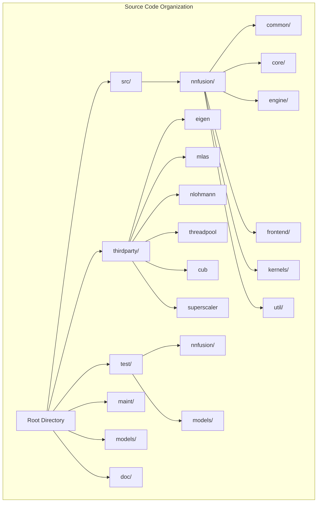
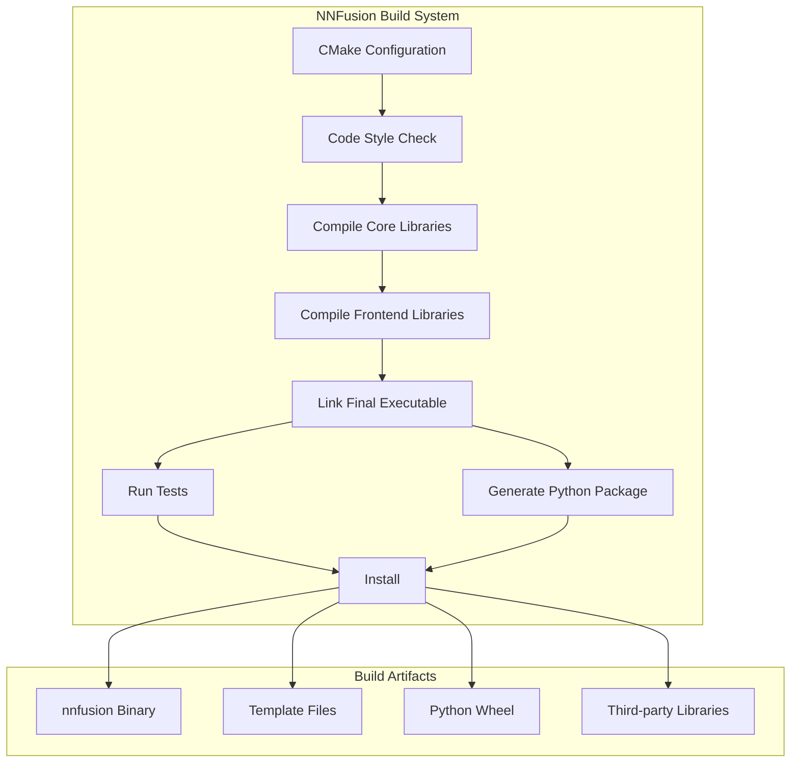
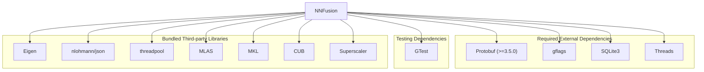
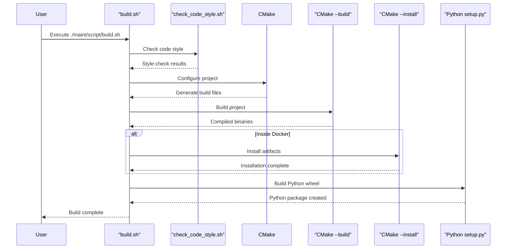
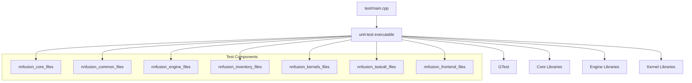
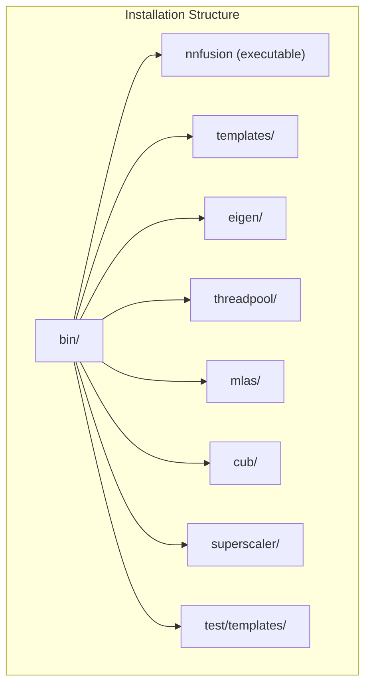

<!-- source: DeepWiki mcp.deepwiki.com · repo microsoft/nnfusion · page 8 Build System and Project Structure · fetched 2026-10-26 -->

# Build System and Project Structure

Relevant source files

The following files were used as context for generating this wiki page:

- [.gitignore](.gitignore)
- [CMakeLists.txt](CMakeLists.txt)
- [maint/pipeline/validation.yaml](maint/pipeline/validation.yaml)
- [maint/script/build.sh](maint/script/build.sh)
- [models/tensorflow/google_bert/README.md](models/tensorflow/google_bert/README.md)
- [src/nnfusion/util/curl_request.hpp](src/nnfusion/util/curl_request.hpp)
- [src/tools/nnfusion/CMakeLists.txt](src/tools/nnfusion/CMakeLists.txt)
- [test/CMakeLists.txt](test/CMakeLists.txt)
- [thirdparty/mlas/lib/snchwc.cpp](thirdparty/mlas/lib/snchwc.cpp)
- [thirdparty/nlohmann/json.hpp](thirdparty/nlohmann/json.hpp)

This document provides a detailed overview of NNFusion's build system and project structure, explaining how the codebase is organized and how to build the project from source. For information about specific components like the Core IR, see [Core IR and Graph Representation](#3).

## Project Structure Overview

NNFusion follows a modular organization pattern that separates the codebase into distinct functional areas. The repository structure reflects this modular approach, making it easier to navigate and understand the system architecture.

Sources: [CMakeLists.txt:143-154](), [.gitignore:18-59]()

### Key Directories

The NNFusion codebase is organized into the following key directories:

| Directory | Purpose |
|-----------|---------|
| `src/` | Contains the main source code of NNFusion |
| `src/nnfusion/` | Core implementation of NNFusion compiler |
| `thirdparty/` | Third-party libraries used by NNFusion |
| `test/` | Unit tests and model testing infrastructure |
| `maint/` | Maintenance scripts, CI/CD pipelines, and utilities |
| `models/` | Example models for testing and demonstration |
| `build/` | Generated build files (created during build) |
| `dist/` | Distribution packages (created during build) |

## Build System Overview

NNFusion uses CMake as its build system, enabling cross-platform builds with consistent configuration. The build system handles dependency management, compiler flags, and generates platform-specific build files.

Sources: [maint/script/build.sh:1-60](), [CMakeLists.txt:59-88]()

### CMake Setup

The CMake configuration is defined in the root `CMakeLists.txt` file and additional CMake files in subdirectories. The main configuration:

1. Sets up the project and compiler flags
2. Defines build options (Debug/Release)
3. Configures dependencies
4. Sets up compilation targets

Key build options include:

| Option | Default | Description |
|--------|---------|-------------|
| `ONNX_FRONTEND` | ON | Enable ONNX model import support |
| `TENSORFLOW_FRONTEND` | ON | Enable TensorFlow model import support |
| `TORCHSCRIPT_FRONTEND` | OFF | Enable TorchScript model import support |
| `DEBUG_ENABLE` | OFF | Enable debug build with extra debug information |
| `CODE_COVERAGE_ENABLE` | OFF | Enable code coverage instrumentation |

Sources: [CMakeLists.txt:17-22](), [CMakeLists.txt:66-81]()

### Dependencies

NNFusion depends on several external libraries, which are included as part of the build process:

Sources: [CMakeLists.txt:113-131](), [src/tools/nnfusion/CMakeLists.txt:63-69]()

## Build Process

The build process for NNFusion follows these main steps:

1. **Code style checking** - Ensures code follows the project's style guide
2. **CMake configuration** - Configures the build based on available dependencies
3. **Compilation** - Builds the core libraries and executables
4. **Installation** - Places built artifacts in appropriate directories
5. **Python package creation** - Creates a Python wheel for distribution

### Build Scripts

The primary build script for NNFusion is `maint/script/build.sh`, which automates the entire build process:

Sources: [maint/script/build.sh:12-60]()

### The Main Executable Build

The main NNFusion executable is built from `src/tools/nnfusion/nnfusion.cpp` and linked with all the necessary component libraries:

```mermaid
graph TD
    A["nnfusion executable"]
    
    subgraph "Core Libraries"
        B["nnfusion_common"]
        C["nnfusion_util"]
        D["nnfusion_operators"]
        E["nnfusion_graph"]
        F["nnfusion_ir"]
    end
    
    subgraph "Engine Libraries"
        G["nnfusion_engine_base"]
        H["nnfusion_engine_profiler"]
        I["nnfusion_engine_device"]
        J["nnfusion_engine_mem"]
        K["nnfusion_engine_pass"]
        L["nnfusion_engine_pass_graph"]
        M["nnfusion_engine_pass_graph_blockfusion"]
        N["nnfusion_engine_pass_graph_subgraph_fusion"]
        O["nnfusion_engine_pass_graph_autodiff"]
    end
    
    subgraph "Frontend Libraries"
        P["onnx_import (optional)"]
        Q["tensorflow_import (optional)"]
        R["torchscript_import (optional)"]
    end
    
    subgraph "Kernel Libraries"
        S["kernels_registration"]
        T["kernels_cuda"]
        U["kernels_cpu"]
        V["kernels_hlsl"]
    end
    
    A --> B
    A --> C
    A --> D
    A --> E
    A --> F
    A --> G
    A --> H
    A --> I
    A --> J
    A --> K
    A --> L
    A --> M
    A --> N
    A --> O
    A --> P
    A --> Q
    A --> R
    A --> S
    A --> T
    A --> U
    A --> V
```

Sources: [src/tools/nnfusion/CMakeLists.txt:24-57]()

## Testing Infrastructure

NNFusion includes a comprehensive testing infrastructure with unit tests and model tests:

Sources: [test/CMakeLists.txt:6-88]()

Tests can be run using the custom targets:
- `unit-test-check`: Runs unit tests
- `check`: Runs both style checks and unit tests

Sources: [test/CMakeLists.txt:91-100]()

## Installation and Deployment

After building, NNFusion can be installed using the `cmake --install` command, which:

1. Installs the main executable in the `bin` directory
2. Copies template files needed for code generation
3. Copies third-party libraries required at runtime

The installed structure ensures that the NNFusion compiler can find all necessary files for code generation and execution.

Sources: [src/tools/nnfusion/CMakeLists.txt:73-86]()

## Development Workflow

The typical development workflow for NNFusion involves:

1. Checking out the code
2. Building the project using `./maint/script/build.sh`
3. Running tests to ensure functionality
4. Making changes and ensuring code style compliance

For CI/CD, NNFusion uses Azure Pipelines for validation, with pipeline configuration in `maint/pipeline/validation.yaml`.

Sources: [maint/pipeline/validation.yaml:1-18]()

## Python Package

NNFusion also provides a Python package for easier integration with Python workflows. The package is built during the build process using `python setup.py bdist_wheel`.

The Python package enables calling NNFusion functionality from Python scripts and integrating with other machine learning frameworks.

Sources: [maint/script/build.sh:57-60]()