# Page: Overview

# Overview

<details>
<summary>Relevant source files</summary>

The following files were used as context for generating this wiki page:

- [README.md](README.md)
- [docs/README.md](docs/README.md)

</details>


## Purpose and Scope

NNFusion is a flexible and efficient Deep Neural Network (DNN) compiler that generates high-performance executables from DNN model descriptions. This page provides a comprehensive overview of the NNFusion system architecture, its key components, and the workflow from model input to optimized code generation. For detailed information about specific subsystems, please refer to their respective wiki pages.

For model importing specifics, see [Frontend Systems](#2). For information about the internal representation, see [Core IR and Graph Representation](#3).

## What is NNFusion?

NNFusion is an optimizing compiler for deep learning models that takes models defined in frameworks like TensorFlow, ONNX, or PyTorch and generates highly efficient executable code tailored for specific hardware targets. It employs various compiler optimization techniques to improve performance beyond what's typically achievable with standard deep learning frameworks.

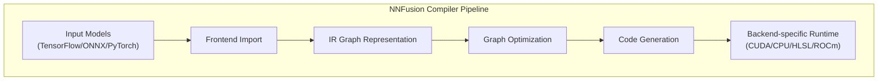

Sources: [README.md:1-23]()

## Key Objectives

NNFusion aims to achieve three primary goals:

1. **Full-stack Model Optimization**: Applying optimizations at different levels of abstraction, from graph-level to hardware-specific kernel tuning.
2. **Framework-free Code Generation**: Removing dependencies on deep learning frameworks for inference, reducing runtime overhead.
3. **Flexible Target Support**: Enabling deployment on various accelerator devices beyond just standard GPUs.

## System Architecture

NNFusion employs a modular architecture following the traditional compiler design pattern with frontend, intermediate representation, optimization, and backend components. The following diagram illustrates the high-level architecture:

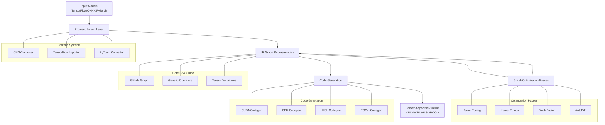

Sources: [README.md:14-21]()

## Key Components

### Frontend Import Systems

The frontend subsystem is responsible for importing models from various deep learning frameworks and converting them to NNFusion's internal representation.

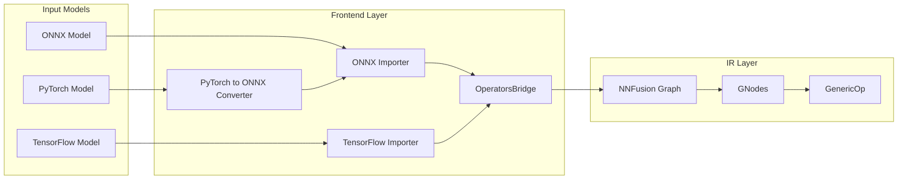

For detailed information about each frontend, refer to the [Frontend Systems](#2) page.

Sources: [README.md:19]()

### Core IR and Graph Representation

NNFusion uses a graph-based intermediate representation (IR) to capture the computational nature of deep learning models. The core components include:

- **GNode Graph**: Represents the dataflow graph of operations
- **Generic Operators**: Framework-agnostic representation of neural network operations
- **Tensor Descriptors**: Metadata about tensors including shape, data type, and memory layout

For more detailed information about the internal representation, see [Core IR and Graph Representation](#3).

Sources: [README.md:15]()

### Optimization Passes

NNFusion applies a series of optimization passes to the IR to improve performance:

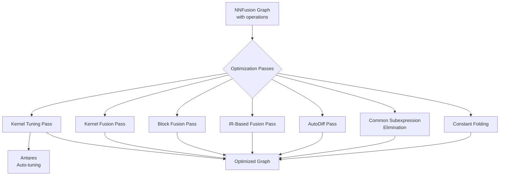

The optimization passes fall into these categories:

| Optimization Type | Description | Examples |
|-------------------|-------------|----------|
| Graph Optimizations | Reduces computational graph complexity | Common Subexpression Elimination, Constant Folding |
| Kernel Optimizations | Improves individual kernel performance | Kernel Tuning with Antares |
| Fusion Optimizations | Combines operations to reduce overhead | Kernel Fusion, Block Fusion |
| Memory Optimizations | Optimizes memory usage patterns | Static Memory Layout Planning |
| Training Support | Enables gradient computation | Automatic Differentiation |

For detailed information on optimization techniques, see [Optimization Passes](#4).

Sources: [README.md:15-17]()

### Code Generation

The code generation subsystem produces optimized code for different hardware targets:

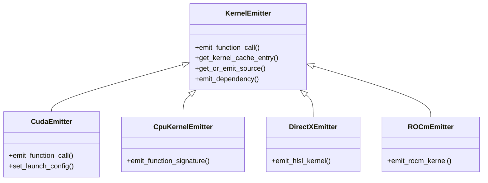

NNFusion supports generating code for:
- NVIDIA GPUs (CUDA)
- AMD GPUs (ROCm)
- CPUs
- DirectX Compute (HLSL)

The generated code is human-readable, allowing for manual inspection and additional customization when needed.

For more details, see [Code Generation](#5).

Sources: [README.md:18](), [README.md:21]()

### Runtime and Execution

After code generation, the model can be executed via different interfaces:

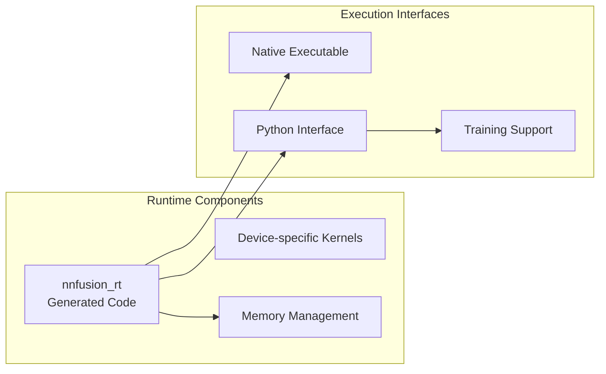

For more information about runtime systems, see [Runtime and Execution](#6).

Sources: [README.md:18](), [README.md:22](), [README.md:97]()

## Key Capabilities

### Supported Model Formats
- TensorFlow frozen models
- ONNX models
- PyTorch models (via conversion to ONNX)

### Supported Target Platforms
- NVIDIA GPUs (CUDA)
- AMD GPUs (ROCm)
- CPUs
- DirectX Compute (HLSL)

### Distinctive Features

| Feature | Description |
|---------|-------------|
| Source-to-Source Compilation | Generates human-readable, framework-independent source code |
| Kernel Auto-tuning | Integrates with Antares for hardware-specific kernel optimization |
| Fusion Techniques | Multiple fusion strategies to reduce kernel launch overhead |
| Training Support | Automatic differentiation for gradient computation |
| Custom Operator Support | Framework for extending with custom operators |

Sources: [README.md:14-22]()

## Typical Usage Workflow

1. **Model Preparation**: Freeze or export model from original framework (TensorFlow, ONNX, PyTorch)
2. **Compilation**: Use NNFusion to compile the model
3. **Optimization**: Apply automatic or manual optimizations
4. **Code Generation**: Generate code for target hardware
5. **Build and Execute**: Compile and run the generated code

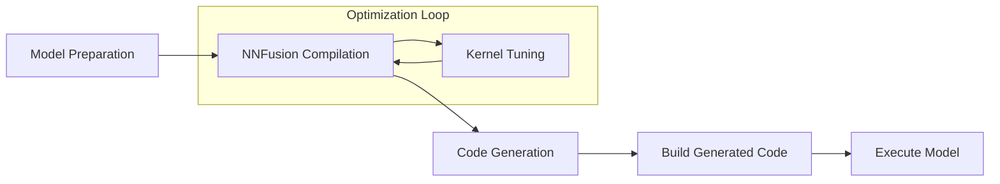

For more detailed instructions on using NNFusion, refer to the specific guides for different model formats and optimization techniques.

Sources: [README.md:24-97]()

---

# Page: Frontend Systems

# Frontend Systems

<details>
<summary>Relevant source files</summary>

The following files were used as context for generating this wiki page:

- [models/pytorch2onnx/ort_run_frozen.py](models/pytorch2onnx/ort_run_frozen.py)
- [models/pytorch2onnx/ort_run_frozen_each_layer.py](models/pytorch2onnx/ort_run_frozen_each_layer.py)
- [src/nnfusion/core/kernels/cuda_gpu/kernels/depthwise_conv2d.cpp](src/nnfusion/core/kernels/cuda_gpu/kernels/depthwise_conv2d.cpp)
- [src/nnfusion/core/operators/generic_op/generic_op_define/DepthwiseConv2dNative.cpp](src/nnfusion/core/operators/generic_op/generic_op_define/DepthwiseConv2dNative.cpp)
- [src/nnfusion/core/operators/generic_op/generic_op_define/Softmax.cpp](src/nnfusion/core/operators/generic_op/generic_op_define/Softmax.cpp)
- [src/nnfusion/frontend/onnx_import/CMakeLists.txt](src/nnfusion/frontend/onnx_import/CMakeLists.txt)
- [src/nnfusion/frontend/onnx_import/onnx.cpp](src/nnfusion/frontend/onnx_import/onnx.cpp)
- [src/nnfusion/frontend/onnx_import/op/conv.cpp](src/nnfusion/frontend/onnx_import/op/conv.cpp)
- [src/nnfusion/frontend/onnx_import/op/custom_op.hpp](src/nnfusion/frontend/onnx_import/op/custom_op.hpp)
- [src/nnfusion/frontend/onnx_import/op/depth_to_space.cpp](src/nnfusion/frontend/onnx_import/op/depth_to_space.cpp)
- [src/nnfusion/frontend/onnx_import/op/layer_norm.hpp](src/nnfusion/frontend/onnx_import/op/layer_norm.hpp)
- [src/nnfusion/frontend/onnx_import/ops_bridge.cpp](src/nnfusion/frontend/onnx_import/ops_bridge.cpp)
- [src/nnfusion/frontend/onnx_import/util/graph_convert.cpp](src/nnfusion/frontend/onnx_import/util/graph_convert.cpp)
- [src/nnfusion/frontend/tensorflow_import/util/graph_convert.cpp](src/nnfusion/frontend/tensorflow_import/util/graph_convert.cpp)
- [test/nnfusion/frontend/onnx_import.cpp](test/nnfusion/frontend/onnx_import.cpp)

</details>


The Frontend Systems in NNFusion are responsible for importing deep learning models from different frameworks (ONNX, TensorFlow, PyTorch) and converting them into NNFusion's internal representation. These systems serve as the bridge between external model formats and NNFusion's optimization and code generation pipeline.

## Architecture Overview

The Frontend Systems consist of importers for different model formats that follow a common workflow:

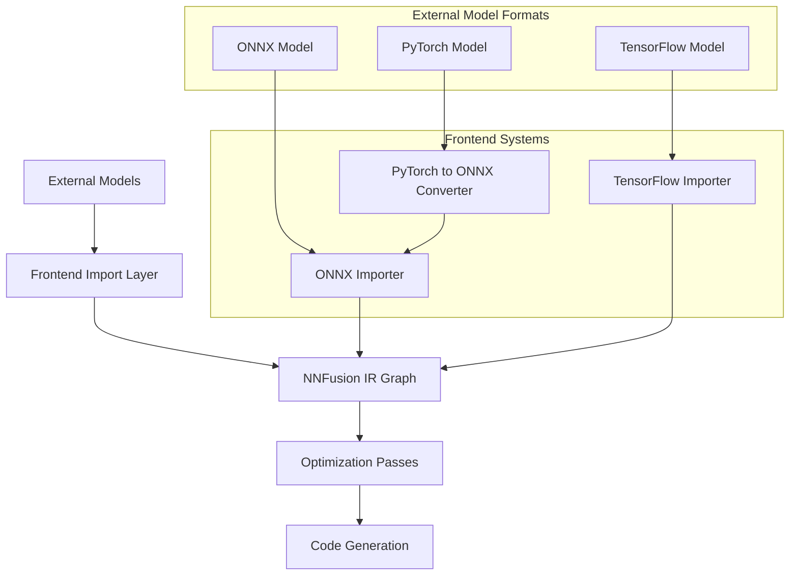

Each frontend module implements three primary functions:
1. **Model Loading**: Parsing the model file from the source format
2. **Operator Mapping**: Converting operators from the source format to NNFusion's operators
3. **Graph Construction**: Building a NNFusion graph with the converted operators

Sources: [src/nnfusion/frontend/onnx_import/onnx.cpp], [src/nnfusion/frontend/tensorflow_import/util/graph_convert.cpp]

## ONNX Import System

The ONNX import system translates ONNX models into NNFusion's internal representation. It is the most extensively developed frontend in NNFusion.

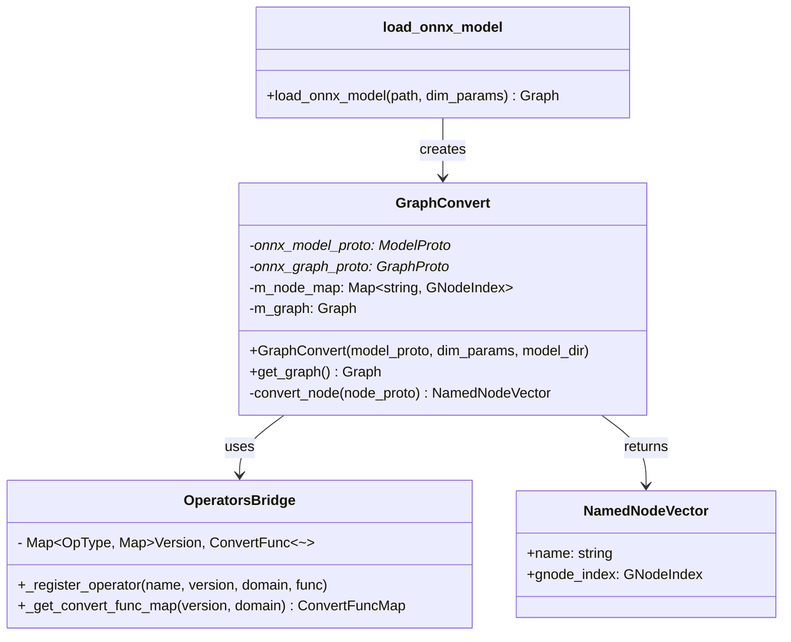

### ONNX Model Loading

The entry point for ONNX model import is `load_onnx_model()` which:
1. Parses the ONNX model file
2. Creates a `GraphConvert` instance
3. Returns the converted NNFusion graph

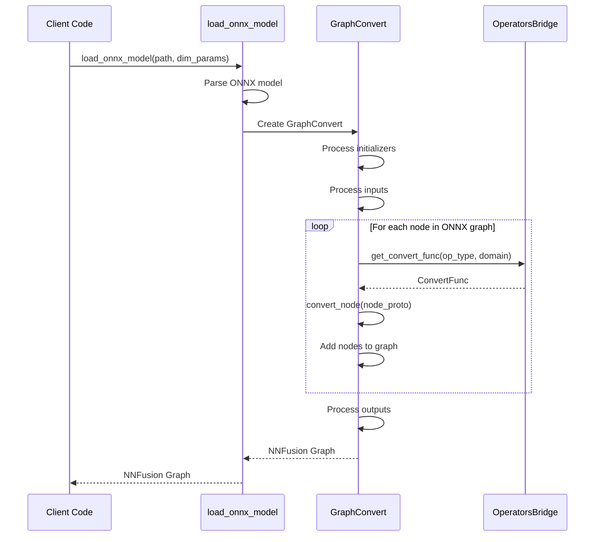

Sources: [src/nnfusion/frontend/onnx_import/onnx.cpp:31-48]()

### Operator Bridge

The `OperatorsBridge` class serves as a registry that maps ONNX operators to their corresponding NNFusion implementations. It maintains a hierarchical map of:
- Domain (e.g., "", "com.microsoft")
- Operator type (e.g., "Conv", "Relu")
- Version (e.g., 1, 7)
- Translator function

Operators are registered in the `OperatorsBridge` constructor:

```cpp
// Registration example
REGISTER_OPERATOR("Abs", 1, TranslateUnaryOp<op::Abs>);
REGISTER_OPERATOR("Conv", 1, TranslateConvOp);
REGISTER_OPERATOR("MatMul", 1, TranslateMatmulOp);
```

Sources: [src/nnfusion/frontend/onnx_import/ops_bridge.cpp:112-137](), [src/nnfusion/frontend/onnx_import/ops_bridge.cpp:150-288]()

### Graph Conversion

The `GraphConvert` class performs the actual conversion of an ONNX graph to a NNFusion graph by:
1. Processing initializers (constant tensors)
2. Processing inputs (parameters)
3. Converting each node using the appropriate translator
4. Setting up the graph outputs

The conversion process handles node ordering, tensor types, dimensions, and operator-specific attributes.

Sources: [src/nnfusion/frontend/onnx_import/util/graph_convert.cpp:229-515]()

### Operator Translation

Each ONNX operator has a corresponding translator function that creates one or more NNFusion operators. For example, the convolution translator:

1. Extracts inputs (data, filters, optional bias)
2. Parses attributes (strides, dilations, padding, etc.)
3. Creates the appropriate NNFusion convolution operator
4. Sets up the connections in the graph

Translators are implemented as free functions that take an ONNX node, a map of existing nodes, and the NNFusion graph, and return a vector of named nodes.

Sources: [src/nnfusion/frontend/onnx_import/op/conv.cpp:93-273]()

## TensorFlow Import System

The TensorFlow import system follows a similar architecture to the ONNX importer, but is tailored to TensorFlow's model format.

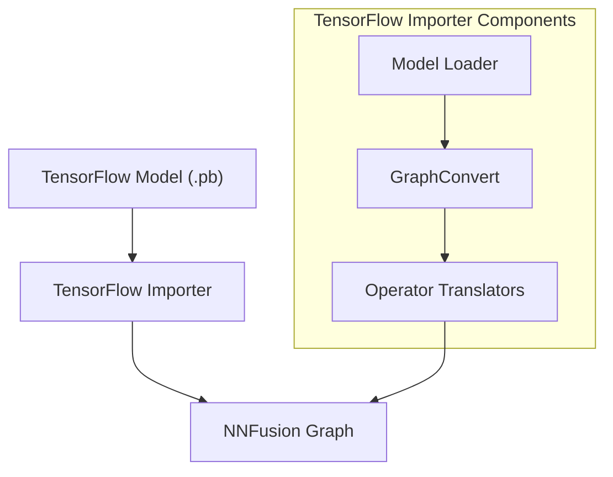

### TensorFlow Operator Translation

TensorFlow operators are translated using specialized functions for different operator types:

```cpp
// Template for unary operators (Relu, Tanh, etc.)
template <typename T>
NamedNodeVector TranslateUnaryOp(const tensorflow::NodeDef& node,
                               const NodeMap& all_ng_nodes,
                               std::shared_ptr<nnfusion::graph::Graph> m_graph)

// Template for binary operators (Add, Mul, etc.)
template <typename T>
NamedNodeVector TranslateBinaryOp(const tensorflow::NodeDef& node,
                                const NodeMap& all_ng_nodes,
                                std::shared_ptr<nnfusion::graph::Graph> m_graph)

// Specialized translators for complex operators
NamedNodeVector TranslateMatMulOp(const tensorflow::NodeDef& node,
                                const NodeMap& all_ng_nodes,
                                std::shared_ptr<nnfusion::graph::Graph> m_graph)
```

For operators without explicit translators, a generic approach is used:

```cpp
NamedNodeVector TranslateGenericNoAttrOp(const tensorflow::NodeDef& node,
                                       const NodeMap& all_ng_nodes,
                                       std::shared_ptr<nnfusion::graph::Graph> m_graph)
```

Sources: [src/nnfusion/frontend/tensorflow_import/util/graph_convert.cpp:130-461](), [src/nnfusion/frontend/tensorflow_import/util/graph_convert.cpp:26-83]()

## PyTorch Integration

PyTorch models are supported through a two-step conversion process:

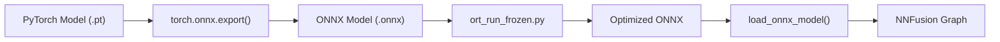

### PyTorch to ONNX Utilities

NNFusion provides utilities in the `models/pytorch2onnx` directory for converting and working with ONNX models:

1. **ort_run_frozen.py**: Validates and optimizes ONNX models using ONNX Runtime
   - Loads ONNX models and performs basic validation
   - Supports optimization with ONNX Runtime
   - Provides benchmarking capabilities

2. **ort_run_frozen_each_layer.py**: Provides layer-by-layer debugging for ONNX models
   - Analyzes the output of each layer
   - Useful for identifying issues in converted models

Sources: [models/pytorch2onnx/ort_run_frozen.py](), [models/pytorch2onnx/ort_run_frozen_each_layer.py]()

### ONNX Model Optimization

When importing an ONNX model, NNFusion automatically attempts to optimize it using ONNX Runtime:

```cpp
// Optimize ONNX model using external tool
string cmd = "python3 " + script_path +
             " --graph_optimization_level ORT_ENABLE_BASIC " +
             "--warmup 1 --iters 0 --file " +
             path + " --optimized_model_filepath " + optimized_filename;

// Run optimization
int sys_ret = system(cmd.c_str());
```

This optimization can improve model performance and compatibility by applying ONNX Runtime's graph transformations.

Sources: [src/nnfusion/frontend/onnx_import/onnx.cpp:54-79]()

## Supported Operators

The frontend systems support a wide range of operators from each framework:

| Framework | Operator Categories | Examples |
|-----------|---------------------|----------|
| ONNX | Math, Neural Network, Tensor, Activation | Add, Conv, Reshape, Relu, MatMul, BatchNorm |
| TensorFlow | Math, Neural Network, Tensor, Control Flow | Add, Conv2D, Reshape, Relu, MatMul, BiasAdd |
| PyTorch | Via ONNX conversion | All operators supported by PyTorch's ONNX exporter |

New operators can be added by implementing the appropriate translator functions and registering them with the operator bridge.

## Integration with Core IR

The frontend systems produce a NNFusion `Graph` object that is passed to the optimization and code generation components:


This integration allows models from any supported framework to benefit from NNFusion's optimization and code generation capabilities.

## Summary

The Frontend Systems in NNFusion provide a unified approach to importing deep learning models from different frameworks. By converting these models to a common internal representation, NNFusion can apply optimizations and generate efficient code regardless of the original model format.

Key features:
- Support for ONNX, TensorFlow, and PyTorch models
- Extensible architecture for adding new operators and frameworks
- Integration with NNFusion's optimization and code generation pipeline

For more information on specific frontend systems, see:
- ONNX Import: [Section 2.1](#2.1)
- TensorFlow Import: [Section 2.2](#2.2)
- PyTorch Integration: [Section 2.3](#2.3)

Sources: [src/nnfusion/frontend/onnx_import/ops_bridge.cpp], [src/nnfusion/frontend/onnx_import/util/graph_convert.cpp], [src/nnfusion/frontend/tensorflow_import/util/graph_convert.cpp], [models/pytorch2onnx/ort_run_frozen.py]

---

# Page: ONNX Import

# ONNX Import

<details>
<summary>Relevant source files</summary>

The following files were used as context for generating this wiki page:

- [src/nnfusion/core/kernels/cuda_gpu/kernels/batch_matmul.cpp](src/nnfusion/core/kernels/cuda_gpu/kernels/batch_matmul.cpp)
- [src/nnfusion/core/kernels/cuda_gpu/kernels/batch_norm.cpp](src/nnfusion/core/kernels/cuda_gpu/kernels/batch_norm.cpp)
- [src/nnfusion/core/kernels/cuda_gpu/kernels/dot.cpp](src/nnfusion/core/kernels/cuda_gpu/kernels/dot.cpp)
- [src/nnfusion/core/kernels/cuda_gpu/kernels/reduce.hpp](src/nnfusion/core/kernels/cuda_gpu/kernels/reduce.hpp)
- [src/nnfusion/core/operators/op_define/constant.hpp](src/nnfusion/core/operators/op_define/constant.hpp)
- [src/nnfusion/frontend/onnx_import/CMakeLists.txt](src/nnfusion/frontend/onnx_import/CMakeLists.txt)
- [src/nnfusion/frontend/onnx_import/core/tensor.hpp](src/nnfusion/frontend/onnx_import/core/tensor.hpp)
- [src/nnfusion/frontend/onnx_import/op/custom_op.hpp](src/nnfusion/frontend/onnx_import/op/custom_op.hpp)
- [src/nnfusion/frontend/onnx_import/op/depth_to_space.cpp](src/nnfusion/frontend/onnx_import/op/depth_to_space.cpp)
- [src/nnfusion/frontend/onnx_import/op/layer_norm.hpp](src/nnfusion/frontend/onnx_import/op/layer_norm.hpp)
- [src/nnfusion/frontend/onnx_import/ops_bridge.cpp](src/nnfusion/frontend/onnx_import/ops_bridge.cpp)
- [src/nnfusion/frontend/onnx_import/util/graph_convert.cpp](src/nnfusion/frontend/onnx_import/util/graph_convert.cpp)
- [src/nnfusion/frontend/onnx_import/util/util.cpp](src/nnfusion/frontend/onnx_import/util/util.cpp)
- [src/nnfusion/frontend/onnx_import/util/util.hpp](src/nnfusion/frontend/onnx_import/util/util.hpp)
- [test/nnfusion/frontend/onnx_import.cpp](test/nnfusion/frontend/onnx_import.cpp)

</details>


This document describes the ONNX import system in NNFusion, which enables the conversion of models from the Open Neural Network Exchange (ONNX) format into NNFusion's internal representation. This functionality allows NNFusion to optimize and compile deep learning models that were originally created in other frameworks like PyTorch and TensorFlow.

## System Overview

The ONNX import system in NNFusion converts ONNX models into NNFusion's graph representation through a series of transformations. This process involves parsing the ONNX protobuf, mapping ONNX operators to NNFusion operators, and building a new graph structure that preserves the computational semantics of the original model.

### Architecture Diagram

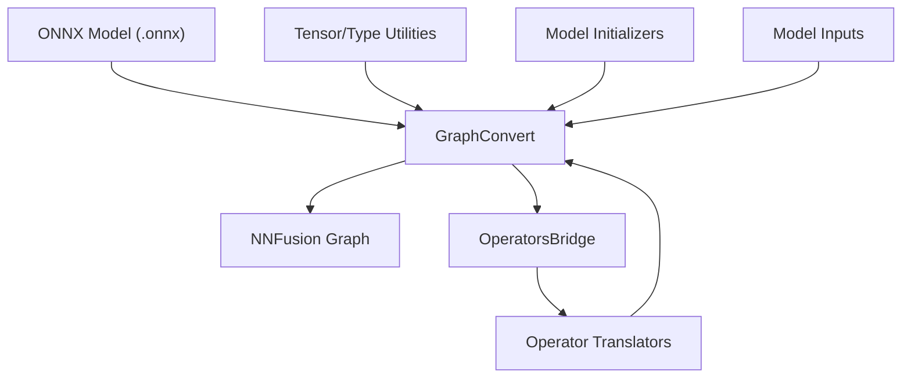

Sources: [src/nnfusion/frontend/onnx_import/util/graph_convert.cpp](src/nnfusion/frontend/onnx_import/util/graph_convert.cpp), [src/nnfusion/frontend/onnx_import/ops_bridge.cpp](src/nnfusion/frontend/onnx_import/ops_bridge.cpp)

## Import Process

The ONNX import process follows a sequence of steps to transform the ONNX model into NNFusion's representation:

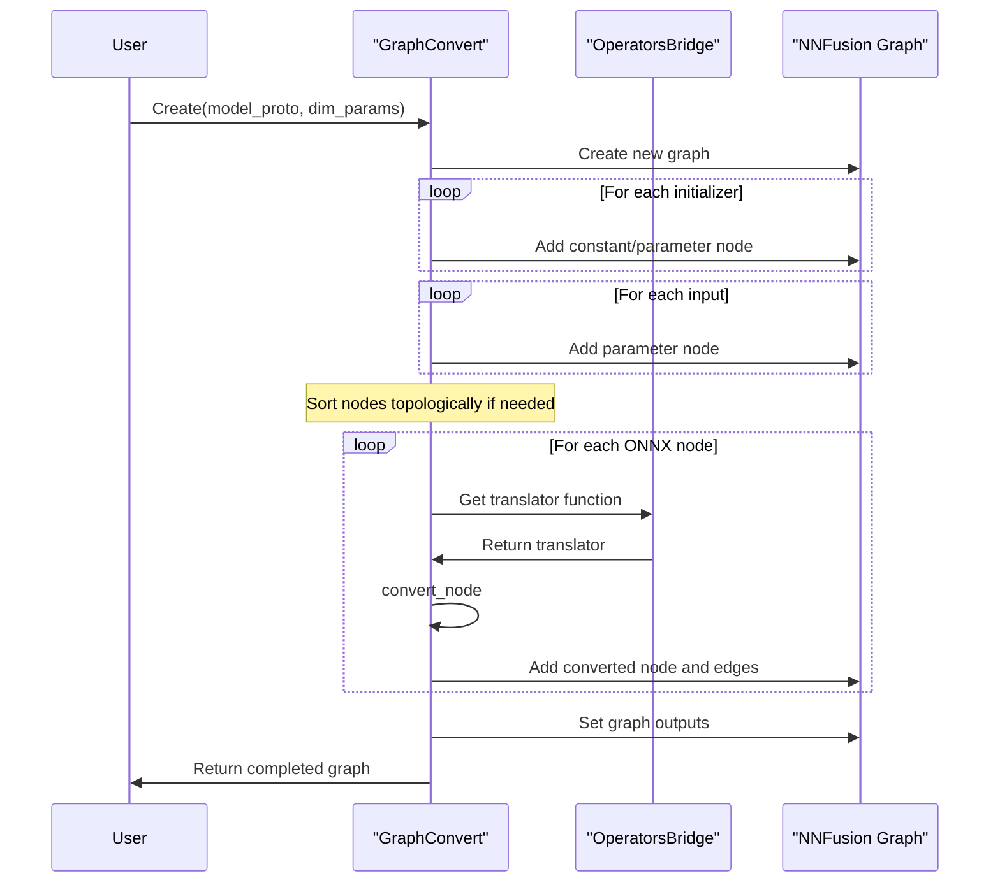

Sources: [src/nnfusion/frontend/onnx_import/util/graph_convert.cpp:229-515](src/nnfusion/frontend/onnx_import/util/graph_convert.cpp:229-515)

The import process consists of the following key steps:

1. **Initialize the Graph**: Create a new NNFusion graph structure.
2. **Register Operator Sets**: Register the ONNX operator sets needed for translation.
3. **Process Initializers**: Convert ONNX initializers (constant values) to NNFusion constant nodes.
4. **Process Inputs**: Convert ONNX inputs to NNFusion parameter nodes.
5. **Topological Sort**: Ensure nodes are processed in the correct dependency order.
6. **Convert Nodes**: Translate each ONNX node to its NNFusion equivalent using the appropriate translator.
7. **Set Outputs**: Configure the graph outputs based on ONNX model outputs.

## Key Components

### GraphConvert

The `GraphConvert` class is the central component of the ONNX import system. It orchestrates the entire conversion process from ONNX to NNFusion.

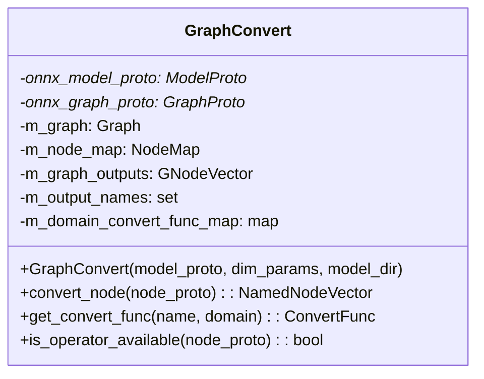

Sources: [src/nnfusion/frontend/onnx_import/util/graph_convert.cpp:229-564](src/nnfusion/frontend/onnx_import/util/graph_convert.cpp:229-564)

### OperatorsBridge

The `OperatorsBridge` class maintains a registry of translator functions that convert ONNX operators to NNFusion operators. It supports different versions and domains of ONNX operators.

```mermaid
classDiagram
    class OperatorsBridge {
        -m_map: map<string, map<string, map<int64_t, ConvertFunc>>>
        
        +_register_operator(name, version, domain, fn)
        +_get_convert_func_map(version, domain): ConvertFuncMap
        +static get_convert_func_map(version, domain): ConvertFuncMap
    }
    
    class ConvertFunc {
        <<typedef>>
        function<NamedNodeVector(NodeProto, NodeMap, Graph)>
    }
    
    OperatorsBridge --> ConvertFunc: registers
```

Sources: [src/nnfusion/frontend/onnx_import/ops_bridge.cpp:93-288](src/nnfusion/frontend/onnx_import/ops_bridge.cpp:93-288)

The `OperatorsBridge` constructor registers a wide variety of operator translators:

```cpp
// Registration pattern
REGISTER_OPERATOR("Add", 1, TranslateLegacyBinaryOp<op::Add>);
REGISTER_OPERATOR("Add", 7, TranslateBinaryOp<op::Add>);
REGISTER_OPERATOR("Conv", 1, TranslateConvOp);
// Many more operators...
```

### Utility Functions

The ONNX import system includes various utility functions for working with ONNX data types, tensors, and attributes:

1. **Type Conversion**: 
   - `ONNXDataTypeToNNFusionElementType`: Converts ONNX data types to NNFusion element types
   - Example: `TensorProto_DataType_FLOAT` → `element::f32`

2. **Tensor Data Extraction**:
   - `get_data<T>`: Extracts typed data from ONNX tensors
   - Handles different storage formats (raw_data, typed_data, etc.)

3. **Shape and Attribute Handling**:
   - Functions for extracting kernel shapes, pads, strides, etc.

Sources: [src/nnfusion/frontend/onnx_import/util/util.cpp:31-285](src/nnfusion/frontend/onnx_import/util/util.cpp:31-285), [src/nnfusion/frontend/onnx_import/util/util.hpp:216-358](src/nnfusion/frontend/onnx_import/util/util.hpp:216-358)

## Operator Translation

The translation of ONNX operators to NNFusion operators is a key part of the import process. NNFusion supports a wide range of ONNX operators with specific translators for each.

### Translation Process

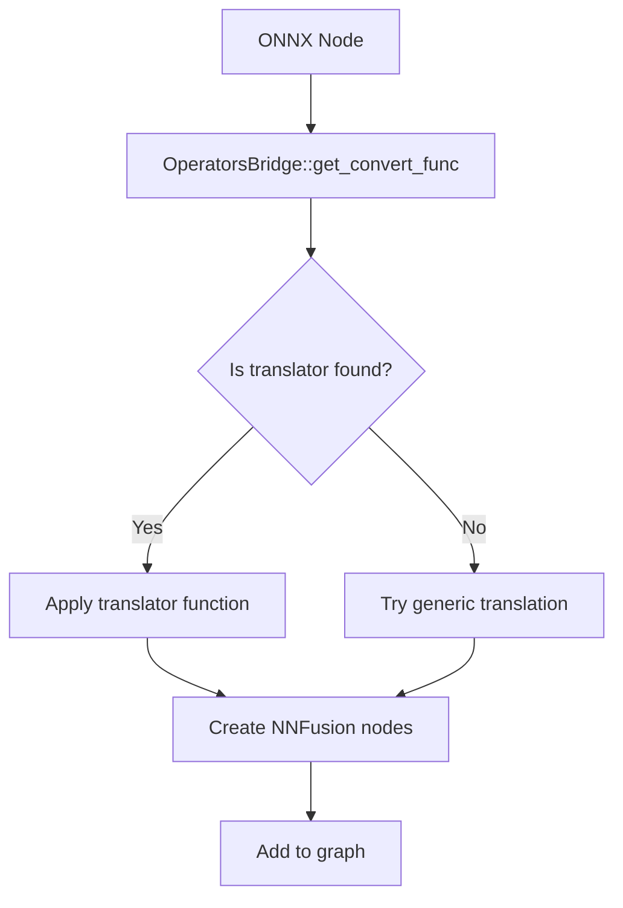

Sources: [src/nnfusion/frontend/onnx_import/util/graph_convert.cpp:517-542](src/nnfusion/frontend/onnx_import/util/graph_convert.cpp:517-542)

### Operator Categories

The supported operators can be broadly categorized as:

1. **Simple Unary Operators**: Translated using template functions
   - Examples: Abs, Relu, Sigmoid, Tanh
   - Pattern: `REGISTER_OPERATOR("Relu", 1, TranslateUnaryOp<op::Relu>);`

2. **Simple Binary Operators**: Translated using template functions
   - Examples: Add, Mul, Div, Sub
   - Pattern: `REGISTER_OPERATOR("Add", 7, TranslateBinaryOp<op::Add>);`

3. **Complex Operators**: Have dedicated translator functions
   - Examples: Conv, BatchNorm, LSTM, Attention
   - Pattern: `REGISTER_OPERATOR("Conv", 1, TranslateConvOp);`

4. **Custom/Unsupported Operators**: Translated to Generic Operators
   - Uses the `TranslateCustomOp` function from [src/nnfusion/frontend/onnx_import/op/custom_op.hpp](src/nnfusion/frontend/onnx_import/op/custom_op.hpp)

## Data Type Handling

NNFusion supports a variety of ONNX data types and converts them to the appropriate NNFusion element types:

| ONNX Data Type | NNFusion Element Type |
|----------------|------------------------|
| FLOAT          | element::f32          |
| FLOAT16        | element::f16          |
| DOUBLE         | element::f64          |
| INT8           | element::i8           |
| INT16          | element::i16          |
| INT32          | element::i32          |
| INT64          | element::i64          |
| UINT8          | element::u8           |
| UINT16         | element::u16          |
| UINT32         | element::u32          |
| UINT64         | element::u64          |
| BOOL           | element::boolean      |

Source: [src/nnfusion/frontend/onnx_import/util/util.cpp:31-78](src/nnfusion/frontend/onnx_import/util/util.cpp:31-78)

## Special Considerations

The ONNX import system includes several special features and handling mechanisms:

1. **External Data Support**: The importer can load tensor data stored in external files.
   - See: [src/nnfusion/frontend/onnx_import/util/graph_convert.cpp:185-226](src/nnfusion/frontend/onnx_import/util/graph_convert.cpp:185-226)

2. **Topological Sorting**: Nodes are sorted to ensure proper execution order.
   - See: [src/nnfusion/frontend/onnx_import/util/graph_convert.cpp:41-153](src/nnfusion/frontend/onnx_import/util/graph_convert.cpp:41-153)

3. **Training Mode**: Special handling for training mode where initializers are treated as parameters.
   - See: [src/nnfusion/frontend/onnx_import/util/graph_convert.cpp:353-369](src/nnfusion/frontend/onnx_import/util/graph_convert.cpp:353-369)

4. **Version Support**: Different ONNX opset versions are supported through version-specific translators.
   - See: ONNX_OPSET_VERSION defined in [src/nnfusion/frontend/onnx_import/CMakeLists.txt:17](src/nnfusion/frontend/onnx_import/CMakeLists.txt:17)

## Usage Example

The ONNX import functionality can be used as follows:

```cpp
// Import a model
auto model = frontend::load_onnx_model("path/to/model.onnx");

// Execute the model with input data
Inputs inputs = {...};  // Model input data
Outputs outputs = execute(model, inputs, "NNFusion");

// Or compile the model for deployment
// ...
```

Source: [test/nnfusion/frontend/onnx_import.cpp:109-122](test/nnfusion/frontend/onnx_import.cpp:109-122)

## Summary

The ONNX import functionality in NNFusion provides a robust bridge between models created in other frameworks and NNFusion's optimization capabilities. By supporting the ONNX standard, NNFusion enables users to leverage models from various sources while benefiting from its performance optimization and code generation features.

Sources: [src/nnfusion/frontend/onnx_import/util/graph_convert.cpp](src/nnfusion/frontend/onnx_import/util/graph_convert.cpp), [src/nnfusion/frontend/onnx_import/ops_bridge.cpp](src/nnfusion/frontend/onnx_import/ops_bridge.cpp), [src/nnfusion/frontend/onnx_import/util/util.cpp](src/nnfusion/frontend/onnx_import/util/util.cpp)

---

# Page: TensorFlow Import

# TensorFlow Import

<details>
<summary>Relevant source files</summary>

The following files were used as context for generating this wiki page:

- [src/nnfusion/core/kernels/cuda_gpu/kernels/depthwise_conv2d.cpp](src/nnfusion/core/kernels/cuda_gpu/kernels/depthwise_conv2d.cpp)
- [src/nnfusion/core/operators/generic_op/generic_op_define/DepthwiseConv2dNative.cpp](src/nnfusion/core/operators/generic_op/generic_op_define/DepthwiseConv2dNative.cpp)
- [src/nnfusion/core/operators/generic_op/generic_op_define/Softmax.cpp](src/nnfusion/core/operators/generic_op/generic_op_define/Softmax.cpp)
- [src/nnfusion/frontend/onnx_import/op/conv.cpp](src/nnfusion/frontend/onnx_import/op/conv.cpp)
- [src/nnfusion/frontend/tensorflow_import/util/graph_convert.cpp](src/nnfusion/frontend/tensorflow_import/util/graph_convert.cpp)

</details>


This document describes the TensorFlow Import system in NNFusion, which enables the compilation and optimization of TensorFlow models. The TensorFlow Import module converts TensorFlow graph definitions into NNFusion's internal graph representation, preserving the computational semantics while enabling the application of NNFusion's optimization passes and code generation capabilities.

## Overview

The TensorFlow Import system is responsible for translating TensorFlow model graphs into NNFusion's internal representation. It parses TensorFlow's NodeDef objects, maps them to equivalent NNFusion operations, and constructs a corresponding graph structure in NNFusion.

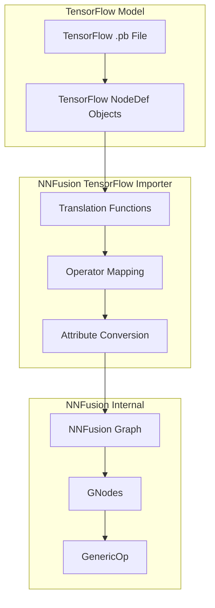

**TensorFlow Import Architecture**

Sources: [src/nnfusion/frontend/tensorflow_import/util/graph_convert.cpp:19-161]()

## Translation Process

The TensorFlow importer translates TensorFlow operations to NNFusion operations through a set of specialized translation functions. Each TensorFlow operation type has a corresponding translation function that handles the specifics of that operation.

### Core Translation Functions

The translation system includes several patterns for handling different types of operations:

1. **Generic Translation** - For operations with no special handling requirements
2. **Identity Translation** - For operations that pass through values unchanged
3. **Unary/Binary Operation Translation** - For mathematical operations with one or two inputs
4. **Specialized Translation** - For complex operations like convolution, pooling, etc.

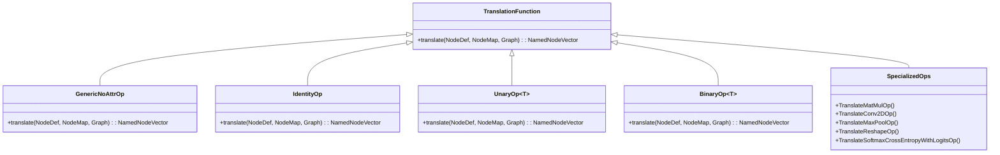

**Translation Function Hierarchy**

Sources: [src/nnfusion/frontend/tensorflow_import/util/graph_convert.cpp:26-83](), [src/nnfusion/frontend/tensorflow_import/util/graph_convert.cpp:85-92](), [src/nnfusion/frontend/tensorflow_import/util/graph_convert.cpp:129-159]()

### Attribute Conversion

TensorFlow operation attributes are converted to NNFusion operation configuration parameters. The system supports various attribute types:

- Strings
- Integers
- Floats
- Booleans
- Data types

```
auto config = nnfusion::op::OpConfig::any{};
for (auto& entry : node.attr()) {
    switch (entry.second.value_case()) {
    case ::tensorflow::AttrValue::ValueCase::kS:
        config[entry.first] = entry.second.s();
        break;
    case ::tensorflow::AttrValue::ValueCase::kI:
        config[entry.first] = entry.second.i();
        break;
    // ... other types
    }
}
```

Sources: [src/nnfusion/frontend/tensorflow_import/util/graph_convert.cpp:36-73]()

## Supported Operations

The TensorFlow Import system supports a wide range of TensorFlow operations, with special handling for many common neural network operations.

### Basic Operations

| Operation Type | Translation Function | Notes |
|----------------|----------------------|-------|
| Identity | TranslateIdentityOp | Simply passes through input node |
| NoOp | TranslateNoOp | Handles control dependencies |
| Cast | TranslateCastOp | Converts data types |
| Reshape | TranslateReshapeOp | Reshapes tensors with shape inference |

Sources: [src/nnfusion/frontend/tensorflow_import/util/graph_convert.cpp:85-92](), [src/nnfusion/frontend/tensorflow_import/util/graph_convert.cpp:111-127](), [src/nnfusion/frontend/tensorflow_import/util/graph_convert.cpp:602-619](), [src/nnfusion/frontend/tensorflow_import/util/graph_convert.cpp:530-600]()

### Mathematical Operations

| Operation Type | Translation Function | Notes |
|----------------|----------------------|-------|
| MatMul | TranslateMatMulOp | Handles transpose_a and transpose_b attributes |
| BatchMatMul | TranslateBatchMatMulOp | Handled via GenericOp |
| BiasAdd | TranslateBiasAddOp | Supports NHWC and NCHW formats |
| Unary Ops (Relu, Tanh, etc.) | TranslateUnaryOp | Template for various unary operations |
| Binary Ops (Add, Mul, etc.) | TranslateBinaryOp | Template for various binary operations |

Sources: [src/nnfusion/frontend/tensorflow_import/util/graph_convert.cpp:313-344](), [src/nnfusion/frontend/tensorflow_import/util/graph_convert.cpp:346-374](), [src/nnfusion/frontend/tensorflow_import/util/graph_convert.cpp:376-431](), [src/nnfusion/frontend/tensorflow_import/util/graph_convert.cpp:129-140](), [src/nnfusion/frontend/tensorflow_import/util/graph_convert.cpp:142-159]()

### Neural Network Operations

| Operation Type | Translation Function | Implementation |
|----------------|----------------------|----------------|
| Conv2D | TranslateConv2DOp | Supports padding, strides, dilations |
| DepthwiseConv2d | Via GenericOp | Custom implementation with CUDA kernel |
| MaxPool | TranslateMaxPoolOp | Supports various data formats and padding |
| Softmax | Via GenericOp | Specialized implementation |
| SparseSoftmaxCrossEntropyWithLogits | TranslateSparseSoftmaxCrossEntropyWithLogitsOp | Translation for loss function |

Sources: [src/nnfusion/frontend/tensorflow_import/util/graph_convert.cpp:707-874](), [src/nnfusion/core/operators/generic_op/generic_op_define/DepthwiseConv2dNative.cpp:6-181](), [src/nnfusion/frontend/tensorflow_import/util/graph_convert.cpp:621-705](), [src/nnfusion/core/operators/generic_op/generic_op_define/Softmax.cpp:6-38](), [src/nnfusion/frontend/tensorflow_import/util/graph_convert.cpp:231-311]()

## Detailed Translation Example

Let's examine how a MatMul operation is translated from TensorFlow to NNFusion:

```mermaid
flowchart TD
    A["TensorFlow MatMul NodeDef"] --> B["Extract input nodes"]
    B --> C["Get 'transpose_a' and 'transpose_b' attributes"]
    C --> D["Create NNFusion Dot operation"]
    D --> E["Set transpose parameters"]
    E --> F["Add node to NNFusion graph"]
    F --> G["Return new GNode"]
```

**MatMul Translation Process**

Sources: [src/nnfusion/frontend/tensorflow_import/util/graph_convert.cpp:313-344]()

The function `TranslateMatMulOp` takes a TensorFlow NodeDef, retrieves the input nodes and required attributes, then creates a NNFusion Dot operation with the appropriate configuration:

1. Get input nodes using `GetInputNode`
2. Retrieve transpose_a and transpose_b attributes
3. Create a Dot operation with the transpose settings
4. Add the operation to the graph
5. Return the new node

## Data Format Handling

TensorFlow primarily uses the NHWC (batch, height, width, channels) data format, while many other frameworks use NCHW. NNFusion supports both formats and provides conversion mechanisms.

```mermaid
graph TD
    A["TensorFlow Model (NHWC)"] --> B["Format Detection"]
    B --> C{"Convert to NCHW?"}
    C -->|Yes| D["Convert Format (BatchToNGraph)"]
    C -->|No| E["Keep Original Format"]
    D --> F["NNFusion Processing"]
    E --> F
    F --> G{"Original format NHWC?"}
    G -->|Yes| H["Convert Back (BatchToTensorflow)"]
    G -->|No| I["Use Result Directly"]
    H --> J["Final Result"]
    I --> J
```

**Data Format Conversion Flow**

Sources: [src/nnfusion/frontend/tensorflow_import/util/graph_convert.cpp:642-706]()

The system can:
1. Detect the input data format
2. Convert between formats as needed
3. Process using the preferred format
4. Convert back to the original format if required

The conversion is controlled by the flag `FLAGS_fnchw`, which determines whether to convert NHWC data to NCHW for internal processing.

## Gradient Operation Support

NNFusion's TensorFlow importer supports gradient operations for backpropagation during training:

| Gradient Operation | Translation Function | Description |
|--------------------|----------------------|-------------|
| ReluGrad | TranslateReluGradOp | Gradient for ReLU operation |
| Relu6Grad | TranslateRelu6GradOp | Gradient for ReLU6 operation |
| SigmoidGrad | TranslateSigmoidGradOp | Gradient for Sigmoid operation |
| BiasAddGrad | TranslateBiasAddGradOp | Gradient for BiasAdd operation |

Sources: [src/nnfusion/frontend/tensorflow_import/util/graph_convert.cpp:433-461](), [src/nnfusion/frontend/tensorflow_import/util/graph_convert.cpp:448-461](), [src/nnfusion/frontend/tensorflow_import/util/graph_convert.cpp:463-475](), [src/nnfusion/frontend/tensorflow_import/util/graph_convert.cpp:477-528]()

## Special Case: Depthwise Convolution

Depthwise convolution is a specialized form of convolution that processes each input channel separately. NNFusion provides a dedicated implementation for this operation:

```mermaid
graph TD
    A["TensorFlow DepthwiseConv2d"] --> B["Extract Parameters"]
    B --> C["Create GenericOp with DepthwiseConv2dNative"]
    C --> D["Set data_format, strides, dilations, padding"]
    D --> E["Register Shape Inference Function"]
    E --> F["Register Translation Function"]
    F --> G["Register CUDA Kernel Implementation"]
```

**Depthwise Convolution Support**

Sources: [src/nnfusion/core/operators/generic_op/generic_op_define/DepthwiseConv2dNative.cpp:6-181](), [src/nnfusion/core/kernels/cuda_gpu/kernels/depthwise_conv2d.cpp:10-377]()

NNFusion implements DepthwiseConv2dNative as a GenericOp with:
1. Shape inference function
2. IR translation function
3. Specialized CUDA kernel implementation for both NHWC and NCHW formats

## Integration with ONNX Import

While distinct systems, the TensorFlow and ONNX importers share similar patterns for handling operations like convolution. The ONNX importer provides insights into how operations can be translated across frameworks:

```mermaid
graph LR
    A["TensorFlow Model"] --> B["TensorFlow Import"]
    C["ONNX Model"] --> D["ONNX Import"]
    B --> E["NNFusion Internal Representation"]
    D --> E
    E --> F["Optimization Passes"]
    F --> G["Code Generation"]
```

**Frontend Import Systems**

Sources: [src/nnfusion/frontend/onnx_import/op/conv.cpp:36-274]()

## Conclusion

The TensorFlow Import system in NNFusion enables efficient translation of TensorFlow models to NNFusion's internal representation, preserving the computational semantics while enabling NNFusion's optimization capabilities. The system supports a wide range of TensorFlow operations and provides specialized handling for complex neural network operations.

For information on importing ONNX models, see the [ONNX Import](#2.1) page.

For details about the Core IR and Graph Representation that TensorFlow models are converted to, see [Core IR and Graph Representation](#3).

---

# Page: PyTorch Integration

# PyTorch Integration

<details>
<summary>Relevant source files</summary>

The following files were used as context for generating this wiki page:

- [models/pytorch2onnx/ort_run_frozen.py](models/pytorch2onnx/ort_run_frozen.py)
- [models/pytorch2onnx/ort_run_frozen_each_layer.py](models/pytorch2onnx/ort_run_frozen_each_layer.py)
- [src/nnfusion/frontend/onnx_import/onnx.cpp](src/nnfusion/frontend/onnx_import/onnx.cpp)
- [src/python/nnfusion/data_format.py](src/python/nnfusion/data_format.py)
- [src/python/nnfusion/description.py](src/python/nnfusion/description.py)
- [src/python/nnfusion/executor.py](src/python/nnfusion/executor.py)
- [src/python/nnfusion/runner.py](src/python/nnfusion/runner.py)
- [src/python/nnfusion/session.py](src/python/nnfusion/session.py)

</details>


This page documents how PyTorch models can be converted, optimized, and executed using NNFusion. The PyTorch integration enables users to benefit from NNFusion's advanced optimization capabilities while maintaining their existing PyTorch workflows.

## Overview

NNFusion provides a seamless integration with PyTorch through a conversion and execution pipeline. The main components of this integration include:

1. **PyTorch to ONNX conversion** - Converting PyTorch models to ONNX format
2. **NNFusion compilation** - Processing the ONNX model through NNFusion's optimization pipeline
3. **Runtime execution** - Executing the optimized model using NNFusion's runtime

### PyTorch Integration Workflow

```mermaid
graph TD
    A["PyTorch Model"] -->|"torch.onnx.export"| B["ONNX Model"]
    B -->|"ONNX Runtime Optimization"| C["Optimized ONNX"]
    C -->|"load_onnx_model"| D["NNFusion IR"]
    D -->|"Optimization Passes"| E["Optimized IR"]
    E -->|"Code Generation"| F["Generated Code"]
    F -->|"Compilation"| G["Runtime Library"]
    G -->|"Executor Interface"| H["Model Execution"]
```

Sources: [src/python/nnfusion/session.py:50-81](), [src/nnfusion/frontend/onnx_import/onnx.cpp:31-108]()

## Key Components

### Core Classes

The PyTorch integration consists of several key classes that handle different aspects of the conversion and execution process:

```mermaid
classDiagram
    class PTRunner {
        +__init__(model, codegen_flags)
        +__call__(*args, **kwargs)
        +run_by_nnf(*args)
    }
    class PTSession {
        +__init__(model, input_desc, device)
        +__call__(feed_data)
        +run_by_nnf(feed_data)
        +run_by_pytorch(feed_data)
    }
    class Executor {
        +__init__(nnf_rt_dir, device)
        +__call__(inputs, outputs)
        +feed_data(inputs, outputs)
        +feed_pointers(signature, params)
    }
    class IODescription {
        +name
        +shape
        +dtype
    }
    class ModelDescription {
        +inputs
        +outputs
    }
    class DataFormat {
        +pointer
        +shape
        +dtype
    }
    
    PTRunner --> PTSession : "creates/uses"
    PTSession --> Executor : "creates/uses"
    PTSession --> ModelDescription : "creates"
    ModelDescription --> IODescription : "contains"
    Executor --> DataFormat : "uses"
```

Sources: [src/python/nnfusion/runner.py:30-91](), [src/python/nnfusion/session.py:107-302](), [src/python/nnfusion/executor.py:70-243]()

## PyTorch to ONNX Conversion

The first step in the PyTorch integration pipeline is converting PyTorch models to the ONNX format, which serves as an intermediate representation.

### Conversion Process

```mermaid
graph LR
    A["PyTorch Model"] -->|"convert_model_to_onnx"| B["Sample Inputs"]
    B --> C["torch.onnx.export"]
    C --> D["ONNX File"]
    D -->|"onnx.checker.check_model"| E["Validated ONNX Model"]
    E -->|"ONNX Runtime"| F["Optimized ONNX Model"]
```

The conversion process is handled by the `convert_model_to_onnx` function in the `PTSession` class. This function:

1. Generates sample inputs based on the provided input descriptions
2. Calls `torch.onnx.export` to convert the PyTorch model to ONNX
3. The ONNX model can optionally be optimized using ONNX Runtime

Sources: [src/python/nnfusion/session.py:50-81](), [models/pytorch2onnx/ort_run_frozen.py:1-137]()

## NNFusion Compilation

After conversion to ONNX, the model is imported into NNFusion, optimized, and compiled into an executable runtime.

### Compilation Process

```mermaid
graph TD
    A["ONNX Model"] -->|"load_onnx_model"| B["NNFusion Graph"]
    B --> C["Code Generation"]
    C -->|"codegen function"| D["Generated C++/CUDA Code"]
    D -->|"cmake & make"| E["Runtime Library"]
```

The compilation process includes:

1. Loading the ONNX model using NNFusion's ONNX importer
2. Applying various optimization passes to the model
3. Generating backend-specific code (CUDA, CPU, etc.)
4. Compiling the generated code into a runtime library

Sources: [src/python/nnfusion/session.py:84-105](), [src/nnfusion/frontend/onnx_import/onnx.cpp:31-108]()

## Execution Interfaces

NNFusion provides several interfaces for executing the optimized PyTorch models:

### PTSession

`PTSession` is the main interface for converting and executing PyTorch models. It handles:

1. Converting the PyTorch model to ONNX
2. Compiling the ONNX model with NNFusion
3. Creating an Executor to run the compiled model
4. Handling the data transfer between PyTorch and NNFusion

Example usage:

```python
# Create a session
session = nnfusion.session.PTSession(
    model=model,                  # PyTorch model
    input_desc=input_desc,        # Input descriptions
    device="cuda:0"               # Execution device
)

# Run the model
outputs = session(feed_data)      # Dictionary of input tensors
```

Sources: [src/python/nnfusion/session.py:107-302]()

### Executor

`Executor` is a lower-level interface that wraps the NNFusion runtime library:

1. Loads the compiled NNFusion runtime library
2. Initializes the runtime environment
3. Parses the model's input and output information
4. Handles data conversion between PyTorch tensors and NNFusion's format
5. Executes the model using the runtime library

Sources: [src/python/nnfusion/executor.py:70-243]()

### PTRunner

`PTRunner` provides a higher-level interface that caches sessions for different input shapes:

1. Creates and caches `PTSession` instances for different input configurations
2. Automatically selects or creates the appropriate session when called
3. Simplifies the execution of models with varying input shapes

Example usage:

```python
# Create a runner
runner = nnfusion.runner.PTRunner(
    model=model,                  # PyTorch model
    codegen_flags={...}           # NNFusion codegen flags
)

# Run the model with any input shape
outputs = runner(*inputs)         # PyTorch tensors
```

Sources: [src/python/nnfusion/runner.py:30-91]()

## Execution Flow

The following sequence diagram illustrates the execution flow when running a PyTorch model with NNFusion:

```mermaid
sequenceDiagram
    participant U as "User"
    participant R as "PTRunner"
    participant S as "PTSession"
    participant E as "Executor"
    participant N as "NNFusion Runtime"
    
    U->>R: __call__(*args)
    R->>R: Extract tensor descriptions
    R->>S: _retrieve_by_desc(descs, device)
    R->>S: __call__(feeds)
    S->>S: run_by_nnf(feed_data)
    S->>E: _executor(inputs, outputs)
    E->>E: feed_data(inputs, outputs)
    E->>E: feed_pointers(signature, params)
    E->>N: kernel_entry(*params)
    N-->>E: Execution completes
    E-->>S: Return via outputs
    S-->>R: Return output tensors
    R-->>U: Return results
```

Sources: [src/python/nnfusion/runner.py:63-90](), [src/python/nnfusion/session.py:262-290](), [src/python/nnfusion/executor.py:179-230]()

## Data Format Conversion

NNFusion provides utilities for converting data between PyTorch tensors and NNFusion's internal data format:

### Tensor Conversion Flow

```mermaid
graph LR
    A["PyTorch Tensor"] -->|"cast_pytorch_tensor"| B["DataFormat"]
    B -->|"Executor.feed_data"| C["Pointer Conversion"]
    C -->|"NNFusion Runtime"| D["Kernel Execution"]
```

The `cast_pytorch_tensor` function converts PyTorch tensors to NNFusion's `DataFormat`, which includes:

- A pointer to the tensor data
- The tensor's shape and data type
- A reference to the original PyTorch tensor

Sources: [src/python/nnfusion/data_format.py:9-62]()

## Data Type Handling

The following table shows the mapping between PyTorch tensor types and NNFusion data types:

| PyTorch Type | NNFusion Type |
|--------------|---------------|
| float32      | float32       |
| float64      | float64       |
| float16      | float16       |
| int32        | int32         |
| int64        | int64         |
| int16        | int16         |
| int8         | int8          |
| uint8        | uint8         |
| bool         | bool          |

The type conversion is handled automatically during the conversion process.

Sources: [src/python/nnfusion/executor.py:35-64](), [models/pytorch2onnx/ort_run_frozen.py:37-64]()

## Summary

The PyTorch integration in NNFusion provides a powerful way to optimize PyTorch models for faster execution. By converting PyTorch models to ONNX and then leveraging NNFusion's optimization capabilities, users can achieve significant performance improvements while maintaining their existing PyTorch workflows.

Key benefits include:
- Seamless integration with existing PyTorch models
- Advanced optimization capabilities through NNFusion
- Support for multiple backends (CUDA, CPU, etc.)
- Easy-to-use Python interfaces

The `PTSession` and `PTRunner` classes provide convenient interfaces for converting and executing PyTorch models with NNFusion, making it easy to integrate NNFusion into existing PyTorch workflows.

---

# Page: Core IR and Graph Representation

# Core IR and Graph Representation

<details>
<summary>Relevant source files</summary>

The following files were used as context for generating this wiki page:

- [docs/Compile-a-model-with-kernel-tuning-enabled.md](docs/Compile-a-model-with-kernel-tuning-enabled.md)
- [src/nnfusion/common/descriptor/tensor.cpp](src/nnfusion/common/descriptor/tensor.cpp)
- [src/nnfusion/common/descriptor/tensor.hpp](src/nnfusion/common/descriptor/tensor.hpp)
- [src/nnfusion/core/operators/generic_op/generic_op.hpp](src/nnfusion/core/operators/generic_op/generic_op.hpp)
- [src/nnfusion/core/operators/generic_op/op_registration.cpp](src/nnfusion/core/operators/generic_op/op_registration.cpp)
- [src/nnfusion/core/operators/op_define/fused.cpp](src/nnfusion/core/operators/op_define/fused.cpp)
- [src/nnfusion/core/operators/op_define/fused.hpp](src/nnfusion/core/operators/op_define/fused.hpp)
- [src/nnfusion/engine/pass/extract_graph_signature.cpp](src/nnfusion/engine/pass/extract_graph_signature.cpp)
- [src/nnfusion/engine/pass/graph/op_inplace_pass.cpp](src/nnfusion/engine/pass/graph/op_inplace_pass.cpp)
- [src/nnfusion/frontend/onnx_import/op/gemm.cpp](src/nnfusion/frontend/onnx_import/op/gemm.cpp)
- [src/tools/nnfusion/extensions/Slice](src/tools/nnfusion/extensions/Slice)

</details>


## Purpose and Overview

This document describes the internal representation (IR) and graph structure used by NNFusion to represent deep learning models. The Core IR serves as the central data structure that connects the frontend import systems with backend code generation and optimization passes.

The Core IR is based on a computational graph model where operations (represented as nodes) are connected through data dependencies (represented as edges). This representation enables powerful graph-based optimizations and transformations while maintaining a clean abstraction of the underlying computation.

For information about how models are imported into this representation, see [Frontend Systems](#2).

## Graph Structure

The NNFusion Core IR is structured as a directed graph where each node (GNode) represents an operation and edges represent data flow between operations.

```mermaid
classDiagram
    class Graph {
        +vector~GNodePtr~ nodes
        +vector~GNodePtr~ outputs
        +vector~GNodePtr~ parameters
        +add_node()
        +add_edge()
        +get_ordered_ops()
    }
    
    class GNode {
        +vector~descriptor::Tensor~ outputs
        +vector~Edge~ in_edges
        +vector~Edge~ out_edges
        +shared_ptr~Op~ op_ptr
        +get_output_tensor()
        +get_input_shape()
        +get_input_element_type()
        +set_output_type_and_shape()
    }
    
    class Edge {
        +GNodePtr src
        +GNodePtr dst
        +size_t src_output
        +size_t dst_input
        +bool is_control_edge()
    }
    
    class Op {
        +string op_type
        +validate_and_infer_types()
        +get_op_annotations()
    }
    
    Graph "1" *-- "many" GNode : contains
    GNode "1" *-- "many" Edge : has
    GNode "1" o-- "1" Op : has-operation
```

Key components of the graph structure:

1. **GNode**: Represents a computational node in the graph, holding information about its operation, inputs, and outputs
2. **Edge**: Connects nodes with directional data flow, specifying which output of the source node connects to which input of the destination node
3. **Graph**: Contains and manages the entire collection of nodes and their connections

Sources: [src/nnfusion/core/operators/generic_op/generic_op.hpp:315-456](), [src/nnfusion/engine/pass/extract_graph_signature.cpp:42-128]()

## Generic Operators Framework

The core of NNFusion's IR is the Generic Operator framework, which provides a unified representation for all operations.

```mermaid
classDiagram
    class Op {
        +string op_type
        +validate_and_infer_types()
        +get_op_annotations()
    }
    
    class GenericOp {
        +OpConfig localOpConfig
        +string m_expression
        +validate_and_infer_types()
        +infer_shared_memory()
    }
    
    class OpConfig {
        +any j_attrs
        +map~string, kernel_func_t~ f_kernel_funcs
        +infershape_func_t f_infershape
        +translate_func_t f_translate
        +translate_func_t_v2 f_translate_v2
        +attr()
        +infershape()
        +translate()
        +antares_ir()
    }
    
    Op <|-- GenericOp : extends
    GenericOp "1" *-- "1" OpConfig : has-config
```

### Operator Registration and Configuration

The Generic Operator system uses a registration mechanism to define operations with their properties:

```
REGISTER_OP(operation_name)
```

The `OpConfig` class provides a fluent interface to configure operations with:
- Shape inference functions (`infershape`)
- Translation functions for code generation (`translate`, `translate_v2`)
- Kernel implementation functions for different backends (`cuda_kernel`, `cpu_kernel`, etc.)
- Attributes and constraints

Example configuration from the codebase:

```
// Sample operator registration pattern
REGISTER_OP(MyOp)
    .attr("attribute1", value1)
    .attr("attribute2", value2)
    .infershape(my_infershape_function)
    .translate_v2(my_translation_function)
    .cuda_kernel(my_kernel_function, {launch_config})
```

The registered operations are stored in a global registry accessed via `get_op_configs()`.

Sources: [src/nnfusion/core/operators/generic_op/generic_op.hpp:54-198](), [src/nnfusion/core/operators/generic_op/op_registration.cpp:10-109]()

## Expression IR and Translation

NNFusion uses textual expressions to represent operations in an intermediate form before generating backend code. This representation is crucial for optimization and code generation.

### Translation Process

```mermaid
flowchart TD
    A["Frontend Model \n(TF/ONNX/PyTorch)"] --> B["Graph of GNodes \nwith GenericOps"]
    B --> C["IR Expression \n(Einstein/Antares)"]
    C --> D["Backend Code \n(CUDA/CPU/HLSL)"]
    
    subgraph "IR Translation"
        E["translate_v2() function"] --> F["Generates Antares IR"]
        F --> G["Expression for inputs/outputs"]
        G --> H["Template substitution"]
    end
```

The translation process:

1. Each `GenericOp` can provide a translation function that converts the operation to a string-based IR
2. Two translation mechanisms are supported:
   - `f_translate`: Original translation mechanism
   - `f_translate_v2`: Enhanced translation mechanism with better templating support
3. The expressions can include annotations for optimization hints and performance plans

For example, a matrix multiplication operation might be translated to an expression like:
```
output0[N0, N2] += input0[N0, N1] * input1[N1, N2] where N0 in 128, N1 in 256, N2 in 512
```

Sources: [src/nnfusion/core/operators/generic_op/generic_op.hpp:99-115](), [src/nnfusion/core/operators/generic_op/op_registration.cpp:16-109](), [src/tools/nnfusion/extensions/Slice:1-19]()

## Tensor Representation

Tensors are the primary data structure in NNFusion's IR, representing both inputs/outputs of operations and intermediate results.

```mermaid
classDiagram
    class Tensor {
        +element::Type m_element_type
        +Shape m_shape
        +PartialShape m_partial_shape
        +string m_name
        +bool m_persistent
        +bool m_constant
        +bool m_parameter
        +size_t m_pool_offset
        +string m_pool
        +get_name()
        +get_shape()
        +set_tensor_type()
        +size()
    }
    
    class TensorLayout {
        +get_shape()
        +get_element_type()
        +get_size()
    }
    
    class GNode {
        +vector~Tensor~ outputs
        +get_output_tensor()
        +get_input_tensor_ptr()
    }
    
    Tensor "0..1" o-- "1" TensorLayout : has-layout
    GNode "1" *-- "many" Tensor : has-outputs
```

Key aspects of tensor representation:

1. **Element Type**: Data type of tensor elements (float32, int32, etc.)
2. **Shape**: Dimensions of the tensor
3. **Memory Management**:
   - Pool allocation with offsets
   - Support for persistent, constant, and parameter tensors
4. **Device Placement**: Information about which device holds the tensor data
5. **Tensor Identity**: Unique naming and identification

Tensors can be rooted in:
- Parameter nodes (inputs to the graph)
- Constant nodes (embedded values)
- Intermediate operation outputs

Sources: [src/nnfusion/common/descriptor/tensor.hpp:40-152](), [src/nnfusion/common/descriptor/tensor.cpp:27-209]()

## Operator Fusion Representation

NNFusion supports operator fusion to optimize performance by combining multiple operations into a single optimized kernel.

```mermaid
flowchart TD
    A["Individual Operations"] --> B["Fusion Detection"]
    B --> C["Fused Operator"]
    C --> D["Combined IR Expression"]
    D --> E["Single Optimized Kernel"]
    
    subgraph "Fusion Process"
        F["Collect operations"] --> G["register_ir2()"]
        G --> H["Create combined expression"]
        H --> I["Apply optimization plans"]
    end
```

The `Fused` operator class handles:

1. Combining multiple operations into a single logical operator
2. Generating a combined IR expression that represents the fused computation
3. Preserving input/output relationships with the rest of the graph
4. Providing optimization hints through plan rules

Fusion is a critical optimization that reduces kernel launch overhead and improves data locality.

Sources: [src/nnfusion/core/operators/op_define/fused.hpp:25-44](), [src/nnfusion/core/operators/op_define/fused.cpp:27-234]()

## In-Place Operations

NNFusion supports in-place operations to optimize memory usage by allowing operations to modify their inputs directly.

```mermaid
flowchart TD
    A["Operation Detection"] --> B["In-Place Annotation"]
    B --> C["Memory Reuse"]
    C --> D["Variable Name Forwarding"]
    
    subgraph "In-Place Optimizations"
        E["AddInplace() annotation"] --> F["Propagate through graph"]
        F --> G["Update variable references"]
    end
```

The `OpInplacePass` identifies operators that can perform in-place computation and annotates them accordingly. This information is then used during code generation to reuse memory buffers.

Common in-place operations include:
- Element-wise operations
- Reshaping without layout changes
- Result operations (output nodes)

Sources: [src/nnfusion/engine/pass/graph/op_inplace_pass.cpp:22-109]()

## IR to Backend Translation

The Core IR serves as a bridge between frontend model importers and backend code generators. The translation process involves:

1. **Graph Analysis**:
   - Extracting signature information (inputs, outputs, constants)
   - Identifying data dependencies
   - Determining memory requirements

2. **IR Expression Extraction**:
   - Getting expressions for each operation
   - Applying annotations and optimization hints

3. **Code Generation**:
   - Backend-specific kernel emission
   - Memory allocation and management
   - Data movement and synchronization

The entire process preserves the computational semantics of the original model while enabling optimizations specific to the target platform.

Sources: [src/nnfusion/engine/pass/extract_graph_signature.cpp:130-238]()

## Relation to Other Components

The Core IR and graph representation is the centerpiece of the NNFusion architecture, connecting:

- **Frontend Importers**: Convert external model formats into the Core IR
- **Optimization Passes**: Transform the graph to improve performance
- **Backend Code Generators**: Convert the IR into executable code for different targets

This central position allows NNFusion to support multiple frontend frameworks and backend targets while sharing common optimizations and transformations.

---

# Page: Generic Operators

# Generic Operators

<details>
<summary>Relevant source files</summary>

The following files were used as context for generating this wiki page:

- [src/nnfusion/core/operators/generic_op/generic_op.hpp](src/nnfusion/core/operators/generic_op/generic_op.hpp)
- [src/nnfusion/core/operators/generic_op/op_registration.cpp](src/nnfusion/core/operators/generic_op/op_registration.cpp)
- [src/nnfusion/engine/pass/graph/op_inplace_pass.cpp](src/nnfusion/engine/pass/graph/op_inplace_pass.cpp)
- [src/tools/nnfusion/extensions/Slice](src/tools/nnfusion/extensions/Slice)

</details>


This document details NNFusion's Generic Operator framework, which provides a flexible system for defining, registering, and implementing neural network operations across various hardware targets. Generic Operators are a core component of NNFusion's Intermediate Representation (IR) layer, bridging the gap between imported model formats and hardware-specific code generation.

For information about tensors and memory management, see [Tensors and Memory](#3.2). For information about optimization passes that work with Generic Operators, see [Optimization Passes](#4).

## Core Architecture

The Generic Operator framework consists of two primary classes that work together to provide a comprehensive abstraction for neural network operations:

```mermaid
classDiagram
    class Op {
        +string op_type
        +validate_and_infer_types(GNode)
        +infer_shared_memory(GNode)
    }
    
    class OpConfig {
        +any j_attrs
        +vector~constrait_func_t~ f_constraits
        +infershape_func_t f_infershape
        +infersharedmemory_func_t f_infersharedmemory
        +translate_func_t f_translate
        +translate_func_t_v2 f_translate_v2
        +map~string, kernel_func_t~ f_kernel_funcs
        +attr(name, val)
        +constrait(func)
        +infershape(func)
        +translate(func)
        +translate_v2(func)
        +cuda_kernel(func, config)
        +cpu_kernel(func)
        +hlsl_kernel(func, config)
    }
    
    class GenericOp {
        +OpConfig localOpConfig
        +string m_expression
        +validate_and_infer_types(GNode)
        +infer_shared_memory(GNode)
        +serialize()
        +deserialize(json)
    }
    
    Op <|-- GenericOp
    GenericOp --> OpConfig : uses
```

Sources: [src/nnfusion/core/operators/generic_op/generic_op.hpp:54-171](), [src/nnfusion/core/operators/generic_op/generic_op.hpp:315-455]()

### OpConfig Class

`OpConfig` is a configuration class that stores and manages operator attributes, constraints, inference functions, translation functions, and kernel implementations.

Key capabilities of `OpConfig` include:

1. **Attribute Management**: Add custom attributes using the `attr(name, value)` method
2. **Constraint Specification**: Add validation constraints with the `constrait(func)` method
3. **Shape Inference**: Set shape inference logic with `infershape(func)`
4. **Shared Memory Inference**: Set shared memory requirements with `infersharedmemory(func)`
5. **Translation Functions**: Define how to translate to Antares IR with `translate(func)` or `translate_v2(func)`
6. **Backend-Specific Implementations**: Configure kernels for different backends:
   - CUDA: `cuda_kernel(func, config)`
   - CPU: `cpu_kernel(func)`
   - HLSL/DirectX: `hlsl_kernel(func, config)`

Sources: [src/nnfusion/core/operators/generic_op/generic_op.hpp:54-171]()

### GenericOp Class

`GenericOp` inherits from the base `Op` class and uses an `OpConfig` instance to define its behavior. Key methods include:

1. **Construction**: Takes an operator name, type, and custom configuration
2. **Type and Shape Inference**: Implements `validate_and_infer_types` to determine output shapes
3. **Shared Memory Inference**: Implements `infer_shared_memory` for shared memory requirements
4. **Serialization**: Supports serialization/deserialization to/from JSON

Sources: [src/nnfusion/core/operators/generic_op/generic_op.hpp:315-455]()

## Operator Registration and Lookup

The Generic Operator framework provides mechanisms for registering and looking up operators:

```mermaid
flowchart TD
    A["REGISTER_OP(op_name)"] --> B["build_op_config(op_name)"]
    B --> C["Add to global op_configs map"]
    D["lookup_op_config(op_name)"] --> E{"Is op registered?"}
    E -->|"Yes"| F["Return existing OpConfig"]
    E -->|"No"| G["Create new OpConfig"]
    G --> C
    H["GenericOp constructor"] --> D
```

Sources: [src/nnfusion/core/operators/generic_op/generic_op.hpp:173-199](), [src/nnfusion/core/operators/generic_op/op_registration.cpp:10-14]()

### Registration Macro

Operators are registered using the `REGISTER_OP` macro, which creates an `OpConfig` instance and adds it to the global operators map:

```cpp
#define REGISTER_OP(op_x)                                                                          \
    static nnfusion::op::OpConfig __register_op_##op_x = nnfusion::op::build_op_config(#op_x)
```

Sources: [src/nnfusion/core/operators/generic_op/generic_op.hpp:13-14]()

### Global Operator Registry

All registered operators are stored in a global static map, accessed via the `get_op_configs()` function:

```cpp
std::unordered_map<std::string, OpConfig>& get_op_configs()
{
    static std::unordered_map<std::string, OpConfig> __op_configs;
    return __op_configs;
}
```

Sources: [src/nnfusion/core/operators/generic_op/op_registration.cpp:10-14]()

## Shape Inference System

Shape inference is a critical component of the Generic Operator framework. It determines the output tensor shapes based on input shapes and operator attributes.

### Default Shape Inference Functions

The framework provides several default shape inference functions:

1. **Copy Shapes**: Simply copies input shapes to outputs
   ```cpp
   inline void copy_shape_from_inputs(std::shared_ptr<graph::GNode> gnode)
   {
       for (int i = 0; i < gnode->get_input_size(); ++i)
       {
           gnode->set_output_type_and_shape(
               0, gnode->get_input_element_type(i), gnode->get_input_shape(i));
       }
   }
   ```

2. **Boolean Output**: Copies input shapes but sets output type to boolean
   ```cpp
   inline void copy_shape_from_inputs_with_boolean(std::shared_ptr<graph::GNode> gnode)
   {
       for (int i = 0; i < gnode->get_input_size(); ++i)
       {
           gnode->set_output_type_and_shape(
               0, nnfusion::element::boolean, gnode->get_input_shape(i));
       }
   }
   ```

Sources: [src/nnfusion/core/operators/generic_op/generic_op.hpp:24-52]()

### Advanced Shape Inference

For operators with complex shape transformations, custom shape inference functions can be provided. If no shape inference function is provided, NNFusion will attempt to infer shapes through Antares IR execution.

Sources: [src/nnfusion/core/operators/generic_op/generic_op.hpp:348-441]()

## Translation to Antares IR

The Generic Operator framework provides a translation mechanism that converts operator nodes to Antares IR for code generation and auto-tuning.

```mermaid
flowchart TD
    A["get_translation(GNode)"] --> B["get_translation_v2(GNode)"]
    B --> C{"Check extension IR"}
    C -->|"Found"| D["Return extension IR"]
    C -->|"Not found"| E{"Check f_translate_v2"}
    E -->|"Found"| F["Execute f_translate_v2"]
    E -->|"Not found"| G["Return empty string"]
    A --> H{"Check original translation"}
    H -->|"Found"| I["Execute f_translate"]
    H -->|"Not found"| J["Return empty string"]
    F --> K["Generate input/output code"]
    I --> K
    K --> L["Return final IR string"]
```

Sources: [src/nnfusion/core/operators/generic_op/op_registration.cpp:17-109]()

### Translation Functions

There are two kinds of translation functions:
1. **Original Translation (`f_translate`)**: The first-generation translation function
2. **Advanced Translation (`f_translate_v2`)**: The second-generation translation function that generates Antares-compatible IR

Sources: [src/nnfusion/core/operators/generic_op/generic_op.hpp:99-115](), [src/nnfusion/core/operators/generic_op/op_registration.cpp:17-109]()

### Extension Mechanism

The framework supports an extension mechanism through the `get_ir_via_extension` function. This allows external scripts to generate IR code for operators:

```mermaid
flowchart TD
    A["get_ir_via_extension(GNode)"] --> B["Check environment variables"]
    B --> C["Prepare input message in JSON"]
    C --> D["Execute extension script"]
    D --> E["Return IR string from script output"]
```

Sources: [src/nnfusion/core/operators/generic_op/op_registration.cpp:135-197](), [src/tools/nnfusion/extensions/Slice:1-19]()

## In-place Operation Support

The Generic Operator framework supports in-place operations, which can improve memory efficiency by reusing input memory for outputs.

```mermaid
flowchart TD
    A["OpInplacePass"] --> B["Iterate through graph nodes"]
    B --> C{"Operator type check"}
    C --> D["Result Operator"]
    C --> E["ElementwiseArithmetic"]
    C --> F["Select"]
    C --> G["AddN (GenericOp)"]
    C --> H["ApplyGradient (GenericOp)"]
    C --> I["Reshape (if not layout change)"]
    C --> J["Broadcast (if empty axes)"]
    C --> K["Operations with |memcpy| annotation"]
    D --> L["AddInplace(op, 0, 0, false)"]
    E --> L
    F --> M["AddInplace(op, 0, 1, true)"]
    G --> L
    H --> N["AddInplace(op, 0, 0, true, true)"]
    I --> L
    J --> L
    K --> L
```

Sources: [src/nnfusion/engine/pass/graph/op_inplace_pass.cpp:22-109]()

## Code Generation Templates

The framework includes utilities for generating code from templates using a simple placeholder replacement mechanism:

```cpp
inline std::string create_code_from_template(std::string templ,
                                           const OpConfig::any& feed_dict)
{
    std::unordered_map<std::string, std::string> feed_pairs;
    for (auto& it : feed_dict.items())
    {
        // Convert values to strings
        std::string value;
        if (it.value().is_string())
            value = it.value();
        else if (it.value().is_null())
            value = "NULL";
        else if (it.value().is_number_float())
        {
            // Handle floating point values precisely
            std::stringstream ss;
            ss.flags(std::ios_base::scientific);
            ss << std::setprecision(std::numeric_limits<float>::digits)
               << (float)it.value();
            value = ss.str();
        }
        else
        {
            std::stringstream ss;
            ss << it.value();
            value = ss.str();
        }
        feed_pairs.insert(std::make_pair("@" + it.key() + "@", value));
    }

    // Replace all placeholders in the template
    int at = templ.find("@");
    while (true)
    {
        int cur_at = templ.find("@", at + 1);
        if (cur_at == std::string::npos || at == std::string::npos)
            break;
        auto placeholder = templ.substr(at, cur_at - at + 1);
        auto feed_pair = feed_pairs.find(placeholder);
        if (feed_pair != feed_pairs.end())
        {
            templ = templ.substr(0, at) + feed_pair->second + templ.substr(cur_at + 1);
            at += feed_pair->second.size();
        }
        else
        {
            at = cur_at;
        }
    }
    return std::move(templ);
}
```

Sources: [src/nnfusion/core/operators/generic_op/generic_op.hpp:210-260]()

## Operator Annotation System

The framework includes an annotation system that allows operators to specify additional properties or hints for code generation and optimization:

```cpp
std::string get_annotation(std::string translation)
{
    std::string options;
    const char annotation[] = "## @: ";
    int pos = translation.find(annotation);
    if (pos >= 0)
    {
        pos += sizeof(annotation) - 1;
        options = translation.substr(pos);
        options.erase(remove(options.begin(), options.end(), ' '), options.end());
        std::replace(options.begin(), options.end(), ',', '|');
    }

    if (options.size() > 0)
    {
        if (options[0] != '|')
            options = "|" + options;
        if (options.back() != '|')
            options += "|";
    }

    return options;
}
```

Sources: [src/nnfusion/core/operators/generic_op/op_registration.cpp:111-133]()

## Integration with NNFusion Framework

The Generic Operator framework is a central component of NNFusion's IR layer, connecting high-level model representations with backend-specific code generation:

```mermaid
flowchart TD
    subgraph "Frontend Layer"
        A1["TensorFlow Model"] --> B1["TensorFlow Importer"]
        A2["ONNX Model"] --> B2["ONNX Importer"]
        A3["PyTorch Model"] --> B3["PyTorch Converter"]
    end
    
    subgraph "IR Layer"
        C["Graph Representation"]
        D["GNode Instances"]
        E["GenericOp Operators"]
    end
    
    subgraph "Optimization Layer"
        F["Kernel Tuning Pass"]
        G["Kernel Fusion Pass"]
        H["Block Fusion Pass"]
        I["OpInplacePass"]
    end
    
    subgraph "Code Generation Layer"
        J["CUDA Codegen"]
        K["CPU Codegen"]
        L["HLSL Codegen"]
        M["ROCm Codegen"]
    end
    
    B1 --> C
    B2 --> C
    B3 --> C
    C --> D
    D --> E
    E --> F
    E --> G
    E --> H
    E --> I
    F --> J
    G --> J
    H --> J
    I --> J
    F --> K
    G --> K
    H --> K
    I --> K
    F --> L
    G --> L
    H --> L
    I --> L
    F --> M
    G --> M
    H --> M
    I --> M
```

Sources: [src/nnfusion/core/operators/generic_op/generic_op.hpp:315-455](), [src/nnfusion/engine/pass/graph/op_inplace_pass.cpp:22-109]()

## Usage Examples

### 1. Registering a New Operator

To register a new operator, use the `REGISTER_OP` macro followed by method chaining:

```cpp
REGISTER_OP(MyCustomOp)
    .attr("dimensions", {1, 2, 3})  // Add custom attributes
    .infershape(my_shape_inference_function)  // Set shape inference
    .translate_v2([](std::shared_ptr<graph::GNode> gnode) -> std::string {
        // Generate Antares IR code
        return "output0[N0, N1] = input0[N0, N1] * input1[N0, N1] where N0 in 64, N1 in 128;";
    })
    .cuda_kernel(my_cuda_kernel_function, {32, 32, 1});  // Set CUDA kernel
```

### 2. Using a GenericOp in a Graph

To create and use a GenericOp instance:

```cpp
// Custom configuration
OpConfig::any custom_config;
custom_config["dimensions"] = {1, 2, 3};

// Create operator instance
auto op = std::make_shared<GenericOp>("instance_name", "MyCustomOp", custom_config);

// Create graph node using this operator
auto node = graph->add_node(op, inputs);
```

### 3. Example: Slice Operator Extension

The Slice operator is implemented as an extension script that generates Antares IR:

```python
#!/usr/bin/env python3
import sys, json
op_v2 = json.loads(sys.argv[1])
inputs, config = op_v2["input_dict"], op_v2["config"]
output_name = op_v2["output_name"]
where_range = [x for x in inputs[0]["shape"]]
in_items, out_items = [f'N{i}' for i in range(len(where_range))], [f'N{i}' for i in range(len(where_range))]
for dim, start, end, stride in zip(config["axes"], config["starts"], config["ends"], config["steps"]):
  if dim < 0:
    dim += len(where_range)
  if start > where_range[dim]:
    start = where_range[dim]
  if end > where_range[dim]:
    end = where_range[dim]
  in_items[dim] = f'''{start} + ({stride}) * {in_items[dim]}'''
  where_range[dim] = (end - start) // stride
  assert where_range[dim] > 0
where_range = [f'N{i} in {x}' for i, x in enumerate(where_range)]
print(f'''{output_name}[{", ".join(out_items)}] = {inputs[0]["name"]}[{", ".join(in_items)}] where {", ".join(where_range)}; ''')
```

Sources: [src/tools/nnfusion/extensions/Slice:1-19]()

## Summary

The Generic Operator framework provides a flexible and extensible system for defining, registering, and implementing neural network operations in NNFusion. Key features include:

1. **Flexible Configuration**: Operators can be configured with various attributes, constraints, and functions
2. **Shape Inference**: Automatic and custom inference of output shapes
3. **Multiple Translation Paths**: Support for original and Antares-compatible IR
4. **Extension Mechanism**: External scripts for operator implementation
5. **Backend Support**: Configurable kernels for CUDA, CPU, and HLSL/DirectX
6. **In-place Operations**: Memory optimization through in-place execution
7. **Code Generation**: Template-based code generation utilities

The framework serves as a critical layer in NNFusion, enabling the compiler to generate optimized code for a wide range of neural network operations across different hardware targets.

---

# Page: Tensors and Memory

# Tensors and Memory

<details>
<summary>Relevant source files</summary>

The following files were used as context for generating this wiki page:

- [docs/Compile-a-model-with-kernel-tuning-enabled.md](docs/Compile-a-model-with-kernel-tuning-enabled.md)
- [src/nnfusion/common/descriptor/tensor.cpp](src/nnfusion/common/descriptor/tensor.cpp)
- [src/nnfusion/common/descriptor/tensor.hpp](src/nnfusion/common/descriptor/tensor.hpp)
- [src/nnfusion/core/operators/op_define/fused.cpp](src/nnfusion/core/operators/op_define/fused.cpp)
- [src/nnfusion/core/operators/op_define/fused.hpp](src/nnfusion/core/operators/op_define/fused.hpp)
- [src/nnfusion/engine/pass/extract_graph_signature.cpp](src/nnfusion/engine/pass/extract_graph_signature.cpp)
- [src/nnfusion/frontend/onnx_import/op/gemm.cpp](src/nnfusion/frontend/onnx_import/op/gemm.cpp)

</details>


This document explains how tensors are represented and how memory is managed in the NNFusion compiler framework. It describes the data structures and mechanisms used to handle tensor data throughout the compilation process, from frontend import to backend code generation.

For information about generic operators that work with these tensors, see [Generic Operators](#3.1).

## Tensor Representation Overview

In NNFusion, tensors are the fundamental data structures that represent multi-dimensional arrays of values used in deep learning models. The tensor system provides a flexible and efficient way to manage these data structures across different devices and memory spaces.

```mermaid
classDiagram
    class Tensor {
        +element::Type m_element_type
        +Shape m_shape
        +PartialShape m_partial_shape
        +string m_name
        +string m_unique_name
        +TensorLayout m_tensor_layout
        +bool m_persistent
        +bool m_constant
        +bool m_parameter
        +bool m_RDMA
        +size_t m_pool_offset
        +string m_pool
        +NNFusion_DeviceType m_device_type
        +int m_device_id
        +get_name()
        +get_shape()
        +set_pool_offset()
        +size()
    }
    
    class TensorLayout {
        +get_shape()
        +get_element_type()
        +get_size()
    }
    
    Tensor --> TensorLayout: has
```

Sources: [src/nnfusion/common/descriptor/tensor.hpp:40-150](), [src/nnfusion/common/descriptor/tensor.cpp:27-54]()

## Core Tensor Class

The `Tensor` class is defined in the `nnfusion::descriptor` namespace and is the primary data structure for representing tensor data in NNFusion. A tensor encapsulates:

1. **Data Type** - The element type of the tensor (e.g., float32, int64)
2. **Shape** - The dimensions of the tensor
3. **Memory Location** - Where the tensor data is stored
4. **Device Information** - Which device the tensor is allocated on
5. **Properties** - Flags indicating the tensor's characteristics

Tensor instances are usually stored and passed as shared pointers (`std::shared_ptr<Tensor>`) throughout the codebase to ensure proper memory management.

```mermaid
graph TD
    subgraph "Tensor Attributes"
        A["Element Type<br>(float32, int32, etc.)"]
        B["Shape<br>(dimensions)"]
        C["Memory Location<br>(pool, offset)"]
        D["Device Info<br>(CPU, CUDA, etc.)"]
        E["Properties<br>(constant, parameter, etc.)"]
    end
    
    subgraph "Tensor Methods"
        F["get_name()"]
        G["get_shape()"]
        H["get_element_type()"]
        I["size()"]
        J["get_pool()/get_pool_offset()"]
    end
    
    Tensor --- A
    Tensor --- B
    Tensor --- C
    Tensor --- D
    Tensor --- E
    Tensor --- F
    Tensor --- G
    Tensor --- H
    Tensor --- I
    Tensor --- J
```

Sources: [src/nnfusion/common/descriptor/tensor.hpp:40-150](), [src/nnfusion/common/descriptor/tensor.cpp:27-54]()

## Tensor Creation and Properties

Tensors are created during different phases of the compilation process:

1. **Model Import** - Created when importing models from frameworks like TensorFlow, ONNX, or PyTorch
2. **Graph Transformation** - Created during graph transformation passes
3. **Code Generation** - Referenced during code generation to create memory allocations

Each tensor has several important properties:

| Property | Description |
|----------|-------------|
| `m_element_type` | The data type of tensor elements (float32, int32, etc.) |
| `m_shape` | The static shape of the tensor (if known) |
| `m_partial_shape` | Potentially dynamic shape information |
| `m_name` | Human-readable name (often from the source model) |
| `m_unique_name` | System-generated unique identifier |
| `m_persistent` | Whether the tensor should persist across iterations |
| `m_constant` | Whether the tensor contains immutable data |
| `m_parameter` | Whether the tensor is a model parameter |
| `m_RDMA` | Whether the tensor is accessed via RDMA |
| `m_pool` | Memory pool identifier |
| `m_pool_offset` | Offset in the memory pool |
| `m_device_type` | Type of device (CPU, CUDA, HLSL, etc.) |
| `m_device_id` | ID of the device |

Sources: [src/nnfusion/common/descriptor/tensor.hpp:122-149](), [src/nnfusion/common/descriptor/tensor.cpp:27-54]()

## Memory Management

NNFusion uses a memory pool system to manage tensor allocations efficiently. Instead of allocating memory for each tensor individually, tensors are assigned to memory pools with specific offsets.

```mermaid
graph TD
    subgraph "Memory Management Flow"
        A["Tensor Creation"] -->|"Define element type<br>and shape"| B["Size Calculation"]
        B -->|"size() method"| C["Memory Pool Assignment"]
        C -->|"set_pool()/set_pool_offset()"| D["Code Generation"]
        D -->|"Generate memory allocation<br>and access code"| E["Final Executable"]
    end
```

Sources: [src/nnfusion/common/descriptor/tensor.cpp:142-161](), [src/nnfusion/common/descriptor/tensor.cpp:169-180]()

Key aspects of memory management include:

1. **Memory Pools**: Tensors are assigned to named memory pools (`m_pool`)
2. **Pool Offsets**: Each tensor has an offset within its pool (`m_pool_offset`)
3. **Size Calculation**: The `size()` method calculates tensor size in bytes or elements
4. **Memory Sharing**: Tensors can share memory through reference mechanisms
5. **In-place Operations**: Some operations modify tensors in-place to reduce memory usage

The memory management system allows NNFusion to:
- Minimize memory allocation overhead
- Enable memory reuse between operations
- Optimize memory layout for specific devices
- Handle device-specific memory constraints

Sources: [src/nnfusion/engine/pass/extract_graph_signature.cpp:84-128](), [src/nnfusion/common/descriptor/tensor.cpp:142-180]()

## Tensor Layouts

Tensors can have associated layout information through the `TensorLayout` class. This allows for device-specific memory organizations that can optimize access patterns.

A tensor layout provides:
- Physical arrangement of tensor elements in memory
- Device-specific optimizations
- Support for specialized memory formats (e.g., blocked layouts for CPUs)

When a tensor has a layout, the layout's shape and element type must match those of the tensor.

Sources: [src/nnfusion/common/descriptor/tensor.cpp:182-196](), [src/nnfusion/common/descriptor/tensor.hpp:66-71]()

## Tensor Usage During Compilation

During the compilation process, tensors serve multiple roles:

```mermaid
graph TD
    subgraph "Compilation Pipeline"
        A["Frontend Import"] -->|"Create initial tensors"| B["IR Generation"]
        B -->|"Create intermediate tensors"| C["Optimization Passes"]
        C -->|"Transform tensor properties"| D["Memory Planning"]
        D -->|"Assign pools and offsets"| E["Code Generation"]
    end
    
    subgraph "Tensor Categories"
        F["Input Tensors<br>(Parameters)"]
        G["Constant Tensors<br>(Immutable Data)"]
        H["Intermediate Tensors<br>(Operation Results)"]
        I["Output Tensors<br>(Results)"]
    end
```

Sources: [src/nnfusion/engine/pass/extract_graph_signature.cpp:11-238]()

The `ExtractGraphSignature` pass in NNFusion identifies different categories of tensors:

1. **Input Tensors (Parameters)**: External inputs to the model
2. **Constant Tensors**: Immutable tensor values (e.g., weights)
3. **Output Tensors (Results)**: Tensors that need to be returned
4. **Intermediate Tensors**: Temporary results between operations

This categorization is crucial for:
- Generating function signatures for compiled code
- Allocating memory correctly
- Optimizing memory usage through tensor reuse
- Managing data transfers between host and devices

Sources: [src/nnfusion/engine/pass/extract_graph_signature.cpp:130-170](), [src/nnfusion/engine/pass/extract_graph_signature.cpp:172-223]()

## In-place Operations and Memory Optimization

NNFusion optimizes memory usage by identifying operations that can modify tensors in-place, avoiding unnecessary copies. The system tracks:

1. **In-place Input Propagation**: When an operation's input is the same memory as another tensor
2. **In-place Output Propagation**: When an operation's output is the same memory as its input

This is implemented in the `propagate_in_place_input` and `propagate_in_place_output` methods.

Sources: [src/nnfusion/engine/pass/extract_graph_signature.cpp:43-77](), [src/nnfusion/engine/pass/extract_graph_signature.cpp:84-128]()

## Device-specific Memory Handling

Tensors in NNFusion can be associated with different device types and IDs. This information is used during code generation to:

1. Generate device-specific memory allocation code
2. Handle data transfers between devices
3. Apply device-specific optimizations
4. Support heterogeneous execution environments

The device information includes:
- `m_device_type`: The type of device (CPU, CUDA, HLSL, ROCm)
- `m_device_id`: The specific device ID (important for multi-GPU systems)
- `m_RDMA`: Flag indicating whether the tensor is accessed via RDMA

Sources: [src/nnfusion/common/descriptor/tensor.cpp:198-203](), [src/nnfusion/common/descriptor/tensor.hpp:113-117]()

## Tensor Naming and Identification

Each tensor in NNFusion has several identification mechanisms:

1. **Name**: Human-readable name (often from the source model)
2. **Unique Name**: System-generated unique identifier
3. **Instance ID**: Unique numeric ID assigned when the tensor is created

These identifiers are used in:
- Code generation to create variable names
- Debugging and visualization
- Mapping between different compilation stages

Sources: [src/nnfusion/common/descriptor/tensor.cpp:57-104](), [src/nnfusion/common/descriptor/tensor.hpp:57-58]()

## Integration with Operator System

Tensors are tightly integrated with NNFusion's operator system, especially in the context of fused operations. When operators are fused:

1. Intermediate tensors are managed to optimize memory usage
2. Tensor expressions are retargeted to reflect the fusion
3. Memory allocation for intermediate results is optimized

The `Fused` operator handles tensor references through expressions and mediates (intermediate tensors).

Sources: [src/nnfusion/core/operators/op_define/fused.cpp:80-201](), [src/nnfusion/core/operators/op_define/fused.hpp:25-43]()

## Summary

The tensor and memory management system in NNFusion provides a flexible and efficient way to represent and manipulate multi-dimensional data. Key aspects include:

1. Comprehensive tensor representation via the `Tensor` class
2. Memory pool-based allocation system for efficient memory usage
3. Support for different device types and memory spaces
4. In-place operation detection for memory optimization
5. Integration with the operator system for optimized execution

This infrastructure forms the backbone of NNFusion's ability to efficiently compile deep learning models for various target platforms.

---

# Page: Optimization Passes

# Optimization Passes

<details>
<summary>Relevant source files</summary>

The following files were used as context for generating this wiki page:

- [src/nnfusion/core/graph/gnode.cpp](src/nnfusion/core/graph/gnode.cpp)
- [src/nnfusion/core/graph/gnode.hpp](src/nnfusion/core/graph/gnode.hpp)
- [src/nnfusion/core/graph/graph_util.cpp](src/nnfusion/core/graph/graph_util.cpp)
- [src/nnfusion/core/graph/subgraph_match.cpp](src/nnfusion/core/graph/subgraph_match.cpp)
- [src/nnfusion/core/kernels/kernel_emitter.cpp](src/nnfusion/core/kernels/kernel_emitter.cpp)
- [src/nnfusion/core/operators/generic_op/generic_op_define/AvgPool.cpp](src/nnfusion/core/operators/generic_op/generic_op_define/AvgPool.cpp)
- [src/nnfusion/core/operators/generic_op/generic_op_define/DepthToSpace.cpp](src/nnfusion/core/operators/generic_op/generic_op_define/DepthToSpace.cpp)
- [src/nnfusion/core/operators/generic_op/generic_op_define/Elementwise.cpp](src/nnfusion/core/operators/generic_op/generic_op_define/Elementwise.cpp)
- [src/nnfusion/core/operators/generic_op/generic_op_define/GatherV2.cpp](src/nnfusion/core/operators/generic_op/generic_op_define/GatherV2.cpp)
- [src/nnfusion/engine/pass/graph/blockfusion/blockfusion_codegen.cpp](src/nnfusion/engine/pass/graph/blockfusion/blockfusion_codegen.cpp)
- [src/nnfusion/engine/pass/graph/blockfusion/blockfusion_optimizer.cpp](src/nnfusion/engine/pass/graph/blockfusion/blockfusion_optimizer.cpp)
- [src/nnfusion/engine/pass/graph/blockfusion/blockfusion_optimizer.hpp](src/nnfusion/engine/pass/graph/blockfusion/blockfusion_optimizer.hpp)
- [src/nnfusion/engine/pass/graph/blockfusion/blockfusion_profiler.cpp](src/nnfusion/engine/pass/graph/blockfusion/blockfusion_profiler.cpp)
- [src/nnfusion/engine/pass/graph/blockfusion/blockfusion_profiler.hpp](src/nnfusion/engine/pass/graph/blockfusion/blockfusion_profiler.hpp)
- [src/nnfusion/engine/pass/graph/blockfusion/common.hpp](src/nnfusion/engine/pass/graph/blockfusion/common.hpp)
- [src/nnfusion/engine/pass/graph/blockfusion_pass.cpp](src/nnfusion/engine/pass/graph/blockfusion_pass.cpp)
- [src/nnfusion/engine/pass/graph/ir_based_fusion_pass.hpp](src/nnfusion/engine/pass/graph/ir_based_fusion_pass.hpp)
- [src/nnfusion/engine/pass/graph/kernel_fusion_pass.cpp](src/nnfusion/engine/pass/graph/kernel_fusion_pass.cpp)
- [src/nnfusion/engine/pass/graph/kernel_tuning.cpp](src/nnfusion/engine/pass/graph/kernel_tuning.cpp)
- [src/nnfusion/engine/pass/graph/kernel_tuning.hpp](src/nnfusion/engine/pass/graph/kernel_tuning.hpp)
- [src/nnfusion/engine/pass/tensor/liveness_analysis.cpp](src/nnfusion/engine/pass/tensor/liveness_analysis.cpp)
- [src/nnfusion/frontend/torchscript_import/util/graph_convert.cpp](src/nnfusion/frontend/torchscript_import/util/graph_convert.cpp)
- [src/nnfusion/frontend/util/evaluator.hpp](src/nnfusion/frontend/util/evaluator.hpp)
- [test/nnfusion/scripts/testcase_configs/blockfusion_tests.json](test/nnfusion/scripts/testcase_configs/blockfusion_tests.json)

</details>


This document describes the optimization passes in NNFusion, which are critical components in the compiler pipeline that transform and improve the computational graph for better performance. These passes operate on the graph representation after the frontend import phase and before the code generation phase. For information about the core IR itself, see [Core IR and Graph Representation](#3).

## Overview

Optimization passes in NNFusion are graph-to-graph transformations that analyze and modify the internal representation to achieve better performance. The primary goals of these passes include:

1. Optimizing individual kernels through auto-tuning
2. Combining operations to reduce kernel launch overhead
3. Improving data locality and memory access patterns
4. Enabling other performance optimizations like automatic differentiation

```mermaid
flowchart TD
    subgraph "Optimization Passes"
        A["Graph Optimization"]
        B["Kernel Tuning Pass"]
        C["Kernel Fusion Pass"]
        D["Block Fusion Pass"]
        E["IR-Based Fusion Pass"]
        F["Auto Diff Pass"]
        
        A --> B
        B --> C
        C --> D
        D --> E
        E --> F
    end
    
    Input["NNFusion IR Graph"] --> A
    F --> Output["Optimized Graph"]
    Output --> CodeGen["Code Generation"]
```

Sources: [src/nnfusion/engine/pass/graph/kernel_tuning.hpp](https://github.com/microsoft/nnfusion/src/nnfusion/engine/pass/graph/kernel_tuning.hpp), [src/nnfusion/engine/pass/graph/blockfusion_pass.cpp](https://github.com/microsoft/nnfusion/src/nnfusion/engine/pass/graph/blockfusion_pass.cpp), [src/nnfusion/engine/pass/graph/kernel_fusion_pass.cpp](https://github.com/microsoft/nnfusion/src/nnfusion/engine/pass/graph/kernel_fusion_pass.cpp)

## Kernel Tuning Pass

The Kernel Tuning Pass optimizes individual kernels to achieve the best performance on target hardware. It interfaces with an auto-tuning system called Antares to search for optimal kernel implementations.

### Key Features

- Automatically tunes kernels for maximum performance
- Leverages Antares tuning service for kernel optimization
- Caches tuned kernels for later reuse
- Supports blocking of specific operators from tuning

```mermaid
sequenceDiagram
    participant Graph as "IR Graph"
    participant Tuner as "Kernel Tuning Pass"
    participant Antares as "Antares Auto-Tuner"
    participant Cache as "Kernel Cache"
    
    Graph->>Tuner: get_tuning_candidates()
    Tuner->>Cache: Check for cached kernels
    Cache-->>Tuner: Return cached kernels
    
    loop For each tuning candidate
        Tuner->>Antares: Submit tuning request
        activate Antares
        Antares-->>Tuner: Return tuned kernel
        deactivate Antares
    end
    
    Tuner->>Cache: Insert tuned kernels
    Tuner->>Graph: Update with tuned kernels
```

### Implementation Details

The `KernelTuning` class is the main implementation of this pass. 

- It first identifies tuning candidates in the graph by examining each node's operator type and checking if they're in the blocklist.
- For each candidate, it either submits a tuning request to an Antares service or performs synchronous tuning.
- Tuning can be performed asynchronously, with results being saved for later compilation runs.
- Performance results are collected and can be dumped to a CSV file for analysis.
- Tuned kernels are registered in the kernel registry and can be inserted into a kernel cache.

Configuration parameters include:
- Maximum tuning steps (`FLAGS_fkernel_tuning_steps`)
- Operator blocklist (`FLAGS_ftuning_blocklist`)
- Performance file location (`FLAGS_fantares_perf_file`)
- Target platform (`FLAGS_ftuning_platform`)

Sources: [src/nnfusion/engine/pass/graph/kernel_tuning.cpp:30-113](https://github.com/microsoft/nnfusion/src/nnfusion/engine/pass/graph/kernel_tuning.cpp:30-113), [src/nnfusion/engine/pass/graph/kernel_tuning.cpp:409-538](https://github.com/microsoft/nnfusion/src/nnfusion/engine/pass/graph/kernel_tuning.cpp:409-538)

## Fusion Passes

NNFusion implements several fusion passes that combine multiple operations to reduce kernel launch overhead and improve data locality.

### Kernel Fusion Pass

The Kernel Fusion Pass combines element-wise operations into a single operation to reduce kernel launch overhead and improve memory access patterns.

```mermaid
flowchart LR
    subgraph "Before Fusion"
        A["Add"] --> B["Relu"]
        B --> C["Multiply"]
    end
    
    subgraph "After Fusion"
        D["Fused Kernel<br>(Add+Relu+Multiply)"]
    end
    
    Before --> After
```

Key aspects:
- Focuses on fusing element-wise operations (e.g., Add, Multiply, Relu)
- Can fuse reshape and broadcast operations with element-wise operations
- Identifies independent groups that can be fused separately
- Extracts fusion groups based on topological ordering

The implementation uses a `KernelFuseOptimizer` class, which:
1. Extracts fusion groups from the graph
2. Optimizes reshape and broadcast operations in these groups
3. Splits independent operation groups to increase fusion opportunities
4. Fuses element groups on the graph

The fusion level can be configured with `FLAGS_fkernel_fusion_level`:
- Level 0: Disable fusion
- Level 1: Basic fusion
- Level 2: Enable reshapes and broadcasts fusion
- Level 3: Split independent groups for more fusion opportunities

Sources: [src/nnfusion/engine/pass/graph/kernel_fusion_pass.cpp:73-143](https://github.com/microsoft/nnfusion/src/nnfusion/engine/pass/graph/kernel_fusion_pass.cpp:73-143), [src/nnfusion/engine/pass/graph/kernel_fusion_pass.cpp:533-602](https://github.com/microsoft/nnfusion/src/nnfusion/engine/pass/graph/kernel_fusion_pass.cpp:533-602)

### Block Fusion Pass

The Block Fusion Pass is a more advanced fusion technique that groups operations into "blocks" that can be executed in parallel by GPU blocks. This approach leverages the parallel nature of GPU execution to improve performance.

```mermaid
flowchart TD
    subgraph "BlockFusion Process"
        direction LR
        A["Extract Fusion Groups"] --> B["Split Large Groups"]
        B --> C["Profile Groups"]
        C --> D["Merge Groups (Opt)"]
        D --> E["Generate Fused Code"]
    end
    
    subgraph "Block Execution"
        direction LR
        BE1["Block Executor 1"] 
        BE2["Block Executor 2"]
        BE3["Block Executor 3"]
        
        K1["Kernel 1 Block"]
        K2["Kernel 2 Block"]
        K3["Kernel 3 Block"]
        K4["Kernel 4 Block"]
        
        BE1 -->|executes| K1
        BE1 -->|executes| K2
        BE2 -->|executes| K3
        BE3 -->|executes| K4
    end
```

Key features:
- Uses a wavefront optimization approach to identify groups of operations that can be executed in parallel
- Profiles fusion groups to determine if fusion will improve performance
- Supports different fusion levels with increasing aggressiveness
- Generates CUDA/ROCm code for the fused blocks

The `BlockFusionWavefrontOptimizer` class implements this pass with the following key methods:
- `ExtractFusionGroups()`: Identifies groups of operations that can be fused
- `SplitGroup()`: Splits large groups to ensure they fit within resource limits
- `MergeGroups()`: Optionally merges compatible groups for better performance
- `GroupProfiler()`: Profiles groups to determine if fusion will improve performance
- `FuseGroupOnGraph()`: Performs the actual fusion on the graph

The fusion level is controlled by `FLAGS_fblockfusion_level`:
- Level 0: Disable block fusion
- Level 1: Enable wavefront optimization
- Level 2: Enable wavefront optimization with wave merging (experimental)

Sources: [src/nnfusion/engine/pass/graph/blockfusion/blockfusion_optimizer.cpp:52-143](https://github.com/microsoft/nnfusion/src/nnfusion/engine/pass/graph/blockfusion/blockfusion_optimizer.cpp:52-143), [src/nnfusion/engine/pass/graph/blockfusion_pass.cpp:25-65](https://github.com/microsoft/nnfusion/src/nnfusion/engine/pass/graph/blockfusion_pass.cpp:25-65)

### Block Fusion Code Generation

Once block fusion groups are identified, code must be generated for the fused operations. The `BlockFusionCudaCodegen` class handles this task:

```mermaid
flowchart TD
    A["BlockFusionCudaCodegen"] --> B["Fuse Context"]
    A --> C["Emit Block Kernel Functions"]
    A --> D["Emit Block Executor Instructions"]
    
    subgraph "Instruction Types"
        E["ExecuteBlock"]
        F["StepTo"]
        G["WaitFor"]
    end
    
    D --> E
    D --> F
    D --> G
    
    B --> H["Function Unit"]
    C --> H
    D --> H
    H --> I["Compiled Kernel"]
```

Key components:
- `FuseContext()`: Merges the contexts of individual kernels into a unified context
- `emit_block_kernel_functions()`: Generates code for all kernel functions in the block
- `emit_block_executor_instruction_*()`: Generates code for different instruction types
- `emit_block_executor()`: Generates code for a specific block executor

Block fusion instructions include:
- `ExecuteBlock`: Executes a specific kernel block
- `StepTo`: Advances the execution to a specific step (for synchronization)
- `WaitFor`: Waits for other executors to reach a specific step

Sources: [src/nnfusion/engine/pass/graph/blockfusion/blockfusion_codegen.cpp:16-137](https://github.com/microsoft/nnfusion/src/nnfusion/engine/pass/graph/blockfusion/blockfusion_codegen.cpp:16-137), [src/nnfusion/engine/pass/graph/blockfusion/common.hpp:18-153](https://github.com/microsoft/nnfusion/src/nnfusion/engine/pass/graph/blockfusion/common.hpp:18-153)

## IR-Based Fusion Pass

The IR-Based Fusion Pass leverages Antares IR to perform fusion. While less information is available in the provided files, this pass appears to be another approach to operator fusion that works at the IR level rather than the graph level.

Sources: [src/nnfusion/engine/pass/graph/ir_based_fusion_pass.hpp:19-23](https://github.com/microsoft/nnfusion/src/nnfusion/engine/pass/graph/ir_based_fusion_pass.hpp:19-23)

## Working with Generic Operators

Many optimization passes work with generic operators, which are a flexible representation of operations in NNFusion. For example, element-wise operations are defined in a generic way to facilitate optimization:

```mermaid
classDiagram
    class GenericOp {
        +string op_type
        +OpConfig config
        +translate_v2()
        +infershape()
        +infersharedmemory()
    }
    
    class ElementwiseOp {
        +string func
        +string expr
    }
    
    GenericOp <|-- ElementwiseOp
```

The generic operator system allows for easy definition of operations like element-wise arithmetic, pooling, reshaping, etc., and facilitates their fusion and optimization.

Sources: [src/nnfusion/core/operators/generic_op/generic_op_define/Elementwise.cpp:6-75](https://github.com/microsoft/nnfusion/src/nnfusion/core/operators/generic_op/generic_op_define/Elementwise.cpp:6-75), [src/nnfusion/core/operators/generic_op/generic_op_define/AvgPool.cpp:6-113](https://github.com/microsoft/nnfusion/src/nnfusion/core/operators/generic_op/generic_op_define/AvgPool.cpp:6-113)

## Liveness Analysis and Memory Optimization

While not strictly an optimization pass itself, liveness analysis is a crucial component that supports optimization by determining when tensors are created and when they're no longer needed. This information is used by optimization passes to make decisions about memory allocation and reuse.

Sources: [src/nnfusion/engine/pass/tensor/liveness_analysis.cpp:22-194](https://github.com/microsoft/nnfusion/src/nnfusion/engine/pass/tensor/liveness_analysis.cpp:22-194)

## Performance Profiling

Optimization passes rely on performance profiling to make decisions about which optimizations to apply. The `BlockFusionProfiler` class provides profiling capabilities for block fusion:

```mermaid
flowchart TD
    A["BlockFusionProfiler"] --> B["Profile Device"]
    A --> C["Profile CodeGen"]
    
    B --> D["Estimate Normal Execution Time"]
    B --> E["Estimate Fused Execution Time"]
    
    C --> F["Measure Actual Fused Execution Time"]
    
    D --> G["Profiling Result"]
    E --> G
    F --> G
    
    G --> H["Decision: Skip or Apply Fusion"]
```

Key metrics tracked include:
- Number of block executors and kernels
- Normal execution time vs. fused execution time
- Resource requirements of the fused kernel

Sources: [src/nnfusion/engine/pass/graph/blockfusion/blockfusion_profiler.cpp:34-134](https://github.com/microsoft/nnfusion/src/nnfusion/engine/pass/graph/blockfusion/blockfusion_profiler.cpp:34-134), [src/nnfusion/engine/pass/graph/blockfusion/blockfusion_profiler.hpp:13-34](https://github.com/microsoft/nnfusion/src/nnfusion/engine/pass/graph/blockfusion/blockfusion_profiler.hpp:13-34)

## Integration with Graph Traversal

Optimization passes often need to traverse the graph in specific orders. NNFusion provides utilities for this:

- `ReverseDFS`: Depth-first search on the graph in reverse order
- `BFS`: Breadth-first search on the graph

These traversal methods are used by optimization passes to analyze and transform the graph efficiently.

Sources: [src/nnfusion/core/graph/graph_util.cpp:7-171](https://github.com/microsoft/nnfusion/src/nnfusion/core/graph/graph_util.cpp:7-171)

## How to Add a New Optimization Pass

To create a new optimization pass in NNFusion, follow these steps:

1. Create a new class that inherits from `GraphPassBase`
2. Implement the `run_on_graph` method
3. Register the pass in the appropriate pipeline

Here's an example template:

```cpp
class MyOptimizationPass : public GraphPassBase
{
public:
    bool run_on_graph(std::shared_ptr<nnfusion::graph::Graph>& graph) override
    {
        // Implement your optimization logic here
        return true; // Return true if graph was modified, false otherwise
    }
};
```

Important considerations:
- Ensure your pass correctly handles all node types it encounters
- Check for existing optimizations that might conflict with yours
- Consider adding configuration options for enabling/disabling features
- Add profiling to verify performance improvements

## Summary

Optimization passes are a critical component of NNFusion that transform the computational graph to achieve better performance. The system includes several sophisticated passes:

| Pass | Purpose | Key Features |
|------|---------|-------------|
| Kernel Tuning | Optimize individual kernels | Auto-tuning with Antares, caching |
| Kernel Fusion | Combine element-wise operations | Reduces kernel launches, improves memory access |
| Block Fusion | Group operations into parallel blocks | Wavefront optimization, profiling-guided |
| IR-Based Fusion | Fusion at the IR level | Works with Antares IR |

These passes work together to create an optimized executable that makes efficient use of the target hardware.

---

# Page: Kernel Tuning

# Kernel Tuning

<details>
<summary>Relevant source files</summary>

The following files were used as context for generating this wiki page:

- [src/nnfusion/core/kernels/kernel_emitter.cpp](src/nnfusion/core/kernels/kernel_emitter.cpp)
- [src/nnfusion/core/operators/generic_op/generic_op_define/AvgPool.cpp](src/nnfusion/core/operators/generic_op/generic_op_define/AvgPool.cpp)
- [src/nnfusion/core/operators/generic_op/generic_op_define/DepthToSpace.cpp](src/nnfusion/core/operators/generic_op/generic_op_define/DepthToSpace.cpp)
- [src/nnfusion/core/operators/generic_op/generic_op_define/Elementwise.cpp](src/nnfusion/core/operators/generic_op/generic_op_define/Elementwise.cpp)
- [src/nnfusion/core/operators/generic_op/generic_op_define/GatherV2.cpp](src/nnfusion/core/operators/generic_op/generic_op_define/GatherV2.cpp)
- [src/nnfusion/engine/pass/graph/ir_based_fusion_pass.hpp](src/nnfusion/engine/pass/graph/ir_based_fusion_pass.hpp)
- [src/nnfusion/engine/pass/graph/kernel_tuning.cpp](src/nnfusion/engine/pass/graph/kernel_tuning.cpp)
- [src/nnfusion/engine/pass/graph/kernel_tuning.hpp](src/nnfusion/engine/pass/graph/kernel_tuning.hpp)
- [src/nnfusion/engine/pass/tensor/liveness_analysis.cpp](src/nnfusion/engine/pass/tensor/liveness_analysis.cpp)

</details>


## Purpose and Scope

This document describes the kernel tuning mechanism in NNFusion, which optimizes individual computational kernels through auto-tuning to achieve better performance on various hardware targets. Kernel tuning works by automatically generating and evaluating multiple implementations of the same computational kernel to find the most efficient version for the target hardware platform.

For information about broader optimization techniques like kernel fusion, see [Fusion Techniques](#4.2).

Sources: [src/nnfusion/engine/pass/graph/kernel_tuning.hpp:33-54](), [src/nnfusion/engine/pass/graph/kernel_tuning.cpp:4-18]()

## Overview of Kernel Tuning in NNFusion

Kernel tuning in NNFusion is implemented as a graph pass that analyzes computation nodes in the graph, identifies tuning candidates, and applies tuning techniques to optimize their performance. The primary focus is on finding optimal implementations for individual operations in the computation graph.

```mermaid
flowchart TB
    subgraph "Kernel Tuning Process"
        A["Input Graph"] --> B["Parse Blocklist"]
        B --> C["Register Antares Kernels"]
        C --> D["Get Tuning Candidates"]
        D --> E{"Tuning Mode"}
        E -- "Async Mode" --> F["Submit Batch Async"]
        E -- "Sync Mode" --> G["Tuning Kernels Sync"]
        F --> H["Store Results"]
        G --> H
        H --> I["Insert to Kernel Cache"]
        I --> J["Optimized Graph"]
    end
```

Sources: [src/nnfusion/engine/pass/graph/kernel_tuning.cpp:409-443]()

## Tuning Components and Workflow

### TuningStatus 

The tuning process tracks the status and progress of each kernel being tuned using the `TuningStatus` structure:

```mermaid
classDiagram
    class TuningStatus {
        +string op_type
        +string op_name
        +string status
        +int64_t progress_step
        +double best_perf
        +string ir
        +TuningStatus(GNode* gnode)
    }
```

This structure captures:
- The operation type and name
- Current tuning status (e.g., "completed", "submitted", "tuning")
- Progress through the tuning steps
- Best performance achieved so far (in milliseconds)
- The Intermediate Representation (IR) string used for tuning

Sources: [src/nnfusion/engine/pass/graph/kernel_tuning.hpp:16-31]()

### Kernel Tuning Workflow

```mermaid
sequenceDiagram
    participant G as "Graph"
    participant KT as "KernelTuning"
    participant AS as "Antares Service"
    participant KC as "Kernel Cache"
    
    G->>KT: run_on_graph()
    KT->>KT: parse_block_list()
    KT->>KT: register_antares_kernel()
    KT->>KT: get_tuning_candidates()
    KT->>AS: Submit tuning requests
    AS->>KT: Return optimized kernels
    KT->>KT: Extract performance
    KT->>KC: insert_to_kernel_cache()
    KT->>G: Return optimized graph
```

Sources: [src/nnfusion/engine/pass/graph/kernel_tuning.cpp:409-443](), [src/nnfusion/engine/pass/graph/kernel_tuning.cpp:271-315](), [src/nnfusion/engine/pass/graph/kernel_tuning.cpp:333-407]()

## Tuning Process in Detail

### 1. Candidate Selection

The tuning process begins by identifying appropriate candidates for tuning from the computation graph:

```mermaid
flowchart TD
    A["Graph Nodes"] --> B{"Is DeviceType\nAssigned?"}
    B -- No --> Z["Error"]
    B -- Yes --> C{"In Blocklist?"}
    C -- Yes --> Z2["Skip"]
    C -- No --> D{"Has IR?"}
    D -- No --> Z2
    D -- Yes --> E{"Deduplicate\nIR"}
    E --> F{"In Kernel\nCache?"}
    F -- Yes --> G["Add to\nCached Kernels"]
    F -- No --> H["Add to\nTuning Candidates"]
```

The candidate selection process:
1. Filters out nodes in the blocklist
2. Checks if a valid IR can be generated for the node
3. Deduplicates identical IRs to avoid redundant tuning
4. Checks if a tuned kernel already exists in the cache

Sources: [src/nnfusion/engine/pass/graph/kernel_tuning.cpp:115-227]()

### 2. Tuning Execution Modes

NNFusion supports two modes for kernel tuning:

#### Asynchronous Tuning

In asynchronous mode, tuning requests are submitted to an external Antares code generation server:

1. For each candidate node, an IR is generated and sent to the server
2. The server starts tuning the kernel and returns a status
3. The process continues with other candidates while tuning happens in the background
4. If tuning is incomplete, the compilation process will prompt the user to retry later

Sources: [src/nnfusion/engine/pass/graph/kernel_tuning.cpp:271-315]()

#### Synchronous Tuning

In synchronous mode, tuning is performed locally:

1. For each candidate node, an IR is generated
2. The Antares command line tool is invoked with the IR
3. The system waits for the tuning process to complete
4. The optimized kernel code is extracted and performance is measured
5. Results are stored for future use

Sources: [src/nnfusion/engine/pass/graph/kernel_tuning.cpp:333-407]()

### 3. IR Translation for Tuning

The kernel tuning process relies on translating NNFusion's operators to a domain-specific IR format that Antares can understand. This translation is handled by the `translate_v2` method in operator definitions.

For example, with elementwise operators:

```mermaid
flowchart LR
    A["NNFusion\nElementwise Op"] --> B["Generic Op\nTranslator"]
    B --> C["Operation IR\n(e.g., '@output0@ = @input0@.call(`abs`);')"]
    C --> D["Antares\nTuning Service"]
    D --> E["Optimized\nKernel Code"]
```

Sources: [src/nnfusion/core/operators/generic_op/generic_op_define/Elementwise.cpp:93-126]()

## Device Backend Integration

Kernel tuning supports multiple device backends by registering appropriate kernel emitters for each device type:

```mermaid
classDiagram
    class KernelEmitter {
        +emit_function_call()
        +get_kernel_cache_entry()
        +get_or_emit_source()
    }
    
    class AntaresCudaKernelEmitter {
        +emit_function_body()
    }
    
    class AntaresCpuKernelEmitter {
        +emit_function_body()
    }
    
    class AntaresHLSLKernelEmitter {
        +emit_function_body()
    }
    
    KernelEmitter <|-- AntaresCudaKernelEmitter
    KernelEmitter <|-- AntaresCpuKernelEmitter
    KernelEmitter <|-- AntaresHLSLKernelEmitter
```

The `register_antares_kernel` method registers appropriate kernel emitters for different device types, with:
- CUDA_GPU: Using `AntaresCudaKernelEmitter`
- GENERIC_CPU: Using `AntaresCpuKernelEmitter`
- HLSL: Using `AntaresHLSLKernelEmitter`

Sources: [src/nnfusion/engine/pass/graph/kernel_tuning.cpp:445-500](), [src/nnfusion/core/kernels/kernel_emitter.cpp:50-62]()

## Caching Mechanism

Tuned kernels are cached to avoid redundant tuning in future compilations:

```mermaid
flowchart TB
    A["Tuned Kernel"] --> B["Create\nKernelCacheEntry"]
    B --> C["Insert to\nKernel Cache DB"]
    D["New Compilation"] --> E["Check\nKernel Cache"]
    E -- "Cache Hit" --> F["Reuse\nTuned Kernel"]
    E -- "Cache Miss" --> G["Perform\nKernel Tuning"]
```

The cache stores:
1. The kernel's unique identifier
2. Operation type and attributes
3. Device type and platform information
4. The optimized function code
5. Performance metrics

Sources: [src/nnfusion/engine/pass/graph/kernel_tuning.cpp:502-538](), [src/nnfusion/core/kernels/kernel_emitter.cpp:321-399]()

## Configuration Options

NNFusion provides several configuration options to control the kernel tuning process:

| Option | Description | Default |
|--------|-------------|---------|
| `fkernel_tuning_steps` | Maximum number of tuning steps to perform | 0 (disabled) |
| `ftuning_blocklist` | List of operator types to skip during tuning | "" (empty) |
| `fantares_perf_file` | File to save Antares kernel performance data | "./antares_perf.csv" |
| `ftuning_platform` | Target platform for tuning (e.g., win64, xbox) | "" (empty) |
| `fantares_mode` | Enable Antares tuning mode | false |
| `fantares_codegen_server` | URL of Antares code generation server | "" (empty) |

Sources: [src/nnfusion/engine/pass/graph/kernel_tuning.cpp:19-25]()

## Performance Analysis and Reporting

The kernel tuning system includes functionality to analyze and report the performance of tuned kernels:

```mermaid
flowchart LR
    A["Tuned Kernels"] --> B["print_tuning_results()"]
    A --> C["dump_perf()"]
    B --> D["Console Output\n(Status Table)"]
    C --> E["Performance CSV\n(sorted by impact)"]
```

The performance reporting includes:
1. A status table showing the tuning progress for each kernel
2. A detailed CSV file with performance measurements
3. Sort ordering based on cumulative performance impact

Sources: [src/nnfusion/engine/pass/graph/kernel_tuning.cpp:50-113]()

## Integration with Graph Optimization Pipeline

Kernel tuning is just one of the optimization passes in NNFusion's graph optimization pipeline. It works alongside other passes like kernel fusion, IR-based fusion, and automatic differentiation:

```mermaid
flowchart TB
    A["NNFusion Graph"] --> B["Kernel Selection Pass"]
    B --> C["Kernel Tuning Pass"]
    C --> D["Kernel Fusion Pass"]
    D --> E["Block Fusion Pass"]
    E --> F["IR-Based Fusion Pass"]
    F --> G["Final Optimized Graph"]
```

For automatic differentiation support, see [Automatic Differentiation](#4.3).

Sources: [src/nnfusion/engine/pass/graph/ir_based_fusion_pass.hpp:19-23]()

## Example: Tuning an Elementwise Operation

To illustrate the kernel tuning process, consider an elementwise operation like `Add`. The system:

1. Translates the operation to an IR string like: `@output0@@data_layout@ = @input0@@data_layout@ + @input1@@data_layout@;`
2. Sends this IR to the Antares tuning service
3. Antares explores different implementation strategies (e.g., thread block sizes, memory access patterns)
4. The best-performing implementation is selected and integrated back into NNFusion

Sources: [src/nnfusion/core/operators/generic_op/generic_op_define/Elementwise.cpp:38-41](), [src/nnfusion/core/operators/generic_op/generic_op_define/Elementwise.cpp:128-196]()

---

# Page: Fusion Techniques

# Fusion Techniques

<details>
<summary>Relevant source files</summary>

The following files were used as context for generating this wiki page:

- [src/nnfusion/core/graph/gnode.cpp](src/nnfusion/core/graph/gnode.cpp)
- [src/nnfusion/core/graph/gnode.hpp](src/nnfusion/core/graph/gnode.hpp)
- [src/nnfusion/core/graph/graph_util.cpp](src/nnfusion/core/graph/graph_util.cpp)
- [src/nnfusion/core/graph/subgraph_match.cpp](src/nnfusion/core/graph/subgraph_match.cpp)
- [src/nnfusion/engine/pass/graph/blockfusion/blockfusion_codegen.cpp](src/nnfusion/engine/pass/graph/blockfusion/blockfusion_codegen.cpp)
- [src/nnfusion/engine/pass/graph/blockfusion/blockfusion_optimizer.cpp](src/nnfusion/engine/pass/graph/blockfusion/blockfusion_optimizer.cpp)
- [src/nnfusion/engine/pass/graph/blockfusion/blockfusion_optimizer.hpp](src/nnfusion/engine/pass/graph/blockfusion/blockfusion_optimizer.hpp)
- [src/nnfusion/engine/pass/graph/blockfusion/blockfusion_profiler.cpp](src/nnfusion/engine/pass/graph/blockfusion/blockfusion_profiler.cpp)
- [src/nnfusion/engine/pass/graph/blockfusion/blockfusion_profiler.hpp](src/nnfusion/engine/pass/graph/blockfusion/blockfusion_profiler.hpp)
- [src/nnfusion/engine/pass/graph/blockfusion/common.hpp](src/nnfusion/engine/pass/graph/blockfusion/common.hpp)
- [src/nnfusion/engine/pass/graph/blockfusion_pass.cpp](src/nnfusion/engine/pass/graph/blockfusion_pass.cpp)
- [src/nnfusion/engine/pass/graph/kernel_fusion_pass.cpp](src/nnfusion/engine/pass/graph/kernel_fusion_pass.cpp)
- [src/nnfusion/frontend/torchscript_import/util/graph_convert.cpp](src/nnfusion/frontend/torchscript_import/util/graph_convert.cpp)
- [src/nnfusion/frontend/util/evaluator.hpp](src/nnfusion/frontend/util/evaluator.hpp)
- [test/nnfusion/scripts/testcase_configs/blockfusion_tests.json](test/nnfusion/scripts/testcase_configs/blockfusion_tests.json)

</details>


## Purpose and Scope

This document details the fusion techniques implemented in NNFusion to optimize neural network execution. Fusion is a critical optimization that combines multiple operations to reduce kernel launch overhead, improve data locality, and enhance memory access patterns. NNFusion implements two principal fusion techniques: Kernel Fusion and Block Fusion, each with different strengths and application scenarios.

For more information about other optimization passes, see [Optimization Passes](#4).

## Overview of Fusion Techniques in NNFusion

```mermaid
graph TD
    subgraph "Fusion Techniques"
        KF["Kernel Fusion"]
        BF["Block Fusion"]
    end
    
    subgraph "Characteristics"
        KF --- KF1["Element-wise operations"]
        KF --- KF2["Same-shape tensors"]
        KF --- KF3["Single kernel generation"]
        
        BF --- BF1["Complex operations"]
        BF --- BF2["Operation dependency management"]
        BF --- BF3["Block-level parallelism"]
    end
    
    subgraph "Implementation"
        KF --- KFI["KernelFusionPass"]
        BF --- BFI["BlockFusionPass"]
    end
```

Sources:
- [src/nnfusion/engine/pass/graph/kernel_fusion_pass.cpp:701-705]()
- [src/nnfusion/engine/pass/graph/blockfusion_pass.cpp:25-65]()

## Kernel Fusion

### Overview and Architecture

Kernel Fusion identifies element-wise operations and combines them into a single kernel. It's particularly effective for operations like addition, multiplication, and activation functions that operate on tensors of the same shape.

```mermaid
graph TD
    subgraph "Kernel Fusion Process"
        A["Extract Fusion Groups"] --> B["FuseReshapeAndBroadcast"]
        B --> C["SplitIndependentGroups"]
        C --> D["FuseElementGroupOnGraph"]
        D --> E["Replace Original Nodes"]
    end
    
    subgraph "FusionGroup Structure"
        FG["FusionGroup"] --> FG1["nodes: vector<size_t>"]
        FG --> FG2["inputs: map<GNode, map<int, int>>"]
        FG --> FG3["outputs: map<GNode, map<int, int>>"]
        FG --> FG4["device_type: NNFusion_DeviceType"]
    end
```

Sources:
- [src/nnfusion/engine/pass/graph/kernel_fusion_pass.cpp:85-143]()
- [src/nnfusion/engine/pass/graph/kernel_fusion_pass.cpp:605-653]()

### Implementation Details

The Kernel Fusion technique is implemented through the `KernelFuseOptimizer` class with multiple optimization levels:

| Fusion Level | Description |
|--------------|-------------|
| 0 | Fusion disabled |
| 1 | Basic fusion of element-wise operations |
| 2 | Level 1 + fusion of reshape and broadcast operations |
| 3 | Level 2 + splitting of independent operation groups |

The optimization process works as follows:

1. **Group Extraction**: `ExtractFusionGroups` method identifies operations that can be fused based on operation type (element-wise arithmetic, reshape), device type, and output tensor size.

2. **Group Refinement**: Operations like `FuseReshapeAndBroadcast` and `SplitIndependentGroups` refine the fusion groups to maximize optimization opportunities.

3. **Fusion Implementation**: `FuseElementGroupOnGraph` creates a `FusedGNode` for each fusion group, building a fused operation that replaces the original nodes in the graph.

Sources:
- [src/nnfusion/engine/pass/graph/kernel_fusion_pass.cpp:191-365]()
- [src/nnfusion/engine/pass/graph/kernel_fusion_pass.cpp:367-497]()
- [src/nnfusion/engine/pass/graph/kernel_fusion_pass.cpp:533-602]()

## Block Fusion

### Overview and Architecture

Block Fusion is a more sophisticated technique that handles operations with complex dependencies. It uses a block-parallel execution model where each CUDA/ROCm block can execute multiple operations in a coordinated manner.

```mermaid
graph TD
    subgraph "Block Fusion Components"
        BFO["BlockFusionWavefrontOptimizer"] --> BPD["BlockParallelDevice"]
        BPD --> BEI["BlockExecutorInstructions"]
        BEI --> BFC["BlockFusionCudaCodegen"]
        BFC --> BFP["BlockFusionProfiler"]
    end
    
    subgraph "Execution Flow"
        F1["Extract Fusion Groups"] --> F2["Split/Merge Groups"]
        F2 --> F3["Create Block Execution Plan"]
        F3 --> F4["Generate Fused Kernel Code"]
        F4 --> F5["Profile Performance"]
        F5 --> F6["Replace Original Operations"]
    end
```

Sources:
- [src/nnfusion/engine/pass/graph/blockfusion/blockfusion_optimizer.hpp:58-146]()
- [src/nnfusion/engine/pass/graph/blockfusion/blockfusion_optimizer.cpp:27-42]()

### Wavefront Optimization

The core of Block Fusion is the `BlockFusionWavefrontOptimizer`, which organizes operations into wavefronts - groups of operations that can be executed in parallel:

```mermaid
graph LR
    subgraph "Wavefront Organization"
        W1["Wavefront 1"] --> W2["Wavefront 2"]
        W2 --> W3["Wavefront 3"]
        
        W1 --- OP1["Op A"]
        W1 --- OP2["Op B"]
        
        W2 --- OP3["Op C"]
        W2 --- OP4["Op D"]
        
        W3 --- OP5["Op E"]
    end
    
    subgraph "Dependencies"
        OP1 --"data"--> OP3
        OP2 --"data"--> OP4
        OP3 --"data"--> OP5
        OP4 --"data"--> OP5
    end
```

The optimizer extracts fusion groups by topologically sorting the operations in the graph and identifying operations that can be executed in parallel. It then creates a wavefront execution schedule that maintains correct execution order while maximizing parallelism.

Sources:
- [src/nnfusion/engine/pass/graph/blockfusion/blockfusion_optimizer.cpp:214-298]()
- [src/nnfusion/engine/pass/graph/blockfusion/blockfusion_optimizer.cpp:300-361]()

### Block Execution Instructions

Block Fusion uses three main types of instructions to coordinate execution:

1. **ExecuteBlock**: Executes a specific kernel block.
2. **StepTo**: Updates execution state to indicate progress.
3. **WaitFor**: Waits for other blocks to reach a specific execution state.

These instructions are implemented in the `BlockFusionCudaCodegen` class which generates CUDA code for the fused operations.

Sources:
- [src/nnfusion/engine/pass/graph/blockfusion/common.hpp:102-153]()
- [src/nnfusion/engine/pass/graph/blockfusion/blockfusion_codegen.cpp:372-518]()

### Profiling and Decision Making

Block Fusion includes a profiling mechanism (`BlockFusionProfiler`) that compares the estimated execution time of the original operations against the fused operations. Fusion is only applied if the profiling results indicate a performance improvement.

The profiler considers several metrics:
- Number of kernels in the fusion group
- Number of large kernels (with grid size >= number of block executors)
- Normal execution time vs. fused execution time

Sources:
- [src/nnfusion/engine/pass/graph/blockfusion/blockfusion_profiler.hpp:13-34]()
- [src/nnfusion/engine/pass/graph/blockfusion/blockfusion_profiler.cpp:83-134]()
- [src/nnfusion/engine/pass/graph/blockfusion/blockfusion_optimizer.cpp:500-550]()

## Fusion Decision Process

The following diagram illustrates the decision process for selecting and applying fusion techniques:

```mermaid
flowchart TD
    Start["Graph Optimization"] --> KF{{"Kernel Fusion?"}}
    KF -->|"Yes"| KFL["Apply Kernel Fusion"]
    KF -->|"No"| BF{{"Block Fusion?"}}
    
    BF -->|"Yes"| BFP["Profile Block Fusion"]
    BF -->|"No"| End["No Fusion Applied"]
    
    BFP --> PD{{"Performance Gain?"}}
    PD -->|"Yes"| BFL["Apply Block Fusion"]
    PD -->|"No"| End
    
    KFL --> Finished["Optimized Graph"]
    BFL --> Finished
    End --> Finished
```

Sources:
- [src/nnfusion/engine/pass/graph/blockfusion/blockfusion_optimizer.cpp:51-143]()
- [src/nnfusion/engine/pass/graph/blockfusion/blockfusion_optimizer.cpp:500-550]()
- [src/nnfusion/engine/pass/graph/kernel_fusion_pass.cpp:87-110]()

## Fusion Techniques Comparison

| Feature | Kernel Fusion | Block Fusion |
|---------|--------------|--------------|
| Target Operations | Element-wise, reshape, broadcast | Complex operations with dependencies |
| Execution Model | Single fused kernel | Multiple kernels with coordinated execution |
| Dependencies | Limited handling | Advanced dependency management |
| Optimization Levels | 0-3 | 0-2 |
| Implementation | `KernelFuseOptimizer` | `BlockFusionWavefrontOptimizer` |
| Performance Factors | Reduced kernel launches | Coordinated execution |
| Backends | CUDA, ROCm, CPU | CUDA, ROCm |

Sources:
- [src/nnfusion/engine/pass/graph/kernel_fusion_pass.cpp:21-22]()
- [src/nnfusion/engine/pass/graph/blockfusion_pass.cpp:11-21]()
- [src/nnfusion/engine/pass/graph/blockfusion/common.hpp:16-17]()

## Conclusion

NNFusion's fusion techniques provide powerful optimization capabilities by combining operations to reduce overhead and improve performance. The choice between Kernel Fusion and Block Fusion depends on the characteristics of the operations being optimized:

- **Kernel Fusion** is best for simple element-wise operations with similar tensor shapes and no complex dependencies.
- **Block Fusion** is more suitable for operations with complex dependencies that cannot be fused into a single kernel but can benefit from coordinated execution.

These fusion techniques are crucial components of NNFusion's optimization pipeline, enabling efficient execution of neural network models across different hardware backends.

---

# Page: Automatic Differentiation

# Automatic Differentiation

<details>
<summary>Relevant source files</summary>

The following files were used as context for generating this wiki page:

- [src/nnfusion/engine/pass/graph/autodiff/abs.cpp](src/nnfusion/engine/pass/graph/autodiff/abs.cpp)
- [src/nnfusion/engine/pass/graph/autodiff/roll.cpp](src/nnfusion/engine/pass/graph/autodiff/roll.cpp)
- [src/nnfusion/engine/pass/graph/autodiff/sigmoid.cpp](src/nnfusion/engine/pass/graph/autodiff/sigmoid.cpp)
- [src/nnfusion/engine/pass/graph/autodiff_pass.hpp](src/nnfusion/engine/pass/graph/autodiff_pass.hpp)
- [test/models/onnx/roll.onnx](test/models/onnx/roll.onnx)
- [test/nnfusion/engine/autodiff.cpp](test/nnfusion/engine/autodiff.cpp)

</details>


## Overview

Automatic Differentiation (AD) in NNFusion provides the capability to automatically generate gradient computation for deep learning models. This is essential for model training workflows where gradients are required for backpropagation. The AD system works by analyzing a computational graph and systematically applying derivative rules to create a corresponding backward graph that computes gradients.

This page documents the implementation and usage of automatic differentiation in NNFusion, including the architecture, supported operations, and integration with the rest of the compiler pipeline.

Sources: [src/nnfusion/engine/pass/graph/autodiff_pass.hpp:33-39]()

## System Architecture

Automatic differentiation in NNFusion is implemented as a graph pass that transforms the original forward computation graph by adding gradient nodes for each operation. The system uses a registry-based approach where each operation type has a registered "backward translator" that defines how to compute gradients for that operation.

```mermaid
graph TD
    subgraph "NNFusion Compilation Flow"
        A["Input Model"] --> B["Frontend Import"]
        B --> C["IR Graph Representation"]
        C --> D["Optimization Passes"]
        D --> E["AutodiffPass"]
        E --> F["Other Optimization Passes"]
        F --> G["Code Generation"]
        G --> H["Compiled Model"]
    end

    subgraph "AutodiffPass Internals"
        AA["Original Forward Graph"] --> BB["Operation Traversal"]
        BB --> CC["Backward Translator Lookup"]
        CC --> DD["Gradient Node Generation"]
        DD --> EE["Graph Augmentation"]
        EE --> FF["Complete Forward+Backward Graph"]
    end
```

The `AutodiffPass` sits within the optimization pipeline of NNFusion, transforming the computational graph to include gradient computations. This is typically invoked when NNFusion is used to compile models for training rather than just inference.

Sources: [src/nnfusion/engine/pass/graph/autodiff_pass.hpp:33-39](), [test/nnfusion/engine/autodiff.cpp:80-87]()

## Backward Translator Registry

The backbone of the autodiff system is the backward translator registry. Each operation type in NNFusion registers a function that knows how to generate the gradient computation nodes for that operation.

```mermaid
classDiagram
    class "BackwardTranslatorRegistry" {
        +Register(opType, translator)
        +GetTranslator(opType)
    }
    
    class "BackwardTranslator" {
        +translator(node, outputsGrad, graph) : GNodeIndexVector
    }
    
    class "OperationGradients" {
        +AbsGradient
        +SigmoidGradient
        +TanhGradient
        +ConvGradient
        +MatMulGradient
        +etc...
    }
    
    "BackwardTranslatorRegistry" --> "BackwardTranslator" : contains
    "OperationGradients" --> "BackwardTranslator" : implements
```

The registration of backward translators is done using the `REGISTER_BACKWARD_TRANSLATOR` macro. The translator function takes the forward operation node, the gradient of the output, and the graph as inputs, and returns the gradient of the inputs.

Here's an example of how the backward translator for the `Sigmoid` operation is registered:

```
REGISTER_BACKWARD_TRANSLATOR(Sigmoid).translator(
    [](std::shared_ptr<GNode> forward_node,
       const GNodeIndexVector& outputs_grad,
       std::shared_ptr<nnfusion::graph::Graph> graph) -> GNodeIndexVector {
        // Implementation of sigmoid gradient calculation
        auto x_grad = graph->add_node_and_edge(std::make_shared<op::SigmoidBackprop>(),
                                              {get_node_input(forward_node, 0), outputs_grad[0]});
        return GNodeIndexVector{GNodeIndex{x_grad, 0}};
    });
```

Sources: [src/nnfusion/engine/pass/graph/autodiff/sigmoid.cpp:6-15](), [src/nnfusion/engine/pass/graph/autodiff/abs.cpp:6-22]()

## Gradient Computation Flow

When automatic differentiation is enabled, the forward graph is traversed to generate the corresponding backward graph. The process involves:

1. Identifying all outputs of the graph
2. Creating gradient variables for each output
3. Working backwards through the computational graph
4. Applying the appropriate backward translator for each operation
5. Accumulating gradients for operations with multiple outgoing edges
6. Connecting the generated gradient nodes to form a complete backward graph

```mermaid
graph TB
    subgraph "Forward Graph"
        X["Input X"] --> A["Operation A"]
        Y["Input Y"] --> A
        A --> B["Operation B"]
        B --> C["Operation C"]
        C --> Z["Output Z"]
    end
    
    subgraph "Backward Graph Generation"
        Z1["Output Z Gradient"] --> C1["C Gradient"]
        C1 --> B1["B Gradient"]
        B1 --> A1["A Gradient"]
        A1 --> X1["X Gradient"]
        A1 --> Y1["Y Gradient"]
    end
    
    Z --> Z1
    
    classDef input fill:#f9f,stroke:#333,stroke-width:1px;
    classDef output fill:#ff9,stroke:#333,stroke-width:1px;
    classDef gradient fill:#9ff,stroke:#333,stroke-width:1px;
    
    class X,Y input;
    class Z output;
    class Z1,C1,B1,A1,X1,Y1 gradient;
```

Sources: [test/nnfusion/engine/autodiff.cpp:80-87]()

## Supported Operations

NNFusion's autodiff system supports a wide range of operations commonly used in deep learning models. Each operation has its own backward translator implementation that defines how to compute gradients.

| Operation | Backward Implementation | Description |
|-----------|-------------------------|-------------|
| Abs | [abs.cpp]() | Computes gradient as `sign(x) * grad_output` |
| Sigmoid | [sigmoid.cpp]() | Uses the `SigmoidBackprop` operation |
| Tanh | Similar to sigmoid | Computes gradient based on tanh derivative |
| Convolution | Complex implementation | Computes gradients for inputs and weights |
| MatMul/BatchMatMul | Matrix multiplication rules | Computes gradients following matrix calculus |
| Roll | [roll.cpp]() | Reverses the roll operation to compute gradients |
| Softmax | Special implementation | Handles the complex derivative of softmax |
| Log | Simple derivative rule | Computes gradient as `1/x * grad_output` |
| Divide | Quotient rule | Applies the quotient rule of differentiation |
| Gather | Index-based gradients | Accumulates gradients at the gathered indices |
| AvgPool | Distributes gradients | Evenly distributes gradients across the pooling window |

The test file contains various examples demonstrating the correctness of these gradient implementations.

Sources: [test/nnfusion/engine/autodiff.cpp:90-505](), [src/nnfusion/engine/pass/graph/autodiff/sigmoid.cpp:6-15](), [src/nnfusion/engine/pass/graph/autodiff/abs.cpp:6-22](), [src/nnfusion/engine/pass/graph/autodiff/roll.cpp:6-31]()

## Implementation Example: Abs Gradient

To illustrate how backward translators work, here's a detailed look at the implementation for the `Abs` operation:

```mermaid
graph LR
    A["Input X"] --> B["Abs"]
    B --> C["Output |X|"]
    
    subgraph "Backward Pass"
        D["Output Gradient"] --> E["Multiply"]
        F["Sign(X)"] --> E
        E --> G["Input Gradient"]
    end
    
    A --> F
    C -.-> D
```

The backward translator for `Abs`:
1. Takes the original input `X` and computes `Sign(X)` (which is 1 for positive values, -1 for negative values, and 0 for zero)
2. Multiplies the output gradient by this sign to get the input gradient
3. This implements the rule that the derivative of `abs(x)` is `sign(x)`

Sources: [src/nnfusion/engine/pass/graph/autodiff/abs.cpp:6-22]()

## Usage

### Enabling Automatic Differentiation

To enable automatic differentiation in NNFusion, you can set the `fautodiff` flag to true. Additionally, you can configure the optimization algorithm using the `ftraining_optimizer` flag.

```
FLAGS_fautodiff = true;
FLAGS_ftraining_optimizer = "{\"optimizer\": \"SGD\", \"learning_rate\": 0.1}";
```

Once enabled, the autodiff pass will automatically generate backward graphs for your models.

Sources: [test/nnfusion/engine/autodiff.cpp:80-87]()

### Integration with Training Workflows

When automatic differentiation is enabled, NNFusion generates a complete forward and backward computational graph. The backward graph computes gradients for all trainable parameters in the model, which can then be used by an optimizer to update the parameters.

The output of the model after compilation includes:
1. The original model outputs
2. Gradients for all input parameters

These gradients can be passed to an optimizer like SGD (Stochastic Gradient Descent) to update the model parameters during training.

```mermaid
graph TD
    A["Input Data"] --> B["Forward Pass"]
    B --> C["Model Outputs"]
    C --> D["Loss Calculation"]
    D --> E["Backward Pass (AutodiffPass)"]
    E --> F["Parameter Gradients"]
    F --> G["Optimizer Update"]
    G --> H["Updated Parameters"]
    H --> B
```

Sources: [test/nnfusion/engine/autodiff.cpp:90-112](), [test/nnfusion/engine/autodiff.cpp:80-87]()

## Examples

The test file [test/nnfusion/engine/autodiff.cpp]() contains numerous examples of gradient computations for various operations, demonstrating how automatic differentiation works in practice.

For instance, the test for the `multiply` operation:
1. Creates a model with a multiplication operation
2. Applies the autodiff pass
3. Runs forward and backward computation
4. Verifies that the gradients match the expected values

For a multiply operation `C = A * B`:
- The gradient of A is B
- The gradient of B is A

Similar patterns are shown for other operations, with tests that validate the correctness of the gradient calculations.

Sources: [test/nnfusion/engine/autodiff.cpp:90-112]()

## Conclusion

Automatic differentiation is a critical component of NNFusion that enables the compilation of training workflows. By automatically generating gradient computations for a wide range of operations, NNFusion allows for efficient training of deep learning models on various hardware targets.

The autodiff system is well-integrated with the rest of the NNFusion compiler infrastructure, allowing for optimized gradient computations that can be targeted to different hardware backends like CUDA, CPU, HLSL, and ROCm.

---

# Page: Code Generation

# Code Generation

<details>
<summary>Relevant source files</summary>

The following files were used as context for generating this wiki page:

- [src/nnfusion/core/kernels/cpu/cpu_kernel_emitter.hpp](src/nnfusion/core/kernels/cpu/cpu_kernel_emitter.hpp)
- [src/nnfusion/core/kernels/cuda_gpu/cuda_emitter.cpp](src/nnfusion/core/kernels/cuda_gpu/cuda_emitter.cpp)
- [src/nnfusion/core/kernels/cuda_gpu/cuda_emitter.hpp](src/nnfusion/core/kernels/cuda_gpu/cuda_emitter.hpp)
- [src/nnfusion/engine/memory_allocator.cpp](src/nnfusion/engine/memory_allocator.cpp)
- [src/nnfusion/engine/memory_allocator.hpp](src/nnfusion/engine/memory_allocator.hpp)
- [src/nnfusion/engine/pass/codegen/base_codegen_pass.cpp](src/nnfusion/engine/pass/codegen/base_codegen_pass.cpp)
- [src/nnfusion/engine/pass/codegen/base_codegen_pass.hpp](src/nnfusion/engine/pass/codegen/base_codegen_pass.hpp)
- [src/nnfusion/engine/pass/codegen/codegen_langunit.cpp](src/nnfusion/engine/pass/codegen/codegen_langunit.cpp)
- [src/nnfusion/engine/pass/codegen/codegen_langunit.hpp](src/nnfusion/engine/pass/codegen/codegen_langunit.hpp)
- [src/nnfusion/engine/pass/codegen/cpu_codegen_pass.cpp](src/nnfusion/engine/pass/codegen/cpu_codegen_pass.cpp)
- [src/nnfusion/engine/pass/codegen/cuda_codegen_pass.cpp](src/nnfusion/engine/pass/codegen/cuda_codegen_pass.cpp)
- [src/nnfusion/engine/pass/codegen/hlsl_cpp_codegen_pass.cpp](src/nnfusion/engine/pass/codegen/hlsl_cpp_codegen_pass.cpp)
- [src/nnfusion/engine/pass/codegen/hlsl_cs_codegen_pass.cpp](src/nnfusion/engine/pass/codegen/hlsl_cs_codegen_pass.cpp)
- [src/nnfusion/engine/pass/codegen/rocm_codegen_pass.cpp](src/nnfusion/engine/pass/codegen/rocm_codegen_pass.cpp)
- [src/nnfusion/engine/pass/graph/ir_based_fusion_pass.cpp](src/nnfusion/engine/pass/graph/ir_based_fusion_pass.cpp)

</details>


Code generation is a core component of the NNFusion compiler framework, responsible for translating the optimized computational graph into executable code for different hardware targets. This page explains how NNFusion converts its internal graph representation into platform-specific code that can be compiled and executed efficiently.

For information about specific backend code generation, see [CUDA Code Generation](#5.1) and [DirectX Compute Integration](#5.2).

## Overview of Code Generation Architecture

The code generation system in NNFusion follows a modular architecture that separates the common code generation logic from device-specific implementations. This allows NNFusion to support multiple backends while sharing common functionality.

```mermaid
classDiagram
    class BaseCodegenPass {
        +run(ctx, tu)
        +initialize(ctx, tu)
        +collect_funcs(ctx, tu)
        +collect_mem(ctx, tu)
        +collect_stream(ctx, tu)
        +modify_codegen()
        +after_projgen()
    }
    
    class CudaCodegenPass {
        +set_global_member(ctx, tu)
        +get_kernel_entry_paras(tu)
        +create_header_file(ctx, tu)
        +create_main_file(ctx, tu)
        +create_cmake_file(ctx, tu)
    }
    
    class CpuCodegenPass {
        +set_global_member(ctx, tu)
        +create_header_file(ctx, tu)
        +create_main_file(ctx, tu)
        +create_cmake_file(ctx, tu)
    }
    
    class HLSLCPPCodegenPass {
        +set_global_member(ctx, tu)
        +create_header_file(ctx, tu)
        +create_main_file(ctx, tu)
    }
    
    class RocmCodegenPass {
        +create_cmake_file(ctx, tu)
        +after_projgen()
    }
    
    class HLSLCSCodegenPass {
        +generate_main(ctx, tu)
    }
    
    BaseCodegenPass <|-- CudaCodegenPass
    BaseCodegenPass <|-- CpuCodegenPass
    BaseCodegenPass <|-- HLSLCPPCodegenPass
    BaseCodegenPass <|-- RocmCodegenPass
    BaseCodegenPass <|-- HLSLCSCodegenPass
```

Sources: [src/nnfusion/engine/pass/codegen/base_codegen_pass.hpp:17-106](), [src/nnfusion/engine/pass/codegen/cuda_codegen_pass.cpp:38-1035](), [src/nnfusion/engine/pass/codegen/cpu_codegen_pass.cpp:36-777](), [src/nnfusion/engine/pass/codegen/hlsl_cpp_codegen_pass.cpp:29-247](), [src/nnfusion/engine/pass/codegen/rocm_codegen_pass.cpp:24-296](), [src/nnfusion/engine/pass/codegen/hlsl_cs_codegen_pass.cpp:27-122]()

## Code Generation Process

The code generation process in NNFusion follows a consistent workflow regardless of the target device, with device-specific aspects handled by the corresponding subclasses.

```mermaid
flowchart TD
    A["Translation Unit (IR Graph)"] --> B["Initialize Code Generator"]
    B --> C["Collect Memory Allocation Info"]
    C --> D["Collect Stream/Thread Info"]
    D --> E["Collect Functions"]
    E --> F["Modify Code Generation"]
    F --> G["Generate Code"]
    G --> H["Post-Processing"]
    H --> I["Compiled Runtime"]
    
    subgraph "Device-Specific Processing"
        B
        C
        D
        E
        F
    end
```

Sources: [src/nnfusion/engine/pass/codegen/base_codegen_pass.cpp:17-33]()

### 1. Initialization Phase

The initialization phase prepares the code generator for a specific device target:

1. Sets up global members and requirements
2. Configures the code output location
3. Prepares the code template structure with initialization, execution, and cleanup blocks
4. Creates supporting files (headers, main file, CMakeLists.txt)

```cpp
void BaseCodegenPass::initialize(std::shared_ptr<InterpreterContext> ctx,
                              std::shared_ptr<TranslationUnit> tu)
{
    // setup lup_codegen execution info
    projgen->lup_codegen->pwd = m_codegen_folder;
    projgen->lup_codegen->write_to = "nnfusion_rt.h";
    // ...
}
```

Sources: [src/nnfusion/engine/pass/codegen/base_codegen_pass.cpp:34-43](), [src/nnfusion/engine/pass/codegen/cuda_codegen_pass.cpp:66-247](), [src/nnfusion/engine/pass/codegen/cpu_codegen_pass.cpp:65-167]()

### 2. Memory Collection

This phase analyzes the necessary memory allocations and generates code for memory management:

1. Tracks all tensors that need memory allocation
2. Calculates total memory requirements
3. Generates code for memory allocation, freeing, and initialization
4. Handles device-specific memory management (e.g., CUDA vs. CPU)

```mermaid
flowchart TD
    A["Translation Unit"] --> B["Memory Allocator Factory"]
    B --> C["Device Memory Allocators"]
    C --> D1["CUDA Memory Allocator"]
    C --> D2["CPU Memory Allocator"]
    C --> D3["HLSL Memory Allocator"]
    C --> D4["ROCm Memory Allocator"]
    
    D1 --> E1["Memory Init Code"]
    D1 --> E2["Memory Alloc Code"]
    D1 --> E3["Memory Free Code"]
    
    E1 --> F["Generated Code"]
    E2 --> F
    E3 --> F
```

Sources: [src/nnfusion/engine/pass/codegen/base_codegen_pass.cpp:164-204](), [src/nnfusion/engine/memory_allocator.cpp:268-304](), [src/nnfusion/engine/memory_allocator.cpp:320-366]()

### 3. Stream and Thread Collection

For device types that support streams or parallel execution, this phase:

1. Identifies concurrent operations
2. Sets up code for stream/thread creation
3. Configures synchronization points
4. Handles event recording and waiting

Sources: [src/nnfusion/engine/pass/codegen/cuda_codegen_pass.cpp:811-866]()

### 4. Function Collection

The core of code generation, this phase:

1. Collects all kernel functions from the computation graph
2. Processes each function through its corresponding emitter
3. Organizes functions into initialization and execution blocks
4. Handles function dependencies and shared code

```mermaid
flowchart TD
    A["Translation Unit Program"] --> B{"Process Instructions"}
    B --> C["Get Kernel Emitter"]
    C --> D["Emit Function Body"]
    C --> E["Emit Function Signature"]
    C --> F["Emit Function Call"]
    
    D --> G["Add to Function Definitions"]
    E --> G
    F --> H["Add to Function Calls"]
    
    G --> I["Generate Function Files"]
    H --> J["Add to Main Code"]
```

Sources: [src/nnfusion/engine/pass/codegen/base_codegen_pass.cpp:109-162](), [src/nnfusion/engine/pass/codegen/cuda_codegen_pass.cpp:248-430]()

## Kernel Emitters Hierarchy

The kernel emitters are responsible for generating the actual computational code for different devices and operations. They follow a class hierarchy that separates common functionality from device-specific implementations.

```mermaid
classDiagram
    class KernelEmitter {
        +get_or_emit_source()
        +emit_function_body()
        +emit_function_signature()
        +emit_function_call()
        +emit_dependency()
    }
    
    class CudaEmitter {
        +emit_function_call()
        +set_launch_config()
    }
    
    class BlockCudaEmitter {
        +emit_block_kernel()
        +emit_device_function_signature()
        +emit_device_function_body()
    }
    
    class AntaresCudaKernelEmitter {
        +emit_function_body()
        +emit_function_call()
        +emit_function_signature()
    }
    
    class CpuKernelEmitter {
        +emit_function_signature()
    }
    
    class EigenKernelEmitter {
        +emit_eigen_utils()
    }
    
    class MklKernelEmitter
    
    class MlasKernelEmitter
    
    class AntaresCpuKernelEmitter {
        +emit_function_body()
        +emit_dependency()
    }
    
    KernelEmitter <|-- CudaEmitter
    KernelEmitter <|-- CpuKernelEmitter
    
    CudaEmitter <|-- BlockCudaEmitter
    BlockCudaEmitter <|-- AntaresCudaKernelEmitter
    
    CpuKernelEmitter <|-- EigenKernelEmitter
    CpuKernelEmitter <|-- MklKernelEmitter
    CpuKernelEmitter <|-- MlasKernelEmitter
    CpuKernelEmitter <|-- AntaresCpuKernelEmitter
```

Sources: [src/nnfusion/core/kernels/cuda_gpu/cuda_emitter.hpp:38-444](), [src/nnfusion/core/kernels/cpu/cpu_kernel_emitter.hpp:21-178]()

### Key Emitter Components

1. **Function Signature Generation**: Creates the function declaration with proper parameters
2. **Function Body Generation**: Implements the computational logic
3. **Function Call Generation**: Creates code to invoke the function with proper arguments
4. **Dependency Management**: Tracks and includes necessary headers and helper functions

```cpp
// Example of function signature generation in CudaEmitter
LanguageUnit_p cuda::CudaEmitter::emit_function_signature()
{
    LanguageUnit_p _lu(new LanguageUnit(this->m_kernel_name + "_sig"));
    auto& lu = *_lu;
    
    // Generate parameter list
    vector<string> params;
    for (size_t i = 0; i < m_context->inputs.size(); i++)
    {
        stringstream ss;
        ss << m_context->inputs[i]->get_element_type().c_type_string() << "* ";
        ss << "input" << i;
        params.push_back(ss.str());
    }
    
    // Add function declaration
    set_launch_config();
    emit_function_body();
    lu << "extern \"C\" __launch_bounds__(" << m_blockDim.x * m_blockDim.y * m_blockDim.z
       << ") __global__ void "
       << "(" << join(params, ", ") << ")";
    return _lu;
}
```

Sources: [src/nnfusion/core/kernels/cuda_gpu/cuda_emitter.cpp:36-64](), [src/nnfusion/core/kernels/cuda_gpu/cuda_emitter.cpp:205-327]()

## Generated Code Structure

The code generation produces a complete project with all necessary files to compile and execute the neural network model on the target platform.

```mermaid
flowchart TD
    A["Generated Project"] --> B["Runtime Code"]
    A --> C["Kernel Files"]
    A --> D["Support Files"]
    
    B --> B1["nnfusion_rt.cpp/cu"]
    B --> B2["nnfusion_rt.h"]
    
    C --> C1["Kernel Function Definitions"]
    C --> C2["Shared Declarations"]
    
    D --> D1["CMakeLists.txt"]
    D --> D2["main_test.cpp"]
    D --> D3["Platform-specific files"]
    
    E["User Code"] --> F["Entry Points"]
    F --> F1["cpu_init()/cuda_init()"]
    F --> F2["kernel_entry()"]
    F --> F3["cpu_free()/cuda_free()"]
```

Sources: [src/nnfusion/engine/pass/codegen/cuda_codegen_pass.cpp:128-246](), [src/nnfusion/engine/pass/codegen/base_codegen_pass.cpp:74-97]()

### Main Runtime Components

1. **Initialization Code**: Sets up the runtime environment, including device selection, memory allocation, and stream creation
2. **Execution Code**: Implements the main execution logic
3. **Cleanup Code**: Handles resource freeing and cleanup
4. **Header Declarations**: Declares interfaces for external use
5. **Kernel Definitions**: Contains the implementation of all computational kernels

```cpp
// Structure of generated initialization code
extern "C" void cuda_init()
{
    // Memory allocation
    CUDA_SAFE_CALL(cudaMalloc((void**)&memory_pool, size));
    
    // Stream creation
    CUDA_SAFE_CALL(cudaStreamCreate(&stream_0));
    
    // Event creation
    CUDA_SAFE_CALL(cudaEventCreate(&event_0));
}

// Structure of generated execution code
extern "C" int kernel_entry(float* input0, float* output0)
{
    // Execute kernels
    kernel_func<<<grid, block, 0, stream_0>>>(input0, output0);
    return 0;
}

// Structure of generated cleanup code
extern "C" void cuda_free()
{
    // Free memory
    CUDA_SAFE_CALL(cudaFree(memory_pool));
    
    // Destroy streams
    CUDA_SAFE_CALL(cudaStreamDestroy(stream_0));
}
```

Sources: [src/nnfusion/engine/pass/codegen/cuda_codegen_pass.cpp:114-166](), [src/nnfusion/engine/pass/codegen/cpu_codegen_pass.cpp:109-155]()

## Device-Specific Code Generation

Each supported device type has specific code generation approaches:

### CUDA GPU Code Generation

The CUDA code generator produces:
- CUDA kernel functions (`__global__ void kernel_func(...)`)
- Kernel launch configurations with grid and block dimensions
- Stream and event management for asynchronous execution
- CUDA memory allocation and management

Sources: [src/nnfusion/engine/pass/codegen/cuda_codegen_pass.cpp:38-135]()

### CPU Code Generation

The CPU code generator produces:
- C++ functions for CPU execution
- Thread pool management for parallel execution
- Integration with CPU libraries (Eigen, MKL, MLAS)
- Host memory allocation and management

Sources: [src/nnfusion/engine/pass/codegen/cpu_codegen_pass.cpp:36-168]()

### HLSL/DirectX Code Generation

The HLSL code generator produces:
- HLSL compute shaders
- DirectX resource management
- Descriptor heap handling
- Two forms: C++ wrapper (HLSLCPPCodegenPass) and C# wrapper (HLSLCSCodegenPass)

Sources: [src/nnfusion/engine/pass/codegen/hlsl_cpp_codegen_pass.cpp:29-142]()

### ROCm Code Generation

The ROCm code generator:
- Starts with CUDA-like code generation
- Post-processes the code with HIPify to convert CUDA to HIP
- Adds ROCm-specific libraries and includes
- Configures for AMD GPU execution

Sources: [src/nnfusion/engine/pass/codegen/rocm_codegen_pass.cpp:24-185](), [src/nnfusion/engine/pass/codegen/rocm_codegen_pass.cpp:186-296]()

## Code Generation and IR-Based Fusion

Code generation works closely with IR-based fusion optimization to generate optimized code for fused operations:

```mermaid
flowchart LR
    A["IR Graph"] --> B["IR-Based Fusion Pass"]
    B --> C["Fused IR Nodes"]
    C --> D["Code Generation Pass"]
    D --> E["Kernel Emitters"]
    E --> E1["Standard Kernels"]
    E --> E2["Fused Kernels"]
    E1 --> F["Generated Code"]
    E2 --> F
```

When IR-based fusion is enabled, the code generator:
1. Identifies fused node patterns
2. Uses specialized kernel emitters (like AntaresCudaKernelEmitter) to generate optimized code
3. Incorporates the fused kernels into the runtime

Sources: [src/nnfusion/engine/pass/graph/ir_based_fusion_pass.cpp:21-169]()

## Memory Management in Generated Code

The code generator implements an optimized memory allocation strategy:

1. **Memory Pool**: Creates a single large allocation for all tensors
2. **Offset Management**: Assigns offsets within the pool to tensors
3. **Memory Reuse**: Reuses memory when tensors have non-overlapping lifetimes
4. **In-place Operations**: Optimizes operations to work in-place when possible

```cpp
// Example of memory pool allocation in generated code
CUDA_SAFE_CALL(cudaMalloc((void**)&memory_pool, total_size));

// Assigning tensor addresses from the pool
tensor1 = (float*)(memory_pool + offset1);
tensor2 = (float*)(memory_pool + offset2);
```

Sources: [src/nnfusion/engine/memory_allocator.cpp:268-366](), [src/nnfusion/engine/memory_allocator.hpp:16-107]()

## Summary

The code generation system in NNFusion is a flexible and extensible framework for translating computational graphs into efficient executable code for various hardware targets. By separating common code generation logic from device-specific implementations, NNFusion can easily support multiple backends while maximizing code reuse.

The key components of the code generation system include:
1. The base code generation pass that defines the common workflow
2. Device-specific code generation passes for different hardware targets
3. Kernel emitters that generate the actual computational code
4. Memory allocators that manage tensor memory
5. A comprehensive code project structure with runtime, kernels, and support files

This modular architecture allows NNFusion to generate optimized code for CPUs, NVIDIA GPUs, AMD GPUs, and DirectX compute devices from a unified internal representation.

---

# Page: CUDA Code Generation

# CUDA Code Generation

<details>
<summary>Relevant source files</summary>

The following files were used as context for generating this wiki page:

- [src/nnfusion/core/kernels/cpu/cpu_kernel_emitter.hpp](src/nnfusion/core/kernels/cpu/cpu_kernel_emitter.hpp)
- [src/nnfusion/core/kernels/cuda_gpu/cuda_emitter.cpp](src/nnfusion/core/kernels/cuda_gpu/cuda_emitter.cpp)
- [src/nnfusion/core/kernels/cuda_gpu/cuda_emitter.hpp](src/nnfusion/core/kernels/cuda_gpu/cuda_emitter.hpp)
- [src/nnfusion/engine/memory_allocator.cpp](src/nnfusion/engine/memory_allocator.cpp)
- [src/nnfusion/engine/memory_allocator.hpp](src/nnfusion/engine/memory_allocator.hpp)
- [src/nnfusion/engine/pass/codegen/base_codegen_pass.cpp](src/nnfusion/engine/pass/codegen/base_codegen_pass.cpp)
- [src/nnfusion/engine/pass/codegen/base_codegen_pass.hpp](src/nnfusion/engine/pass/codegen/base_codegen_pass.hpp)
- [src/nnfusion/engine/pass/codegen/codegen_langunit.cpp](src/nnfusion/engine/pass/codegen/codegen_langunit.cpp)
- [src/nnfusion/engine/pass/codegen/codegen_langunit.hpp](src/nnfusion/engine/pass/codegen/codegen_langunit.hpp)
- [src/nnfusion/engine/pass/codegen/cpu_codegen_pass.cpp](src/nnfusion/engine/pass/codegen/cpu_codegen_pass.cpp)
- [src/nnfusion/engine/pass/codegen/cuda_codegen_pass.cpp](src/nnfusion/engine/pass/codegen/cuda_codegen_pass.cpp)
- [src/nnfusion/engine/pass/codegen/hlsl_cpp_codegen_pass.cpp](src/nnfusion/engine/pass/codegen/hlsl_cpp_codegen_pass.cpp)
- [src/nnfusion/engine/pass/codegen/hlsl_cs_codegen_pass.cpp](src/nnfusion/engine/pass/codegen/hlsl_cs_codegen_pass.cpp)
- [src/nnfusion/engine/pass/codegen/rocm_codegen_pass.cpp](src/nnfusion/engine/pass/codegen/rocm_codegen_pass.cpp)
- [src/nnfusion/engine/pass/graph/ir_based_fusion_pass.cpp](src/nnfusion/engine/pass/graph/ir_based_fusion_pass.cpp)

</details>


This page documents the CUDA code generation system in NNFusion, which transforms the internal IR representation into optimized CUDA code for GPU execution. This module is responsible for generating CUDA kernel functions, setting up memory allocation, managing device resources, and creating the runtime infrastructure for model execution.

For information about other code generation targets like CPU or DirectX, see the relevant sections in [Code Generation](#5).

## Overview of the CUDA Codegen Architecture

The CUDA code generation system takes a `TranslationUnit` (containing the computation graph and program information) and transforms it into a complete CUDA runtime application. It handles kernel code generation, memory management, asynchronous execution streams, and creates all necessary build files for compilation.

```mermaid
graph TD
    A["TranslationUnit"] --> B["CudaCodegenPass"]
    B --> C1["Initialize Project Structure"]
    B --> C2["Generate Memory Allocation Code"]
    B --> C3["Set up Streams/Events"]
    B --> C4["Generate Kernel Functions"]
    B --> C5["Create Build Files"]
    
    C1 --> D["Final CUDA Runtime Files"]
    C2 --> D
    C3 --> D
    C4 --> D
    C5 --> D
    
    D --> E1["nnfusion_rt.cu"]
    D --> E2["nnfusion_rt.h"]
    D --> E3["CMakeLists.txt"]
    D --> E4["main_test.cpp"]
    D --> E5["Kernel Files"]
```

Sources: [src/nnfusion/engine/pass/codegen/cuda_codegen_pass.cpp:1-246](), [src/nnfusion/engine/pass/codegen/base_codegen_pass.cpp:1-48]()

## Key Components

### CudaCodegenPass

`CudaCodegenPass` is the main class responsible for orchestrating the CUDA code generation process. It inherits from `BaseCodegenPass` and implements CUDA-specific functionality.

Key responsibilities include:
- Setting up the project structure
- Collecting and generating memory allocation code
- Setting up CUDA streams and events for asynchronous execution
- Collecting and generating kernel function definitions and calls
- Creating necessary build files (CMakeLists.txt, headers, etc.)

Sources: [src/nnfusion/engine/pass/codegen/cuda_codegen_pass.cpp:38-246]()

### CUDA Kernel Emitters Hierarchy

The CUDA code generation relies on a hierarchy of kernel emitters that generate code for different types of operations. Each emitter is specialized for a specific type of operation or optimization.

```mermaid
classDiagram
    KernelEmitter <|-- CudaEmitter
    CudaEmitter <|-- BlockCudaEmitter
    BlockCudaEmitter <|-- AntaresCudaKernelEmitter
    BlockCudaEmitter <|-- CudaElementwiseEmitter
    BlockCudaEmitter <|-- CustomCudaKernelEmitter
    BlockCudaEmitter <|-- CacheBlockCudaEmitter
    CudaEmitter <|-- CudaLibEmitter
    CudaEmitter <|-- CacheCudaEmitter
    
    class KernelEmitter {
        +get_or_emit_source()
        +emit_function_call()
        +is_eliminative()
    }
    
    class CudaEmitter {
        +emit_function_signature()
        +emit_function_call()
        +set_launch_config()
        +dim3 m_blockDim
        +dim3 m_gridDim
    }
    
    class BlockCudaEmitter {
        +emit_block_kernel()
        +emit_device_function_body()
        +emit_device_function_signature()
        +emit_alloc_shared()
    }
    
    class AntaresCudaKernelEmitter {
        +emit_function_body()
        +process_antares_kernel_info()
        +find_launch_config()
    }
```

Sources: [src/nnfusion/core/kernels/cuda_gpu/cuda_emitter.hpp:38-444]()

## Code Generation Process

The CUDA code generation process follows these main steps:

### 1. Initialization

The `initialize` method sets up the basic structure for code generation, including:
- Creating language units for initialization, execution, and cleanup
- Setting up file paths and templates
- Defining entry point functions

```cpp
void CudaCodegenPass::initialize(std::shared_ptr<InterpreterContext> ctx,
                                std::shared_ptr<TranslationUnit> tu)
{
    set_global_member(ctx, tu);
    projgen->lup_codegen->pwd = m_codegen_folder;
    projgen->lup_codegen->write_to = "nnfusion_rt.cu";
    // ... Setup entry points and requirements ...
}
```

Sources: [src/nnfusion/engine/pass/codegen/cuda_codegen_pass.cpp:66-246]()

### 2. Collecting Memory Allocation Information

The `collect_mem` method analyzes memory requirements and generates code for memory allocation and deallocation:

```mermaid
graph TD
    A["collect_mem()"] --> B["Create memory allocators"]
    B --> C["Calculate total memory requirements"]
    C --> D["Generate memory initialization code"]
    D --> E["Generate memory allocation code"]
    D --> F["Generate memory free code"]
```

Sources: [src/nnfusion/engine/pass/codegen/base_codegen_pass.cpp:164-204](), [src/nnfusion/engine/memory_allocator.cpp:268-339]()

### 3. Setting up CUDA Streams and Events

The `collect_stream` method sets up CUDA streams and events for asynchronous execution:

```mermaid
graph TD
    A["collect_stream()"] --> B["Check for device_async_manager"]
    B -- "If streams exist" --> C["Generate stream declarations"]
    C --> D["Generate stream initialization code"]
    C --> E["Generate stream destroy code"]
    
    B -- "If events exist" --> F["Generate event declarations"]
    F --> G["Generate event initialization code"]
    F --> H["Generate event destroy code"]
```

Sources: [src/nnfusion/engine/pass/codegen/cuda_codegen_pass.cpp:811-866]()

### 4. Collecting and Generating Kernel Functions

The `collect_funcs` method is responsible for collecting and generating all kernel functions:

1. It collects all instructions from the program
2. For each instruction, it gets the associated kernel
3. It generates the kernel function definition and call
4. It handles special cases like memory copy operations

```cpp
bool CudaCodegenPass::collect_funcs(std::shared_ptr<InterpreterContext> ctx,
                                   std::shared_ptr<TranslationUnit> tu)
{
    auto pairs = collect_ins(ctx, tu);
    for (auto& it : pairs) {
        auto lup_func_calls = get_kernel_func_calls(it.first + "_func_calls", nullptr);
        for (auto ins : it.second) {
            auto kernel = ins->getKernel();
            // Generate function definition and call
            // ...
        }
    }
    // ...
}
```

Sources: [src/nnfusion/engine/pass/codegen/cuda_codegen_pass.cpp:248-430]()

### 5. Kernel Function Generation

Kernel function generation is primarily handled by the `CudaEmitter` class hierarchy:

```mermaid
graph TD
    A["CudaEmitter::get_or_emit_source()"] --> B["emit_function_signature()"]
    A --> C["emit_function_body()"]
    A --> D["emit_dependency()"]
    
    B --> E["Generate kernel function signature"]
    C --> F["Generate kernel function body"]
    D --> G["Generate required headers/dependencies"]
    
    H["BlockCudaEmitter::emit_block_kernel()"] --> I["emit_device_function_signature()"]
    H --> J["emit_device_function_body()"]
```

Sources: [src/nnfusion/core/kernels/cuda_gpu/cuda_emitter.cpp:10-64](), [src/nnfusion/core/kernels/cuda_gpu/cuda_emitter.cpp:100-190]()

## Memory Management

The CUDA code generator handles memory allocation for tensors using the `MemoryAllocator` system:

```mermaid
graph TD
    A["MemoryAllocatorFactory"] --> B["Creates allocators"]
    B --> C["CUDAMemoryAllocator"]
    B --> D["HostMemoryAllocator"]
    
    E["collect_mem() method"] --> F["Get memory requirements"]
    F --> G["Create memory allocation code"]
    F --> H["Create memory deallocation code"]
    
    C --> I["allocate() methods"]
    I --> J1["first_fit() strategy"]
    I --> J2["best_fit() strategy"]
    I --> J3["no_reuse_allocator() strategy"]
```

The memory allocator provides several allocation strategies:
- `first_fit`: Allocates memory in the first available block of sufficient size
- `best_fit`: Allocates memory in the smallest available block of sufficient size
- `no_reuse_allocator`: Allocates memory without reusing memory blocks

Sources: [src/nnfusion/engine/memory_allocator.hpp:16-207](), [src/nnfusion/engine/memory_allocator.cpp:9-366]()

## Asynchronous Execution Support

NNFusion's CUDA code generation supports asynchronous execution through CUDA streams and events. This is managed through the AsyncManager system:

```cpp
bool CudaCodegenPass::collect_stream(std::shared_ptr<InterpreterContext> ctx,
                                    std::shared_ptr<TranslationUnit> tu)
{
    // Handle CUDA streams
    if (device_async_manager && device_async_manager->num_stream() > 0) {
        auto stream_decl = device_async_manager->emit_stream_decl();
        auto stream_init = device_async_manager->emit_stream_init();
        auto stream_destroy = device_async_manager->emit_stream_destroy();
        // ...
    }
    
    // Handle CUDA events
    if (device_async_manager && device_async_manager->num_event() > 0) {
        auto event_decl = device_async_manager->emit_event_decl();
        auto event_init = device_async_manager->emit_event_init();
        auto event_destroy = device_async_manager->emit_event_destroy();
        // ...
    }
    
    return true;
}
```

Sources: [src/nnfusion/engine/pass/codegen/cuda_codegen_pass.cpp:811-866]()

## Kernel Function Call Generation

The generation of kernel function calls is handled by the `func_call_codegen` method, which creates CUDA kernel launch code with the appropriate grid and block dimensions:

```cpp
nnfusion::LanguageUnit_p CudaCodegenPass::func_call_codegen(
    nnfusion::ir::Instruction::Pointer ins,
    bool func_call_only,
    const std::string& func_call)
{
    // Generate function call with proper event synchronization
    // ...
}
```

This method handles:
- Waiting for dependent events and barriers
- Generating the actual kernel launch
- Recording events after execution
- Adding debug code for kernel outputs if needed

Sources: [src/nnfusion/engine/pass/codegen/cuda_codegen_pass.cpp:675-809]()

## Integration with Antares

NNFusion integrates with Antares, an auto-tuning framework for tensor operations. The `AntaresCudaKernelEmitter` class handles this integration:

```mermaid
graph TD
    A["AntaresCudaKernelEmitter"] --> B["Get IR translation"]
    B --> C["Request Antares auto-tuning"]
    C --> D["Process kernel information"]
    D --> E["Generate kernel code"]
    
    F["emit_function_body()"] --> G["Extract kernel code"]
    G --> H["Configure kernel launch parameters"]
    H --> I["Generate kernel body"]
```

The integration with Antares allows automatic generation and tuning of efficient kernel implementations.

Sources: [src/nnfusion/core/kernels/cuda_gpu/cuda_emitter.hpp:201-335](), [src/nnfusion/core/kernels/cuda_gpu/cuda_emitter.cpp:205-328]()

## Output Files

The CUDA code generation process produces several output files:

| File | Description |
|------|-------------|
| `nnfusion_rt.cu` | Main CUDA runtime file with all kernel code |
| `nnfusion_rt.h` | Header file with function declarations |
| `main_test.cpp` | Test application to execute the model |
| `CMakeLists.txt` | Build file for compiling the project |
| `kernels/*.cu` | Individual kernel files (if split) |

These files collectively form a complete, deployable CUDA application that can execute the neural network model.

Sources: [src/nnfusion/engine/pass/codegen/cuda_codegen_pass.cpp:66-133]()

## Memory Optimizations

NNFusion's CUDA code generation implements various memory optimizations:

1. **Memory Pool**: Allocates a single large memory pool and manages allocations within it
2. **Memory Reuse**: Reuses memory between operations when possible
3. **In-place Operations**: Identifies operations that can operate in-place to reduce memory usage
4. **Memory Allocation Strategies**: Supports different allocation strategies (first-fit, best-fit)

These optimizations help reduce the memory footprint of the generated code.

Sources: [src/nnfusion/engine/memory_allocator.cpp:38-187]()

## Integration with Build System

The code generator creates CMake files for building the CUDA project:

```cpp
// Add CUDA requirements
projgen->lup_codegen->require(header::assert);
projgen->lup_codegen->require(header::stdexcept);
projgen->lup_codegen->require(header::sstream);
projgen->lup_codegen->require(header::cuda);
projgen->lup_codegen->require(header::cublas);
projgen->lup_codegen->require(header::cudnn);
// ...
```

It also includes necessary dependencies:
- CUDA runtime libraries
- cuBLAS for matrix operations
- cuDNN for deep learning primitives
- Other utility libraries as needed

Sources: [src/nnfusion/engine/pass/codegen/cuda_codegen_pass.cpp:223-245](), [src/nnfusion/engine/pass/codegen/codegen_langunit.cpp:1-139]()

## Advanced Features

### Block Fusion

NNFusion can fuse multiple operations into a single CUDA kernel to reduce kernel launch overhead and improve data locality. The `BlockCudaEmitter` class handles this feature:

```cpp
LanguageUnit_p cuda::BlockCudaEmitter::emit_block_kernel()
{
    LanguageUnit_p _lu(new LanguageUnit(this->m_kernel_name + "_device_kernel"));
    auto& lu = *_lu;

    is_emitting_block_kernel = true;
    FunctionUnit_p fu = this->get_or_emit_source();
    is_emitting_block_kernel = false;
    // Generate block kernel code
    // ...
    return _lu;
}
```

Sources: [src/nnfusion/core/kernels/cuda_gpu/cuda_emitter.cpp:109-127]()

### IR-Based Fusion

NNFusion also supports IR-based fusion for more complex fusion patterns. This is handled by the `IRBasedFusionPass`:

```mermaid
graph TD
    A["IRBasedFusionPass"] --> B["Parse block list"]
    B --> C["Tag nodes for potential fusion"]
    C --> D["Perform fusion on tagged nodes"]
    D --> E["Create fused nodes"]
```

IR-based fusion allows fusing operations based on their intermediate representation, which can capture more complex patterns than direct kernel fusion.

Sources: [src/nnfusion/engine/pass/graph/ir_based_fusion_pass.cpp:22-159]()

## Summary

The CUDA code generation system in NNFusion provides a comprehensive pipeline for transforming neural network models into optimized CUDA code. It handles kernel generation, memory management, asynchronous execution, and integration with external tools like Antares for auto-tuning. The modular design with different emitter classes allows specialized code generation for different types of operations, enabling various optimizations for performance.

---

# Page: DirectX Compute Integration

# DirectX Compute Integration

<details>
<summary>Relevant source files</summary>

The following files were used as context for generating this wiki page:

- [src/nnfusion/engine/pass/graph/hlsl_required_pass.hpp](src/nnfusion/engine/pass/graph/hlsl_required_pass.hpp)
- [src/nnfusion/engine/pass/graph/runtime_const_folding_pass.cpp](src/nnfusion/engine/pass/graph/runtime_const_folding_pass.cpp)
- [src/nnfusion/frontend/onnx_import/op/where.cpp](src/nnfusion/frontend/onnx_import/op/where.cpp)
- [src/tools/nnfusion/templates/dxcompute/Direct3DWinNN/runtime/D3D12APIWrapper.cpp](src/tools/nnfusion/templates/dxcompute/Direct3DWinNN/runtime/D3D12APIWrapper.cpp)
- [src/tools/nnfusion/templates/dxcompute/Direct3DWinNN/runtime/D3D12Util.h](src/tools/nnfusion/templates/dxcompute/Direct3DWinNN/runtime/D3D12Util.h)
- [src/tools/nnfusion/templates/dxcompute/Direct3DXBoxNN/runtime/D3D12APIWrapper.cpp](src/tools/nnfusion/templates/dxcompute/Direct3DXBoxNN/runtime/D3D12APIWrapper.cpp)
- [src/tools/nnfusion/templates/dxcompute/Direct3DXBoxNN/runtime/D3D12Util.h](src/tools/nnfusion/templates/dxcompute/Direct3DXBoxNN/runtime/D3D12Util.h)

</details>


This document describes the DirectX Compute integration in NNFusion, which enables neural network models to be executed using DirectX Compute shaders on Windows platforms. This integration serves as an alternative to CUDA and ROCm backends, providing acceleration capabilities on Windows devices with DirectX-compatible GPUs.

For information about CUDA code generation, see [CUDA Code Generation](#5.1).

## Overview of DirectX Compute in NNFusion

NNFusion's DirectX Compute backend translates neural network operations into High-Level Shading Language (HLSL) compute shaders. These shaders are then compiled and executed using the DirectX 12 API. The integration includes a complete runtime system that manages device initialization, memory allocation, shader compilation, execution, and synchronization.

```mermaid
graph TD
    subgraph "NNFusion Compilation Pipeline"
        IR["IR Graph"] --> OPT["Optimized Graph"]
        OPT --> HLSL["HLSL Code Generator"]
        HLSL --> CS["HLSL Compute Shaders"]
    end
    
    subgraph "DirectX Runtime"
        CS --> DXC["DirectX Shader Compiler"]
        DXC --> PSO["Pipeline State Objects"]
        
        D3D["D3DDevice"] --> DEV["ID3D12Device"]
        D3D --> CQ["ID3D12CommandQueue"]
        D3D --> ALLOC["ID3D12CommandAllocator"]
        
        PSO --> EXEC["Shader Execution"]
        DEV --> EXEC
        CQ --> EXEC
        ALLOC --> EXEC
        
        MEM["GPU Memory Management"] --> EXEC
    end
    
    CS --> RT["Generated Runtime Code"]
    RT --> D3D
```

Sources: [src/tools/nnfusion/templates/dxcompute/Direct3DWinNN/runtime/D3D12Util.h:689-860](), [src/tools/nnfusion/templates/dxcompute/Direct3DWinNN/runtime/D3D12APIWrapper.cpp:226-364]()

## Core Components

The DirectX Compute integration consists of several key components:

### D3DDevice Class

The `D3DDevice` class is the core component that manages DirectX resources, including:
- DirectX device initialization
- Command queue management 
- Resource creation and memory management
- Synchronization primitives
- Query handling for profiling

```mermaid
classDiagram
    class D3DDevice {
        +ComPtr<IDXGIFactory5> pDxgiFactory
        +ComPtr<ID3D12Device1> pDevice
        +ComPtr<ID3D12CommandQueue> pCommandQueue
        +ComPtr<ID3D12CommandAllocator> pCommandAllocator
        +ComPtr<ID3D12Fence> pFence
        +HANDLE event
        +uint64_t fenceValue
        +Init()
        +InitD3DDevice()
        +SignalFence()
        +WaitForFence()
        +AwaitExecution()
        +CreateCommittedResource()
        +CreateGPUOnlyResource()
        +CreateUploadBuffer()
        +CreateReadbackBuffer()
        +MapAndCopyToResource()
        +MapCopyFromResource()
    }
```

Sources: [src/tools/nnfusion/templates/dxcompute/Direct3DWinNN/runtime/D3D12Util.h:689-890]()

### Buffer Management Structures

The runtime uses several key structures to manage GPU resources:

- `dx_buffer_t`: Represents a buffer in GPU memory with state management
- `dx_tensor_t`: Represents tensor metadata including shape and data type
- `dx_shader_t`: Represents a compiled compute shader with associated metadata
- `dx_stream_t`: Represents a command stream for execution

```mermaid
classDiagram
    class dx_buffer_t {
        +size_t size
        +ComPtr<ID3D12Resource> handle
        +D3D12_RESOURCE_STATES state
        +StateTransition()
    }
    
    class dx_tensor_t {
        +std::vector<size_t> shape
        +std::string name
        +std::string dtype
        +NumElements()
        +TypeSize()
    }
    
    class dx_shader_t {
        +int block[3]
        +int thread[3]
        +std::vector<dx_tensor_t> inputs
        +std::vector<dx_tensor_t> outputs
        +std::string source
        +CD3DX12_SHADER_BYTECODE bytecode
        +ComPtr<ID3D12RootSignature> pRootSignature
        +ComPtr<ID3D12PipelineState> pPSO
    }
    
    class dx_stream_t {
        +uint64_t fenceVal
        +State state
        +ComPtr<ID3D12GraphicsCommandList> pCmdList
        +ComPtr<ID3D12CommandAllocator> pCmdAllocator
        +ComPtr<ID3D12DescriptorHeap> pDescHeap
        +uint32_t descIdxOffset
        +Reset()
    }
```

Sources: [src/tools/nnfusion/templates/dxcompute/Direct3DWinNN/runtime/D3D12APIWrapper.cpp:21-127]()

### DirectX API Wrapper

The DirectX API Wrapper provides a C-style interface for interacting with DirectX resources. Key functions include:

| Function | Description |
|----------|-------------|
| `dxInit` | Initialize the DirectX backend |
| `dxFinalize` | Clean up resources |
| `dxMemAlloc` | Allocate GPU memory |
| `dxMemFree` | Free GPU memory |
| `dxMemcpyHtoDAsync` | Copy from host to device asynchronously |
| `dxMemcpyDtoHAsync` | Copy from device to host asynchronously |
| `dxMemcpyDtoDAsync` | Copy between device buffers asynchronously |
| `dxShaderLoad_v2` | Load and compile a shader |
| `dxShaderLaunchAsync` | Launch a shader asynchronously |
| `dxStreamCreate` | Create a command stream |
| `dxStreamSubmit` | Submit commands for execution |
| `dxStreamSynchronize` | Wait for command completion |

Sources: [src/tools/nnfusion/templates/dxcompute/Direct3DWinNN/runtime/D3D12APIWrapper.cpp:176-700]()

## Memory Management

The DirectX backend implements a sophisticated memory management system that maps virtual pointers to DirectX resources. This allows a consistent API regardless of the underlying memory architecture.

```mermaid
sequenceDiagram
    participant App as "Application Code"
    participant API as "DX API Wrapper"
    participant Device as "D3DDevice"
    participant GPU as "GPU Memory"
    
    App->>API: dxMemAlloc(bytes)
    API->>Device: CreateGPUOnlyResource(bytes)
    Device->>GPU: Allocate Resource
    GPU-->>Device: ID3D12Resource
    Device-->>API: Resource Handle
    API->>API: Create Virtual Pointer
    API->>API: Map Virtual Ptr to Resource
    API-->>App: Return Virtual Pointer
    
    App->>API: dxMemcpyHtoDAsync(dst, src, bytes)
    API->>API: Find Resource from Virtual Ptr
    API->>Device: CreateUploadBuffer
    API->>Device: MapAndCopyToResource
    API->>Device: CopyBufferRegion
    
    App->>API: dxMemcpyDtoHAsync(dst, src, bytes)
    API->>API: Find Resource from Virtual Ptr
    API->>Device: CreateReadbackBuffer
    API->>Device: CopyBufferRegion
    API->>Device: MapCopyFromResource
    Device-->>API: Copied Data
    API-->>App: Data in Host Memory
```

Key aspects of the memory management system:

1. **Virtual Memory Mapping**: 
   - Virtual address space is reserved using `VirtualAlloc` 
   - DirectX resources are mapped to these virtual addresses
   - Provides a CUDA-like pointer interface

2. **Resource State Management**:
   - Automatically tracks and transitions resource states
   - Handles barriers for proper synchronization
   - Supports copy, shader resource, and unordered access states

3. **Buffer Types**:
   - GPU-only buffers for device computation
   - Upload buffers for host-to-device transfers
   - Readback buffers for device-to-host transfers

Sources: [src/tools/nnfusion/templates/dxcompute/Direct3DWinNN/runtime/D3D12APIWrapper.cpp:201-217](), [src/tools/nnfusion/templates/dxcompute/Direct3DWinNN/runtime/D3D12APIWrapper.cpp:523-599]()

## Shader Compilation and Execution

The DirectX backend uses the following process to compile and execute compute shaders:

```mermaid
graph TD
    subgraph "Shader Loading"
        SRC["HLSL Source Code"] --> PARSE["Parse Metadata"]
        PARSE --> COMP["Compile Shader"]
        COMP --> SIG["Create Root Signature"]
        SIG --> PSO["Create Pipeline State"]
    end
    
    subgraph "Shader Execution"
        LAUNCH["dxShaderLaunchAsync"] --> TRANS["Resource State Transitions"]
        TRANS --> ROOT["Set Root Signature"]
        ROOT --> STATE["Set Pipeline State"]
        STATE --> DESC["Create Descriptor Views"]
        DESC --> DISPATCH["Dispatch Compute Shader"]
    end
    
    PSO --> LAUNCH
```

### Shader Loading Process

1. **Metadata Parsing**: 
   - Extracts input and output tensor information
   - Determines thread block dimensions

2. **Shader Compilation**:
   - Uses DirectX Shader Compiler (DXC) or legacy D3DCompile
   - Compiles HLSL code to shader bytecode

3. **Root Signature Creation**:
   - Creates descriptor tables or root parameters
   - Configures shader resource views (SRVs) and unordered access views (UAVs)

4. **Pipeline State Creation**:
   - Links compiled shader and root signature
   - Creates pipeline state object for execution

Sources: [src/tools/nnfusion/templates/dxcompute/Direct3DWinNN/runtime/D3D12APIWrapper.cpp:226-364]()

### Shader Execution Process

1. **Resource Preparation**:
   - Maps virtual pointers to DirectX resources
   - Calculates buffer offsets

2. **State Transitions**:
   - Transitions input buffers to shader resource state
   - Transitions output buffers to unordered access state

3. **Command Setup**:
   - Sets root signature and pipeline state
   - Creates or updates descriptors

4. **Dispatch**:
   - Launches compute shader with specified dimensions
   - Manages execution through command lists

5. **Synchronization**:
   - Uses fences to track completion
   - Provides synchronization primitives to wait for results

Sources: [src/tools/nnfusion/templates/dxcompute/Direct3DWinNN/runtime/D3D12APIWrapper.cpp:602-700]()

## Command Stream Management

The DirectX backend manages command execution through streams that encapsulate command lists and allocators:

```mermaid
graph TD
    subgraph "Stream Creation"
        CREATE["dxStreamCreate"] --> ALLOCATOR["Create Command Allocator"]
        ALLOCATOR --> CMDLIST["Create Command List"]
        CMDLIST --> DESCHEAP["Create Descriptor Heap"]
    end
    
    subgraph "Command Execution"
        RECORD["Record Commands"] --> SUBMIT["dxStreamSubmit"]
        SUBMIT --> EXECUTE["Execute Command List"]
        EXECUTE --> SIGNAL["Signal Fence"]
        SIGNAL --> SYNC["dxStreamSynchronize"]
        SYNC --> WAIT["Wait for Fence"]
        WAIT --> RESET["Reset Stream"]
    end
    
    CREATE --> RECORD
```

Key aspects of command stream management:

1. **Stream Creation**:
   - Each stream has its own command allocator and list
   - Optional descriptor heap for resource binding
   - State tracking for proper command recording

2. **Command Recording**:
   - Operations are recorded into command lists
   - Resource transitions are tracked and managed
   - Descriptor tables are updated when needed

3. **Command Submission**:
   - Command lists are closed and submitted
   - Fence values are used to track completion
   - Multiple streams can be managed independently

4. **Synchronization**:
   - Fence-based synchronization ensures completion
   - Streams can be reset for reuse after completion
   - Explicit or implicit synchronization is supported

Sources: [src/tools/nnfusion/templates/dxcompute/Direct3DWinNN/runtime/D3D12APIWrapper.cpp:417-498]()

## DirectX Version and Platform Support

The DirectX Compute backend supports both regular Windows platforms and Xbox platforms. The implementation includes conditional compilation for different target environments:

- Standard Windows: Uses DXGI and standard DirectX 12 APIs
- Xbox: Uses Xbox-specific DirectX 12 APIs

The backend supports both DXC (DirectX Shader Compiler) and the legacy D3DCompiler based on configuration and platform requirements.

Sources: [src/tools/nnfusion/templates/dxcompute/Direct3DWinNN/runtime/D3D12Util.h:23-47](), [src/tools/nnfusion/templates/dxcompute/Direct3DXBoxNN/runtime/D3D12Util.h:23-47]()

## Integration with NNFusion Compilation Pipeline

The DirectX Compute backend integrates with NNFusion's compilation pipeline by:

1. Converting optimized IR graphs to HLSL compute shaders
2. Generating runtime code to load and execute these shaders
3. Managing memory transfers between host and device
4. Providing synchronization mechanisms for execution

The backend is integrated into NNFusion's code generation system alongside other backends like CUDA, ROCm, and CPU.

Sources: [src/nnfusion/engine/pass/graph/hlsl_required_pass.hpp:14-20]()

## Conclusion

The DirectX Compute integration in NNFusion provides a robust backend for executing neural network models on Windows platforms using DirectX 12. This integration leverages DirectX Compute shaders for high-performance computation while providing a consistent programming interface similar to other backends in NNFusion.

The implementation includes comprehensive memory management, shader compilation and execution, command stream handling, and synchronization mechanisms necessary for efficient neural network inference on DirectX-compatible GPUs.

---

# Page: Runtime and Execution

# Runtime and Execution

<details>
<summary>Relevant source files</summary>

The following files were used as context for generating this wiki page:

- [src/nnfusion/core/kernels/cpu/cpu_kernel_emitter.cpp](src/nnfusion/core/kernels/cpu/cpu_kernel_emitter.cpp)
- [src/nnfusion/engine/device/cpu.cpp](src/nnfusion/engine/device/cpu.cpp)
- [src/nnfusion/engine/device/cuda.cpp](src/nnfusion/engine/device/cuda.cpp)
- [src/nnfusion/engine/device/hlsl.cpp](src/nnfusion/engine/device/hlsl.cpp)
- [src/nnfusion/engine/device/rocm.cpp](src/nnfusion/engine/device/rocm.cpp)
- [src/nnfusion/engine/pass/graph/CMakeLists.txt](src/nnfusion/engine/pass/graph/CMakeLists.txt)
- [src/nnfusion/engine/pass/graph/graph_pass.cpp](src/nnfusion/engine/pass/graph/graph_pass.cpp)
- [src/python/nnfusion/data_format.py](src/python/nnfusion/data_format.py)
- [src/python/nnfusion/description.py](src/python/nnfusion/description.py)
- [src/python/nnfusion/executor.py](src/python/nnfusion/executor.py)
- [src/python/nnfusion/runner.py](src/python/nnfusion/runner.py)
- [src/python/nnfusion/session.py](src/python/nnfusion/session.py)

</details>


This document describes the runtime and execution system of NNFusion, focusing on how compiled models are loaded and executed after the compilation phase. For information about the compilation process itself, see [Code Generation](#5).

## Runtime System Overview

After a model is compiled by NNFusion, the runtime system handles loading the compiled code, managing memory, initializing the target device, and executing computational kernels. NNFusion supports multiple backend targets including CUDA, CPU, HLSL (DirectX), and ROCm, each with its own runtime implementation.

### Runtime System Architecture

```mermaid
graph TD
    A["Compiled Model<br>(.so/.dll)"] --> B["Runtime Library<br>(nnfusion_rt)"]
    B --> C{"Device Type"}
    C -->|"CUDA"| D1["CUDA Runtime"]
    C -->|"CPU"| D2["CPU Runtime"]
    C -->|"DirectX"| D3["HLSL Runtime"]
    C -->|"ROCm"| D4["ROCm Runtime"]
    
    D1 --> E1["Device Initialization<br>(cuda_init)"]
    D2 --> E2["Device Initialization<br>(cpu_init)"]
    D3 --> E3["Device Initialization<br>(hlsl_init)"]
    D4 --> E4["Device Initialization<br>(rocm_init)"]
    
    E1 --> F["kernel_entry"]
    E2 --> F
    E3 --> F
    E4 --> F
    
    F --> G["Memory Management"]
    G --> H["Kernel Execution"]
    H --> I["Result Output"]
```

Sources:
- [src/python/nnfusion/executor.py:70-83]()
- [src/python/nnfusion/executor.py:114-128]()

## Device-specific Runtime Engines

Each supported backend has its own runtime engine with specific optimization passes and code generation techniques.

```mermaid
classDiagram
    class Engine {
        +g_passes
        +m_passes
        +g_visitor
    }
    
    class CudaEngine {
        +CudaEngine()
    }
    
    class CpuEngine {
        +CpuEngine()
    }
    
    class HLSLEngine {
        +HLSLEngine()
    }
    
    class ROCmEngine {
        +ROCmEngine()
    }
    
    Engine <|-- CudaEngine
    Engine <|-- CpuEngine
    Engine <|-- HLSLEngine
    Engine <|-- ROCmEngine
```

Each engine initializes specific sets of passes for optimizing and generating code:

| Engine | Code Generation Pass | Device Init/Free Functions |
|--------|----------------------|----------------------------|
| CudaEngine | CudaCodegenPass | cuda_init, cuda_free |
| CpuEngine | CpuCodegenPass | cpu_init, cpu_free |
| HLSLEngine | HLSLCodegenPass/HLSLCSCodegenPass/HLSLCPPCodegenPass | hlsl_init, hlsl_free |
| ROCmEngine | RocmCodegenPass | rocm_init, rocm_free |

Sources:
- [src/nnfusion/engine/device/cuda.cpp:45-101]()
- [src/nnfusion/engine/device/cpu.cpp:40-87]()
- [src/nnfusion/engine/device/hlsl.cpp:46-152]()
- [src/nnfusion/engine/device/rocm.cpp:41-90]()

## Python Execution Interface

NNFusion provides a Python interface that allows for seamless integration with PyTorch models. The interface consists of three main components:

1. `Executor`: Loads and interfaces with the compiled runtime library
2. `PTSession`: Manages PyTorch model conversion and execution
3. `PTRunner`: Provides caching for multiple executions with different inputs

### Python Interface Component Diagram

```mermaid
classDiagram
    class Executor {
        +__init__(nnf_rt_dir, device)
        +feed_data(inputs, outputs)
        +feed_pointers(signature, params)
        +get_device_type()
        +get_inputs()
        +get_outputs()
    }
    
    class PTSession {
        +__init__(model, input_desc, device)
        +run_by_nnf(feed_data)
        +run_by_pytorch(feed_data)
        +_create_executor()
    }
    
    class PTRunner {
        +__init__(model, codegen_flags)
        +run_by_nnf(*args)
    }
    
    class DataFormat {
        +pointer
        +pointer_type
        +shape
        +dtype
        +reference
    }
    
    class IODescription {
        +name
        +shape
        +dtype
        +num_classes
    }
    
    PTRunner --> PTSession: creates
    PTSession --> Executor: creates
    PTSession --> IODescription: uses
    Executor --> DataFormat: uses
```

Sources:
- [src/python/nnfusion/executor.py:70-244]()
- [src/python/nnfusion/session.py:107-302]()
- [src/python/nnfusion/runner.py:30-91]()
- [src/python/nnfusion/data_format.py:9-70]()
- [src/python/nnfusion/description.py:4-71]()

### Execution Flow

The execution flow using the Python interface follows this sequence:

```mermaid
sequenceDiagram
    participant User
    participant PTRunner
    participant PTSession
    participant Executor
    participant Runtime as "nnfusion_rt library"
    
    User->>PTRunner: model(input_tensors)
    PTRunner->>PTRunner: Extract tensor descriptions
    
    alt Session exists for this input shape
        PTRunner->>PTSession: Use cached session
    else New input shape/type
        PTRunner->>PTSession: Create new session
        PTSession->>PTSession: Convert model to ONNX
        PTSession->>PTSession: Run NNFusion codegen
        PTSession->>PTSession: Build runtime library
        PTSession->>Executor: Create executor
    end
    
    PTRunner->>PTSession: run_by_nnf(input_tensors)
    PTSession->>Executor: feed_data(inputs, outputs)
    Executor->>Runtime: kernel_entry(inputs, outputs)
    Runtime-->>Executor: Write results to output tensors
    Executor-->>PTSession: Return
    PTSession-->>PTRunner: Return output tensors
    PTRunner-->>User: Return results
```

Sources:
- [src/python/nnfusion/runner.py:64-90]()
- [src/python/nnfusion/session.py:262-290]()
- [src/python/nnfusion/executor.py:179-230]()

## Memory Management

The runtime system handles memory management for inputs, outputs, and intermediate tensors. The memory management process includes:

1. **Input Memory**: References PyTorch tensors directly to avoid copying
2. **Workspace Memory**: Reserved for intermediate computations
3. **Output Memory**: Allocated for storing computation results
4. **Parameter Memory**: Stores model weights and constants

When using PyTorch integration, NNFusion uses CUDA or CPU memory directly from PyTorch tensors through `ctypes` pointers, ensuring zero-copy data transfer between PyTorch and the compiled runtime.

```mermaid
graph TD
    A["PyTorch Tensor"] --> B["DataFormat"]
    B -->|"ctypes cast"| C["C++ Pointer"]
    C --> D["kernel_entry"]
    E["Model Weights"] --> D
    
    D --> F["Execute Kernels"]
    F --> G["Output Tensor Memory"]
    G --> H["PyTorch Output Tensor"]
```

Sources:
- [src/python/nnfusion/data_format.py:50-61]()
- [src/python/nnfusion/executor.py:232-243]()

## Runtime Implementation Details

### Runtime Library Structure

The NNFusion runtime library (`nnfusion_rt`) contains these key components:

1. **Device Type Detection**: Identifies the target hardware device via `get_device_type()`
2. **Device Initialization**: Functions for each supported backend (e.g., `cuda_init()`)
3. **kernel_entry Function**: Main entry point for executing the compiled model
4. **Parameter Information**: Metadata in `para_info.json` about inputs and outputs

### Runtime API

The core runtime C++ API exposed through the compiled library includes:

- **Device Type Detection**: `get_device_type()`
- **Device Initialization**: `cuda_init()`, `cpu_init()`, `hlsl_init()`, `rocm_init()`
- **Device Cleanup**: `cuda_free()`, `cpu_free()`, `hlsl_free()`, `rocm_free()`
- **Execution**: `kernel_entry()` or `kernel_entry_host()`
- **Workspace Size Query**: `get_workspace_size()` (optional)

Sources:
- [src/python/nnfusion/executor.py:107-113]()
- [src/python/nnfusion/executor.py:161-165]()

## Usage Examples

### Using PTSession Directly

```python
import torch
from nnfusion.session import PTSession
from nnfusion.description import IODescription

# Create a PyTorch model
model = MyModel()

# Define input descriptions
input_desc = [IODescription("input_0", shape=(1, 3, 224, 224), dtype="float32")]

# Create a session
session = PTSession(
    model=model,
    input_desc=input_desc,
    device="cuda:0",
    workdir="./compiled_model",
    codegen_flags={"extern_result_memory": 1}
)

# Prepare input tensor
input_tensor = torch.rand(1, 3, 224, 224).cuda()

# Execute the model
outputs = session.run_by_nnf({"input_0": input_tensor})
```

### Using PTRunner for Repeated Execution

```python
import torch
from nnfusion.runner import PTRunner

# Create a PyTorch model
model = MyModel()

# Create a runner (manages sessions automatically)
runner = PTRunner(model, codegen_flags={"extern_result_memory": 1})

# First execution will compile and cache
input1 = torch.rand(1, 3, 224, 224).cuda()
output1 = runner(input1)

# Subsequent executions with same shapes will use cache
input2 = torch.rand(1, 3, 224, 224).cuda()
output2 = runner(input2)

# Different shapes will create a new session
input3 = torch.rand(2, 3, 224, 224).cuda()
output3 = runner(input3)
```

## Integration with Other Systems

NNFusion's runtime can integrate with other systems:

1. **PyTorch**: Seamless integration through PTSession and PTRunner
2. **DirectX**: HLSL backend for DirectX 12 Compute integration
3. **C++ Applications**: Direct usage of the compiled runtime library
4. **Custom Operators**: Extension with custom C++/CUDA operators

## Performance Considerations

The runtime implementation focuses on performance with the following features:

1. **Zero-copy Data Transfer**: Direct pointer access to PyTorch tensors
2. **Minimal Overhead**: Thin C++ wrapper around optimized kernels
3. **Workspace Memory Reuse**: Single allocation for all intermediate results
4. **Cached Compilation**: PTRunner caches sessions for repeated shape patterns
5. **Device-specific Optimizations**: Each backend has tailored runtime code

Sources:
- [src/python/nnfusion/executor.py:232-243]()
- [src/python/nnfusion/runner.py:30-91]()

---

# Page: Device Engines

# Device Engines

<details>
<summary>Relevant source files</summary>

The following files were used as context for generating this wiki page:

- [src/nnfusion/core/kernels/cpu/cpu_kernel_emitter.cpp](src/nnfusion/core/kernels/cpu/cpu_kernel_emitter.cpp)
- [src/nnfusion/engine/device/cpu.cpp](src/nnfusion/engine/device/cpu.cpp)
- [src/nnfusion/engine/device/cuda.cpp](src/nnfusion/engine/device/cuda.cpp)
- [src/nnfusion/engine/device/hlsl.cpp](src/nnfusion/engine/device/hlsl.cpp)
- [src/nnfusion/engine/device/rocm.cpp](src/nnfusion/engine/device/rocm.cpp)
- [src/nnfusion/engine/pass/graph/CMakeLists.txt](src/nnfusion/engine/pass/graph/CMakeLists.txt)
- [src/nnfusion/engine/pass/graph/graph_pass.cpp](src/nnfusion/engine/pass/graph/graph_pass.cpp)

</details>


## Purpose and Scope

This document describes the Device Engines in NNFusion, which are specialized optimization and code generation pipelines for different hardware backends. Device Engines translate NNFusion's internal representation (IR) into optimized code tailored for specific hardware targets. For details on the IR itself, see [Core IR and Graph Representation](#3).

```mermaid
graph TD
    subgraph "NNFusion Compilation Pipeline"
        A["Input Model"] --> B["Frontend Import"]
        B --> C["IR Graph"]
        C --> D["Device Engines"]
        D --> E["Optimized Code Generation"]
    end

    subgraph "Device Engines"
        D1["CPU Engine"]
        D2["CUDA Engine"]
        D3["HLSL Engine"]
        D4["ROCm Engine"]
    end

    D --> D1
    D --> D2
    D --> D3
    D --> D4
```

Sources: [src/nnfusion/engine/device/cpu.cpp](), [src/nnfusion/engine/device/cuda.cpp](), [src/nnfusion/engine/device/hlsl.cpp](), [src/nnfusion/engine/device/rocm.cpp]()

## Device Engine Architecture

Each Device Engine is an implementation of the base `Engine` class with device-specific optimization passes and code generation. The Device Engines are responsible for:

1. Configuring a sequence of graph optimization passes (`g_passes`)
2. Setting up a graph visitor pattern for traversal
3. Establishing a sequence of model passes (`m_passes`) for memory allocation and code generation
4. Executing the final code generation for the target hardware

```mermaid
classDiagram
    class Engine {
        +g_passes: vector<PassPtr>
        +m_passes: vector<PassPtr>
        +g_visitor: Visitor
        +run_on_graph()
        +run_on_model()
    }
    
    class CpuEngine {
        +CpuEngine()
    }
    
    class CudaEngine {
        +CudaEngine()
    }
    
    class HLSLEngine {
        +HLSLEngine()
    }
    
    class ROCmEngine {
        +ROCmEngine()
    }
    
    Engine <|-- CpuEngine
    Engine <|-- CudaEngine
    Engine <|-- HLSLEngine
    Engine <|-- ROCmEngine
```

Sources: [src/nnfusion/engine/device/cpu.cpp:40-87](), [src/nnfusion/engine/device/cuda.cpp:45-101](), [src/nnfusion/engine/device/hlsl.cpp:46-152](), [src/nnfusion/engine/device/rocm.cpp:41-90]()

## Optimization Passes Pipeline

Each Device Engine configures a tailored optimization pipeline. The following diagram illustrates the common pattern of optimization passes across different engines:

```mermaid
graph TD
    IR["IR Graph"] --> G["Graph Optimization Passes"]
    G --> OG["Optimized Graph"]
    OG --> M["Model Optimization Passes"]
    M --> CG["Device-Specific Code Generation"]
    
    subgraph "Common Graph Passes"
        CSE["Common Subexpression Elimination"]
        AD["Autodiff Pass"]
        GWMP["Gradient Weight Mapping Pass"]
        RCF["Runtime Constant Folding"]
        MRF["Multi Reshape Folding"]
        VDTP["Vector Dot Transpose Pass"]
        GFP["Gemm Fusion Pass"]
        BNF["BatchNorm Inference Folding"]
        ALP["Assign Layout Pass"]
        OIP["Op Inplace Pass"]
    end
    
    subgraph "Device Dispatcher & Kernel Selection"
        DGNDD["Default GNode Device Dispatcher"]
        KFP["Kernel Fusion Pass"]
        KT["Kernel Tuning"]
        PBKS["Profiling Based Kernel Selector"]
        FBS["Fetch Based Selector"]
        DKS["Default Kernel Selector"]
    end
    
    subgraph "Model Passes"
        EGS["Extract Graph Signature"]
        TDD["Tensor Device Dispatcher"]
        TLA["Tensor Liveness Analysis"]
        ITA["Inplace Tensor Analysis"]
        ATML["Assign Tensor Memory Layout"]
        DCGP["Device-Specific Codegen Pass"]
    end
```

Sources: [src/nnfusion/engine/device/cpu.cpp:43-86](), [src/nnfusion/engine/device/cuda.cpp:48-100](), [src/nnfusion/engine/pass/graph/graph_pass.cpp]()

## CPU Engine

The CPU Engine targets execution on CPUs and includes optimization passes specifically for CPU execution.

### Key Components:

- Uses `ReversedDFSVisitor` for graph traversal
- Applies generic optimizations like Common Subexpression Elimination and Auto-differentiation
- Configures CPU-specific memory layout
- Generates code using the `CpuCodegenPass`

### CPU-Specific Optimization Passes:

- Vector operation optimizations (`VectorDotTransposePass`)
- GEMM fusion optimizations
- In-place operation passes to reduce memory usage

Sources: [src/nnfusion/engine/device/cpu.cpp:40-87](), [src/nnfusion/core/kernels/cpu/cpu_kernel_emitter.cpp]()

## CUDA Engine

The CUDA Engine targets NVIDIA GPUs using CUDA. It includes several GPU-specific optimizations not present in the CPU engine.

### Key Components:

- Uses `ReversedDFSVisitor` for graph traversal (same as CPU)
- Adds GPU-specific optimizations like `BlockFusionPass` for merging kernel launches
- Includes `AssignAsyncInfoPass` for CUDA stream management
- Generates CUDA code using the `CudaCodegenPass`

### CUDA-Specific Optimization Passes:

- `ReduceFusionPass` for optimizing reduction operations
- `BlockFusionPass` for fusing computation blocks to reduce kernel launches
- `KernelProfilingPass` for performance measurement
- `DotTransposePass` for optimizing matrix operations

Sources: [src/nnfusion/engine/device/cuda.cpp:45-101]()

## HLSL Engine

The HLSL Engine targets DirectX hardware through HLSL (High-Level Shading Language) code generation. It features multiple codegen types based on the target integration environment.

### HLSL Codegen Types:

1. **Default** - Core HLSL code generation
2. **C#** - HLSL code with C# integration for DirectX applications
3. **C++** - HLSL code with C++ integration

### Key Components:

- Uses either `ReversedDFSVisitor` or `DegreeBasedVisitor` depending on codegen type
- Contains specific passes for optimizing DirectX Compute execution
- Generates shader code through `HLSLCodegenPass`, `HLSLCSCodegenPass`, or `HLSLCPPCodegenPass`

Sources: [src/nnfusion/engine/device/hlsl.cpp:46-152]()

## ROCm Engine

The ROCm Engine targets AMD GPUs using the ROCm platform, which is similar to CUDA but for AMD hardware.

### Key Components:

- Uses `ReversedDFSVisitor` for graph traversal
- Shares many optimization passes with the CUDA Engine
- Contains ROCm-specific implementations for kernel fusion and code generation
- Generates code using the `RocmCodegenPass`

Sources: [src/nnfusion/engine/device/rocm.cpp:41-90]()

## Device-Specific Kernel Emitters

Each Device Engine relies on corresponding kernel emitters that generate the actual device-specific code for operators.

```mermaid
classDiagram
    class KernelEmitter {
        +emit_function_call()
        +get_kernel_cache_entry()
        +get_or_emit_source()
        +emit_dependency()
    }
    
    class CpuKernelEmitter {
        +emit_function_signature()
    }
    
    class EigenKernelEmitter {
        +emit_eigen_utils()
        +emit_eigen_vector()
        +emit_eigen_matrix()
    }
    
    class AntaresCpuKernelEmitter {
        +emit_function_body()
        +emit_dependency()
        +is_eliminative()
    }
    
    class CudaEmitter {
        +emit_function_call()
        +set_launch_config()
    }
    
    class HLSLEmitter {
        +emit_shader_code()
    }
    
    class ROCmEmitter {
        +emit_function_call()
        +set_launch_config()
    }
    
    KernelEmitter <|-- CpuKernelEmitter
    CpuKernelEmitter <|-- EigenKernelEmitter
    CpuKernelEmitter <|-- AntaresCpuKernelEmitter
    KernelEmitter <|-- CudaEmitter
    KernelEmitter <|-- HLSLEmitter
    KernelEmitter <|-- ROCmEmitter
```

### Function Signature Generation

Kernel emitters generate function signatures appropriate to the target device. For example, CPU kernel emitters produce functions that can work with thread pools:

```cpp
// Example from CpuKernelEmitter::emit_function_signature()
void (concurrency::ThreadPool* thread_pool, float* input0, float* output0)
```

Sources: [src/nnfusion/core/kernels/cpu/cpu_kernel_emitter.cpp:210-246]()

## Engine Execution Flow

The Device Engines follow a similar execution flow, with device-specific variations:

```mermaid
graph TD
    A["Starting IR Graph"] --> B["Apply Graph Optimization Passes"]
    B --> C["Dispatch Operations to Appropriate Device"]
    C --> D["Apply Kernel Selection & Tuning"]
    D --> E["Apply Fusion Passes"]
    E --> F["Create Optimized Graph"]
    F --> G["Extract Graph Signature"]
    G --> H["Perform Tensor Memory Allocation"]
    H --> I["Generate Device-Specific Code"]
    I --> J["Compiled Executable/Library"]
```

Each Device Engine configures this flow via different sets of passes, but the general pattern remains the same across all supported devices.

Sources: [src/nnfusion/engine/device/cpu.cpp:40-87](), [src/nnfusion/engine/device/cuda.cpp:45-101](), [src/nnfusion/engine/device/hlsl.cpp:46-152](), [src/nnfusion/engine/device/rocm.cpp:41-90]()

## Summary

Device Engines are a critical part of NNFusion that enable targeting multiple hardware platforms with optimized code. Each Device Engine encapsulates a series of tailored optimization passes and code generation strategies specific to its target hardware. This modular architecture allows NNFusion to support CPUs, NVIDIA GPUs, AMD GPUs, and DirectX-compatible devices within a unified compilation framework.

---

# Page: Python Interface

# Python Interface

<details>
<summary>Relevant source files</summary>

The following files were used as context for generating this wiki page:

- [src/python/nnfusion/data_format.py](src/python/nnfusion/data_format.py)
- [src/python/nnfusion/description.py](src/python/nnfusion/description.py)
- [src/python/nnfusion/executor.py](src/python/nnfusion/executor.py)
- [src/python/nnfusion/runner.py](src/python/nnfusion/runner.py)
- [src/python/nnfusion/session.py](src/python/nnfusion/session.py)

</details>


## Purpose and Scope

The Python Interface provides a bridge between Python-based deep learning frameworks (especially PyTorch) and NNFusion's optimization capabilities. This document covers how to use the Python interface to convert, optimize, and execute neural network models through NNFusion.

For information about the device-specific runtime engines that execute the compiled models, see [Device Engines](#6.1).

## Architecture Overview

The Python Interface consists of several hierarchical components that enable the conversion from PyTorch models to optimized NNFusion executables:

```mermaid
graph TD
    A["PyTorch Model"] --> B["PTRunner"]
    B --> C["PTSession"]
    C --> D["ONNX Conversion"]
    D --> E["NNFusion Codegen"]
    E --> F["Build Runtime"]
    F --> G["Executor"]
    G --> H["NNFusion Runtime Library"]
    
    I["Input Tensors"] --> B
    B --> J["Output Tensors"]
```

Sources: [src/python/nnfusion/runner.py:30-90](), [src/python/nnfusion/session.py:107-300](), [src/python/nnfusion/executor.py:70-177]()

## Core Components

The Python Interface consists of several key components that work together:

### Component Hierarchy and Responsibilities

```mermaid
classDiagram
    class PTRunner {
        -_model: PyTorch Model
        -_sessions: Dict
        -_codegen_flags: Dict
        +__init__(model, codegen_flags)
        +run_by_nnf(*args, **kwargs)
    }
    
    class PTSession {
        -_model: PyTorch Model
        -_input_desc: List[IODescription]
        -_device: str
        -_executor: Executor
        +__init__(model, input_desc, device)
        +run_by_nnf(feed_data, check_nan)
        +run_by_pytorch(feed_data)
    }
    
    class Executor {
        -libnnf: Library
        -kernel_entry: Function
        -input_descs: List[IODescription]
        -output_descs: List[IODescription]
        +__init__(nnf_rt_dir, device)
        +get_inputs()
        +get_outputs()
        +feed_data(inputs, outputs, strict)
    }
    
    class IODescription {
        -_name: str
        -_shape: tuple
        -_dtype: str
        -_num_classes: int
        +name
        +shape
        +dtype
        +num_classes
    }
    
    class DataFormat {
        -_pointer: ctypes.pointer
        -_pointer_type: ctypes.POINTER
        -_shape: tuple
        -_dtype: str
        -_reference: object
        +pointer
        +pointer_type
        +shape
        +dtype
        +reference
    }
    
    PTRunner --> PTSession: creates
    PTSession --> Executor: creates
    PTSession --> IODescription: uses
    Executor --> DataFormat: uses
```

Sources: [src/python/nnfusion/runner.py:30-90](), [src/python/nnfusion/session.py:107-300](), [src/python/nnfusion/executor.py:70-177](), [src/python/nnfusion/description.py:4-71](), [src/python/nnfusion/data_format.py:9-70]()

| Component | Description | Responsibility |
|-----------|-------------|----------------|
| **PTRunner** | High-level interface that acts as a drop-in replacement for PyTorch models | Caches sessions for different input shapes and handles automatic session creation |
| **PTSession** | Mid-level interface that manages a single compilation pipeline | Converts PyTorch models to ONNX, runs NNFusion compilation, builds the runtime |
| **Executor** | Low-level interface that wraps the compiled NNFusion runtime | Loads the dynamic library, manages memory, executes the compiled kernels |
| **IODescription** | Utility class for tensor metadata | Describes tensor name, shape, and data type for model inputs and outputs |
| **DataFormat** | Utility class for data exchange | Manages pointers and memory for passing data between Python and C++ |

Sources: [src/python/nnfusion/runner.py:30-90](), [src/python/nnfusion/session.py:107-300](), [src/python/nnfusion/executor.py:70-177](), [src/python/nnfusion/description.py:4-71](), [src/python/nnfusion/data_format.py:9-70]()

## Execution Flow

The following diagram illustrates the data flow when executing a PyTorch model through NNFusion:

```mermaid
sequenceDiagram
    participant User
    participant PTRunner
    participant PTSession
    participant Executor
    participant "NNFusion Runtime"
    
    User->>PTRunner: input_tensor
    PTRunner->>PTRunner: Check cache for session
    alt No cached session
        PTRunner->>PTSession: Create new session
        PTSession->>PTSession: Convert model to ONNX
        PTSession->>PTSession: Generate code with NNFusion
        PTSession->>PTSession: Build runtime
        PTSession->>Executor: Create executor
    end
    PTRunner->>PTSession: feed_data(inputs)
    PTSession->>Executor: feed_data(inputs, outputs)
    Executor->>Executor: Prepare pointers
    Executor->>NNFusion Runtime: Execute kernel_entry
    NNFusion Runtime->>Executor: Return results
    Executor->>PTSession: Return outputs
    PTSession->>PTRunner: Return outputs
    PTRunner->>User: output_tensor
```

Sources: [src/python/nnfusion/runner.py:63-90](), [src/python/nnfusion/session.py:262-290](), [src/python/nnfusion/executor.py:179-230]()

## Usage Examples

### Basic Usage with PTRunner

The simplest way to use NNFusion with PyTorch is through the `PTRunner` class:

```python
import torch
import torch.nn as nn
from nnfusion.runner import PTRunner

# Define a simple PyTorch model
class SimpleModel(nn.Module):
    def __init__(self):
        super().__init__()
        self.fc1 = nn.Linear(10, 5)
        self.fc2 = nn.Linear(5, 1)
        
    def forward(self, x):
        x = torch.relu(self.fc1(x))
        x = self.fc2(x)
        return x

# Create the model
model = SimpleModel()

# Create a PTRunner with the model
runner = PTRunner(model)

# Create input tensor
input_tensor = torch.randn(1, 10, device="cuda:0")

# Execute the model with NNFusion
output = runner(input_tensor)
```

The `PTRunner` automatically handles:
1. Creating a session for the input tensor shape
2. Converting the model to ONNX
3. Generating and building NNFusion code
4. Executing the model with the input tensor

Sources: [src/python/nnfusion/runner.py:30-90]()

### Advanced Usage with PTSession

For more control over the compilation process, you can use `PTSession` directly:

```python
import torch
import torch.nn as nn
from nnfusion.session import PTSession
from nnfusion.description import IODescription

# Define a PyTorch model
model = nn.Sequential(
    nn.Conv2d(3, 16, 3, padding=1),
    nn.ReLU(),
    nn.MaxPool2d(2),
    nn.Conv2d(16, 32, 3, padding=1),
    nn.ReLU(),
    nn.MaxPool2d(2),
    nn.Flatten(),
    nn.Linear(32 * 8 * 8, 10)
)

# Define input description
input_desc = [IODescription("input", (1, 3, 32, 32), "float32")]

# Create a PTSession with custom configurations
session = PTSession(
    model,
    input_desc,
    device="cuda:0",
    workdir="./my_model",
    codegen_flags={"antares_mode": True, "extern_result_memory": 1}
)

# Create input tensor
input_tensor = torch.randn(1, 3, 32, 32, device="cuda:0")

# Execute the model with NNFusion
output = session.run_by_nnf({"input": input_tensor})
```

With `PTSession`, you can:
1. Specify input/output descriptions
2. Set a working directory for generated code
3. Provide custom codegen flags
4. Control the model conversion and execution process

Sources: [src/python/nnfusion/session.py:107-300]()

## Low-Level Components

### Executor

The `Executor` class wraps the compiled NNFusion runtime library:

```python
class Executor:
    """
    Python wrapper for NNFusion runtime.
    Executor loads a compiled nnf_rt dynamic lib, provide a __call__ func to
    execute the "kernel_entry" in nnf_rt with given data.
    """
```

Key methods:
- `__init__(nnf_rt_dir, device=None)`: Initializes the executor with a path to the runtime directory
- `get_inputs()`: Returns descriptions of the required inputs
- `get_outputs()`: Returns descriptions of the expected outputs
- `feed_data(inputs, outputs, strict=True)`: Executes the model with the given inputs and outputs

Sources: [src/python/nnfusion/executor.py:70-230]()

### Data Handling

The interface uses two main classes for data handling:

1. **IODescription**: Describes the metadata of tensors (name, shape, data type)
2. **DataFormat**: Handles the conversion between PyTorch tensors and C pointers

```python
# Converting a PyTorch tensor to a format NNFusion can use
from nnfusion.data_format import cast_pytorch_tensor

tensor = torch.randn(1, 3, 224, 224, device="cuda:0")
data_format = cast_pytorch_tensor(tensor)
```

Sources: [src/python/nnfusion/description.py:4-51](), [src/python/nnfusion/data_format.py:9-61]()

## Limitations and Considerations

When using the Python Interface, be aware of the following:

1. **Device Support**: Currently, only CUDA devices are well-tested for execution.
2. **Input Format**: The interface only supports model conversion from PyTorch to ONNX format.
3. **Tensor Requirements**: Input tensors must be contiguous in memory. Use `tensor.detach().clone().contiguous()` if needed.
4. **Device Consistency**: All input tensors must be on the same device.
5. **Model Compatibility**: Complex models may require custom codegen flags.

Table of supported devices:

| Device Type | Status | Notes |
|-------------|--------|-------|
| CUDA GPU | ✅ Supported | Primary target, well-tested |
| CPU | ⚠️ Limited support | Partial implementation |
| ROCm GPU | ⚠️ Limited support | "ROCm not supported yet" in PTSession |
| DirectX | ⚠️ Limited support | Only through Executor directly |
| Other | ❌ Not supported | |

Sources: [src/python/nnfusion/session.py:198-206](), [src/python/nnfusion/runner.py:83-87](), [src/python/nnfusion/data_format.py:50-61]()

## Conclusion

The Python Interface for NNFusion provides a convenient way to leverage NNFusion's optimization capabilities with PyTorch models. By converting PyTorch models to NNFusion's internal representation and generating optimized code, it allows for efficient model execution directly from Python, with minimal changes to existing code.

---

# Page: Custom Operators

# Custom Operators

<details>
<summary>Relevant source files</summary>

The following files were used as context for generating this wiki page:

- [src/contrib/custom_op/custom_op.cpp](src/contrib/custom_op/custom_op.cpp)
- [src/contrib/custom_op/script/ArgMax.py](src/contrib/custom_op/script/ArgMax.py)
- [src/contrib/custom_op/script/TopK.py](src/contrib/custom_op/script/TopK.py)
- [src/contrib/custom_op/script/__operator__.py](src/contrib/custom_op/script/__operator__.py)
- [src/contrib/custom_op/script/hlsl/argmax/argmax.hlsl](src/contrib/custom_op/script/hlsl/argmax/argmax.hlsl)
- [src/contrib/custom_op/script/hlsl/topk/topk.hlsl](src/contrib/custom_op/script/hlsl/topk/topk.hlsl)
- [src/contrib/custom_op/script/op.json](src/contrib/custom_op/script/op.json)
- [src/nnfusion/common/util.cpp](src/nnfusion/common/util.cpp)

</details>


This document describes how to extend NNFusion with custom operators. Custom operators provide a mechanism to implement operations that are not natively supported in NNFusion's core framework, allowing you to execute models with specialized functions. For information on how standard operators are processed, see [Core IR and Graph Representation](#3).

## Overview

NNFusion's custom operator framework allows you to define new operations that can be used in neural network models. The system uses a script-based approach with Python files defining the operator logic and behavior, along with HLSL kernel implementations for DirectX backend support.

```mermaid
graph TD
    A["Input Model with\nCustom Operators"] --> B["NNFusion Frontend"]
    B --> C["IR Graph with\nCustom Op Nodes"]
    C --> D["Custom Op Registration"]
    D --> E["Script-based\nOperator Processing"]
    E --> |"Shape Inference"| F["Updated Graph"]
    E --> |"Kernel Generation"| G["HLSL/CUDA Kernel"]
    F --> H["Code Generation"]
    G --> H
    H --> I["Compiled Runtime"]

    subgraph "Custom Operator System"
        D
        E
        G
    end
```

Sources: [src/contrib/custom_op/custom_op.cpp](), [src/contrib/custom_op/script/op.json]()

## Custom Operator Framework

The custom operator system consists of several components that work together to integrate new operators into NNFusion's compilation pipeline.

```mermaid
classDiagram
    class OperatorBase {
        +input: dict
        +output: dict
        +config_infer()
        +attach_hlsl_kernel()
    }
    
    class CustomOpsRegistration {
        +register_json_ops()
        +register_common()
    }
    
    class CustomOperator {
        +ConfigClass
        +config_infer()
        +attach_directx_hlsl_kernel()
    }
    
    class OperatorTestBase {
        +test_cases
        +allclose()
        +create_test_cases()
    }
    
    OperatorBase <|-- CustomOperator
    OperatorTestBase <|-- CustomOperatorTest
    CustomOperator <-- CustomOpsRegistration : registers
    
    CustomOperator : +execute_script()
    CustomOpsRegistration : +get_base_dir()
```

Sources: [src/contrib/custom_op/script/__operator__.py](), [src/contrib/custom_op/custom_op.cpp]()

### Base Classes

The custom operator system is built on several base classes that provide the framework for implementing new operators:

1. **OperatorBase**: The foundational class for all custom operators that provides common functionality.
2. **OperatorTestBase**: Provides testing capabilities for custom operators.
3. **CustomOpsRegistration**: Handles registration of custom operators with the NNFusion system.

Each custom operator inherits from `OperatorBase` and implements specific methods to define its behavior.

Sources: [src/contrib/custom_op/script/__operator__.py:19-36]()

### Configuration and Shape Inference

Custom operators must implement a `config_infer` method that determines the output shape and data type based on input characteristics. This is crucial for the NNFusion compiler to properly construct the computational graph.

For example, the `TopK` operator determines its output shape based on the input shape and the k value:

```python
def config_infer(self, input_dict=None):
    outputs = {"shape": [], "dtype": []}
    # output 0: values
    outputs["shape"].append(input_dict["input"]["shape"][0].copy())
    # output 1: indicies
    outputs["shape"].append(input_dict["input"]["shape"][0].copy())
    # Apply K to reduce the target axis
    outputs["shape"][0][self['axis']] = input_dict["K"]
    outputs["shape"][1][self['axis']] = input_dict["K"]
    return outputs
```

Sources: [src/contrib/custom_op/script/TopK.py:110-140](), [src/contrib/custom_op/script/ArgMax.py:77-97]()

### Kernel Generation

The core of a custom operator is its kernel implementation. NNFusion supports several backends, with HLSL being particularly well-supported for custom operators.

Custom operators generate kernels by:

1. Defining a configuration class that contains parameters needed for kernel generation
2. Reading a template HLSL file
3. Replacing template variables with actual values
4. Attaching the generated kernel to the operator

```mermaid
graph TD
    A["Operator Parameters"] --> B["Config Class"]
    B --> C["Template Variables"]
    D["HLSL Template File"] --> E["Template Substitution"]
    C --> E
    E --> F["Final HLSL Kernel"]
    F --> G["Attachment to Operator"]
    G --> H["NNFusion Codegen"]
```

Sources: [src/contrib/custom_op/script/TopK.py:65-108](), [src/contrib/custom_op/script/ArgMax.py:56-75]()

## Custom Operator Registration

To make custom operators available to NNFusion, they must be registered through the registration system. The `op.json` file lists all available custom operators.

```json
{
    "ops": [
        {
            "op": "Round",
            "script" : "python <NNFUSION_CONTRIB>/custom_op/script --operator-name=\"<OP_NAME>\" --input-config=<OP_JSON>"
        },
        {
            "op": "TopK",
            "script" : "python <NNFUSION_CONTRIB>/custom_op/script --operator-name=\"<OP_NAME>\" --input-config=<OP_JSON>"
        },
        {
            "op": "GridSample",
            "script" : "python <NNFUSION_CONTRIB>/custom_op/script --operator-name=\"<OP_NAME>\" --input-config=<OP_JSON>"
        },
        {
            "op": "ArgMax",
            "script" : "python <NNFUSION_CONTRIB>/custom_op/script --operator-name=\"<OP_NAME>\" --input-config=<OP_JSON>"
        }
    ]
}
```

When NNFusion encounters one of these operators during compilation, it executes the associated script to generate the necessary kernels and configuration.

Sources: [src/contrib/custom_op/script/op.json](), [src/contrib/custom_op/custom_op.cpp:6-22]()

## Execution Flow

When NNFusion processes a model with custom operators, the following steps occur:

1. The model is imported and converted to NNFusion's internal representation
2. When a custom operator is encountered, NNFusion looks it up in the registration system
3. The associated script is executed with the operator's configuration
4. The script returns shape information and kernel code
5. NNFusion integrates the custom operator into the compilation process
6. The generated kernel is included in the final compiled output

```mermaid
sequenceDiagram
    participant NNFusion
    participant CustomOpRegistry
    participant PythonScript
    participant KernelTemplate
    
    NNFusion->>CustomOpRegistry: Look up operator "TopK"
    CustomOpRegistry->>NNFusion: Return script configuration
    NNFusion->>PythonScript: Execute with operator parameters
    PythonScript->>PythonScript: Create config object
    PythonScript->>KernelTemplate: Load template
    KernelTemplate->>PythonScript: Return template content
    PythonScript->>PythonScript: Replace template variables
    PythonScript->>NNFusion: Return shape info and kernel
    NNFusion->>NNFusion: Integrate into compilation
```

Sources: [src/contrib/custom_op/custom_op.cpp:74-132](), [src/contrib/custom_op/custom_op.cpp:134-256]()

## Example: TopK Operator

The TopK operator is a concrete example of a custom operator in NNFusion. It finds the k largest (or smallest) elements along a specified axis of an input tensor.

### Configuration

The `TopKConfig` class handles configuration parameters:

```python
class TopKConfig(dict):
    def __init__(self, topkop):
        self.input_dtype_0 = topkop["input"]["dtype"][0]
        self.input_shape_0 = topkop["input"]["shape"][0]
        self.output_dtype_1 = topkop["output"]["dtype"][1]
        self.axis = topkop["axis"]
        self.largest = True 
        self.__K__ = topkop["K"]
        if 'largest' in topkop and topkop["largest"] == 0:
            self.largest = False
        self.get_config()
        self.init_dict()
```

The configuration includes parameters like:
- Input data type and shape
- Output data type
- Axis along which to find top-k elements
- Whether to find largest or smallest elements
- The value of k

Sources: [src/contrib/custom_op/script/TopK.py:10-76]()

### HLSL Kernel

The TopK operator uses a bitonic sort algorithm implemented in HLSL to find the top-k elements. Key parts of the implementation include:

1. Loading input data into shared memory
2. Sorting elements using a bitonic sort algorithm
3. Extracting the k largest/smallest elements
4. Writing the results to output buffers

The kernel is implemented to work efficiently on GPU hardware, using techniques like shared memory and efficient thread organization.

Sources: [src/contrib/custom_op/script/hlsl/topk/topk.hlsl]()

### Integration

The TopK operator integrates with NNFusion by:

1. Implementing the `config_infer` method to determine output shapes
2. Attaching the HLSL kernel to the operator
3. Providing launch configuration for the kernel
4. Adding metadata for the Antares kernel configuration system

Sources: [src/contrib/custom_op/script/TopK.py:78-108]()

## Example: ArgMax Operator

The ArgMax operator is another example that returns the indices of the maximum values along a specified axis.

### Configuration

Similar to TopK, ArgMax has its own configuration class:

```python
class ArgMaxConfig(dict):
    def __init__(self, op) -> None:
        self.input_dtype_0 = op["input"]["dtype"][0]
        self.input_shape_0 = op["input"]["shape"][0]
        self.output_dtype_0 = op["output"]["dtype"][0]
        self.output_shape_0 = op["output"]["shape"][0]
        self.axis = op["axis"]
        self.keepdims = op["keepdims"]
        self.get_config()
        self.init_dict()
```

Key parameters include:
- Input and output types and shapes
- Axis along which to find the maximum
- Whether to keep the reduced dimension (keepdims)

Sources: [src/contrib/custom_op/script/ArgMax.py:11-50]()

### HLSL Kernel

The ArgMax HLSL kernel efficiently finds the maximum value along the specified axis using parallel processing techniques on the GPU:

1. Loading input data into shared memory
2. Using WaveActive operations for efficient reduction
3. Finding the maximum value and its index across threads
4. Writing the result to the output buffer

Sources: [src/contrib/custom_op/script/hlsl/argmax/argmax.hlsl]()

## Creating Your Own Custom Operator

To create a new custom operator, follow these steps:

1. **Create a Python script** in the `src/contrib/custom_op/script` directory
2. **Inherit from OperatorBase** to define your operator class
3. **Implement the config_infer method** to determine output shapes and types
4. **Create an HLSL kernel template** for your operator
5. **Implement kernel generation logic** to create the final kernel
6. **Register your operator** in the `op.json` file

### Required Methods

- **`__init__`**: Initialize your operator and call the parent constructor
- **`config_infer`**: Determine output shapes and types based on inputs
- **`attach_directx_hlsl_kernel`**: Generate and attach an HLSL kernel
- **`attach_antares_hlsl_kernel_config`**: Add metadata for Antares integration

### Testing

To ensure your custom operator works correctly, create a test class that inherits from both your operator class and `OperatorTestBase`. Implement test case generation methods that start with `create_` to automatically generate test cases.

## Conclusion

The custom operator framework in NNFusion provides a flexible way to extend the system's capabilities. By following the patterns established in existing operators like TopK and ArgMax, you can add support for new operations that integrate seamlessly with the NNFusion compilation pipeline.

For more information on how these custom operators are used in the broader context of NNFusion's code generation, see [Code Generation](#5).

---

# Page: Custom Operator Framework

# Custom Operator Framework

<details>
<summary>Relevant source files</summary>

The following files were used as context for generating this wiki page:

- [src/contrib/custom_op/custom_op.cpp](src/contrib/custom_op/custom_op.cpp)
- [src/contrib/custom_op/script/__operator__.py](src/contrib/custom_op/script/__operator__.py)
- [src/contrib/custom_op/script/op.json](src/contrib/custom_op/script/op.json)
- [src/nnfusion/common/util.cpp](src/nnfusion/common/util.cpp)

</details>


## Introduction

The Custom Operator Framework enables users to extend NNFusion with new operations beyond the built-in operators. This framework provides a structured way to define, register, and integrate custom operators with the NNFusion compiler, supporting various backends like CUDA, CPU, and DirectX (HLSL). This page describes the architecture, components, and processes involved in creating and using custom operators in NNFusion.

For detailed examples of implementing specific custom operators, see [Example: TopK and ArgMax Operators](#7.2).

Sources: [src/contrib/custom_op/script/__operator__.py:14-18]()

## Architecture Overview

The Custom Operator Framework bridges Python-defined operators with the core C++ NNFusion engine through a script-based interface. This design allows for flexible operator definition while maintaining performance by generating optimized backend code.

```mermaid
flowchart TD
    subgraph "Custom Operator Definition"
        A["Python Operator Classes"] --> |"Defines"| B["Operator Configuration"]
        A --> |"Defines"| C["Output Shape/Type Inference"]
        A --> |"Optional"| D["Operator Tests"]
    end
    
    subgraph "NNFusion Integration"
        E["C++ Registration"] --> |"Registers"| F["Operator to NNFusion Registry"]
        G["Script Execution"] --> |"Generates"| H["Backend-specific Code"]
    end
    
    B --> G
    C --> G
    F --> |"Triggers"| G
    H --> |"Integrates with"| I["NNFusion Compiler"]
    
    classDef mainComp fill:#f9f9f9,stroke:#333,stroke-width:1px
    class A,E,I mainComp
```

The framework consists of two main components:
1. **Python-based operator definitions**: Allows defining operator behavior, shape inference, and test cases
2. **C++ registration mechanism**: Integrates custom operators into NNFusion's operator registry

Sources: [src/contrib/custom_op/script/__operator__.py:19-71](), [src/contrib/custom_op/custom_op.cpp:6-23]()

## Core Components

### Operator Base Classes

The framework provides several base classes for defining custom operators:

```mermaid
classDiagram
    class OperatorBase {
        +dict input_dict
        +config_infer(input_json)
        +__init__(input_dict, config_infer)
    }
    
    class OperatorTestBase {
        +name: String
        +test_cases: List
        +allclose(truth, output)
    }
    
    class OperatorConfigSameAsInput {
        +__init__(input_dict, config_infer)
    }
    
    class OperatorSingleOutputAsOneInput {
        +as_pos: int
        +__init__(input_dict, config_infer, as_pos)
        +set_as_pos(as_pos)
        +config_infer(input_json)
    }
    
    OperatorBase <|-- OperatorConfigSameAsInput
    OperatorBase <|-- OperatorSingleOutputAsOneInput
```

- **`OperatorBase`**: Base class for all custom operators that includes:
  - Input/output shape and type handling
  - Default configuration inference
  
- **`OperatorConfigSameAsInput`**: Specialized operator that maintains the same shape/type as input

- **`OperatorSingleOutputAsOneInput`**: Operator that produces output with the same shape/type as a specific input

- **`OperatorTestBase`**: Base class for testing custom operators

Sources: [src/contrib/custom_op/script/__operator__.py:19-71]()

### Operator Loading and Registration

The framework dynamically loads operator definitions from Python files and registers them with NNFusion:

```mermaid
flowchart LR
    A["Python Operator Files"] --> |"load_operators()"| B["Operator Map"]
    B --> |"load_operator_by_name()"| C["Specific Operator"]
    C --> |"get_operator_config()"| D["Operator Instance"]
    
    E["op.json"] --> |"register_json_ops()"| F["NNFusion OpConfig"]
    F --> |"register_common()"| G["Complete Registration"]
    
    H["GNode in Graph"] --> |"execute_script()"| I["Backend Code Generation"]
    
    D --> H
    G --> H
```

Key functions:
- `load_operators()`: Discovers and loads all Python operator definitions
- `load_operator_by_name()`: Retrieves a specific operator class by name
- `get_operator_config()`: Creates an instance of an operator with specific configuration
- `register_json_ops()`: Registers operators from a JSON configuration file

Sources: [src/contrib/custom_op/script/__operator__.py:74-109](), [src/contrib/custom_op/custom_op.cpp:6-23](), [src/contrib/custom_op/custom_op.cpp:134-256]()

## Integration with NNFusion

### Script Execution and Code Generation

The custom operator framework generates backend-specific code by executing the associated Python script:

```mermaid
flowchart TD
    A["GNode with Custom Op"] --> |"execute_script()"| B["Script Execution"]
    B --> C["Input JSON Creation"]
    C --> D["Python Script Execution"]
    D --> E["Output JSON"]
    
    E --> |"contains output"| F["Shape/Type Inference"]
    E --> |"contains antares_ir"| G["Antares IR Code Generation"]
    E --> |"contains hlsl_kernel"| H["HLSL Kernel Generation"]
    E --> |"contains cpu_kernel"| I["CPU Kernel Generation"]
    E --> |"contains cuda_kernel"| J["CUDA Kernel Generation"]
    
    F --> K["NNFusion Graph"]
    G --> L["Generated Backend Code"]
    H --> L
    I --> L
    J --> L
```

The framework supports multiple backends:
- CUDA kernels for NVIDIA GPUs
- CPU kernels for general purpose processors
- HLSL kernels for DirectX Compute
- Antares IR for auto-tuned kernels

Sources: [src/contrib/custom_op/custom_op.cpp:74-132](), [src/contrib/custom_op/custom_op.cpp:207-256]()

### Shape and Type Inference

For custom operators, output shapes and types are inferred by:

1. Creating a JSON representation of inputs
2. Executing the associated Python script
3. Parsing the output JSON to extract shape and type information
4. Setting the output shape and type on the operator's GNode

This allows custom operators to have flexible output configurations based on their inputs.

Sources: [src/contrib/custom_op/custom_op.cpp:137-204]()

## Creating a Custom Operator

### Steps to Create a Custom Operator

1. Create a Python class that derives from one of the operator base classes
2. Implement the required shape and type inference logic
3. Add backend-specific kernel implementations
4. Register the operator in the `op.json` file

### Example Custom Operator Registration

Here's how custom operators are registered in the `op.json` file:

```json
{
    "ops": [
        {
            "op": "TopK",
            "script": "python <NNFUSION_CONTRIB>/custom_op/script --operator-name=\"<OP_NAME>\" --input-config=<OP_JSON>"
        }
    ]
}
```

This configuration specifies:
- The operator name ("TopK")
- The script to execute for shape inference and code generation

Sources: [src/contrib/custom_op/script/op.json:1-20]()

### Operator Testing

The framework includes a testing mechanism to verify operator correctness:

1. Define a test class that inherits from both your operator class and `OperatorTestBase`
2. Implement `create_*` methods that generate test cases
3. Use `allclose()` method to verify output correctness against reference values

When a custom operator is used, the test cases can be automatically generated and executed to verify proper implementation.

Sources: [src/contrib/custom_op/script/__operator__.py:38-50](), [src/contrib/custom_op/script/__operator__.py:117-139]()

## Custom Operator Workflow

The overall workflow for using a custom operator in NNFusion is:

```mermaid
sequenceDiagram
    participant User
    participant PythonOp as "Python Operator"
    participant OpReg as "Operator Registry"
    participant NNFusion as "NNFusion Compiler"
    participant Backend as "Backend Codegen"
    
    User->>PythonOp: Define custom operator
    User->>OpReg: Register in op.json
    NNFusion->>OpReg: Request operator for GNode
    OpReg->>PythonOp: Execute script for inference
    PythonOp->>OpReg: Return shapes/types
    OpReg->>NNFusion: Update GNode
    NNFusion->>OpReg: Request code generation
    OpReg->>PythonOp: Execute script for codegen
    PythonOp->>Backend: Generate backend-specific code
    Backend->>NNFusion: Integrate generated code
    NNFusion->>User: Compiled model with custom op
```

Sources: [src/contrib/custom_op/custom_op.cpp:74-132](), [src/contrib/custom_op/custom_op.cpp:134-256]()

## Configuration and Environment

The framework uses environment variables to locate necessary files:

- `NNFUSION_CONTRIB`: Base directory for custom operators
- If not set, falls back to `$HOME/.nnfusion/`

This allows for a flexible installation while maintaining a consistent operator discovery mechanism.

Sources: [src/contrib/custom_op/custom_op.cpp:52-72](), [src/nnfusion/common/util.cpp:37-61]()

## Summary

The Custom Operator Framework in NNFusion provides a flexible way to extend the compiler with new operations. By combining Python-based operator definitions with C++ integration mechanisms, it offers both ease of use and performance. The framework supports multiple backends and provides a testing mechanism to ensure operator correctness.

---

# Page: Example: TopK and ArgMax Operators

# Example: TopK and ArgMax Operators

<details>
<summary>Relevant source files</summary>

The following files were used as context for generating this wiki page:

- [src/contrib/custom_op/script/ArgMax.py](src/contrib/custom_op/script/ArgMax.py)
- [src/contrib/custom_op/script/TopK.py](src/contrib/custom_op/script/TopK.py)
- [src/contrib/custom_op/script/hlsl/argmax/argmax.hlsl](src/contrib/custom_op/script/hlsl/argmax/argmax.hlsl)
- [src/contrib/custom_op/script/hlsl/topk/topk.hlsl](src/contrib/custom_op/script/hlsl/topk/topk.hlsl)

</details>


This document provides a detailed walkthrough of implementing custom TopK and ArgMax operators in NNFusion using HLSL (High-Level Shader Language) for DirectX compute support. These implementations serve as practical examples of extending NNFusion with custom operators, particularly when targeting hardware platforms that require specialized implementations like DirectX.

For information about the overall custom operator framework architecture, see [Custom Operator Framework](#7.1).

## Operator Functionality Overview

**TopK**: Finds the k largest (or smallest) elements along a specified axis of a tensor and returns both their values and indices.

**ArgMax**: Returns the indices of the maximum values along a specified axis of a tensor.

Both operators are fundamental building blocks in deep learning models, especially for tasks like classification (finding highest probability classes) and object detection (selecting strongest predictions).

```mermaid
graph LR
    A["Input Tensor"] --> B["TopK/ArgMax"]
    B -- "Values (TopK only)" --> C["k Values"]
    B -- "Indices" --> D["k Indices"]
```

Sources: [src/contrib/custom_op/script/TopK.py:10-11](), [src/contrib/custom_op/script/ArgMax.py:11-12]()

## Custom Operator Architecture

The implementation of both operators follows a consistent architecture pattern that combines Python configuration classes with HLSL kernel templates:

```mermaid
classDiagram
    class OperatorBase {
        +input_dict: dict
        +config_infer(): dict
        +attach_directx_hlsl_kernel()
    }
    
    class TopK {
        +cs_5_compatiable_mode: bool
        +attach_directx_hlsl_kernel()
        +config_infer(): dict
    }
    
    class ArgMax {
        +cs_5_compatible_mode: bool
        +attach_directx_hlsl_kernel()
        +config_infer(): dict
    }
    
    class TopKConfig {
        +input_dtype_0: str
        +input_shape_0: list
        +axis: int
        +K: int
        +get_config()
    }
    
    class ArgMaxConfig {
        +input_dtype_0: str
        +input_shape_0: list
        +axis: int
        +keepdims: int
        +get_config()
    }
    
    OperatorBase <|-- TopK
    OperatorBase <|-- ArgMax
    TopK *-- TopKConfig
    ArgMax *-- ArgMaxConfig
```

Sources: [src/contrib/custom_op/script/TopK.py:10-108](), [src/contrib/custom_op/script/ArgMax.py:11-97]()

### Implementation Flow

The custom operator implementation follows this workflow:

```mermaid
graph TD
    A["Python Operator Class<br>TopK/ArgMax"] --> B["Configuration Generation<br>Calculate kernel parameters"]
    B --> C["HLSL Template Loading<br>from hlsl/topk/topk.hlsl or hlsl/argmax/argmax.hlsl"]
    C --> D["Parameter Substitution<br>replace_template_args()"]
    D --> E["Final HLSL Kernel"]
    A --> F["Input/Output Configuration<br>config_infer()"]
    F --> G["Shape/Type Inference"]
    E --> H["Kernel Registration"]
    G --> I["Operator Registration"]
    H --> J["Runtime Integration"]
    I --> J
```

Sources: [src/contrib/custom_op/script/TopK.py:78-108](), [src/contrib/custom_op/script/ArgMax.py:51-75]()

## TopK Operator Implementation

### TopK Configuration

The `TopKConfig` inner class handles all parameter calculations needed for the HLSL kernel:

```python
def get_config(self):
    # Maximum elements processed by one block of threads
    self.__block_max_element__ = self.get_block_max_element(self.input_dtype_0)
    # Maximum elements for one sequence in one block
    self.__block_max_seq_element__ = self.__block_max_element__ // 2
    # Stride between two elements in original 
    self.__axis_stride__ = 1 
    for r in range(self.axis+1, len(self.input_shape_0)):
        self.__axis_stride__ *= self.input_shape_0[r]
    # "Greater block" is which process one batch of data
    self.__greater_blocks__ = 1
    for r in range(0, len(self.input_shape_0)):
        if r == self.axis:
            continue
        self.__greater_blocks__ *= self.input_shape_0[r]
    # Thread parameters for processing topK
    self.__thread_max_element__ = 1
    while self.__thread_max_element__ < self.__K__:
        self.__thread_max_element__ *= 2
```

Sources: [src/contrib/custom_op/script/TopK.py:37-56]()

Key parameters include:
- `block_max_element`: Maximum elements in shared memory (constrained by 4096 bytes in DirectX)
- `axis_stride`: Stride calculation for navigating the tensor memory layout
- `greater_blocks` and `smaller_blocks`: Block divisions for parallel processing
- `thread_max_element`: Sizing thread blocks to handle at least K elements

### TopK HLSL Kernel Structure

The TopK HLSL kernel implements a parallel bitonic sort algorithm:

```mermaid
graph TD
    A["Input Buffer<br>StructuredBuffer&lt;__value_type__&gt;"] --> B["Load Data<br>to Shared Memory Array"]
    B --> C["Bitonic Sort<br>Within Thread Block"]
    C --> D["Inter-Block Merge<br>Across Blocks"]
    D --> E["Final Selection<br>of K Elements"]
    E --> F["Values Output<br>RWStructuredBuffer&lt;__value_type__&gt;"]
    E --> G["Indices Output<br>RWStructuredBuffer&lt;__index_type__&gt;"]
```

Sources: [src/contrib/custom_op/script/hlsl/topk/topk.hlsl:1-146]()

The kernel uses:
- Structured buffers for input and output
- Shared memory for thread block communication
- Bitonic sorting network for efficient parallel sorting
- A two-phase approach that first sorts within blocks then merges

The bitonic sort function implements a butterfly pattern for parallel comparison and swap:

```hlsl
void bitonic_sort(uint element_id, uint step, uint gstep, uint largest)
{
    uint pos = element_id % step + (element_id / step) * step * 2;
    if((((pos/gstep>>1 & 1) == largest) && buf[pos].val > buf[pos+step].val) || 
       (((pos/gstep>>1 & 1) == (largest^1) && (buf[pos].val < buf[pos+step].val))))
    {
        type t = buf[pos + step];
        buf[pos + step] = buf[pos];
        buf[pos] = t;
    }
}
```

Sources: [src/contrib/custom_op/script/hlsl/topk/topk.hlsl:25-34]()

## ArgMax Operator Implementation

### ArgMax Configuration

The `ArgMaxConfig` class calculates parameters for efficient parallel reduction:

```python
def get_config(self):
    self.__axis_size__ = self.input_shape_0[self.axis]
    self.__value_type__, dx_type_size, dx_type_min, dx_type_max = get_type_info(self.input_dtype_0)
    self.__index_type__, _, _, _ = get_type_info(self.output_dtype_0)
    self.__boundary_value__ = dx_type_min

    in_block_number = 4096 // dx_type_size
    self.__block_max_element__ = min(in_block_number, self.__axis_size__)

    self.__blocks__ = 1
    for r in range(0, len(self.input_shape_0)):
        if r == self.axis:
            continue
        self.__blocks__ *= self.input_shape_0[r]
```

Sources: [src/contrib/custom_op/script/ArgMax.py:28-43]()

Key parameters include:
- `axis_size`: Size of the dimension being reduced
- `block_max_element`: Maximum elements per block (constrained by shared memory)
- `blocks`: Number of parallel blocks for batch processing
- `threads`: Number of threads per block

### ArgMax HLSL Kernel Structure

The ArgMax HLSL kernel uses DirectX wave operations for efficient parallel reduction:

```mermaid
graph TD
    A["Input Buffer<br>StructuredBuffer&lt;__value_type__&gt;"] --> B["Load Elements<br>to Shared Memory"]
    B --> C["Find Max within Wave<br>WaveActiveMax()"]
    C --> D["First Lane Records<br>Max Value and Index"]
    D --> E["Reduce Across Waves<br>Using Shared Memory"]
    E --> F["Final Max Index<br>RWStructuredBuffer&lt;__index_type__&gt;"]
```

Sources: [src/contrib/custom_op/script/hlsl/argmax/argmax.hlsl:1-76]()

The kernel leverages DirectX Shader Model 6.0 wave operations for efficient parallel reduction:

```hlsl
__value_type__ warp_max = WaveActiveMax(lane_val);
if(lane_val == warp_max)
{
    uint buf_id = thread_id / lane_count;
    buf[buf_id] = warp_max;
    buf[buf_id + lane_count] = element_id;
}
```

Sources: [src/contrib/custom_op/script/hlsl/argmax/argmax.hlsl:34-40]()

The algorithm:
1. Divides input into chunks processed by thread blocks
2. Uses `WaveActiveMax` to find maximum within each wave
3. Threads with the max value record both the value and its index
4. Further reduction combines results across waves
5. Final maximum index is written to output

## Memory Constraints and Optimizations

Both operators handle the constraints of DirectX shared memory (limited to 4096 bytes):

```python
# Only 4096 Bytes shared memory(L1 cache) in DirectX
in_block_number = 4096 // (dx_type_size + 4)
```

Sources: [src/contrib/custom_op/script/TopK.py:34]()

This constraint necessitates several optimizations:
1. Calculating maximum elements per block based on data type size
2. Chunking larger inputs into multiple processing blocks
3. Implementing two-phase processing for TopK with large input sizes

## Testing and Integration

Both operators include test classes that verify correctness against PyTorch reference implementations:

```python
# TopK test against PyTorch reference
X = torch.rand(tuple(shape), dtype=torch.float32) * 100
(values_ref, indicies_ref) = torch.topk(
    X, k=self["K"], dim=self["axis"], largest=True, sorted=True)
```

Sources: [src/contrib/custom_op/script/TopK.py:220-222]()

```python
# ArgMax test against PyTorch reference
X = torch.rand(tuple(shape), dtype=torch.float32) * 100
Y = torch.argmax(X, dim=self["axis"], keepdim=(self["keepdims"]==1))
```

Sources: [src/contrib/custom_op/script/ArgMax.py:112-113]()

## Usage in NNFusion

These custom operators can be directly used when processing models that contain TopK or ArgMax operations:

```mermaid
graph LR
    A["ONNX/TensorFlow<br>Model with TopK/ArgMax"] --> B["NNFusion Frontend"]
    B --> C["IR Graph"]
    C --> D["Operator Mapping<br>Maps to Custom Op"]
    D --> E["Custom Operator<br>Code Generation"]
    E --> F["HLSL Kernel<br>for DirectX"]
    F --> G["DirectX Runtime<br>Execution"]
```

Sources: [src/contrib/custom_op/script/TopK.py:252-261]()

The operators support various runtime configurations:
- Different data types (float32, float16, int32)
- Multi-dimensional tensors with arbitrary axis specifications
- Options for largest/smallest elements in TopK
- keepdims option in ArgMax

## Summary

The TopK and ArgMax operators demonstrate the custom operator framework in NNFusion by implementing efficient HLSL kernels for DirectX compute. They showcase:

1. Parameter calculation and optimization for HLSL kernel generation
2. Efficient parallel algorithms (bitonic sort for TopK, wave operations for ArgMax)
3. Memory constraint handling for DirectX
4. Integration with the NNFusion operator system

These implementations enable NNFusion to efficiently execute models with TopK and ArgMax operations on DirectX hardware, expanding the framework's hardware support beyond traditional GPU compute APIs.

---

# Page: Build System and Project Structure

# Build System and Project Structure

<details>
<summary>Relevant source files</summary>

The following files were used as context for generating this wiki page:

- [.gitignore](.gitignore)
- [CMakeLists.txt](CMakeLists.txt)
- [maint/pipeline/validation.yaml](maint/pipeline/validation.yaml)
- [maint/script/build.sh](maint/script/build.sh)
- [models/tensorflow/google_bert/README.md](models/tensorflow/google_bert/README.md)
- [src/nnfusion/util/curl_request.hpp](src/nnfusion/util/curl_request.hpp)
- [src/tools/nnfusion/CMakeLists.txt](src/tools/nnfusion/CMakeLists.txt)
- [test/CMakeLists.txt](test/CMakeLists.txt)
- [thirdparty/mlas/lib/snchwc.cpp](thirdparty/mlas/lib/snchwc.cpp)
- [thirdparty/nlohmann/json.hpp](thirdparty/nlohmann/json.hpp)

</details>


This document provides a detailed overview of NNFusion's build system and project structure, explaining how the codebase is organized and how to build the project from source. For information about specific components like the Core IR, see [Core IR and Graph Representation](#3).

## Project Structure Overview

NNFusion follows a modular organization pattern that separates the codebase into distinct functional areas. The repository structure reflects this modular approach, making it easier to navigate and understand the system architecture.

```mermaid
graph TD
    subgraph "Source Code Organization"
        A["Root Directory"] --> B["src/"]
        A --> C["thirdparty/"]
        A --> D["test/"]
        A --> E["maint/"]
        A --> F["models/"]
        A --> G["doc/"]
        
        B --> B1["nnfusion/"]
        B1 --> B2["common/"]
        B1 --> B3["core/"]
        B1 --> B4["engine/"]
        B1 --> B5["frontend/"]
        B1 --> B6["kernels/"]
        B1 --> B7["util/"]
        
        C --> C1["eigen"]
        C --> C2["mlas"]
        C --> C3["nlohmann"]
        C --> C4["threadpool"]
        C --> C5["cub"]
        C --> C6["superscaler"]
        
        D --> D1["nnfusion/"]
        D --> D2["models/"]
    end
```

Sources: [CMakeLists.txt:143-154](), [.gitignore:18-59]()

### Key Directories

The NNFusion codebase is organized into the following key directories:

| Directory | Purpose |
|-----------|---------|
| `src/` | Contains the main source code of NNFusion |
| `src/nnfusion/` | Core implementation of NNFusion compiler |
| `thirdparty/` | Third-party libraries used by NNFusion |
| `test/` | Unit tests and model testing infrastructure |
| `maint/` | Maintenance scripts, CI/CD pipelines, and utilities |
| `models/` | Example models for testing and demonstration |
| `build/` | Generated build files (created during build) |
| `dist/` | Distribution packages (created during build) |

## Build System Overview

NNFusion uses CMake as its build system, enabling cross-platform builds with consistent configuration. The build system handles dependency management, compiler flags, and generates platform-specific build files.

```mermaid
flowchart TD
    subgraph "NNFusion Build System"
        A["CMake Configuration"] --> B["Code Style Check"]
        B --> C["Compile Core Libraries"]
        C --> D["Compile Frontend Libraries"]
        D --> E["Link Final Executable"]
        E --> F["Run Tests"]
        E --> G["Generate Python Package"]
        F --> H["Install"]
        G --> H
    end

    subgraph "Build Artifacts"
        H --> I["nnfusion Binary"]
        H --> J["Template Files"]
        H --> K["Python Wheel"]
        H --> L["Third-party Libraries"]
    end
```

Sources: [maint/script/build.sh:1-60](), [CMakeLists.txt:59-88]()

### CMake Setup

The CMake configuration is defined in the root `CMakeLists.txt` file and additional CMake files in subdirectories. The main configuration:

1. Sets up the project and compiler flags
2. Defines build options (Debug/Release)
3. Configures dependencies
4. Sets up compilation targets

Key build options include:

| Option | Default | Description |
|--------|---------|-------------|
| `ONNX_FRONTEND` | ON | Enable ONNX model import support |
| `TENSORFLOW_FRONTEND` | ON | Enable TensorFlow model import support |
| `TORCHSCRIPT_FRONTEND` | OFF | Enable TorchScript model import support |
| `DEBUG_ENABLE` | OFF | Enable debug build with extra debug information |
| `CODE_COVERAGE_ENABLE` | OFF | Enable code coverage instrumentation |

Sources: [CMakeLists.txt:17-22](), [CMakeLists.txt:66-81]()

### Dependencies

NNFusion depends on several external libraries, which are included as part of the build process:

```mermaid
graph TD
    A["NNFusion"]
    
    subgraph "Required External Dependencies"
        B["Protobuf (>=3.5.0)"]
        C["gflags"]
        D["SQLite3"]
        E["Threads"]
    end
    
    subgraph "Testing Dependencies"
        F["GTest"]
    end
    
    subgraph "Bundled Third-party Libraries"
        G["Eigen"]
        H["nlohmann/json"]
        I["threadpool"]
        J["MLAS"]
        K["MKL"]
        L["CUB"]
        M["Superscaler"]
    end
    
    A --> B
    A --> C
    A --> D
    A --> E
    A --> F
    A --> G
    A --> H
    A --> I
    A --> J
    A --> K
    A --> L
    A --> M
```

Sources: [CMakeLists.txt:113-131](), [src/tools/nnfusion/CMakeLists.txt:63-69]()

## Build Process

The build process for NNFusion follows these main steps:

1. **Code style checking** - Ensures code follows the project's style guide
2. **CMake configuration** - Configures the build based on available dependencies
3. **Compilation** - Builds the core libraries and executables
4. **Installation** - Places built artifacts in appropriate directories
5. **Python package creation** - Creates a Python wheel for distribution

### Build Scripts

The primary build script for NNFusion is `maint/script/build.sh`, which automates the entire build process:

```mermaid
sequenceDiagram
    participant User
    participant Script as "build.sh"
    participant Style as "check_code_style.sh"
    participant CMake
    participant Make as "CMake --build"
    participant Install as "CMake --install"
    participant PySetup as "Python setup.py"
    
    User->>Script: Execute ./maint/script/build.sh
    Script->>Style: Check code style
    Style-->>Script: Style check results
    
    Script->>CMake: Configure project
    CMake-->>Script: Generate build files
    
    Script->>Make: Build project
    Make-->>Script: Compiled binaries
    
    alt Inside Docker
        Script->>Install: Install artifacts
        Install-->>Script: Installation complete
    end
    
    Script->>PySetup: Build Python wheel
    PySetup-->>Script: Python package created
    Script-->>User: Build complete
```

Sources: [maint/script/build.sh:12-60]()

### The Main Executable Build

The main NNFusion executable is built from `src/tools/nnfusion/nnfusion.cpp` and linked with all the necessary component libraries:

```mermaid
graph TD
    A["nnfusion executable"]
    
    subgraph "Core Libraries"
        B["nnfusion_common"]
        C["nnfusion_util"]
        D["nnfusion_operators"]
        E["nnfusion_graph"]
        F["nnfusion_ir"]
    end
    
    subgraph "Engine Libraries"
        G["nnfusion_engine_base"]
        H["nnfusion_engine_profiler"]
        I["nnfusion_engine_device"]
        J["nnfusion_engine_mem"]
        K["nnfusion_engine_pass"]
        L["nnfusion_engine_pass_graph"]
        M["nnfusion_engine_pass_graph_blockfusion"]
        N["nnfusion_engine_pass_graph_subgraph_fusion"]
        O["nnfusion_engine_pass_graph_autodiff"]
    end
    
    subgraph "Frontend Libraries"
        P["onnx_import (optional)"]
        Q["tensorflow_import (optional)"]
        R["torchscript_import (optional)"]
    end
    
    subgraph "Kernel Libraries"
        S["kernels_registration"]
        T["kernels_cuda"]
        U["kernels_cpu"]
        V["kernels_hlsl"]
    end
    
    A --> B
    A --> C
    A --> D
    A --> E
    A --> F
    A --> G
    A --> H
    A --> I
    A --> J
    A --> K
    A --> L
    A --> M
    A --> N
    A --> O
    A --> P
    A --> Q
    A --> R
    A --> S
    A --> T
    A --> U
    A --> V
```

Sources: [src/tools/nnfusion/CMakeLists.txt:24-57]()

## Testing Infrastructure

NNFusion includes a comprehensive testing infrastructure with unit tests and model tests:

```mermaid
graph TD
    A["test/main.cpp"] --> B["unit-test executable"]
    
    subgraph "Test Components"
        C["nnfusion_core_files"]
        D["nnfusion_common_files"]
        E["nnfusion_engine_files"]
        F["nnfusion_inventory_files"]
        G["nnfusion_kernels_files"]
        H["nnfusion_testutil_files"]
        I["nnfusion_frontend_files"]
    end
    
    B --> C
    B --> D
    B --> E
    B --> F
    B --> G
    B --> H
    B --> I
    
    B --> J["GTest"]
    B --> K["Core Libraries"]
    B --> L["Engine Libraries"]
    B --> M["Kernel Libraries"]
```

Sources: [test/CMakeLists.txt:6-88]()

Tests can be run using the custom targets:
- `unit-test-check`: Runs unit tests
- `check`: Runs both style checks and unit tests

Sources: [test/CMakeLists.txt:91-100]()

## Installation and Deployment

After building, NNFusion can be installed using the `cmake --install` command, which:

1. Installs the main executable in the `bin` directory
2. Copies template files needed for code generation
3. Copies third-party libraries required at runtime

The installed structure ensures that the NNFusion compiler can find all necessary files for code generation and execution.

```mermaid
graph TD
    subgraph "Installation Structure"
        A["bin/"] --> B["nnfusion (executable)"]
        A --> C["templates/"]
        A --> D["eigen/"]
        A --> E["threadpool/"]
        A --> F["mlas/"]
        A --> G["cub/"]
        A --> H["superscaler/"]
        A --> I["test/templates/"]
    end
```

Sources: [src/tools/nnfusion/CMakeLists.txt:73-86]()

## Development Workflow

The typical development workflow for NNFusion involves:

1. Checking out the code
2. Building the project using `./maint/script/build.sh`
3. Running tests to ensure functionality
4. Making changes and ensuring code style compliance

For CI/CD, NNFusion uses Azure Pipelines for validation, with pipeline configuration in `maint/pipeline/validation.yaml`.

Sources: [maint/pipeline/validation.yaml:1-18]()

## Python Package

NNFusion also provides a Python package for easier integration with Python workflows. The package is built during the build process using `python setup.py bdist_wheel`.

The Python package enables calling NNFusion functionality from Python scripts and integrating with other machine learning frameworks.

Sources: [maint/script/build.sh:57-60]()