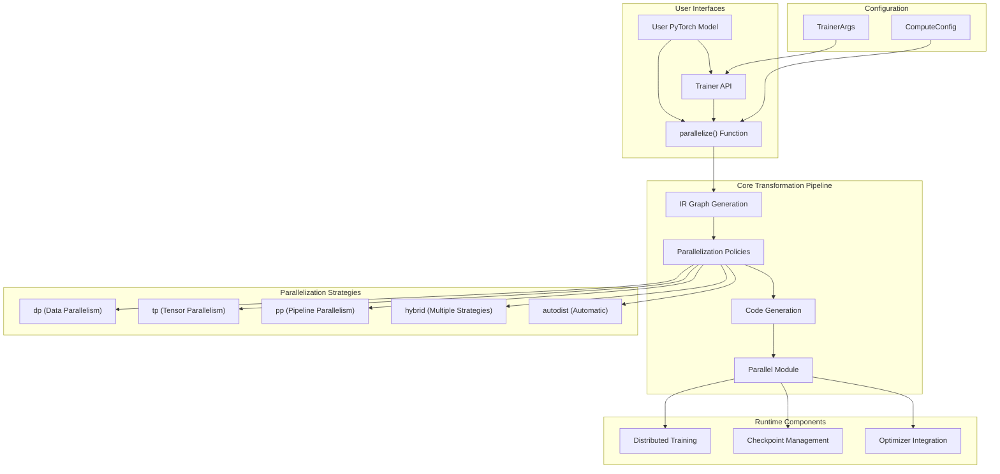
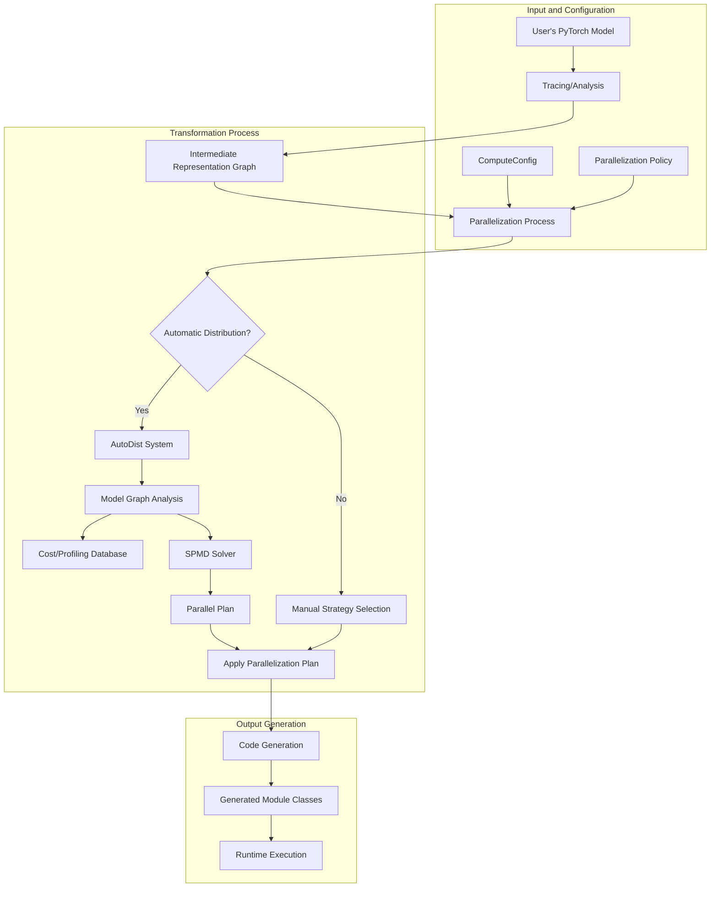
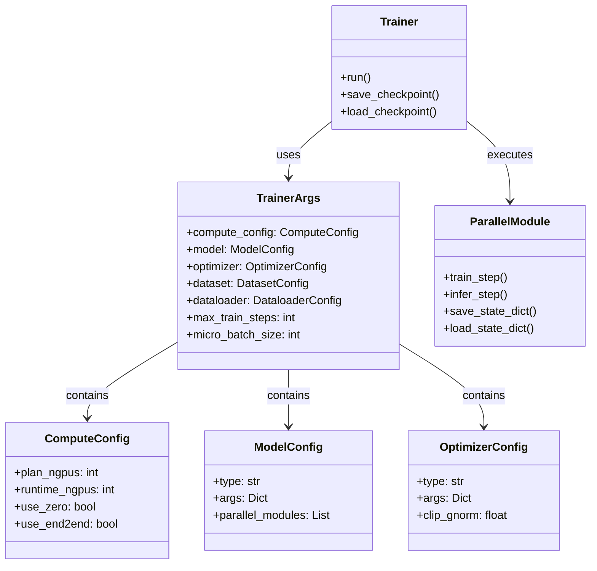
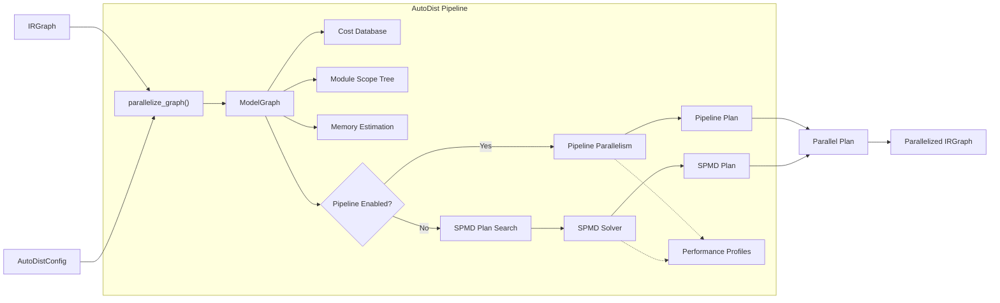

<!-- source: DeepWiki mcp.deepwiki.com · repo microsoft/nnscaler · page 1 Overview · fetched 2026-10-26 -->

# Overview

<details>
<summary>Relevant source files</summary>

The following files were used as context for generating this wiki page:

- [README.md](README.md)
- [docs/source/quickstart.rst](docs/source/quickstart.rst)

</details>


nnScaler is a parallelization engine that compiles deep neural network (DNN) models designed for single-GPU execution into programs capable of running in parallel across multiple GPUs. This document provides a high-level overview of the system architecture, key components, and core workflows of nnScaler.

For detailed installation instructions, see [Installation](#1.1).
For getting started quickly with examples, see [Quickstart Guide](#1.2).

## System Purpose and Architecture

nnScaler provides a systematic approach to model parallelization, allowing deep learning practitioners to focus on model design while the system handles the complexities of distributed training. The system is built around two main user interfaces:

1. The **Trainer API** - A high-level interface for training loop management
2. The **parallelize() function** - A direct model parallelization interface



**Diagram Title: nnScaler System Architecture**

Sources: [README.md:7-28]()

## Key Features

nnScaler offers several key features that distinguish it from other parallelization frameworks:

| Feature | Description |
|---------|-------------|
| **Ease of Use** | Only a few lines of code changes needed to enable parallelization |
| **Pythonic** | Generated parallelized code is in PyTorch, making it readable and customizable |
| **Extensibility** | API support for custom operators and emerging model architectures |
| **Reliability** | Verified through extensive end-to-end training sessions |
| **Performance** | Explores large parallelization space to optimize training speed |

Sources: [README.md:22-28]()

## Core Workflow

The parallelization process in nnScaler follows a well-defined workflow:



**Diagram Title: nnScaler Transformation Workflow**

The workflow consists of three major phases:

1. **Input and Configuration**: The user's PyTorch model is traced and analyzed to create an intermediate representation (IR) graph. Configuration options define how parallelization should be performed.

2. **Transformation Process**: Based on the configuration, the system either applies a manually selected parallelization strategy or uses the AutoDist system to automatically determine the optimal strategy. The AutoDist system analyzes the model graph, consults a cost/profiling database, and uses an SPMD (Single Program Multiple Data) solver to create a parallelization plan.

3. **Output Generation**: The parallelization plan is applied to the IR graph, code is generated for the parallel module classes, and the parallelized model is executed at runtime.

Sources: [README.md:10-12](), [docs/source/quickstart.rst:19-182]()

## Components and Their Relationships

The core components of nnScaler and their relationships are depicted in the following diagram:



**Diagram Title: nnScaler Component Relationships**

The main components are:

- **Trainer**: The high-level interface for training parallelized models
- **TrainerArgs**: Configuration container for the Trainer
- **ComputeConfig**: Defines parallelization-specific settings
- **ModelConfig**: Specifies the model type and arguments
- **OptimizerConfig**: Defines optimizer type and parameters
- **ParallelModule**: The parallelized module generated by nnScaler

Sources: [README.md:83-131]()

## Usage Example

The following code snippet demonstrates the basic usage pattern of nnScaler:

```python
# Import the nnScaler Trainer
from nnscaler.cli.trainer import Trainer
from nnscaler.cli.trainer_args import TrainerArgs, ComputeConfig, ModelConfig, OptimizerConfig

# Define a model wrapper
class WrapperModel(torch.nn.Module):
    def __init__(self, model_id):
        super().__init__()
        self.model = AutoModelForCausalLM.from_pretrained(model_id)
    
    def forward(self, samples):
        outputs = self.model.model(
            input_ids=samples['net_input']['src_tokens'],
            use_cache=False,
            return_dict=False,
        )
        loss = torch.sum(chunk_linear_cross_entropy(outputs[0], self.model.lm_head.weight, samples['target']))
        return loss, samples['ntokens'], samples['nsentences']

# Configure and initialize the trainer
trainer = Trainer(train_args=TrainerArgs(
    compute_config=ComputeConfig(
        plan_ngpus=1,  # Number of GPUs used for planning
        runtime_ngpus=2,  # Number of GPUs used for runtime
        use_zero=True  # Enable ZeRO optimization
    ),
    model=ModelConfig(
        type=WrapperModel,
        args={'model_id': 'model_path'}
    ),
    optimizer=OptimizerConfig(
        type=torch.optim.AdamW,
        args={'lr': 2e-5, 'weight_decay': 0.0}
    ),
    max_train_steps=10000
))

# Start training
trainer.run()
```

To run this with multiple GPUs:

```bash
torchrun --nproc_per_node=2 train_script.py
```

Sources: [README.md:83-131](), [docs/source/quickstart.rst:25-74]()

## Parallelization Strategies

nnScaler supports several parallelization strategies:

| Strategy | Key | Description |
|----------|-----|-------------|
| **Data Parallelism** | `dp` | Replicates the model across devices and divides the data batch |
| **Tensor Parallelism** | `tp` | Partitions individual tensors and operations across devices |
| **Pipeline Parallelism** | `pp` | Splits the model into sequential stages across devices |
| **Hybrid Parallelism** | `hybrid` | Combines multiple strategies for optimal performance |
| **Automatic Distribution** | `autodist` | Automatically determines the best parallelization strategy |

For detailed explanations of each strategy, see [Parallelization Strategies](#3).

Sources: [README.md:136-191]()

## AutoDist System

The AutoDist system is a key component of nnScaler that automatically determines optimal parallelization strategies:



**Diagram Title: AutoDist System Workflow**

The AutoDist system analyzes the model graph, estimates memory requirements, and determines whether pipeline parallelism is suitable. Based on this analysis, it either creates a pipeline plan or uses the SPMD solver to find an optimal partitioning strategy. The result is a parallel plan that is applied to the IR graph.

For more details on the AutoDist system, see [Automatic Distribution (AutoDist)](#4).

Sources: [README.md:156-172]()

## Conclusion

nnScaler provides a comprehensive solution for parallelizing deep neural network models across multiple GPUs. By abstracting the complexities of distributed training, it allows researchers and practitioners to focus on model design while achieving high-performance parallel execution.

The system has been adopted by multiple research and product projects, demonstrating its effectiveness in real-world applications. For example, it has been used for training and fine-tuning large language models like the Phi-3 series, and for implementing specialized architectures like LongRoPE and Diff-Transformer.

For detailed information on specific components and features, please refer to the other sections of this documentation.

Sources: [README.md:14-20]()

---

