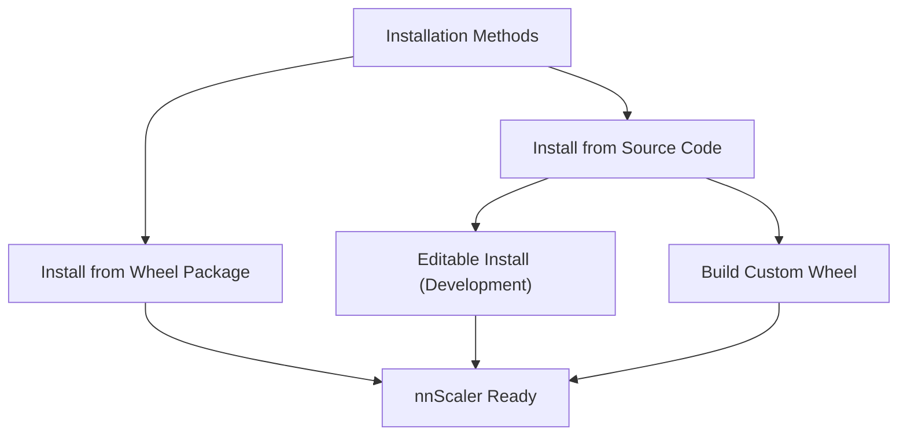
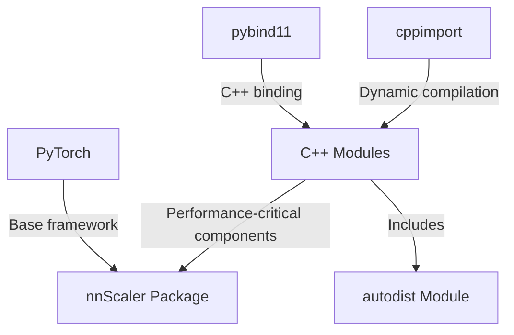
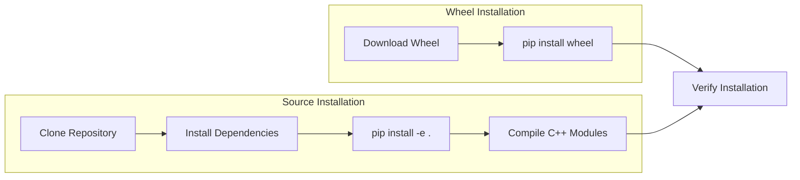

<!-- source: DeepWiki mcp.deepwiki.com · repo microsoft/nnscaler · page 1.1 Installation · fetched 2026-10-26 -->

# Installation

<details>
<summary>Relevant source files</summary>

The following files were used as context for generating this wiki page:

- [.readthedocs.yaml](.readthedocs.yaml)
- [docs/source/installation.rst](docs/source/installation.rst)
- [requirements-dev.txt](requirements-dev.txt)

</details>


This page provides instructions for installing nnScaler through different methods. The library can be installed either from a pre-built wheel package or from the source code, depending on your usage requirements.

## Installation Methods

nnScaler provides several installation approaches to accommodate different use cases:



Sources: [docs/source/installation.rst:5-9]()

## Installation Components

When installing nnScaler, it's important to understand the core components that are set up:



Sources: [docs/source/installation.rst:24-25]()

## Installing from Wheel Package

The wheel package installation is the simplest method and recommended for most users who don't need to modify the nnScaler source code.

```bash
pip install https://github.com/microsoft/nnscaler/releases/download/0.7/nnscaler-0.7-py3-none-any.whl
```

This installs the pre-compiled version of nnScaler with all necessary dependencies.

Sources: [docs/source/installation.rst:11-15]()

## Installing from Source Code

### Editable Install

For development purposes or when you need to modify the nnScaler source code, an editable installation is appropriate. This method requires manual compilation of C++ modules.

```bash
git clone --recursive https://github.com/microsoft/nnscaler
cd nnscaler
pip install -e .
python -c "import cppimport.import_hook ; import nnscaler.autodist.dp_solver"
```

Note: The last command is critical as it compiles the C++ modules, which are not automatically built during an editable install. The `autodist.dp_solver` module is a C++ component that requires compilation.

Sources: [docs/source/installation.rst:21-32]()

### Building a Custom Wheel

You can also build the wheel package yourself, which is useful for custom deployments or when you need to distribute a modified version of nnScaler:

```bash
cd nnscaler
pip install build
python -m build
pip install dist/nnscaler-*.whl
```

Sources: [docs/source/installation.rst:34-44]()

## Installation Workflow

The following diagram illustrates the installation workflow for both methods:



Sources: [docs/source/installation.rst:5-44]()

## Development Dependencies

If you're planning to contribute to nnScaler or run tests and build documentation, you'll need additional development dependencies:

```bash
pip install -r requirements-dev.txt
```

The development requirements include:
- Testing tools: `pytest`, `pytest-cov`, `pytest-mock`
- Documentation tools: `sphinx`, `furo`, `myst-parser`
- Code quality tools: `pre-commit`, `yapf`
- Visualization tools: `wandb`, `tensorboard`

Sources: [requirements-dev.txt:1-20]()

## Verifying Installation

To verify that nnScaler has been installed correctly, you can import it in Python:

```python
import nnscaler
# Attempt to import a core module
from nnscaler.trainer import Trainer
print("nnScaler installation successful")
```

If no errors occur, the installation is successful.

## Troubleshooting Common Issues

### C++ Compilation Errors

If you encounter errors during C++ module compilation, ensure:
- You have a compatible C++ compiler installed
- You've cloned the repository with the `--recursive` flag to get all submodules
- Your environment has the necessary development libraries

### Python Environment Issues

For dependency conflicts or environment issues:
```bash
# Create a clean virtual environment
python -m venv nnscaler_env
source nnscaler_env/bin/activate  # On Windows: nnscaler_env\Scripts\activate
# Then proceed with installation
```

For information on how to use nnScaler after installation, see the [Quickstart Guide](#1.2).

---

