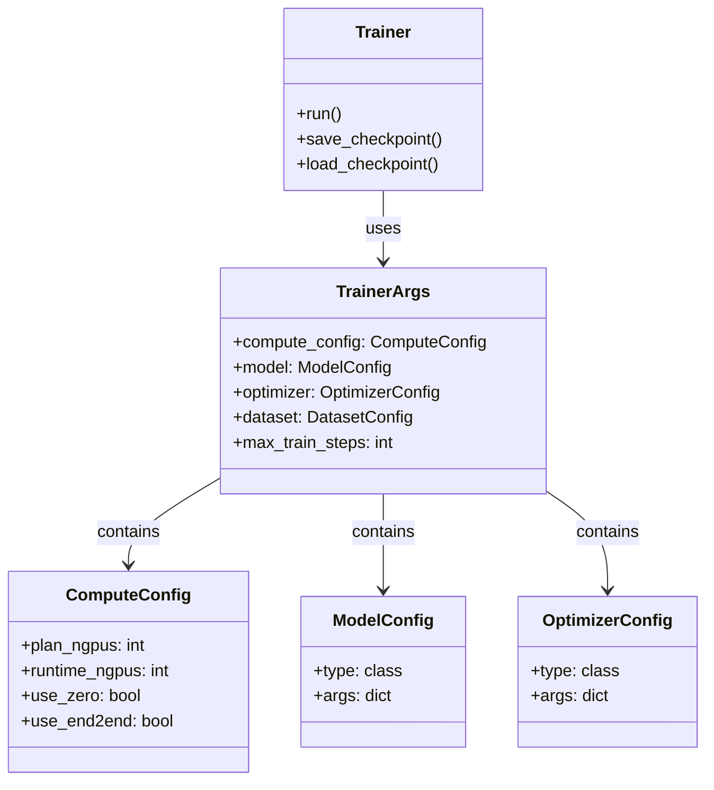
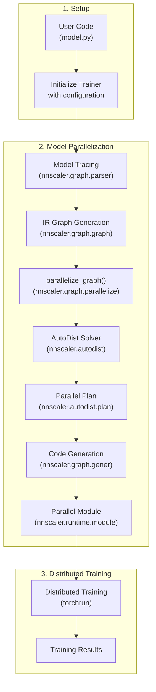

<!-- source: DeepWiki mcp.deepwiki.com · repo microsoft/nnscaler · page 1.2 Quickstart Guide · fetched 2026-10-26 -->

# Quickstart Guide

<details>
<summary>Relevant source files</summary>

The following files were used as context for generating this wiki page:

- [README.md](README.md)
- [docs/source/quickstart.rst](docs/source/quickstart.rst)

</details>


This guide provides a quick introduction to nnScaler, helping you get started with model parallelization. You'll learn how to install nnScaler, understand its basic workflow, and run your first parallelized model training.

For a more comprehensive introduction, see [Overview](#1). For detailed installation instructions, see [Installation](#1.1).

## Installation

### Prerequisites

Before installing nnScaler, make sure you have:
- Python >= 3.9, < 3.11 (3.10 is recommended)
- PyTorch >= 2.0, < 2.4 (2.2.0 is recommended)

### Installing nnScaler

You can install nnScaler using pip:

```bash
pip install https://github.com/microsoft/nnscaler/releases/download/0.7/nnscaler-0.7-py3-none-any.whl
```

Or install from source:

```bash
git clone --recursive https://github.com/microsoft/nnscaler
cd nnscaler
pip install -r requirements.txt
pip install -e .

# Add to PYTHONPATH to avoid cppimport errors
export NNSCALER_HOME=$(pwd)
export PYTHONPATH=${NNSCALER_HOME}:$PYTHONPATH
```

Sources: [README.md:39-58](), [docs/source/quickstart.rst:5-16]()

## Core Workflow

The diagram below illustrates the basic workflow of nnScaler:


nnScaler transforms a PyTorch model designed for a single GPU into one that can run efficiently across multiple GPUs through these steps:

1. **Tracing**: Analyzes the model's structure and operations
2. **IR Graph**: Creates an intermediate representation of the model
3. **Parallelization Plan**: Determines how to split the model across devices
4. **Code Generation**: Produces optimized PyTorch code for parallel execution
5. **Distributed Training**: Executes the parallelized model across multiple GPUs

Sources: [README.md:9-11](), [README.md:22-27]()

## Key Components

nnScaler is built around several core components that work together to enable parallelization:



- **Trainer**: Manages the training process using the parallelized model
- **TrainerArgs**: Holds configuration for all aspects of training
- **ComputeConfig**: Specifies parallelization settings (GPU count, optimization strategies)
- **ModelConfig**: Defines the model class and initialization arguments
- **OptimizerConfig**: Specifies optimizer settings

Sources: [README.md:86-130](), [docs/source/quickstart.rst:60-68]()

## Running a Minimal Example

Let's start with a simple example to verify your installation:

1. Create a Python file with the following code:

```python
# model.py
import os
import torch
from nnscaler.cli.trainer import Trainer
from nnscaler.cli.trainer_args import *
from nnscaler.utils import set_default_logger_level

set_default_logger_level('INFO')

class Model(torch.nn.Module):
    def __init__(self):
        super().__init__()
        self.linear = torch.nn.Linear(100, 10)

    def forward(self, data):
        x = self.linear(data['x'])
        return torch.nn.functional.cross_entropy(x, data['y'])

class RandomDataset:
    def __init__(self, split):
        pass

    def __getitem__(self, i):
        return {
            'x': torch.rand(100),
            'y': torch.randint(10, tuple()),
        }

    def __len__(self):
        return 100

if __name__ == '__main__':
    world_size = int(os.getenv('WORLD_SIZE', 1))
    trainer_args = TrainerArgs(
        compute_config=ComputeConfig(plan_ngpus=1, runtime_ngpus=world_size, use_end2end=True),
        model=ModelConfig(type=Model),
        optimizer=OptimizerConfig(type=torch.optim.AdamW),
        dataset=DatasetConfig(type=RandomDataset, train_args={'split': 'train'}),
        max_train_steps=10,
        enable_progress_bar=False,
    )
    trainer = Trainer(train_args=trainer_args)
    trainer.run()
```

2. Run the model with multiple GPUs using `torchrun`:

```bash
torchrun --nproc_per_node=2 model.py
```

The example demonstrates:
- A simple model with one linear layer
- A random dataset for training
- Configuration of parallelization parameters through `ComputeConfig`
- Running the model across multiple GPUs using torchrun

Sources: [docs/source/quickstart.rst:19-74]()

## Understanding Parallelization Process

When you run the minimal example, nnScaler performs several steps:



Key outputs to observe:
- Parallelization strategy selection
- Memory and performance profiling
- Operator partitioning decisions
- Training progress and metrics

Sources: [docs/source/quickstart.rst:75-180]()

## Advanced Examples

### Llama-3 Model Training

nnScaler includes an example for training Llama-3 models:

1. **Prerequisites**:
   ```bash
   python -m pip install transformers==4.40.0 flash-attn==2.5.5 tensorboard
   
   # Set HuggingFace token for model access
   export HF_TOKEN=<HUGGINGFACE_ACCESS_TOKEN>
   ```

2. **Run the example**:
   ```bash
   cd examples/llama
   
   # Prepare training data
   python bookcorpus.py --data_path_or_name bookcorpus/bookcorpus --tokenizer_path_or_name meta-llama/Meta-Llama-3-8B-Instruct --save_path ./bookcorpus_llama3_4K --sequence_length 4096
   
   # Build mini model for testing
   python create_mini_model.py --model_id meta-llama/Meta-Llama-3-8B-Instruct --output_id ./llama3_mini
   
   # Run with data parallelism + zero1
   torchrun --nproc_per_node=2 train.py --plan_ngpus 1 --runtime_ngpus 2 --name llama3_debug --model_id ./llama3_mini --dataset_path ./bookcorpus_llama3_4K
   ```

Sources: [README.md:63-150]()

### nanoGPT Example

nnScaler also provides an example of parallelizing nanoGPT through a PyTorch Lightning-compatible interface:

1. **Setup**:
   ```bash
   cd examples/nanogpt
   pip install -r requirements.txt
   python nanoGPT/data/shakespeare_char/prepare.py
   ```

2. **Run on a single GPU**:
   ```bash
   torchrun --nproc_per_node=1 train_nnscaler.py nanoGPT/config/train_shakespeare_char.py
   ```

3. **Run on multiple GPUs**:
   ```bash
   torchrun --nproc_per_node=4 train_nnscaler.py nanoGPT/config/train_shakespeare_char.py
   ```

Sources: [README.md:152-191]()

## Next Steps

After completing this quickstart guide, you can explore more advanced topics:

- Learn about different [Parallelization Strategies](#3) (Data, Tensor, Pipeline, and Hybrid Parallelism)
- Explore the [Trainer API](#2.1) in depth for more training options
- Understand [Automatic Distribution](#4) through nnScaler's AutoDist system
- Configure advanced options through [ComputeConfig](#2.3)
- Implement [Custom Operators](#5) for specialized model architectures

For detailed examples demonstrating nnScaler with production models, see [Examples and Use Cases](#6).

Sources: [docs/source/quickstart.rst:182-192]()

---

