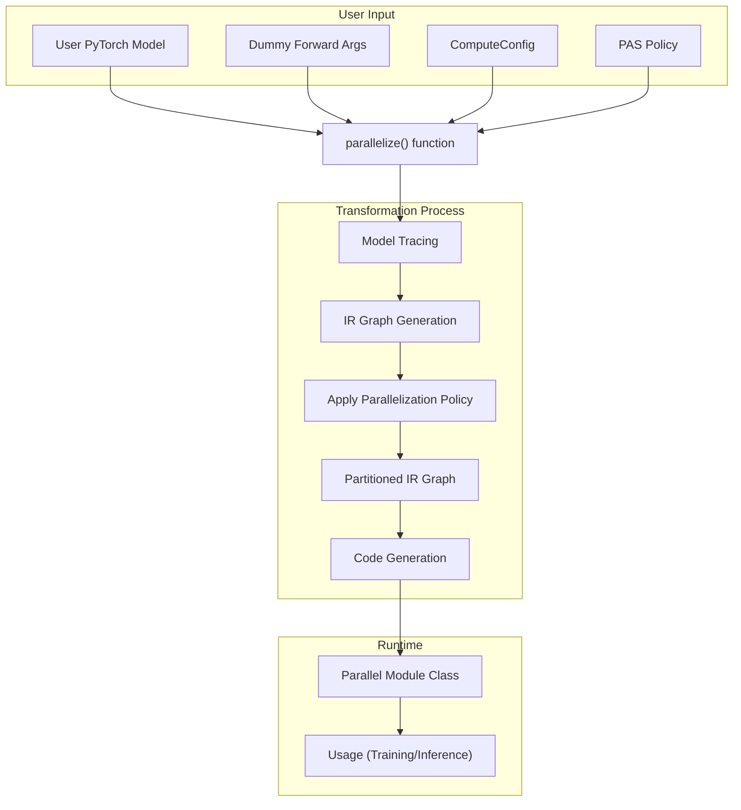
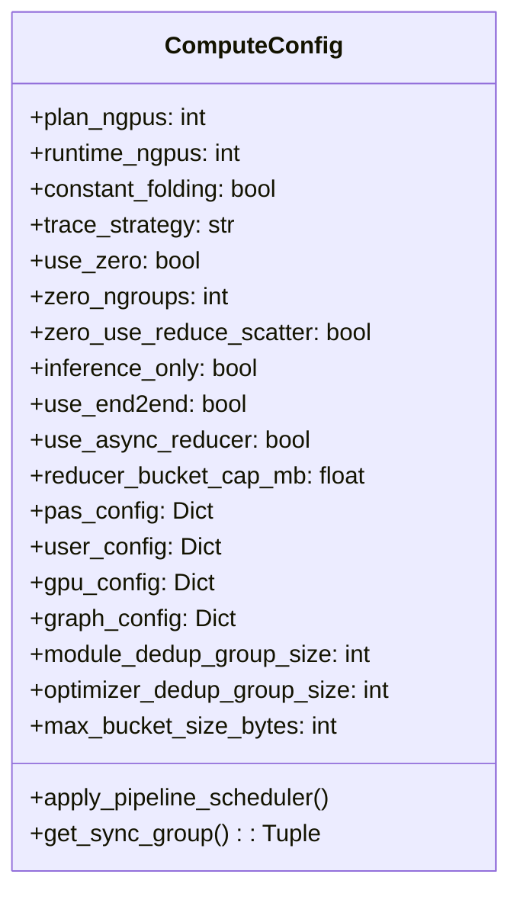
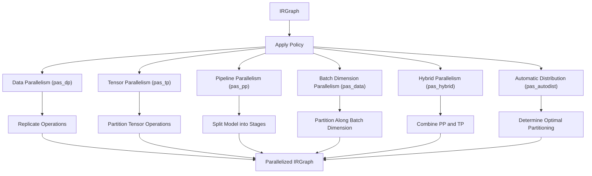
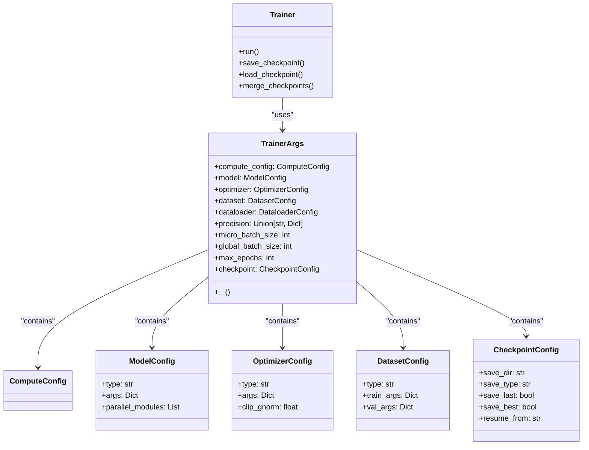
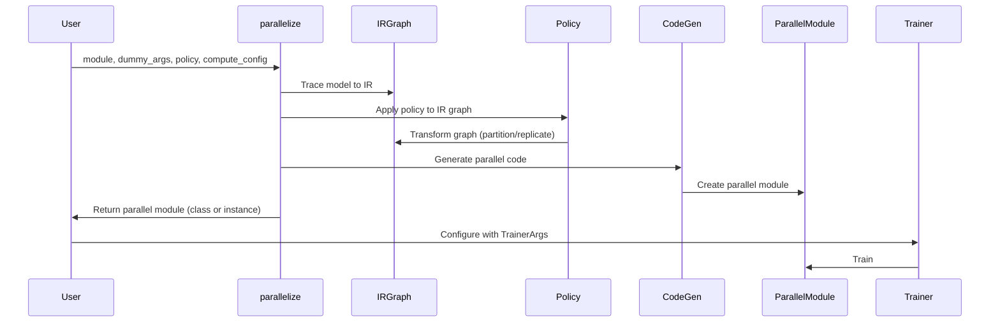

<!-- source: DeepWiki mcp.deepwiki.com · repo microsoft/nnscaler · page 2 Core Components · fetched 2026-10-26 -->

# Core Components

<details>
<summary>Relevant source files</summary>

The following files were used as context for generating this wiki page:

- [README.md](README.md)
- [docs/source/pytorch_lightning.md](docs/source/pytorch_lightning.md)
- [docs/source/trainer.rst](docs/source/trainer.rst)
- [nnscaler/parallel.py](nnscaler/parallel.py)
- [nnscaler/policies.py](nnscaler/policies.py)
- [nnscaler/version.py](nnscaler/version.py)

</details>


This page provides a comprehensive overview of the core components that make up the nnScaler system. These components work together to enable the parallelization of deep neural network (DNN) models across multiple devices. For information about specific parallelization strategies, see [Parallelization Strategies](#3), and for automatic distribution details, see [Automatic Distribution (AutoDist)](#4).

## Overview of Core Components

nnScaler comprises several fundamental components that work together to provide its parallelization capabilities:

```mermaid
classDiagram
    class ComputeConfig {
        +plan_ngpus: int
        +runtime_ngpus: int
        +constant_folding: bool
        +trace_strategy: str
        +use_zero: bool
        +inference_only: bool
        +use_end2end: bool
        +...()
    }
    
    class Trainer {
        +TrainerArgs
        +run()
        +save_checkpoint()
        +load_checkpoint()
    }
    
    class IRGraph {
        +nodes()
        +full_tensors()
        +partition()
        +replicate()
        +assign()
        +backward()
    }

    class ParallelModule {
        +train_step()
        +infer_step()
        +save_state_dict()
        +load_state_dict()
    }
    
    class "parallelize()" {
        +module
        +dummy_forward_args
        +pas_policy
        +compute_config
    }
    
    class PAS {
        +dp
        +tp
        +pp
        +hybrid
        +autodist
    }
    
    ComputeConfig --> "parallelize()"
    "parallelize()" --> IRGraph : "generates"
    "parallelize()" --> PAS : "applies policy"
    PAS --> IRGraph : "transforms"
    IRGraph --> ParallelModule : "generates"
    ComputeConfig --> Trainer : "configures"
    Trainer --> ParallelModule : "executes"
```

Sources: [nnscaler/parallel.py:68-306](), [README.md:86-131]()

## Parallelization Process

The core workflow in nnScaler follows a systematic process to convert a single-GPU model to a parallelized model:



Sources: [nnscaler/parallel.py:618-706](), [nnscaler/parallel.py:739-857](), [README.md:35-60]()

## Key Components

### ComputeConfig

`ComputeConfig` is a critical component that defines the computing environment and resource allocation for model parallelization. It controls how the model is traced, partitioned, and executed.



The `ComputeConfig` class contains several important fields:

| Field | Type | Description |
|-------|------|-------------|
| `plan_ngpus` | int | Number of GPUs to be used as a unit for model partitioning |
| `runtime_ngpus` | int | Total number of GPUs used at runtime (multiple of `plan_ngpus`) |
| `constant_folding` | bool | Whether to fold constants during code generation |
| `trace_strategy` | str | Strategy for executing functions during tracing ('cpu', 'cuda', 'meta', etc.) |
| `use_zero` | bool | Whether to enable ZeRO optimization |
| `use_end2end` | bool | Whether the module is end-to-end (contains loss computation) |
| `inference_only` | bool | Whether the parallelized module is for inference only |
| `pas_config` | Dict | Configuration settings for parallelization strategy |
| `user_config` | Dict | User-defined configuration that may affect the traced graph |

Sources: [nnscaler/parallel.py:68-306](), [docs/source/trainer.rst:634-650]()

### parallelize() Function

The `parallelize()` function is the main entry point for converting a PyTorch module to a parallelized module. It performs the entire process of tracing, policy application, and code generation.

Function signature:

```python
def parallelize(
    module_or_module_class: Union[torch.nn.Module, Type[torch.nn.Module]],
    dummy_forward_args: Dict[str, Any],
    pas_policy: Union[str, Callable[[IRGraph, ComputeConfig], IRGraph]],
    compute_config: ComputeConfig,
    *,
    gen_savedir: Union[str, Path] = './.nnscaler',
    reuse: Union[ReuseType, str] = ReuseType.MATCH,
    instance_name: Optional[str] = None,
    load_module: bool = True,
    module_dtype: Optional[torch.dtype] = None,
    module_fn: Optional[Callable[[], torch.nn.Module]] = None,
    init_module_params: bool = True,
    broadcast_strategy: Union[str, BroadcastGenFilesStrategy] = 'none',
) -> Union[None, ParallelModule, Type[ParallelModule]]
```

Key parameters:

| Parameter | Description |
|-----------|-------------|
| `module_or_module_class` | The PyTorch module or module class to be parallelized |
| `dummy_forward_args` | Dummy input arguments for tracing the module |
| `pas_policy` | Policy for parallelization (can be a predefined policy name or custom function) |
| `compute_config` | Configuration for computing resources and environment |
| `gen_savedir` | Directory for saving generated code (default: './.nnscaler') |
| `reuse` | Strategy for reusing existing generated code |
| `instance_name` | Name to distinguish multiple instances of the same module |
| `load_module` | Whether to load the generated module after conversion |

Sources: [nnscaler/parallel.py:901-993](), [README.md:86-131]()

### IRGraph

The `IRGraph` is an intermediate representation of the model's computational graph. It's the central data structure that gets transformed during the parallelization process.

Key aspects of `IRGraph`:

- Represents the computational graph of the model
- Provides methods for partitioning and replicating operations
- Enables device assignment for operations
- Supports backward graph generation for training
- Contains both forward and backward operations
- Stores tensor information and dependencies

Sources: [nnscaler/policies.py:1-20](), [nnscaler/parallel.py:618-706]()

### Parallelization Policies

nnScaler provides several predefined policies for parallelizing models:

| Policy | Function | Description |
|--------|----------|-------------|
| `dp` | `pas_dp` | Data parallelism - replicates the entire model across devices |
| `tp` | `pas_tp` | Tensor parallelism - partitions tensor operations across devices |
| `pp` | `pas_pp` | Pipeline parallelism - splits the model into sequential stages |
| `data` | `pas_data` | Batch dimension parallelism - partitions along batch dimension |
| `hybrid` | `pas_hybrid` | Combined pipeline and tensor parallelism |
| `autodist` | `pas_autodist` | Automatic distribution system for optimal partitioning |

The policies apply different transformation techniques to the IRGraph:



Sources: [nnscaler/policies.py:77-347]()

### ParallelModule

The `ParallelModule` class is the output of the parallelization process, representing a parallelized version of the original PyTorch module. It provides methods for training, inference, and checkpoint management.

Key methods:

- `train_step()`: Performs a training step across distributed devices
- `infer_step()`: Performs inference across distributed devices
- `save_state_dict()`: Saves the parallelized model state
- `load_state_dict()`: Loads the parallelized model state

The `ParallelModule` integrates with the PyTorch ecosystem while handling the complexities of distributed execution.

Sources: [nnscaler/parallel.py:45-46](), [README.md:80-130]()

### Trainer

The `Trainer` class provides a high-level interface for training and evaluating parallelized models. It handles various aspects of the training process including data loading, optimization, checkpointing, and distributed coordination.



Sources: [docs/source/trainer.rst:5-563](), [README.md:84-130]()

## Integration of Components

The core components in nnScaler work together in a cohesive flow:

1. The user provides a PyTorch model, dummy input arguments, a parallelization policy, and compute configuration
2. The `parallelize()` function traces the model to create an IRGraph representation
3. The specified policy is applied to the IRGraph, partitioning or replicating operations
4. Code generation creates a `ParallelModule` class specific to the partitioned model
5. The `Trainer` can be used with appropriate arguments to train the parallelized model

This integration allows for a flexible and powerful system that can handle various model architectures and parallelization strategies.



Sources: [README.md:35-130](), [nnscaler/parallel.py:901-993]()

## Usage Patterns

There are two main usage patterns for nnScaler:

1. **Trainer API**: A high-level interface for training and evaluating models
    - Define model, optimizer, dataset, and other configurations
    - Create a `Trainer` with `TrainerArgs`
    - Call `trainer.run()` to perform training
    
2. **Direct Parallelization**: Lower-level interface for more control
    - Call `parallelize()` to get a parallelized module
    - Use the parallelized module directly in custom training loops

These patterns provide flexibility for users with different needs and experience levels.

Sources: [README.md:84-130](), [nnscaler/parallel.py:901-993]()

## Integration with PyTorch Lightning

nnScaler also provides integration with PyTorch Lightning through the `NnScalerStrategy` and `NnScalerPrecision` classes, making it easier to use with existing PyTorch Lightning workflows.

```python
compute_config = ComputeConfig(...)
trainer = Trainer(
    ...,
    strategy=NnScalerStrategy(
        compute_config=compute_config, pas_policy=..., gen_savedir=...,
        ...
    ),
    plugins=[NnScalerPrecision(precision, ...)],
    ...
)
trainer.fit(...)
```

Sources: [docs/source/pytorch_lightning.md:1-95]()

## Version Information

The current version of nnScaler is 0.7, as defined in the version file.

Sources: [nnscaler/version.py:4]()

---

