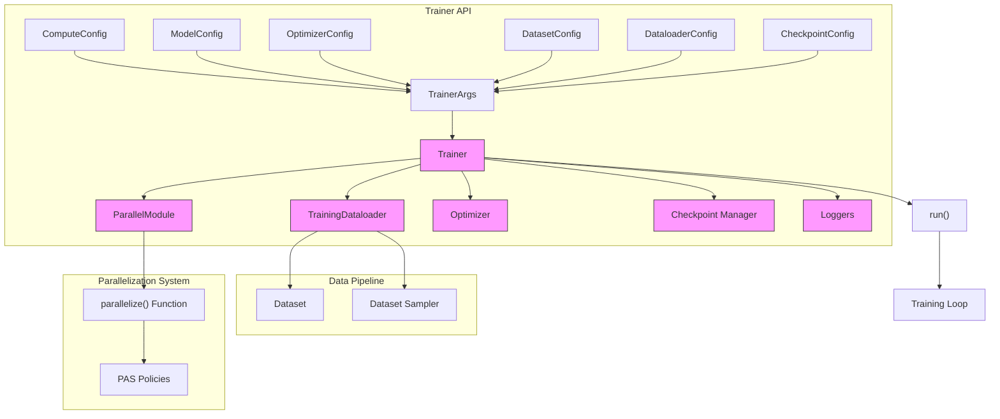
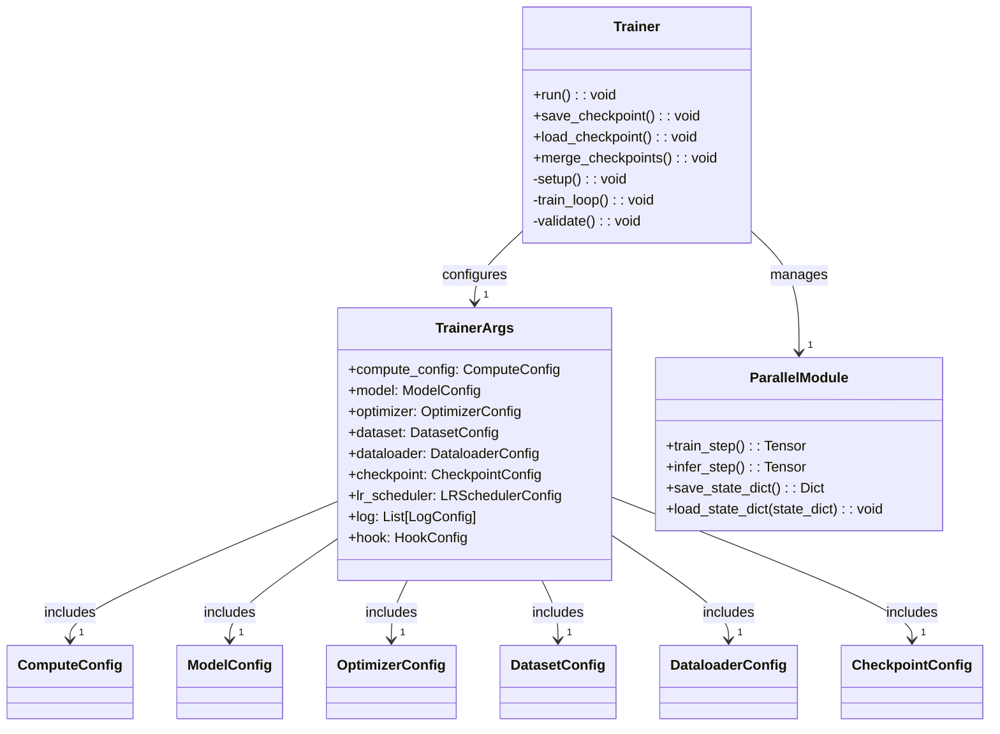
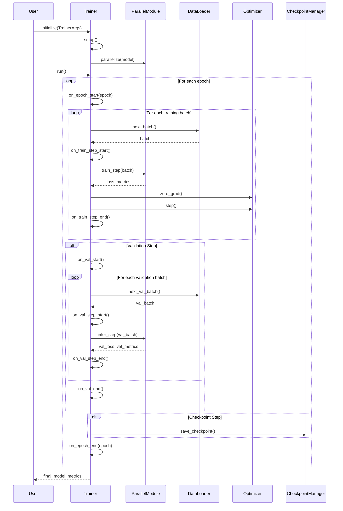
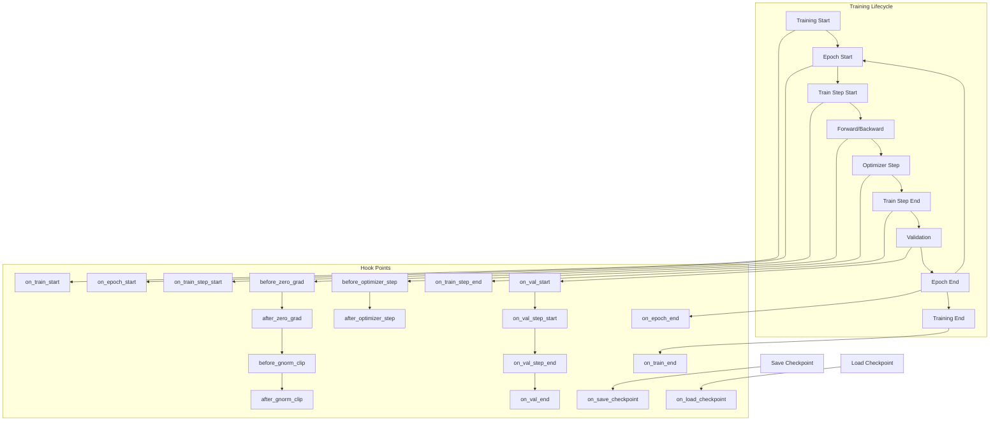

<!-- source: DeepWiki mcp.deepwiki.com · repo microsoft/nnscaler · page 2.1 Trainer API · fetched 2026-10-26 -->

# Trainer API

<details>
<summary>Relevant source files</summary>

The following files were used as context for generating this wiki page:

- [README.md](README.md)
- [docs/source/pytorch_lightning.md](docs/source/pytorch_lightning.md)
- [docs/source/trainer.rst](docs/source/trainer.rst)

</details>


The Trainer API in nnScaler provides a high-level interface for training and evaluating models that have been parallelized across multiple GPUs. This document details how to use the Trainer API, its components, configuration options, and integration with the rest of the nnScaler system. For information about the underlying parallelization engine, see [Parallelization Engine](#2.2).

## Overview

The Trainer API enables end-to-end training of deep neural networks across multiple GPUs with minimal code changes. It handles dataset loading, optimization, model parallelization, checkpoint management, and other training-related tasks through a consistent interface. 



Sources: [docs/source/trainer.rst:1-131](https://github.com/microsoft/nnscaler/blob/main/docs/source/trainer.rst), [README.md:83-131](https://github.com/microsoft/nnscaler/blob/main/README.md)

## Core Components

The Trainer API consists of the following core components:

1. `Trainer`: The main class that orchestrates the training process
2. `TrainerArgs`: A configuration class that holds all parameters for the trainer
3. `ComputeConfig`: Configuration for parallelization settings
4. Various component configurations (model, optimizer, dataset, etc.)

### Trainer Architecture



Sources: [docs/source/trainer.rst:14-55](https://github.com/microsoft/nnscaler/blob/main/docs/source/trainer.rst)

## Training Workflow

The Trainer API handles the complete training lifecycle, from model setup to evaluation and checkpointing:



Sources: [docs/source/trainer.rst:376-447](https://github.com/microsoft/nnscaler/blob/main/docs/source/trainer.rst)

## Configuration

The Trainer API is highly configurable through `TrainerArgs`, which contains all the parameters needed to define a training run.

### TrainerArgs

`TrainerArgs` is the main configuration class that holds all parameters for the Trainer:

```
@dataclass
class TrainerArgs:
    compute_config: ComputeConfig = None
    
    gen_savedir: str = './.nnscaler'
    gen_reuse: str = 'auto'
    pas_policy: str = 'autodist'
    broadcast_strategy: str = 'all'
    instance_name: str = None
    run_mode: str = 'run'
    tracing_from_weights: str = None
    
    model: ModelConfig
    optimizer: OptimizerConfig
    dataset: DatasetConfig
    dataloader: DataloaderConfig
    dataset_sampler: DatasetSamplerConfig
    lr_scheduler: Optional[LRSchedulerConfig]
    checkpoint: CheckpointConfig
    log: List[LogConfig]
    hook: Union[HookConfig, HookMapConfig, None]
    
    precision: Union[str, Dict]
    
    micro_batch_size: int = 1
    global_batch_size: Optional[int] = None
    grad_accumulation_steps: Optional[int] = None
    
    max_epochs: Optional[int] = None
    max_train_steps: Optional[int] = None
    max_val_steps: Optional[int] = None
    
    val_every_n_train_steps: Optional[int] = None
    val_every_n_epochs: Optional[int] = 1
    
    enable_progress_bar: bool = True
    seed: Optional[int] = None
    init_env_fn: str = None
```

Sources: [docs/source/trainer.rst:14-55](https://github.com/microsoft/nnscaler/blob/main/docs/source/trainer.rst)

### Component Configurations

The `TrainerArgs` includes several component configurations:

| Configuration | Description |
|---------------|-------------|
| `ModelConfig` | Specifies the model class and its arguments |
| `OptimizerConfig` | Specifies the optimizer class, arguments, and gradient clipping |
| `DatasetConfig` | Specifies the dataset class and arguments for training and validation |
| `DataloaderConfig` | Specifies the dataloader configuration |
| `DatasetSamplerConfig` | Specifies the dataset sampler for distributed training |
| `LRSchedulerConfig` | Optional learning rate scheduler configuration |
| `CheckpointConfig` | Configuration for checkpoint saving and loading |
| `LogConfig` | Configuration for logging (e.g., TensorBoard, WandB) |
| `HookConfig` | Configuration for custom hooks during training |

Sources: [docs/source/trainer.rst:135-275](https://github.com/microsoft/nnscaler/blob/main/docs/source/trainer.rst)

### ComputeConfig

The `ComputeConfig` is a critical component that defines how the model is parallelized across GPUs:

```
@dataclass(frozen=True)
class ComputeConfig:
    plan_ngpus: int            # Number of GPUs in a unit for model parallelism
    runtime_ngpus: int         # Total number of GPUs for data parallelism
    
    constant_folding: bool = False
    trace_strategy: str = 'cuda_run_cpu_offload'
    
    use_zero: bool = False     # Whether to use ZeRO optimization
    zero_ngroups: int = 1      # Number of groups for ZeRO
    
    inference_only: bool = False
    use_end2end: bool = False  # Must be True for Trainer API
    
    pas_config: Dict[str, Any] = field(default_factory=dict)
    user_config: Dict[str, Any] = field(default_factory=dict)
```

The `ComputeConfig` contains critical settings:
- `plan_ngpus`: Number of GPUs as a unit for model parallelism (TP/PP)
- `runtime_ngpus`: Total number of GPUs (data parallelism runs across units)
- `use_zero`: Whether to use ZeRO optimization for memory efficiency
- `pas_config`: Configuration for the parallelization policy

Sources: [docs/source/trainer.rst:449-650](https://github.com/microsoft/nnscaler/blob/main/docs/source/trainer.rst)

## Parallelization Policies

The Trainer supports multiple parallelization strategies through the `pas_policy` parameter:

| Policy | Description |
|--------|-------------|
| `dp` | Data Parallelism - replicates the model across all devices |
| `tp` | Tensor Parallelism - partitions tensors across devices |
| `pp` | Pipeline Parallelism - splits model into pipeline stages |
| `data` | Batch Dimension Parallelism |
| `hybrid` | Combines TP, PP, and DP strategies |
| `autodist` | Automatic distribution - recommended for most cases |

The `autodist` policy automatically determines the optimal parallelization strategy based on memory constraints and performance profiles.

Sources: [docs/source/trainer.rst:778-842](https://github.com/microsoft/nnscaler/blob/main/docs/source/trainer.rst)

## Usage Example

Here's a basic example of using the Trainer API:

```python
from nnscaler.cli.trainer import Trainer
from nnscaler.config import ModelConfig, OptimizerConfig, TrainerArgs, ComputeConfig

# Define your model wrapper
class WrapperModel(torch.nn.Module):
    def __init__(self, model_id):
        super().__init__()
        self.model = AutoModelForCausalLM.from_pretrained(model_id)
        
    def forward(self, samples):
        outputs = self.model.model(
            input_ids=samples['net_input']['src_tokens'],
            use_cache=False,
            return_dict=False,
        )
        loss = compute_loss(outputs, samples)
        return loss, samples['ntokens'], samples['nsentences']

# Setup configurations
compute_config = ComputeConfig(
    plan_ngpus=4,
    runtime_ngpus=8,
    use_zero=True,
    use_end2end=True,
    pas_config={
        'update_freq': 1,
        'mem_constraint': 40,  # GB per GPU
    }
)

model_config = ModelConfig(
    type=WrapperModel,
    args={'model_id': 'my-pretrained-model'},
)

optimizer_config = OptimizerConfig(
    type='torch.optim.AdamW',
    args={'lr': 2e-5, 'weight_decay': 0.01},
    clip_gnorm=1.0,
)

# Initialize and run the trainer
trainer = Trainer(
    train_args=TrainerArgs(
        compute_config=compute_config,
        model=model_config,
        optimizer=optimizer_config,
        dataloader=dataloader_config,
        micro_batch_size=16,
        global_batch_size=128,
        max_epochs=10,
    )
)

trainer.run()
```

Sources: [README.md:83-131](https://github.com/microsoft/nnscaler/blob/main/README.md)

## Checkpoint Management

The Trainer API provides robust checkpoint management through the `CheckpointConfig`:

```
@dataclass
class CheckpointConfig:
    save_dir: str = './checkpoints'
    no_save: bool = False
    
    save_type: str = 'sharded'  # 'sharded', 'deduped', or 'merged'
    
    save_last: bool = True
    save_best: bool = True
    symlink_best_and_last: bool = True
    
    every_n_train_steps: Optional[int] = None
    every_n_epochs: Optional[int] = None
    keep_last_n_checkpoints: Optional[int] = None
    
    resume_from: str = None     # 'last', 'best', or specific path
```

Important features:
- Support for sharded, deduped, and merged checkpoint formats
- Automatic saving of best (lowest validation loss) and last checkpoints
- Customizable checkpoint frequency
- Resume training from checkpoints

When the parallelization plan changes, checkpoints can be merged using:
```python
Trainer.merge_checkpoint(checkpoint_files, output_file)
```

Sources: [docs/source/trainer.rst:468-519](https://github.com/microsoft/nnscaler/blob/main/docs/source/trainer.rst)

## Hooks and Customization

The Trainer API provides an extensive hook system for customizing the training process:



Hooks can be provided either through a hook class or a map of hook functions. The hook system allows for customization of nearly every aspect of the training process.

Sources: [docs/source/trainer.rst:354-447](https://github.com/microsoft/nnscaler/blob/main/docs/source/trainer.rst)

## CLI Usage

The Trainer API can also be used through a command-line interface:

```
torchrun [torchrun arguments] ${NNSCALER_HOME}/cli/train.py -f ${CONFIG_FILE} [other arguments]
```

The configuration file is a YAML file that contains all the parameters for the `TrainerArgs` class:

```yaml
compute_config:
  plan_ngpus: 4
  runtime_ngpus: 8
  use_zero: true
  use_end2end: true

run_mode: run
pas_policy: autodist
micro_batch_size: 16
global_batch_size: 128
max_epochs: 10

model:
  type: path.to.MyModel
  args:
    param1: value1
    param2: value2

optimizer:
  type: torch.optim.AdamW
  args:
    lr: 2e-5
    weight_decay: 0.01
```

Sources: [docs/source/trainer.rst:564-619](https://github.com/microsoft/nnscaler/blob/main/docs/source/trainer.rst)

## PyTorch Lightning Integration

For users familiar with PyTorch Lightning, nnScaler provides an alternative interface through the `NnScalerStrategy` and `NnScalerPrecision` classes:

```python
from pytorch_lightning import Trainer
from nnscaler.lightning import NnScalerStrategy, NnScalerPrecision
from nnscaler.config import ComputeConfig

compute_config = ComputeConfig(...)
trainer = Trainer(
    strategy=NnScalerStrategy(
        compute_config=compute_config,
        pas_policy="autodist",
        gen_savedir="./.nnscaler",
    ),
    plugins=[NnScalerPrecision("16-mixed")],
)
trainer.fit(...)
```

Sources: [docs/source/pytorch_lightning.md:1-78](https://github.com/microsoft/nnscaler/blob/main/docs/source/pytorch_lightning.md)

## End-to-End Mode Requirement

It's important to note that the Trainer API requires `use_end2end` to be set to `True` in the `ComputeConfig`. This means:

1. The first argument of `module.forward` must be the data sample
2. All other arguments must have default values
3. The first return value must be the loss (scalar tensor)

This constraint allows the Trainer to handle the training loop efficiently.

Sources: [docs/source/trainer.rst:452-463](https://github.com/microsoft/nnscaler/blob/main/docs/source/trainer.rst)

## Conclusion

The Trainer API provides a comprehensive solution for training parallelized models with nnScaler. It handles the entire training lifecycle, from model parallelization to checkpoint management, with a high degree of configurability. 

By using the Trainer API, you can focus on your model definition and hyperparameters while nnScaler takes care of the complexities of distributed training across multiple GPUs.

---

