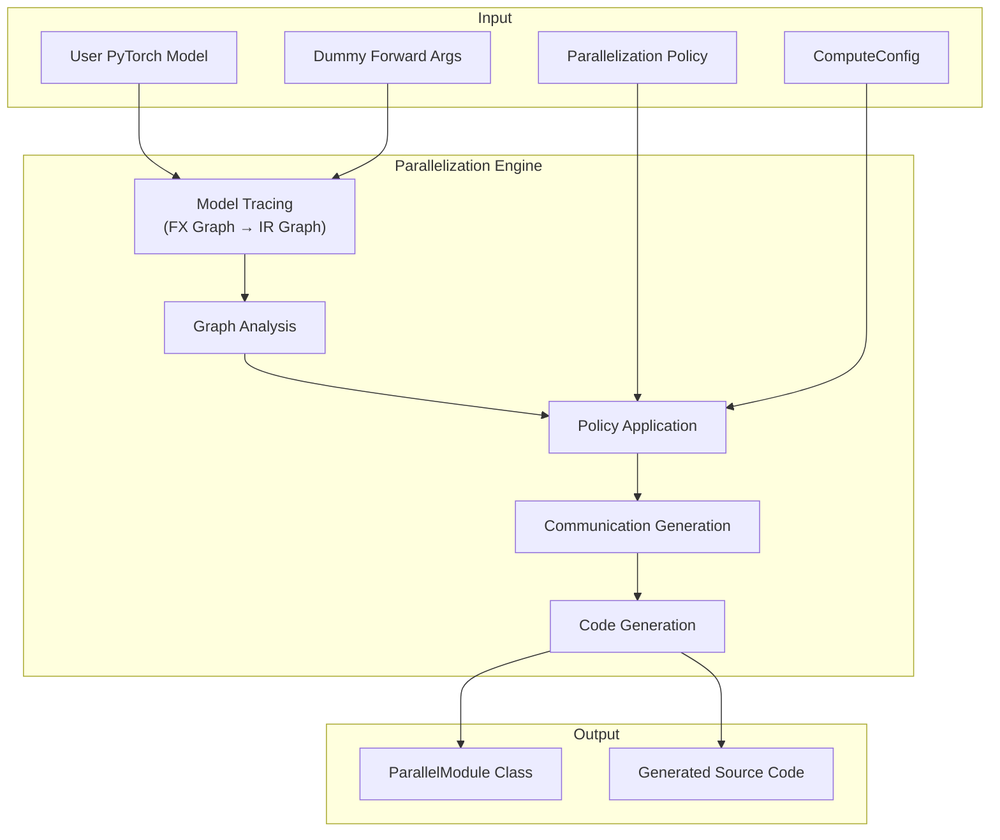
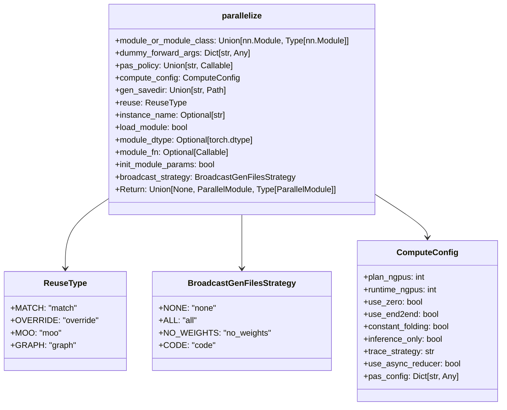
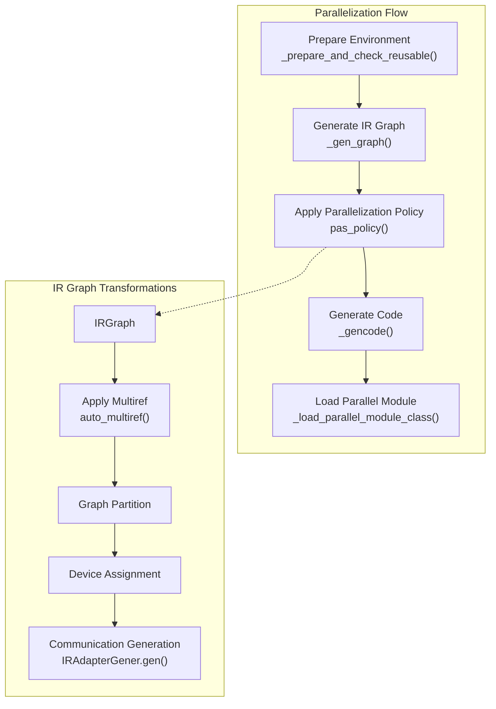
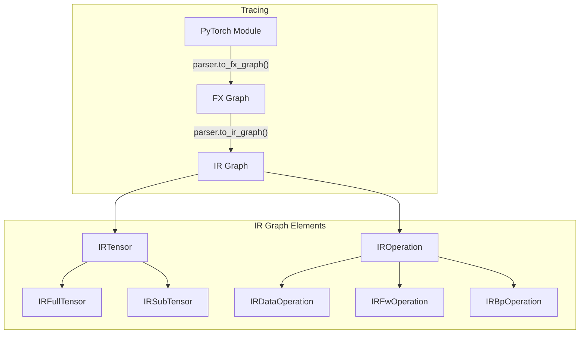
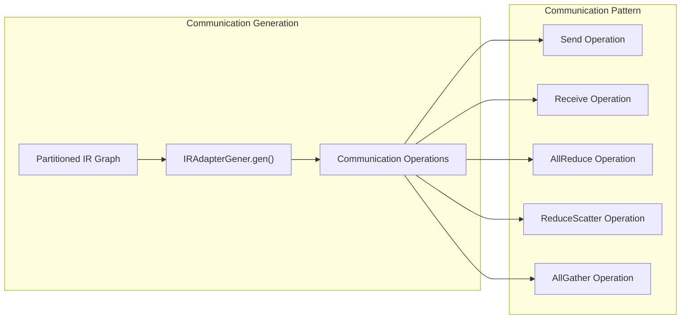
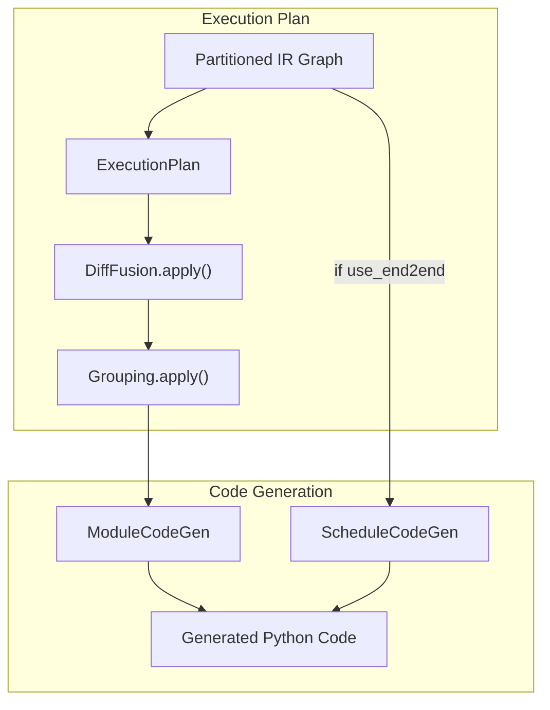
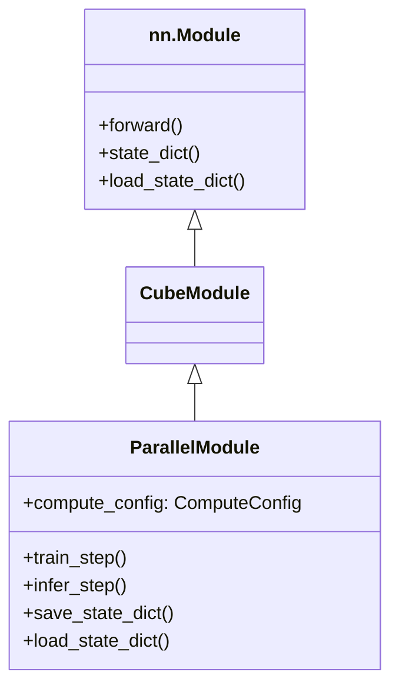
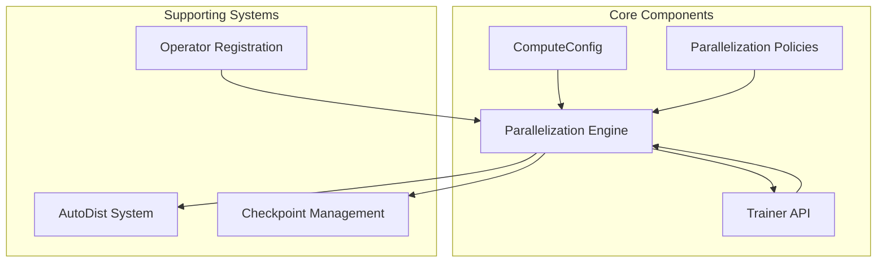

<!-- source: DeepWiki mcp.deepwiki.com · repo microsoft/nnscaler · page 2.2 Parallelization Engine · fetched 2026-10-26 -->

# Parallelization Engine

<details>
<summary>Relevant source files</summary>

The following files were used as context for generating this wiki page:

- [README.md](README.md)
- [nnscaler/parallel.py](nnscaler/parallel.py)
- [nnscaler/policies.py](nnscaler/policies.py)
- [nnscaler/version.py](nnscaler/version.py)

</details>


The Parallelization Engine is the core component of nnScaler that transforms PyTorch models designed for single-GPU execution into optimized code that runs efficiently across multiple GPUs. It handles the complex process of analyzing model structure, applying parallelization strategies, and generating optimized code tailored to the specified distributed environment.

For information about specific parallelization strategies like Data Parallelism, Tensor Parallelism, and Pipeline Parallelism, see [Parallelization Strategies](#3). For details on configuration options, see [ComputeConfig and Configuration Options](#2.3).

## Engine Architecture

The Parallelization Engine follows a compiler-like approach with distinct phases for analyzing, transforming, and generating code for distributed execution.



Sources: [nnscaler/parallel.py:899-1120](). [README.md:10-12]()

## Key Components and Workflow

### The `parallelize()` Function

The primary entry point to the Parallelization Engine is the `parallelize()` function, which transforms a PyTorch module into a parallel module capable of running across multiple GPUs.



Sources: [nnscaler/parallel.py:899-1120]()

### Internal Components

The parallelization process involves several internal components that work together to transform a PyTorch model into a parallelized version:



Sources: [nnscaler/parallel.py:618-706](), [nnscaler/parallel.py:708-857](), [nnscaler/policies.py:45-79]()

## Graph Representation and Transformation

### IR Graph Construction

The model is first traced to create an Intermediate Representation (IR) Graph that captures its computation and data flow.



Sources: [nnscaler/parallel.py:618-706](), [nnscaler/graph/parser.py]() (referenced in imports)

### Policy Application

Once the IR Graph is constructed, a parallelization policy is applied to partition the computation across devices.

nnScaler provides several built-in parallelization strategies:

| Policy | Description | Function |
|--------|-------------|----------|
| Data Parallelism (dp) | Replicates the model and splits data across devices | `pas_dp()` |
| Tensor Parallelism (tp) | Splits tensor computations across devices | `pas_tp()` |
| Pipeline Parallelism (pp) | Splits model layers across devices | `pas_pp()` |
| Batch Dimension Parallelism (data) | Splits batch dimension across devices | `pas_data()` |
| Hybrid Parallelism (hybrid) | Combines pipeline and tensor parallelism | `pas_hybrid()` |
| Automatic Distribution (autodist) | Uses AutoDist to find optimal partition plan | `pas_autodist()` |

Sources: [nnscaler/policies.py:78-347](), [nnscaler/parallel.py:62-66]()

### Communication Generation

After partitioning, communication operations are inserted to ensure correct data flow between partitions.



Sources: [nnscaler/parallel.py:708-857](), [nnscaler/graph/gener/gen.py]() (referenced in imports)

## Code Generation

The final step is generating optimized PyTorch code for each device, which is done by the code generation subsystem.



Sources: [nnscaler/parallel.py:820-856]()

## Output: The ParallelModule

The generated code creates a `ParallelModule` class, which extends PyTorch's `nn.Module` with distributed training capabilities.



Sources: [nnscaler/parallel.py:45-46](), [nnscaler/runtime/module.py]() (referenced in imports)

## Usage Examples

To use the Parallelization Engine, you need to define your PyTorch model, create a `ComputeConfig`, and call the `parallelize()` function.

### Basic Example

```python
import torch
from nnscaler.parallel import parallelize, ComputeConfig

# Define your PyTorch model
class MyModel(torch.nn.Module):
    def __init__(self):
        super().__init__()
        self.linear = torch.nn.Linear(128, 128)
    
    def forward(self, x):
        return self.linear(x)

# Create dummy inputs for tracing
dummy_inputs = {"x": torch.randn(16, 128)}

# Configure parallelization
config = ComputeConfig(
    plan_ngpus=2,       # Number of GPUs in the parallelization plan
    runtime_ngpus=2,    # Number of GPUs available at runtime
    use_zero=False,     # Whether to use ZeRO optimizer
    use_end2end=False   # Whether to use end-to-end mode
)

# Parallelize the model
parallel_model_class = parallelize(
    MyModel,
    dummy_inputs,
    pas_policy="dp",  # Data parallelism policy
    compute_config=config
)

# Create an instance of the parallelized model
parallel_model = parallel_model_class()
```

Sources: [README.md:83-131]()

### End-to-End Example

For more complex models where you want to include loss computation and other training components, you can use the end-to-end mode:

```python
from nnscaler.parallel import parallelize, ComputeConfig

# Define your model with loss computation
class WrapperModel(torch.nn.Module):
    def __init__(self):
        super().__init__()
        self.model = MyUnderlyingModel()
    
    def forward(self, samples):
        outputs = self.model(samples['input'])
        loss = torch.nn.functional.cross_entropy(outputs, samples['target'])
        return loss, samples['ntokens'], samples['nsentences']

# Create configuration with end-to-end mode enabled
config = ComputeConfig(
    plan_ngpus=2,
    runtime_ngpus=2,
    use_zero=True,
    use_end2end=True  # Enable end-to-end mode
)

# Parallelize the model
parallel_model = parallelize(
    WrapperModel(),
    {"samples": sample_batch},
    pas_policy="hybrid",
    compute_config=config
)
```

Sources: [README.md:83-131]()

## Relation to Other Components

The Parallelization Engine interacts with several other components of nnScaler:



Sources: [README.md:22-33]()

## Summary

The Parallelization Engine is the central component of nnScaler that enables efficient distributed training of deep neural networks across multiple GPUs. By analyzing the model structure, applying appropriate parallelization strategies, and generating optimized PyTorch code, it simplifies the complex task of distributed training for users, allowing them to focus on model design rather than parallelization details.

---

