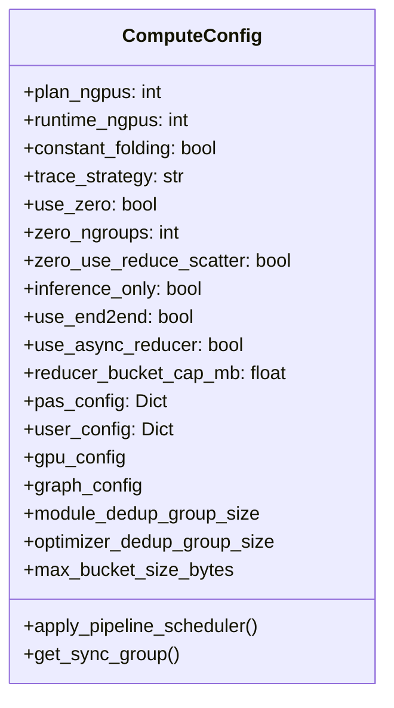
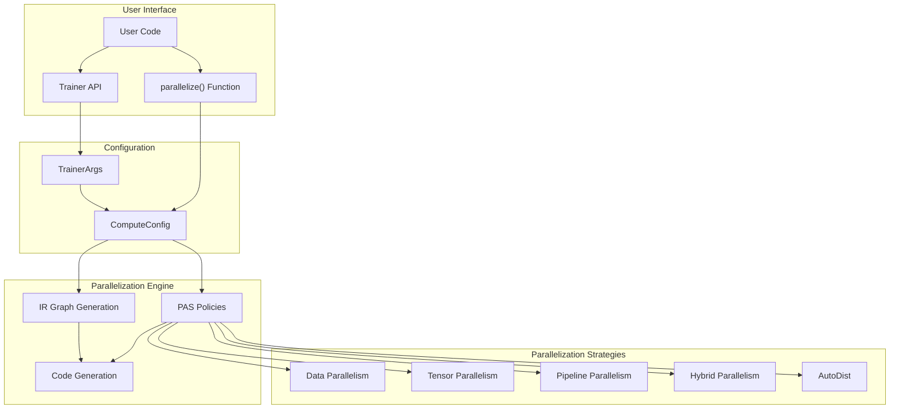
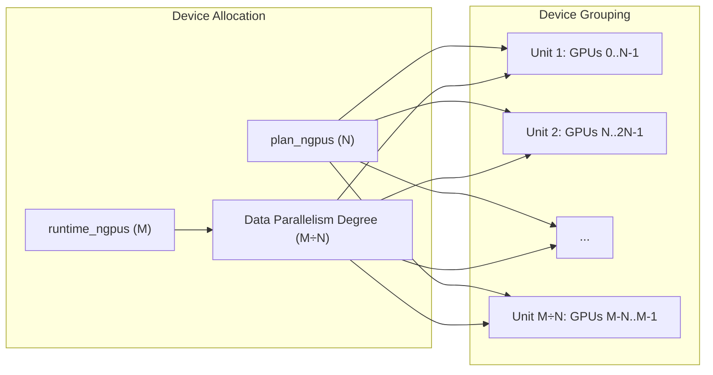
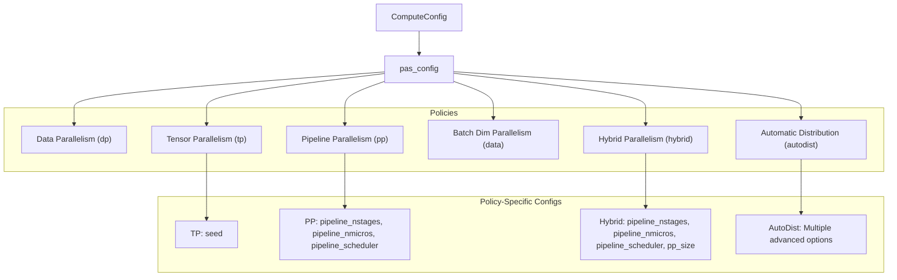

<!-- source: DeepWiki mcp.deepwiki.com · repo microsoft/nnscaler · page 2.3 ComputeConfig and Configuration Options · fetched 2026-10-26 -->

# ComputeConfig and Configuration Options

<details>
<summary>Relevant source files</summary>

The following files were used as context for generating this wiki page:

- [docs/source/pytorch_lightning.md](docs/source/pytorch_lightning.md)
- [docs/source/trainer.rst](docs/source/trainer.rst)
- [nnscaler/parallel.py](nnscaler/parallel.py)
- [nnscaler/policies.py](nnscaler/policies.py)
- [nnscaler/version.py](nnscaler/version.py)

</details>


## Purpose and Overview

This document details the `ComputeConfig` class and related configuration options in nnScaler, which control how models are parallelized, traced, and executed across distributed hardware. These configuration options are essential for defining the resource allocation, optimization strategies, and execution behavior of your distributed training setup.

For information about specific parallelization policies (DP, TP, PP, etc.) that use these configurations, see [Parallelization Strategies](#3). For the Trainer API that consumes these configurations, see [Trainer API](#2.1).

## Core Configuration Structure

`ComputeConfig` is implemented as a frozen dataclass to ensure configuration immutability after initialization. It serves as a central repository for all hardware-related and parallelization-related settings.



Sources: [nnscaler/parallel.py:69-238]()

## Relationship to System Components

The `ComputeConfig` is used throughout the nnScaler system to guide the parallelization process and define resource allocation.



Sources: [docs/source/trainer.rst:18-57](), [nnscaler/parallel.py:901-980]()

## Configuration Categories

The configuration options in `ComputeConfig` can be categorized into several key areas:

### 1. GPU Configuration

| Option | Type | Description |
|--------|------|-------------|
| `plan_ngpus` | int | Number of GPUs as a unit for model partitioning (TP/PP within this unit) |
| `runtime_ngpus` | int | Total number of GPUs used at runtime (must be multiple of `plan_ngpus`) |

GPU configuration is foundational for determining how the model is partitioned and how data parallelism is applied:



Sources: [nnscaler/parallel.py:71-72](), [docs/source/trainer.rst:686-690]()

### 2. Tracing Configuration

| Option | Type | Default | Description |
|--------|------|---------|-------------|
| `constant_folding` | bool | False | Whether to fold constants during code generation |
| `trace_strategy` | str | 'cuda_run_cpu_offload' | Strategy for executing functions during trace |

Tracing strategies:
- `'cpu'`: Execute on CPU, weights and intermediates on CPU
- `'cuda'`: Execute on CUDA, weights and intermediates on CUDA
- `'meta'`: Execute on meta device, weights on CPU, intermediates on meta
- `'cuda_run_cpu_offload'`: Try CUDA, fallback to CPU on OOM
- `'reuse_cache'`: Cache outputs based on function signatures

Sources: [nnscaler/parallel.py:75-78](), [docs/source/trainer.rst:653-682]()

### 3. Zero Optimization Configuration

| Option | Type | Default | Description |
|--------|------|---------|-------------|
| `use_zero` | bool | False | Whether to use ZeRO (Zero Redundancy Optimizer) |
| `zero_ngroups` | int | 1 | Number of ZeRO groups |
| `zero_use_reduce_scatter` | bool | False | Whether to use reduce scatter for ZeRO |

ZeRO is a memory optimization technique that partitions optimizer states across devices to reduce memory usage.

Sources: [nnscaler/parallel.py:80-86](), [docs/source/trainer.rst:696-698]()

### 4. Mode Configuration

| Option | Type | Default | Description |
|--------|------|---------|-------------|
| `inference_only` | bool | False | Whether code is for inference only |
| `use_end2end` | bool | False | Whether to use end-to-end training mode |

End-to-end mode requires:
1. First argument of `module.forward` must be data sample
2. First return value must be the loss (scalar tensor)

Sources: [nnscaler/parallel.py:89-95](), [docs/source/trainer.rst:452-463]()

### 5. Reduction Configuration

| Option | Type | Default | Description |
|--------|------|---------|-------------|
| `use_async_reducer` | bool | False | Whether to use async gradient all-reduce |
| `reducer_bucket_cap_mb` | float | None | Max bucket size for reducer in MB |

These settings control how gradients are synchronized across devices during distributed training.

Sources: [nnscaler/parallel.py:98-104](), [docs/source/trainer.rst:699-702]()

### 6. User Configuration

| Option | Type | Default | Description |
|--------|------|---------|-------------|
| `pas_config` | Dict | {} | PAS policy settings and other code generation settings |
| `user_config` | Dict | {} | Custom configurations that can affect graph/code generation |

`user_config` is used to track changes that may affect the traced graph, ensuring consistent code generation.

Sources: [nnscaler/parallel.py:106-138](), [docs/source/trainer.rst:702-707]()

## PAS Policy Configuration

The PAS (Partition-Assign-Schedule) policies describe how to place computations across devices. Different policies require different configuration options in the `pas_config` dictionary.



Sources: [nnscaler/policies.py:45-347](), [docs/source/trainer.rst:700-702]()

### Data Parallelism (dp)

Simple data parallelism with no partitioning within a plan unit. Requires `plan_ngpus=1`.

Sources: [nnscaler/policies.py:77-89]()

### Tensor Parallelism (tp)

Tensor parallelism with random partitioning. Optional configurations:
- `seed`: Random seed for partitioning decisions (default: 1)

Sources: [nnscaler/policies.py:92-129]()

### Pipeline Parallelism (pp)

Pipeline parallelism configuration:
- `pipeline_nstages`: Number of pipeline stages (must equal `plan_ngpus`)
- `pipeline_nmicros`: Number of micro-batches
- `pipeline_scheduler`: Pipeline scheduling strategy (e.g., '1f1b')

Sources: [nnscaler/policies.py:132-140]()

### Batch Dimension Parallelism (data)

Partitions tensors along the batch dimension (dim 0).

Sources: [nnscaler/policies.py:142-165]()

### Hybrid Parallelism (hybrid)

Combines pipeline and tensor parallelism:
- `pipeline_nstages`: Number of pipeline stages
- `pipeline_nmicros`: Number of micro-batches
- `pipeline_scheduler`: Pipeline scheduling strategy
- `pp_size`: Pipeline parallelism size

Sources: [nnscaler/policies.py:168-218]()

### Automatic Distribution (autodist)

The most sophisticated policy with automatic partitioning. Key configurations:
- `update_freq`: Update frequency
- `pipeline_nstages`: Number of pipeline stages (or 'auto')
- `pipeline_scheduler`: Pipeline scheduling strategy
- `max_partition_degree`: Maximum partition degree
- `mem_constraint`: Memory constraint in GB
- `re_profile`: Whether to re-profile
- `load_plan_path`/`save_plan_path`: Paths for loading/saving plans
- `pipeline_pivots`: Pipeline stage boundaries
- `max_pipeline_bubble_ratio`: Maximum pipeline bubble ratio
- And many more advanced options

Sources: [nnscaler/policies.py:221-347]()

## Configuration in Practice

### Basic Configuration Example

Here's a basic example of creating a `ComputeConfig`:

```python
from nnscaler.parallel import ComputeConfig

# Create a basic configuration for 8 GPUs (2 units of 4 GPUs each)
config = ComputeConfig(
    plan_ngpus=4,          # 4 GPUs per unit
    runtime_ngpus=8,       # 8 GPUs total (2x data parallelism)
    constant_folding=True, # Enable constant folding
    use_zero=True,         # Enable ZeRO optimization
    use_end2end=True       # Use end-to-end mode
)
```

### Configuration for Tensor and Pipeline Parallelism

Here's an example for configuring hybrid parallelism:

```python
from nnscaler.parallel import ComputeConfig

# Configuration for hybrid parallelism (pipeline + tensor)
config = ComputeConfig(
    plan_ngpus=8,
    runtime_ngpus=16,
    use_end2end=True,
    pas_config={
        'pipeline_nstages': 4,
        'pipeline_nmicros': 4,
        'pipeline_scheduler': '1f1b',
        'pp_size': 4       # 4 pipeline stages, 2 GPUs per stage for tensor parallelism
    }
)
```

### Configuration for AutoDist

Here's an example of configuring the automatic distribution system:

```python
from nnscaler.parallel import ComputeConfig

# Configuration for automatic distribution
config = ComputeConfig(
    plan_ngpus=8,
    runtime_ngpus=32,
    use_end2end=True,
    pas_config={
        'update_freq': 1,
        'max_partition_degree': 8,
        'mem_constraint': 16,  # 16GB per GPU
        'pipeline_pivots': 'decoder.layers.11,decoder.layers.23',
        're_profile': True,
        'verbose': True
    }
)
```

Sources: [docs/source/trainer.rst:578-616]()

## Advanced Features

### Saving and Loading Configurations

`ComputeConfig` provides methods for safely saving and loading configurations:

```python
# Save configuration
ComputeConfig.safe_dump_to_file(config, 'compute_config.pt')

# Load configuration
loaded_config = ComputeConfig.safe_load_from_file('compute_config.pt')

# Compare configurations
is_equal = ComputeConfig.safe_equals(config, loaded_config)
```

This is particularly important for ensuring consistency between training runs.

Sources: [nnscaler/parallel.py:262-307]()

### Integration with TrainerArgs

In the Trainer API, `ComputeConfig` is integrated via the `TrainerArgs` class:

```python
@dataclass
class TrainerArgs:
    compute_config: ComputeConfig = None
    # Other training configuration options...
```

Sources: [docs/source/trainer.rst:17-56]()

### Configuration Validation

`ComputeConfig` performs validation in its `__post_init__` method to ensure consistency:

- `plan_ngpus` must be > 0
- `runtime_ngpus` must be > 0 and a multiple of `plan_ngpus`
- `zero_ngroups` must be > 0 when `use_zero` is True
- `reducer_bucket_cap_mb` must not be negative

Sources: [nnscaler/parallel.py:140-165]()

## Considerations for Different Parallelization Strategies

### Memory Optimization

- For large models that don't fit on a single GPU, use `trace_strategy='cuda_run_cpu_offload'`
- Enable `use_zero=True` to reduce memory usage through optimizer state partitioning
- Use `reducer_bucket_cap_mb` to control the bucket size for gradient reduction

### Performance Optimization

- Set appropriate values for `plan_ngpus` based on your model architecture and GPU topology
- Configure pipeline parallelism with suitable `pipeline_nmicros` to balance throughput and latency
- Use `constant_folding=True` to optimize the generated code

### Compatibility with Different Training Modes

- Set `use_end2end=True` for full training pipelines
- Set `inference_only=True` for inference-only deployments
- Configure mode-specific options in `pas_config` for fine-grained control

Sources: [docs/source/trainer.rst:655-682](), [nnscaler/parallel.py:985-1120]()

---

