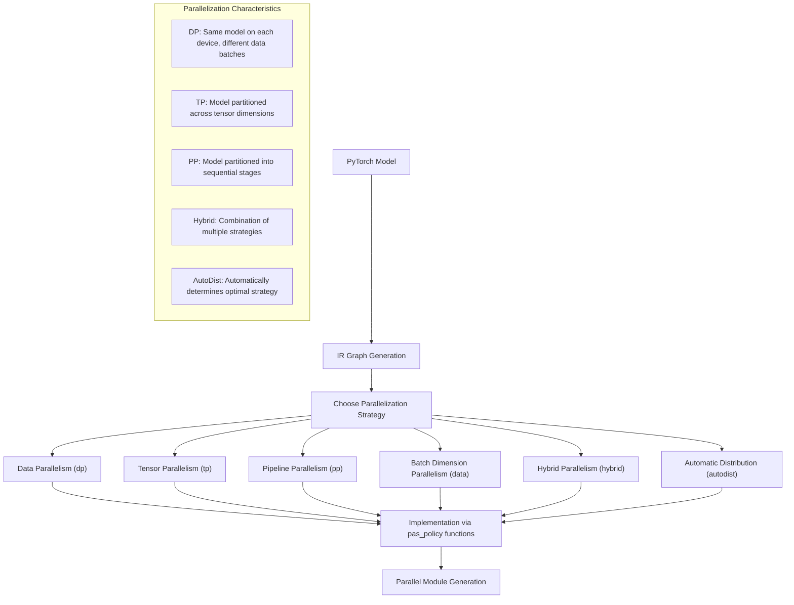
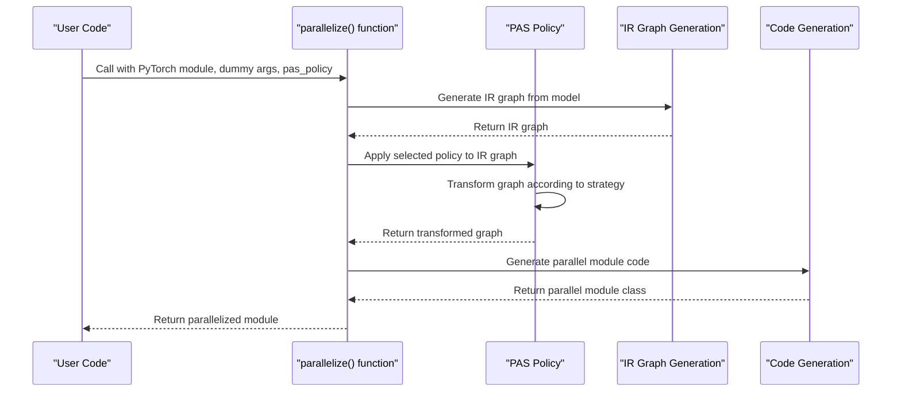
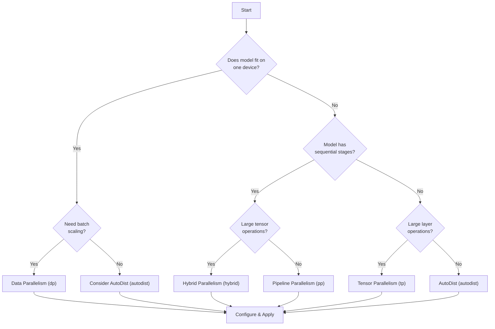
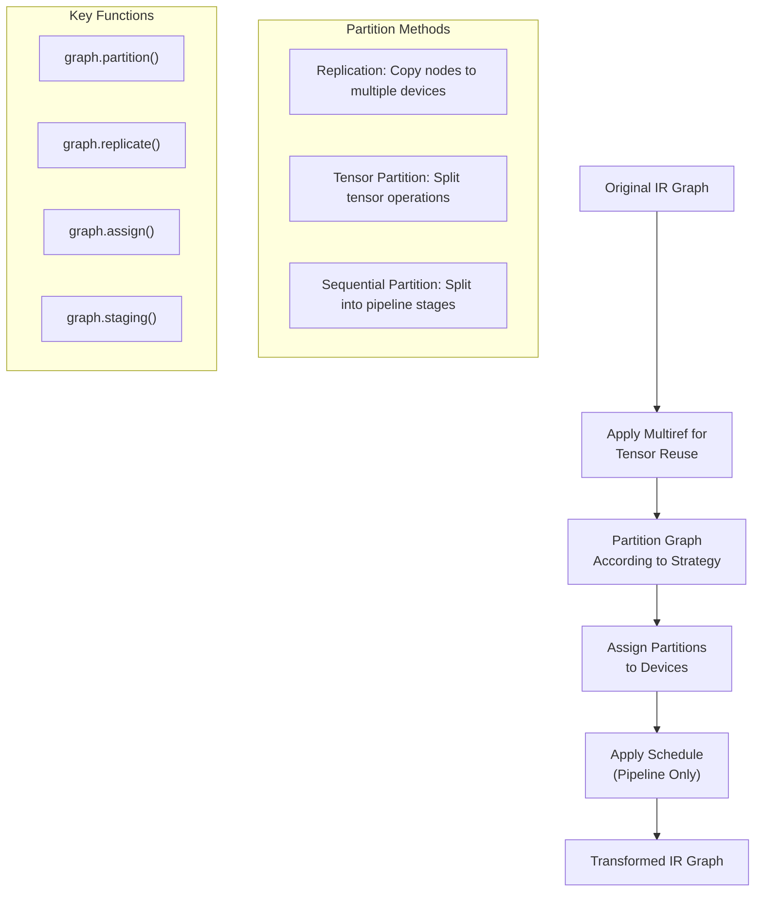

<!-- source: DeepWiki mcp.deepwiki.com · repo microsoft/nnscaler · page 3 Parallelization Strategies · fetched 2026-10-26 -->

# Parallelization Strategies

<details>
<summary>Relevant source files</summary>

The following files were used as context for generating this wiki page:

- [README.md](README.md)
- [nnscaler/parallel.py](nnscaler/parallel.py)
- [nnscaler/policies.py](nnscaler/policies.py)
- [nnscaler/version.py](nnscaler/version.py)

</details>


This page provides an overview of the different parallelization strategies available in nnScaler for distributing deep learning models across multiple devices. Understanding these strategies is essential for efficiently scaling your models to leverage multiple GPUs.

nnScaler supports several standard parallelization techniques as well as hybrid approaches and an automatic distribution system. For detailed implementation of specific strategies, see the child pages: [Data Parallelism](#3.1), [Tensor Parallelism](#3.2), [Pipeline Parallelism](#3.3), and [Hybrid Parallelism](#3.4). For information about the automatic distribution system, see [AutoDist](#4).

Sources: [README.md:22-28](), [nnscaler/policies.py:1-19]()

## Parallelization Strategy Overview

nnScaler implements various parallelization strategies through policy functions that transform the intermediate representation (IR) graph of a model. Each strategy has different characteristics and is suitable for different types of models and hardware configurations.

**Diagram: Parallelization Strategies in nnScaler**



Sources: [nnscaler/policies.py:78-347](), [nnscaler/parallel.py:899-920]()

## Specifying a Parallelization Strategy

When using nnScaler, you can select a parallelization strategy by passing the appropriate `pas_policy` parameter to the `parallelize()` function. This can be a string identifier for built-in strategies or a custom policy function.

**Diagram: Parallelization Process Flow**



Here's how to specify a parallelization strategy:

```python
# Using a built-in strategy
parallel_module = parallelize(
    module, 
    dummy_forward_args, 
    pas_policy="dp",  # Choose from: "dp", "tp", "pp", "data", "hybrid", "autodist"
    compute_config=compute_config
)

# Using a custom policy function
def my_custom_policy(graph, config):
    # Custom graph transformation logic
    return transformed_graph

parallel_module = parallelize(
    module, 
    dummy_forward_args, 
    pas_policy=my_custom_policy,
    compute_config=compute_config
)
```

Sources: [nnscaler/parallel.py:899-1120](), [nnscaler/policies.py:78-347]()

## Built-in Parallelization Strategies

nnScaler includes several built-in parallelization strategies implemented as policy functions. Each strategy transforms the IR graph of the model in a specific way to distribute computation across devices.

### Data Parallelism (DP)

Data parallelism replicates the entire model on each device and splits the input data batch among devices. Each device computes the forward and backward passes on its data subset, and gradients are synchronized across devices.

**Key characteristics:**
- Simplest parallelization strategy
- Works well when model fits entirely in a single device's memory
- Requires gradient synchronization between devices
- Good for batch-oriented training

Implementation: [nnscaler/policies.py:78-89]()

### Tensor Parallelism (TP)

Tensor parallelism splits individual tensors and operations across devices. This allows distributing a single operation (like a large matrix multiplication) across multiple devices.

**Key characteristics:**
- Partitions individual tensor operations
- Can handle models larger than a single device's memory
- Reduces communication overhead for large tensors
- Well-suited for models with large layers (e.g., transformer models)

Implementation: [nnscaler/policies.py:92-129]()

### Pipeline Parallelism (PP)

Pipeline parallelism divides the model into sequential stages, with each stage assigned to a different device. Data flows through these stages in a pipelined manner.

**Key characteristics:**
- Splits model sequentially across devices
- Well-suited for deep models with sequential dependencies
- Can introduce pipeline bubbles (inefficiency)
- Requires careful scheduling to maximize efficiency

Implementation: [nnscaler/policies.py:132-140]()

### Batch Dimension Parallelism (data)

This strategy specifically partitions tensors along the batch dimension across devices.

**Key characteristics:**
- Focuses on partitioning the batch dimension
- Similar to data parallelism but with tensor-level partitioning
- Useful for specific neural network architectures

Implementation: [nnscaler/policies.py:142-165]()

### Hybrid Parallelism (hybrid)

Hybrid parallelism combines multiple strategies (typically pipeline and tensor parallelism) to optimize model distribution across devices.

**Key characteristics:**
- Combines benefits of multiple strategies
- Can be more efficient than any single strategy
- Requires end-to-end mode
- Supports complex configuration options

Implementation: [nnscaler/policies.py:168-218]()

### Automatic Distribution (autodist)

The AutoDist system automatically determines an optimal parallelization strategy based on model characteristics, hardware resources, and performance profiles.

**Key characteristics:**
- Analyses model structure and memory requirements
- Automatically selects an optimal parallelization strategy
- Supports various constraints and configurations
- Can significantly improve performance with minimal user effort

Implementation: [nnscaler/policies.py:221-347]()

Sources: [nnscaler/policies.py:78-347]()

## Configuration and Selection

Selecting the appropriate parallelization strategy depends on various factors:

**Diagram: Strategy Selection Decision Tree**



### Configuring Parallelization Strategies

The configuration for each strategy is specified through the `ComputeConfig` object and its `pas_config` dictionary. Here are some key configuration options:

| Strategy | Key Configuration Options | Purpose |
|----------|---------------------------|---------|
| All | `plan_ngpus` | Number of GPUs for planning parallelization |
| All | `runtime_ngpus` | Number of GPUs for runtime execution |
| All | `use_zero` | Whether to use ZeRO optimizer |
| Pipeline | `pipeline_nstages` | Number of pipeline stages |
| Pipeline | `pipeline_nmicros` | Number of micro-batches for pipeline |
| Pipeline | `pipeline_scheduler` | Pipeline scheduler type (e.g., '1f1b') |
| Hybrid | `pp_size` | Number of pipeline-parallel devices |
| AutoDist | `max_partition_degree` | Maximum partition degree per operator |
| AutoDist | `mem_constraint` | Memory constraint per device (MB) |
| AutoDist | `pipeline_pivots` | Pivot modules for pipeline partition |

Example configuration:

```python
from nnscaler.parallel import ComputeConfig

# Configure for hybrid parallelization
config = ComputeConfig(
    plan_ngpus=8,
    runtime_ngpus=8,
    use_end2end=True,
    pas_config={
        'pipeline_nstages': 4,
        'pipeline_nmicros': 4,
        'pipeline_scheduler': '1f1b',
        'pp_size': 4  # 4 pipeline stages, each with 2 tensor-parallel devices
    }
)

# Use the configuration with parallelize function
parallel_module = parallelize(
    module,
    dummy_forward_args,
    pas_policy="hybrid", 
    compute_config=config
)
```

Sources: [nnscaler/parallel.py:69-238](), [nnscaler/policies.py:168-218]()

## Implementation Details

Each parallelization strategy is implemented as a policy function that transforms the IR graph of the model. These functions follow a common pattern:

1. Apply `auto_multiref` if needed to handle tensor reuse
2. Process graph nodes according to the specific strategy
3. Assign transformed nodes to appropriate devices
4. Apply scheduling if needed (for pipeline parallelism)

**Diagram: IR Graph Transformation Process**



### Key IR Graph Transformation Functions

The IR graph transformation process relies on several core functions:

1. `graph.partition()` - Partitions a node according to a specific algorithm
2. `graph.replicate()` - Creates copies of a node for multiple devices
3. `graph.assign()` - Assigns a node to a specific device
4. `graph.staging()` - Divides the graph into pipeline stages
5. `graph.multiref()` - Handles tensor references across multiple consumers

These functions are used in different combinations by each parallelization strategy to achieve the desired distribution of computation.

Sources: [nnscaler/policies.py:45-76](), [nnscaler/policies.py:168-218]()

## Advanced Topics

### Customizing Parallelization Strategies

You can create custom parallelization strategies by implementing a policy function that transforms the IR graph. This function should:

1. Take an `IRGraph` and a `ComputeConfig` as parameters
2. Apply appropriate transformations to the graph
3. Return the transformed graph

Example structure of a custom policy function:

```python
def pas_custom(graph: IRGraph, cfg: 'ComputeConfig'):
    """
    Custom parallelization strategy
    """
    ngpus = cfg.plan_ngpus
    
    # Apply multiref for tensor reuse if needed
    auto_multiref(graph)
    
    # Custom graph transformation logic
    # ...
    
    return graph
```

### Combining Strategies

While nnScaler provides a built-in hybrid strategy, you can also create custom combinations by implementing a policy function that applies multiple strategies to different parts of the model.

### Memory Considerations

Different parallelization strategies have different memory characteristics:

- **Data Parallelism**: Requires enough memory to store the entire model on each device
- **Tensor Parallelism**: Reduces memory needed for individual tensors/operations
- **Pipeline Parallelism**: Reduces memory needed for model parameters but may require memory for activations
- **Hybrid Approaches**: Balance memory usage across different dimensions

When memory is constrained, consider using the AutoDist system to automatically find an optimal strategy based on memory constraints.

Sources: [nnscaler/policies.py:221-347](), [nnscaler/parallel.py:900-920]()

## Best Practices

1. **Start with simple strategies**: Begin with data parallelism if your model fits on a single device
2. **Consider model architecture**: Different model architectures benefit from different strategies
3. **Benchmark multiple approaches**: Performance can vary based on specific models and hardware
4. **Use AutoDist for complex models**: Let the automatic system find optimal strategies for large models
5. **Configure pipeline micro-batches carefully**: Too few or too many can impact efficiency

For most use cases, starting with the `autodist` strategy is recommended, as it will automatically analyze your model and select an appropriate parallelization approach.

Sources: [README.md:26-32](), [nnscaler/policies.py:221-347]()

---

