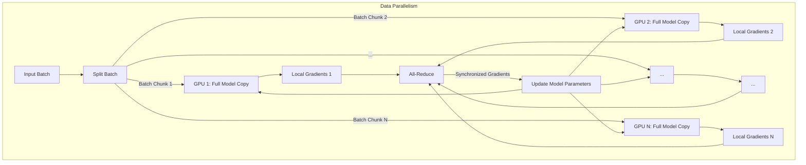
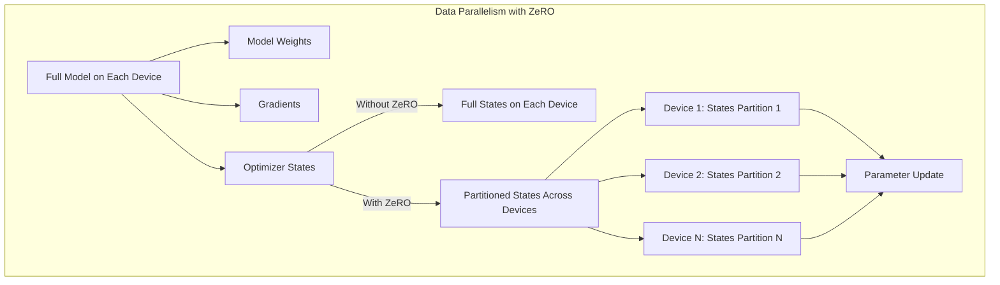
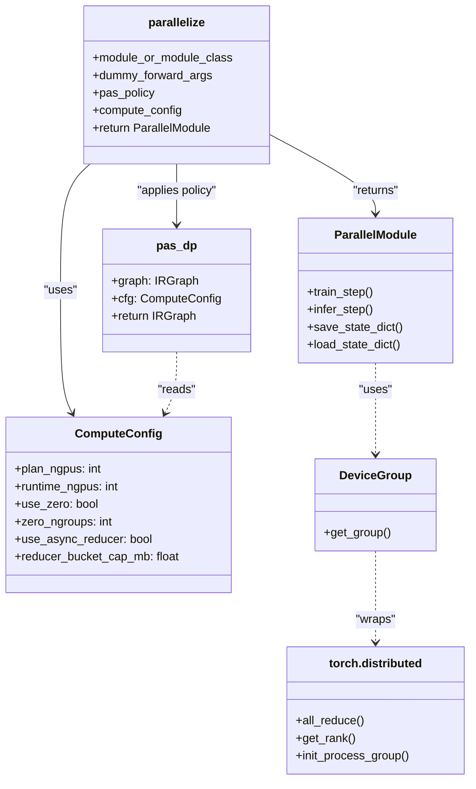

<!-- source: DeepWiki mcp.deepwiki.com · repo microsoft/nnscaler · page 3.1 Data Parallelism · fetched 2026-10-26 -->

# Data Parallelism

<details>
<summary>Relevant source files</summary>

The following files were used as context for generating this wiki page:

- [nnscaler/parallel.py](nnscaler/parallel.py)
- [nnscaler/policies.py](nnscaler/policies.py)
- [nnscaler/version.py](nnscaler/version.py)
- [tests/autodist/spmd_solver/test_solver_data_parallel/comp/torch.matmul.json](tests/autodist/spmd_solver/test_solver_data_parallel/comp/torch.matmul.json)

</details>


This document explains data parallelism in nnScaler, which is the simplest form of distributed training strategy for neural networks. Data parallelism is one of several parallelization methods available in nnScaler; for other approaches, see [Tensor Parallelism](#3.2), [Pipeline Parallelism](#3.3), and [Hybrid Parallelism](#3.4).

## Overview of Data Parallelism

Data parallelism is a distributed training strategy where:

1. The entire model is replicated on each device (GPU)
2. Each device processes a different subset of the input data batch
3. Gradients from all devices are synchronized (typically via all-reduce) to update the model parameters

This approach is particularly effective for models that fit within the memory of a single device but benefit from processing larger batch sizes or accelerating training through parallel computation.



Sources: [nnscaler/policies.py:78-90](), [nnscaler/parallel.py:901-994]()

## Implementation in nnScaler

nnScaler implements data parallelism through the `pas_dp` policy function. Unlike some other parallelism strategies, data parallelism is relatively straightforward to implement as it's primarily concerned with replication rather than partitioning.

### Key Implementation Details

The data parallelism policy in nnScaler:

1. Sets `plan_ngpus=1` (planning phase uses a single GPU representation)
2. Replicates all operations in the intermediate representation (IR) graph
3. Automatically handles gradient synchronization during the backward pass
4. Can be optionally enhanced with ZeRO optimization techniques

```mermaid
flowchart TD
    subgraph "nnScaler Data Parallelism Implementation"
        UserModel["User PyTorch Model"] --> Trace["Model Tracing"]
        Trace --> IRGraph["IR Graph Generation"]
        
        IRGraph --> PASDP["pas_dp Policy Application"]
        PASDP --> Replicate["Replicate All Operations"]
        Replicate --> Assign["Assign to Device 0"]
        
        Assign --> CodeGen["Code Generation"]
        CodeGen -->|"Generated Module"| Runtime["Runtime Execution"]
        
        subgraph "Runtime Phase"
            Runtime --> |"Device 0"| Device0["Process Batch Chunk 0"]
            Runtime --> |"Device 1"| Device1["Process Batch Chunk 1"]
            Runtime --> |"Device N"| DeviceN["Process Batch Chunk N"]
            
            Device0 --> AllReduce["All-Reduce Gradients"]
            Device1 --> AllReduce
            DeviceN --> AllReduce
            
            AllReduce --> Update["Update Parameters"]
            Update --> Device0
            Update --> Device1
            Update --> DeviceN
        end
    end
```



Sources: [nnscaler/policies.py:78-90](), [nnscaler/parallel.py:618-706]()

## Configuration

To use data parallelism in nnScaler, you need to:

1. Create a `ComputeConfig` instance with appropriate settings
2. Call `parallelize()` with the "dp" policy

### Key Configuration Parameters

| Parameter | Description | Default | Notes |
|-----------|-------------|---------|-------|
| `plan_ngpus` | Number of GPUs for planning | Must be 1 for DP | Required |
| `runtime_ngpus` | Number of GPUs at runtime | Inferred from `WORLD_SIZE` | Required |
| `use_zero` | Enable ZeRO optimizer | `False` | Optional memory optimization |
| `zero_ngroups` | Number of ZeRO optimizer groups | 1 | Only relevant when `use_zero=True` |
| `use_async_reducer` | Use async gradient reduction | `False` | Requires `use_end2end=True` |
| `reducer_bucket_cap_mb` | Max reducer bucket size (MB) | None | Performance optimization |

Sources: [nnscaler/parallel.py:69-238]()

### Example Usage

```python
from nnscaler import ComputeConfig, parallelize

# Create configuration for data parallelism
config = ComputeConfig(
    plan_ngpus=1,         # Must be 1 for data parallelism
    runtime_ngpus=8,      # Using 8 GPUs at runtime
    use_zero=True,        # Optional: Enable ZeRO optimizer
    use_end2end=True      # Enable end-to-end mode
)

# Apply data parallelism to your model
parallel_model = parallelize(
    model,                # Your PyTorch model
    dummy_forward_args,   # Dummy inputs for model tracing
    pas_policy="dp",      # Data parallelism policy
    compute_config=config # Configuration
)

# Train the parallelized model
parallel_model.train_step(batch_data)
```

Sources: [nnscaler/parallel.py:901-994]()

## Memory Optimization with ZeRO

Data parallelism can be memory-intensive because each device stores a full copy of the model. nnScaler supports ZeRO (Zero Redundancy Optimizer) to reduce the memory footprint:

- With `use_zero=True`, optimizer states are partitioned across devices
- `zero_ngroups` controls the number of groups for ZeRO partitioning
- `zero_use_reduce_scatter` can be enabled for potentially better performance

ZeRO can significantly reduce memory usage while maintaining the computational advantages of data parallelism.



Sources: [nnscaler/parallel.py:69-106](), [nnscaler/parallel.py:219-237]()

## Gradient Synchronization

nnScaler automatically handles gradient synchronization across devices during the backward pass:

- By default, synchronous all-reduce operations are used to accumulate gradients
- When `use_async_reducer=True`, asynchronous gradient reduction is enabled (requires `use_end2end=True`)
- `reducer_bucket_cap_mb` controls the bucket size for gradient reduction, which can impact performance

For large models, gradient synchronization can become a communication bottleneck. nnScaler's bucketing approach helps mitigate this by reducing the number of communication operations.

Sources: [nnscaler/parallel.py:95-104](), [nnscaler/runtime/adapter/reducer.py]() (referenced in imports)

## Under the Hood: The Policy Implementation

The core implementation of data parallelism in nnScaler is found in the `pas_dp` function:

```python
def pas_dp(graph: IRGraph, cfg: 'ComputeConfig'):
    """
    pure data parallelism policy
    """
    ngpus = cfg.plan_ngpus
    if ngpus != 1:
        raise ValueError("Data parallelism only supports 1 plan GPU")

    # no partition is done, so we can skip multiref safely
    for node in graph.select(ntype=(IRFwOperation, IRDataOperation)):
        _replica(graph, node, [0])
    return graph
```

This function:
1. Verifies that `plan_ngpus` is set to 1 (a requirement for data parallelism)
2. Iterates through all forward and data operation nodes in the IR graph
3. Replicates each node with a device assignment of 0
4. Returns the modified graph which is then used for code generation

Sources: [nnscaler/policies.py:78-90]()

## Benefits and Limitations

### Benefits

- **Simplicity**: Easiest parallelism strategy to implement and use
- **Scaling**: Nearly linear scaling with number of devices for compute-bound workloads
- **No model modifications**: Works with any model that fits on a single device

### Limitations

- **Memory constrained**: Each device needs enough memory to store the entire model (mitigated with ZeRO)
- **Communication overhead**: All-reduce operations can become a bottleneck for very large models
- **Not suitable for large models**: Models that exceed single-device memory cannot use pure data parallelism

## Comparison with Other Parallelism Strategies

| Strategy | Implementation | Best For | Memory Efficiency | Communication Overhead |
|----------|---------------|----------|-------------------|------------------------|
| **Data Parallelism** | Replicate model, split data | Small to medium models | Low (high with ZeRO) | Proportional to model size |
| **Tensor Parallelism** | Split individual operations | Large model layers | High | Proportional to activation sizes |
| **Pipeline Parallelism** | Split model into stages | Deep models | High | Low, but adds pipeline bubbles |
| **Hybrid Parallelism** | Combination of strategies | Very large models | Very high | Optimized based on model |

For more complex models that exceed the capacity of a single device, consider:
- [Tensor Parallelism](#3.2) for splitting individual tensor operations
- [Pipeline Parallelism](#3.3) for sequentially partitioning model layers
- [Hybrid Parallelism](#3.4) for combining multiple parallelism strategies

Sources: [nnscaler/policies.py]()

## Relationship to PyTorch Distributed

nnScaler's data parallelism builds upon PyTorch's distributed capabilities but provides several advantages:

- Automatic code generation for optimized execution
- Integration with other parallelism strategies
- Support for ZeRO optimization
- Configurable gradient synchronization



Sources: [nnscaler/parallel.py:901-994](), [nnscaler/policies.py:78-90](), [nnscaler/runtime/device.py]() (referenced in imports)

---

