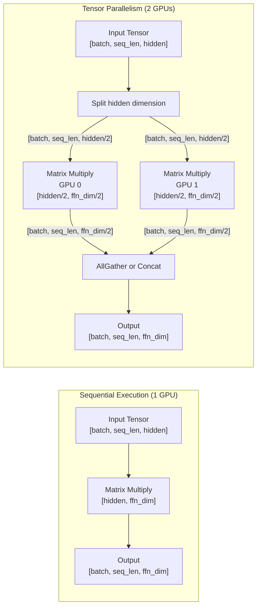
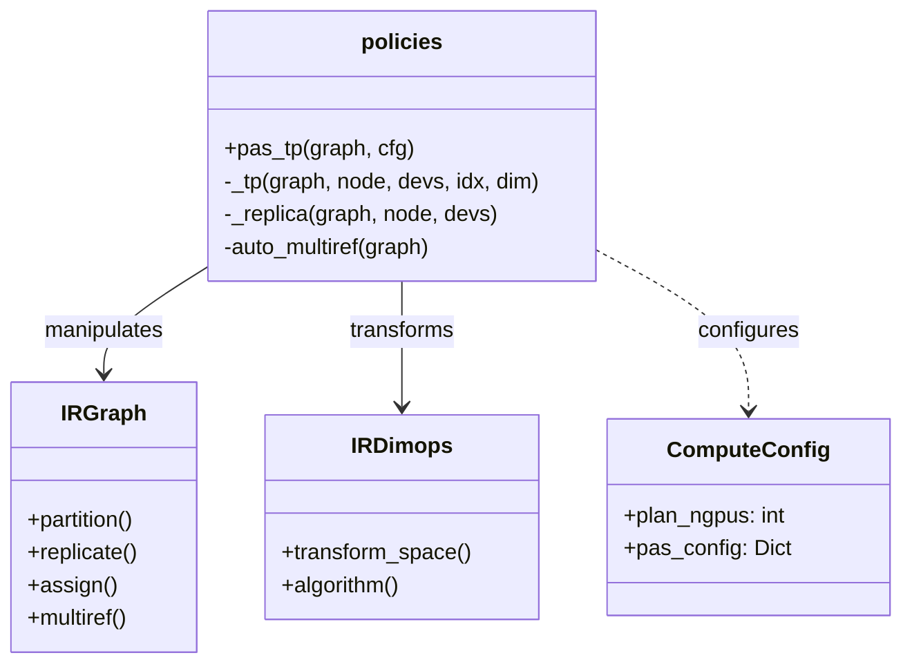
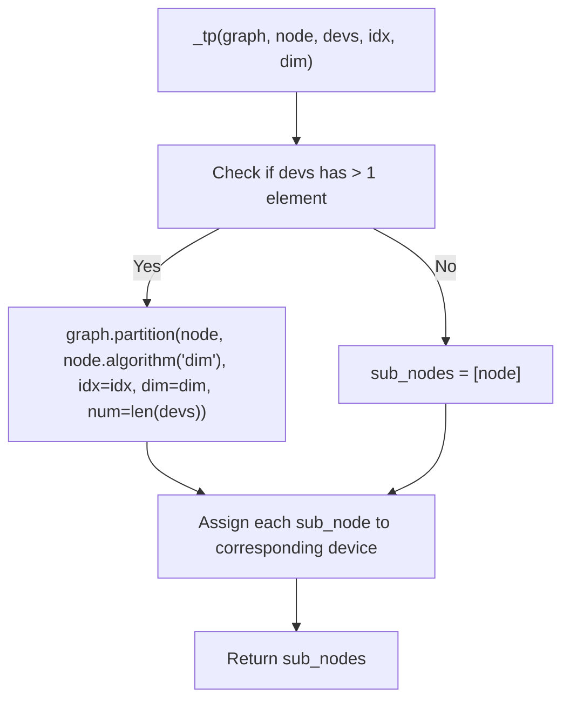
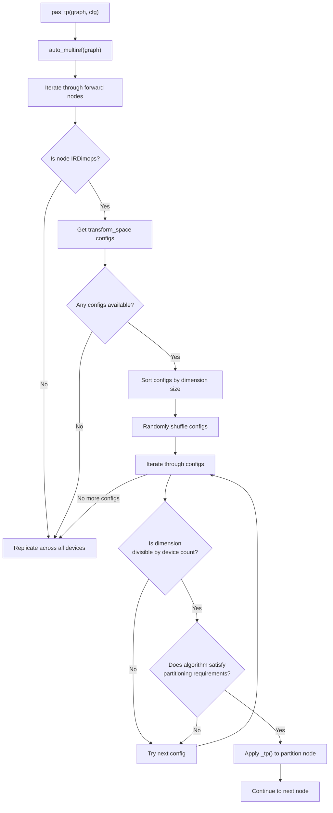

<!-- source: DeepWiki mcp.deepwiki.com · repo microsoft/nnscaler · page 3.2 Tensor Parallelism · fetched 2026-10-26 -->

# Tensor Parallelism

<details>
<summary>Relevant source files</summary>

The following files were used as context for generating this wiki page:

- [README.md](README.md)
- [nnscaler/parallel.py](nnscaler/parallel.py)
- [nnscaler/policies.py](nnscaler/policies.py)
- [nnscaler/version.py](nnscaler/version.py)

</details>


Tensor Parallelism (TP) is a distributed training strategy in nnScaler that partitions individual tensors across multiple devices, enabling parallel computation on different portions of the same tensor. Unlike Data Parallelism which replicates the model across devices and splits the data, or Pipeline Parallelism which divides the model into sequential stages, Tensor Parallelism splits individual layers or operations of the model along specific tensor dimensions.

This document explains how Tensor Parallelism is implemented and used in nnScaler. For information about other parallelism strategies, see [Data Parallelism](#3.1), [Pipeline Parallelism](#3.3), and [Hybrid Parallelism](#3.4).

## Conceptual Overview

In Tensor Parallelism, model layers are split along specific dimensions to distribute computation across multiple devices. The most common application is partitioning large matrix multiplications in transformer models by splitting the hidden dimension, allowing parallel computation followed by communication to collect results.



**Diagram: Tensor Parallelism for Matrix Multiplication**

Sources: [nnscaler/policies.py:45-53](), [nnscaler/policies.py:92-129]()

### Key Benefits of Tensor Parallelism

1. **Memory Efficiency**: Reduces per-device memory requirements by distributing large tensors across devices
2. **Computation Parallelism**: Speeds up computation for large matrix operations
3. **Scalability**: Enables training models too large to fit on a single device
4. **Reduced Communication**: Can require less communication than other parallelism strategies for certain model architectures

### When to Use Tensor Parallelism

Tensor Parallelism is particularly effective when:
- The model contains large, computationally intensive operators (like large matrix multiplications)
- Individual tensors are too large to fit in a single device's memory
- Model architecture has natural points for tensor partitioning (such as attention heads or feed-forward layers)
- The dimensions of key tensors are cleanly divisible by the number of devices

## Implementation in nnScaler

In nnScaler, Tensor Parallelism is implemented primarily through the `pas_tp` policy function in the policies module.



**Diagram: Tensor Parallelism Implementation Classes**

Sources: [nnscaler/policies.py:45-53](), [nnscaler/policies.py:92-129](), [nnscaler/parallel.py:69-238]()

### Core Tensor Parallelism Function

The `_tp()` function is the core implementation that partitions IRDimops nodes along specified dimensions:



**Diagram: Core TP Function Operation**

Sources: [nnscaler/policies.py:45-53]()

### Tensor Parallelism Policy

The `pas_tp` policy function implements random tensor parallelism inside a scale unit and data parallelism across scale units:

1. Takes an IR graph and configuration as input
2. Uses a fixed random seed for reproducibility
3. Calls `auto_multiref()` to handle tensor references
4. Iterates through IRFwOperation and IRDataOperation nodes in the graph
5. For IRDimops nodes:
   - Gets possible transformation configurations
   - Randomly selects dimensions for partitioning
   - Checks if dimensions are divisible by device count
   - Partitions the node if possible, otherwise replicates
6. Replicates non-IRDimops nodes across devices

Sources: [nnscaler/policies.py:92-129]()

## Configuration

Tensor Parallelism is configured through the `ComputeConfig` class and selected using the 'tp' policy identifier.

### Basic Configuration Example

```python
from nnscaler.parallel import ComputeConfig, parallelize

# Create configuration for tensor parallelism
config = ComputeConfig(
    plan_ngpus=4,                   # Number of GPUs for parallelization planning
    runtime_ngpus=4,                # Number of GPUs at runtime
    use_end2end=True,               # Enable end-to-end mode
    pas_config={
        'seed': 42,                 # Random seed for reproducibility
    }
)

# Parallelize a model using tensor parallelism
parallel_model = parallelize(
    model,                          # PyTorch model
    dummy_forward_args,             # Dummy inputs for tracing
    'tp',                           # Use tensor parallelism policy
    config                          # Configuration object
)
```

Sources: [nnscaler/parallel.py:69-238](), [nnscaler/parallel.py:901-993]()

### Important Configuration Parameters

| Parameter | Description | Default |
|-----------|-------------|---------|
| `plan_ngpus` | Number of GPUs for parallelization planning | Required |
| `runtime_ngpus` | Number of GPUs at runtime | `WORLD_SIZE` env variable |
| `use_end2end` | Enable end-to-end mode (loss as first output) | `False` |
| `pas_config['seed']` | Random seed for TP partitioning decisions | `1` |

Sources: [nnscaler/parallel.py:69-238](), [nnscaler/policies.py:100]()

## Internal Decision Flow

The Tensor Parallelism policy uses a decision flow to determine how to partition each node:



**Diagram: Tensor Parallelism Decision Flow**

Sources: [nnscaler/policies.py:92-129]()

## Integration with Other Parallelism Strategies

Tensor Parallelism in nnScaler can be combined with other parallelism strategies for enhanced scalability:

1. **TP with Data Parallelism**: When `runtime_ngpus` > `plan_ngpus`, each tensor-parallelized model is further replicated across nodes (Data Parallelism)

2. **TP with Pipeline Parallelism**: Using the hybrid policy, which combines tensor and pipeline parallelism:
   - Model is first divided into pipeline stages
   - Each stage is then tensor-parallelized across available devices

3. **Automatic Integration**: The `autodist` policy automatically determines the optimal combination of parallelism strategies, potentially incorporating tensor parallelism

Sources: [nnscaler/policies.py:168-218](), [nnscaler/policies.py:221-347]()

## Advanced Usage

### Hybrid Parallelism with Tensor Parallelism

For large models, combining tensor parallelism with pipeline parallelism can be more effective:

```python
from nnscaler.parallel import ComputeConfig, parallelize

config = ComputeConfig(
    plan_ngpus=8,
    runtime_ngpus=8,
    use_end2end=True,
    pas_config={
        'pipeline_nstages': 4,       # 4 pipeline stages
        'pipeline_nmicros': 8,       # 8 micro-batches for pipeline
        'pipeline_scheduler': '1f1b', # 1F1B pipeline scheduler
        'pp_size': 4,                # 4 GPUs for pipeline parallelism
    }
)

# This will use 4 GPUs for pipeline (pp_size=4) 
# and 2 GPUs for tensor parallelism per stage (8/4=2)
parallel_model = parallelize(
    model,
    dummy_forward_args,
    'hybrid',                       # Hybrid parallelism policy
    config
)
```

Sources: [nnscaler/policies.py:168-218]()

### Automatic Distribution with Tensor Parallelism

The `autodist` policy can automatically incorporate tensor parallelism where beneficial:

```python
config = ComputeConfig(
    plan_ngpus=8,
    runtime_ngpus=8,
    use_end2end=True,
    pas_config={
        'max_partition_degree': 8,   # Maximum tensor partition degree
        'mem_constraint': 16,        # Memory constraint in GB
        're_profile': True,          # Re-profile performance
    }
)

# AutoDist will automatically determine optimal parallelization strategy
parallel_model = parallelize(
    model,
    dummy_forward_args,
    'autodist',                     # Automatic distribution policy
    config
)
```

Sources: [nnscaler/policies.py:221-347]()

## Limitations and Considerations

When using Tensor Parallelism in nnScaler, consider the following:

1. **Divisibility Requirements**: Tensor dimensions must be cleanly divisible by the number of devices for optimal performance

2. **Communication Overhead**: While TP can be efficient, it introduces communication operations that can become bottlenecks

3. **Operation Support**: Not all operations support tensor parallelism; some operations may need to be replicated

4. **Dimension Selection**: The random selection of dimensions for partitioning may not always yield optimal performance

5. **Custom Operations**: When using custom operations, proper dimension specifications must be provided for effective tensor parallelism

Sources: [nnscaler/policies.py:92-129](), [nnscaler/policies.py:43-53]()

## Summary

Tensor Parallelism in nnScaler provides an effective way to scale large models across multiple devices by partitioning individual tensors. It's particularly useful for models with large operators that can be naturally partitioned, such as transformer models with large matrix multiplications. The implementation in nnScaler offers flexibility through configurable policies and can be combined with other parallelism strategies for enhanced scalability.

---

