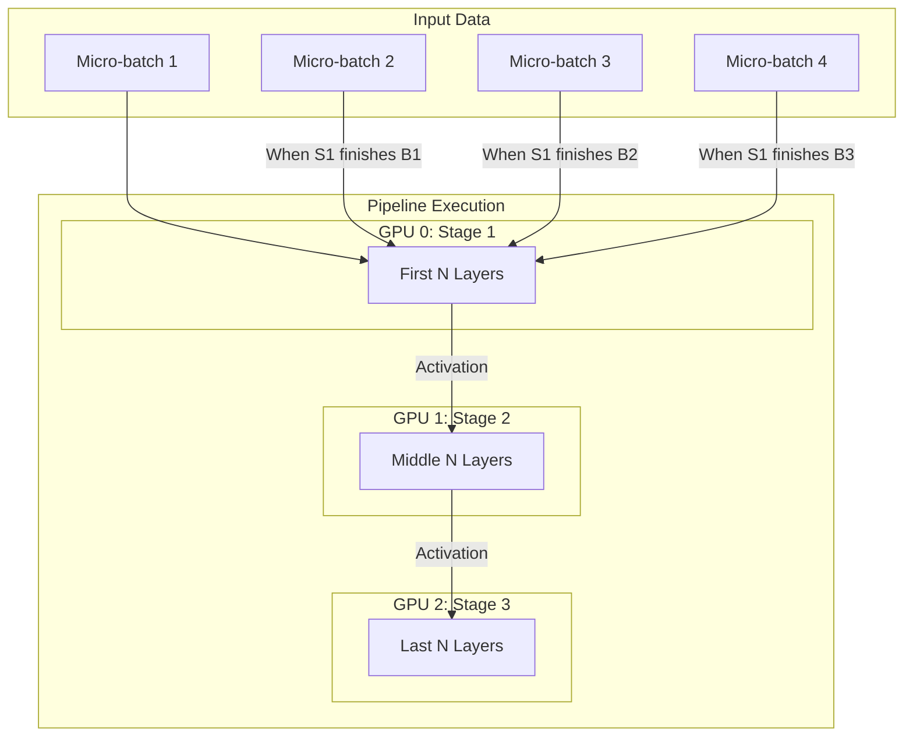
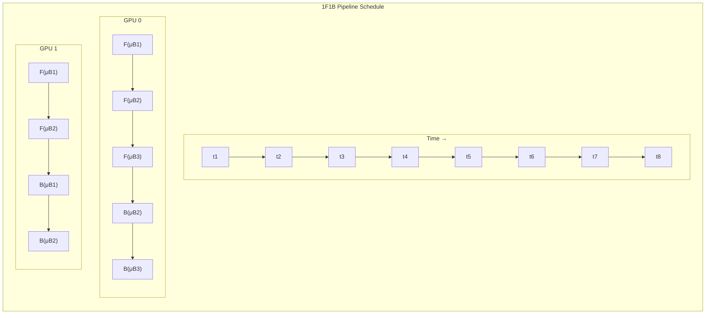
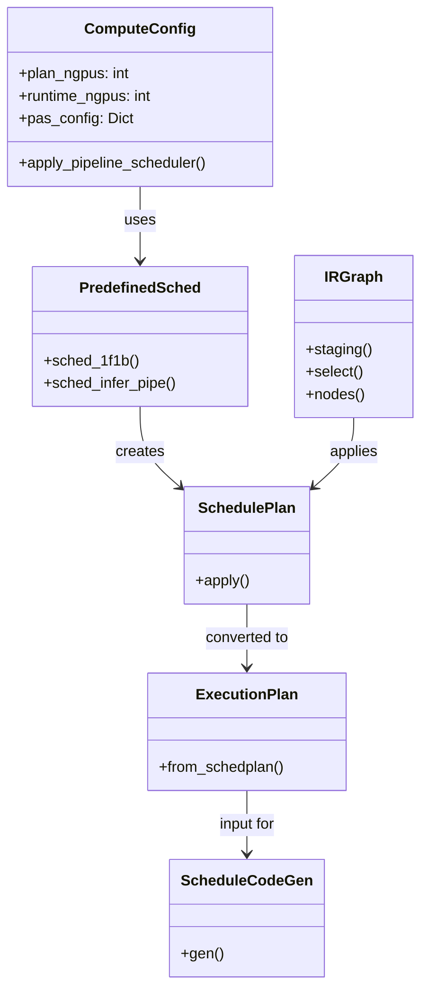
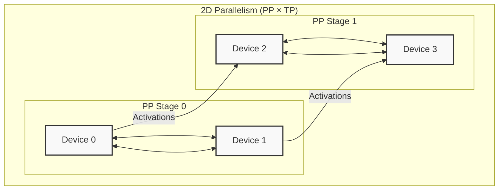

<!-- source: DeepWiki mcp.deepwiki.com · repo microsoft/nnscaler · page 3.3 Pipeline Parallelism · fetched 2026-10-26 -->

# Pipeline Parallelism

<details>
<summary>Relevant source files</summary>

The following files were used as context for generating this wiki page:

- [README.md](README.md)
- [nnscaler/parallel.py](nnscaler/parallel.py)
- [nnscaler/policies.py](nnscaler/policies.py)
- [nnscaler/version.py](nnscaler/version.py)

</details>


Pipeline parallelism is a model parallelism strategy that partitions a deep neural network along its depth (layers) and executes different parts of the network on different devices. This document describes how pipeline parallelism is implemented in nnScaler, its configuration options, and best practices for usage.

For information about other parallelization strategies, see [Data Parallelism](#3.1) and [Tensor Parallelism](#3.2). To learn about combining multiple parallelism strategies, see [Hybrid Parallelism](#3.4).

Sources: [README.md:1-223](), [nnscaler/policies.py:1-347]()

## How Pipeline Parallelism Works

Pipeline parallelism divides the model's layers into multiple sequential stages, with each stage assigned to a different GPU. Computation is then performed in a pipelined fashion, where multiple micro-batches flow through the system simultaneously.



The key benefits of pipeline parallelism include:

1. **Memory Efficiency**: Each device only needs to store a portion of the model, enabling training of larger models that wouldn't fit on a single GPU
2. **Communication Efficiency**: Only activations at the boundaries between stages need to be transferred between devices
3. **Computational Efficiency**: Different layers can execute in parallel on different micro-batches

However, pipeline parallelism introduces pipeline bubbles (idle time) during the warm-up and cool-down phases of the pipeline.

Sources: [nnscaler/policies.py:132-139](), [nnscaler/parallel.py:167-193]()

## Pipeline Scheduling Strategies

nnScaler supports different pipeline scheduling strategies to maximize hardware utilization and minimize pipeline bubbles. The most common scheduling strategy is 1F1B (one-forward-one-backward).



Legend:
- F: Forward pass
- B: Backward pass
- μB: Micro-batch

In the 1F1B schedule, each device alternates between forward and backward passes. This approach reduces memory requirements while maintaining good computational efficiency.

Sources: [nnscaler/parallel.py:56-60](), [nnscaler/policies.py:180-181]()

## Configuring Pipeline Parallelism in nnScaler

To use pipeline parallelism in nnScaler, you need to configure the following parameters:

### Key Configuration Parameters

| Parameter | Description | Default |
|-----------|-------------|---------|
| `pipeline_nstages` | Number of pipeline stages | Either equal to `plan_ngpus` or 'auto' |
| `pipeline_nmicros` | Number of micro-batches | Required when using pipeline |
| `pipeline_scheduler` | Scheduling algorithm | '1f1b' |
| `pipeline_pivots` | Specific modules to use as stage boundaries | Required for autodist pipeline |

These parameters are typically specified in the `pas_config` dictionary of the `ComputeConfig` object.

Sources: [nnscaler/policies.py:133-139](), [nnscaler/parallel.py:167-193]()

## Pipeline Parallelism Implementation

In nnScaler, pipeline parallelism is implemented through the following components:



The pipeline implementation follows these steps:

1. The model graph is analyzed and divided into stages
2. A scheduling plan is created based on the chosen scheduler
3. The execution plan is generated from the scheduling plan
4. Code is generated for each device to execute its assigned stage with proper communication

Sources: [nnscaler/parallel.py:167-193](), [nnscaler/parallel.py:820-855]()

## Pipeline Parallelism in Practice

### Using Pure Pipeline Parallelism

The `pas_pp` policy enables pure pipeline parallelism:

```python
# Example usage (not actual code)
compute_config = ComputeConfig(
    plan_ngpus=4,
    runtime_ngpus=4,
    use_end2end=True,
    pas_config={
        'pipeline_nstages': 4,
        'pipeline_nmicros': 8,
        'pipeline_scheduler': '1f1b'
    }
)

# Use the pipeline parallelism policy
parallel_model = parallelize(model, input_args, pas_policy='pp', compute_config=compute_config)
```

Key requirements for pipeline parallelism:

1. `use_end2end` must be `True` in the `ComputeConfig`
2. `pipeline_nmicros` must be specified and greater than 0
3. `pipeline_nstages` must be specified and greater than 0

Sources: [nnscaler/policies.py:132-139](), [nnscaler/parallel.py:167-193]()

### Using Hybrid Parallelism with Pipeline

The `pas_hybrid` policy combines pipeline parallelism with tensor parallelism:



In this configuration:
- The model is first divided into pipeline stages (vertical partitioning)
- Each stage is further split using tensor parallelism (horizontal partitioning)
- Communication happens both within each stage (for tensor parallelism) and between stages (for pipeline parallelism)

Sources: [nnscaler/policies.py:168-218]()

## Advanced Pipeline Parallelism with AutoDist

nnScaler also supports automatic pipeline parallelism configuration through the `pas_autodist` policy, which can determine optimal pipeline configurations:

```python
# Example usage with autodist (not actual code)
compute_config = ComputeConfig(
    plan_ngpus=8,
    runtime_ngpus=8,
    use_end2end=True,
    pas_config={
        'pipeline_pivots': 'layer1,layer2,layer3',  # Module names to use as stage boundaries
        'pipeline_nstages': 4,
        'pipeline_nmicros': 8,
        'mem_constraint': 16  # GB
    }
)

# Use the autodist policy
parallel_model = parallelize(model, input_args, pas_policy='autodist', compute_config=compute_config)
```

When using `autodist` with pipeline parallelism:
1. Pipeline stages are defined by `pipeline_pivots` (comma-separated list of module names)
2. The memory constraint helps determine optimal partitioning
3. Pipeline parallelism is automatically disabled if incompatible settings are detected

Sources: [nnscaler/policies.py:221-347]()

## Limitations and Best Practices

### Requirements

- Pipeline parallelism requires `use_end2end=True` in the `ComputeConfig`
- Pipeline parallelism cannot be used with `use_async_reducer=True`
- The outputs of pipeline stages must be communicable between devices

### Best Practices

1. **Choose an appropriate number of micro-batches**: More micro-batches reduce pipeline bubbles but increase memory usage
2. **Balance pipeline stages**: Try to distribute computation evenly across stages
3. **Consider communication overhead**: Pipeline stages with very small activations between them are ideal
4. **Start with 1F1B scheduler**: The 1F1B scheduler provides a good balance of memory efficiency and throughput

### Common Issues

If you encounter errors like "some of outputs are not commutable between gpus", this indicates that your model's intermediate outputs contain objects that cannot be transferred between devices. Ensure all model outputs are tensor types or other serializable objects.

Sources: [nnscaler/parallel.py:167-193](), [nnscaler/policies.py:221-240](), [nnscaler/parallel.py:801-804]()

## Performance Considerations

Pipeline parallelism introduces some overhead due to pipeline bubbles and communication between stages. The efficiency of pipeline parallelism depends on:

1. **Model architecture**: Models with natural sequential components work best
2. **Micro-batch size**: Smaller micro-batches improve pipeline efficiency but may reduce computational efficiency
3. **Number of stages**: More stages enable training larger models but increase pipeline bubbles
4. **Inter-device bandwidth**: High-bandwidth connections between devices improve performance

When using pipeline parallelism with 8 micro-batches and 4 stages, approximately 25% of execution time is spent in pipeline bubbles. This overhead decreases as the number of micro-batches increases.

Sources: [nnscaler/policies.py:276]()

## Conclusion

Pipeline parallelism in nnScaler provides an effective strategy for training large deep learning models that don't fit on a single GPU. By partitioning the model across multiple devices and using efficient scheduling strategies, pipeline parallelism enables efficient training of very large models while minimizing communication overhead.

For complex models, consider combining pipeline parallelism with other strategies like tensor parallelism and data parallelism using the hybrid approach, or let the `autodist` policy automatically determine an optimal parallelization strategy.

---

