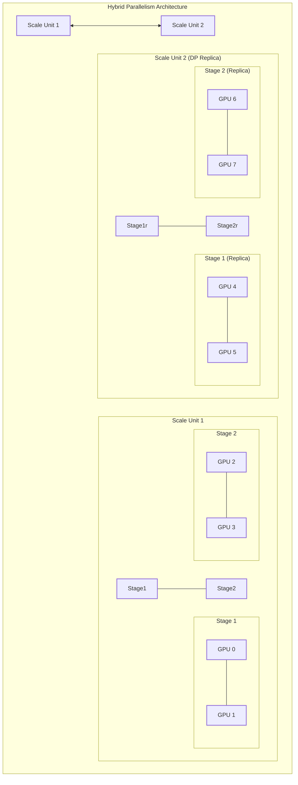
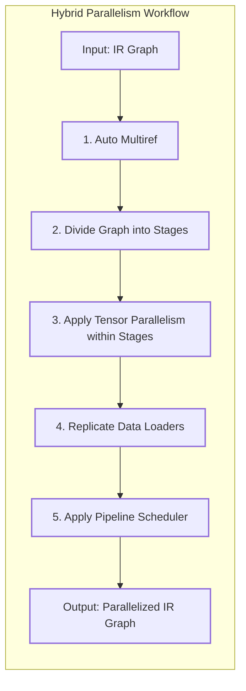
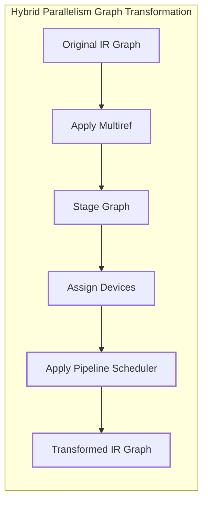
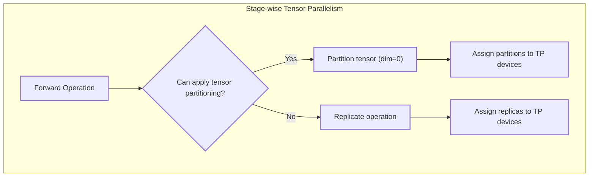

<!-- source: DeepWiki mcp.deepwiki.com · repo microsoft/nnscaler · page 3.4 Hybrid Parallelism · fetched 2026-10-26 -->

# Hybrid Parallelism

<details>
<summary>Relevant source files</summary>

The following files were used as context for generating this wiki page:

- [README.md](README.md)
- [nnscaler/parallel.py](nnscaler/parallel.py)
- [nnscaler/policies.py](nnscaler/policies.py)
- [nnscaler/version.py](nnscaler/version.py)

</details>


Hybrid Parallelism in nnScaler refers to the combined application of multiple parallelism strategies (Data Parallelism, Tensor Parallelism, and Pipeline Parallelism) within a single training setup. This approach allows for more efficient resource utilization and better scaling for large models compared to using a single parallelism strategy. This page explains how hybrid parallelism is implemented in nnScaler, its configuration options, and how it differs from other parallelization strategies.

For details on individual parallelism strategies, see [Data Parallelism](#3.1), [Tensor Parallelism](#3.2), and [Pipeline Parallelism](#3.3).

## Overview of Hybrid Parallelism

Hybrid Parallelism combines different parallelization techniques with specific roles:

- **Pipeline Parallelism (PP)**: Splits the model across GPUs by stages (layers)
- **Tensor Parallelism (TP)**: Splits individual tensor operations across GPUs
- **Data Parallelism (DP)**: Replicates the model across GPUs and splits the data

In nnScaler's hybrid approach, PP and TP are applied within a "scale unit" (a subset of GPUs), while DP is applied across scale units. This multi-dimensional approach offers more flexibility for efficiently distributing large models.

The diagram below illustrates how the three parallelism dimensions are combined:



Sources: [nnscaler/policies.py:168-218]()

## Implementation in nnScaler

The hybrid parallelism implementation in nnScaler is defined in the `pas_hybrid` function in the policies module. It works by:

1. Automatically adding multi-references to tensors accessed by multiple operations
2. Staging the graph (dividing nodes into pipeline stages)
3. Applying tensor parallelism within each stage
4. Replicating data loaders across all devices
5. Applying a pipeline scheduler



Sources: [nnscaler/policies.py:168-218]()

### Key Operational Components

The hybrid parallelism implementation relies on several key components:

1. **Auto Multiref Function**: Adds references to tensors accessed by multiple operations
2. **Graph Staging**: Divides the forward operations into stages
3. **Tensor Partitioning**: Applies dimension-based partitioning within each stage
4. **Pipeline Scheduler**: Controls the execution of pipeline stages

Sources: [nnscaler/policies.py:168-218](), [nnscaler/policies.py:70-75]()

## Configuration Parameters

To use hybrid parallelism in nnScaler, you must configure it through the `ComputeConfig` with specific `pas_config` parameters. The following table shows the required and optional parameters:

| Parameter | Description | Default | Required |
|-----------|-------------|---------|----------|
| `pipeline_nstages` | Number of pipeline stages | `auto` (equals to `plan_ngpus`) | Yes |
| `pipeline_nmicros` | Number of micro-batches for pipelining | N/A | Yes |
| `pipeline_scheduler` | Pipeline scheduling algorithm | `1f1b` | No |
| `pp_size` | Number of GPUs in pipeline dimension | `pipeline_nstages` | No |

When using hybrid parallelism, the `use_end2end` flag in `ComputeConfig` must be set to `True`.

Sources: [nnscaler/policies.py:176-186](), [nnscaler/parallel.py:68-168]()

### Device Assignment Calculation

The distribution of operations across devices follows these rules:

1. `pp_size` determines how many devices are used for the pipeline dimension
2. `tp_size` (calculated as `ngpus // pp_size`) determines devices per stage for tensor parallelism
3. The assignment respects the formula: `ngpus = pp_size * tp_size`

For example, with 8 GPUs and `pp_size=4`, `tp_size` would be 2, resulting in 4 pipeline stages with 2 GPUs each for tensor parallelism.

Sources: [nnscaler/policies.py:183-188]()

## Technical Implementation Details

### Graph Analysis and Transformation

Hybrid parallelism starts by analyzing the model graph and applying several transformations:

1. **Auto Multiref**: Identifies tensors that are accessed by multiple operations and marks them for reference handling
2. **Graph Staging**: Divides forward operations into approximately equal-sized stages
3. **Device Assignment**: Assigns each operation to specific devices based on stage and tensor parallelism patterns



Sources: [nnscaler/policies.py:190-218]()

### Stage-wise Tensor Parallelism

Within each pipeline stage, tensor parallelism is applied to distribute operations across the tensor parallel dimension. The implementation attempts to partition each operation along index 0, dimension 0. If this is not possible, the operation is replicated across all devices in the tensor parallel group.



Sources: [nnscaler/policies.py:202-211]()

## Requirements and Limitations

Hybrid parallelism in nnScaler has several requirements and limitations:

1. **End2End Mode**: Hybrid parallelism requires `use_end2end` to be `True` in the `ComputeConfig`
2. **Parameter Consistency**: `nstages % pp_size` must be 0 and `ngpus % pp_size` must be 0
3. **Pipeline Stages**: The number of pipeline stages can be manually configured or automatically determined
4. **Data Loader Replication**: Data loaders are always replicated across all devices

Sources: [nnscaler/policies.py:172-186]()

## Usage Example

To use hybrid parallelism, you need to:

1. Create a `ComputeConfig` with appropriate parameters
2. Set the PAS policy to 'hybrid'
3. Call the `parallelize()` function with your model

Here's an example configuration:

```python
from nnscaler.parallel import ComputeConfig, parallelize

compute_config = ComputeConfig(
    plan_ngpus=8,
    runtime_ngpus=8,
    use_end2end=True,
    pas_config={
        'pipeline_nstages': 4,  # 4 pipeline stages
        'pipeline_nmicros': 4,  # 4 micro-batches
        'pp_size': 4,           # 4 GPUs for pipeline (2 GPUs per stage for TP)
        'pipeline_scheduler': '1f1b'
    }
)

parallel_model = parallelize(
    model,
    dummy_forward_args,
    pas_policy='hybrid',
    compute_config=compute_config
)
```

Sources: [nnscaler/parallel.py:900-994](), [nnscaler/policies.py:168-218]()

## Comparison with Other Parallelism Strategies

The following table compares hybrid parallelism with other parallelization strategies in nnScaler:

| Strategy | Description | Use Case | Scalability |
|----------|-------------|----------|-------------|
| Data Parallelism (`dp`) | Replicates model, splits data | Small models, large batch sizes | Limited by model size |
| Tensor Parallelism (`tp`) | Partitions individual operations | Large tensor operations | Limited by operation granularity |
| Pipeline Parallelism (`pp`) | Splits model into sequential stages | Deep models | Limited by pipeline bubbles |
| Hybrid Parallelism (`hybrid`) | Combines PP, TP, and DP | Very large models | Scales better for large models |
| AutoDist (`autodist`) | Automatic parallelization | General purpose | Optimized based on profiling |

Sources: [nnscaler/policies.py:77-347]()

## Internal Mechanisms

Underneath the hybrid parallelism implementation, nnScaler performs several key operations:

1. **Graph Partitioning**: Uses the `_tp()` function to partition operations along specific dimensions
2. **Node Replication**: Uses the `_replica()` function to create copies of operations for data parallelism
3. **Graph Staging**: Divides the forward operations into approximately equal-sized segments
4. **Schedule Application**: Applies a pipeline scheduler to coordinate the execution of stages

Sources: [nnscaler/policies.py:45-53](), [nnscaler/policies.py:56-60](), [nnscaler/policies.py:190-218]()

## Relationship to AutoDist

While hybrid parallelism applies a predetermined combination of parallelization strategies, nnScaler also offers `AutoDist` which can automatically determine the optimal parallelization strategy based on profiling and analysis. The hybrid approach provides more explicit control over how parallelism is applied, while AutoDist aims to find an optimal solution automatically.

The key difference is that hybrid parallelism applies a fixed partitioning pattern (PP + TP within a scale unit, DP across scale units), while AutoDist uses cost models and profiles to optimize the partition plan.

Sources: [nnscaler/policies.py:221-347]()

## Summary

Hybrid Parallelism in nnScaler provides a powerful way to scale large models by combining multiple parallelization strategies. It offers:

1. Better resource utilization than single parallelism strategies
2. More efficient scaling for very large models
3. Flexible configuration options to adapt to different model architectures
4. Compatibility with nnScaler's end-to-end training mode

By applying pipeline parallelism across layers, tensor parallelism within layers, and data parallelism across scale units, hybrid parallelism allows users to efficiently distribute training across a large number of GPUs while minimizing communication overhead.

Sources: [nnscaler/policies.py:168-218](), [nnscaler/parallel.py:68-168]()

---

