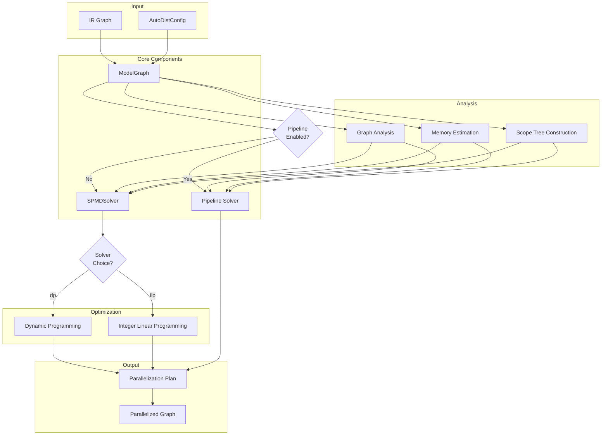
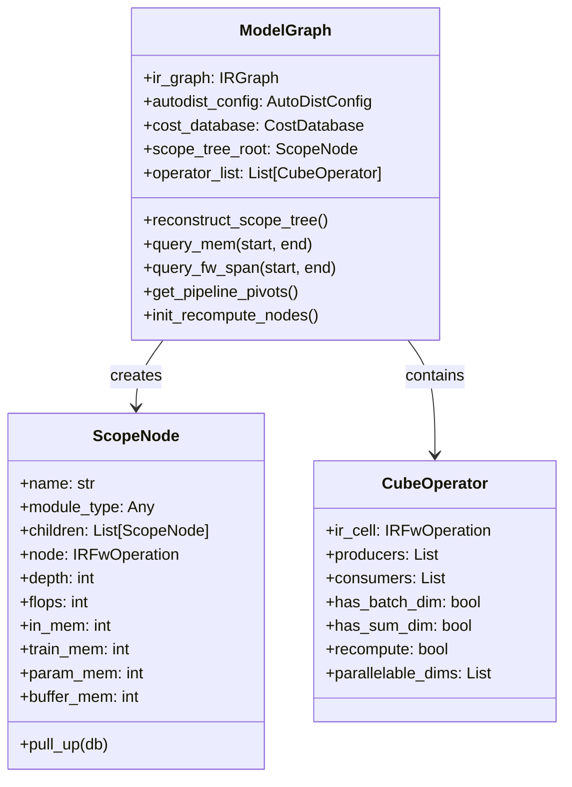
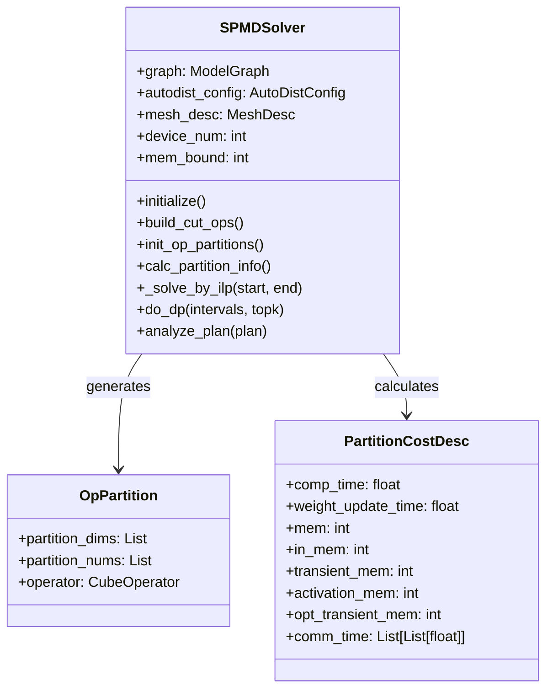
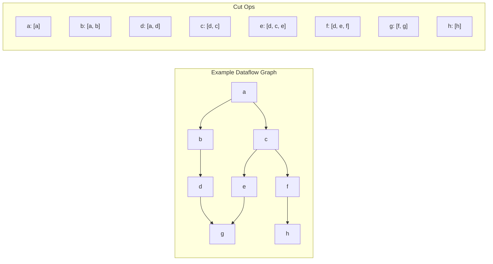
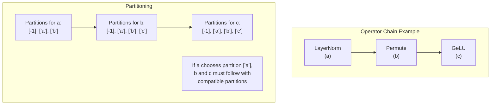

<!-- source: DeepWiki mcp.deepwiki.com · repo microsoft/nnscaler · page 4 Automatic Distribution (AutoDist) · fetched 2026-10-26 -->

# Automatic Distribution (AutoDist)

<details>
<summary>Relevant source files</summary>

The following files were used as context for generating this wiki page:

- [nnscaler/autodist/apis.py](nnscaler/autodist/apis.py)
- [nnscaler/autodist/model_graph.py](nnscaler/autodist/model_graph.py)
- [nnscaler/autodist/spmd_solver.py](nnscaler/autodist/spmd_solver.py)

</details>


AutoDist is nnScaler's automatic distribution subsystem that intelligently partitions neural network models across multiple devices. Unlike manual parallelization strategies (see [Parallelization Strategies](#3)), AutoDist analyzes the model's computational graph and automatically determines an optimal partitioning plan that balances computation time, communication overhead, and memory usage.

## Overview

AutoDist performs detailed analysis of the model's computation and memory requirements, then uses optimization techniques to find an efficient partitioning strategy. It supports both pure SPMD (Single Program Multiple Data) solutions and hybrid approaches that combine SPMD with pipeline parallelism.



Sources: [nnscaler/autodist/apis.py:87-106](), [nnscaler/autodist/spmd_solver.py:94-150]()

## Key Components

### ModelGraph

The `ModelGraph` class analyzes the computation graph, creating a hierarchical representation of the model through a scope tree. This analysis provides crucial information about:
- Memory requirements (activations, parameters, buffers)
- Computation costs
- Potential pipeline pivot points
- Recomputation opportunities



Sources: [nnscaler/autodist/model_graph.py:521-944]()

### SPMDSolver

The `SPMDSolver` class is responsible for finding optimal partitioning plans using either dynamic programming or integer linear programming. It operates by:
1. Building "cut_ops" for each operator
2. Generating valid partition options for each operator 
3. Establishing following relationships to reduce search space
4. Calculating costs for each partition option
5. Solving the optimization problem to minimize execution time while respecting memory constraints



Sources: [nnscaler/autodist/spmd_solver.py:94-370]()

## SPMD Solver Algorithm

The SPMD solver uses a sophisticated algorithm to find the optimal partitioning strategy. It employs dynamic programming where `dp[p(u), M]` is the optimal plan for the subgraph ending with operator `u` in partition state `p`, with memory bound `M`.

### Cut Operations

For each operator in a topological order, the solver identifies "cut ops" - the set of operators whose partition states need to be maintained to calculate communication costs correctly:



Sources: [nnscaler/autodist/spmd_solver.py:912-934]()

### Operator Partitioning

For each operator, the solver generates valid partition options and filters out invalid ones:

1. Operators without dimension annotations (non-IRDimops) are always replicated
2. Small operators may be forced to replicate to reduce communication costs
3. Shared parameters have specific partitioning constraints
4. User-provided partition constraints are respected

The resulting partitions are evaluated for:
- Computation cost
- Weight update communication cost
- Memory usage (resident and transient)
- Communication cost between partitions

Sources: [nnscaler/autodist/spmd_solver.py:217-424](), [nnscaler/autodist/spmd_solver.py:626-734]()

### Following Relationships

To reduce the search space, the solver identifies "following chains" where operators in a chain must have the same partitioning:



Sources: [nnscaler/autodist/spmd_solver.py:432-623]()

### Solving Methods

The solver supports two optimization methods:

1. **Dynamic Programming (DP)**: Efficiently finds the optimal plan by building solutions incrementally
2. **Integer Linear Programming (ILP)**: Formulates the problem as an ILP and uses external solvers

The solver minimizes the objective function (computation time + communication time) while respecting memory constraints.

Sources: [nnscaler/autodist/spmd_solver.py:935-1182](), [nnscaler/autodist/spmd_solver.py:1368-1445]()

## Memory Analysis and Estimation

AutoDist performs detailed memory analysis to ensure the partitioning plan fits within the memory constraints:

1. **Parameter Memory**: Memory for model weights
2. **Buffer Memory**: Memory for model buffers
3. **Activation Memory**: Memory for activations during forward pass
4. **Optimizer Memory**: 
   - Resident memory: First/second moments in optimizers like Adam
   - Transient memory: Temporary buffers used during optimization steps
5. **Recomputation Memory**: Memory needed when using activation recomputation

The system estimates the minimum possible memory consumption per device and uses this for constraint validation.

Sources: [nnscaler/autodist/model_graph.py:78-115](), [nnscaler/autodist/apis.py:42-85]()

## Plan Analysis

After finding an optimal plan, AutoDist provides comprehensive analysis:

1. **Computation Analysis**:
   - Total computation time
   - Top operators by computation time
   - Detailed partition plans for computation-intensive operators

2. **Communication Analysis**:
   - Total communication time
   - Top operators by communication time

3. **Memory Analysis**:
   - Memory usage by module at different scope depths
   - Breakdown of different memory types

This analysis helps users understand bottlenecks and potentially refine parallelization strategies.

Sources: [nnscaler/autodist/spmd_solver.py:1225-1367]()

## Usage

The AutoDist system is accessed through the `parallelize()` function with `autodist` specified as the policy, and fine-tuned through the `ComputeConfig` options:

```python
# Enable AutoDist with default settings
model = parallelize(model, policy='autodist')

# Configure AutoDist with specific settings
config = ComputeConfig(
    mesh_shape=(1, 8),  # 1x8 device mesh
    memory_constraint=40,  # 40GB per device
    solver='dp',  # Use dynamic programming solver
    pipeline_enabled=False  # Pure SPMD solution
)
model = parallelize(model, policy='autodist', compute_config=config)
```

For more information about specific configuration options for AutoDist, see [ComputeConfig and Configuration Options](#2.3).

## Pipeline Integration

AutoDist can integrate with pipeline parallelism for hybrid solutions. When pipeline_enabled=True:

1. AutoDist identifies pipeline stages based on user-provided pivot points
2. Each stage is solved independently for optimal SPMD partitioning
3. Stages are connected with appropriate communication patterns

This hybrid approach can be more efficient for very large models that benefit from both pipeline and tensor parallelism.

Sources: [nnscaler/autodist/apis.py:98-106]()

## Performance and Limitations

- **Search Space**: Models with complex computational graphs may have a large search space, possibly requiring heuristics or constraints
- **Profiling Dependency**: The quality of the solution depends on accurate profiling information
- **Memory Estimation**: Memory estimates are approximate and might differ from actual runtime memory usage

For large models with known structures, manually specified parallelization strategies might still outperform automatic distribution in some cases.

---

