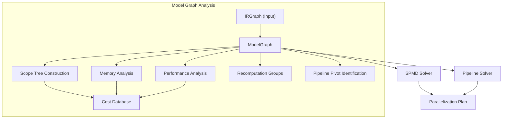
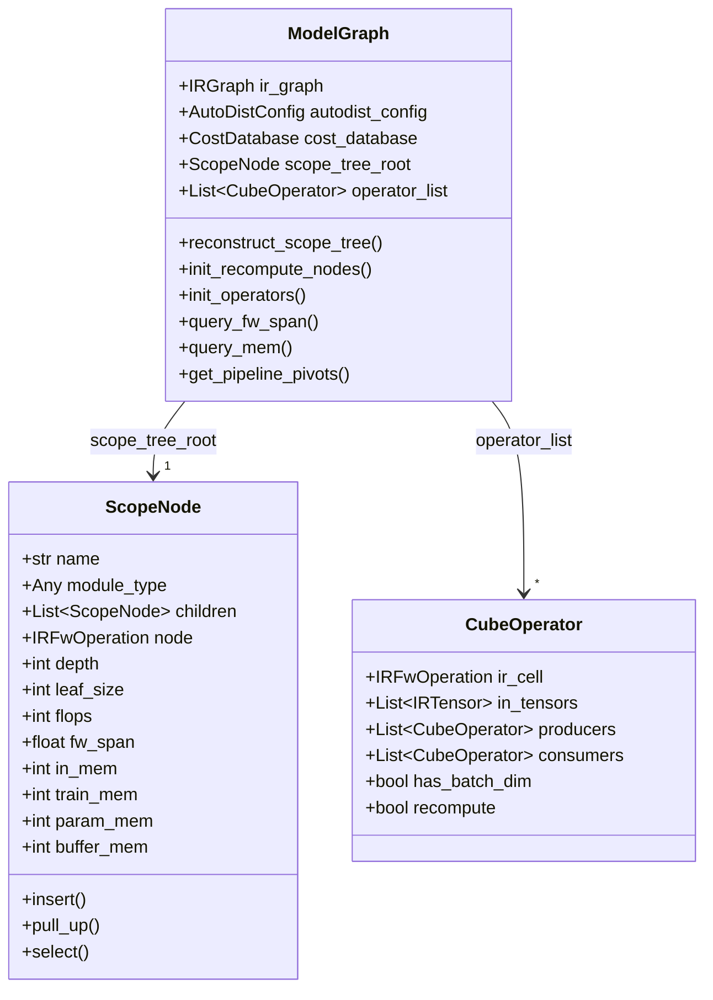
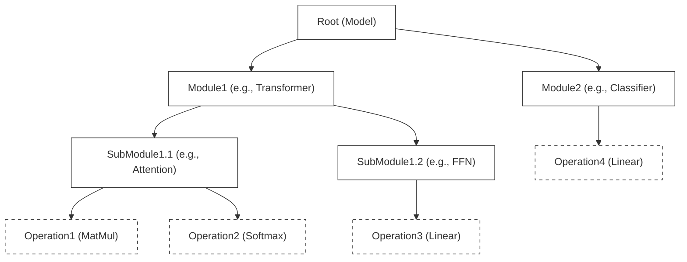
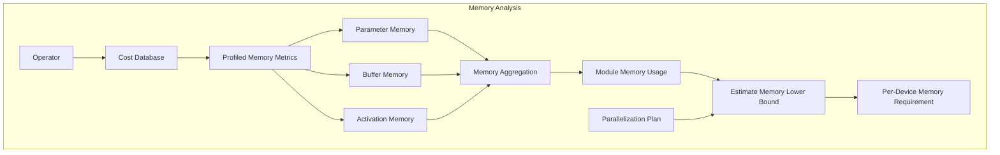
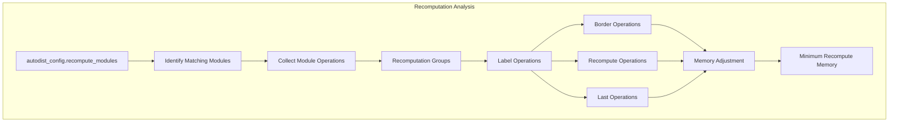
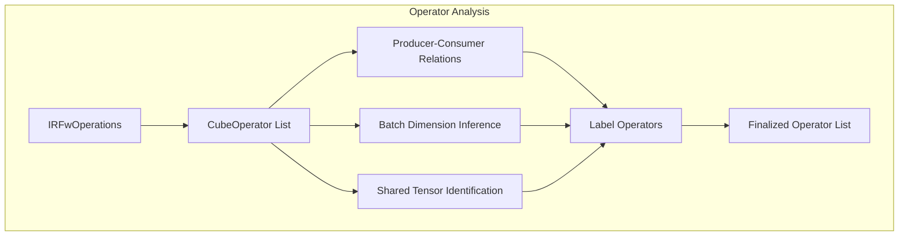
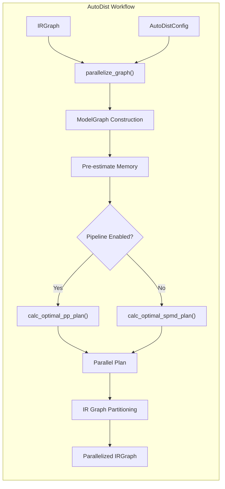

<!-- source: DeepWiki mcp.deepwiki.com · repo microsoft/nnscaler · page 4.1 Model Graph Analysis · fetched 2026-10-26 -->

# Model Graph Analysis

<details>
<summary>Relevant source files</summary>

The following files were used as context for generating this wiki page:

- [nnscaler/autodist/apis.py](nnscaler/autodist/apis.py)
- [nnscaler/autodist/model_graph.py](nnscaler/autodist/model_graph.py)

</details>


Model Graph Analysis is a core component of nnScaler's AutoDist subsystem that analyzes PyTorch model graphs to enable optimized parallel training. This component builds a comprehensive representation of the model's structure, memory requirements, and computational characteristics to inform intelligent parallelization decisions.

For information about how the analyzed data is used to determine parallelization strategies, see [SPMD Solver](#4.2).

## Overview

The Model Graph Analysis module creates an abstraction layer over the IR (Intermediate Representation) graph that provides essential information for parallelization decision-making. It performs several critical functions:

1. Constructing a hierarchical scope tree that mirrors the module structure of the PyTorch model
2. Profiling memory usage and computational requirements
3. Identifying candidate points for pipeline parallelism
4. Supporting activation recomputation optimization
5. Providing structural information for the SPMD solver



Sources: [nnscaler/autodist/model_graph.py:521-940](), [nnscaler/autodist/apis.py:87-106]()

## Model Graph Construction

The `ModelGraph` class is instantiated with an `IRGraph` (the intermediate representation of a PyTorch model) and an `AutoDistConfig` object. It performs several initialization steps:

1. Creating/accessing a `CostDatabase` for profiling information
2. Reconstructing a scope tree that represents the module hierarchy
3. Identifying recomputation groups based on configuration
4. Building a list of operators with their relationships



Sources: [nnscaler/autodist/model_graph.py:521-534](), [nnscaler/autodist/model_graph.py:552-580](), [nnscaler/autodist/model_graph.py:869-940]()

## Scope Tree Construction

A core aspect of Model Graph Analysis is building a hierarchical scope tree that represents the module structure of the PyTorch model. This tree provides critical context for performance analysis and parallelization decisions.

### Scope Tree Structure

The scope tree is a hierarchical representation where:
- The root node represents the entire model
- Child nodes represent sub-modules within the model
- Leaf nodes represent individual operations (IRFwOperation)

Each node in the tree contains performance metrics including:
- Memory usage (parameters, buffers, activations)
- Forward pass span time
- FLOPs (floating-point operations)
- Number of leaf operations



Sources: [nnscaler/autodist/model_graph.py:252-432](), [nnscaler/autodist/model_graph.py:552-580]()

### Scope Tree Construction Process

The scope tree is built through these steps:

1. Iterate through all forward operations in the IR graph
2. Reconstruct the module hierarchy using the `module_stack` property of operations
3. Insert each operation into the appropriate place in the tree
4. Calculate aggregate statistics by "pulling up" information from leaf nodes to their parents

```python
# Simplified pseudocode for scope tree construction
root = ScopeNode('root', None)
for node in fw_cube_nodes:
    module_info = []
    for module_path, module_type in node.module_stack.items():
        module_info.append((module_path.split('.')[-1], module_type))
    root.insert(node, module_info, calc_flops(node), fw_span, idx=i)

root.pull_up(cost_database)
```

The `pull_up` method is crucial as it aggregates memory and performance metrics from leaf nodes to their parent modules, enabling analysis at different levels of granularity.

Sources: [nnscaler/autodist/model_graph.py:552-580](), [nnscaler/autodist/model_graph.py:341-371]()

## Memory Analysis

Memory analysis is a critical component of the Model Graph Analysis. It provides insights into the memory requirements of different parts of the model, which is essential for making informed parallelization decisions.

### Memory Categories

The memory analysis distinguishes between several types of memory usage:

1. **Parameter Memory**: Memory used by model parameters (weights)
2. **Buffer Memory**: Memory used by model buffers (e.g., running statistics in batch normalization)
3. **Activation Memory**: Memory used by activations during forward pass
4. **Training Memory**: Additional memory required during training (e.g., for storing gradients)

For each operation and module, these memory metrics are calculated and stored in the scope tree.

Sources: [nnscaler/autodist/model_graph.py:364-368](), [nnscaler/autodist/model_graph.py:849-867]()

### Memory Estimation Methods

Different approaches are used to estimate memory usage:

1. **Direct Profiling**: Using the `CostDatabase` to get profiled memory metrics for operations
2. **Aggregation**: For modules, memory usage is aggregated from their constituent operations
3. **Lower Bound Estimation**: A theoretical minimum memory requirement is calculated based on parallelization strategy



Sources: [nnscaler/autodist/model_graph.py:77-115](), [nnscaler/autodist/model_graph.py:217-249]()

## Recomputation Analysis

Activation recomputation (or gradient checkpointing) is an important memory optimization technique for large models. The Model Graph Analysis identifies potential recomputation points based on configuration settings.

### Recomputation Group Identification

Recomputation groups are identified based on module types specified in the configuration:

1. The system identifies modules matching the specified types in `autodist_config.recompute_modules`
2. For each matching module, all operations within it are marked for recomputation
3. Border operations (those that have inputs from outside the group) are specially marked



Sources: [nnscaler/autodist/model_graph.py:691-735](), [nnscaler/autodist/model_graph.py:782-831]()

### Memory Impact of Recomputation

The system adjusts memory estimations to account for recomputation:

1. Activation memory for operations marked for recomputation is set to zero in memory queries
2. Instead, a global minimum recomputation memory is calculated and added to the total estimated memory
3. This approach ensures that the memory savings from recomputation are properly reflected in the analysis

Sources: [nnscaler/autodist/model_graph.py:849-867](), [nnscaler/autodist/apis.py:76-77]()

## Pipeline Parallelism Analysis

The Model Graph Analysis identifies potential pipeline stage boundaries based on configuration settings. This analysis is crucial for implementing efficient pipeline parallelism.

### Pipeline Pivot Identification

Pipeline pivots are module boundaries where the model can be split into pipeline stages:

1. The system identifies modules matching the types specified in `autodist_config.pipeline_pivots`
2. These modules become potential boundaries for pipeline stages
3. If no pipeline pivots are found, an error is raised (when pipeline is enabled)

```python
# Simplified pseudocode for pipeline pivot identification
pp_pivot_modules = autodist_config.pipeline_pivots.split(',')
pivot_modules = scope_tree_root.select(lambda node: 
    not node.is_leaf and 
    node.module_type.__name__ in pp_pivot_modules)
```

Sources: [nnscaler/autodist/model_graph.py:582-622]()

### Interval Analysis

For pipeline parallelism, the system analyzes different possible intervals (potential pipeline stages):

1. All possible intervals between pipeline pivots are analyzed
2. For each interval, memory and performance metrics are calculated
3. Similar intervals are grouped together to reduce search space
4. This information is used by the pipeline solver to determine the optimal pipeline configuration

Sources: [nnscaler/autodist/model_graph.py:624-664]()

## Operator Analysis

The Model Graph Analysis also examines individual operators to understand their characteristics and relationships, which is crucial for making parallelization decisions.

### Operator Relationships

The system builds a graph of operator relationships:

1. Producer-consumer relationships between operators are identified
2. Batch dimension propagation is inferred across the operator graph
3. Shared tensors are identified to ensure consistent parallelization



Sources: [nnscaler/autodist/model_graph.py:869-940]()

### Operator Properties

Each operator in the model is analyzed for several properties:

1. Whether it has batch dimensions (for possible data parallelism)
2. Which inputs are parameters, buffers, or activations
3. Whether it should be considered for recomputation
4. Its position in the execution order

This information is stored in `CubeOperator` objects, which wrap the original `IRFwOperation` objects with additional metadata.

Sources: [nnscaler/autodist/model_graph.py:737-797](), [nnscaler/autodist/model_graph.py:869-940]()

## Integration with AutoDist

The Model Graph Analysis is a key component in the AutoDist system, serving as a bridge between the IR graph and the parallelization solvers.



Sources: [nnscaler/autodist/apis.py:87-106](), [nnscaler/autodist/apis.py:109-280]()

## Key APIs and Usage

The Model Graph Analysis provides several key APIs that are used by the parallelization solvers:

### Key Methods

- **`query_mem(start, end)`**: Calculate memory consumption of operators in a range
- **`query_fw_span(start, end)`**: Calculate forward pass span time of operators in a range
- **`get_pipeline_pivots()`**: Get indices of potential pipeline stage boundaries
- **`calc_interval_info(start, end)`**: Calculate comprehensive metrics for an interval
- **`group_pipeline_intervals()`**: Group similar intervals to reduce search space

### Example Usage Flow

1. Create a `ModelGraph` instance with an `IRGraph` and `AutoDistConfig`
2. Perform pre-estimation of memory requirements
3. If pipeline parallelism is enabled, identify pipeline pivots and analyze intervals
4. Use the model graph information to calculate an optimal parallelization plan
5. Apply the plan to the original IR graph

Sources: [nnscaler/autodist/apis.py:87-106](), [nnscaler/autodist/model_graph.py:624-664]()

## Summary

The Model Graph Analysis component is a critical part of nnScaler's AutoDist system that provides detailed insights into model structure, memory requirements, and computational characteristics. These insights enable intelligent parallelization decisions, allowing large models to be efficiently distributed across multiple devices.

It bridges the gap between the raw IR graph representation and the higher-level parallelization strategies by:

1. Organizing operations into a hierarchical module structure
2. Profiling memory usage and performance
3. Identifying opportunities for optimization like recomputation
4. Providing the necessary information for pipeline and SPMD parallelism

This analysis forms the foundation for the automatic distribution capabilities of nnScaler, allowing complex neural networks to be efficiently parallelized with minimal user intervention.

---

