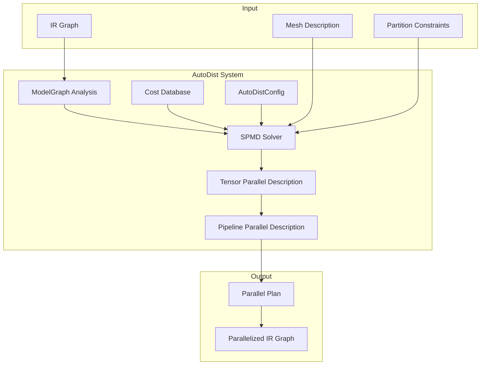
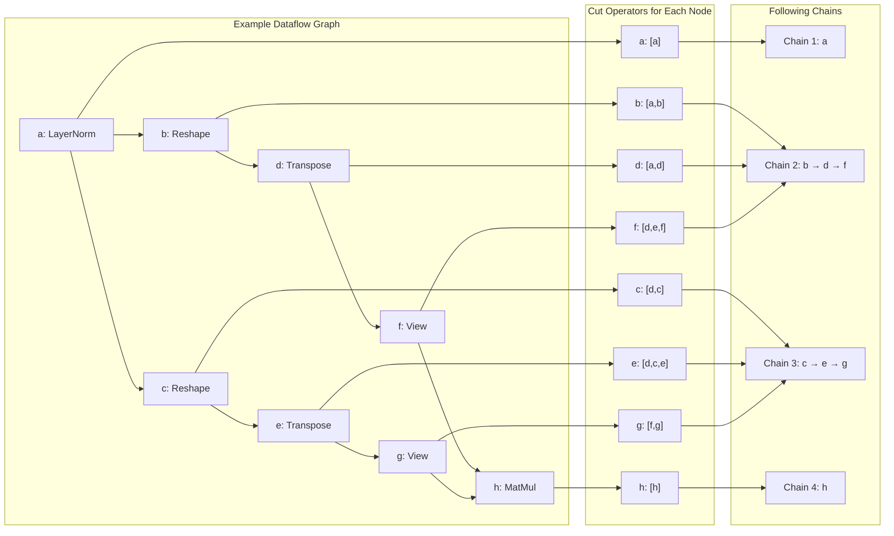
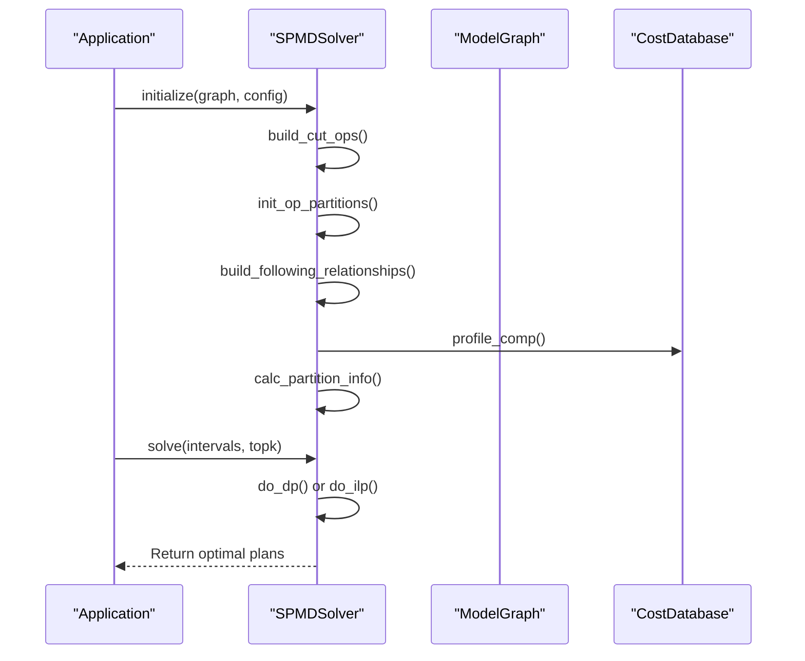
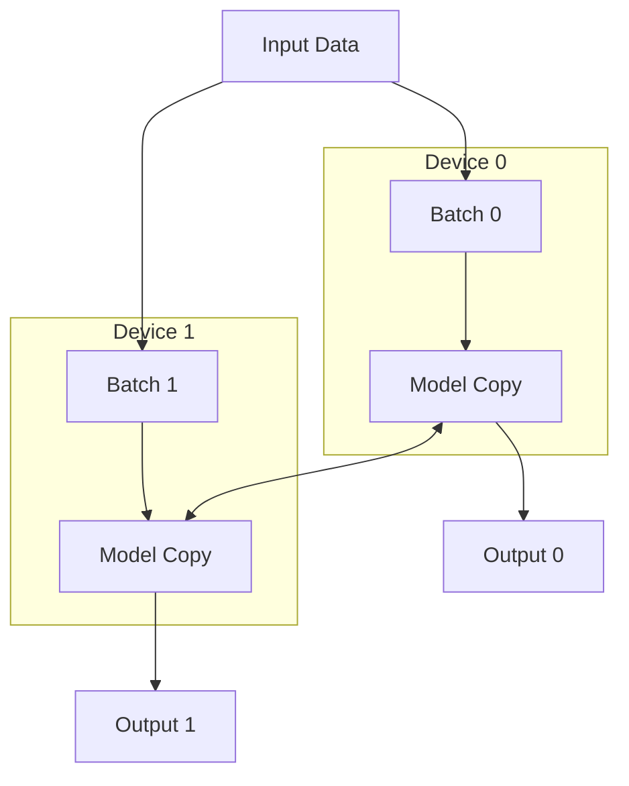
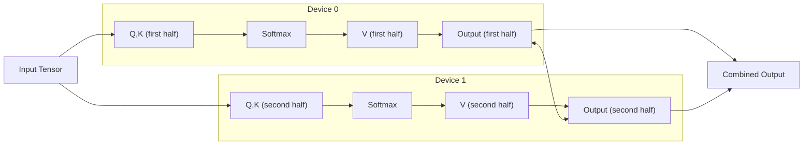

<!-- source: DeepWiki mcp.deepwiki.com · repo microsoft/nnscaler · page 4.2 SPMD Solver · fetched 2026-10-26 -->

# SPMD Solver

<details>
<summary>Relevant source files</summary>

The following files were used as context for generating this wiki page:

- [nnscaler/autodist/spmd_solver.py](nnscaler/autodist/spmd_solver.py)
- [tests/autodist/spmd_solver/test_follow.py](tests/autodist/spmd_solver/test_follow.py)

</details>


The SPMD (Single Program Multiple Data) Solver is a core component of nnScaler's AutoDist system responsible for finding optimal operator partitioning plans for distributed training of neural networks. It analyzes computational graphs and determines how to distribute operators across multiple devices to minimize training time while respecting memory constraints.

For information on how model graphs are analyzed before the SPMD solving stage, see [Model Graph Analysis](#4.1).

## 1. Overview

The SPMD Solver takes a model graph representation and applies algorithmic techniques to find efficient partitioning strategies. It can handle complex neural network architectures with various operators (matrix multiplications, convolutions, attention mechanisms, etc.) and determines how to split computation across devices with minimal communication overhead.



Sources: [nnscaler/autodist/spmd_solver.py:94-150](), [nnscaler/autodist/spmd_solver.py:1492-1533]()

## 2. Core Concepts

### 2.1 Cut Operators and Following Relationships

The SPMD Solver uses two important concepts to reduce the search space:

- **Cut Operators**: For each node in the graph, the "cut_ops" represent the set of operators whose partition states need to be considered together when calculating the optimal partitioning for that node.

- **Following Relationships**: Operators are grouped into "following chains" where communication between operators in the same chain is minimized or eliminated.



Sources: [nnscaler/autodist/spmd_solver.py:94-148](), [nnscaler/autodist/spmd_solver.py:426-489](), [nnscaler/autodist/spmd_solver.py:911-934]()

### 2.2 Partition Strategies

For each operator, multiple partitioning strategies can be considered:

- **Replicated**: The operator is copied to all devices (partition dimension = -1)
- **Sharded**: The operator is split along a specific dimension (like batch dimension, hidden dimension, etc.)

The SPMD Solver evaluates various partitioning strategies for each operator and selects an optimal plan based on computation time and communication costs.

Sources: [nnscaler/autodist/spmd_solver.py:218-424]()

## 3. Solver Architecture

### 3.1 Initialization and Setup

The SPMD Solver initialization involves:

1. Loading partition constraints (if provided)
2. Building cut operators and following relationships
3. Initializing operator partitions
4. Calculating costs for each partition option



Sources: [nnscaler/autodist/spmd_solver.py:151-187](), [nnscaler/autodist/spmd_solver.py:712-756]()

### 3.2 Cost Models

The SPMD Solver considers several cost factors when evaluating partitioning strategies:

1. **Computation Time**: Time to execute an operator on a device
2. **Weight Update Time**: Communication cost for updating weights (e.g., allreduce)
3. **Communication Time**: Cost of transferring data between operators
4. **Memory Requirements**: 
   - Activation memory
   - Weight memory
   - Gradient memory
   - Buffer memory
   - Optimizer memory

These costs are used to evaluate different partitioning strategies and select the optimal one.

Sources: [nnscaler/autodist/spmd_solver.py:40-75](), [nnscaler/autodist/spmd_solver.py:626-710]()

## 4. Solution Approaches

The SPMD Solver offers two approaches to finding optimal partitioning plans:

### 4.1 Dynamic Programming (DP)

The DP approach uses a dynamic programming algorithm to find optimal partitioning plans. It recursively builds solutions for subproblems and combines them to find the global optimum.

Key features:
- Can generate top-k solutions
- More memory efficient
- Faster for large graphs
- Implemented in C++ for performance

Sources: [nnscaler/autodist/spmd_solver.py:1184-1223]()

### 4.2 Integer Linear Programming (ILP)

The ILP approach formulates the optimization problem as an integer linear program and uses solvers like CBC to find the optimal solution.

Key features:
- Defines the objective function as minimizing computation and communication time
- Adds constraints for memory usage, partition selection, and communication
- Uses PuLP for problem formulation
- Has a time limit (600 seconds by default)

Sources: [nnscaler/autodist/spmd_solver.py:935-1170]()

## 5. Plan Analysis and Evaluation

The SPMD Solver includes analysis capabilities to evaluate partitioning plans:

- **Computation Analysis**: Identifies operators consuming the most computation time
- **Communication Analysis**: Identifies operators with highest communication costs
- **Memory Analysis**: Breakdowns memory usage by module and memory type
- **Module Analysis**: Analyzes performance at the module level

This information helps users understand bottlenecks and refine their partitioning strategies.

Sources: [nnscaler/autodist/spmd_solver.py:1225-1366](), [nnscaler/autodist/spmd_solver.py:1454-1489]()

## 6. Example: Model Partitioning

The SPMD Solver can generate different partitioning strategies depending on the model architecture and hardware configuration:

### 6.1 Data Parallelism

For models with large batch dimensions, the solver often selects data parallelism (partitioning along the batch dimension), which involves minimal communication during the forward and backward pass but requires allreduce for weight updates.



Sources: [tests/autodist/spmd_solver/test_follow.py:308-378]()

### 6.2 Tensor Parallelism (e.g., Megatron-LM style)

For large models, the solver may choose tensor parallelism, partitioning along hidden dimensions or attention heads to distribute model parameters.



Sources: [tests/autodist/spmd_solver/test_follow.py:127-306]()

## 7. Usage

The SPMD Solver is typically used through the AutoDist system rather than directly. However, for advanced users, it can be used as follows:

1. Create a ModelGraph from an IR graph
2. Configure an AutoDistConfig with desired parameters
3. Instantiate the SPMDSolver with the model graph and config
4. Call solve() to get optimal partitioning plans
5. Apply the plans to the IR graph

The typical usage pattern is shown in this example:

```python
# Create a model graph
model_graph = ModelGraph(ir_graph, autodist_config)

# Create SPMD solver
spmd_solver = SPMDSolver(
    graph=model_graph,
    mesh_desc=autodist_config.mesh_desc,
    autodist_config=autodist_config,
    stage_num=1,
    micro_batch_num=autodist_config.update_freq,
)

# Solve for optimal plan
spmd_outs = spmd_solver.solve([(0, model_graph.op_num - 1)], 1)[0]
if not spmd_outs:
    raise RuntimeError("Failed to find valid plan")

# Get the best plan
best_plan = spmd_outs[0]
```

Sources: [nnscaler/autodist/spmd_solver.py:1492-1533]()

## 8. Advanced Features

### 8.1 Partition Constraints

Users can provide partition constraints to guide the solver's decisions. These constraints can:
- Force specific operators to be replicated
- Restrict partitioning to specific dimensions
- Reduce the search space for faster solving

Constraints are defined in YAML format and loaded via the `partition_constraints_path` parameter in AutoDistConfig.

Sources: [nnscaler/autodist/spmd_solver.py:188-210](), [nnscaler/autodist/spmd_solver.py:273-366]()

### 8.2 Memory Estimation

The SPMD Solver includes detailed memory estimation that accounts for:
- Resident memory (weights, gradients)
- Activation memory
- Optimizer memory
- Transient memory
- Recomputation memory

These estimates ensure that the generated plan fits within the available device memory.

Sources: [nnscaler/autodist/spmd_solver.py:758-793](), [nnscaler/autodist/spmd_solver.py:816-873]()

## 9. Summary

The SPMD Solver is a sophisticated component of nnScaler's AutoDist system that finds optimal ways to partition neural network computation across multiple devices. By analyzing computation graphs, estimating costs, and applying mathematical optimization techniques, it generates efficient distributed training strategies that maximize throughput while respecting memory constraints.

---

