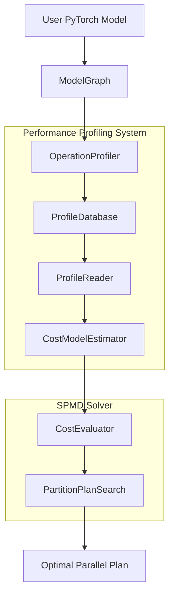
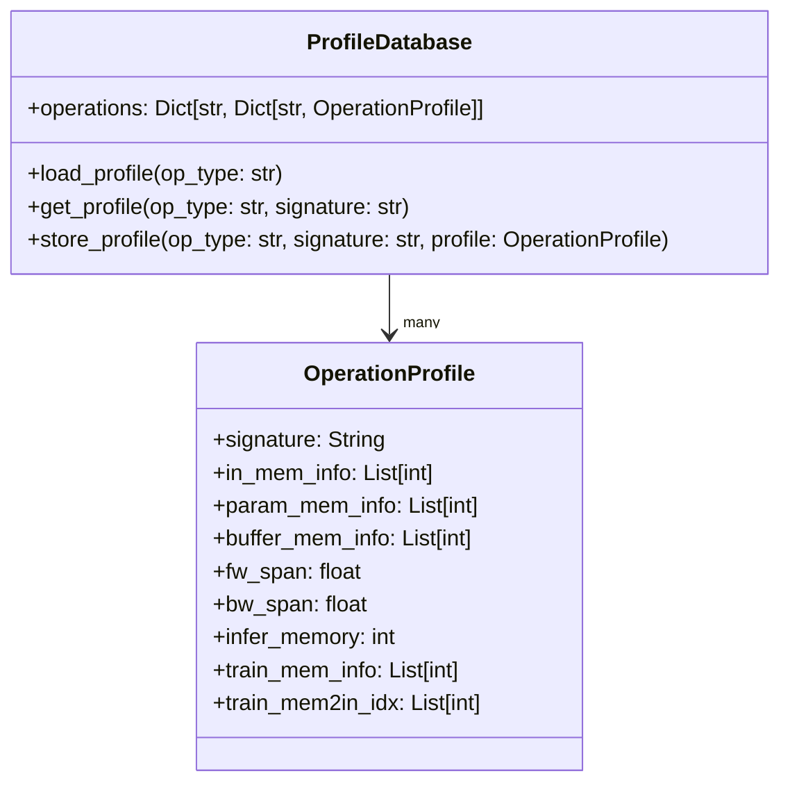
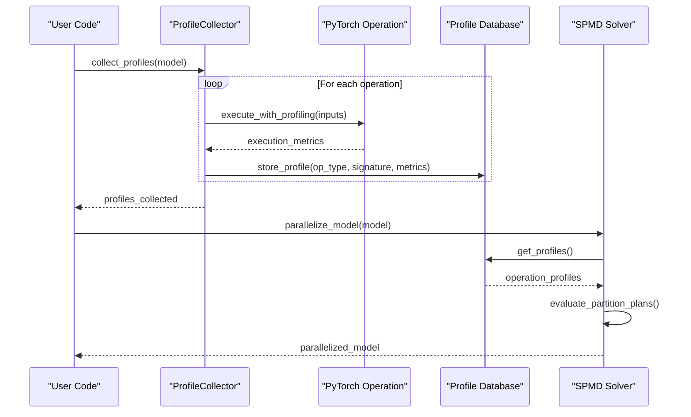
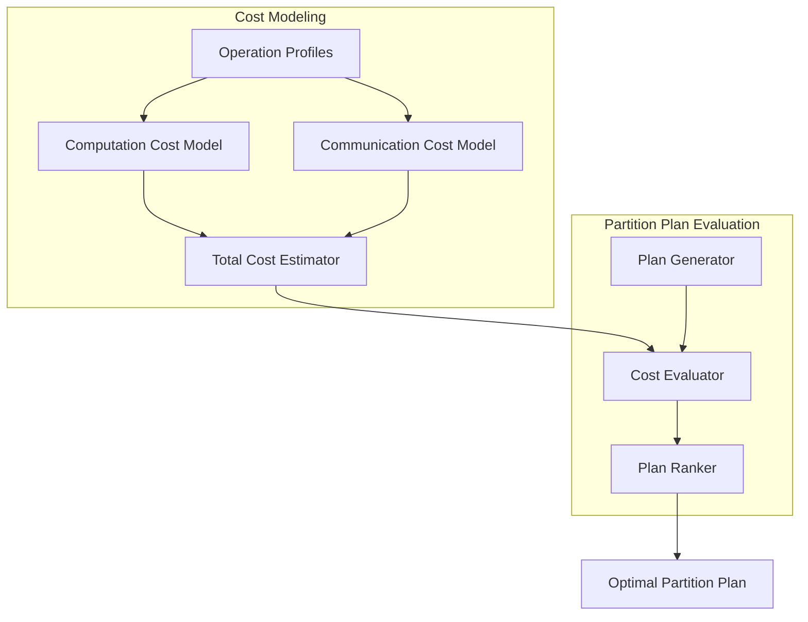
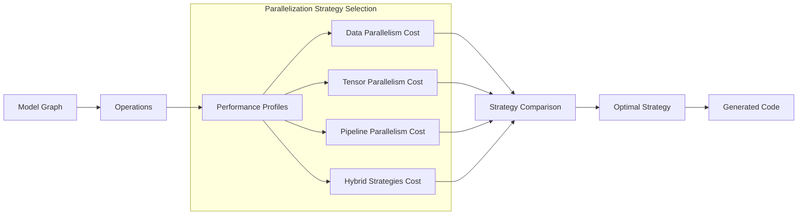

<!-- source: DeepWiki mcp.deepwiki.com · repo microsoft/nnscaler · page 4.3 Performance Profiling · fetched 2026-10-26 -->

# Performance Profiling

Relevant source files

The following files were used as context for generating this wiki page:

- [tests/autodist/spmd_solver/test_follow_attention_profile/comp/torch.Tensor.contiguous.json](tests/autodist/spmd_solver/test_follow_attention_profile/comp/torch.Tensor.contiguous.json)
- [tests/autodist/spmd_solver/test_follow_attention_profile/comp/torch.matmul.json](tests/autodist/spmd_solver/test_follow_attention_profile/comp/torch.matmul.json)

## Overview

This document describes nnScaler's performance profiling system, which collects and manages detailed execution metrics to optimize parallelization decisions. Performance profiling is a critical component of the AutoDist subsystem, enabling data-driven optimization of distributed training strategies.

For information about the SPMD Solver that uses this profiling data, see [SPMD Solver](#4.2).

## Profiling System Architecture

The performance profiling system in nnScaler collects, stores, and provides access to operation execution metrics that guide parallelization decisions. It's primarily used by the SPMD Solver to make cost-based decisions about optimal partition plans.

The profiling system captures detailed metrics for operations like tensor manipulations and matrix multiplications, allowing the SPMD solver to make informed decisions about how to partition computation across devices.

Sources: tests/autodist/spmd_solver/test_follow_attention_profile/comp/torch.Tensor.contiguous.json, tests/autodist/spmd_solver/test_follow_attention_profile/comp/torch.matmul.json

## Profile Data Structure

Performance profiles are stored as JSON files organized by operation type, with each operation's unique signature mapping to its performance characteristics. Operation signatures combine input/output shapes, data types, and other relevant attributes.

Each profile contains critical timing and memory usage metrics that influence parallelization decisions:

| Metric | Description | Usage |
|--------|-------------|-------|
| `fw_span` | Forward pass execution time (seconds) | Determines compute intensity, influences partitioning |
| `bw_span` | Backward pass execution time (seconds) | Critical for training performance optimization |
| `in_mem_info` | Input tensor memory sizes (bytes) | Used to calculate communication costs |
| `param_mem_info` | Parameter memory sizes (bytes) | Used for memory planning |
| `buffer_mem_info` | Buffer memory sizes (bytes) | Used for intermediate storage planning |
| `infer_memory` | Inference-specific memory usage | Helps optimize inference workloads |
| `train_mem_info` | Training-specific memory usage | Helps optimize training workloads |
| `train_mem2in_idx` | Mapping indices between training and input memory | Used to track memory dependencies |

Sources: tests/autodist/spmd_solver/test_follow_attention_profile/comp/torch.Tensor.contiguous.json, tests/autodist/spmd_solver/test_follow_attention_profile/comp/torch.matmul.json

## Key Performance Metrics

The profiling system captures comprehensive metrics across different operation types, tensor shapes, and batch sizes to guide optimization decisions. Here's an example of profiling data contrast between small and large tensor operations:

| Operation | Input Shapes | FW Time (s) | BW Time (s) | Memory Usage (MB) |
|-----------|--------------|-------------|-------------|-------------------|
| `torch.matmul` | (2, 8, 128, 64)×(2, 8, 64, 128) | 0.025 | 0.158 | 1.0 |
| `torch.matmul` | (1024, 8, 128, 64)×(1024, 8, 64, 128) | 2.423 | 7.280 | 512.0 |
| `torch.Tensor.contiguous` | (2, 128, 8, 64) | 0.005 | 0.029 | 0.5 |
| `torch.Tensor.contiguous` | (1024, 128, 8, 64) | 0.011 | 1.425 | 256.0 |

This data shows how operation execution time and memory usage scale with tensor dimensions, highlighting the importance of capturing metrics across different scales for accurate cost modeling.

Sources: tests/autodist/spmd_solver/test_follow_attention_profile/comp/torch.Tensor.contiguous.json, tests/autodist/spmd_solver/test_follow_attention_profile/comp/torch.matmul.json

## Profile Collection Process

The performance profiling process involves systematically collecting execution metrics across representative operations and tensor shapes.

During model parallelization, the SPMD solver uses these collected profiles to estimate the cost of different partitioning strategies and select the most efficient one.

Sources: tests/autodist/spmd_solver/test_follow_attention_profile/comp/torch.Tensor.contiguous.json, tests/autodist/spmd_solver/test_follow_attention_profile/comp/torch.matmul.json

## Cost Modeling with Profiles

The profiling data enables sophisticated cost modeling that considers both computation and communication costs. The system estimates execution time, memory usage, and communication overhead for different partition strategies.

The cost models estimate:

1. **Computation time**: Based on the `fw_span` and `bw_span` metrics for each operation
2. **Memory usage**: Using the various memory metrics to ensure operations fit within device constraints
3. **Communication overhead**: Calculated by analyzing the data movement required between partitioned operations

Sources: tests/autodist/spmd_solver/test_follow_attention_profile/comp/torch.Tensor.contiguous.json, tests/autodist/spmd_solver/test_follow_attention_profile/comp/torch.matmul.json

## Shape-Dependent Performance

One of the key insights from the profiling data is that performance characteristics vary significantly with tensor shapes. For example, matrix multiplication (`torch.matmul`) shows different scaling behavior depending on the batch size, sequence length, and embedding dimensions.

Consider the forward pass time (in seconds) for matrix multiplications with different shapes:

| Batch Size | Sequence Length | Heads | Embedding Dim | FW Time (s) |
|------------|-----------------|-------|---------------|-------------|
| 2 | 128 | 8 | 64 | 0.025 |
| 256 | 128 | 8 | 64 | 0.588 |
| 1024 | 128 | 8 | 64 | 2.423 |
| 1024 | 32 | 8 | 64 | 0.884 |
| 1024 | 128 | 2 | 64 | 0.592 |
| 1024 | 128 | 8 | 16 | 1.236 |

This data demonstrates that performance doesn't scale linearly with tensor dimensions, emphasizing the importance of detailed profiling across representative workloads.

Sources: tests/autodist/spmd_solver/test_follow_attention_profile/comp/torch.matmul.json

## Integration with Parallelization Policies

The performance profiles directly influence the decision-making process of the SPMD solver when determining optimal parallelization strategies.

The system estimates the cost of different parallelization strategies (data, tensor, pipeline, or hybrid) based on the profiling data, selecting the approach that minimizes execution time while respecting memory constraints.

Sources: tests/autodist/spmd_solver/test_follow_attention_profile/comp/torch.Tensor.contiguous.json, tests/autodist/spmd_solver/test_follow_attention_profile/comp/torch.matmul.json

## Memory-Performance Tradeoffs

The profiling system captures the complex relationship between memory usage and computation time, enabling sophisticated tradeoff analysis.

For example, matrix multiplication operations show the following forward pass time and memory usage patterns:

| Operation | Input Shapes | FW Time (s) | Memory Usage (MB) |
|-----------|--------------|-------------|-------------------|
| `torch.matmul` | (2, 8, 128, 64)×(2, 8, 64, 128) | 0.025 | 1.0 |
| `torch.matmul` | (2, 8, 128, 128)×(2, 8, 128, 64) | 0.037 | 1.5 |
| `torch.matmul` | (1024, 8, 128, 64)×(1024, 8, 64, 128) | 2.423 | 512.0 |
| `torch.matmul` | (1024, 8, 128, 128)×(1024, 8, 128, 64) | 2.169 | 768.0 |

This data helps the system balance execution speed against memory constraints when selecting partition strategies.

Sources: tests/autodist/spmd_solver/test_follow_attention_profile/comp/torch.matmul.json

## Conclusion

The performance profiling system in nnScaler serves as the foundation for intelligent parallelization decisions. By collecting detailed execution metrics across different operations and tensor shapes, it enables the SPMD solver to make data-driven decisions that optimize distributed training efficiency.

For more information about how these profiles are used by the SPMD solver, see [SPMD Solver](#4.2).

---

