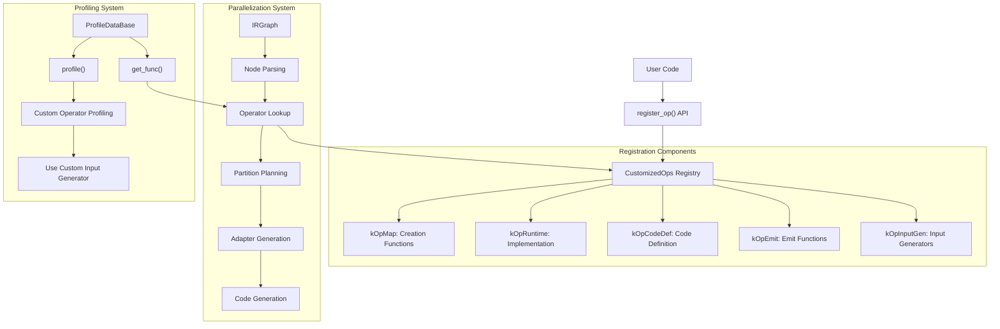
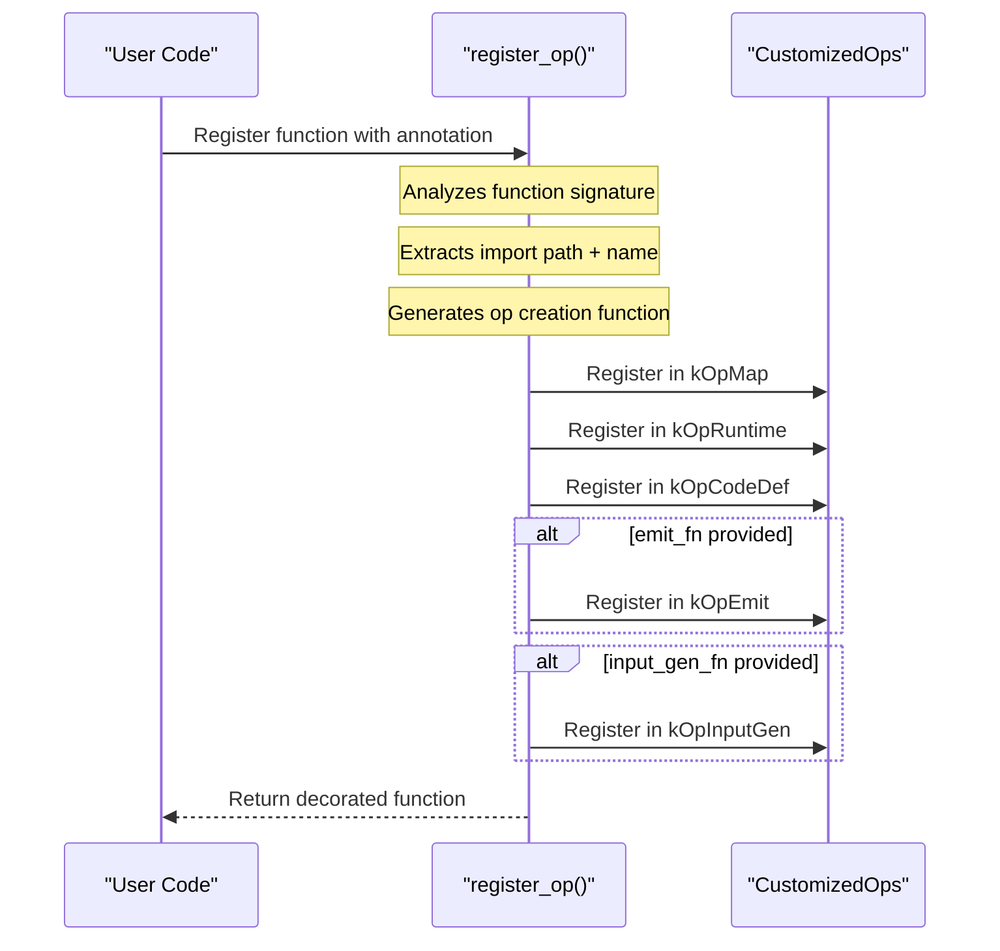
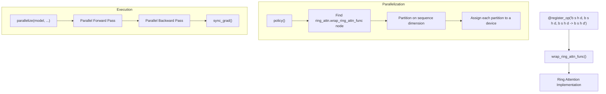

<!-- source: DeepWiki mcp.deepwiki.com · repo microsoft/nnscaler · page 5 Custom Operators · fetched 2026-10-26 -->

# Custom Operators

<details>
<summary>Relevant source files</summary>

The following files were used as context for generating this wiki page:

- [.gitignore](.gitignore)
- [dev.md](dev.md)
- [docs/source/dimops.md](docs/source/dimops.md)
- [examples/customized_ops/ring_attention/test_ring_attn.py](examples/customized_ops/ring_attention/test_ring_attn.py)
- [examples/customized_ops/ring_attention/test_zigzag_attn.py](examples/customized_ops/ring_attention/test_zigzag_attn.py)
- [nnscaler/graph/gener/gen.py](nnscaler/graph/gener/gen.py)
- [nnscaler/graph/parser/register.py](nnscaler/graph/parser/register.py)
- [nnscaler/profiler/database.py](nnscaler/profiler/database.py)

</details>


## Purpose and Overview

This document explains how to extend nnScaler with custom operators - user-defined operations that can be registered, parallelized, and optimized within the nnScaler framework. Custom operators allow you to implement specialized computation patterns that aren't directly provided by PyTorch or nnScaler, while still benefiting from nnScaler's automatic parallelization capabilities.

For information about dimension annotations used within custom operators, see [Dimension Annotations (Dimops)](#5.1).

Sources: [nnscaler/graph/parser/register.py:1-270]()

## System Architecture

Custom operators are a key extension point in the nnScaler system, allowing for the integration of specialized computation patterns while maintaining compatibility with the parallelization engine.



Sources: [nnscaler/graph/parser/register.py:23-41](), [nnscaler/profiler/database.py:78-116](), [nnscaler/profiler/database.py:149-162]()

## Registering Custom Operators

The primary way to register a custom operator is through the `register_op` decorator:

```python
@nnscaler.register_op(annotation, name=None, code_impl_pattern='import', 
                     emit_fn=None, transform_rules=None, input_gen_fn=None)
def custom_function(x, y, ...):
    # Implementation
    return result
```

### Registration Parameters

| Parameter | Type | Description |
|-----------|------|-------------|
| `annotation` | `str` or `Callable` | Dimension annotation or function that returns annotation |
| `name` | `str` | Optional name for the operator (defaults to function name) |
| `code_impl_pattern` | `str` | Either 'import' or 'source' for code generation method |
| `emit_fn` | `Callable` | Optional special code generation function |
| `transform_rules` | `Tuple[TransformRule]` | Optional rules for tensor partitioning |
| `input_gen_fn` | `Callable` | Optional function to generate inputs for profiling |

Sources: [nnscaler/graph/parser/register.py:93-166]()

### Registration Process

When you register a custom operator:

1. The system extracts the function signature and creates a unique identifier
2. The function implementation is stored along with the annotation information
3. A special IRDimops creation function is generated to handle the operator during graph analysis
4. Optional custom emit and input generation functions are registered if provided



Sources: [nnscaler/graph/parser/register.py:167-265]()

## Dimension Annotations (Dimops)

Annotations are a central concept in custom operators, providing information about:

1. Input and output tensor shapes
2. Partitioning possibilities for each dimension
3. Reduction behaviors across partitioned dimensions

### Basic Annotation Syntax

Annotations follow this pattern:
```
input1, input2, ... -> output1, output2, ...
```

Where each input/output is annotated with dimension identifiers and reduction types:
```
dim1 dim2 dim3, dim2 dim4 -> dim1 dim4
```

Sources: [docs/source/dimops.md:1-44]()

### Reduction Types

Each dimension identifier can have one of three reduction types:

| Reduction | Symbol | Meaning |
|-----------|--------|---------|
| None (empty) | `''` | Dimension can be spatially partitioned |
| Sum | `'+'` | Dimension can be partitioned with sum-reduction |
| No Partition | `'^'` | Dimension cannot be partitioned |

For example: `m^ kd+, kd+ n -> m^ n` indicates:
- First input has dimensions `m` (not partitionable) and `kd` (partitionable with sum reduction)
- Second input has dimensions `kd` (partitionable with sum reduction) and `n` (spatially partitionable)
- Output has dimensions `m` (not partitionable) and `n` (spatially partitionable)

Sources: [docs/source/dimops.md:45-54]()

### Advanced Features

#### Hidden Dimensions
For reshaping operations, dimensions can be grouped with parentheses:
```
(h t) k -> h t k
```

This indicates that a single dimension `(h t)` is being split into two dimensions `h` and `t`.

#### Special Identifiers
- `*`: Dynamic dimension that will automatically expand
- `?`: Non-tensor input or output (ignored for shape inference)

Sources: [docs/source/dimops.md:55-69]()

## Using Custom Operators in Parallelization Policies

Once registered, custom operators can be used in parallelization policies. The system will treat them like any other operation, but with the specific partitioning behaviors defined by their annotations.

### Example Policy

```python
def policy(graph: IRGraph, resource: ComputeConfig) -> IRGraph:
    ngpus = resource.plan_ngpus
    for node in graph.select(ntype=IRFwOperation):
        if node.signature == 'my_module.custom_op':
            # Get the dimension-based algorithm for partitioning
            algo = node.algorithm('dim')
            # Partition the operator on dimension 1
            sub_nodes = graph.partition(node, algo, idx=0, dim=1, num=ngpus)
            for i, sub_node in enumerate(sub_nodes):
                graph.assign(sub_node, i)
    return graph
```

Sources: [examples/customized_ops/ring_attention/test_ring_attn.py:58-71](), [examples/customized_ops/ring_attention/test_zigzag_attn.py:58-71]()

## Profiling Custom Operators

The nnScaler profiling system automatically handles custom operators, but you can customize the profiling behavior further with the `input_gen_fn` parameter.

### Custom Input Generation

By default, the profiler will use `torch.rand` for floating-point tensors and `torch.zeros` for integer or boolean tensors. However, for operators where input content significantly affects performance (e.g., attention masks), you can provide a custom input generator:

```python
def custom_input_generator(node: IRFwOperation) -> List[torch.Tensor]:
    """Generate realistic inputs for profiling the custom operator"""
    shape = node.inputs()[0].shape
    # Create input tensors with specific patterns relevant to the operator
    return [specific_pattern_tensor(shape)]

@nnscaler.register_op('annotation', input_gen_fn=custom_input_generator)
def custom_op(x):
    # Implementation
    return result
```

Sources: [nnscaler/profiler/database.py:119-280](), [nnscaler/graph/parser/register.py:153-161]()

## Advanced Usage

### Custom Emit Functions

For operations that require specialized code generation, you can provide an `emit_fn`:

```python
def custom_emit(node, repred_args, repred_kwargs, runtime_devid, plan_ndevs, runtime_ndevs):
    """Generate custom code for the operation"""
    # Custom code generation logic
    return generated_code

@nnscaler.register_op('annotation', emit_fn=custom_emit)
def custom_op(x):
    # Implementation
    return result
```

Sources: [nnscaler/graph/parser/register.py:152-155]()

### Complete Custom Operator Example

The following diagram shows the implementation flow of a custom ring attention operator, which demonstrates a complete use case of custom operators:



Sources: [examples/customized_ops/ring_attention/test_ring_attn.py:1-139](), [examples/customized_ops/ring_attention/test_zigzag_attn.py:1-139]()

## Best Practices and Limitations

### Best Practices

1. **Register in Module Scope**: Custom operators must be registered at the module scope, not inside a function, class, or `__main__`.
   
2. **Provide Type Annotations**: Include proper Python type annotations to help the system understand your function.
   
3. **Be Careful with In-Place Operations**: In-place tensor operations can interfere with gradient calculation and should be used with caution.
   
4. **Use Custom Input Generators**: For operators where input patterns affect performance, provide a custom input generator for more accurate profiling.

### Limitations

1. **Module-Level Functions Only**: Cannot register functions defined inside a function, class, or `__main__` scope.

2. **Restricted Signatures**: Cannot register operators with signatures starting with `_operator.`, `torch.`, or `nnscaler.runtime.function.`

3. **Tensor Partitioning Constraints**: Custom operators must follow specific patterns for tensor partitioning:
   - Cannot simultaneously partition tensor dimension and tensor value
   - Must follow the annotation rules for reduction types

Sources: [nnscaler/graph/parser/register.py:80-90](), [nnscaler/graph/parser/register.py:185-191](), [nnscaler/graph/gener/gen.py:561-567]()

## Related Documentation

- For more details on dimension annotations, see [Dimension Annotations](#5.1)
- For operator registration details, see [Operator Registration](#5.2)
- For a complete example, see [Ring Attention Example](#5.3)

---

