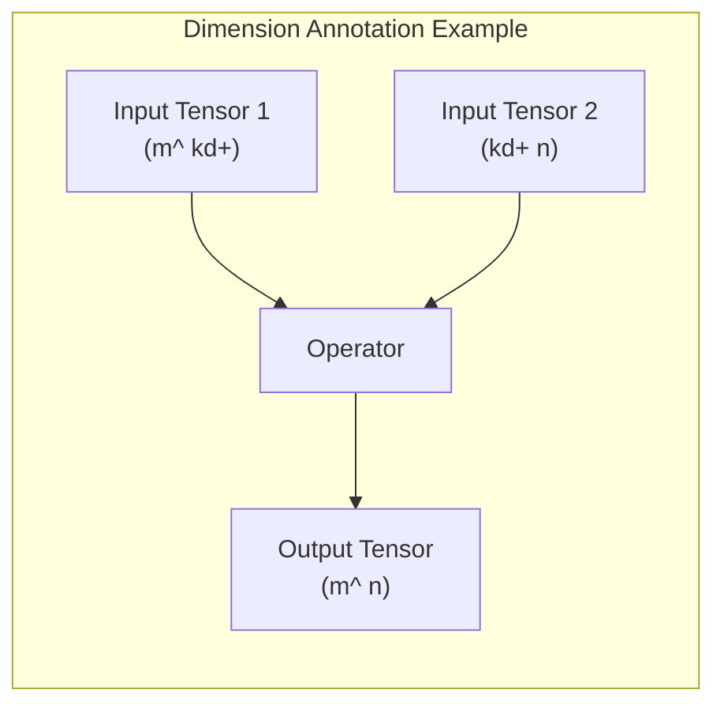
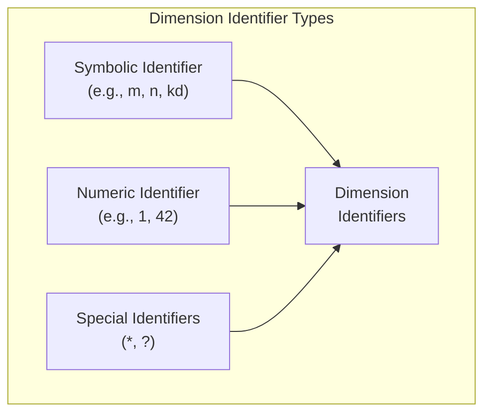
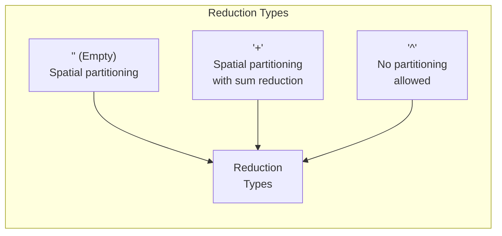
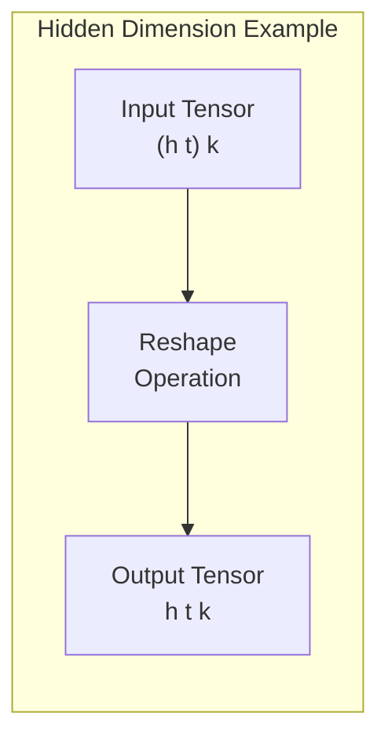
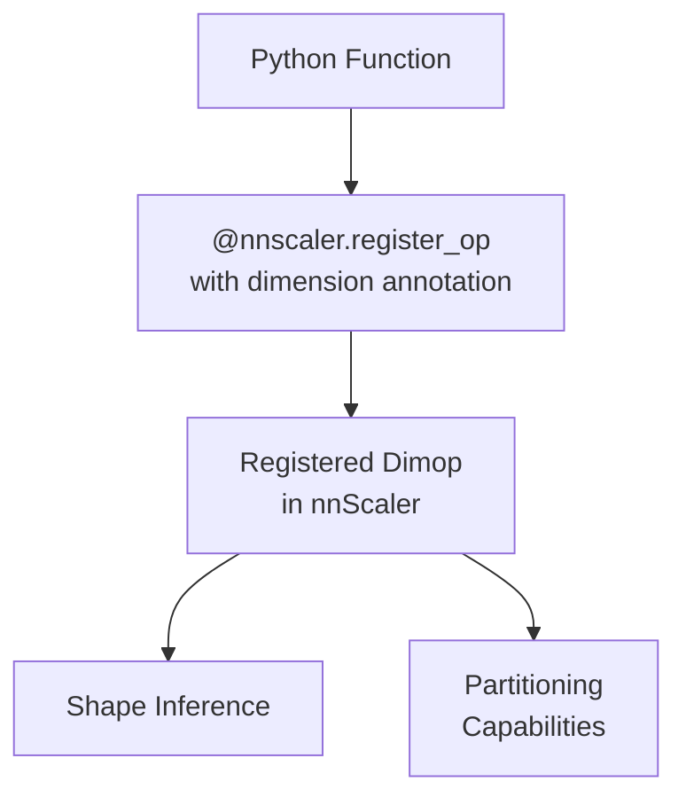
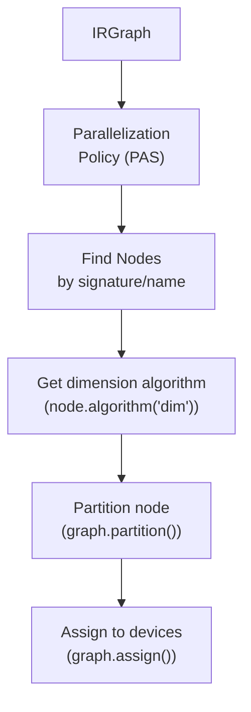
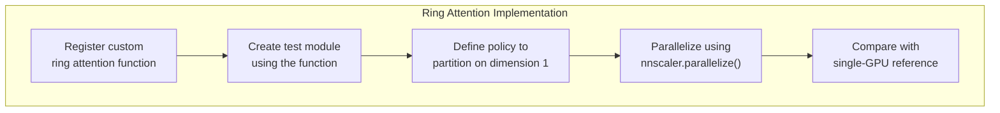

<!-- source: DeepWiki mcp.deepwiki.com · repo microsoft/nnscaler · page 5.1 Dimension Annotations (Dimops) · fetched 2026-10-26 -->

# Dimension Annotations (Dimops)

<details>
<summary>Relevant source files</summary>

The following files were used as context for generating this wiki page:

- [.gitignore](.gitignore)
- [dev.md](dev.md)
- [docs/source/dimops.md](docs/source/dimops.md)
- [examples/customized_ops/ring_attention/test_ring_attn.py](examples/customized_ops/ring_attention/test_ring_attn.py)
- [examples/customized_ops/ring_attention/test_zigzag_attn.py](examples/customized_ops/ring_attention/test_zigzag_attn.py)

</details>


## Purpose and Scope

Dimension Annotations (Dimops) are a critical component in nnScaler that allow for precise specification of tensor dimensions and their partitioning behavior. This documentation explains the Dimops annotation system, which serves two primary purposes:

1. **Shape inference** - Determining output tensor shapes based on input shapes
2. **Transformation planning** - Guiding the parallelization engine on how to partition tensors across devices

For information on registering custom operators using these annotations, see [Operator Registration](#5.2).

## Dimops Basics

A Dimop (Dimension-annotated Operator) is an operator with annotations that describe how its tensor dimensions should be treated during parallelization.



Sources: [docs/source/dimops.md:3-17]()

### Annotation Syntax

The basic structure of a Dimop annotation follows this pattern:

```
# annotation: [input tensor dimensions], [input tensor dimensions] -> [output tensor dimensions]
```

For example, a matrix multiplication might be annotated as:

```python
# annotation: m^ kd+, kd+ n -> m^ n
def matmul(x: torch.Tensor, w: torch.Tensor) -> torch.Tensor:
    return torch.matmul(x, w)
```

Key syntax elements:
- `->` separates inputs from outputs
- `,` separates individual tensors
- Space ` ` separates dimensions within a tensor
- Each dimension has the format: `{identifier}{reduction}`

Sources: [docs/source/dimops.md:19-21]()

## Dimension Identifiers

Dimension identifiers specify the logical identity of each tensor dimension and are crucial for shape inference.



### Regular Identifiers

- **Symbolic identifiers**: Must match Python's `str.isidentifier()` criteria
  - Example: `m`, `batch_size`, `hidden_dim`
  - Same identifier in different tensors = same dimension length
  
- **Numeric identifiers**: Must match Python's `str.isdecimal()` criteria
  - Example: `1`, `42`, `512`
  - Represents a fixed dimension size
  - Always have `^` reduction type (non-partitionable)

### Special Identifiers

- **Wildcard** (`*`): Represents dynamic dimensions that get automatically expanded
  - Example: `* t -> a * t` can expand to `b c t -> a b c t`
  
- **Non-tensor** (`?`): Indicates non-tensor values that should be ignored in the annotation
  - Used for scalar parameters that aren't tensors

Sources: [docs/source/dimops.md:25-43]()

## Reduction Types

Reduction types specify how dimensions can be partitioned and reduced during parallelization.



- **Empty reduction** (`''`): 
  - Dimension can be spatially partitioned
  - Outputs with the same identifier will also be spatially partitioned
  - Example: `m, n -> m n`

- **Sum reduction** (`+`):
  - Dimension can be spatially partitioned
  - Outputs without this identifier require sum-reduction across partitions
  - Example: `m, kd+ n -> m n`

- **Non-partitionable** (`^`):
  - Dimension cannot be partitioned
  - Must be fully replicated across devices
  - Example: `m^, n -> m^ n`

Sources: [docs/source/dimops.md:45-54]()

## Advanced Annotations

### Hidden Dimensions

Hidden dimensions allow reshaping tensors by splitting a single dimension into multiple dimensions:



To annotate hidden dimensions:
1. Use parentheses `()` to group dimensions
2. Include multiple identifiers inside the parentheses
3. Provide a named argument in the function with the same name as the identifier

Example:
```python
# annotation: (h t) k -> h t k
def reshape(tensor: torch.Tensor, h: int = 8) -> torch.Tensor:
    out = tensor.reshape(h, tensor.size(0) // h, tensor.size(-1))
    return out
```

Sources: [docs/source/dimops.md:55-69]()

## Registering Custom Operators

Custom operators can be registered with nnScaler using the `@nnscaler.register_op` decorator:



Example:
```python
@nnscaler.register_op('(h^ m^) kd+, kd+ n -> h^ m^ n', name='matmul_custom')
def operator(x: torch.Tensor, w: torch.Tensor, h: float) -> torch.Tensor:
    out = torch.matmul(x, w)
    out = out.view(h, out.size(0) // h, out.size(1))
    return out
```

Requirements:
1. Type annotations for inputs and outputs are required
2. Non-tensor inputs should be listed last
3. A name can be specified for the operator

Sources: [docs/source/dimops.md:71-90]()

## Using Dimops in Parallelization Policies

Dimops provide the foundation for creating parallelization policies in nnScaler. Within a policy function, you can:

1. Identify operators by name or signature
2. Access dimension annotations through the `algorithm('dim')` method
3. Partition operators based on annotated dimensions



Example policy function:
```python
def policy(graph: IRGraph, resource: ComputeConfig) -> IRGraph:
    ngpus = resource.plan_ngpus
    for node in graph.select(ntype=IRFwOperation):
        if node.signature == 'matmul_custom':
            algo = node.algorithm('dim')
            # Partition on kd+ dimension
            config = dict(idx=0, dim=1, num=ngpus)
            sub_nodes = graph.partition(node, algo, **config)
            # Assign partitions to devices
            for idx, sub_node in enumerate(sub_nodes):
                graph.assign(sub_node, idx)
    return graph
```

Sources: [docs/source/dimops.md:91-107](), [examples/customized_ops/ring_attention/test_ring_attn.py:58-72]()

## Real-World Example: Ring Attention

The custom ring attention example demonstrates the practical application of Dimops in nnScaler:



The test example for ring attention follows these steps:
1. Register a custom ring attention function with dimension annotations
2. Create a test module that uses this function
3. Define a policy that partitions the operation on the sequence length dimension
4. Parallelize the module using nnScaler
5. Compare the results with a single-GPU reference implementation

Sources: [examples/customized_ops/ring_attention/test_ring_attn.py:50-72](), [examples/customized_ops/ring_attention/test_zigzag_attn.py:50-72]()

## Summary

Dimension Annotations (Dimops) provide a powerful and flexible system for specifying how tensor operations should be partitioned in distributed training. By annotating tensor dimensions with identifiers and reduction types, nnScaler can automatically infer shapes and determine optimal partitioning strategies.

When implementing custom operators that need to be parallelized, using the Dimops system enables integration with nnScaler's parallelization engine, allowing operations to be efficiently distributed across multiple devices.

---

