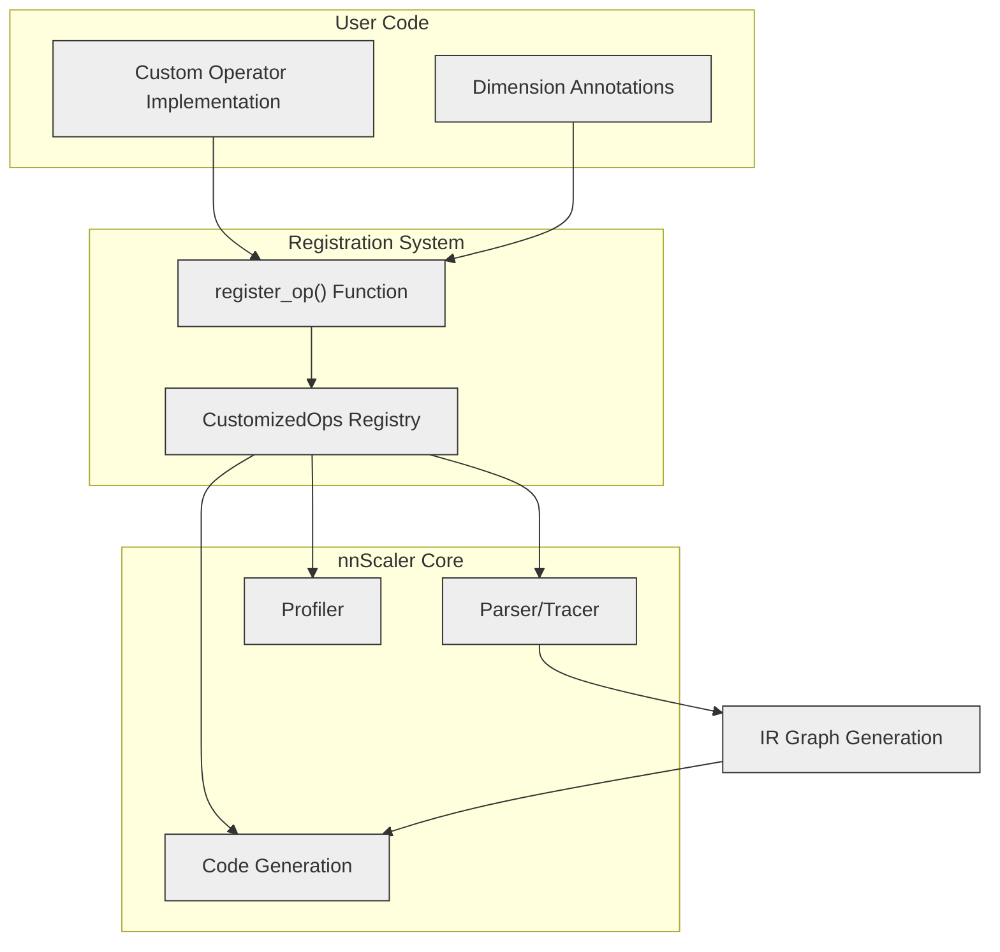
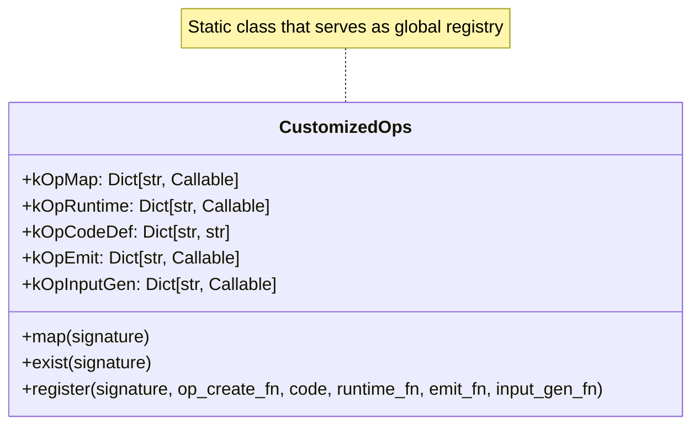
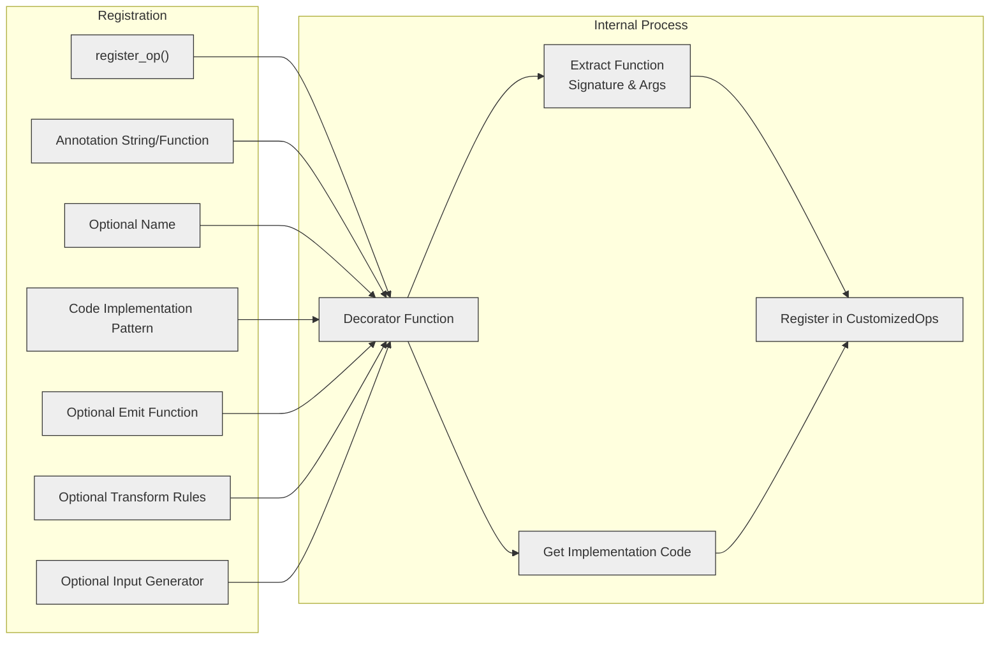
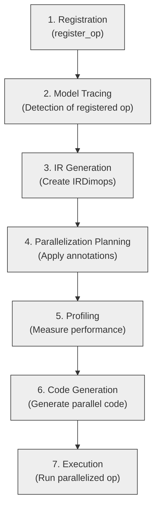

<!-- source: DeepWiki mcp.deepwiki.com · repo microsoft/nnscaler · page 5.2 Operator Registration · fetched 2026-10-26 -->

# Operator Registration

<details>
<summary>Relevant source files</summary>

The following files were used as context for generating this wiki page:

- [nnscaler/graph/gener/gen.py](nnscaler/graph/gener/gen.py)
- [nnscaler/graph/parser/register.py](nnscaler/graph/parser/register.py)
- [nnscaler/profiler/database.py](nnscaler/profiler/database.py)

</details>


This page documents the operator registration system in nnScaler, which allows users to extend the framework with custom operators that can be properly parallelized by the system. For related concepts, see [Dimension Annotations (Dimops)](#5.1) which explains the annotation system used when registering operators, and [Ring Attention Example](#5.3) for a complete implementation example.

## Overview

In nnScaler, custom operators are registered to teach the system how to handle operations that aren't built into the framework. Registration allows the system to understand:

1. How to partition tensors for a given operator
2. How to generate code for the parallelized operator
3. How to profile the operator for performance optimization



Sources: [nnscaler/graph/parser/register.py:1-271]()

## The CustomizedOps Registry

The `CustomizedOps` class maintains internal maps that store information about registered custom operators. This centralized registry makes the operators available to different parts of the system.



The registry maintains five key dictionaries:

| Registry Map | Purpose |
|-------------|---------|
| `kOpMap` | Maps operator signatures to IRDimop creation functions |
| `kOpRuntime` | Maps signatures to runtime function implementations |
| `kOpCodeDef` | Stores implementation code for each operator |
| `kOpEmit` | Optional special code emission functions for operators |
| `kOpInputGen` | Optional functions to generate inputs for profiling |

Sources: [nnscaler/graph/parser/register.py:23-90]()

## Registering Custom Operators

### The register_op Function

The `register_op` function is the primary interface for registering custom operators. It associates operator implementations with dimension annotations that describe how tensors should be partitioned.



### Registration Parameters

When calling `register_op`, you can specify the following parameters:

| Parameter | Type | Description |
|-----------|------|-------------|
| `annotation` | `str` or `Callable` | Dimension annotations or function that generates them |
| `name` | `str` (optional) | Custom name for the operator |
| `code_impl_pattern` | `str` | `'import'` or `'source'` - how to include code |
| `emit_fn` | `Callable` (optional) | Custom code generation function |
| `transform_rules` | `Tuple[TransformRule]` (optional) | Special rules for partitioning |
| `input_gen_fn` | `Callable` (optional) | Function to generate profiling inputs |

Sources: [nnscaler/graph/parser/register.py:93-167]()

### Basic Usage Example

Here's a basic pattern for registering a custom operator:

```python
import nnscaler
from nnscaler.graph.parser import register_op

@register_op('a (b c) -> (a b) c')
def custom_function(x, y, param=0):
    # Implementation here
    return result
```

This tells nnScaler that:
- The first input has dimension annotations 'a'
- The second input has dimension annotations '(b c)'
- The output has dimension annotations '(a b) c'

The system uses these annotations to determine how to parallelize the operation.

Sources: [nnscaler/graph/parser/register.py:110-140]()

## Advanced Registration Features

### Custom Emit Functions

For operators that need special code generation logic, you can provide a custom `emit_fn` that controls how code is generated for the parallelized operator:

```python
def custom_emit_fn(node, repred_args, repred_kwargs, runtime_devid, plan_ndevs, runtime_ndevs):
    # Custom code generation logic
    return generated_code

@register_op('a (b c) -> (a b) c', emit_fn=custom_emit_fn)
def custom_function(x, y):
    # Implementation
    return result
```

The emit function receives the operation node, represented arguments and keyword arguments, and information about the runtime environment.

Sources: [nnscaler/graph/parser/register.py:152-156]()

### Custom Input Generation

For operations where dummy tensor content (typically random values) is not appropriate for profiling, you can provide an `input_gen_fn`:

```python
def custom_input_gen(node):
    # Create appropriate test inputs
    return [input1, input2, ...]

@register_op('a (b c) -> (a b) c', input_gen_fn=custom_input_gen)
def custom_function(x, y):
    # Implementation
    return result
```

This is particularly useful for operations like attention mechanisms where specific input patterns significantly affect performance.

Sources: [nnscaler/graph/parser/register.py:157-163](), [nnscaler/profiler/database.py:148-155]()

## Operator Lifecycle

A registered operator goes through several phases in the nnScaler system:



During this lifecycle:

1. **Registration**: Associates your function with annotations and other metadata
2. **Tracing**: System recognizes your registered function during model analysis
3. **IR Generation**: Creates intermediate representation with dimension information
4. **Planning**: Determines how to parallelize your operation
5. **Profiling**: Measures performance characteristics to guide optimization
6. **Code Generation**: Creates optimized parallel implementation
7. **Execution**: Runs your parallelized operator as part of the model

Sources: [nnscaler/graph/parser/register.py:1-271](), [nnscaler/profiler/database.py:294-339]()

## Internal Registration Process

When you register an operator, nnScaler performs several steps:

1. Extracts function signature and argument information
2. Retrieves or generates implementation code
3. Creates a function to produce IRDimops objects
4. Registers all components in the CustomizedOps registry

The system enforces several restrictions:
- Registered functions must be defined in a module, not in __main__
- You cannot register functions with signatures that start with builtin prefixes
- Each operator can only be registered once

Sources: [nnscaler/graph/parser/register.py:168-262]()

## Performance Profiling Integration

The registration system integrates with nnScaler's profiling functionality. For registered operators, the profiler:

1. Retrieves the runtime function from `CustomizedOps.kOpRuntime`
2. Uses the custom input generator if provided, otherwise creates default inputs
3. Measures forward and backward execution time
4. Estimates memory consumption
5. Records this information for future parallelization decisions

This information helps the system make optimal parallelization decisions.

Sources: [nnscaler/profiler/database.py:119-280]()

## Conclusion

Operator registration is a key extension mechanism in nnScaler. By providing dimension annotations and optional customization hooks, you can integrate specialized operations into the parallelization framework. For a complete implementation example, see [Ring Attention Example](#5.3).

---

