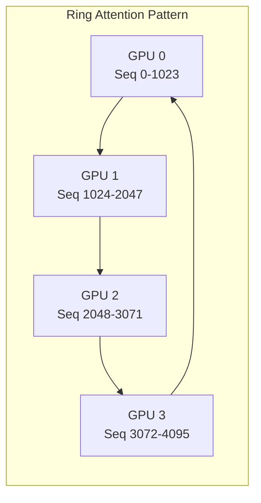
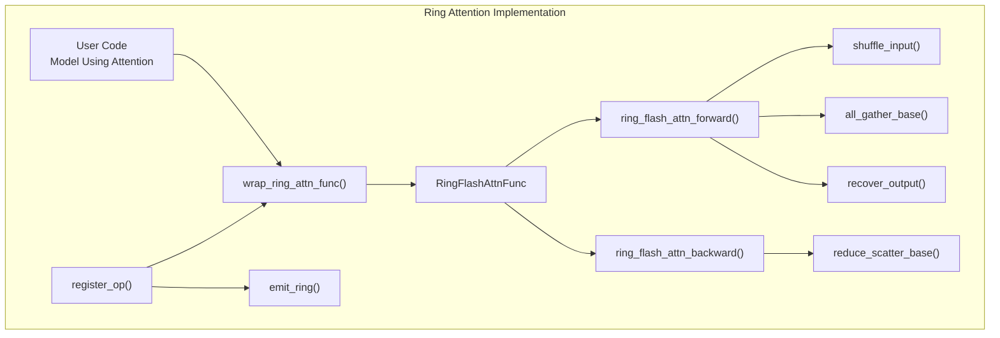
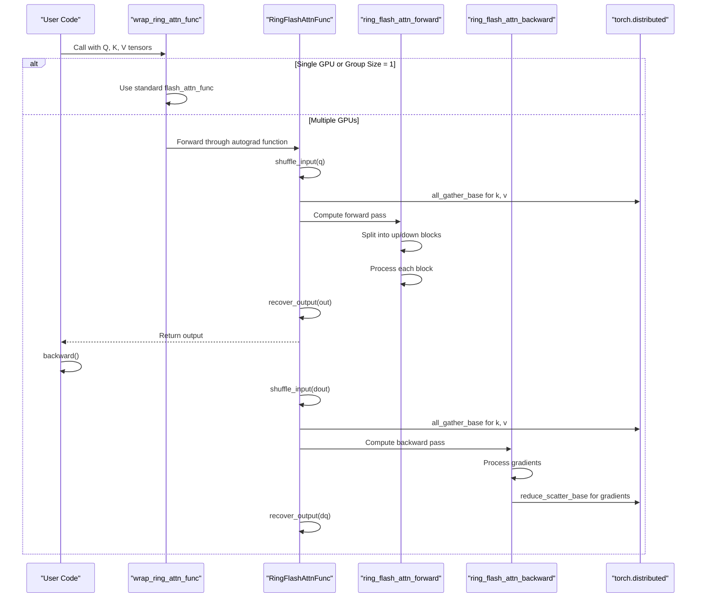
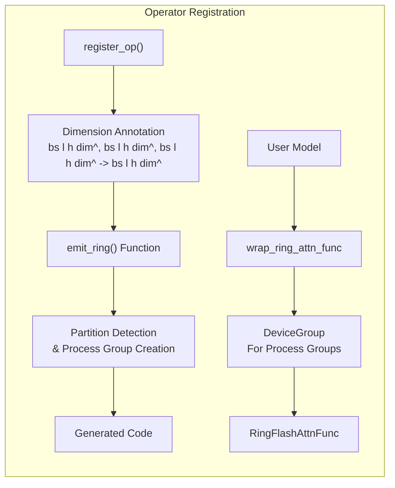

<!-- source: DeepWiki mcp.deepwiki.com · repo microsoft/nnscaler · page 5.3 Ring Attention Example · fetched 2026-10-26 -->

# Ring Attention Example

<details>
<summary>Relevant source files</summary>

The following files were used as context for generating this wiki page:

- [.gitignore](.gitignore)
- [dev.md](dev.md)
- [docs/source/dimops.md](docs/source/dimops.md)
- [docs/source/parallel_module.md](docs/source/parallel_module.md)
- [examples/customized_ops/ring_attention/core/ring_attn_implementation.py](examples/customized_ops/ring_attention/core/ring_attn_implementation.py)
- [examples/customized_ops/ring_attention/ring_attn.py](examples/customized_ops/ring_attention/ring_attn.py)
- [examples/customized_ops/ring_attention/test_ring_attn.py](examples/customized_ops/ring_attention/test_ring_attn.py)
- [examples/customized_ops/ring_attention/test_zigzag_attn.py](examples/customized_ops/ring_attention/test_zigzag_attn.py)

</details>


This page provides a comprehensive guide for implementing a custom Ring Attention operator in nnScaler. Ring Attention is an optimization technique for attention mechanisms that distributes the computation across multiple GPUs using a ring-based communication pattern. This approach is particularly effective for handling long sequences by reducing memory requirements and communication overhead.

For information about general custom operator registration, see [Operator Registration](#5.2). For background on dimension annotations used in this example, see [Dimension Annotations (Dimops)](#5.1).

## What is Ring Attention?

Ring Attention is a distributed attention mechanism that partitions sequence processing across multiple GPUs. Unlike standard attention where each GPU processes the full sequence independently, Ring Attention divides the sequence dimension across GPUs and arranges communication in a ring pattern to ensure all tokens can attend to each other without requiring full all-to-all communication.



Key benefits of Ring Attention:
- Reduces peak memory usage by distributing the attention computation
- Scales to longer sequences than single-GPU attention
- Maintains full attention connectivity through ring communication
- Built on Flash Attention for high performance

Sources: [examples/customized_ops/ring_attention/core/ring_attn_implementation.py:189-195]()

## Implementation Components

The Ring Attention example consists of several key components that work together:



1. **User Interface (`wrap_ring_attn_func`)**: A wrapper function that serves as the entry point, handling both single-GPU and multi-GPU scenarios.

2. **Autograd Implementation (`RingFlashAttnFunc`)**: Custom autograd function implementing forward and backward passes for proper gradient computation.

3. **Forward/Backward Core (`ring_flash_attn_forward/backward`)**: Core implementations of the distributed attention algorithm.

4. **Operator Registration**: Registration with dimension annotations to integrate with nnScaler's parallelization system.

5. **Code Generation (`emit_ring`)**: Special function for generating appropriate code for parallelized execution.

Sources: [examples/customized_ops/ring_attention/ring_attn.py:15-107](), [examples/customized_ops/ring_attention/core/ring_attn_implementation.py:20-186]()

## Implementation Details

### Ring Attention Process Flow



### Key Implementation Details

1. **Sequence Transformation**:
   - Standard sequence ordering: `[0 1 2 3 4 5 6 7]`
   - Ring attention required ordering: `[0 7 2 5 3 4 1 6]`
   - Forward pass: shuffle input Q, all-gather K and V, recover output
   - Backward pass: shuffle dout, recover dq, reduce-scatter dk and dv

2. **Block Processing**:
   - Sequence is split into two blocks per rank ("up" and "down")
   - Each rank processes its assigned blocks
   - Causal attention processing varies based on block position

3. **Memory Management**:
   - Uses a global memory buffer (`GlobalMemoryBuffer`) to reuse tensor allocations
   - Carefully manages tensor layouts to optimize communication

Sources: [examples/customized_ops/ring_attention/core/ring_attn_implementation.py:189-283]()

## Custom Operator Registration

The Ring Attention operator is registered with nnScaler using dimension annotations:



The operator is registered with the dimension annotation: `'bs l h dim^, bs l h dim^, bs l h dim^ -> bs l h dim^'`, which indicates:
- Three input tensors (Q, K, V) with dimensions: batch size, sequence length, heads, and head dimension
- One output tensor with the same dimensions
- The `^` mark indicates dimensions that cannot be partitioned (head dimension)
- The sequence dimension (`l`) can be partitioned

The `emit_ring` function generates appropriate code based on the partition dimension, handling different partitioning strategies:
- If partitioned on batch dimension (0): Use local attention
- If partitioned on sequence dimension (1): Use ring attention across scale units
- If partitioned on head dimension (2): Use local attention

Sources: [examples/customized_ops/ring_attention/ring_attn.py:71-107](), [docs/source/dimops.md:1-110]()

## Usage Example

### Basic Usage

To use Ring Attention in your model:

1. Import the wrapper function:
```python
from ring_attn import wrap_ring_attn_func
```

2. Use it in your module's forward method:
```python
class AttentionModule(torch.nn.Module):
    def forward(self, q, k, v):
        output = wrap_ring_attn_func(q, k, v)
        return output
```

3. The function automatically handles both single-GPU and multi-GPU scenarios.

### Parallelization Policy

When parallelizing a model with Ring Attention using nnScaler, you need to define a policy that partitions the attention operation on the sequence dimension:

```python
def policy(graph: IRGraph, resource: ComputeConfig) -> IRGraph:
    ngpus = resource.plan_ngpus
    for idx, node in enumerate(graph.select(ntype=IRFwOperation)):
        if node.signature == 'ring_attn.wrap_ring_attn_func':
            # Partition on sequence dimension (dim=1)
            sub_nodes = graph.partition(
                node, node.algorithm('dim'), idx=0, dim=1, num=ngpus)
            # Assign sub-nodes to devices
            for idx, sub_node in enumerate(sub_nodes):
                graph.assign(sub_node, idx)
    return graph
```

### Testing Correctness

The example includes a test script that verifies the correctness of the implementation by comparing outputs and gradients between the single-GPU and multi-GPU versions:

1. Initialize a test with the same inputs on all ranks
2. Run the computation in single-GPU mode
3. Run the same computation using the parallelized model
4. Compare outputs and gradients to ensure they match

The test validates that the distributed implementation produces the same results as the non-distributed version.

Sources: [examples/customized_ops/ring_attention/test_ring_attn.py:50-139]()

## Performance Considerations

Ring Attention is most beneficial for:
- Long sequences (typically 8K+ tokens)
- Multiple GPUs (4 or more for significant benefit)
- Models with heavy attention computation

The implementation is optimized for Flash Attention 2.6.x and may require adaptation for other versions.

For optimal performance, tensor dimensions should be properly aligned and contiguous in memory.

## Conclusion

The Ring Attention example demonstrates how to implement a custom distributed operator in nnScaler. By registering the operator with appropriate dimension annotations and implementing the necessary communication patterns, you can create highly efficient distributed implementations of attention mechanisms that scale to longer sequences than what's possible on a single GPU.

This pattern can be extended to other types of operations that benefit from similar distributed communication strategies.

---

