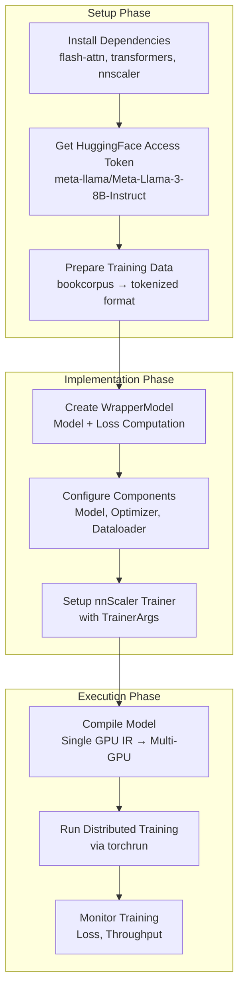
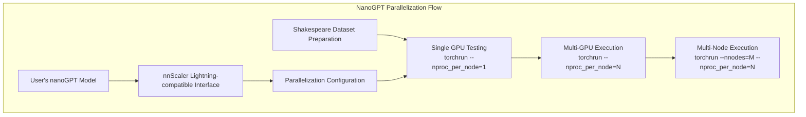
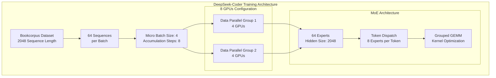
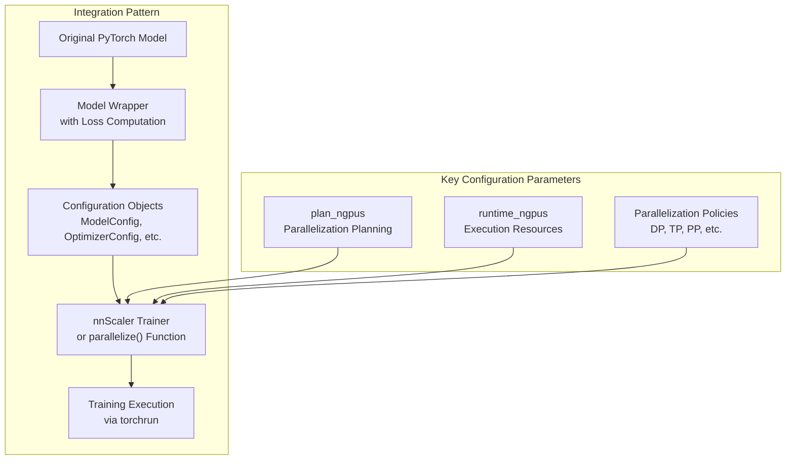

<!-- source: DeepWiki mcp.deepwiki.com · repo microsoft/nnscaler · page 6 Examples and Use Cases · fetched 2026-10-26 -->

# Examples and Use Cases

<details>
<summary>Relevant source files</summary>

The following files were used as context for generating this wiki page:

- [README.md](README.md)
- [examples/deepseek_coder_v2_lite/README.md](examples/deepseek_coder_v2_lite/README.md)
- [examples/deepseek_coder_v2_lite/modeling/__init__.py](examples/deepseek_coder_v2_lite/modeling/__init__.py)

</details>


This page showcases practical examples of using nnScaler for distributed training across multiple devices. It demonstrates how to apply nnScaler to different types of models through concrete examples. For information about the underlying parallelization strategies, see [Parallelization Strategies](#3), and for details on automatic distribution capabilities, see [Automatic Distribution (AutoDist)](#4).

## Example Models Overview

nnScaler includes several example implementations that demonstrate its capabilities for different models and use cases. The following table summarizes these examples:

| Model | Description | Parallelization Strategy | Key Features |
|-------|-------------|--------------------------|--------------|
| Llama-3 | Large language model fine-tuning | Data Parallelism, ZeRO-1 | Flash Attention integration, minimal code changes |
| nanoGPT | Small GPT implementation | Data Parallelism | PyTorch Lightning compatibility, easy multi-node scaling |
| DeepSeek-Coder-V2-Lite | Code generation model with MoE | Data Parallelism, ZeRO-1 | Expert parallelism, grouped GEMM optimization |

Let's explore each of these examples in detail.

## Llama-3 Example

This example demonstrates how to fine-tune Llama-3 models using nnScaler with minimal code changes.



### Prerequisites

1. Install required packages:
   ```bash
   python -m pip install transformers==4.40.0 flash-attn==2.5.5 tensorboard
   ```

2. Obtain access to Llama-3 model from [HuggingFace](https://huggingface.co/meta-llama/Meta-Llama-3-8B-Instruct) and set the access token:
   ```bash
   export HF_TOKEN=<HUGGINGFACE_ACCESS_TOKEN>
   ```

### Code Implementation

The key steps for implementing Llama-3 with nnScaler include:

1. **Wrap the model** to include loss computation:
   ```python
   class WrapperModel(torch.nn.Module):
       def __init__(self, model_id):
           super().__init__()
           self.model = AutoModelForCausalLM.from_pretrained(model_id, attn_implementation='flash_attention_2')

       def forward(self, samples):
           # Model forward pass and loss computation
           outputs = self.model.model(
               input_ids=samples['net_input']['src_tokens'],
               use_cache=False,
               return_dict=False,
           )
           loss = torch.sum(chunk_linear_cross_entropy(outputs[0], self.model.lm_head.weight, samples['target'], ...))
           return loss, samples['ntokens'], samples['nsentences']
   ```

2. **Configure components** including model, optimizer, and dataloader:
   ```python
   model_config = ModelConfig(
       type=WrapperModel,
       args={'model_id': args.model_id},
   )
   
   optimizer_config = OptimizerConfig(
       type=MixedPrecisionAdamW,
       args={'lr': 2e-5, 'betas': (0.9, 0.95), 'weight_decay': 0.0, 'fused': True},
   )
   ```

3. **Set up the nnScaler trainer**:
   ```python
   trainer = Trainer(train_args=TrainerArgs(
       model=model_config,
       optimizer=optimizer_config,
       dataloader=dataloader_config,
       # Other configurations
   ))
   trainer.run()
   ```

### Running the Example

To run the Llama-3 example:

1. Prepare training data:
   ```bash
   python bookcorpus.py --data_path_or_name bookcorpus/bookcorpus --tokenizer_path_or_name meta-llama/Meta-Llama-3-8B-Instruct --save_path ./bookcorpus_llama3_4K --sequence_length 4096
   ```

2. Build a mini model for testing (optional):
   ```bash
   python create_mini_model.py --model_id meta-llama/Meta-Llama-3-8B-Instruct --output_id ./llama3_mini
   ```

3. Run distributed training:
   ```bash
   torchrun --nproc_per_node=2 train.py --plan_ngpus 1 --runtime_ngpus 2 --name llama3_debug --model_id ./llama3_mini --dataset_path ./bookcorpus_llama3_4K
   ```

Sources: [README.md:64-151]()

## nanoGPT Example

This example demonstrates how to parallelize [Andrej Karpathy's nanoGPT](https://github.com/karpathy/nanoGPT) using nnScaler with a PyTorch Lightning-compatible interface.



### Setup and Dependencies

1. Install nanoGPT dependencies:
   ```bash
   pip install -r requirements.txt
   ```

2. Prepare the Shakespeare dataset:
   ```bash
   python nanoGPT/data/shakespeare_char/prepare.py
   ```

### Training Execution

#### Single GPU Testing
To verify your setup, run the model on a single GPU:
```bash
torchrun --nproc_per_node=1 train_nnscaler.py nanoGPT/config/train_shakespeare_char.py
```

#### Multi-GPU Execution
To run on multiple GPUs on a single node:
```bash
torchrun --nproc_per_node=4 train_nnscaler.py nanoGPT/config/train_shakespeare_char.py
```

#### Multi-Node Execution
To distribute training across multiple nodes:
```bash
# Run this on each node
torchrun --nnodes=2 --nproc_per_node=4 --rdzv-id=NNSCALER_NANOGPT --rdzv-backend=c10d --rdzv-endpoint=<IP> train_nnscaler.py nanoGPT/config/train_shakespeare_char.py
```

**Note**: By default, the local batch size remains fixed, so using more workers results in a larger global batch size.

Sources: [README.md:152-192]()

## DeepSeek-Coder-V2-Lite Training

This example demonstrates how to train [DeepSeek-Coder-V2-Lite](https://huggingface.co/deepseek-ai/DeepSeek-Coder-V2-Lite-Base), a specialized code generation model with Mixture of Experts (MoE) architecture, on 8x H100/A100 GPUs.



### Requirements and Setup

To run this example, you need:
```
nnscaler
transformers==4.40.0
datasets==2.20.0
apex
flash-attn
grouped_gemm==1.1.4
```

Running in a Nvidia container like `nvidia/pytorch:24.02-py3` is recommended. The [grouped_gemm library](https://github.com/fanshiqing/grouped_gemm) is needed for efficient MoE implementation.

### Data Preparation

Prepare the bookcorpus dataset for training:
```bash
python bookcorpus.py --data_path_or_name bookcorpus/bookcorpus --tokenizer_path_or_name deepseek-ai/DeepSeek-Coder-V2-Lite-Base --save_path ./bookcorpus_2k --sequence_length 2048
```

### Code Modifications

The DeepSeek-Coder model has been modified to work efficiently with nnScaler:

1. Base implementation files `configuration_deepseek.py` and `modeling_deepseek.py` are identical to the original implementation.
2. Token dispatching logic in `moe_utils.py` is adapted from [Megatron-LM](https://github.com/NVIDIA/Megatron-LM/blob/main/megatron/core/transformer/moe/moe_utils.py).
3. Performance optimizations in `modeling_deepseek_modifier.py`:
   - Integration of apex and flash-attn for efficient RMSNorm and attention
   - Registration of routing functions with annotations for nnScaler
   - Replacement of for-loop based MoE with efficient CUTLASS-based implementation
   - Merging of separate expert weights after loading checkpoints

### Distributed Configuration

The distributed configuration uses:
- 64 sequences per batch with sequence length of 2048
- Micro batch size of 4 with gradient accumulation steps of 8
- 8 GPUs divided into 2 data parallel groups (4 GPUs per replica)

### Running the Example

To compile the model:
```bash
python train.py --run_mode compile --model_id deepseek-ai/DeepSeek-Coder-V2-Lite-Base --dataset_path ./bookcorpus_2k --plan_ngpus=4 --runtime_ngpus=8 2>&1 | tee compile.log
```

To run the distributed training:
```bash
torchrun --nproc_per_node=8 train.py --model_id deepseek-ai/DeepSeek-Coder-V2-Lite-Base --dataset_path ./bookcorpus_2k --plan_ngpus=4 --runtime_ngpus=8 2>&1 | tee run.log
```

### Performance Analysis

The training achieves approximately 13% Model FLOPs Utilization (MFU) on 8x H100 GPUs, with each step processing 128K tokens in about 2 seconds. The bottleneck is primarily the MoE component utilization.

Performance metrics for the grouped GEMM implementation:

| # Dispatch Token | # Expert | forward (ms) | backward (ms) | MFU   |
|------------------|----------|--------------|---------------|-------|
| 4096             | 64       | 3.190        | 6.363         | 13.5% |
| 2048             | 32       | 1.851        | 3.367         | 12.3% |
| 8192             | 64       | 5.148        | 8.964         | 18.2% |
| 2048             | 16       | 1.613        | 2.459         | 15.8% |
| 16384            | 64       | 8.901        | 14.90         | 21.6% |
| 2048             | 8        | 1.663        | 2.329         | 16.1% |

Optimization recommendations:
- Replace the CUTLASS kernel with improved implementations
- Fuse additional kernels such as RoPE and memory slicing in attention
- Use more devices to reduce memory pressure from optimizer states (128GB)

Sources: [examples/deepseek_coder_v2_lite/README.md:1-81]()

## Real-World Applications

nnScaler has been adopted by multiple research and product projects:

### Differential Transformer
The [Differential Transformer](https://arxiv.org/abs/2410.05258) project utilizes nnScaler for implementing and scaling its differential attention mechanism. This demonstrates nnScaler's ability to handle custom attention patterns.

### YOCO (You Only Cache Once)
The [YOCO](https://arxiv.org/abs/2405.05254) project leverages nnScaler for training models with long sequences using decoder-decoder architectures, showcasing nnScaler's capability for efficient long-context training.

### Phi-3 Series
nnScaler was used for [post-training the long context version of Phi-3 models](https://arxiv.org/abs/2404.14219), demonstrating its applicability to production-grade models in commercial settings.

### LongRoPE
The [LongRoPE](https://arxiv.org/abs/2402.13753) project utilizes nnScaler to reduce both training and inference costs when extending LLM context windows beyond 2 million tokens, showing nnScaler's effectiveness for extreme context length handling.

Sources: [README.md:14-20]()

## Integration Pattern Overview

The following diagram illustrates the common pattern for integrating various models with nnScaler:



This diagram shows the common workflow across all examples, highlighting how original PyTorch models are wrapped, configured, and passed to the nnScaler Trainer or `parallelize()` function. The key parameters that control parallelization are `plan_ngpus` (number of GPUs used during planning), `runtime_ngpus` (number of GPUs used during execution), and the parallelization policies.

Sources: [README.md:7-33](), [README.md:64-151]()

---

