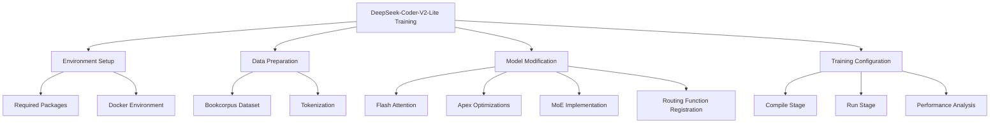
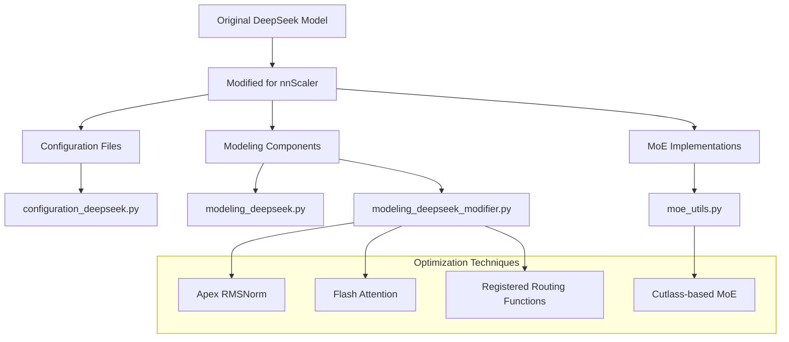
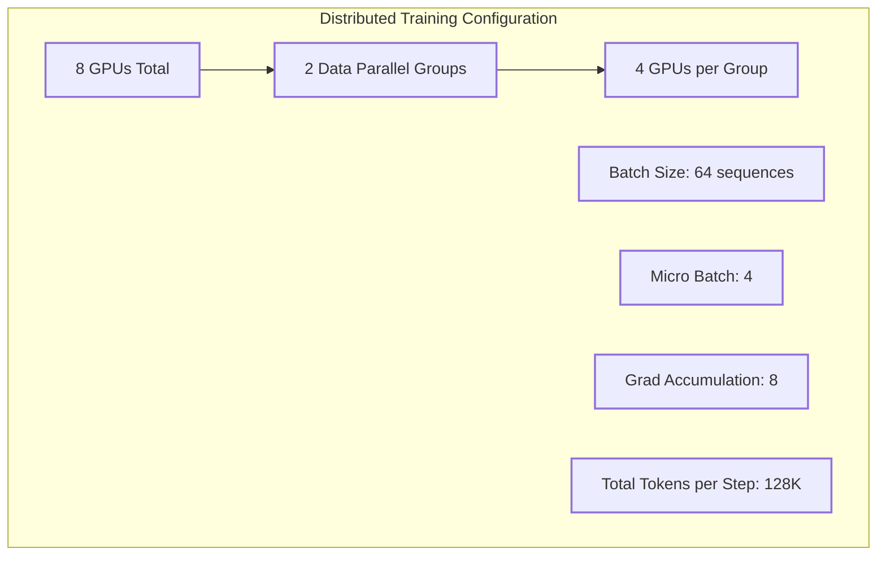
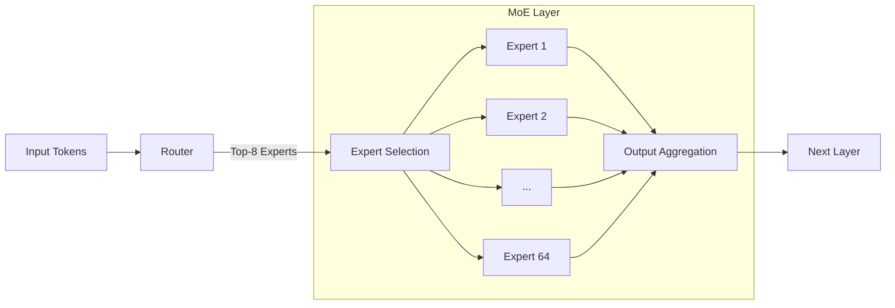

<!-- source: DeepWiki mcp.deepwiki.com · repo microsoft/nnscaler · page 6.1 DeepSeek-Coder-V2-Lite Training · fetched 2026-10-26 -->

# DeepSeek-Coder-V2-Lite Training

<details>
<summary>Relevant source files</summary>

The following files were used as context for generating this wiki page:

- [examples/deepseek_coder_v2_lite/README.md](examples/deepseek_coder_v2_lite/README.md)
- [examples/deepseek_coder_v2_lite/modeling/__init__.py](examples/deepseek_coder_v2_lite/modeling/__init__.py)

</details>


This document details how to train the DeepSeek-Coder-V2-Lite-2k model using nnScaler's distributed training capabilities. It covers the complete workflow from setup to performance analysis, focusing on the practical aspects of training this Mixture of Experts (MoE) language model across multiple GPUs. For general information on training large language models with nnScaler, see [Training Large Language Models](#6.2).

## 1. Overview

DeepSeek-Coder-V2-Lite is a smaller version of DeepSeek's code-focused language model that maintains strong performance while requiring fewer computational resources. This example demonstrates how to effectively train this model on 8 NVIDIA H100 or A100 GPUs using data parallelism and nnScaler's optimization techniques.



Sources: [examples/deepseek_coder_v2_lite/README.md:1-81]()

## 2. Environment Requirements

To successfully train DeepSeek-Coder-V2-Lite, you'll need the following dependencies:

| Package | Purpose |
|---------|---------|
| nnscaler | Core distributed training framework |
| transformers (v4.40.0) | For model architecture and tokenization |
| datasets (v2.20.0) | For dataset handling |
| apex | For optimized CUDA operations |
| flash-attn | For optimized attention mechanism |
| grouped_gemm (v1.1.4) | For efficient MoE implementation |

The recommended environment is NVIDIA's official PyTorch container (nvidia/pytorch:24.02-py3), which provides a compatible CUDA environment with necessary libraries pre-installed.

Sources: [examples/deepseek_coder_v2_lite/README.md:7-20]()

## 3. Data Preparation

The training example uses the BookCorpus dataset from Hugging Face. The preparation process involves tokenizing the text data using the DeepSeek tokenizer and formatting it to the expected sequence length.


To prepare the dataset, use the provided script with the following parameters:
- Data source: `bookcorpus/bookcorpus`
- Tokenizer: `deepseek-ai/DeepSeek-Coder-V2-Lite-Base`
- Sequence length: 2048 tokens
- Output path: `./bookcorpus_2k`

Sources: [examples/deepseek_coder_v2_lite/README.md:22-28]()

## 4. Model Modification for nnScaler

The DeepSeek-Coder-V2-Lite model requires specific modifications to work efficiently with nnScaler. These changes are primarily focused on optimizing performance and ensuring compatibility with distributed training.



The key modifications include:

1. **Performance Optimizations**:
   - Integration of Apex for optimized RMSNorm implementation
   - Flash Attention for faster multi-head attention operations
   
2. **MoE-specific Changes**:
   - Registration of routing functions with proper annotations for nnScaler
   - Replacement of loop-based MoE implementation with a more efficient Cutlass-based grouped GEMM implementation
   - Merging of separate expert weights after checkpoint loading

Sources: [examples/deepseek_coder_v2_lite/README.md:32-44]()

## 5. Distributed Training Configuration

The training configuration uses nnScaler to efficiently distribute the DeepSeek-Coder-V2-Lite model across multiple GPUs.

### 5.1 Configuration Parameters

| Parameter | Value | Description |
|-----------|-------|-------------|
| Sequence Length | 2048 | Number of tokens per sequence |
| Batch Size | 64 | Total sequences per batch |
| Micro Batch Size | 4 | Sequences processed in one forward pass |
| Gradient Accumulation Steps | 8 | Gradient accumulation before weight update |
| GPUs | 8 | Total GPUs used for training |
| Data Parallel Groups | 2 | Number of model replicas (4 GPUs each) |



Sources: [examples/deepseek_coder_v2_lite/README.md:45-49]()

### 5.2 Training Process

The training process consists of two main stages:

1. **Compilation Stage**:
   ```bash
   python train.py --run_mode compile --model_id deepseek-ai/DeepSeek-Coder-V2-Lite-Base --dataset_path ./bookcorpus_2k --plan_ngpus=4 --runtime_ngpus=8
   ```

2. **Execution Stage**:
   ```bash
   torchrun --nproc_per_node=8 train.py --model_id deepseek-ai/DeepSeek-Coder-V2-Lite-Base --dataset_path ./bookcorpus_2k --plan_ngpus=4 --runtime_ngpus=8
   ```

The compilation stage generates the optimized plan for distributed training, while the execution stage uses that plan to run the actual training process across all GPUs.

Sources: [examples/deepseek_coder_v2_lite/README.md:50-61]()

## 6. Performance Analysis

On 8 NVIDIA H100 GPUs, each training step (processing 128K tokens) takes approximately 2 seconds. With 2.65B activated parameters, this results in a Model FLOPS Utilization (MFU) of about 13%.

### 6.1 MoE Performance Breakdown

The primary performance bottleneck is the low utilization rate of the MoE component. DeepSeek-Coder-V2-Lite uses 64 experts with hidden size = 2048 and intermediate size = 1408, where each token is dispatched to 8 experts.



Performance metrics for the grouped GEMM implementation used in MoE:

| # Dispatch Tokens | # Experts | Forward (ms) | Backward (ms) | MFU |
|-------------------|-----------|--------------|---------------|-----|
| 4096              | 64        | 3.190        | 6.363         | 13.5% |
| 2048              | 32        | 1.851        | 3.367         | 12.3% |
| 8192              | 64        | 5.148        | 8.964         | 18.2% |
| 2048              | 16        | 1.613        | 2.459         | 15.8% |
| 16384             | 64        | 8.901        | 14.90         | 21.6% |
| 2048              | 8         | 1.663        | 2.329         | 16.1% |

Sources: [examples/deepseek_coder_v2_lite/README.md:63-75]()

### 6.2 Performance Improvement Recommendations

To further optimize training performance:

1. **Kernel Improvements**:
   - Replace the current grouped_gemm (v1.14) with more optimized implementations
   - Fuse additional operations like RoPE and memory slicing in attention

2. **Resource Allocation**:
   - Add more devices to better distribute the optimizer states (currently using ~128GB)
   - With more devices, nnScaler can find more efficient parallelization plans

Sources: [examples/deepseek_coder_v2_lite/README.md:76-81]()

## 7. Conclusion

The DeepSeek-Coder-V2-Lite training example demonstrates how to efficiently train a MoE-based language model using nnScaler's distributed training capabilities. By leveraging optimized kernels, custom MoE implementations, and data parallelism, the training process achieves reasonable performance while maintaining the model's capabilities.

This example serves as a practical reference for training similar MoE models and can be further optimized following the recommendations provided in the performance analysis section.

---

