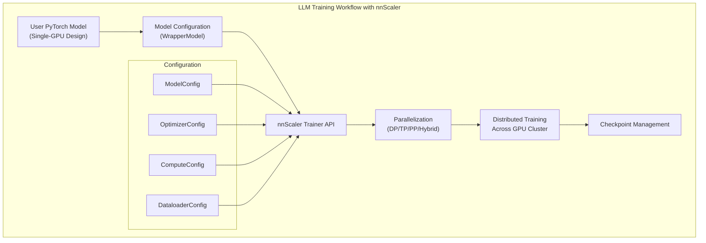
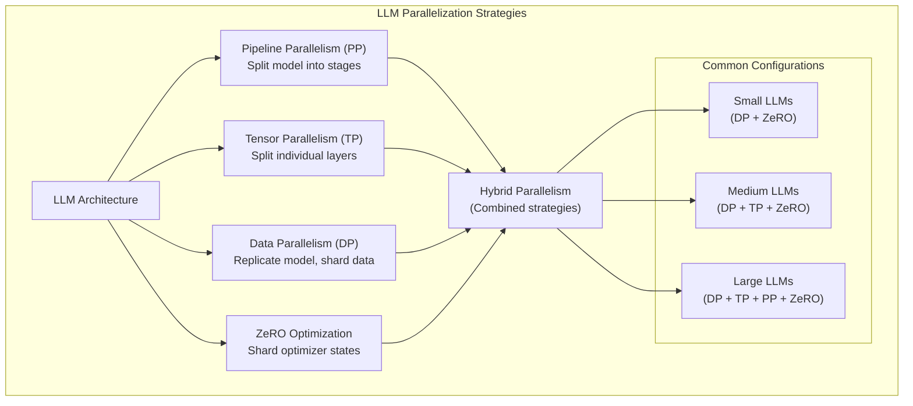
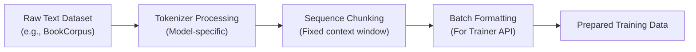
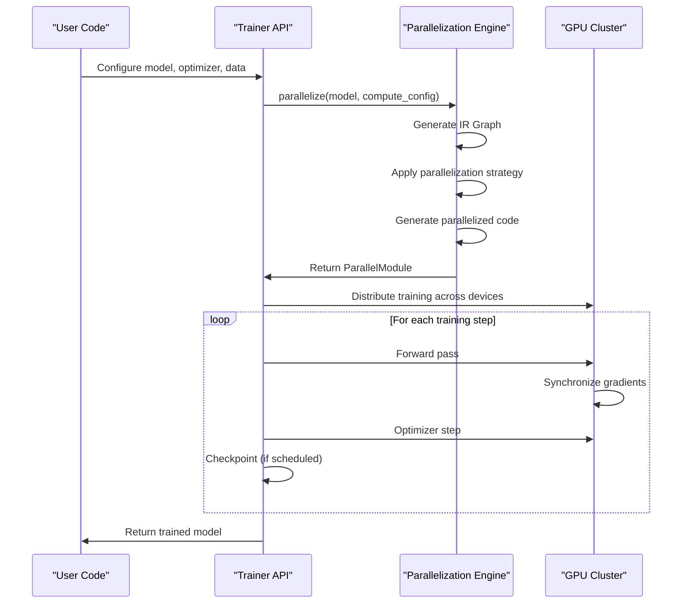
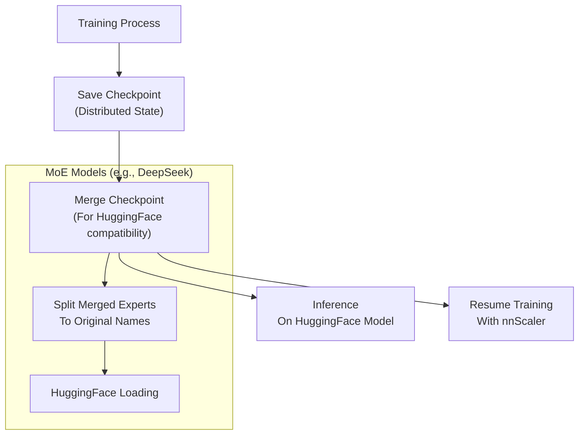

<!-- source: DeepWiki mcp.deepwiki.com · repo microsoft/nnscaler · page 6.2 Training Large Language Models · fetched 2026-10-26 -->

# Training Large Language Models

<details>
<summary>Relevant source files</summary>

The following files were used as context for generating this wiki page:

- [README.md](README.md)
- [examples/deepseek_coder_v2_lite/README.md](examples/deepseek_coder_v2_lite/README.md)
- [examples/deepseek_coder_v2_lite/modeling/__init__.py](examples/deepseek_coder_v2_lite/modeling/__init__.py)

</details>


This guide provides comprehensive instructions for training large language models (LLMs) with nnScaler. It covers the complete workflow from data preparation to distributed training configuration, with specific examples for popular LLM architectures. For information about training DeepSeek-Coder-V2-Lite specifically, see [DeepSeek-Coder-V2-Lite Training](#6.1).

## Overview of LLM Training with nnScaler

Training Large Language Models presents unique challenges due to their massive parameter counts and computational requirements. nnScaler addresses these challenges by automatically parallelizing LLM training across multiple GPUs with minimal code changes. This approach enables efficient training of models that would otherwise be impractical to train on single devices.



Sources: [README.md:85-132]()

## Setting Up the Environment

### Hardware Requirements

Training LLMs with nnScaler requires multiple GPUs for effective parallelization. The hardware requirements vary by model size:

| Model Size | Minimum Recommended Setup | Optimal Setup |
|------------|---------------------------|---------------|
| Small LLMs (1-3B parameters) | 2-4 GPUs | 4-8 GPUs |
| Medium LLMs (7-13B parameters) | 4-8 GPUs | 8+ GPUs |
| Large LLMs (20B+ parameters) | 8+ GPUs | 16+ GPUs |

### Software Dependencies

Before training LLMs with nnScaler, install the following dependencies:

```
Python >= 3.9, < 3.11 (3.10 is recommended)
PyTorch >= 2.0, < 2.4 (2.2.0 is recommended)
transformers==4.40.0 (for Hugging Face models)
flash-attn==2.5.5 (for efficient attention)
```

For specialized models like DeepSeek-Coder, additional packages may be required:
- `apex` (for mixed precision training)
- `grouped_gemm` (for MoE operations)

Sources: [README.md:39-59](), [examples/deepseek_coder_v2_lite/README.md:9-20]()

## LLM Parallelization Architecture

nnScaler supports multiple parallelization strategies that can be combined to efficiently train LLMs across GPU clusters.



Sources: [README.md:85-132]()

### Parallelization Strategy Selection

The optimal parallelization strategy depends on your model size, GPU memory, and communication bandwidth:

- **Data Parallelism (DP)**: Replicates the model across devices and shards the input data. Suitable for small to medium LLMs when each GPU has enough memory to hold the entire model.

- **Tensor Parallelism (TP)**: Splits individual layers across devices. Effective for large transformer modules in LLMs where layer dimensions are substantial.

- **Pipeline Parallelism (PP)**: Divides the model into sequential stages, with each stage on a different device. Useful for very deep LLMs.

- **ZeRO Optimization**: Distributes optimizer states, gradients, and parameters across devices. Can be combined with other strategies to reduce memory footprint.

- **Hybrid Parallelism**: Combines multiple strategies for maximum efficiency. Most production LLM training uses hybrid approaches.

## Data Preparation for LLM Training

Proper data preparation is essential for effective LLM training. nnScaler examples provide utilities for processing common datasets:



Sources: [README.md:142-143](), [examples/deepseek_coder_v2_lite/README.md:22-28]()

### Example Data Preparation Command

For Llama-3 models:
```bash
python bookcorpus.py --data_path_or_name bookcorpus/bookcorpus --tokenizer_path_or_name meta-llama/Meta-Llama-3-8B-Instruct --save_path ./bookcorpus_llama3_4K --sequence_length 4096
```

For DeepSeek-Coder:
```bash
python bookcorpus.py --data_path_or_name bookcorpus/bookcorpus --tokenizer_path_or_name deepseek-ai/DeepSeek-Coder-V2-Lite-Base --save_path ./bookcorpus_2k --sequence_length 2048
```

## Model Configuration for LLM Training

To prepare an LLM for training with nnScaler, you need to:

1. **Wrap the model**: Create a wrapper class that handles forward pass and loss computation
2. **Configure components**: Set up model, optimizer, and dataloader configurations
3. **Initialize the trainer**: Create and run an nnScaler trainer with appropriate arguments

### LLM Wrapper Model Example

```python
class WrapperModel(torch.nn.Module):
    def __init__(self, model_id):
        super().__init__()
        self.model = AutoModelForCausalLM.from_pretrained(
            model_id, 
            attn_implementation='flash_attention_2'
        )

    def forward(self, samples):
        outputs = self.model.model(
            input_ids=samples['net_input']['src_tokens'],
            use_cache=False,
            return_dict=False,
        )
        loss = torch.sum(chunk_linear_cross_entropy(
            outputs[0], 
            self.model.lm_head.weight, 
            samples['target'], 
            ...
        ))
        return loss, samples['ntokens'], samples['nsentences']
```

Sources: [README.md:89-101]()

### Trainer Configuration

```python
# Model configuration
model_config = ModelConfig(
    type=WrapperModel,
    args={'model_id': model_id},
)

# Optimizer configuration
optimizer_config = OptimizerConfig(
    type=MixedPrecisionAdamW,
    args={
        'lr': 2e-5, 
        'betas': (0.9, 0.95), 
        'weight_decay': 0.0, 
        'fused': True
    },
)

# Initialize trainer with configurations
trainer = Trainer(train_args=TrainerArgs(
    model=model_config,
    optimizer=optimizer_config,
    dataloader=dataloader_config,
    compute_config=ComputeConfig(
        plan_ngpus=plan_ngpus,
        runtime_ngpus=runtime_ngpus,
        use_zero=True
    ),
    max_train_steps=max_steps,
    micro_batch_size=micro_batch_size,
))

# Start training
trainer.run()
```

Sources: [README.md:108-130]()

## Training Process

The nnScaler training process for LLMs follows these steps:



Sources: [README.md:85-132]()

## Example: Training Llama-3 with nnScaler

### Compilation and Training

To parallelize and train a Llama-3 model:

```bash
# Build mini model (for testing)
python create_mini_model.py --model_id meta-llama/Meta-Llama-3-8B-Instruct --output_id ./llama3_mini

# Compile and run using data parallelism + zero1
torchrun --nproc_per_node=2 train.py --plan_ngpus 1 --runtime_ngpus 2 --name llama3_debug --model_id ./llama3_mini --dataset_path ./bookcorpus_llama3_4K
```

Sources: [README.md:145-148]()

### Key Parameters Explained

- `--plan_ngpus`: Number of GPUs used during compilation (planning)
- `--runtime_ngpus`: Number of GPUs used during actual training
- `--model_id`: Path or HuggingFace ID of the model
- `--dataset_path`: Path to the prepared dataset

## Example: Training DeepSeek-Coder with nnScaler

The DeepSeek-Coder-V2-Lite example demonstrates training a Mixture-of-Experts LLM with nnScaler. This model introduces additional complexity with its MoE architecture.

### Compilation and Training

```bash
# Compilation
python train.py --run_mode compile --model_id deepseek-ai/DeepSeek-Coder-V2-Lite-Base --dataset_path ./bookcorpus_2k --plan_ngpus=4 --runtime_ngpus=8

# Training
torchrun --nproc_per_node=8 train.py --model_id deepseek-ai/DeepSeek-Coder-V2-Lite-Base --dataset_path ./bookcorpus_2k --plan_ngpus=4 --runtime_ngpus=8
```

Sources: [examples/deepseek_coder_v2_lite/README.md:52-61]()

### Distributed Configuration for DeepSeek-Coder

In this example:
- Batch size: 64 sequences with length 2048
- Micro batch size: 4
- Gradient accumulation steps: 8
- Parallel strategy: 2 data parallel groups (each with 4 GPUs holding a full copy of weights)

Sources: [examples/deepseek_coder_v2_lite/README.md:46-49]()

## Performance Optimization for LLM Training

To maximize LLM training performance with nnScaler, consider these optimization techniques:

### Memory Efficiency

- Use mixed precision training (FP16/BF16) to reduce memory footprint
- Enable ZeRO optimization to distribute optimizer states
- Configure appropriate micro batch sizes based on available GPU memory

### Computation Efficiency

For optimal performance in MoE models like DeepSeek-Coder, consider:

| Technique | Description | Impact |
|-----------|-------------|--------|
| Kernel optimization | Replace with more efficient CUDA kernels | Reduces execution time |
| Operation fusion | Fuse operations like RoPE and memory slicing | Reduces kernel launch overhead |
| Scaling out | Add more devices to distribute optimizer states | Enables better parallelization plans |

Sources: [examples/deepseek_coder_v2_lite/README.md:64-80]()

## Custom Modifications for LLM Training

Some LLMs require specific modifications to work efficiently with nnScaler:

1. **Flash Attention**: Replace standard attention with Flash Attention for faster training
2. **Optimized Normalization**: Use apex for optimized layer/RMS normalization
3. **MoE Optimizations**: For MoE models like DeepSeek-Coder:
   - Register routing functions with proper annotations
   - Replace loop-based MoE implementations with efficient CUDA kernels
   - Merge separate expert weights after loading checkpoints

Sources: [examples/deepseek_coder_v2_lite/README.md:34-44]()

## Checkpoint Management

nnScaler handles checkpoint saving and loading for distributed LLM training:



Sources: [examples/deepseek_coder_v2_lite/README.md:49-50]()

## Multi-Node LLM Training

For training on multiple nodes, use `torchrun` with appropriate distributed parameters:

```bash
# Example for 2 nodes with 4 GPUs each
torchrun --nnodes=2 --nproc_per_node=4 --rdzv-id=NNSCALER_LLM --rdzv-backend=c10d --rdzv-endpoint=<IP> \
    train.py --plan_ngpus=4 --runtime_ngpus=8 --model_id <MODEL_ID> --dataset_path <DATA_PATH>
```

Sources: [README.md:186-188]()

## Troubleshooting LLM Training

When training LLMs with nnScaler, be aware of these potential issues:

| Issue | Possible Cause | Solution |
|-------|----------------|----------|
| OOM errors | Model too large for configured GPUs | Reduce micro batch size, enable ZeRO, use more GPUs |
| Slow compilation | Complex model architecture | Add `--compile_only` flag to separate compilation from training |
| Low GPU utilization | Inefficient parallelization strategy | Try different parallelization configs, optimize batch size |
| NaN loss values | Training instability | Reduce learning rate, add gradient clipping |

Sources: [examples/deepseek_coder_v2_lite/README.md:76-80]()

## Conclusion

nnScaler enables efficient training of large language models by automatically handling the complexities of distributed training. By following the guidelines in this document, you can train various LLM architectures with minimal code changes. For model-specific training guides, refer to [DeepSeek-Coder-V2-Lite Training](#6.1) or explore other examples in the repository.

---

