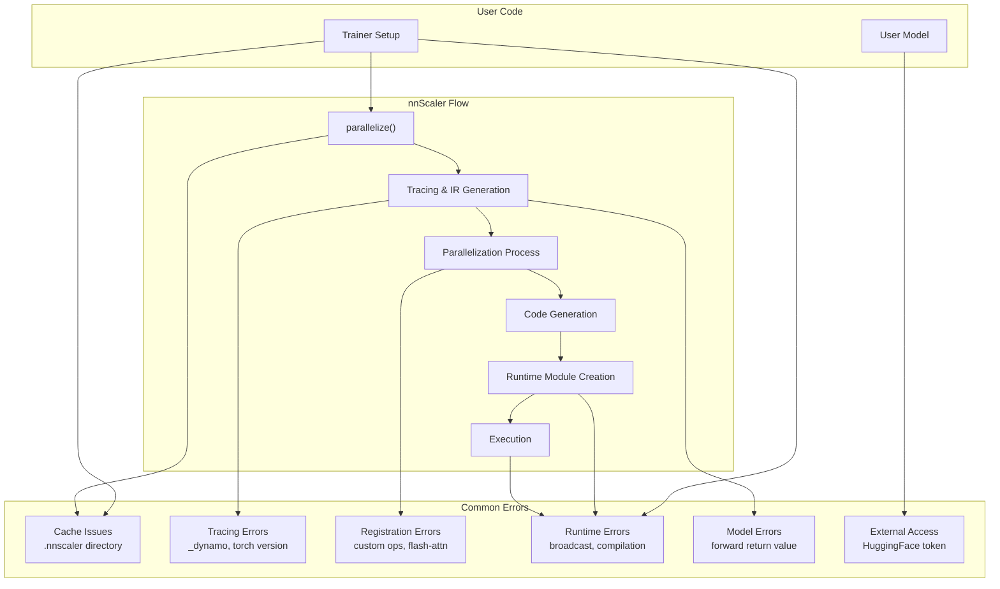
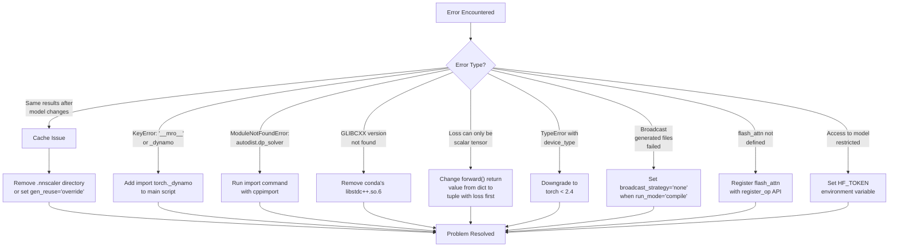
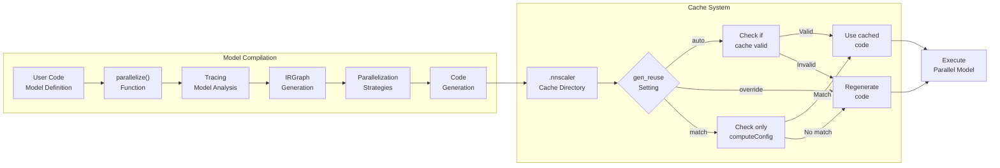

<!-- source: DeepWiki mcp.deepwiki.com · repo microsoft/nnscaler · page 7 Troubleshooting and FAQ · fetched 2026-10-26 -->

# Troubleshooting and FAQ

<details>
<summary>Relevant source files</summary>

The following files were used as context for generating this wiki page:

- [README.md](README.md)
- [docs/source/troubleshooting.rst](docs/source/troubleshooting.rst)

</details>


This page provides solutions for common issues encountered when using nnScaler, organized by category with practical fixes and explanations. For information about system architecture and components, see [Core Components](#2) and [Parallelization Strategies](#3).

## Common Issues and Solutions

### Cache and Reuse Issues

#### Model modifications not reflected in results

**Problem**: You've modified your model but the changes are not visible in the training or inference results.

**Solution**: nnScaler caches compiled models. You need to either:
1. Remove the `.nnscaler` directory in your working path, or
2. Set `TrainerArgs.gen_reuse` to `"override"` to force recompilation:

```python
trainer_args = TrainerArgs(
    gen_reuse='override',
    # other arguments...
)
trainer = Trainer(trainer_args=trainer_args)
trainer.run()
```

> Note: `gen_reuse="match"` only checks `compute_config`, not the model itself.

**Best practice**: Use `gen_reuse="override"` during development and `gen_reuse="auto"` for production.

#### "RuntimeError: Output directory is not empty..."

**Problem**: After modifying your model, you encounter an error about the output directory not being empty.

**Solution**: Remove the `.nnscaler` directory or set `gen_reuse="override"` to regenerate the code.

Sources: [docs/source/troubleshooting.rst:36-58]()

### Setup and Import Issues

#### "KeyError: '__mro__'" and "_dynamo" errors

**Problem**: You encounter `KeyError: '__mro__'` errors or other errors mentioning `_dynamo`.

**Solution**: Add this import to the beginning of your main script:
```python
import torch._dynamo
```

This works around a limitation in nnScaler's tracing of dynamic imports.

Sources: [docs/source/troubleshooting.rst:63-108]()

#### Missing DP solver module

**Problem**: `ModuleNotFoundError: No module named 'nnscaler.autodist.dp_solver'` when using editable install.

**Solution**: Run the following command to ensure proper C++ module compilation:
```bash
python -c 'import os,sys,nnscaler,cppimport.import_hook ; sys.path.append(os.path.dirname(nnscaler.__path__[0])) ; import nnscaler.autodist.dp_solver'
```

Sources: [docs/source/troubleshooting.rst:110-144]()

#### GLIBCXX version errors

**Problem**: `ImportError: ... libstdc++.so.6: version 'GLIBCXX_x.y.z' not found`

**Solution**: This is caused by gcc and glibc version mismatch, typically using system gcc with conda's glibc. Remove conda's glibc:
```bash
rm <PATH_TO_CONDA_ENV>/lib/libstdc++.so.6
```
The path will be shown in the error message.

Sources: [docs/source/troubleshooting.rst:146-164]()

## API Usage Issues

#### Dict return values from forward method

**Problem**: `RuntimeError: Loss can only be scalar tensor ...` when your model's forward method returns a dict.

**Solution**: When using nnScaler's Trainer, the top-level `forward()` must return either:
1. A loss tensor, or
2. A tuple where the first element is a loss tensor

Change your code:
```diff
def forward(self, data):
    ...
    -return {'loss': loss, 'ntokens': ntokens}
    +return loss, ntokens
```

Sources: [docs/source/troubleshooting.rst:168-203]()

#### PyTorch 2.4+ compatibility

**Problem**: TypeError regarding 'device_type' with PyTorch 2.4+

**Solution**: nnScaler doesn't support PyTorch 2.4 yet. Downgrade to PyTorch 2.3.x:
```bash
pip install "torch<2.4"
```

Sources: [docs/source/troubleshooting.rst:205-233]()

#### Broadcast errors with compile mode

**Problem**: `RuntimeError: Broadcast generated files failed` when using `run_mode='compile'`

**Solution**: When using `run_mode='compile'`, you must set `broadcast_strategy` to `'none'`:
```python
trainer_args = TrainerArgs(
    run_mode='compile',
    # ...
    broadcast_strategy=('none' if run_mode=='compile' else 'all'),
)
```

Sources: [docs/source/troubleshooting.rst:235-265]()

## Flash Attention Issues

#### Flash attention undefined

**Problem**: `NameError: name 'flash_attn' is not defined`

**Solution**: When using flash attention, it must be registered with the `register_op` API. Check the llama 3 example for usage details.

Sources: [docs/source/troubleshooting.rst:270-305]()

#### Import errors with flash-attn

**Problem**: ImportError when using flash attention

**Solution**: This is likely an error in flash attention itself. Try the import command outside nnScaler. If it still fails, check the [flash-attention documentation](https://github.com/Dao-AILab/flash-attention). For pip-installed packages, try using a wheel from the release page that matches your environment.

Sources: [docs/source/troubleshooting.rst:307-332]()

## Hugging Face Access Issues

**Problem**: `Access to model meta-llama/Meta-Llama-3-8B-Instruct is restricted. Please log in.`

**Solution**: You need to:
1. Request [Llama 3 access](https://huggingface.co/meta-llama/Meta-Llama-3-8B-Instruct) on Hugging Face
2. Generate your Hugging Face token
3. Export the token in your environment:
```bash
export HF_TOKEN=hf_...
```

Sources: [docs/source/troubleshooting.rst:336-345]()

## Troubleshooting Workflow

### Common Error Locations in nnScaler



Sources: [docs/source/troubleshooting.rst:1-345](), [README.md:84-130]()

### Troubleshooting Decision Process



Sources: [docs/source/troubleshooting.rst:1-345]()

## Cache and Code Generation Mechanism



Sources: [docs/source/troubleshooting.rst:5-58]()

## Frequently Asked Questions

### Performance and Optimization

**Q: How do I know if my model has been properly parallelized?**

A: nnScaler generates code in the `.nnscaler` directory. You can inspect this code to verify the parallelization strategy applied. Additionally, you should observe performance improvements and can check GPU utilization with tools like `nvidia-smi`.

**Q: What's the recommended setup for development vs. production?**

A: For development and debugging, use `gen_reuse="override"` to ensure changes are always reflected. For production, use `gen_reuse="auto"` to benefit from caching for faster startup.

### Compatibility

**Q: Which PyTorch versions are supported?**

A: nnScaler currently supports PyTorch versions from 2.0 to 2.3.x. PyTorch 2.4+ support is not yet available.

**Q: What are the Python version requirements?**

A: Python 3.9 or 3.10 is recommended. Python 3.11 and above are not fully supported yet.

Sources: [README.md:45-47]()

### Custom Operators

**Q: How do I add custom operators to my model?**

A: Use the `register_op` API to register custom operators with nnScaler. Refer to [Custom Operators](#5) for detailed documentation and examples.

**Q: Why am I seeing "flash_attn not defined" errors?**

A: Flash attention requires explicit registration with the `register_op` API before use. Check the examples in the documentation.

Sources: [docs/source/troubleshooting.rst:270-305]()

### Troubleshooting

**Q: How can I completely reset nnScaler if I'm having persistent issues?**

A: Remove the `.nnscaler` directory in your working path to clear all cached compilations and start fresh.

**Q: Why is my model producing the same results after making changes?**

A: nnScaler caches compiled models. Either remove the `.nnscaler` directory or set `gen_reuse="override"` to force recompilation.

Sources: [docs/source/troubleshooting.rst:5-58]()