# Page: Overview

# Overview

<details>
<summary>Relevant source files</summary>

The following files were used as context for generating this wiki page:

- [README.md](README.md)
- [docs/source/quickstart.rst](docs/source/quickstart.rst)

</details>


nnScaler is a parallelization engine that compiles deep neural network (DNN) models designed for single-GPU execution into programs capable of running in parallel across multiple GPUs. This document provides a high-level overview of the system architecture, key components, and core workflows of nnScaler.

For detailed installation instructions, see [Installation](#1.1).
For getting started quickly with examples, see [Quickstart Guide](#1.2).

## System Purpose and Architecture

nnScaler provides a systematic approach to model parallelization, allowing deep learning practitioners to focus on model design while the system handles the complexities of distributed training. The system is built around two main user interfaces:

1. The **Trainer API** - A high-level interface for training loop management
2. The **parallelize() function** - A direct model parallelization interface

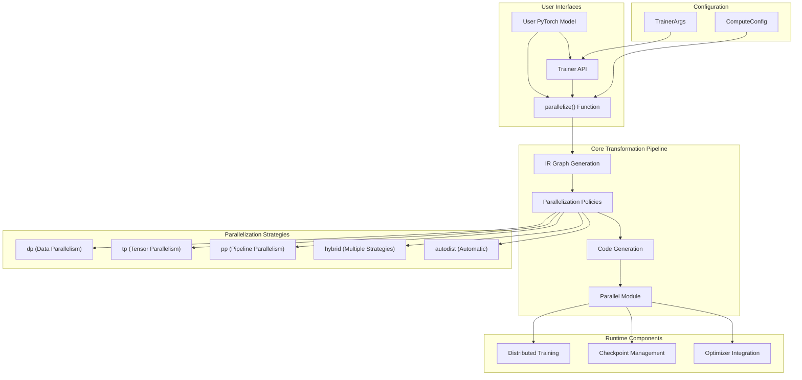

**Diagram Title: nnScaler System Architecture**

Sources: [README.md:7-28]()

## Key Features

nnScaler offers several key features that distinguish it from other parallelization frameworks:

| Feature | Description |
|---------|-------------|
| **Ease of Use** | Only a few lines of code changes needed to enable parallelization |
| **Pythonic** | Generated parallelized code is in PyTorch, making it readable and customizable |
| **Extensibility** | API support for custom operators and emerging model architectures |
| **Reliability** | Verified through extensive end-to-end training sessions |
| **Performance** | Explores large parallelization space to optimize training speed |

Sources: [README.md:22-28]()

## Core Workflow

The parallelization process in nnScaler follows a well-defined workflow:

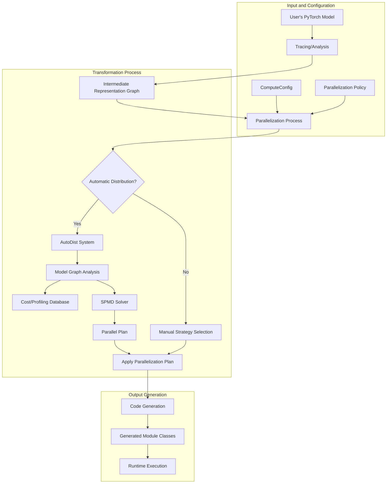

**Diagram Title: nnScaler Transformation Workflow**

The workflow consists of three major phases:

1. **Input and Configuration**: The user's PyTorch model is traced and analyzed to create an intermediate representation (IR) graph. Configuration options define how parallelization should be performed.

2. **Transformation Process**: Based on the configuration, the system either applies a manually selected parallelization strategy or uses the AutoDist system to automatically determine the optimal strategy. The AutoDist system analyzes the model graph, consults a cost/profiling database, and uses an SPMD (Single Program Multiple Data) solver to create a parallelization plan.

3. **Output Generation**: The parallelization plan is applied to the IR graph, code is generated for the parallel module classes, and the parallelized model is executed at runtime.

Sources: [README.md:10-12](), [docs/source/quickstart.rst:19-182]()

## Components and Their Relationships

The core components of nnScaler and their relationships are depicted in the following diagram:

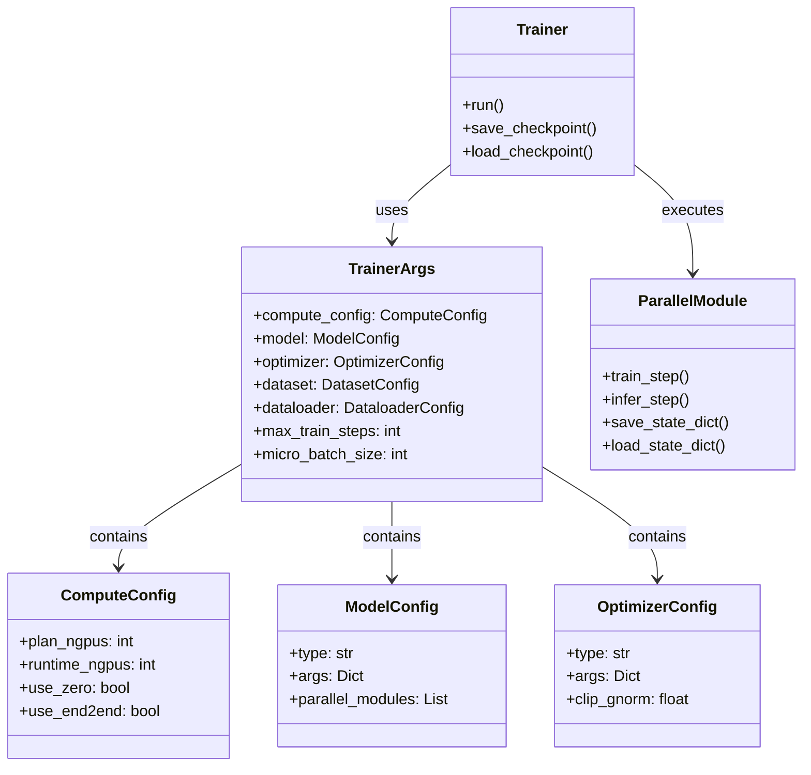

**Diagram Title: nnScaler Component Relationships**

The main components are:

- **Trainer**: The high-level interface for training parallelized models
- **TrainerArgs**: Configuration container for the Trainer
- **ComputeConfig**: Defines parallelization-specific settings
- **ModelConfig**: Specifies the model type and arguments
- **OptimizerConfig**: Defines optimizer type and parameters
- **ParallelModule**: The parallelized module generated by nnScaler

Sources: [README.md:83-131]()

## Usage Example

The following code snippet demonstrates the basic usage pattern of nnScaler:

```python
# Import the nnScaler Trainer
from nnscaler.cli.trainer import Trainer
from nnscaler.cli.trainer_args import TrainerArgs, ComputeConfig, ModelConfig, OptimizerConfig

# Define a model wrapper
class WrapperModel(torch.nn.Module):
    def __init__(self, model_id):
        super().__init__()
        self.model = AutoModelForCausalLM.from_pretrained(model_id)
    
    def forward(self, samples):
        outputs = self.model.model(
            input_ids=samples['net_input']['src_tokens'],
            use_cache=False,
            return_dict=False,
        )
        loss = torch.sum(chunk_linear_cross_entropy(outputs[0], self.model.lm_head.weight, samples['target']))
        return loss, samples['ntokens'], samples['nsentences']

# Configure and initialize the trainer
trainer = Trainer(train_args=TrainerArgs(
    compute_config=ComputeConfig(
        plan_ngpus=1,  # Number of GPUs used for planning
        runtime_ngpus=2,  # Number of GPUs used for runtime
        use_zero=True  # Enable ZeRO optimization
    ),
    model=ModelConfig(
        type=WrapperModel,
        args={'model_id': 'model_path'}
    ),
    optimizer=OptimizerConfig(
        type=torch.optim.AdamW,
        args={'lr': 2e-5, 'weight_decay': 0.0}
    ),
    max_train_steps=10000
))

# Start training
trainer.run()
```

To run this with multiple GPUs:

```bash
torchrun --nproc_per_node=2 train_script.py
```

Sources: [README.md:83-131](), [docs/source/quickstart.rst:25-74]()

## Parallelization Strategies

nnScaler supports several parallelization strategies:

| Strategy | Key | Description |
|----------|-----|-------------|
| **Data Parallelism** | `dp` | Replicates the model across devices and divides the data batch |
| **Tensor Parallelism** | `tp` | Partitions individual tensors and operations across devices |
| **Pipeline Parallelism** | `pp` | Splits the model into sequential stages across devices |
| **Hybrid Parallelism** | `hybrid` | Combines multiple strategies for optimal performance |
| **Automatic Distribution** | `autodist` | Automatically determines the best parallelization strategy |

For detailed explanations of each strategy, see [Parallelization Strategies](#3).

Sources: [README.md:136-191]()

## AutoDist System

The AutoDist system is a key component of nnScaler that automatically determines optimal parallelization strategies:

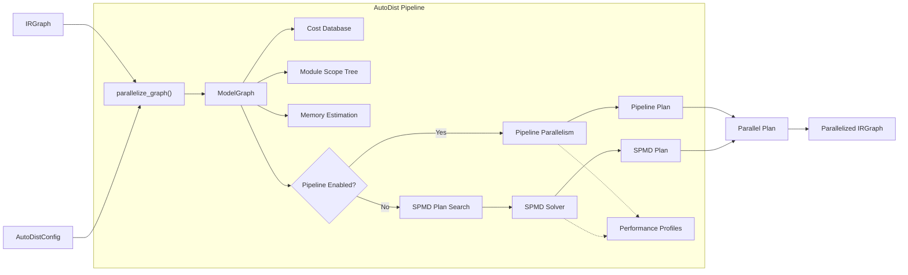

**Diagram Title: AutoDist System Workflow**

The AutoDist system analyzes the model graph, estimates memory requirements, and determines whether pipeline parallelism is suitable. Based on this analysis, it either creates a pipeline plan or uses the SPMD solver to find an optimal partitioning strategy. The result is a parallel plan that is applied to the IR graph.

For more details on the AutoDist system, see [Automatic Distribution (AutoDist)](#4).

Sources: [README.md:156-172]()

## Conclusion

nnScaler provides a comprehensive solution for parallelizing deep neural network models across multiple GPUs. By abstracting the complexities of distributed training, it allows researchers and practitioners to focus on model design while achieving high-performance parallel execution.

The system has been adopted by multiple research and product projects, demonstrating its effectiveness in real-world applications. For example, it has been used for training and fine-tuning large language models like the Phi-3 series, and for implementing specialized architectures like LongRoPE and Diff-Transformer.

For detailed information on specific components and features, please refer to the other sections of this documentation.

Sources: [README.md:14-20]()

---

# Page: Installation

# Installation

<details>
<summary>Relevant source files</summary>

The following files were used as context for generating this wiki page:

- [.readthedocs.yaml](.readthedocs.yaml)
- [docs/source/installation.rst](docs/source/installation.rst)
- [requirements-dev.txt](requirements-dev.txt)

</details>


This page provides instructions for installing nnScaler through different methods. The library can be installed either from a pre-built wheel package or from the source code, depending on your usage requirements.

## Installation Methods

nnScaler provides several installation approaches to accommodate different use cases:

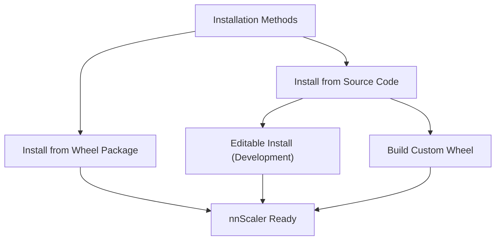

Sources: [docs/source/installation.rst:5-9]()

## Installation Components

When installing nnScaler, it's important to understand the core components that are set up:

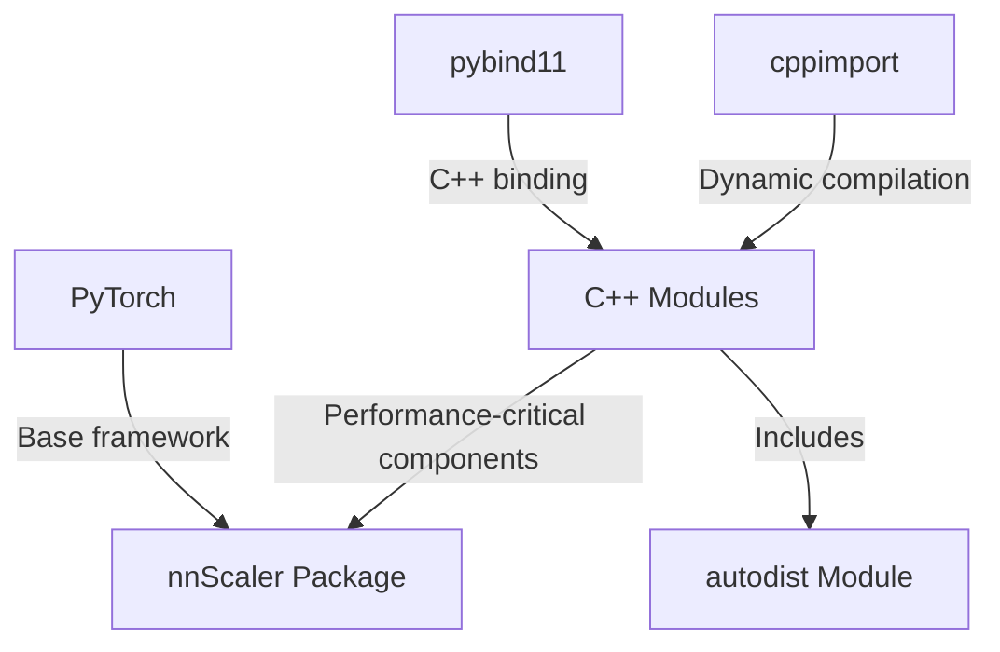

Sources: [docs/source/installation.rst:24-25]()

## Installing from Wheel Package

The wheel package installation is the simplest method and recommended for most users who don't need to modify the nnScaler source code.

```bash
pip install https://github.com/microsoft/nnscaler/releases/download/0.7/nnscaler-0.7-py3-none-any.whl
```

This installs the pre-compiled version of nnScaler with all necessary dependencies.

Sources: [docs/source/installation.rst:11-15]()

## Installing from Source Code

### Editable Install

For development purposes or when you need to modify the nnScaler source code, an editable installation is appropriate. This method requires manual compilation of C++ modules.

```bash
git clone --recursive https://github.com/microsoft/nnscaler
cd nnscaler
pip install -e .
python -c "import cppimport.import_hook ; import nnscaler.autodist.dp_solver"
```

Note: The last command is critical as it compiles the C++ modules, which are not automatically built during an editable install. The `autodist.dp_solver` module is a C++ component that requires compilation.

Sources: [docs/source/installation.rst:21-32]()

### Building a Custom Wheel

You can also build the wheel package yourself, which is useful for custom deployments or when you need to distribute a modified version of nnScaler:

```bash
cd nnscaler
pip install build
python -m build
pip install dist/nnscaler-*.whl
```

Sources: [docs/source/installation.rst:34-44]()

## Installation Workflow

The following diagram illustrates the installation workflow for both methods:

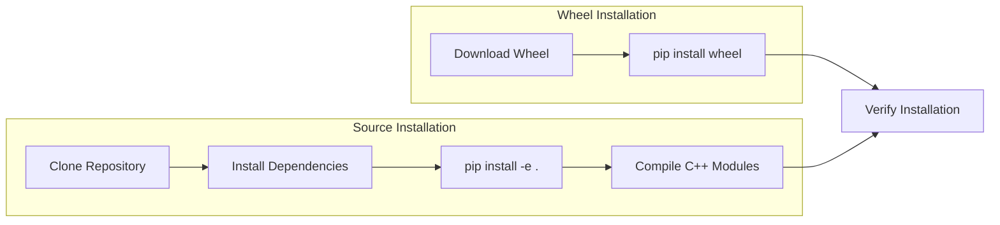

Sources: [docs/source/installation.rst:5-44]()

## Development Dependencies

If you're planning to contribute to nnScaler or run tests and build documentation, you'll need additional development dependencies:

```bash
pip install -r requirements-dev.txt
```

The development requirements include:
- Testing tools: `pytest`, `pytest-cov`, `pytest-mock`
- Documentation tools: `sphinx`, `furo`, `myst-parser`
- Code quality tools: `pre-commit`, `yapf`
- Visualization tools: `wandb`, `tensorboard`

Sources: [requirements-dev.txt:1-20]()

## Verifying Installation

To verify that nnScaler has been installed correctly, you can import it in Python:

```python
import nnscaler
# Attempt to import a core module
from nnscaler.trainer import Trainer
print("nnScaler installation successful")
```

If no errors occur, the installation is successful.

## Troubleshooting Common Issues

### C++ Compilation Errors

If you encounter errors during C++ module compilation, ensure:
- You have a compatible C++ compiler installed
- You've cloned the repository with the `--recursive` flag to get all submodules
- Your environment has the necessary development libraries

### Python Environment Issues

For dependency conflicts or environment issues:
```bash
# Create a clean virtual environment
python -m venv nnscaler_env
source nnscaler_env/bin/activate  # On Windows: nnscaler_env\Scripts\activate
# Then proceed with installation
```

For information on how to use nnScaler after installation, see the [Quickstart Guide](#1.2).

---

# Page: Quickstart Guide

# Quickstart Guide

<details>
<summary>Relevant source files</summary>

The following files were used as context for generating this wiki page:

- [README.md](README.md)
- [docs/source/quickstart.rst](docs/source/quickstart.rst)

</details>


This guide provides a quick introduction to nnScaler, helping you get started with model parallelization. You'll learn how to install nnScaler, understand its basic workflow, and run your first parallelized model training.

For a more comprehensive introduction, see [Overview](#1). For detailed installation instructions, see [Installation](#1.1).

## Installation

### Prerequisites

Before installing nnScaler, make sure you have:
- Python >= 3.9, < 3.11 (3.10 is recommended)
- PyTorch >= 2.0, < 2.4 (2.2.0 is recommended)

### Installing nnScaler

You can install nnScaler using pip:

```bash
pip install https://github.com/microsoft/nnscaler/releases/download/0.7/nnscaler-0.7-py3-none-any.whl
```

Or install from source:

```bash
git clone --recursive https://github.com/microsoft/nnscaler
cd nnscaler
pip install -r requirements.txt
pip install -e .

# Add to PYTHONPATH to avoid cppimport errors
export NNSCALER_HOME=$(pwd)
export PYTHONPATH=${NNSCALER_HOME}:$PYTHONPATH
```

Sources: [README.md:39-58](), [docs/source/quickstart.rst:5-16]()

## Core Workflow

The diagram below illustrates the basic workflow of nnScaler:


nnScaler transforms a PyTorch model designed for a single GPU into one that can run efficiently across multiple GPUs through these steps:

1. **Tracing**: Analyzes the model's structure and operations
2. **IR Graph**: Creates an intermediate representation of the model
3. **Parallelization Plan**: Determines how to split the model across devices
4. **Code Generation**: Produces optimized PyTorch code for parallel execution
5. **Distributed Training**: Executes the parallelized model across multiple GPUs

Sources: [README.md:9-11](), [README.md:22-27]()

## Key Components

nnScaler is built around several core components that work together to enable parallelization:

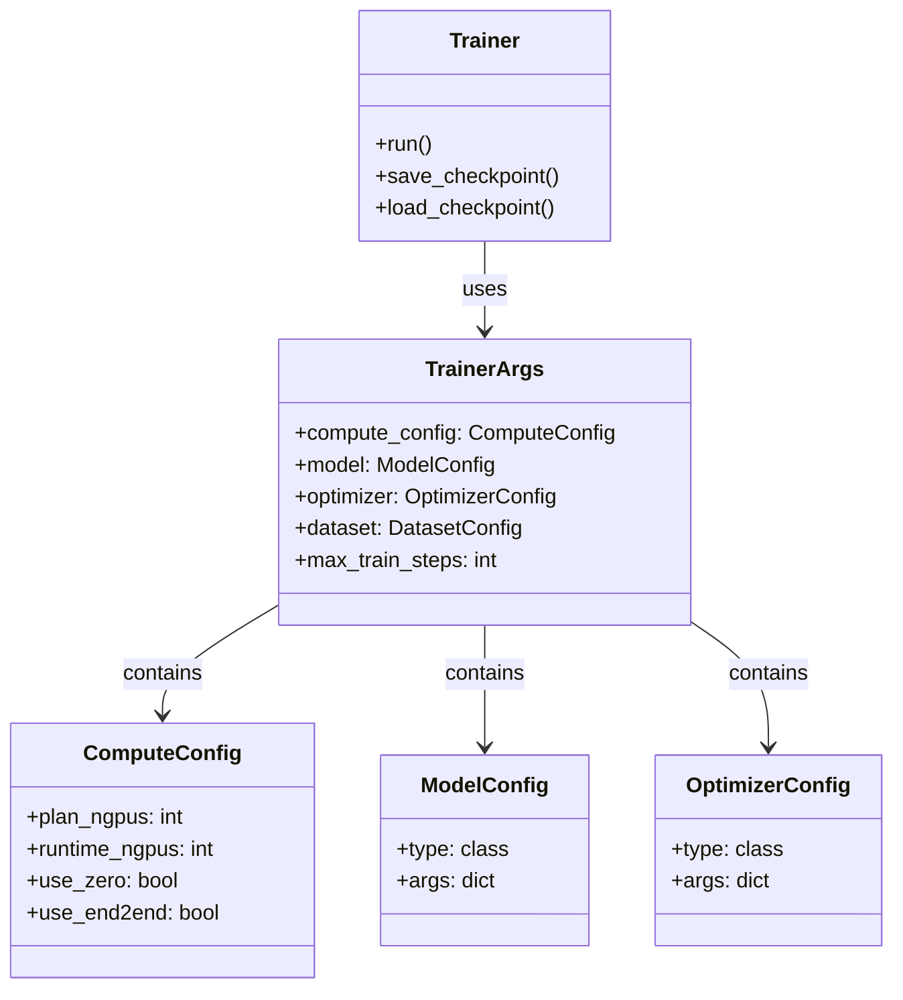

- **Trainer**: Manages the training process using the parallelized model
- **TrainerArgs**: Holds configuration for all aspects of training
- **ComputeConfig**: Specifies parallelization settings (GPU count, optimization strategies)
- **ModelConfig**: Defines the model class and initialization arguments
- **OptimizerConfig**: Specifies optimizer settings

Sources: [README.md:86-130](), [docs/source/quickstart.rst:60-68]()

## Running a Minimal Example

Let's start with a simple example to verify your installation:

1. Create a Python file with the following code:

```python
# model.py
import os
import torch
from nnscaler.cli.trainer import Trainer
from nnscaler.cli.trainer_args import *
from nnscaler.utils import set_default_logger_level

set_default_logger_level('INFO')

class Model(torch.nn.Module):
    def __init__(self):
        super().__init__()
        self.linear = torch.nn.Linear(100, 10)

    def forward(self, data):
        x = self.linear(data['x'])
        return torch.nn.functional.cross_entropy(x, data['y'])

class RandomDataset:
    def __init__(self, split):
        pass

    def __getitem__(self, i):
        return {
            'x': torch.rand(100),
            'y': torch.randint(10, tuple()),
        }

    def __len__(self):
        return 100

if __name__ == '__main__':
    world_size = int(os.getenv('WORLD_SIZE', 1))
    trainer_args = TrainerArgs(
        compute_config=ComputeConfig(plan_ngpus=1, runtime_ngpus=world_size, use_end2end=True),
        model=ModelConfig(type=Model),
        optimizer=OptimizerConfig(type=torch.optim.AdamW),
        dataset=DatasetConfig(type=RandomDataset, train_args={'split': 'train'}),
        max_train_steps=10,
        enable_progress_bar=False,
    )
    trainer = Trainer(train_args=trainer_args)
    trainer.run()
```

2. Run the model with multiple GPUs using `torchrun`:

```bash
torchrun --nproc_per_node=2 model.py
```

The example demonstrates:
- A simple model with one linear layer
- A random dataset for training
- Configuration of parallelization parameters through `ComputeConfig`
- Running the model across multiple GPUs using torchrun

Sources: [docs/source/quickstart.rst:19-74]()

## Understanding Parallelization Process

When you run the minimal example, nnScaler performs several steps:

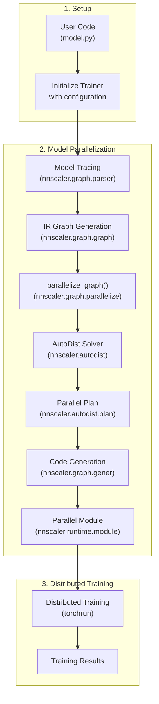

Key outputs to observe:
- Parallelization strategy selection
- Memory and performance profiling
- Operator partitioning decisions
- Training progress and metrics

Sources: [docs/source/quickstart.rst:75-180]()

## Advanced Examples

### Llama-3 Model Training

nnScaler includes an example for training Llama-3 models:

1. **Prerequisites**:
   ```bash
   python -m pip install transformers==4.40.0 flash-attn==2.5.5 tensorboard
   
   # Set HuggingFace token for model access
   export HF_TOKEN=<HUGGINGFACE_ACCESS_TOKEN>
   ```

2. **Run the example**:
   ```bash
   cd examples/llama
   
   # Prepare training data
   python bookcorpus.py --data_path_or_name bookcorpus/bookcorpus --tokenizer_path_or_name meta-llama/Meta-Llama-3-8B-Instruct --save_path ./bookcorpus_llama3_4K --sequence_length 4096
   
   # Build mini model for testing
   python create_mini_model.py --model_id meta-llama/Meta-Llama-3-8B-Instruct --output_id ./llama3_mini
   
   # Run with data parallelism + zero1
   torchrun --nproc_per_node=2 train.py --plan_ngpus 1 --runtime_ngpus 2 --name llama3_debug --model_id ./llama3_mini --dataset_path ./bookcorpus_llama3_4K
   ```

Sources: [README.md:63-150]()

### nanoGPT Example

nnScaler also provides an example of parallelizing nanoGPT through a PyTorch Lightning-compatible interface:

1. **Setup**:
   ```bash
   cd examples/nanogpt
   pip install -r requirements.txt
   python nanoGPT/data/shakespeare_char/prepare.py
   ```

2. **Run on a single GPU**:
   ```bash
   torchrun --nproc_per_node=1 train_nnscaler.py nanoGPT/config/train_shakespeare_char.py
   ```

3. **Run on multiple GPUs**:
   ```bash
   torchrun --nproc_per_node=4 train_nnscaler.py nanoGPT/config/train_shakespeare_char.py
   ```

Sources: [README.md:152-191]()

## Next Steps

After completing this quickstart guide, you can explore more advanced topics:

- Learn about different [Parallelization Strategies](#3) (Data, Tensor, Pipeline, and Hybrid Parallelism)
- Explore the [Trainer API](#2.1) in depth for more training options
- Understand [Automatic Distribution](#4) through nnScaler's AutoDist system
- Configure advanced options through [ComputeConfig](#2.3)
- Implement [Custom Operators](#5) for specialized model architectures

For detailed examples demonstrating nnScaler with production models, see [Examples and Use Cases](#6).

Sources: [docs/source/quickstart.rst:182-192]()

---

# Page: Core Components

# Core Components

<details>
<summary>Relevant source files</summary>

The following files were used as context for generating this wiki page:

- [README.md](README.md)
- [docs/source/pytorch_lightning.md](docs/source/pytorch_lightning.md)
- [docs/source/trainer.rst](docs/source/trainer.rst)
- [nnscaler/parallel.py](nnscaler/parallel.py)
- [nnscaler/policies.py](nnscaler/policies.py)
- [nnscaler/version.py](nnscaler/version.py)

</details>


This page provides a comprehensive overview of the core components that make up the nnScaler system. These components work together to enable the parallelization of deep neural network (DNN) models across multiple devices. For information about specific parallelization strategies, see [Parallelization Strategies](#3), and for automatic distribution details, see [Automatic Distribution (AutoDist)](#4).

## Overview of Core Components

nnScaler comprises several fundamental components that work together to provide its parallelization capabilities:

```mermaid
classDiagram
    class ComputeConfig {
        +plan_ngpus: int
        +runtime_ngpus: int
        +constant_folding: bool
        +trace_strategy: str
        +use_zero: bool
        +inference_only: bool
        +use_end2end: bool
        +...()
    }
    
    class Trainer {
        +TrainerArgs
        +run()
        +save_checkpoint()
        +load_checkpoint()
    }
    
    class IRGraph {
        +nodes()
        +full_tensors()
        +partition()
        +replicate()
        +assign()
        +backward()
    }

    class ParallelModule {
        +train_step()
        +infer_step()
        +save_state_dict()
        +load_state_dict()
    }
    
    class "parallelize()" {
        +module
        +dummy_forward_args
        +pas_policy
        +compute_config
    }
    
    class PAS {
        +dp
        +tp
        +pp
        +hybrid
        +autodist
    }
    
    ComputeConfig --> "parallelize()"
    "parallelize()" --> IRGraph : "generates"
    "parallelize()" --> PAS : "applies policy"
    PAS --> IRGraph : "transforms"
    IRGraph --> ParallelModule : "generates"
    ComputeConfig --> Trainer : "configures"
    Trainer --> ParallelModule : "executes"
```

Sources: [nnscaler/parallel.py:68-306](), [README.md:86-131]()

## Parallelization Process

The core workflow in nnScaler follows a systematic process to convert a single-GPU model to a parallelized model:

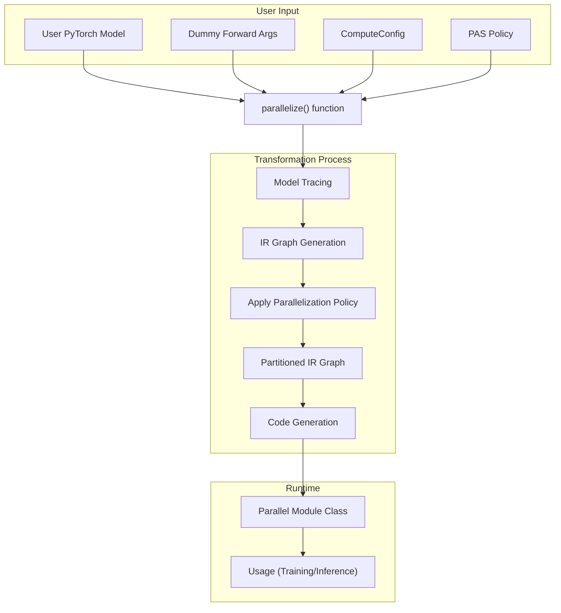

Sources: [nnscaler/parallel.py:618-706](), [nnscaler/parallel.py:739-857](), [README.md:35-60]()

## Key Components

### ComputeConfig

`ComputeConfig` is a critical component that defines the computing environment and resource allocation for model parallelization. It controls how the model is traced, partitioned, and executed.

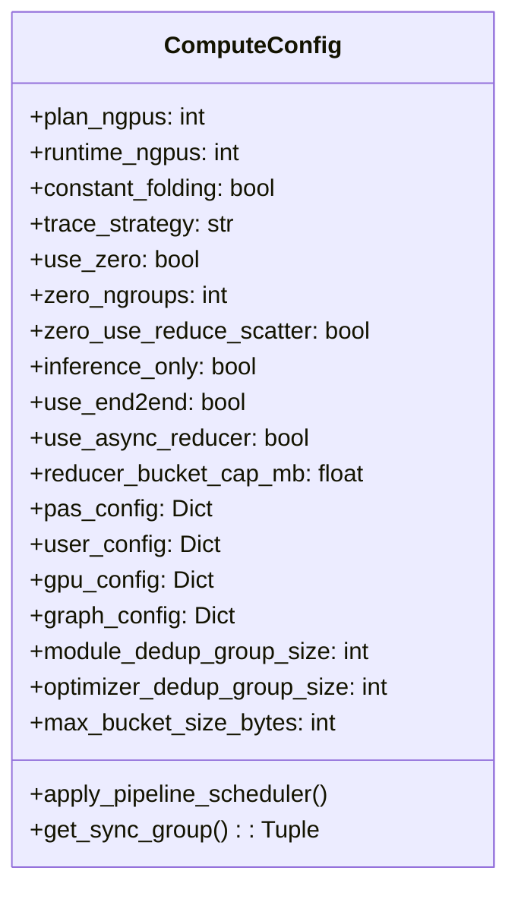

The `ComputeConfig` class contains several important fields:

| Field | Type | Description |
|-------|------|-------------|
| `plan_ngpus` | int | Number of GPUs to be used as a unit for model partitioning |
| `runtime_ngpus` | int | Total number of GPUs used at runtime (multiple of `plan_ngpus`) |
| `constant_folding` | bool | Whether to fold constants during code generation |
| `trace_strategy` | str | Strategy for executing functions during tracing ('cpu', 'cuda', 'meta', etc.) |
| `use_zero` | bool | Whether to enable ZeRO optimization |
| `use_end2end` | bool | Whether the module is end-to-end (contains loss computation) |
| `inference_only` | bool | Whether the parallelized module is for inference only |
| `pas_config` | Dict | Configuration settings for parallelization strategy |
| `user_config` | Dict | User-defined configuration that may affect the traced graph |

Sources: [nnscaler/parallel.py:68-306](), [docs/source/trainer.rst:634-650]()

### parallelize() Function

The `parallelize()` function is the main entry point for converting a PyTorch module to a parallelized module. It performs the entire process of tracing, policy application, and code generation.

Function signature:

```python
def parallelize(
    module_or_module_class: Union[torch.nn.Module, Type[torch.nn.Module]],
    dummy_forward_args: Dict[str, Any],
    pas_policy: Union[str, Callable[[IRGraph, ComputeConfig], IRGraph]],
    compute_config: ComputeConfig,
    *,
    gen_savedir: Union[str, Path] = './.nnscaler',
    reuse: Union[ReuseType, str] = ReuseType.MATCH,
    instance_name: Optional[str] = None,
    load_module: bool = True,
    module_dtype: Optional[torch.dtype] = None,
    module_fn: Optional[Callable[[], torch.nn.Module]] = None,
    init_module_params: bool = True,
    broadcast_strategy: Union[str, BroadcastGenFilesStrategy] = 'none',
) -> Union[None, ParallelModule, Type[ParallelModule]]
```

Key parameters:

| Parameter | Description |
|-----------|-------------|
| `module_or_module_class` | The PyTorch module or module class to be parallelized |
| `dummy_forward_args` | Dummy input arguments for tracing the module |
| `pas_policy` | Policy for parallelization (can be a predefined policy name or custom function) |
| `compute_config` | Configuration for computing resources and environment |
| `gen_savedir` | Directory for saving generated code (default: './.nnscaler') |
| `reuse` | Strategy for reusing existing generated code |
| `instance_name` | Name to distinguish multiple instances of the same module |
| `load_module` | Whether to load the generated module after conversion |

Sources: [nnscaler/parallel.py:901-993](), [README.md:86-131]()

### IRGraph

The `IRGraph` is an intermediate representation of the model's computational graph. It's the central data structure that gets transformed during the parallelization process.

Key aspects of `IRGraph`:

- Represents the computational graph of the model
- Provides methods for partitioning and replicating operations
- Enables device assignment for operations
- Supports backward graph generation for training
- Contains both forward and backward operations
- Stores tensor information and dependencies

Sources: [nnscaler/policies.py:1-20](), [nnscaler/parallel.py:618-706]()

### Parallelization Policies

nnScaler provides several predefined policies for parallelizing models:

| Policy | Function | Description |
|--------|----------|-------------|
| `dp` | `pas_dp` | Data parallelism - replicates the entire model across devices |
| `tp` | `pas_tp` | Tensor parallelism - partitions tensor operations across devices |
| `pp` | `pas_pp` | Pipeline parallelism - splits the model into sequential stages |
| `data` | `pas_data` | Batch dimension parallelism - partitions along batch dimension |
| `hybrid` | `pas_hybrid` | Combined pipeline and tensor parallelism |
| `autodist` | `pas_autodist` | Automatic distribution system for optimal partitioning |

The policies apply different transformation techniques to the IRGraph:

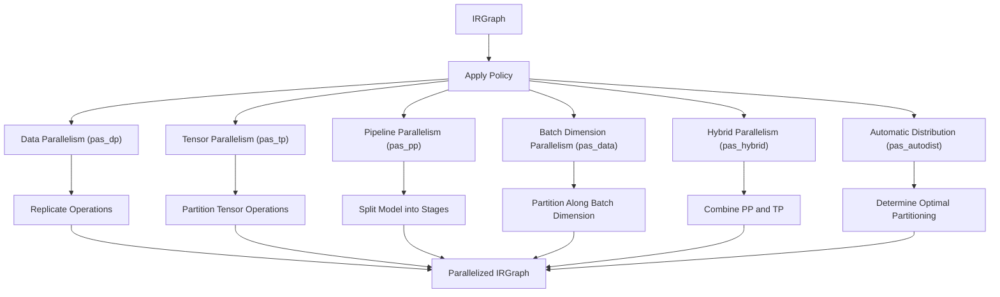

Sources: [nnscaler/policies.py:77-347]()

### ParallelModule

The `ParallelModule` class is the output of the parallelization process, representing a parallelized version of the original PyTorch module. It provides methods for training, inference, and checkpoint management.

Key methods:

- `train_step()`: Performs a training step across distributed devices
- `infer_step()`: Performs inference across distributed devices
- `save_state_dict()`: Saves the parallelized model state
- `load_state_dict()`: Loads the parallelized model state

The `ParallelModule` integrates with the PyTorch ecosystem while handling the complexities of distributed execution.

Sources: [nnscaler/parallel.py:45-46](), [README.md:80-130]()

### Trainer

The `Trainer` class provides a high-level interface for training and evaluating parallelized models. It handles various aspects of the training process including data loading, optimization, checkpointing, and distributed coordination.

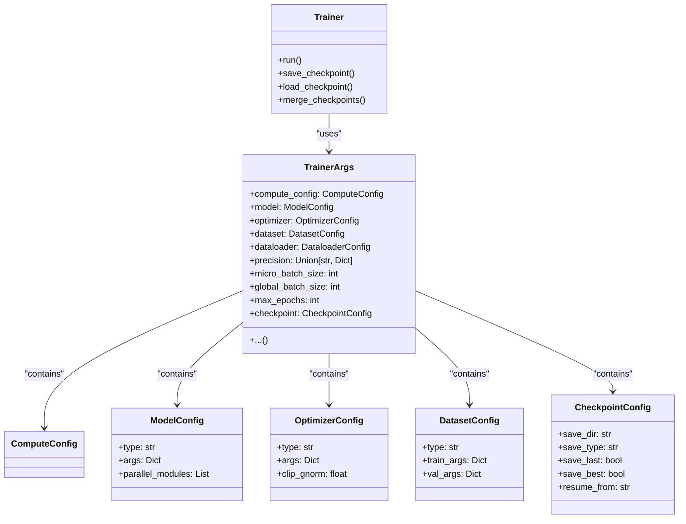

Sources: [docs/source/trainer.rst:5-563](), [README.md:84-130]()

## Integration of Components

The core components in nnScaler work together in a cohesive flow:

1. The user provides a PyTorch model, dummy input arguments, a parallelization policy, and compute configuration
2. The `parallelize()` function traces the model to create an IRGraph representation
3. The specified policy is applied to the IRGraph, partitioning or replicating operations
4. Code generation creates a `ParallelModule` class specific to the partitioned model
5. The `Trainer` can be used with appropriate arguments to train the parallelized model

This integration allows for a flexible and powerful system that can handle various model architectures and parallelization strategies.

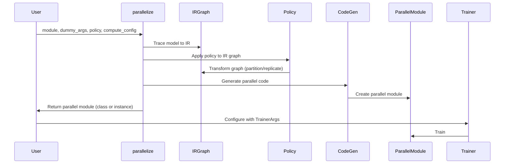

Sources: [README.md:35-130](), [nnscaler/parallel.py:901-993]()

## Usage Patterns

There are two main usage patterns for nnScaler:

1. **Trainer API**: A high-level interface for training and evaluating models
    - Define model, optimizer, dataset, and other configurations
    - Create a `Trainer` with `TrainerArgs`
    - Call `trainer.run()` to perform training
    
2. **Direct Parallelization**: Lower-level interface for more control
    - Call `parallelize()` to get a parallelized module
    - Use the parallelized module directly in custom training loops

These patterns provide flexibility for users with different needs and experience levels.

Sources: [README.md:84-130](), [nnscaler/parallel.py:901-993]()

## Integration with PyTorch Lightning

nnScaler also provides integration with PyTorch Lightning through the `NnScalerStrategy` and `NnScalerPrecision` classes, making it easier to use with existing PyTorch Lightning workflows.

```python
compute_config = ComputeConfig(...)
trainer = Trainer(
    ...,
    strategy=NnScalerStrategy(
        compute_config=compute_config, pas_policy=..., gen_savedir=...,
        ...
    ),
    plugins=[NnScalerPrecision(precision, ...)],
    ...
)
trainer.fit(...)
```

Sources: [docs/source/pytorch_lightning.md:1-95]()

## Version Information

The current version of nnScaler is 0.7, as defined in the version file.

Sources: [nnscaler/version.py:4]()

---

# Page: Trainer API

# Trainer API

<details>
<summary>Relevant source files</summary>

The following files were used as context for generating this wiki page:

- [README.md](README.md)
- [docs/source/pytorch_lightning.md](docs/source/pytorch_lightning.md)
- [docs/source/trainer.rst](docs/source/trainer.rst)

</details>


The Trainer API in nnScaler provides a high-level interface for training and evaluating models that have been parallelized across multiple GPUs. This document details how to use the Trainer API, its components, configuration options, and integration with the rest of the nnScaler system. For information about the underlying parallelization engine, see [Parallelization Engine](#2.2).

## Overview

The Trainer API enables end-to-end training of deep neural networks across multiple GPUs with minimal code changes. It handles dataset loading, optimization, model parallelization, checkpoint management, and other training-related tasks through a consistent interface. 

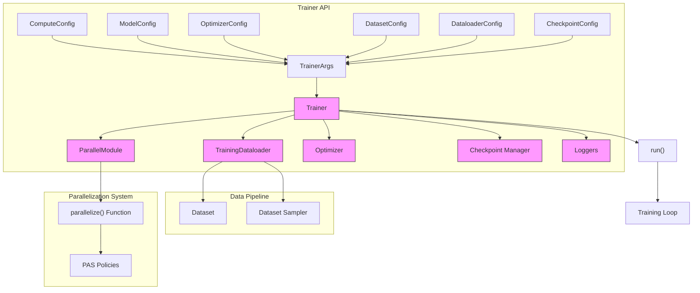

Sources: [docs/source/trainer.rst:1-131](https://github.com/microsoft/nnscaler/blob/main/docs/source/trainer.rst), [README.md:83-131](https://github.com/microsoft/nnscaler/blob/main/README.md)

## Core Components

The Trainer API consists of the following core components:

1. `Trainer`: The main class that orchestrates the training process
2. `TrainerArgs`: A configuration class that holds all parameters for the trainer
3. `ComputeConfig`: Configuration for parallelization settings
4. Various component configurations (model, optimizer, dataset, etc.)

### Trainer Architecture

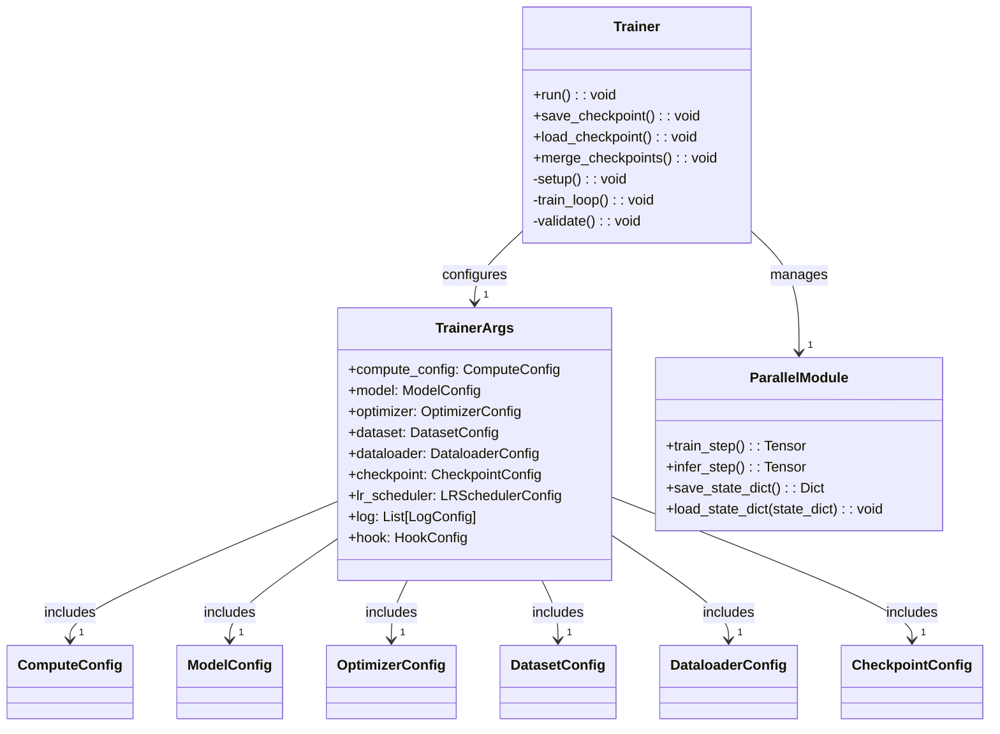

Sources: [docs/source/trainer.rst:14-55](https://github.com/microsoft/nnscaler/blob/main/docs/source/trainer.rst)

## Training Workflow

The Trainer API handles the complete training lifecycle, from model setup to evaluation and checkpointing:

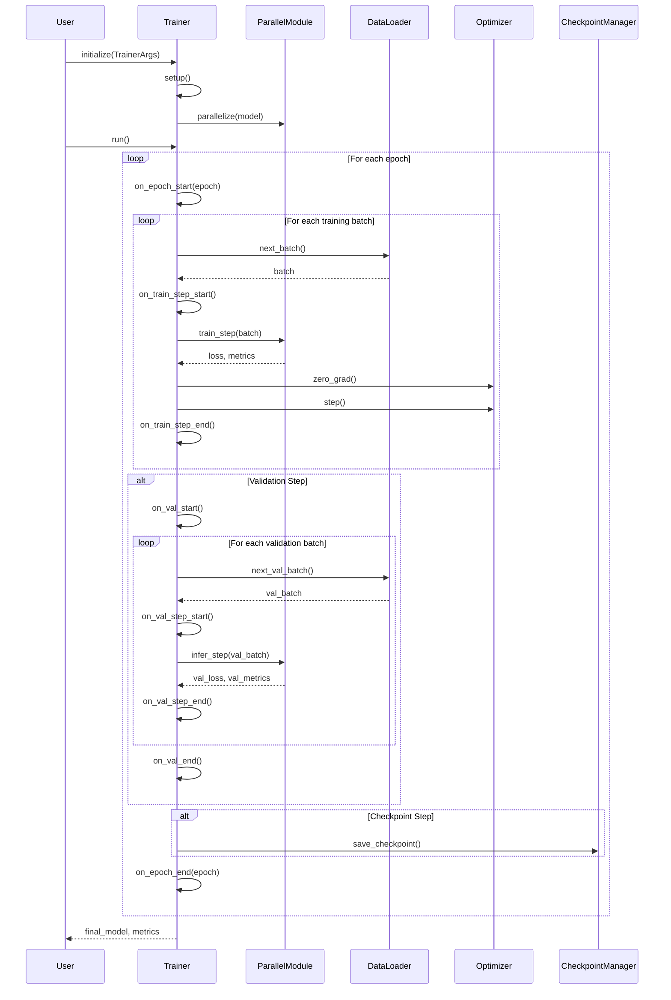

Sources: [docs/source/trainer.rst:376-447](https://github.com/microsoft/nnscaler/blob/main/docs/source/trainer.rst)

## Configuration

The Trainer API is highly configurable through `TrainerArgs`, which contains all the parameters needed to define a training run.

### TrainerArgs

`TrainerArgs` is the main configuration class that holds all parameters for the Trainer:

```
@dataclass
class TrainerArgs:
    compute_config: ComputeConfig = None
    
    gen_savedir: str = './.nnscaler'
    gen_reuse: str = 'auto'
    pas_policy: str = 'autodist'
    broadcast_strategy: str = 'all'
    instance_name: str = None
    run_mode: str = 'run'
    tracing_from_weights: str = None
    
    model: ModelConfig
    optimizer: OptimizerConfig
    dataset: DatasetConfig
    dataloader: DataloaderConfig
    dataset_sampler: DatasetSamplerConfig
    lr_scheduler: Optional[LRSchedulerConfig]
    checkpoint: CheckpointConfig
    log: List[LogConfig]
    hook: Union[HookConfig, HookMapConfig, None]
    
    precision: Union[str, Dict]
    
    micro_batch_size: int = 1
    global_batch_size: Optional[int] = None
    grad_accumulation_steps: Optional[int] = None
    
    max_epochs: Optional[int] = None
    max_train_steps: Optional[int] = None
    max_val_steps: Optional[int] = None
    
    val_every_n_train_steps: Optional[int] = None
    val_every_n_epochs: Optional[int] = 1
    
    enable_progress_bar: bool = True
    seed: Optional[int] = None
    init_env_fn: str = None
```

Sources: [docs/source/trainer.rst:14-55](https://github.com/microsoft/nnscaler/blob/main/docs/source/trainer.rst)

### Component Configurations

The `TrainerArgs` includes several component configurations:

| Configuration | Description |
|---------------|-------------|
| `ModelConfig` | Specifies the model class and its arguments |
| `OptimizerConfig` | Specifies the optimizer class, arguments, and gradient clipping |
| `DatasetConfig` | Specifies the dataset class and arguments for training and validation |
| `DataloaderConfig` | Specifies the dataloader configuration |
| `DatasetSamplerConfig` | Specifies the dataset sampler for distributed training |
| `LRSchedulerConfig` | Optional learning rate scheduler configuration |
| `CheckpointConfig` | Configuration for checkpoint saving and loading |
| `LogConfig` | Configuration for logging (e.g., TensorBoard, WandB) |
| `HookConfig` | Configuration for custom hooks during training |

Sources: [docs/source/trainer.rst:135-275](https://github.com/microsoft/nnscaler/blob/main/docs/source/trainer.rst)

### ComputeConfig

The `ComputeConfig` is a critical component that defines how the model is parallelized across GPUs:

```
@dataclass(frozen=True)
class ComputeConfig:
    plan_ngpus: int            # Number of GPUs in a unit for model parallelism
    runtime_ngpus: int         # Total number of GPUs for data parallelism
    
    constant_folding: bool = False
    trace_strategy: str = 'cuda_run_cpu_offload'
    
    use_zero: bool = False     # Whether to use ZeRO optimization
    zero_ngroups: int = 1      # Number of groups for ZeRO
    
    inference_only: bool = False
    use_end2end: bool = False  # Must be True for Trainer API
    
    pas_config: Dict[str, Any] = field(default_factory=dict)
    user_config: Dict[str, Any] = field(default_factory=dict)
```

The `ComputeConfig` contains critical settings:
- `plan_ngpus`: Number of GPUs as a unit for model parallelism (TP/PP)
- `runtime_ngpus`: Total number of GPUs (data parallelism runs across units)
- `use_zero`: Whether to use ZeRO optimization for memory efficiency
- `pas_config`: Configuration for the parallelization policy

Sources: [docs/source/trainer.rst:449-650](https://github.com/microsoft/nnscaler/blob/main/docs/source/trainer.rst)

## Parallelization Policies

The Trainer supports multiple parallelization strategies through the `pas_policy` parameter:

| Policy | Description |
|--------|-------------|
| `dp` | Data Parallelism - replicates the model across all devices |
| `tp` | Tensor Parallelism - partitions tensors across devices |
| `pp` | Pipeline Parallelism - splits model into pipeline stages |
| `data` | Batch Dimension Parallelism |
| `hybrid` | Combines TP, PP, and DP strategies |
| `autodist` | Automatic distribution - recommended for most cases |

The `autodist` policy automatically determines the optimal parallelization strategy based on memory constraints and performance profiles.

Sources: [docs/source/trainer.rst:778-842](https://github.com/microsoft/nnscaler/blob/main/docs/source/trainer.rst)

## Usage Example

Here's a basic example of using the Trainer API:

```python
from nnscaler.cli.trainer import Trainer
from nnscaler.config import ModelConfig, OptimizerConfig, TrainerArgs, ComputeConfig

# Define your model wrapper
class WrapperModel(torch.nn.Module):
    def __init__(self, model_id):
        super().__init__()
        self.model = AutoModelForCausalLM.from_pretrained(model_id)
        
    def forward(self, samples):
        outputs = self.model.model(
            input_ids=samples['net_input']['src_tokens'],
            use_cache=False,
            return_dict=False,
        )
        loss = compute_loss(outputs, samples)
        return loss, samples['ntokens'], samples['nsentences']

# Setup configurations
compute_config = ComputeConfig(
    plan_ngpus=4,
    runtime_ngpus=8,
    use_zero=True,
    use_end2end=True,
    pas_config={
        'update_freq': 1,
        'mem_constraint': 40,  # GB per GPU
    }
)

model_config = ModelConfig(
    type=WrapperModel,
    args={'model_id': 'my-pretrained-model'},
)

optimizer_config = OptimizerConfig(
    type='torch.optim.AdamW',
    args={'lr': 2e-5, 'weight_decay': 0.01},
    clip_gnorm=1.0,
)

# Initialize and run the trainer
trainer = Trainer(
    train_args=TrainerArgs(
        compute_config=compute_config,
        model=model_config,
        optimizer=optimizer_config,
        dataloader=dataloader_config,
        micro_batch_size=16,
        global_batch_size=128,
        max_epochs=10,
    )
)

trainer.run()
```

Sources: [README.md:83-131](https://github.com/microsoft/nnscaler/blob/main/README.md)

## Checkpoint Management

The Trainer API provides robust checkpoint management through the `CheckpointConfig`:

```
@dataclass
class CheckpointConfig:
    save_dir: str = './checkpoints'
    no_save: bool = False
    
    save_type: str = 'sharded'  # 'sharded', 'deduped', or 'merged'
    
    save_last: bool = True
    save_best: bool = True
    symlink_best_and_last: bool = True
    
    every_n_train_steps: Optional[int] = None
    every_n_epochs: Optional[int] = None
    keep_last_n_checkpoints: Optional[int] = None
    
    resume_from: str = None     # 'last', 'best', or specific path
```

Important features:
- Support for sharded, deduped, and merged checkpoint formats
- Automatic saving of best (lowest validation loss) and last checkpoints
- Customizable checkpoint frequency
- Resume training from checkpoints

When the parallelization plan changes, checkpoints can be merged using:
```python
Trainer.merge_checkpoint(checkpoint_files, output_file)
```

Sources: [docs/source/trainer.rst:468-519](https://github.com/microsoft/nnscaler/blob/main/docs/source/trainer.rst)

## Hooks and Customization

The Trainer API provides an extensive hook system for customizing the training process:

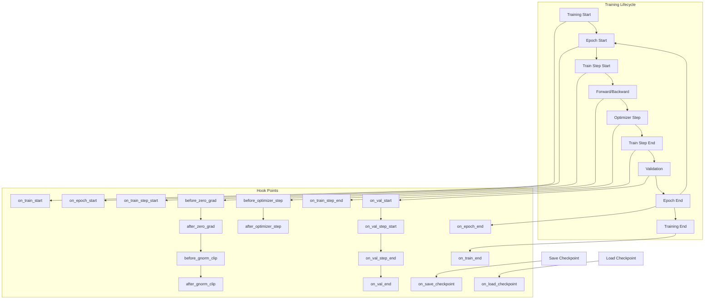

Hooks can be provided either through a hook class or a map of hook functions. The hook system allows for customization of nearly every aspect of the training process.

Sources: [docs/source/trainer.rst:354-447](https://github.com/microsoft/nnscaler/blob/main/docs/source/trainer.rst)

## CLI Usage

The Trainer API can also be used through a command-line interface:

```
torchrun [torchrun arguments] ${NNSCALER_HOME}/cli/train.py -f ${CONFIG_FILE} [other arguments]
```

The configuration file is a YAML file that contains all the parameters for the `TrainerArgs` class:

```yaml
compute_config:
  plan_ngpus: 4
  runtime_ngpus: 8
  use_zero: true
  use_end2end: true

run_mode: run
pas_policy: autodist
micro_batch_size: 16
global_batch_size: 128
max_epochs: 10

model:
  type: path.to.MyModel
  args:
    param1: value1
    param2: value2

optimizer:
  type: torch.optim.AdamW
  args:
    lr: 2e-5
    weight_decay: 0.01
```

Sources: [docs/source/trainer.rst:564-619](https://github.com/microsoft/nnscaler/blob/main/docs/source/trainer.rst)

## PyTorch Lightning Integration

For users familiar with PyTorch Lightning, nnScaler provides an alternative interface through the `NnScalerStrategy` and `NnScalerPrecision` classes:

```python
from pytorch_lightning import Trainer
from nnscaler.lightning import NnScalerStrategy, NnScalerPrecision
from nnscaler.config import ComputeConfig

compute_config = ComputeConfig(...)
trainer = Trainer(
    strategy=NnScalerStrategy(
        compute_config=compute_config,
        pas_policy="autodist",
        gen_savedir="./.nnscaler",
    ),
    plugins=[NnScalerPrecision("16-mixed")],
)
trainer.fit(...)
```

Sources: [docs/source/pytorch_lightning.md:1-78](https://github.com/microsoft/nnscaler/blob/main/docs/source/pytorch_lightning.md)

## End-to-End Mode Requirement

It's important to note that the Trainer API requires `use_end2end` to be set to `True` in the `ComputeConfig`. This means:

1. The first argument of `module.forward` must be the data sample
2. All other arguments must have default values
3. The first return value must be the loss (scalar tensor)

This constraint allows the Trainer to handle the training loop efficiently.

Sources: [docs/source/trainer.rst:452-463](https://github.com/microsoft/nnscaler/blob/main/docs/source/trainer.rst)

## Conclusion

The Trainer API provides a comprehensive solution for training parallelized models with nnScaler. It handles the entire training lifecycle, from model parallelization to checkpoint management, with a high degree of configurability. 

By using the Trainer API, you can focus on your model definition and hyperparameters while nnScaler takes care of the complexities of distributed training across multiple GPUs.

---

# Page: Parallelization Engine

# Parallelization Engine

<details>
<summary>Relevant source files</summary>

The following files were used as context for generating this wiki page:

- [README.md](README.md)
- [nnscaler/parallel.py](nnscaler/parallel.py)
- [nnscaler/policies.py](nnscaler/policies.py)
- [nnscaler/version.py](nnscaler/version.py)

</details>


The Parallelization Engine is the core component of nnScaler that transforms PyTorch models designed for single-GPU execution into optimized code that runs efficiently across multiple GPUs. It handles the complex process of analyzing model structure, applying parallelization strategies, and generating optimized code tailored to the specified distributed environment.

For information about specific parallelization strategies like Data Parallelism, Tensor Parallelism, and Pipeline Parallelism, see [Parallelization Strategies](#3). For details on configuration options, see [ComputeConfig and Configuration Options](#2.3).

## Engine Architecture

The Parallelization Engine follows a compiler-like approach with distinct phases for analyzing, transforming, and generating code for distributed execution.

```mermaid
flowchart TD
    subgraph "Input"
        UserModel["User PyTorch Model"]
        DummyInputs["Dummy Forward Args"]
        Policy["Parallelization Policy"]
        CompConfig["ComputeConfig"]
    end

    subgraph "Parallelization Engine"
        Tracing["Model Tracing\n(FX Graph → IR Graph)"]
        Analysis["Graph Analysis"]
        PolicyApply["Policy Application"]
        CommGen["Communication Generation"]
        CodeGen["Code Generation"]
    end

    subgraph "Output"
        ParallelModule["ParallelModule Class"]
        GeneratedCode["Generated Source Code"]
    end

    UserModel --> Tracing
    DummyInputs --> Tracing
    
    Tracing --> Analysis
    Analysis --> PolicyApply
    Policy --> PolicyApply
    CompConfig --> PolicyApply
    
    PolicyApply --> CommGen
    CommGen --> CodeGen
    
    CodeGen --> ParallelModule
    CodeGen --> GeneratedCode
```

Sources: [nnscaler/parallel.py:899-1120](). [README.md:10-12]()

## Key Components and Workflow

### The `parallelize()` Function

The primary entry point to the Parallelization Engine is the `parallelize()` function, which transforms a PyTorch module into a parallel module capable of running across multiple GPUs.

```mermaid
classDiagram
    class parallelize {
        +module_or_module_class: Union[nn.Module, Type[nn.Module]]
        +dummy_forward_args: Dict[str, Any]
        +pas_policy: Union[str, Callable]
        +compute_config: ComputeConfig
        +gen_savedir: Union[str, Path]
        +reuse: ReuseType
        +instance_name: Optional[str]
        +load_module: bool
        +module_dtype: Optional[torch.dtype]
        +module_fn: Optional[Callable]
        +init_module_params: bool
        +broadcast_strategy: BroadcastGenFilesStrategy
        +Return: Union[None, ParallelModule, Type[ParallelModule]]
    }
    
    class ReuseType {
        +MATCH: "match"
        +OVERRIDE: "override"
        +MOO: "moo"
        +GRAPH: "graph"
    }
    
    class BroadcastGenFilesStrategy {
        +NONE: "none"
        +ALL: "all"
        +NO_WEIGHTS: "no_weights"
        +CODE: "code"
    }
    
    class ComputeConfig {
        +plan_ngpus: int
        +runtime_ngpus: int
        +use_zero: bool
        +use_end2end: bool
        +constant_folding: bool
        +inference_only: bool
        +trace_strategy: str
        +use_async_reducer: bool
        +pas_config: Dict[str, Any]
    }
    
    parallelize --> ReuseType
    parallelize --> BroadcastGenFilesStrategy
    parallelize --> ComputeConfig
```

Sources: [nnscaler/parallel.py:899-1120]()

### Internal Components

The parallelization process involves several internal components that work together to transform a PyTorch model into a parallelized version:

```mermaid
flowchart TD
    subgraph "Parallelization Flow"
        Prepare["Prepare Environment\n_prepare_and_check_reusable()"]
        GenGraph["Generate IR Graph\n_gen_graph()"]
        ApplyPolicy["Apply Parallelization Policy\npas_policy()"]
        GenCode["Generate Code\n_gencode()"]
        LoadModule["Load Parallel Module\n_load_parallel_module_class()"]
    end
    
    Prepare --> GenGraph
    GenGraph --> ApplyPolicy
    ApplyPolicy --> GenCode
    GenCode --> LoadModule
    
    subgraph "IR Graph Transformations"
        IRGraph["IRGraph"]
        IRGraph --> Multiref["Apply Multiref\nauto_multiref()"]
        Multiref --> Partition["Graph Partition"]
        Partition --> DeviceAssign["Device Assignment"]
        DeviceAssign --> CommGen["Communication Generation\nIRAdapterGener.gen()"]
    end
    
    ApplyPolicy -.-> IRGraph
```

Sources: [nnscaler/parallel.py:618-706](), [nnscaler/parallel.py:708-857](), [nnscaler/policies.py:45-79]()

## Graph Representation and Transformation

### IR Graph Construction

The model is first traced to create an Intermediate Representation (IR) Graph that captures its computation and data flow.

```mermaid
flowchart TD
    subgraph "Tracing"
        PyModule["PyTorch Module"]
        FXGraph["FX Graph"]
        IRGraph["IR Graph"]
    end
    
    PyModule --> |"parser.to_fx_graph()"| FXGraph
    FXGraph --> |"parser.to_ir_graph()"| IRGraph
    
    subgraph "IR Graph Elements"
        IROperation["IROperation"]
        IRTensor["IRTensor"]
        IRFullTensor["IRFullTensor"]
        IRSubTensor["IRSubTensor"]
        IRDataOperation["IRDataOperation"]
        IRFwOperation["IRFwOperation"]
        IRBpOperation["IRBpOperation"]
    end
    
    IRGraph --> IROperation
    IRGraph --> IRTensor
    IRTensor --> IRFullTensor
    IRTensor --> IRSubTensor
    IROperation --> IRDataOperation
    IROperation --> IRFwOperation
    IROperation --> IRBpOperation
```

Sources: [nnscaler/parallel.py:618-706](), [nnscaler/graph/parser.py]() (referenced in imports)

### Policy Application

Once the IR Graph is constructed, a parallelization policy is applied to partition the computation across devices.

nnScaler provides several built-in parallelization strategies:

| Policy | Description | Function |
|--------|-------------|----------|
| Data Parallelism (dp) | Replicates the model and splits data across devices | `pas_dp()` |
| Tensor Parallelism (tp) | Splits tensor computations across devices | `pas_tp()` |
| Pipeline Parallelism (pp) | Splits model layers across devices | `pas_pp()` |
| Batch Dimension Parallelism (data) | Splits batch dimension across devices | `pas_data()` |
| Hybrid Parallelism (hybrid) | Combines pipeline and tensor parallelism | `pas_hybrid()` |
| Automatic Distribution (autodist) | Uses AutoDist to find optimal partition plan | `pas_autodist()` |

Sources: [nnscaler/policies.py:78-347](), [nnscaler/parallel.py:62-66]()

### Communication Generation

After partitioning, communication operations are inserted to ensure correct data flow between partitions.

```mermaid
flowchart LR
    subgraph "Communication Pattern"
        direction TB
        Send["Send Operation"]
        Recv["Receive Operation"]
        AllReduce["AllReduce Operation"]
        ReduceScatter["ReduceScatter Operation"]
        AllGather["AllGather Operation"]
    end
    
    subgraph "Communication Generation"
        IRGraph["Partitioned IR Graph"]
        AdapterGener["IRAdapterGener.gen()"]
        CommOps["Communication Operations"]
    end
    
    IRGraph --> AdapterGener
    AdapterGener --> CommOps
    
    CommOps --> Send
    CommOps --> Recv
    CommOps --> AllReduce
    CommOps --> ReduceScatter
    CommOps --> AllGather
```

Sources: [nnscaler/parallel.py:708-857](), [nnscaler/graph/gener/gen.py]() (referenced in imports)

## Code Generation

The final step is generating optimized PyTorch code for each device, which is done by the code generation subsystem.

```mermaid
flowchart TD
    subgraph "Execution Plan"
        IRGraph["Partitioned IR Graph"]
        ExecPlan["ExecutionPlan"]
        PassFusion["DiffFusion.apply()"]
        PassGrouping["Grouping.apply()"]
    end
    
    subgraph "Code Generation"
        ModuleCodeGen["ModuleCodeGen"]
        ScheduleCodeGen["ScheduleCodeGen"]
        PyCode["Generated Python Code"]
    end
    
    IRGraph --> ExecPlan
    ExecPlan --> PassFusion
    PassFusion --> PassGrouping
    
    PassGrouping --> ModuleCodeGen
    ModuleCodeGen --> PyCode
    
    IRGraph --> |"if use_end2end"| ScheduleCodeGen
    ScheduleCodeGen --> PyCode
```

Sources: [nnscaler/parallel.py:820-856]()

## Output: The ParallelModule

The generated code creates a `ParallelModule` class, which extends PyTorch's `nn.Module` with distributed training capabilities.

```mermaid
classDiagram
    class nn.Module {
        +forward()
        +state_dict()
        +load_state_dict()
    }
    
    class ParallelModule {
        +train_step()
        +infer_step()
        +save_state_dict()
        +load_state_dict()
        +compute_config: ComputeConfig
    }
    
    class CubeModule {
        
    }
    
    nn.Module <|-- CubeModule
    CubeModule <|-- ParallelModule
```

Sources: [nnscaler/parallel.py:45-46](), [nnscaler/runtime/module.py]() (referenced in imports)

## Usage Examples

To use the Parallelization Engine, you need to define your PyTorch model, create a `ComputeConfig`, and call the `parallelize()` function.

### Basic Example

```python
import torch
from nnscaler.parallel import parallelize, ComputeConfig

# Define your PyTorch model
class MyModel(torch.nn.Module):
    def __init__(self):
        super().__init__()
        self.linear = torch.nn.Linear(128, 128)
    
    def forward(self, x):
        return self.linear(x)

# Create dummy inputs for tracing
dummy_inputs = {"x": torch.randn(16, 128)}

# Configure parallelization
config = ComputeConfig(
    plan_ngpus=2,       # Number of GPUs in the parallelization plan
    runtime_ngpus=2,    # Number of GPUs available at runtime
    use_zero=False,     # Whether to use ZeRO optimizer
    use_end2end=False   # Whether to use end-to-end mode
)

# Parallelize the model
parallel_model_class = parallelize(
    MyModel,
    dummy_inputs,
    pas_policy="dp",  # Data parallelism policy
    compute_config=config
)

# Create an instance of the parallelized model
parallel_model = parallel_model_class()
```

Sources: [README.md:83-131]()

### End-to-End Example

For more complex models where you want to include loss computation and other training components, you can use the end-to-end mode:

```python
from nnscaler.parallel import parallelize, ComputeConfig

# Define your model with loss computation
class WrapperModel(torch.nn.Module):
    def __init__(self):
        super().__init__()
        self.model = MyUnderlyingModel()
    
    def forward(self, samples):
        outputs = self.model(samples['input'])
        loss = torch.nn.functional.cross_entropy(outputs, samples['target'])
        return loss, samples['ntokens'], samples['nsentences']

# Create configuration with end-to-end mode enabled
config = ComputeConfig(
    plan_ngpus=2,
    runtime_ngpus=2,
    use_zero=True,
    use_end2end=True  # Enable end-to-end mode
)

# Parallelize the model
parallel_model = parallelize(
    WrapperModel(),
    {"samples": sample_batch},
    pas_policy="hybrid",
    compute_config=config
)
```

Sources: [README.md:83-131]()

## Relation to Other Components

The Parallelization Engine interacts with several other components of nnScaler:

```mermaid
flowchart TD
    subgraph "Core Components"
        ParallelEngine["Parallelization Engine"]
        TrainerAPI["Trainer API"]
        ComputeConfig["ComputeConfig"]
        Policies["Parallelization Policies"]
    end
    
    subgraph "Supporting Systems"
        AutoDist["AutoDist System"]
        OpReg["Operator Registration"]
        Checkpointing["Checkpoint Management"]
    end
    
    ParallelEngine --> TrainerAPI
    TrainerAPI --> ParallelEngine
    ComputeConfig --> ParallelEngine
    Policies --> ParallelEngine
    
    ParallelEngine --> AutoDist
    OpReg --> ParallelEngine
    ParallelEngine --> Checkpointing
```

Sources: [README.md:22-33]()

## Summary

The Parallelization Engine is the central component of nnScaler that enables efficient distributed training of deep neural networks across multiple GPUs. By analyzing the model structure, applying appropriate parallelization strategies, and generating optimized PyTorch code, it simplifies the complex task of distributed training for users, allowing them to focus on model design rather than parallelization details.

---

# Page: ComputeConfig and Configuration Options

# ComputeConfig and Configuration Options

<details>
<summary>Relevant source files</summary>

The following files were used as context for generating this wiki page:

- [docs/source/pytorch_lightning.md](docs/source/pytorch_lightning.md)
- [docs/source/trainer.rst](docs/source/trainer.rst)
- [nnscaler/parallel.py](nnscaler/parallel.py)
- [nnscaler/policies.py](nnscaler/policies.py)
- [nnscaler/version.py](nnscaler/version.py)

</details>


## Purpose and Overview

This document details the `ComputeConfig` class and related configuration options in nnScaler, which control how models are parallelized, traced, and executed across distributed hardware. These configuration options are essential for defining the resource allocation, optimization strategies, and execution behavior of your distributed training setup.

For information about specific parallelization policies (DP, TP, PP, etc.) that use these configurations, see [Parallelization Strategies](#3). For the Trainer API that consumes these configurations, see [Trainer API](#2.1).

## Core Configuration Structure

`ComputeConfig` is implemented as a frozen dataclass to ensure configuration immutability after initialization. It serves as a central repository for all hardware-related and parallelization-related settings.

```mermaid
classDiagram
    class ComputeConfig {
        +plan_ngpus: int
        +runtime_ngpus: int
        +constant_folding: bool
        +trace_strategy: str
        +use_zero: bool
        +zero_ngroups: int
        +zero_use_reduce_scatter: bool
        +inference_only: bool
        +use_end2end: bool
        +use_async_reducer: bool
        +reducer_bucket_cap_mb: float
        +pas_config: Dict
        +user_config: Dict
        +apply_pipeline_scheduler()
        +gpu_config
        +graph_config
        +module_dedup_group_size
        +optimizer_dedup_group_size
        +max_bucket_size_bytes
        +get_sync_group()
    }
```

Sources: [nnscaler/parallel.py:69-238]()

## Relationship to System Components

The `ComputeConfig` is used throughout the nnScaler system to guide the parallelization process and define resource allocation.

```mermaid
flowchart TD
    subgraph "User Interface"
        User["User Code"]
        TR["Trainer API"]
        PFn["parallelize() Function"]
    end

    subgraph "Configuration"
        CC["ComputeConfig"]
        TA["TrainerArgs"]
    end

    subgraph "Parallelization Engine"
        IR["IR Graph Generation"]
        PAS["PAS Policies"]
        CG["Code Generation"]
    end

    subgraph "Parallelization Strategies"
        DP["Data Parallelism"]
        TP["Tensor Parallelism"]
        PP["Pipeline Parallelism"]
        Hybrid["Hybrid Parallelism"]
        Auto["AutoDist"]
    end

    User --> TR
    User --> PFn
    TR --> TA
    TA --> CC
    PFn --> CC
    CC --> IR
    CC --> PAS
    PAS --> DP & TP & PP & Hybrid & Auto
    IR --> CG
    PAS --> CG
```

Sources: [docs/source/trainer.rst:18-57](), [nnscaler/parallel.py:901-980]()

## Configuration Categories

The configuration options in `ComputeConfig` can be categorized into several key areas:

### 1. GPU Configuration

| Option | Type | Description |
|--------|------|-------------|
| `plan_ngpus` | int | Number of GPUs as a unit for model partitioning (TP/PP within this unit) |
| `runtime_ngpus` | int | Total number of GPUs used at runtime (must be multiple of `plan_ngpus`) |

GPU configuration is foundational for determining how the model is partitioned and how data parallelism is applied:

```mermaid
flowchart LR
    subgraph "Device Allocation"
        direction TB
        PNGU["plan_ngpus (N)"]
        RNGU["runtime_ngpus (M)"]
        DPD["Data Parallelism Degree (M÷N)"]
    end

    subgraph "Device Grouping"
        direction TB
        U1["Unit 1: GPUs 0..N-1"]
        U2["Unit 2: GPUs N..2N-1"]
        U3["..."]
        U4["Unit M÷N: GPUs M-N..M-1"]
    end

    PNGU --> U1 & U2 & U3 & U4
    RNGU --> DPD
    DPD --> U1 & U2 & U3 & U4
```

Sources: [nnscaler/parallel.py:71-72](), [docs/source/trainer.rst:686-690]()

### 2. Tracing Configuration

| Option | Type | Default | Description |
|--------|------|---------|-------------|
| `constant_folding` | bool | False | Whether to fold constants during code generation |
| `trace_strategy` | str | 'cuda_run_cpu_offload' | Strategy for executing functions during trace |

Tracing strategies:
- `'cpu'`: Execute on CPU, weights and intermediates on CPU
- `'cuda'`: Execute on CUDA, weights and intermediates on CUDA
- `'meta'`: Execute on meta device, weights on CPU, intermediates on meta
- `'cuda_run_cpu_offload'`: Try CUDA, fallback to CPU on OOM
- `'reuse_cache'`: Cache outputs based on function signatures

Sources: [nnscaler/parallel.py:75-78](), [docs/source/trainer.rst:653-682]()

### 3. Zero Optimization Configuration

| Option | Type | Default | Description |
|--------|------|---------|-------------|
| `use_zero` | bool | False | Whether to use ZeRO (Zero Redundancy Optimizer) |
| `zero_ngroups` | int | 1 | Number of ZeRO groups |
| `zero_use_reduce_scatter` | bool | False | Whether to use reduce scatter for ZeRO |

ZeRO is a memory optimization technique that partitions optimizer states across devices to reduce memory usage.

Sources: [nnscaler/parallel.py:80-86](), [docs/source/trainer.rst:696-698]()

### 4. Mode Configuration

| Option | Type | Default | Description |
|--------|------|---------|-------------|
| `inference_only` | bool | False | Whether code is for inference only |
| `use_end2end` | bool | False | Whether to use end-to-end training mode |

End-to-end mode requires:
1. First argument of `module.forward` must be data sample
2. First return value must be the loss (scalar tensor)

Sources: [nnscaler/parallel.py:89-95](), [docs/source/trainer.rst:452-463]()

### 5. Reduction Configuration

| Option | Type | Default | Description |
|--------|------|---------|-------------|
| `use_async_reducer` | bool | False | Whether to use async gradient all-reduce |
| `reducer_bucket_cap_mb` | float | None | Max bucket size for reducer in MB |

These settings control how gradients are synchronized across devices during distributed training.

Sources: [nnscaler/parallel.py:98-104](), [docs/source/trainer.rst:699-702]()

### 6. User Configuration

| Option | Type | Default | Description |
|--------|------|---------|-------------|
| `pas_config` | Dict | {} | PAS policy settings and other code generation settings |
| `user_config` | Dict | {} | Custom configurations that can affect graph/code generation |

`user_config` is used to track changes that may affect the traced graph, ensuring consistent code generation.

Sources: [nnscaler/parallel.py:106-138](), [docs/source/trainer.rst:702-707]()

## PAS Policy Configuration

The PAS (Partition-Assign-Schedule) policies describe how to place computations across devices. Different policies require different configuration options in the `pas_config` dictionary.

```mermaid
flowchart TD
    CC["ComputeConfig"]
    PC["pas_config"]
    
    subgraph "Policies"
        DP["Data Parallelism (dp)"]
        TP["Tensor Parallelism (tp)"]
        PP["Pipeline Parallelism (pp)"]
        DATA["Batch Dim Parallelism (data)"]
        HYBRID["Hybrid Parallelism (hybrid)"]
        AUTO["Automatic Distribution (autodist)"]
    end
    
    CC --> PC
    PC --> DP & TP & PP & DATA & HYBRID & AUTO
    
    subgraph "Policy-Specific Configs"
        TPConf["TP: seed"]
        PPConf["PP: pipeline_nstages, pipeline_nmicros, pipeline_scheduler"]
        HYBConf["Hybrid: pipeline_nstages, pipeline_nmicros, pipeline_scheduler, pp_size"]
        ADConf["AutoDist: Multiple advanced options"]
    end
    
    TP --> TPConf
    PP --> PPConf
    HYBRID --> HYBConf
    AUTO --> ADConf
```

Sources: [nnscaler/policies.py:45-347](), [docs/source/trainer.rst:700-702]()

### Data Parallelism (dp)

Simple data parallelism with no partitioning within a plan unit. Requires `plan_ngpus=1`.

Sources: [nnscaler/policies.py:77-89]()

### Tensor Parallelism (tp)

Tensor parallelism with random partitioning. Optional configurations:
- `seed`: Random seed for partitioning decisions (default: 1)

Sources: [nnscaler/policies.py:92-129]()

### Pipeline Parallelism (pp)

Pipeline parallelism configuration:
- `pipeline_nstages`: Number of pipeline stages (must equal `plan_ngpus`)
- `pipeline_nmicros`: Number of micro-batches
- `pipeline_scheduler`: Pipeline scheduling strategy (e.g., '1f1b')

Sources: [nnscaler/policies.py:132-140]()

### Batch Dimension Parallelism (data)

Partitions tensors along the batch dimension (dim 0).

Sources: [nnscaler/policies.py:142-165]()

### Hybrid Parallelism (hybrid)

Combines pipeline and tensor parallelism:
- `pipeline_nstages`: Number of pipeline stages
- `pipeline_nmicros`: Number of micro-batches
- `pipeline_scheduler`: Pipeline scheduling strategy
- `pp_size`: Pipeline parallelism size

Sources: [nnscaler/policies.py:168-218]()

### Automatic Distribution (autodist)

The most sophisticated policy with automatic partitioning. Key configurations:
- `update_freq`: Update frequency
- `pipeline_nstages`: Number of pipeline stages (or 'auto')
- `pipeline_scheduler`: Pipeline scheduling strategy
- `max_partition_degree`: Maximum partition degree
- `mem_constraint`: Memory constraint in GB
- `re_profile`: Whether to re-profile
- `load_plan_path`/`save_plan_path`: Paths for loading/saving plans
- `pipeline_pivots`: Pipeline stage boundaries
- `max_pipeline_bubble_ratio`: Maximum pipeline bubble ratio
- And many more advanced options

Sources: [nnscaler/policies.py:221-347]()

## Configuration in Practice

### Basic Configuration Example

Here's a basic example of creating a `ComputeConfig`:

```python
from nnscaler.parallel import ComputeConfig

# Create a basic configuration for 8 GPUs (2 units of 4 GPUs each)
config = ComputeConfig(
    plan_ngpus=4,          # 4 GPUs per unit
    runtime_ngpus=8,       # 8 GPUs total (2x data parallelism)
    constant_folding=True, # Enable constant folding
    use_zero=True,         # Enable ZeRO optimization
    use_end2end=True       # Use end-to-end mode
)
```

### Configuration for Tensor and Pipeline Parallelism

Here's an example for configuring hybrid parallelism:

```python
from nnscaler.parallel import ComputeConfig

# Configuration for hybrid parallelism (pipeline + tensor)
config = ComputeConfig(
    plan_ngpus=8,
    runtime_ngpus=16,
    use_end2end=True,
    pas_config={
        'pipeline_nstages': 4,
        'pipeline_nmicros': 4,
        'pipeline_scheduler': '1f1b',
        'pp_size': 4       # 4 pipeline stages, 2 GPUs per stage for tensor parallelism
    }
)
```

### Configuration for AutoDist

Here's an example of configuring the automatic distribution system:

```python
from nnscaler.parallel import ComputeConfig

# Configuration for automatic distribution
config = ComputeConfig(
    plan_ngpus=8,
    runtime_ngpus=32,
    use_end2end=True,
    pas_config={
        'update_freq': 1,
        'max_partition_degree': 8,
        'mem_constraint': 16,  # 16GB per GPU
        'pipeline_pivots': 'decoder.layers.11,decoder.layers.23',
        're_profile': True,
        'verbose': True
    }
)
```

Sources: [docs/source/trainer.rst:578-616]()

## Advanced Features

### Saving and Loading Configurations

`ComputeConfig` provides methods for safely saving and loading configurations:

```python
# Save configuration
ComputeConfig.safe_dump_to_file(config, 'compute_config.pt')

# Load configuration
loaded_config = ComputeConfig.safe_load_from_file('compute_config.pt')

# Compare configurations
is_equal = ComputeConfig.safe_equals(config, loaded_config)
```

This is particularly important for ensuring consistency between training runs.

Sources: [nnscaler/parallel.py:262-307]()

### Integration with TrainerArgs

In the Trainer API, `ComputeConfig` is integrated via the `TrainerArgs` class:

```python
@dataclass
class TrainerArgs:
    compute_config: ComputeConfig = None
    # Other training configuration options...
```

Sources: [docs/source/trainer.rst:17-56]()

### Configuration Validation

`ComputeConfig` performs validation in its `__post_init__` method to ensure consistency:

- `plan_ngpus` must be > 0
- `runtime_ngpus` must be > 0 and a multiple of `plan_ngpus`
- `zero_ngroups` must be > 0 when `use_zero` is True
- `reducer_bucket_cap_mb` must not be negative

Sources: [nnscaler/parallel.py:140-165]()

## Considerations for Different Parallelization Strategies

### Memory Optimization

- For large models that don't fit on a single GPU, use `trace_strategy='cuda_run_cpu_offload'`
- Enable `use_zero=True` to reduce memory usage through optimizer state partitioning
- Use `reducer_bucket_cap_mb` to control the bucket size for gradient reduction

### Performance Optimization

- Set appropriate values for `plan_ngpus` based on your model architecture and GPU topology
- Configure pipeline parallelism with suitable `pipeline_nmicros` to balance throughput and latency
- Use `constant_folding=True` to optimize the generated code

### Compatibility with Different Training Modes

- Set `use_end2end=True` for full training pipelines
- Set `inference_only=True` for inference-only deployments
- Configure mode-specific options in `pas_config` for fine-grained control

Sources: [docs/source/trainer.rst:655-682](), [nnscaler/parallel.py:985-1120]()

---

# Page: Parallelization Strategies

# Parallelization Strategies

<details>
<summary>Relevant source files</summary>

The following files were used as context for generating this wiki page:

- [README.md](README.md)
- [nnscaler/parallel.py](nnscaler/parallel.py)
- [nnscaler/policies.py](nnscaler/policies.py)
- [nnscaler/version.py](nnscaler/version.py)

</details>


This page provides an overview of the different parallelization strategies available in nnScaler for distributing deep learning models across multiple devices. Understanding these strategies is essential for efficiently scaling your models to leverage multiple GPUs.

nnScaler supports several standard parallelization techniques as well as hybrid approaches and an automatic distribution system. For detailed implementation of specific strategies, see the child pages: [Data Parallelism](#3.1), [Tensor Parallelism](#3.2), [Pipeline Parallelism](#3.3), and [Hybrid Parallelism](#3.4). For information about the automatic distribution system, see [AutoDist](#4).

Sources: [README.md:22-28](), [nnscaler/policies.py:1-19]()

## Parallelization Strategy Overview

nnScaler implements various parallelization strategies through policy functions that transform the intermediate representation (IR) graph of a model. Each strategy has different characteristics and is suitable for different types of models and hardware configurations.

**Diagram: Parallelization Strategies in nnScaler**

```mermaid
flowchart TD
    Start["PyTorch Model"] --> IRGraph["IR Graph Generation"]
    IRGraph --> Strategy["Choose Parallelization Strategy"]
    
    Strategy --> DP["Data Parallelism (dp)"]
    Strategy --> TP["Tensor Parallelism (tp)"]
    Strategy --> PP["Pipeline Parallelism (pp)"]
    Strategy --> DataPar["Batch Dimension Parallelism (data)"]
    Strategy --> Hybrid["Hybrid Parallelism (hybrid)"]
    Strategy --> AutoDist["Automatic Distribution (autodist)"]
    
    DP --> Implementation["Implementation via pas_policy functions"]
    TP --> Implementation
    PP --> Implementation
    DataPar --> Implementation
    Hybrid --> Implementation
    AutoDist --> Implementation
    
    Implementation --> ParallelModule["Parallel Module Generation"]
    
    subgraph "Parallelization Characteristics"
        DPChar["DP: Same model on each device, different data batches"]
        TPChar["TP: Model partitioned across tensor dimensions"]
        PPChar["PP: Model partitioned into sequential stages"]
        HybridChar["Hybrid: Combination of multiple strategies"]
        AutoChar["AutoDist: Automatically determines optimal strategy"]
    end
```

Sources: [nnscaler/policies.py:78-347](), [nnscaler/parallel.py:899-920]()

## Specifying a Parallelization Strategy

When using nnScaler, you can select a parallelization strategy by passing the appropriate `pas_policy` parameter to the `parallelize()` function. This can be a string identifier for built-in strategies or a custom policy function.

**Diagram: Parallelization Process Flow**

```mermaid
sequenceDiagram
    participant User as "User Code"
    participant Parallelize as "parallelize() function"
    participant Policy as "PAS Policy"
    participant IRGen as "IR Graph Generation"
    participant CodeGen as "Code Generation"
    
    User->>Parallelize: Call with PyTorch module, dummy args, pas_policy
    Parallelize->>IRGen: Generate IR graph from model
    IRGen-->>Parallelize: Return IR graph
    Parallelize->>Policy: Apply selected policy to IR graph
    Policy->>Policy: Transform graph according to strategy
    Policy-->>Parallelize: Return transformed graph
    Parallelize->>CodeGen: Generate parallel module code
    CodeGen-->>Parallelize: Return parallel module class
    Parallelize-->>User: Return parallelized module
```

Here's how to specify a parallelization strategy:

```python
# Using a built-in strategy
parallel_module = parallelize(
    module, 
    dummy_forward_args, 
    pas_policy="dp",  # Choose from: "dp", "tp", "pp", "data", "hybrid", "autodist"
    compute_config=compute_config
)

# Using a custom policy function
def my_custom_policy(graph, config):
    # Custom graph transformation logic
    return transformed_graph

parallel_module = parallelize(
    module, 
    dummy_forward_args, 
    pas_policy=my_custom_policy,
    compute_config=compute_config
)
```

Sources: [nnscaler/parallel.py:899-1120](), [nnscaler/policies.py:78-347]()

## Built-in Parallelization Strategies

nnScaler includes several built-in parallelization strategies implemented as policy functions. Each strategy transforms the IR graph of the model in a specific way to distribute computation across devices.

### Data Parallelism (DP)

Data parallelism replicates the entire model on each device and splits the input data batch among devices. Each device computes the forward and backward passes on its data subset, and gradients are synchronized across devices.

**Key characteristics:**
- Simplest parallelization strategy
- Works well when model fits entirely in a single device's memory
- Requires gradient synchronization between devices
- Good for batch-oriented training

Implementation: [nnscaler/policies.py:78-89]()

### Tensor Parallelism (TP)

Tensor parallelism splits individual tensors and operations across devices. This allows distributing a single operation (like a large matrix multiplication) across multiple devices.

**Key characteristics:**
- Partitions individual tensor operations
- Can handle models larger than a single device's memory
- Reduces communication overhead for large tensors
- Well-suited for models with large layers (e.g., transformer models)

Implementation: [nnscaler/policies.py:92-129]()

### Pipeline Parallelism (PP)

Pipeline parallelism divides the model into sequential stages, with each stage assigned to a different device. Data flows through these stages in a pipelined manner.

**Key characteristics:**
- Splits model sequentially across devices
- Well-suited for deep models with sequential dependencies
- Can introduce pipeline bubbles (inefficiency)
- Requires careful scheduling to maximize efficiency

Implementation: [nnscaler/policies.py:132-140]()

### Batch Dimension Parallelism (data)

This strategy specifically partitions tensors along the batch dimension across devices.

**Key characteristics:**
- Focuses on partitioning the batch dimension
- Similar to data parallelism but with tensor-level partitioning
- Useful for specific neural network architectures

Implementation: [nnscaler/policies.py:142-165]()

### Hybrid Parallelism (hybrid)

Hybrid parallelism combines multiple strategies (typically pipeline and tensor parallelism) to optimize model distribution across devices.

**Key characteristics:**
- Combines benefits of multiple strategies
- Can be more efficient than any single strategy
- Requires end-to-end mode
- Supports complex configuration options

Implementation: [nnscaler/policies.py:168-218]()

### Automatic Distribution (autodist)

The AutoDist system automatically determines an optimal parallelization strategy based on model characteristics, hardware resources, and performance profiles.

**Key characteristics:**
- Analyses model structure and memory requirements
- Automatically selects an optimal parallelization strategy
- Supports various constraints and configurations
- Can significantly improve performance with minimal user effort

Implementation: [nnscaler/policies.py:221-347]()

Sources: [nnscaler/policies.py:78-347]()

## Configuration and Selection

Selecting the appropriate parallelization strategy depends on various factors:

**Diagram: Strategy Selection Decision Tree**

```mermaid
flowchart TD
    Start["Start"] --> Q1{"Does model fit on\none device?"}
    Q1 -- Yes --> Q2{"Need batch\nscaling?"}
    Q1 -- No --> Q3{"Model has\nsequential stages?"}
    
    Q2 -- Yes --> DP["Data Parallelism (dp)"]
    Q2 -- No --> AD1["Consider AutoDist (autodist)"]
    
    Q3 -- Yes --> Q4{"Large tensor\noperations?"}
    Q3 -- No --> Q5{"Large layer\noperations?"}
    
    Q4 -- Yes --> Hybrid["Hybrid Parallelism (hybrid)"]
    Q4 -- No --> PP["Pipeline Parallelism (pp)"]
    
    Q5 -- Yes --> TP["Tensor Parallelism (tp)"]
    Q5 -- No --> AD2["AutoDist (autodist)"]
    
    DP --> End["Configure & Apply"]
    PP --> End
    TP --> End
    Hybrid --> End
    AD1 --> End
    AD2 --> End
```

### Configuring Parallelization Strategies

The configuration for each strategy is specified through the `ComputeConfig` object and its `pas_config` dictionary. Here are some key configuration options:

| Strategy | Key Configuration Options | Purpose |
|----------|---------------------------|---------|
| All | `plan_ngpus` | Number of GPUs for planning parallelization |
| All | `runtime_ngpus` | Number of GPUs for runtime execution |
| All | `use_zero` | Whether to use ZeRO optimizer |
| Pipeline | `pipeline_nstages` | Number of pipeline stages |
| Pipeline | `pipeline_nmicros` | Number of micro-batches for pipeline |
| Pipeline | `pipeline_scheduler` | Pipeline scheduler type (e.g., '1f1b') |
| Hybrid | `pp_size` | Number of pipeline-parallel devices |
| AutoDist | `max_partition_degree` | Maximum partition degree per operator |
| AutoDist | `mem_constraint` | Memory constraint per device (MB) |
| AutoDist | `pipeline_pivots` | Pivot modules for pipeline partition |

Example configuration:

```python
from nnscaler.parallel import ComputeConfig

# Configure for hybrid parallelization
config = ComputeConfig(
    plan_ngpus=8,
    runtime_ngpus=8,
    use_end2end=True,
    pas_config={
        'pipeline_nstages': 4,
        'pipeline_nmicros': 4,
        'pipeline_scheduler': '1f1b',
        'pp_size': 4  # 4 pipeline stages, each with 2 tensor-parallel devices
    }
)

# Use the configuration with parallelize function
parallel_module = parallelize(
    module,
    dummy_forward_args,
    pas_policy="hybrid", 
    compute_config=config
)
```

Sources: [nnscaler/parallel.py:69-238](), [nnscaler/policies.py:168-218]()

## Implementation Details

Each parallelization strategy is implemented as a policy function that transforms the IR graph of the model. These functions follow a common pattern:

1. Apply `auto_multiref` if needed to handle tensor reuse
2. Process graph nodes according to the specific strategy
3. Assign transformed nodes to appropriate devices
4. Apply scheduling if needed (for pipeline parallelism)

**Diagram: IR Graph Transformation Process**

```mermaid
flowchart TD
    Original["Original IR Graph"] --> Multiref["Apply Multiref for\nTensor Reuse"]
    Multiref --> Partition["Partition Graph\nAccording to Strategy"]
    Partition --> Assign["Assign Partitions\nto Devices"]
    Assign --> Schedule["Apply Schedule\n(Pipeline Only)"]
    Schedule --> Final["Transformed IR Graph"]
    
    subgraph "Partition Methods"
        PM1["Replication: Copy nodes to multiple devices"]
        PM2["Tensor Partition: Split tensor operations"]
        PM3["Sequential Partition: Split into pipeline stages"]
    end
    
    subgraph "Key Functions"
        KF1["graph.partition()"]
        KF2["graph.replicate()"]
        KF3["graph.assign()"]
        KF4["graph.staging()"]
    end
```

### Key IR Graph Transformation Functions

The IR graph transformation process relies on several core functions:

1. `graph.partition()` - Partitions a node according to a specific algorithm
2. `graph.replicate()` - Creates copies of a node for multiple devices
3. `graph.assign()` - Assigns a node to a specific device
4. `graph.staging()` - Divides the graph into pipeline stages
5. `graph.multiref()` - Handles tensor references across multiple consumers

These functions are used in different combinations by each parallelization strategy to achieve the desired distribution of computation.

Sources: [nnscaler/policies.py:45-76](), [nnscaler/policies.py:168-218]()

## Advanced Topics

### Customizing Parallelization Strategies

You can create custom parallelization strategies by implementing a policy function that transforms the IR graph. This function should:

1. Take an `IRGraph` and a `ComputeConfig` as parameters
2. Apply appropriate transformations to the graph
3. Return the transformed graph

Example structure of a custom policy function:

```python
def pas_custom(graph: IRGraph, cfg: 'ComputeConfig'):
    """
    Custom parallelization strategy
    """
    ngpus = cfg.plan_ngpus
    
    # Apply multiref for tensor reuse if needed
    auto_multiref(graph)
    
    # Custom graph transformation logic
    # ...
    
    return graph
```

### Combining Strategies

While nnScaler provides a built-in hybrid strategy, you can also create custom combinations by implementing a policy function that applies multiple strategies to different parts of the model.

### Memory Considerations

Different parallelization strategies have different memory characteristics:

- **Data Parallelism**: Requires enough memory to store the entire model on each device
- **Tensor Parallelism**: Reduces memory needed for individual tensors/operations
- **Pipeline Parallelism**: Reduces memory needed for model parameters but may require memory for activations
- **Hybrid Approaches**: Balance memory usage across different dimensions

When memory is constrained, consider using the AutoDist system to automatically find an optimal strategy based on memory constraints.

Sources: [nnscaler/policies.py:221-347](), [nnscaler/parallel.py:900-920]()

## Best Practices

1. **Start with simple strategies**: Begin with data parallelism if your model fits on a single device
2. **Consider model architecture**: Different model architectures benefit from different strategies
3. **Benchmark multiple approaches**: Performance can vary based on specific models and hardware
4. **Use AutoDist for complex models**: Let the automatic system find optimal strategies for large models
5. **Configure pipeline micro-batches carefully**: Too few or too many can impact efficiency

For most use cases, starting with the `autodist` strategy is recommended, as it will automatically analyze your model and select an appropriate parallelization approach.

Sources: [README.md:26-32](), [nnscaler/policies.py:221-347]()

---

# Page: Data Parallelism

# Data Parallelism

<details>
<summary>Relevant source files</summary>

The following files were used as context for generating this wiki page:

- [nnscaler/parallel.py](nnscaler/parallel.py)
- [nnscaler/policies.py](nnscaler/policies.py)
- [nnscaler/version.py](nnscaler/version.py)
- [tests/autodist/spmd_solver/test_solver_data_parallel/comp/torch.matmul.json](tests/autodist/spmd_solver/test_solver_data_parallel/comp/torch.matmul.json)

</details>


This document explains data parallelism in nnScaler, which is the simplest form of distributed training strategy for neural networks. Data parallelism is one of several parallelization methods available in nnScaler; for other approaches, see [Tensor Parallelism](#3.2), [Pipeline Parallelism](#3.3), and [Hybrid Parallelism](#3.4).

## Overview of Data Parallelism

Data parallelism is a distributed training strategy where:

1. The entire model is replicated on each device (GPU)
2. Each device processes a different subset of the input data batch
3. Gradients from all devices are synchronized (typically via all-reduce) to update the model parameters

This approach is particularly effective for models that fit within the memory of a single device but benefit from processing larger batch sizes or accelerating training through parallel computation.

```mermaid
graph TD
    subgraph "Data Parallelism"
        Input["Input Batch"] --> Split["Split Batch"]
        Split --> |"Batch Chunk 1"| GPU1["GPU 1: Full Model Copy"]
        Split --> |"Batch Chunk 2"| GPU2["GPU 2: Full Model Copy"]
        Split --> |"..."| GPUDots["..."]
        Split --> |"Batch Chunk N"| GPUN["GPU N: Full Model Copy"]
        
        GPU1 --> Grad1["Local Gradients 1"]
        GPU2 --> Grad2["Local Gradients 2"]
        GPUDots --> GradDots["..."]
        GPUN --> GradN["Local Gradients N"]
        
        Grad1 --> AllReduce["All-Reduce"]
        Grad2 --> AllReduce
        GradDots --> AllReduce
        GradN --> AllReduce
        
        AllReduce --> |"Synchronized Gradients"| Update["Update Model Parameters"]
        Update --> GPU1
        Update --> GPU2
        Update --> GPUDots
        Update --> GPUN
    end
```

Sources: [nnscaler/policies.py:78-90](), [nnscaler/parallel.py:901-994]()

## Implementation in nnScaler

nnScaler implements data parallelism through the `pas_dp` policy function. Unlike some other parallelism strategies, data parallelism is relatively straightforward to implement as it's primarily concerned with replication rather than partitioning.

### Key Implementation Details

The data parallelism policy in nnScaler:

1. Sets `plan_ngpus=1` (planning phase uses a single GPU representation)
2. Replicates all operations in the intermediate representation (IR) graph
3. Automatically handles gradient synchronization during the backward pass
4. Can be optionally enhanced with ZeRO optimization techniques

```mermaid
flowchart TD
    subgraph "nnScaler Data Parallelism Implementation"
        UserModel["User PyTorch Model"] --> Trace["Model Tracing"]
        Trace --> IRGraph["IR Graph Generation"]
        
        IRGraph --> PASDP["pas_dp Policy Application"]
        PASDP --> Replicate["Replicate All Operations"]
        Replicate --> Assign["Assign to Device 0"]
        
        Assign --> CodeGen["Code Generation"]
        CodeGen -->|"Generated Module"| Runtime["Runtime Execution"]
        
        subgraph "Runtime Phase"
            Runtime --> |"Device 0"| Device0["Process Batch Chunk 0"]
            Runtime --> |"Device 1"| Device1["Process Batch Chunk 1"]
            Runtime --> |"Device N"| DeviceN["Process Batch Chunk N"]
            
            Device0 --> AllReduce["All-Reduce Gradients"]
            Device1 --> AllReduce
            DeviceN --> AllReduce
            
            AllReduce --> Update["Update Parameters"]
            Update --> Device0
            Update --> Device1
            Update --> DeviceN
        end
    end
```

Sources: [nnscaler/policies.py:78-90](), [nnscaler/parallel.py:618-706]()

## Configuration

To use data parallelism in nnScaler, you need to:

1. Create a `ComputeConfig` instance with appropriate settings
2. Call `parallelize()` with the "dp" policy

### Key Configuration Parameters

| Parameter | Description | Default | Notes |
|-----------|-------------|---------|-------|
| `plan_ngpus` | Number of GPUs for planning | Must be 1 for DP | Required |
| `runtime_ngpus` | Number of GPUs at runtime | Inferred from `WORLD_SIZE` | Required |
| `use_zero` | Enable ZeRO optimizer | `False` | Optional memory optimization |
| `zero_ngroups` | Number of ZeRO optimizer groups | 1 | Only relevant when `use_zero=True` |
| `use_async_reducer` | Use async gradient reduction | `False` | Requires `use_end2end=True` |
| `reducer_bucket_cap_mb` | Max reducer bucket size (MB) | None | Performance optimization |

Sources: [nnscaler/parallel.py:69-238]()

### Example Usage

```python
from nnscaler import ComputeConfig, parallelize

# Create configuration for data parallelism
config = ComputeConfig(
    plan_ngpus=1,         # Must be 1 for data parallelism
    runtime_ngpus=8,      # Using 8 GPUs at runtime
    use_zero=True,        # Optional: Enable ZeRO optimizer
    use_end2end=True      # Enable end-to-end mode
)

# Apply data parallelism to your model
parallel_model = parallelize(
    model,                # Your PyTorch model
    dummy_forward_args,   # Dummy inputs for model tracing
    pas_policy="dp",      # Data parallelism policy
    compute_config=config # Configuration
)

# Train the parallelized model
parallel_model.train_step(batch_data)
```

Sources: [nnscaler/parallel.py:901-994]()

## Memory Optimization with ZeRO

Data parallelism can be memory-intensive because each device stores a full copy of the model. nnScaler supports ZeRO (Zero Redundancy Optimizer) to reduce the memory footprint:

- With `use_zero=True`, optimizer states are partitioned across devices
- `zero_ngroups` controls the number of groups for ZeRO partitioning
- `zero_use_reduce_scatter` can be enabled for potentially better performance

ZeRO can significantly reduce memory usage while maintaining the computational advantages of data parallelism.

```mermaid
graph TD
    subgraph "Data Parallelism with ZeRO"
        Model["Full Model on Each Device"] --> Weights["Model Weights"]
        Model --> Gradients["Gradients"]
        Model --> OptimizerStates["Optimizer States"]
        
        OptimizerStates --> |"Without ZeRO"| Full["Full States on Each Device"]
        OptimizerStates --> |"With ZeRO"| Partitioned["Partitioned States Across Devices"]
        
        Partitioned --> Device1["Device 1: States Partition 1"]
        Partitioned --> Device2["Device 2: States Partition 2"]
        Partitioned --> DeviceN["Device N: States Partition N"]
        
        Device1 --> Update["Parameter Update"]
        Device2 --> Update
        DeviceN --> Update
    end
```

Sources: [nnscaler/parallel.py:69-106](), [nnscaler/parallel.py:219-237]()

## Gradient Synchronization

nnScaler automatically handles gradient synchronization across devices during the backward pass:

- By default, synchronous all-reduce operations are used to accumulate gradients
- When `use_async_reducer=True`, asynchronous gradient reduction is enabled (requires `use_end2end=True`)
- `reducer_bucket_cap_mb` controls the bucket size for gradient reduction, which can impact performance

For large models, gradient synchronization can become a communication bottleneck. nnScaler's bucketing approach helps mitigate this by reducing the number of communication operations.

Sources: [nnscaler/parallel.py:95-104](), [nnscaler/runtime/adapter/reducer.py]() (referenced in imports)

## Under the Hood: The Policy Implementation

The core implementation of data parallelism in nnScaler is found in the `pas_dp` function:

```python
def pas_dp(graph: IRGraph, cfg: 'ComputeConfig'):
    """
    pure data parallelism policy
    """
    ngpus = cfg.plan_ngpus
    if ngpus != 1:
        raise ValueError("Data parallelism only supports 1 plan GPU")

    # no partition is done, so we can skip multiref safely
    for node in graph.select(ntype=(IRFwOperation, IRDataOperation)):
        _replica(graph, node, [0])
    return graph
```

This function:
1. Verifies that `plan_ngpus` is set to 1 (a requirement for data parallelism)
2. Iterates through all forward and data operation nodes in the IR graph
3. Replicates each node with a device assignment of 0
4. Returns the modified graph which is then used for code generation

Sources: [nnscaler/policies.py:78-90]()

## Benefits and Limitations

### Benefits

- **Simplicity**: Easiest parallelism strategy to implement and use
- **Scaling**: Nearly linear scaling with number of devices for compute-bound workloads
- **No model modifications**: Works with any model that fits on a single device

### Limitations

- **Memory constrained**: Each device needs enough memory to store the entire model (mitigated with ZeRO)
- **Communication overhead**: All-reduce operations can become a bottleneck for very large models
- **Not suitable for large models**: Models that exceed single-device memory cannot use pure data parallelism

## Comparison with Other Parallelism Strategies

| Strategy | Implementation | Best For | Memory Efficiency | Communication Overhead |
|----------|---------------|----------|-------------------|------------------------|
| **Data Parallelism** | Replicate model, split data | Small to medium models | Low (high with ZeRO) | Proportional to model size |
| **Tensor Parallelism** | Split individual operations | Large model layers | High | Proportional to activation sizes |
| **Pipeline Parallelism** | Split model into stages | Deep models | High | Low, but adds pipeline bubbles |
| **Hybrid Parallelism** | Combination of strategies | Very large models | Very high | Optimized based on model |

For more complex models that exceed the capacity of a single device, consider:
- [Tensor Parallelism](#3.2) for splitting individual tensor operations
- [Pipeline Parallelism](#3.3) for sequentially partitioning model layers
- [Hybrid Parallelism](#3.4) for combining multiple parallelism strategies

Sources: [nnscaler/policies.py]()

## Relationship to PyTorch Distributed

nnScaler's data parallelism builds upon PyTorch's distributed capabilities but provides several advantages:

- Automatic code generation for optimized execution
- Integration with other parallelism strategies
- Support for ZeRO optimization
- Configurable gradient synchronization

```mermaid
classDiagram
    class ComputeConfig {
        +plan_ngpus: int
        +runtime_ngpus: int
        +use_zero: bool
        +zero_ngroups: int
        +use_async_reducer: bool
        +reducer_bucket_cap_mb: float
    }
    
    class parallelize {
        +module_or_module_class
        +dummy_forward_args
        +pas_policy
        +compute_config
        +return ParallelModule
    }
    
    class ParallelModule {
        +train_step()
        +infer_step()
        +save_state_dict()
        +load_state_dict()
    }
    
    class pas_dp {
        +graph: IRGraph
        +cfg: ComputeConfig
        +return IRGraph
    }
    
    class DeviceGroup {
        +get_group()
    }
    
    class torch.distributed {
        +all_reduce()
        +get_rank()
        +init_process_group()
    }
    
    parallelize --> ComputeConfig: "uses"
    parallelize --> pas_dp: "applies policy"
    parallelize --> ParallelModule: "returns"
    pas_dp ..> ComputeConfig: "reads"
    ParallelModule ..> DeviceGroup: "uses"
    DeviceGroup ..> torch.distributed: "wraps"
```

Sources: [nnscaler/parallel.py:901-994](), [nnscaler/policies.py:78-90](), [nnscaler/runtime/device.py]() (referenced in imports)

---

# Page: Tensor Parallelism

# Tensor Parallelism

<details>
<summary>Relevant source files</summary>

The following files were used as context for generating this wiki page:

- [README.md](README.md)
- [nnscaler/parallel.py](nnscaler/parallel.py)
- [nnscaler/policies.py](nnscaler/policies.py)
- [nnscaler/version.py](nnscaler/version.py)

</details>


Tensor Parallelism (TP) is a distributed training strategy in nnScaler that partitions individual tensors across multiple devices, enabling parallel computation on different portions of the same tensor. Unlike Data Parallelism which replicates the model across devices and splits the data, or Pipeline Parallelism which divides the model into sequential stages, Tensor Parallelism splits individual layers or operations of the model along specific tensor dimensions.

This document explains how Tensor Parallelism is implemented and used in nnScaler. For information about other parallelism strategies, see [Data Parallelism](#3.1), [Pipeline Parallelism](#3.3), and [Hybrid Parallelism](#3.4).

## Conceptual Overview

In Tensor Parallelism, model layers are split along specific dimensions to distribute computation across multiple devices. The most common application is partitioning large matrix multiplications in transformer models by splitting the hidden dimension, allowing parallel computation followed by communication to collect results.

```mermaid
flowchart LR
    subgraph "Sequential Execution (1 GPU)"
        IN1["Input Tensor\n[batch, seq_len, hidden]"] --> MM1["Matrix Multiply\n[hidden, ffn_dim]"] --> OUT1["Output\n[batch, seq_len, ffn_dim]"]
    end
    
    subgraph "Tensor Parallelism (2 GPUs)"
        IN2["Input Tensor\n[batch, seq_len, hidden]"] --> SPLIT["Split hidden dimension"]
        SPLIT --> |"[batch, seq_len, hidden/2]"| MM2_1["Matrix Multiply\nGPU 0\n[hidden/2, ffn_dim/2]"]
        SPLIT --> |"[batch, seq_len, hidden/2]"| MM2_2["Matrix Multiply\nGPU 1\n[hidden/2, ffn_dim/2]"]
        MM2_1 --> |"[batch, seq_len, ffn_dim/2]"| GATHER["AllGather or Concat"]
        MM2_2 --> |"[batch, seq_len, ffn_dim/2]"| GATHER
        GATHER --> OUT2["Output\n[batch, seq_len, ffn_dim]"]
    end
```

**Diagram: Tensor Parallelism for Matrix Multiplication**

Sources: [nnscaler/policies.py:45-53](), [nnscaler/policies.py:92-129]()

### Key Benefits of Tensor Parallelism

1. **Memory Efficiency**: Reduces per-device memory requirements by distributing large tensors across devices
2. **Computation Parallelism**: Speeds up computation for large matrix operations
3. **Scalability**: Enables training models too large to fit on a single device
4. **Reduced Communication**: Can require less communication than other parallelism strategies for certain model architectures

### When to Use Tensor Parallelism

Tensor Parallelism is particularly effective when:
- The model contains large, computationally intensive operators (like large matrix multiplications)
- Individual tensors are too large to fit in a single device's memory
- Model architecture has natural points for tensor partitioning (such as attention heads or feed-forward layers)
- The dimensions of key tensors are cleanly divisible by the number of devices

## Implementation in nnScaler

In nnScaler, Tensor Parallelism is implemented primarily through the `pas_tp` policy function in the policies module.

```mermaid
classDiagram
    class IRGraph {
        +partition()
        +replicate()
        +assign()
        +multiref()
    }
    
    class IRDimops {
        +transform_space()
        +algorithm()
    }
    
    class policies {
        +pas_tp(graph, cfg)
        -_tp(graph, node, devs, idx, dim)
        -_replica(graph, node, devs)
        -auto_multiref(graph)
    }
    
    class ComputeConfig {
        +plan_ngpus: int
        +pas_config: Dict
    }
    
    policies --> IRGraph: manipulates
    policies --> IRDimops: transforms
    policies ..> ComputeConfig: configures
```

**Diagram: Tensor Parallelism Implementation Classes**

Sources: [nnscaler/policies.py:45-53](), [nnscaler/policies.py:92-129](), [nnscaler/parallel.py:69-238]()

### Core Tensor Parallelism Function

The `_tp()` function is the core implementation that partitions IRDimops nodes along specified dimensions:

```mermaid
flowchart TD
    START["_tp(graph, node, devs, idx, dim)"] --> CHECK["Check if devs has > 1 element"]
    
    CHECK --> |"Yes"| PARTITION["graph.partition(node, node.algorithm('dim'), idx=idx, dim=dim, num=len(devs))"]
    CHECK --> |"No"| SINGLE["sub_nodes = [node]"]
    
    PARTITION --> ASSIGN["Assign each sub_node to corresponding device"]
    SINGLE --> ASSIGN
    
    ASSIGN --> RETURN["Return sub_nodes"]
```

**Diagram: Core TP Function Operation**

Sources: [nnscaler/policies.py:45-53]()

### Tensor Parallelism Policy

The `pas_tp` policy function implements random tensor parallelism inside a scale unit and data parallelism across scale units:

1. Takes an IR graph and configuration as input
2. Uses a fixed random seed for reproducibility
3. Calls `auto_multiref()` to handle tensor references
4. Iterates through IRFwOperation and IRDataOperation nodes in the graph
5. For IRDimops nodes:
   - Gets possible transformation configurations
   - Randomly selects dimensions for partitioning
   - Checks if dimensions are divisible by device count
   - Partitions the node if possible, otherwise replicates
6. Replicates non-IRDimops nodes across devices

Sources: [nnscaler/policies.py:92-129]()

## Configuration

Tensor Parallelism is configured through the `ComputeConfig` class and selected using the 'tp' policy identifier.

### Basic Configuration Example

```python
from nnscaler.parallel import ComputeConfig, parallelize

# Create configuration for tensor parallelism
config = ComputeConfig(
    plan_ngpus=4,                   # Number of GPUs for parallelization planning
    runtime_ngpus=4,                # Number of GPUs at runtime
    use_end2end=True,               # Enable end-to-end mode
    pas_config={
        'seed': 42,                 # Random seed for reproducibility
    }
)

# Parallelize a model using tensor parallelism
parallel_model = parallelize(
    model,                          # PyTorch model
    dummy_forward_args,             # Dummy inputs for tracing
    'tp',                           # Use tensor parallelism policy
    config                          # Configuration object
)
```

Sources: [nnscaler/parallel.py:69-238](), [nnscaler/parallel.py:901-993]()

### Important Configuration Parameters

| Parameter | Description | Default |
|-----------|-------------|---------|
| `plan_ngpus` | Number of GPUs for parallelization planning | Required |
| `runtime_ngpus` | Number of GPUs at runtime | `WORLD_SIZE` env variable |
| `use_end2end` | Enable end-to-end mode (loss as first output) | `False` |
| `pas_config['seed']` | Random seed for TP partitioning decisions | `1` |

Sources: [nnscaler/parallel.py:69-238](), [nnscaler/policies.py:100]()

## Internal Decision Flow

The Tensor Parallelism policy uses a decision flow to determine how to partition each node:

```mermaid
flowchart TD
    START["pas_tp(graph, cfg)"] --> MULTIREF["auto_multiref(graph)"]
    MULTIREF --> ITERATE["Iterate through forward nodes"]
    
    ITERATE --> CHECK_TYPE{"Is node IRDimops?"}
    CHECK_TYPE --> |"No"| REPLICATE["Replicate across all devices"]
    
    CHECK_TYPE --> |"Yes"| GET_CONFIGS["Get transform_space configs"]
    GET_CONFIGS --> CHECK_CONFIGS{"Any configs available?"}
    
    CHECK_CONFIGS --> |"No"| REPLICATE
    CHECK_CONFIGS --> |"Yes"| SORT["Sort configs by dimension size"]
    
    SORT --> SHUFFLE["Randomly shuffle configs"]
    SHUFFLE --> ITERATE_CFG["Iterate through configs"]
    
    ITERATE_CFG --> CHECK_DIVISIBLE{"Is dimension\ndivisible by device count?"}
    CHECK_DIVISIBLE --> |"No"| NEXT_CFG["Try next config"]
    NEXT_CFG --> ITERATE_CFG
    
    CHECK_DIVISIBLE --> |"Yes"| CHECK_SATISFY{"Does algorithm satisfy\npartitioning requirements?"}
    CHECK_SATISFY --> |"No"| NEXT_CFG
    
    CHECK_SATISFY --> |"Yes"| APPLY_TP["Apply _tp() to partition node"]
    APPLY_TP --> CONTINUE["Continue to next node"]
    
    ITERATE_CFG --> |"No more configs"| REPLICATE
```

**Diagram: Tensor Parallelism Decision Flow**

Sources: [nnscaler/policies.py:92-129]()

## Integration with Other Parallelism Strategies

Tensor Parallelism in nnScaler can be combined with other parallelism strategies for enhanced scalability:

1. **TP with Data Parallelism**: When `runtime_ngpus` > `plan_ngpus`, each tensor-parallelized model is further replicated across nodes (Data Parallelism)

2. **TP with Pipeline Parallelism**: Using the hybrid policy, which combines tensor and pipeline parallelism:
   - Model is first divided into pipeline stages
   - Each stage is then tensor-parallelized across available devices

3. **Automatic Integration**: The `autodist` policy automatically determines the optimal combination of parallelism strategies, potentially incorporating tensor parallelism

Sources: [nnscaler/policies.py:168-218](), [nnscaler/policies.py:221-347]()

## Advanced Usage

### Hybrid Parallelism with Tensor Parallelism

For large models, combining tensor parallelism with pipeline parallelism can be more effective:

```python
from nnscaler.parallel import ComputeConfig, parallelize

config = ComputeConfig(
    plan_ngpus=8,
    runtime_ngpus=8,
    use_end2end=True,
    pas_config={
        'pipeline_nstages': 4,       # 4 pipeline stages
        'pipeline_nmicros': 8,       # 8 micro-batches for pipeline
        'pipeline_scheduler': '1f1b', # 1F1B pipeline scheduler
        'pp_size': 4,                # 4 GPUs for pipeline parallelism
    }
)

# This will use 4 GPUs for pipeline (pp_size=4) 
# and 2 GPUs for tensor parallelism per stage (8/4=2)
parallel_model = parallelize(
    model,
    dummy_forward_args,
    'hybrid',                       # Hybrid parallelism policy
    config
)
```

Sources: [nnscaler/policies.py:168-218]()

### Automatic Distribution with Tensor Parallelism

The `autodist` policy can automatically incorporate tensor parallelism where beneficial:

```python
config = ComputeConfig(
    plan_ngpus=8,
    runtime_ngpus=8,
    use_end2end=True,
    pas_config={
        'max_partition_degree': 8,   # Maximum tensor partition degree
        'mem_constraint': 16,        # Memory constraint in GB
        're_profile': True,          # Re-profile performance
    }
)

# AutoDist will automatically determine optimal parallelization strategy
parallel_model = parallelize(
    model,
    dummy_forward_args,
    'autodist',                     # Automatic distribution policy
    config
)
```

Sources: [nnscaler/policies.py:221-347]()

## Limitations and Considerations

When using Tensor Parallelism in nnScaler, consider the following:

1. **Divisibility Requirements**: Tensor dimensions must be cleanly divisible by the number of devices for optimal performance

2. **Communication Overhead**: While TP can be efficient, it introduces communication operations that can become bottlenecks

3. **Operation Support**: Not all operations support tensor parallelism; some operations may need to be replicated

4. **Dimension Selection**: The random selection of dimensions for partitioning may not always yield optimal performance

5. **Custom Operations**: When using custom operations, proper dimension specifications must be provided for effective tensor parallelism

Sources: [nnscaler/policies.py:92-129](), [nnscaler/policies.py:43-53]()

## Summary

Tensor Parallelism in nnScaler provides an effective way to scale large models across multiple devices by partitioning individual tensors. It's particularly useful for models with large operators that can be naturally partitioned, such as transformer models with large matrix multiplications. The implementation in nnScaler offers flexibility through configurable policies and can be combined with other parallelism strategies for enhanced scalability.

---

# Page: Pipeline Parallelism

# Pipeline Parallelism

<details>
<summary>Relevant source files</summary>

The following files were used as context for generating this wiki page:

- [README.md](README.md)
- [nnscaler/parallel.py](nnscaler/parallel.py)
- [nnscaler/policies.py](nnscaler/policies.py)
- [nnscaler/version.py](nnscaler/version.py)

</details>


Pipeline parallelism is a model parallelism strategy that partitions a deep neural network along its depth (layers) and executes different parts of the network on different devices. This document describes how pipeline parallelism is implemented in nnScaler, its configuration options, and best practices for usage.

For information about other parallelization strategies, see [Data Parallelism](#3.1) and [Tensor Parallelism](#3.2). To learn about combining multiple parallelism strategies, see [Hybrid Parallelism](#3.4).

Sources: [README.md:1-223](), [nnscaler/policies.py:1-347]()

## How Pipeline Parallelism Works

Pipeline parallelism divides the model's layers into multiple sequential stages, with each stage assigned to a different GPU. Computation is then performed in a pipelined fashion, where multiple micro-batches flow through the system simultaneously.

```mermaid
flowchart TB
    subgraph "Input Data"
        B1["Micro-batch 1"]
        B2["Micro-batch 2"]
        B3["Micro-batch 3"]
        B4["Micro-batch 4"]
    end

    subgraph "Pipeline Execution"
        subgraph "GPU 0: Stage 1"
            S1["First N Layers"]
        end
        
        subgraph "GPU 1: Stage 2"
            S2["Middle N Layers"]
        end
        
        subgraph "GPU 2: Stage 3"
            S3["Last N Layers"]
        end
    end

    B1 --> S1
    S1 --> |"Activation"|S2
    S2 --> |"Activation"|S3
    
    B2 --> |"When S1 finishes B1"|S1
    B3 --> |"When S1 finishes B2"|S1
    B4 --> |"When S1 finishes B3"|S1
```

The key benefits of pipeline parallelism include:

1. **Memory Efficiency**: Each device only needs to store a portion of the model, enabling training of larger models that wouldn't fit on a single GPU
2. **Communication Efficiency**: Only activations at the boundaries between stages need to be transferred between devices
3. **Computational Efficiency**: Different layers can execute in parallel on different micro-batches

However, pipeline parallelism introduces pipeline bubbles (idle time) during the warm-up and cool-down phases of the pipeline.

Sources: [nnscaler/policies.py:132-139](), [nnscaler/parallel.py:167-193]()

## Pipeline Scheduling Strategies

nnScaler supports different pipeline scheduling strategies to maximize hardware utilization and minimize pipeline bubbles. The most common scheduling strategy is 1F1B (one-forward-one-backward).

```mermaid
flowchart LR
    subgraph "1F1B Pipeline Schedule"
        direction TB
        
        subgraph "Time →"
            direction LR
            t1["t1"] --> t2["t2"] --> t3["t3"] --> t4["t4"] --> t5["t5"] --> t6["t6"] --> t7["t7"] --> t8["t8"]
        end
        
        subgraph "GPU 0"
            direction TB
            G0_1["F(μB1)"] --> G0_3["F(μB2)"] --> G0_5["F(μB3)"] --> G0_7["B(μB2)"] --> G0_8["B(μB3)"]
        end
        
        subgraph "GPU 1"
            direction TB
            G1_2["F(μB1)"] --> G1_4["F(μB2)"] --> G1_6["B(μB1)"] --> G1_7["B(μB2)"]
        end
    end
```

Legend:
- F: Forward pass
- B: Backward pass
- μB: Micro-batch

In the 1F1B schedule, each device alternates between forward and backward passes. This approach reduces memory requirements while maintaining good computational efficiency.

Sources: [nnscaler/parallel.py:56-60](), [nnscaler/policies.py:180-181]()

## Configuring Pipeline Parallelism in nnScaler

To use pipeline parallelism in nnScaler, you need to configure the following parameters:

### Key Configuration Parameters

| Parameter | Description | Default |
|-----------|-------------|---------|
| `pipeline_nstages` | Number of pipeline stages | Either equal to `plan_ngpus` or 'auto' |
| `pipeline_nmicros` | Number of micro-batches | Required when using pipeline |
| `pipeline_scheduler` | Scheduling algorithm | '1f1b' |
| `pipeline_pivots` | Specific modules to use as stage boundaries | Required for autodist pipeline |

These parameters are typically specified in the `pas_config` dictionary of the `ComputeConfig` object.

Sources: [nnscaler/policies.py:133-139](), [nnscaler/parallel.py:167-193]()

## Pipeline Parallelism Implementation

In nnScaler, pipeline parallelism is implemented through the following components:

```mermaid
classDiagram
    class ComputeConfig {
        +plan_ngpus: int
        +runtime_ngpus: int
        +pas_config: Dict
        +apply_pipeline_scheduler()
    }
    
    class IRGraph {
        +staging()
        +select()
        +nodes()
    }
    
    class PredefinedSched {
        +sched_1f1b()
        +sched_infer_pipe()
    }
    
    class SchedulePlan {
        +apply()
    }
    
    class ExecutionPlan {
        +from_schedplan()
    }
    
    class ScheduleCodeGen {
        +gen()
    }
    
    ComputeConfig --> PredefinedSched: uses
    PredefinedSched --> SchedulePlan: creates
    IRGraph --> SchedulePlan: applies
    SchedulePlan --> ExecutionPlan: converted to
    ExecutionPlan --> ScheduleCodeGen: input for
```

The pipeline implementation follows these steps:

1. The model graph is analyzed and divided into stages
2. A scheduling plan is created based on the chosen scheduler
3. The execution plan is generated from the scheduling plan
4. Code is generated for each device to execute its assigned stage with proper communication

Sources: [nnscaler/parallel.py:167-193](), [nnscaler/parallel.py:820-855]()

## Pipeline Parallelism in Practice

### Using Pure Pipeline Parallelism

The `pas_pp` policy enables pure pipeline parallelism:

```python
# Example usage (not actual code)
compute_config = ComputeConfig(
    plan_ngpus=4,
    runtime_ngpus=4,
    use_end2end=True,
    pas_config={
        'pipeline_nstages': 4,
        'pipeline_nmicros': 8,
        'pipeline_scheduler': '1f1b'
    }
)

# Use the pipeline parallelism policy
parallel_model = parallelize(model, input_args, pas_policy='pp', compute_config=compute_config)
```

Key requirements for pipeline parallelism:

1. `use_end2end` must be `True` in the `ComputeConfig`
2. `pipeline_nmicros` must be specified and greater than 0
3. `pipeline_nstages` must be specified and greater than 0

Sources: [nnscaler/policies.py:132-139](), [nnscaler/parallel.py:167-193]()

### Using Hybrid Parallelism with Pipeline

The `pas_hybrid` policy combines pipeline parallelism with tensor parallelism:

```mermaid
flowchart TD
    subgraph "2D Parallelism (PP × TP)"
        subgraph "PP Stage 0"
            S0D0["Device 0"] <--> S0D1["Device 1"]
            S0D0 <--> S0D1
        end
        
        subgraph "PP Stage 1"
            S1D2["Device 2"] <--> S1D3["Device 3"]
            S1D2 <--> S1D3
        end
        
        S0D0 --> |"Activations"| S1D2
        S0D1 --> |"Activations"| S1D3
    end
    
    classDef stage0 fill:#f9f9f9,stroke:#333,stroke-width:2px
    classDef stage1 fill:#f9f9f9,stroke:#333,stroke-width:2px
    
    class S0D0,S0D1 stage0
    class S1D2,S1D3 stage1
```

In this configuration:
- The model is first divided into pipeline stages (vertical partitioning)
- Each stage is further split using tensor parallelism (horizontal partitioning)
- Communication happens both within each stage (for tensor parallelism) and between stages (for pipeline parallelism)

Sources: [nnscaler/policies.py:168-218]()

## Advanced Pipeline Parallelism with AutoDist

nnScaler also supports automatic pipeline parallelism configuration through the `pas_autodist` policy, which can determine optimal pipeline configurations:

```python
# Example usage with autodist (not actual code)
compute_config = ComputeConfig(
    plan_ngpus=8,
    runtime_ngpus=8,
    use_end2end=True,
    pas_config={
        'pipeline_pivots': 'layer1,layer2,layer3',  # Module names to use as stage boundaries
        'pipeline_nstages': 4,
        'pipeline_nmicros': 8,
        'mem_constraint': 16  # GB
    }
)

# Use the autodist policy
parallel_model = parallelize(model, input_args, pas_policy='autodist', compute_config=compute_config)
```

When using `autodist` with pipeline parallelism:
1. Pipeline stages are defined by `pipeline_pivots` (comma-separated list of module names)
2. The memory constraint helps determine optimal partitioning
3. Pipeline parallelism is automatically disabled if incompatible settings are detected

Sources: [nnscaler/policies.py:221-347]()

## Limitations and Best Practices

### Requirements

- Pipeline parallelism requires `use_end2end=True` in the `ComputeConfig`
- Pipeline parallelism cannot be used with `use_async_reducer=True`
- The outputs of pipeline stages must be communicable between devices

### Best Practices

1. **Choose an appropriate number of micro-batches**: More micro-batches reduce pipeline bubbles but increase memory usage
2. **Balance pipeline stages**: Try to distribute computation evenly across stages
3. **Consider communication overhead**: Pipeline stages with very small activations between them are ideal
4. **Start with 1F1B scheduler**: The 1F1B scheduler provides a good balance of memory efficiency and throughput

### Common Issues

If you encounter errors like "some of outputs are not commutable between gpus", this indicates that your model's intermediate outputs contain objects that cannot be transferred between devices. Ensure all model outputs are tensor types or other serializable objects.

Sources: [nnscaler/parallel.py:167-193](), [nnscaler/policies.py:221-240](), [nnscaler/parallel.py:801-804]()

## Performance Considerations

Pipeline parallelism introduces some overhead due to pipeline bubbles and communication between stages. The efficiency of pipeline parallelism depends on:

1. **Model architecture**: Models with natural sequential components work best
2. **Micro-batch size**: Smaller micro-batches improve pipeline efficiency but may reduce computational efficiency
3. **Number of stages**: More stages enable training larger models but increase pipeline bubbles
4. **Inter-device bandwidth**: High-bandwidth connections between devices improve performance

When using pipeline parallelism with 8 micro-batches and 4 stages, approximately 25% of execution time is spent in pipeline bubbles. This overhead decreases as the number of micro-batches increases.

Sources: [nnscaler/policies.py:276]()

## Conclusion

Pipeline parallelism in nnScaler provides an effective strategy for training large deep learning models that don't fit on a single GPU. By partitioning the model across multiple devices and using efficient scheduling strategies, pipeline parallelism enables efficient training of very large models while minimizing communication overhead.

For complex models, consider combining pipeline parallelism with other strategies like tensor parallelism and data parallelism using the hybrid approach, or let the `autodist` policy automatically determine an optimal parallelization strategy.

---

# Page: Hybrid Parallelism

# Hybrid Parallelism

<details>
<summary>Relevant source files</summary>

The following files were used as context for generating this wiki page:

- [README.md](README.md)
- [nnscaler/parallel.py](nnscaler/parallel.py)
- [nnscaler/policies.py](nnscaler/policies.py)
- [nnscaler/version.py](nnscaler/version.py)

</details>


Hybrid Parallelism in nnScaler refers to the combined application of multiple parallelism strategies (Data Parallelism, Tensor Parallelism, and Pipeline Parallelism) within a single training setup. This approach allows for more efficient resource utilization and better scaling for large models compared to using a single parallelism strategy. This page explains how hybrid parallelism is implemented in nnScaler, its configuration options, and how it differs from other parallelization strategies.

For details on individual parallelism strategies, see [Data Parallelism](#3.1), [Tensor Parallelism](#3.2), and [Pipeline Parallelism](#3.3).

## Overview of Hybrid Parallelism

Hybrid Parallelism combines different parallelization techniques with specific roles:

- **Pipeline Parallelism (PP)**: Splits the model across GPUs by stages (layers)
- **Tensor Parallelism (TP)**: Splits individual tensor operations across GPUs
- **Data Parallelism (DP)**: Replicates the model across GPUs and splits the data

In nnScaler's hybrid approach, PP and TP are applied within a "scale unit" (a subset of GPUs), while DP is applied across scale units. This multi-dimensional approach offers more flexibility for efficiently distributing large models.

The diagram below illustrates how the three parallelism dimensions are combined:

```mermaid
flowchart TB
    subgraph "Hybrid Parallelism Architecture"
        subgraph "Scale Unit 1"
            direction LR
            subgraph "Stage 1"
                TP1A["GPU 0"] --- TP1B["GPU 1"]
            end
            subgraph "Stage 2"
                TP2A["GPU 2"] --- TP2B["GPU 3"]
            end
            Stage1 --- Stage2
        end
        
        subgraph "Scale Unit 2 (DP Replica)"
            direction LR
            subgraph "Stage 1 (Replica)"
                TP1A2["GPU 4"] --- TP1B2["GPU 5"]
            end
            subgraph "Stage 2 (Replica)"
                TP2A2["GPU 6"] --- TP2B2["GPU 7"]
            end
            Stage1r --- Stage2r
        end
        
        SU1["Scale Unit 1"] <--> SU2["Scale Unit 2"]
    end
    
    classDef default stroke-width:2px;
```

Sources: [nnscaler/policies.py:168-218]()

## Implementation in nnScaler

The hybrid parallelism implementation in nnScaler is defined in the `pas_hybrid` function in the policies module. It works by:

1. Automatically adding multi-references to tensors accessed by multiple operations
2. Staging the graph (dividing nodes into pipeline stages)
3. Applying tensor parallelism within each stage
4. Replicating data loaders across all devices
5. Applying a pipeline scheduler

```mermaid
flowchart TD
    subgraph "Hybrid Parallelism Workflow"
        direction TB
        A["Input: IR Graph"] --> B["1. Auto Multiref"]
        B --> C["2. Divide Graph into Stages"]
        C --> D["3. Apply Tensor Parallelism within Stages"]
        D --> E["4. Replicate Data Loaders"]
        E --> F["5. Apply Pipeline Scheduler"]
        F --> G["Output: Parallelized IR Graph"]
    end
    
    classDef default stroke-width:2px;
```

Sources: [nnscaler/policies.py:168-218]()

### Key Operational Components

The hybrid parallelism implementation relies on several key components:

1. **Auto Multiref Function**: Adds references to tensors accessed by multiple operations
2. **Graph Staging**: Divides the forward operations into stages
3. **Tensor Partitioning**: Applies dimension-based partitioning within each stage
4. **Pipeline Scheduler**: Controls the execution of pipeline stages

Sources: [nnscaler/policies.py:168-218](), [nnscaler/policies.py:70-75]()

## Configuration Parameters

To use hybrid parallelism in nnScaler, you must configure it through the `ComputeConfig` with specific `pas_config` parameters. The following table shows the required and optional parameters:

| Parameter | Description | Default | Required |
|-----------|-------------|---------|----------|
| `pipeline_nstages` | Number of pipeline stages | `auto` (equals to `plan_ngpus`) | Yes |
| `pipeline_nmicros` | Number of micro-batches for pipelining | N/A | Yes |
| `pipeline_scheduler` | Pipeline scheduling algorithm | `1f1b` | No |
| `pp_size` | Number of GPUs in pipeline dimension | `pipeline_nstages` | No |

When using hybrid parallelism, the `use_end2end` flag in `ComputeConfig` must be set to `True`.

Sources: [nnscaler/policies.py:176-186](), [nnscaler/parallel.py:68-168]()

### Device Assignment Calculation

The distribution of operations across devices follows these rules:

1. `pp_size` determines how many devices are used for the pipeline dimension
2. `tp_size` (calculated as `ngpus // pp_size`) determines devices per stage for tensor parallelism
3. The assignment respects the formula: `ngpus = pp_size * tp_size`

For example, with 8 GPUs and `pp_size=4`, `tp_size` would be 2, resulting in 4 pipeline stages with 2 GPUs each for tensor parallelism.

Sources: [nnscaler/policies.py:183-188]()

## Technical Implementation Details

### Graph Analysis and Transformation

Hybrid parallelism starts by analyzing the model graph and applying several transformations:

1. **Auto Multiref**: Identifies tensors that are accessed by multiple operations and marks them for reference handling
2. **Graph Staging**: Divides forward operations into approximately equal-sized stages
3. **Device Assignment**: Assigns each operation to specific devices based on stage and tensor parallelism patterns

```mermaid
flowchart LR
    subgraph "Hybrid Parallelism Graph Transformation"
        A["Original IR Graph"] --> B["Apply Multiref"]
        B --> C["Stage Graph"]
        C --> D["Assign Devices"]
        D --> E["Apply Pipeline Scheduler"]
        E --> F["Transformed IR Graph"]
    end
    
    classDef default stroke-width:2px;
```

Sources: [nnscaler/policies.py:190-218]()

### Stage-wise Tensor Parallelism

Within each pipeline stage, tensor parallelism is applied to distribute operations across the tensor parallel dimension. The implementation attempts to partition each operation along index 0, dimension 0. If this is not possible, the operation is replicated across all devices in the tensor parallel group.

```mermaid
flowchart TD
    subgraph "Stage-wise Tensor Parallelism"
        A["Forward Operation"] --> B{"Can apply tensor partitioning?"}
        B -->|"Yes"| C["Partition tensor (dim=0)"]
        B -->|"No"| D["Replicate operation"]
        C --> E["Assign partitions to TP devices"]
        D --> F["Assign replicas to TP devices"]
    end
    
    classDef default stroke-width:2px;
```

Sources: [nnscaler/policies.py:202-211]()

## Requirements and Limitations

Hybrid parallelism in nnScaler has several requirements and limitations:

1. **End2End Mode**: Hybrid parallelism requires `use_end2end` to be `True` in the `ComputeConfig`
2. **Parameter Consistency**: `nstages % pp_size` must be 0 and `ngpus % pp_size` must be 0
3. **Pipeline Stages**: The number of pipeline stages can be manually configured or automatically determined
4. **Data Loader Replication**: Data loaders are always replicated across all devices

Sources: [nnscaler/policies.py:172-186]()

## Usage Example

To use hybrid parallelism, you need to:

1. Create a `ComputeConfig` with appropriate parameters
2. Set the PAS policy to 'hybrid'
3. Call the `parallelize()` function with your model

Here's an example configuration:

```python
from nnscaler.parallel import ComputeConfig, parallelize

compute_config = ComputeConfig(
    plan_ngpus=8,
    runtime_ngpus=8,
    use_end2end=True,
    pas_config={
        'pipeline_nstages': 4,  # 4 pipeline stages
        'pipeline_nmicros': 4,  # 4 micro-batches
        'pp_size': 4,           # 4 GPUs for pipeline (2 GPUs per stage for TP)
        'pipeline_scheduler': '1f1b'
    }
)

parallel_model = parallelize(
    model,
    dummy_forward_args,
    pas_policy='hybrid',
    compute_config=compute_config
)
```

Sources: [nnscaler/parallel.py:900-994](), [nnscaler/policies.py:168-218]()

## Comparison with Other Parallelism Strategies

The following table compares hybrid parallelism with other parallelization strategies in nnScaler:

| Strategy | Description | Use Case | Scalability |
|----------|-------------|----------|-------------|
| Data Parallelism (`dp`) | Replicates model, splits data | Small models, large batch sizes | Limited by model size |
| Tensor Parallelism (`tp`) | Partitions individual operations | Large tensor operations | Limited by operation granularity |
| Pipeline Parallelism (`pp`) | Splits model into sequential stages | Deep models | Limited by pipeline bubbles |
| Hybrid Parallelism (`hybrid`) | Combines PP, TP, and DP | Very large models | Scales better for large models |
| AutoDist (`autodist`) | Automatic parallelization | General purpose | Optimized based on profiling |

Sources: [nnscaler/policies.py:77-347]()

## Internal Mechanisms

Underneath the hybrid parallelism implementation, nnScaler performs several key operations:

1. **Graph Partitioning**: Uses the `_tp()` function to partition operations along specific dimensions
2. **Node Replication**: Uses the `_replica()` function to create copies of operations for data parallelism
3. **Graph Staging**: Divides the forward operations into approximately equal-sized segments
4. **Schedule Application**: Applies a pipeline scheduler to coordinate the execution of stages

Sources: [nnscaler/policies.py:45-53](), [nnscaler/policies.py:56-60](), [nnscaler/policies.py:190-218]()

## Relationship to AutoDist

While hybrid parallelism applies a predetermined combination of parallelization strategies, nnScaler also offers `AutoDist` which can automatically determine the optimal parallelization strategy based on profiling and analysis. The hybrid approach provides more explicit control over how parallelism is applied, while AutoDist aims to find an optimal solution automatically.

The key difference is that hybrid parallelism applies a fixed partitioning pattern (PP + TP within a scale unit, DP across scale units), while AutoDist uses cost models and profiles to optimize the partition plan.

Sources: [nnscaler/policies.py:221-347]()

## Summary

Hybrid Parallelism in nnScaler provides a powerful way to scale large models by combining multiple parallelization strategies. It offers:

1. Better resource utilization than single parallelism strategies
2. More efficient scaling for very large models
3. Flexible configuration options to adapt to different model architectures
4. Compatibility with nnScaler's end-to-end training mode

By applying pipeline parallelism across layers, tensor parallelism within layers, and data parallelism across scale units, hybrid parallelism allows users to efficiently distribute training across a large number of GPUs while minimizing communication overhead.

Sources: [nnscaler/policies.py:168-218](), [nnscaler/parallel.py:68-168]()

---

# Page: Automatic Distribution (AutoDist)

# Automatic Distribution (AutoDist)

<details>
<summary>Relevant source files</summary>

The following files were used as context for generating this wiki page:

- [nnscaler/autodist/apis.py](nnscaler/autodist/apis.py)
- [nnscaler/autodist/model_graph.py](nnscaler/autodist/model_graph.py)
- [nnscaler/autodist/spmd_solver.py](nnscaler/autodist/spmd_solver.py)

</details>


AutoDist is nnScaler's automatic distribution subsystem that intelligently partitions neural network models across multiple devices. Unlike manual parallelization strategies (see [Parallelization Strategies](#3)), AutoDist analyzes the model's computational graph and automatically determines an optimal partitioning plan that balances computation time, communication overhead, and memory usage.

## Overview

AutoDist performs detailed analysis of the model's computation and memory requirements, then uses optimization techniques to find an efficient partitioning strategy. It supports both pure SPMD (Single Program Multiple Data) solutions and hybrid approaches that combine SPMD with pipeline parallelism.

```mermaid
flowchart TD
    subgraph "Input"
        IRG["IR Graph"] 
        ADC["AutoDistConfig"]
    end
    
    subgraph "Core Components"
        MG["ModelGraph"] 
        SS["SPMDSolver"]
        PS["Pipeline Solver"]
    end
    
    subgraph "Analysis"
        GA["Graph Analysis"]
        ME["Memory Estimation"]
        ST["Scope Tree Construction"]
    end
    
    subgraph "Optimization"
        DP["Dynamic Programming"]
        ILP["Integer Linear Programming"]
    end
    
    subgraph "Output"
        PP["Parallelization Plan"]
        PG["Parallelized Graph"]
    end
    
    IRG --> MG
    ADC --> MG
    MG --> GA & ME & ST
    MG --> PipelineCheck{"Pipeline<br>Enabled?"}
    
    PipelineCheck -->|"Yes"| PS
    PipelineCheck -->|"No"| SS
    
    GA & ME & ST --> SS
    GA & ME & ST --> PS
    
    SS --> SolverChoice{"Solver<br>Choice?"}
    SolverChoice -->|"dp"| DP
    SolverChoice -->|"ilp"| ILP
    
    DP & ILP --> PP
    PS --> PP
    
    PP --> PG
```

Sources: [nnscaler/autodist/apis.py:87-106](), [nnscaler/autodist/spmd_solver.py:94-150]()

## Key Components

### ModelGraph

The `ModelGraph` class analyzes the computation graph, creating a hierarchical representation of the model through a scope tree. This analysis provides crucial information about:
- Memory requirements (activations, parameters, buffers)
- Computation costs
- Potential pipeline pivot points
- Recomputation opportunities

```mermaid
classDiagram
    class ModelGraph {
        +ir_graph: IRGraph
        +autodist_config: AutoDistConfig
        +cost_database: CostDatabase
        +scope_tree_root: ScopeNode
        +operator_list: List[CubeOperator]
        +reconstruct_scope_tree()
        +query_mem(start, end)
        +query_fw_span(start, end)
        +get_pipeline_pivots()
        +init_recompute_nodes()
    }
    
    class ScopeNode {
        +name: str
        +module_type: Any
        +children: List[ScopeNode]
        +node: IRFwOperation
        +depth: int
        +flops: int
        +in_mem: int
        +train_mem: int
        +param_mem: int
        +buffer_mem: int
        +pull_up(db)
    }
    
    class CubeOperator {
        +ir_cell: IRFwOperation
        +producers: List
        +consumers: List
        +has_batch_dim: bool
        +has_sum_dim: bool
        +recompute: bool
        +parallelable_dims: List
    }
    
    ModelGraph --> ScopeNode: creates
    ModelGraph --> CubeOperator: contains
```

Sources: [nnscaler/autodist/model_graph.py:521-944]()

### SPMDSolver

The `SPMDSolver` class is responsible for finding optimal partitioning plans using either dynamic programming or integer linear programming. It operates by:
1. Building "cut_ops" for each operator
2. Generating valid partition options for each operator 
3. Establishing following relationships to reduce search space
4. Calculating costs for each partition option
5. Solving the optimization problem to minimize execution time while respecting memory constraints

```mermaid
classDiagram
    class SPMDSolver {
        +graph: ModelGraph
        +autodist_config: AutoDistConfig
        +mesh_desc: MeshDesc
        +device_num: int
        +mem_bound: int
        +initialize()
        +build_cut_ops()
        +init_op_partitions()
        +calc_partition_info()
        +_solve_by_ilp(start, end)
        +do_dp(intervals, topk)
        +analyze_plan(plan)
    }
    
    class OpPartition {
        +partition_dims: List
        +partition_nums: List
        +operator: CubeOperator
    }
    
    class PartitionCostDesc {
        +comp_time: float
        +weight_update_time: float
        +mem: int
        +in_mem: int
        +transient_mem: int
        +activation_mem: int
        +opt_transient_mem: int
        +comm_time: List[List[float]]
    }
    
    SPMDSolver --> OpPartition: generates
    SPMDSolver --> PartitionCostDesc: calculates
```

Sources: [nnscaler/autodist/spmd_solver.py:94-370]()

## SPMD Solver Algorithm

The SPMD solver uses a sophisticated algorithm to find the optimal partitioning strategy. It employs dynamic programming where `dp[p(u), M]` is the optimal plan for the subgraph ending with operator `u` in partition state `p`, with memory bound `M`.

### Cut Operations

For each operator in a topological order, the solver identifies "cut ops" - the set of operators whose partition states need to be maintained to calculate communication costs correctly:

```mermaid
flowchart LR
    subgraph "Example Dataflow Graph"
        a --> b & c
        b --> d
        c --> e & f
        d & e --> g
        f --> h
    end

    subgraph "Cut Ops"
        cut_a["a: [a]"]
        cut_b["b: [a, b]"]
        cut_d["d: [a, d]"]
        cut_c["c: [d, c]"]
        cut_e["e: [d, c, e]"]
        cut_f["f: [d, e, f]"]
        cut_g["g: [f, g]"]
        cut_h["h: [h]"]
    end
```

Sources: [nnscaler/autodist/spmd_solver.py:912-934]()

### Operator Partitioning

For each operator, the solver generates valid partition options and filters out invalid ones:

1. Operators without dimension annotations (non-IRDimops) are always replicated
2. Small operators may be forced to replicate to reduce communication costs
3. Shared parameters have specific partitioning constraints
4. User-provided partition constraints are respected

The resulting partitions are evaluated for:
- Computation cost
- Weight update communication cost
- Memory usage (resident and transient)
- Communication cost between partitions

Sources: [nnscaler/autodist/spmd_solver.py:217-424](), [nnscaler/autodist/spmd_solver.py:626-734]()

### Following Relationships

To reduce the search space, the solver identifies "following chains" where operators in a chain must have the same partitioning:

```mermaid
flowchart TD
    subgraph "Operator Chain Example"
        a["LayerNorm<br>(a)"]
        b["Permute<br>(b)"]
        c["GeLU<br>(c)"]
        
        a --> b --> c
    end
    
    subgraph "Partitioning"
        p_a["Partitions for a:<br>[-1], ['a'], ['b']"]
        p_b["Partitions for b:<br>[-1], ['a'], ['b'], ['c']"]
        p_c["Partitions for c:<br>[-1], ['a'], ['b'], ['c']"]
        
        p_a --> p_b --> p_c
        
        note["If a chooses partition ['a'],<br>b and c must follow with<br>compatible partitions"]
    end
```

Sources: [nnscaler/autodist/spmd_solver.py:432-623]()

### Solving Methods

The solver supports two optimization methods:

1. **Dynamic Programming (DP)**: Efficiently finds the optimal plan by building solutions incrementally
2. **Integer Linear Programming (ILP)**: Formulates the problem as an ILP and uses external solvers

The solver minimizes the objective function (computation time + communication time) while respecting memory constraints.

Sources: [nnscaler/autodist/spmd_solver.py:935-1182](), [nnscaler/autodist/spmd_solver.py:1368-1445]()

## Memory Analysis and Estimation

AutoDist performs detailed memory analysis to ensure the partitioning plan fits within the memory constraints:

1. **Parameter Memory**: Memory for model weights
2. **Buffer Memory**: Memory for model buffers
3. **Activation Memory**: Memory for activations during forward pass
4. **Optimizer Memory**: 
   - Resident memory: First/second moments in optimizers like Adam
   - Transient memory: Temporary buffers used during optimization steps
5. **Recomputation Memory**: Memory needed when using activation recomputation

The system estimates the minimum possible memory consumption per device and uses this for constraint validation.

Sources: [nnscaler/autodist/model_graph.py:78-115](), [nnscaler/autodist/apis.py:42-85]()

## Plan Analysis

After finding an optimal plan, AutoDist provides comprehensive analysis:

1. **Computation Analysis**:
   - Total computation time
   - Top operators by computation time
   - Detailed partition plans for computation-intensive operators

2. **Communication Analysis**:
   - Total communication time
   - Top operators by communication time

3. **Memory Analysis**:
   - Memory usage by module at different scope depths
   - Breakdown of different memory types

This analysis helps users understand bottlenecks and potentially refine parallelization strategies.

Sources: [nnscaler/autodist/spmd_solver.py:1225-1367]()

## Usage

The AutoDist system is accessed through the `parallelize()` function with `autodist` specified as the policy, and fine-tuned through the `ComputeConfig` options:

```python
# Enable AutoDist with default settings
model = parallelize(model, policy='autodist')

# Configure AutoDist with specific settings
config = ComputeConfig(
    mesh_shape=(1, 8),  # 1x8 device mesh
    memory_constraint=40,  # 40GB per device
    solver='dp',  # Use dynamic programming solver
    pipeline_enabled=False  # Pure SPMD solution
)
model = parallelize(model, policy='autodist', compute_config=config)
```

For more information about specific configuration options for AutoDist, see [ComputeConfig and Configuration Options](#2.3).

## Pipeline Integration

AutoDist can integrate with pipeline parallelism for hybrid solutions. When pipeline_enabled=True:

1. AutoDist identifies pipeline stages based on user-provided pivot points
2. Each stage is solved independently for optimal SPMD partitioning
3. Stages are connected with appropriate communication patterns

This hybrid approach can be more efficient for very large models that benefit from both pipeline and tensor parallelism.

Sources: [nnscaler/autodist/apis.py:98-106]()

## Performance and Limitations

- **Search Space**: Models with complex computational graphs may have a large search space, possibly requiring heuristics or constraints
- **Profiling Dependency**: The quality of the solution depends on accurate profiling information
- **Memory Estimation**: Memory estimates are approximate and might differ from actual runtime memory usage

For large models with known structures, manually specified parallelization strategies might still outperform automatic distribution in some cases.

---

# Page: Model Graph Analysis

# Model Graph Analysis

<details>
<summary>Relevant source files</summary>

The following files were used as context for generating this wiki page:

- [nnscaler/autodist/apis.py](nnscaler/autodist/apis.py)
- [nnscaler/autodist/model_graph.py](nnscaler/autodist/model_graph.py)

</details>


Model Graph Analysis is a core component of nnScaler's AutoDist subsystem that analyzes PyTorch model graphs to enable optimized parallel training. This component builds a comprehensive representation of the model's structure, memory requirements, and computational characteristics to inform intelligent parallelization decisions.

For information about how the analyzed data is used to determine parallelization strategies, see [SPMD Solver](#4.2).

## Overview

The Model Graph Analysis module creates an abstraction layer over the IR (Intermediate Representation) graph that provides essential information for parallelization decision-making. It performs several critical functions:

1. Constructing a hierarchical scope tree that mirrors the module structure of the PyTorch model
2. Profiling memory usage and computational requirements
3. Identifying candidate points for pipeline parallelism
4. Supporting activation recomputation optimization
5. Providing structural information for the SPMD solver

```mermaid
flowchart TD
    subgraph "Model Graph Analysis"
        IRG["IRGraph (Input)"] --> MG["ModelGraph"]
        MG --> ST["Scope Tree Construction"]
        MG --> MA["Memory Analysis"]
        MG --> PA["Performance Analysis"]
        MG --> RG["Recomputation Groups"]
        MG --> PPI["Pipeline Pivot Identification"]
        
        ST --> CD["Cost Database"]
        MA --> CD
        PA --> CD
    end
    
    MG --> SPMDSolver["SPMD Solver"]
    MG --> PipelineSolver["Pipeline Solver"]
    
    SPMDSolver --> PP["Parallelization Plan"]
    PipelineSolver --> PP
```

Sources: [nnscaler/autodist/model_graph.py:521-940](), [nnscaler/autodist/apis.py:87-106]()

## Model Graph Construction

The `ModelGraph` class is instantiated with an `IRGraph` (the intermediate representation of a PyTorch model) and an `AutoDistConfig` object. It performs several initialization steps:

1. Creating/accessing a `CostDatabase` for profiling information
2. Reconstructing a scope tree that represents the module hierarchy
3. Identifying recomputation groups based on configuration
4. Building a list of operators with their relationships

```mermaid
classDiagram
    class ModelGraph {
        +IRGraph ir_graph
        +AutoDistConfig autodist_config
        +CostDatabase cost_database
        +ScopeNode scope_tree_root
        +List~CubeOperator~ operator_list
        +reconstruct_scope_tree()
        +init_recompute_nodes()
        +init_operators()
        +query_fw_span()
        +query_mem()
        +get_pipeline_pivots()
    }
    
    class ScopeNode {
        +str name
        +Any module_type
        +List~ScopeNode~ children
        +IRFwOperation node
        +int depth
        +int leaf_size
        +int flops
        +float fw_span
        +int in_mem
        +int train_mem
        +int param_mem
        +int buffer_mem
        +insert()
        +pull_up()
        +select()
    }
    
    class CubeOperator {
        +IRFwOperation ir_cell
        +List~IRTensor~ in_tensors
        +List~CubeOperator~ producers
        +List~CubeOperator~ consumers
        +bool has_batch_dim
        +bool recompute
    }
    
    ModelGraph --> "1" ScopeNode : scope_tree_root
    ModelGraph --> "*" CubeOperator : operator_list
```

Sources: [nnscaler/autodist/model_graph.py:521-534](), [nnscaler/autodist/model_graph.py:552-580](), [nnscaler/autodist/model_graph.py:869-940]()

## Scope Tree Construction

A core aspect of Model Graph Analysis is building a hierarchical scope tree that represents the module structure of the PyTorch model. This tree provides critical context for performance analysis and parallelization decisions.

### Scope Tree Structure

The scope tree is a hierarchical representation where:
- The root node represents the entire model
- Child nodes represent sub-modules within the model
- Leaf nodes represent individual operations (IRFwOperation)

Each node in the tree contains performance metrics including:
- Memory usage (parameters, buffers, activations)
- Forward pass span time
- FLOPs (floating-point operations)
- Number of leaf operations

```mermaid
flowchart TD
    Root["Root (Model)"] --> M1["Module1 (e.g., Transformer)"]
    Root --> M2["Module2 (e.g., Classifier)"]
    
    M1 --> M1_1["SubModule1.1 (e.g., Attention)"]
    M1 --> M1_2["SubModule1.2 (e.g., FFN)"]
    
    M1_1 --> Op1["Operation1 (MatMul)"]
    M1_1 --> Op2["Operation2 (Softmax)"]
    M1_2 --> Op3["Operation3 (Linear)"]
    
    M2 --> Op4["Operation4 (Linear)"]
    
    classDef module fill:#fff,stroke:#333
    classDef operation fill:#fff,stroke:#333,stroke-dasharray: 5 5
    
    class Root,M1,M2,M1_1,M1_2 module
    class Op1,Op2,Op3,Op4 operation
```

Sources: [nnscaler/autodist/model_graph.py:252-432](), [nnscaler/autodist/model_graph.py:552-580]()

### Scope Tree Construction Process

The scope tree is built through these steps:

1. Iterate through all forward operations in the IR graph
2. Reconstruct the module hierarchy using the `module_stack` property of operations
3. Insert each operation into the appropriate place in the tree
4. Calculate aggregate statistics by "pulling up" information from leaf nodes to their parents

```python
# Simplified pseudocode for scope tree construction
root = ScopeNode('root', None)
for node in fw_cube_nodes:
    module_info = []
    for module_path, module_type in node.module_stack.items():
        module_info.append((module_path.split('.')[-1], module_type))
    root.insert(node, module_info, calc_flops(node), fw_span, idx=i)

root.pull_up(cost_database)
```

The `pull_up` method is crucial as it aggregates memory and performance metrics from leaf nodes to their parent modules, enabling analysis at different levels of granularity.

Sources: [nnscaler/autodist/model_graph.py:552-580](), [nnscaler/autodist/model_graph.py:341-371]()

## Memory Analysis

Memory analysis is a critical component of the Model Graph Analysis. It provides insights into the memory requirements of different parts of the model, which is essential for making informed parallelization decisions.

### Memory Categories

The memory analysis distinguishes between several types of memory usage:

1. **Parameter Memory**: Memory used by model parameters (weights)
2. **Buffer Memory**: Memory used by model buffers (e.g., running statistics in batch normalization)
3. **Activation Memory**: Memory used by activations during forward pass
4. **Training Memory**: Additional memory required during training (e.g., for storing gradients)

For each operation and module, these memory metrics are calculated and stored in the scope tree.

Sources: [nnscaler/autodist/model_graph.py:364-368](), [nnscaler/autodist/model_graph.py:849-867]()

### Memory Estimation Methods

Different approaches are used to estimate memory usage:

1. **Direct Profiling**: Using the `CostDatabase` to get profiled memory metrics for operations
2. **Aggregation**: For modules, memory usage is aggregated from their constituent operations
3. **Lower Bound Estimation**: A theoretical minimum memory requirement is calculated based on parallelization strategy

```mermaid
flowchart TD
    subgraph "Memory Analysis"
        OP["Operator"] --> CD["Cost Database"]
        CD --> ProfMem["Profiled Memory Metrics"]
        
        ProfMem --> ParamMem["Parameter Memory"]
        ProfMem --> BufferMem["Buffer Memory"]
        ProfMem --> ActiveMem["Activation Memory"]
        
        ParamMem & BufferMem & ActiveMem --> Aggregate["Memory Aggregation"]
        Aggregate --> ModuleMem["Module Memory Usage"]
        
        ModuleMem & PP["Parallelization Plan"] --> EstMemLB["Estimate Memory Lower Bound"]
        EstMemLB --> DevMem["Per-Device Memory Requirement"]
    end
```

Sources: [nnscaler/autodist/model_graph.py:77-115](), [nnscaler/autodist/model_graph.py:217-249]()

## Recomputation Analysis

Activation recomputation (or gradient checkpointing) is an important memory optimization technique for large models. The Model Graph Analysis identifies potential recomputation points based on configuration settings.

### Recomputation Group Identification

Recomputation groups are identified based on module types specified in the configuration:

1. The system identifies modules matching the specified types in `autodist_config.recompute_modules`
2. For each matching module, all operations within it are marked for recomputation
3. Border operations (those that have inputs from outside the group) are specially marked

```mermaid
flowchart TD
    subgraph "Recomputation Analysis"
        CFG["autodist_config.recompute_modules"] --> IdentMod["Identify Matching Modules"]
        IdentMod --> ModOps["Collect Module Operations"]
        ModOps --> RG["Recomputation Groups"]
        RG --> LabelOps["Label Operations"]
        
        LabelOps --> BO["Border Operations"]
        LabelOps --> RCOps["Recompute Operations"]
        LabelOps --> LO["Last Operations"]
        
        BO & RCOps & LO --> MemAdj["Memory Adjustment"]
        MemAdj --> MinRCMem["Minimum Recompute Memory"]
    end
```

Sources: [nnscaler/autodist/model_graph.py:691-735](), [nnscaler/autodist/model_graph.py:782-831]()

### Memory Impact of Recomputation

The system adjusts memory estimations to account for recomputation:

1. Activation memory for operations marked for recomputation is set to zero in memory queries
2. Instead, a global minimum recomputation memory is calculated and added to the total estimated memory
3. This approach ensures that the memory savings from recomputation are properly reflected in the analysis

Sources: [nnscaler/autodist/model_graph.py:849-867](), [nnscaler/autodist/apis.py:76-77]()

## Pipeline Parallelism Analysis

The Model Graph Analysis identifies potential pipeline stage boundaries based on configuration settings. This analysis is crucial for implementing efficient pipeline parallelism.

### Pipeline Pivot Identification

Pipeline pivots are module boundaries where the model can be split into pipeline stages:

1. The system identifies modules matching the types specified in `autodist_config.pipeline_pivots`
2. These modules become potential boundaries for pipeline stages
3. If no pipeline pivots are found, an error is raised (when pipeline is enabled)

```python
# Simplified pseudocode for pipeline pivot identification
pp_pivot_modules = autodist_config.pipeline_pivots.split(',')
pivot_modules = scope_tree_root.select(lambda node: 
    not node.is_leaf and 
    node.module_type.__name__ in pp_pivot_modules)
```

Sources: [nnscaler/autodist/model_graph.py:582-622]()

### Interval Analysis

For pipeline parallelism, the system analyzes different possible intervals (potential pipeline stages):

1. All possible intervals between pipeline pivots are analyzed
2. For each interval, memory and performance metrics are calculated
3. Similar intervals are grouped together to reduce search space
4. This information is used by the pipeline solver to determine the optimal pipeline configuration

Sources: [nnscaler/autodist/model_graph.py:624-664]()

## Operator Analysis

The Model Graph Analysis also examines individual operators to understand their characteristics and relationships, which is crucial for making parallelization decisions.

### Operator Relationships

The system builds a graph of operator relationships:

1. Producer-consumer relationships between operators are identified
2. Batch dimension propagation is inferred across the operator graph
3. Shared tensors are identified to ensure consistent parallelization

```mermaid
flowchart TD
    subgraph "Operator Analysis"
        OPS["IRFwOperations"] --> CO["CubeOperator List"]
        CO --> PCR["Producer-Consumer Relations"]
        CO --> BDI["Batch Dimension Inference"]
        CO --> STI["Shared Tensor Identification"]
        
        PCR & BDI & STI --> LAB["Label Operators"]
        LAB --> OP_FIN["Finalized Operator List"]
    end
```

Sources: [nnscaler/autodist/model_graph.py:869-940]()

### Operator Properties

Each operator in the model is analyzed for several properties:

1. Whether it has batch dimensions (for possible data parallelism)
2. Which inputs are parameters, buffers, or activations
3. Whether it should be considered for recomputation
4. Its position in the execution order

This information is stored in `CubeOperator` objects, which wrap the original `IRFwOperation` objects with additional metadata.

Sources: [nnscaler/autodist/model_graph.py:737-797](), [nnscaler/autodist/model_graph.py:869-940]()

## Integration with AutoDist

The Model Graph Analysis is a key component in the AutoDist system, serving as a bridge between the IR graph and the parallelization solvers.

```mermaid
flowchart LR
    subgraph "AutoDist Workflow"
        IRG["IRGraph"] --> PAG["parallelize_graph()"]
        APC["AutoDistConfig"] --> PAG
        
        PAG --> MG["ModelGraph Construction"]
        MG --> PEM["Pre-estimate Memory"]
        
        PEM --> PPE{"Pipeline Enabled?"}
        PPE -->|Yes| PPS["calc_optimal_pp_plan()"]
        PPE -->|No| SPS["calc_optimal_spmd_plan()"]
        
        PPS & SPS --> PP["Parallel Plan"]
        PP --> IRP["IR Graph Partitioning"]
        IRP --> PIRG["Parallelized IRGraph"]
    end
```

Sources: [nnscaler/autodist/apis.py:87-106](), [nnscaler/autodist/apis.py:109-280]()

## Key APIs and Usage

The Model Graph Analysis provides several key APIs that are used by the parallelization solvers:

### Key Methods

- **`query_mem(start, end)`**: Calculate memory consumption of operators in a range
- **`query_fw_span(start, end)`**: Calculate forward pass span time of operators in a range
- **`get_pipeline_pivots()`**: Get indices of potential pipeline stage boundaries
- **`calc_interval_info(start, end)`**: Calculate comprehensive metrics for an interval
- **`group_pipeline_intervals()`**: Group similar intervals to reduce search space

### Example Usage Flow

1. Create a `ModelGraph` instance with an `IRGraph` and `AutoDistConfig`
2. Perform pre-estimation of memory requirements
3. If pipeline parallelism is enabled, identify pipeline pivots and analyze intervals
4. Use the model graph information to calculate an optimal parallelization plan
5. Apply the plan to the original IR graph

Sources: [nnscaler/autodist/apis.py:87-106](), [nnscaler/autodist/model_graph.py:624-664]()

## Summary

The Model Graph Analysis component is a critical part of nnScaler's AutoDist system that provides detailed insights into model structure, memory requirements, and computational characteristics. These insights enable intelligent parallelization decisions, allowing large models to be efficiently distributed across multiple devices.

It bridges the gap between the raw IR graph representation and the higher-level parallelization strategies by:

1. Organizing operations into a hierarchical module structure
2. Profiling memory usage and performance
3. Identifying opportunities for optimization like recomputation
4. Providing the necessary information for pipeline and SPMD parallelism

This analysis forms the foundation for the automatic distribution capabilities of nnScaler, allowing complex neural networks to be efficiently parallelized with minimal user intervention.

---

# Page: SPMD Solver

# SPMD Solver

<details>
<summary>Relevant source files</summary>

The following files were used as context for generating this wiki page:

- [nnscaler/autodist/spmd_solver.py](nnscaler/autodist/spmd_solver.py)
- [tests/autodist/spmd_solver/test_follow.py](tests/autodist/spmd_solver/test_follow.py)

</details>


The SPMD (Single Program Multiple Data) Solver is a core component of nnScaler's AutoDist system responsible for finding optimal operator partitioning plans for distributed training of neural networks. It analyzes computational graphs and determines how to distribute operators across multiple devices to minimize training time while respecting memory constraints.

For information on how model graphs are analyzed before the SPMD solving stage, see [Model Graph Analysis](#4.1).

## 1. Overview

The SPMD Solver takes a model graph representation and applies algorithmic techniques to find efficient partitioning strategies. It can handle complex neural network architectures with various operators (matrix multiplications, convolutions, attention mechanisms, etc.) and determines how to split computation across devices with minimal communication overhead.

```mermaid
flowchart TB
    subgraph "AutoDist System"
        ModelGraph["ModelGraph Analysis"] --> SPMDSolver["SPMD Solver"]
        CostDB["Cost Database"] --> SPMDSolver
        Config["AutoDistConfig"] --> SPMDSolver
        SPMDSolver --> TPDesc["Tensor Parallel Description"]
        TPDesc --> PPDesc["Pipeline Parallel Description"]
    end
    
    subgraph "Input"
        IRGraph["IR Graph"] --> ModelGraph
        MeshDesc["Mesh Description"] --> SPMDSolver
        Constraints["Partition Constraints"] --> SPMDSolver
    end
    
    subgraph "Output"
        PPDesc --> ParallelPlan["Parallel Plan"]
        ParallelPlan --> ParallelGraph["Parallelized IR Graph"]
    end
```

Sources: [nnscaler/autodist/spmd_solver.py:94-150](), [nnscaler/autodist/spmd_solver.py:1492-1533]()

## 2. Core Concepts

### 2.1 Cut Operators and Following Relationships

The SPMD Solver uses two important concepts to reduce the search space:

- **Cut Operators**: For each node in the graph, the "cut_ops" represent the set of operators whose partition states need to be considered together when calculating the optimal partitioning for that node.

- **Following Relationships**: Operators are grouped into "following chains" where communication between operators in the same chain is minimized or eliminated.

```mermaid
flowchart LR
    subgraph "Example Dataflow Graph"
        A["a: LayerNorm"] --> B["b: Reshape"]
        A --> C["c: Reshape"]
        B --> D["d: Transpose"]
        C --> E["e: Transpose"]
        D --> F["f: View"]
        E --> G["g: View"]
        F --> H["h: MatMul"]
        G --> H
    end
    
    subgraph "Cut Operators for Each Node"
        A1["a: [a]"]
        B1["b: [a,b]"]
        D1["d: [a,d]"]
        C1["c: [d,c]"]
        E1["e: [d,c,e]"]
        F1["f: [d,e,f]"]
        G1["g: [f,g]"]
        H1["h: [h]"]
    end

    subgraph "Following Chains"
        Chain1["Chain 1: a"]
        Chain2["Chain 2: b → d → f"]
        Chain3["Chain 3: c → e → g"]
        Chain4["Chain 4: h"]
    end
    
    A --> A1
    B --> B1
    D --> D1
    C --> C1
    E --> E1
    F --> F1
    G --> G1
    H --> H1
    
    A1 --> Chain1
    B1 --> Chain2
    D1 --> Chain2
    F1 --> Chain2
    C1 --> Chain3
    E1 --> Chain3
    G1 --> Chain3
    H1 --> Chain4
```

Sources: [nnscaler/autodist/spmd_solver.py:94-148](), [nnscaler/autodist/spmd_solver.py:426-489](), [nnscaler/autodist/spmd_solver.py:911-934]()

### 2.2 Partition Strategies

For each operator, multiple partitioning strategies can be considered:

- **Replicated**: The operator is copied to all devices (partition dimension = -1)
- **Sharded**: The operator is split along a specific dimension (like batch dimension, hidden dimension, etc.)

The SPMD Solver evaluates various partitioning strategies for each operator and selects an optimal plan based on computation time and communication costs.

Sources: [nnscaler/autodist/spmd_solver.py:218-424]()

## 3. Solver Architecture

### 3.1 Initialization and Setup

The SPMD Solver initialization involves:

1. Loading partition constraints (if provided)
2. Building cut operators and following relationships
3. Initializing operator partitions
4. Calculating costs for each partition option

```mermaid
sequenceDiagram
    participant App as "Application"
    participant Solver as "SPMDSolver"
    participant ModelG as "ModelGraph"
    participant CostDB as "CostDatabase"
    
    App->>Solver: initialize(graph, config)
    Solver->>Solver: build_cut_ops()
    Solver->>Solver: init_op_partitions()
    Solver->>Solver: build_following_relationships()
    
    Solver->>CostDB: profile_comp()
    Solver->>Solver: calc_partition_info()
    
    App->>Solver: solve(intervals, topk)
    Solver->>Solver: do_dp() or do_ilp()
    Solver-->>App: Return optimal plans
```

Sources: [nnscaler/autodist/spmd_solver.py:151-187](), [nnscaler/autodist/spmd_solver.py:712-756]()

### 3.2 Cost Models

The SPMD Solver considers several cost factors when evaluating partitioning strategies:

1. **Computation Time**: Time to execute an operator on a device
2. **Weight Update Time**: Communication cost for updating weights (e.g., allreduce)
3. **Communication Time**: Cost of transferring data between operators
4. **Memory Requirements**: 
   - Activation memory
   - Weight memory
   - Gradient memory
   - Buffer memory
   - Optimizer memory

These costs are used to evaluate different partitioning strategies and select the optimal one.

Sources: [nnscaler/autodist/spmd_solver.py:40-75](), [nnscaler/autodist/spmd_solver.py:626-710]()

## 4. Solution Approaches

The SPMD Solver offers two approaches to finding optimal partitioning plans:

### 4.1 Dynamic Programming (DP)

The DP approach uses a dynamic programming algorithm to find optimal partitioning plans. It recursively builds solutions for subproblems and combines them to find the global optimum.

Key features:
- Can generate top-k solutions
- More memory efficient
- Faster for large graphs
- Implemented in C++ for performance

Sources: [nnscaler/autodist/spmd_solver.py:1184-1223]()

### 4.2 Integer Linear Programming (ILP)

The ILP approach formulates the optimization problem as an integer linear program and uses solvers like CBC to find the optimal solution.

Key features:
- Defines the objective function as minimizing computation and communication time
- Adds constraints for memory usage, partition selection, and communication
- Uses PuLP for problem formulation
- Has a time limit (600 seconds by default)

Sources: [nnscaler/autodist/spmd_solver.py:935-1170]()

## 5. Plan Analysis and Evaluation

The SPMD Solver includes analysis capabilities to evaluate partitioning plans:

- **Computation Analysis**: Identifies operators consuming the most computation time
- **Communication Analysis**: Identifies operators with highest communication costs
- **Memory Analysis**: Breakdowns memory usage by module and memory type
- **Module Analysis**: Analyzes performance at the module level

This information helps users understand bottlenecks and refine their partitioning strategies.

Sources: [nnscaler/autodist/spmd_solver.py:1225-1366](), [nnscaler/autodist/spmd_solver.py:1454-1489]()

## 6. Example: Model Partitioning

The SPMD Solver can generate different partitioning strategies depending on the model architecture and hardware configuration:

### 6.1 Data Parallelism

For models with large batch dimensions, the solver often selects data parallelism (partitioning along the batch dimension), which involves minimal communication during the forward and backward pass but requires allreduce for weight updates.

```mermaid
flowchart TB
    subgraph "Device 0"
        d0_batch["Batch 0"]
        d0_model["Model Copy"]
    end
    
    subgraph "Device 1"
        d1_batch["Batch 1"]
        d1_model["Model Copy"]
    end
    
    Data["Input Data"] --> d0_batch
    Data --> d1_batch
    
    d0_batch --> d0_model
    d1_batch --> d1_model
    
    d0_model <--> d1_model
    
    d0_model --> Out0["Output 0"]
    d1_model --> Out1["Output 1"]
```

Sources: [tests/autodist/spmd_solver/test_follow.py:308-378]()

### 6.2 Tensor Parallelism (e.g., Megatron-LM style)

For large models, the solver may choose tensor parallelism, partitioning along hidden dimensions or attention heads to distribute model parameters.

```mermaid
flowchart LR
    subgraph "Device 0"
        d0_qk["Q,K (first half)"]
        d0_v["V (first half)"]
        d0_softmax["Softmax"]
        d0_out["Output (first half)"]
    end
    
    subgraph "Device 1"
        d1_qk["Q,K (second half)"]
        d1_v["V (second half)"]
        d1_softmax["Softmax"]
        d1_out["Output (second half)"]
    end
    
    Input["Input Tensor"] --> d0_qk
    Input --> d1_qk
    
    d0_qk --> d0_softmax
    d1_qk --> d1_softmax
    
    d0_softmax --> d0_v
    d1_softmax --> d1_v
    
    d0_v --> d0_out
    d1_v --> d1_out
    
    d0_out <--> d1_out
    
    d0_out --> Output["Combined Output"]
    d1_out --> Output
```

Sources: [tests/autodist/spmd_solver/test_follow.py:127-306]()

## 7. Usage

The SPMD Solver is typically used through the AutoDist system rather than directly. However, for advanced users, it can be used as follows:

1. Create a ModelGraph from an IR graph
2. Configure an AutoDistConfig with desired parameters
3. Instantiate the SPMDSolver with the model graph and config
4. Call solve() to get optimal partitioning plans
5. Apply the plans to the IR graph

The typical usage pattern is shown in this example:

```python
# Create a model graph
model_graph = ModelGraph(ir_graph, autodist_config)

# Create SPMD solver
spmd_solver = SPMDSolver(
    graph=model_graph,
    mesh_desc=autodist_config.mesh_desc,
    autodist_config=autodist_config,
    stage_num=1,
    micro_batch_num=autodist_config.update_freq,
)

# Solve for optimal plan
spmd_outs = spmd_solver.solve([(0, model_graph.op_num - 1)], 1)[0]
if not spmd_outs:
    raise RuntimeError("Failed to find valid plan")

# Get the best plan
best_plan = spmd_outs[0]
```

Sources: [nnscaler/autodist/spmd_solver.py:1492-1533]()

## 8. Advanced Features

### 8.1 Partition Constraints

Users can provide partition constraints to guide the solver's decisions. These constraints can:
- Force specific operators to be replicated
- Restrict partitioning to specific dimensions
- Reduce the search space for faster solving

Constraints are defined in YAML format and loaded via the `partition_constraints_path` parameter in AutoDistConfig.

Sources: [nnscaler/autodist/spmd_solver.py:188-210](), [nnscaler/autodist/spmd_solver.py:273-366]()

### 8.2 Memory Estimation

The SPMD Solver includes detailed memory estimation that accounts for:
- Resident memory (weights, gradients)
- Activation memory
- Optimizer memory
- Transient memory
- Recomputation memory

These estimates ensure that the generated plan fits within the available device memory.

Sources: [nnscaler/autodist/spmd_solver.py:758-793](), [nnscaler/autodist/spmd_solver.py:816-873]()

## 9. Summary

The SPMD Solver is a sophisticated component of nnScaler's AutoDist system that finds optimal ways to partition neural network computation across multiple devices. By analyzing computation graphs, estimating costs, and applying mathematical optimization techniques, it generates efficient distributed training strategies that maximize throughput while respecting memory constraints.

---

# Page: Performance Profiling

# Performance Profiling

<details>
<summary>Relevant source files</summary>

The following files were used as context for generating this wiki page:

- [tests/autodist/spmd_solver/test_follow_attention_profile/comp/torch.Tensor.contiguous.json](tests/autodist/spmd_solver/test_follow_attention_profile/comp/torch.Tensor.contiguous.json)
- [tests/autodist/spmd_solver/test_follow_attention_profile/comp/torch.matmul.json](tests/autodist/spmd_solver/test_follow_attention_profile/comp/torch.matmul.json)

</details>


## Overview

This document describes nnScaler's performance profiling system, which collects and manages detailed execution metrics to optimize parallelization decisions. Performance profiling is a critical component of the AutoDist subsystem, enabling data-driven optimization of distributed training strategies.

For information about the SPMD Solver that uses this profiling data, see [SPMD Solver](#4.2).

## Profiling System Architecture

The performance profiling system in nnScaler collects, stores, and provides access to operation execution metrics that guide parallelization decisions. It's primarily used by the SPMD Solver to make cost-based decisions about optimal partition plans.

```mermaid
flowchart TD
    subgraph "Performance Profiling System"
        Profile["ProfileDatabase"]
        Collector["OperationProfiler"]
        Reader["ProfileReader"]
        CostModel["CostModelEstimator"]
    end

    ModelGraph["ModelGraph"] --> Collector
    Collector --> Profile
    Profile --> Reader
    Reader --> CostModel
    
    subgraph "SPMD Solver"
        PlanSearch["PartitionPlanSearch"]
        CostEval["CostEvaluator"]
    end
    
    CostModel --> CostEval
    CostEval --> PlanSearch
    
    UserModel["User PyTorch Model"] --> ModelGraph
    PlanSearch --> ParallelPlan["Optimal Parallel Plan"]
```

The profiling system captures detailed metrics for operations like tensor manipulations and matrix multiplications, allowing the SPMD solver to make informed decisions about how to partition computation across devices.

Sources: tests/autodist/spmd_solver/test_follow_attention_profile/comp/torch.Tensor.contiguous.json, tests/autodist/spmd_solver/test_follow_attention_profile/comp/torch.matmul.json

## Profile Data Structure

Performance profiles are stored as JSON files organized by operation type, with each operation's unique signature mapping to its performance characteristics. Operation signatures combine input/output shapes, data types, and other relevant attributes.

```mermaid
classDiagram
    class OperationProfile {
        +signature: String
        +in_mem_info: List[int]
        +param_mem_info: List[int]
        +buffer_mem_info: List[int]
        +fw_span: float
        +bw_span: float
        +infer_memory: int
        +train_mem_info: List[int]
        +train_mem2in_idx: List[int]
    }
    
    class ProfileDatabase {
        +operations: Dict[str, Dict[str, OperationProfile]]
        +load_profile(op_type: str)
        +get_profile(op_type: str, signature: str)
        +store_profile(op_type: str, signature: str, profile: OperationProfile)
    }
    
    ProfileDatabase --> "many" OperationProfile
```

Each profile contains critical timing and memory usage metrics that influence parallelization decisions:

| Metric | Description | Usage |
|--------|-------------|-------|
| `fw_span` | Forward pass execution time (seconds) | Determines compute intensity, influences partitioning |
| `bw_span` | Backward pass execution time (seconds) | Critical for training performance optimization |
| `in_mem_info` | Input tensor memory sizes (bytes) | Used to calculate communication costs |
| `param_mem_info` | Parameter memory sizes (bytes) | Used for memory planning |
| `buffer_mem_info` | Buffer memory sizes (bytes) | Used for intermediate storage planning |
| `infer_memory` | Inference-specific memory usage | Helps optimize inference workloads |
| `train_mem_info` | Training-specific memory usage | Helps optimize training workloads |
| `train_mem2in_idx` | Mapping indices between training and input memory | Used to track memory dependencies |

Sources: tests/autodist/spmd_solver/test_follow_attention_profile/comp/torch.Tensor.contiguous.json, tests/autodist/spmd_solver/test_follow_attention_profile/comp/torch.matmul.json

## Key Performance Metrics

The profiling system captures comprehensive metrics across different operation types, tensor shapes, and batch sizes to guide optimization decisions. Here's an example of profiling data contrast between small and large tensor operations:

| Operation | Input Shapes | FW Time (s) | BW Time (s) | Memory Usage (MB) |
|-----------|--------------|-------------|-------------|-------------------|
| `torch.matmul` | (2, 8, 128, 64)×(2, 8, 64, 128) | 0.025 | 0.158 | 1.0 |
| `torch.matmul` | (1024, 8, 128, 64)×(1024, 8, 64, 128) | 2.423 | 7.280 | 512.0 |
| `torch.Tensor.contiguous` | (2, 128, 8, 64) | 0.005 | 0.029 | 0.5 |
| `torch.Tensor.contiguous` | (1024, 128, 8, 64) | 0.011 | 1.425 | 256.0 |

This data shows how operation execution time and memory usage scale with tensor dimensions, highlighting the importance of capturing metrics across different scales for accurate cost modeling.

Sources: tests/autodist/spmd_solver/test_follow_attention_profile/comp/torch.Tensor.contiguous.json, tests/autodist/spmd_solver/test_follow_attention_profile/comp/torch.matmul.json

## Profile Collection Process

The performance profiling process involves systematically collecting execution metrics across representative operations and tensor shapes.

```mermaid
sequenceDiagram
    participant User as "User Code"
    participant Profiler as "ProfileCollector"
    participant Op as "PyTorch Operation"
    participant DB as "Profile Database"
    participant SPMD as "SPMD Solver"

    User->>Profiler: collect_profiles(model)
    loop For each operation
        Profiler->>Op: execute_with_profiling(inputs)
        Op-->>Profiler: execution_metrics
        Profiler->>DB: store_profile(op_type, signature, metrics)
    end
    Profiler-->>User: profiles_collected
    
    User->>SPMD: parallelize_model(model)
    SPMD->>DB: get_profiles()
    DB-->>SPMD: operation_profiles
    SPMD->>SPMD: evaluate_partition_plans()
    SPMD-->>User: parallelized_model
```

During model parallelization, the SPMD solver uses these collected profiles to estimate the cost of different partitioning strategies and select the most efficient one.

Sources: tests/autodist/spmd_solver/test_follow_attention_profile/comp/torch.Tensor.contiguous.json, tests/autodist/spmd_solver/test_follow_attention_profile/comp/torch.matmul.json

## Cost Modeling with Profiles

The profiling data enables sophisticated cost modeling that considers both computation and communication costs. The system estimates execution time, memory usage, and communication overhead for different partition strategies.

```mermaid
flowchart TD
    subgraph "Cost Modeling"
        Profiles["Operation Profiles"]
        ComputeCost["Computation Cost Model"]
        CommCost["Communication Cost Model"]
        TotalCost["Total Cost Estimator"]
    end

    Profiles --> ComputeCost
    Profiles --> CommCost
    
    ComputeCost --> TotalCost
    CommCost --> TotalCost
    
    subgraph "Partition Plan Evaluation"
        PlanGenerator["Plan Generator"]
        CostEvaluator["Cost Evaluator"]
        PlanRanker["Plan Ranker"]
    end
    
    TotalCost --> CostEvaluator
    PlanGenerator --> CostEvaluator
    CostEvaluator --> PlanRanker
    PlanRanker --> OptimalPlan["Optimal Partition Plan"]
```

The cost models estimate:

1. **Computation time**: Based on the `fw_span` and `bw_span` metrics for each operation
2. **Memory usage**: Using the various memory metrics to ensure operations fit within device constraints
3. **Communication overhead**: Calculated by analyzing the data movement required between partitioned operations

Sources: tests/autodist/spmd_solver/test_follow_attention_profile/comp/torch.Tensor.contiguous.json, tests/autodist/spmd_solver/test_follow_attention_profile/comp/torch.matmul.json

## Shape-Dependent Performance

One of the key insights from the profiling data is that performance characteristics vary significantly with tensor shapes. For example, matrix multiplication (`torch.matmul`) shows different scaling behavior depending on the batch size, sequence length, and embedding dimensions.

Consider the forward pass time (in seconds) for matrix multiplications with different shapes:

| Batch Size | Sequence Length | Heads | Embedding Dim | FW Time (s) |
|------------|-----------------|-------|---------------|-------------|
| 2 | 128 | 8 | 64 | 0.025 |
| 256 | 128 | 8 | 64 | 0.588 |
| 1024 | 128 | 8 | 64 | 2.423 |
| 1024 | 32 | 8 | 64 | 0.884 |
| 1024 | 128 | 2 | 64 | 0.592 |
| 1024 | 128 | 8 | 16 | 1.236 |

This data demonstrates that performance doesn't scale linearly with tensor dimensions, emphasizing the importance of detailed profiling across representative workloads.

Sources: tests/autodist/spmd_solver/test_follow_attention_profile/comp/torch.matmul.json

## Integration with Parallelization Policies

The performance profiles directly influence the decision-making process of the SPMD solver when determining optimal parallelization strategies.

```mermaid
flowchart LR
    ModelGraph["Model Graph"] --> Operations["Operations"]
    Operations --> Profiles["Performance Profiles"]
    
    subgraph "Parallelization Strategy Selection"
        Profiles --> DP["Data Parallelism Cost"]
        Profiles --> TP["Tensor Parallelism Cost"]
        Profiles --> PP["Pipeline Parallelism Cost"]
        Profiles --> Hybrid["Hybrid Strategies Cost"]
    end
    
    DP & TP & PP & Hybrid --> Comparison["Strategy Comparison"]
    Comparison --> OptimalStrategy["Optimal Strategy"]
    OptimalStrategy --> Implementation["Generated Code"]
```

The system estimates the cost of different parallelization strategies (data, tensor, pipeline, or hybrid) based on the profiling data, selecting the approach that minimizes execution time while respecting memory constraints.

Sources: tests/autodist/spmd_solver/test_follow_attention_profile/comp/torch.Tensor.contiguous.json, tests/autodist/spmd_solver/test_follow_attention_profile/comp/torch.matmul.json

## Memory-Performance Tradeoffs

The profiling system captures the complex relationship between memory usage and computation time, enabling sophisticated tradeoff analysis.

For example, matrix multiplication operations show the following forward pass time and memory usage patterns:

| Operation | Input Shapes | FW Time (s) | Memory Usage (MB) |
|-----------|--------------|-------------|-------------------|
| `torch.matmul` | (2, 8, 128, 64)×(2, 8, 64, 128) | 0.025 | 1.0 |
| `torch.matmul` | (2, 8, 128, 128)×(2, 8, 128, 64) | 0.037 | 1.5 |
| `torch.matmul` | (1024, 8, 128, 64)×(1024, 8, 64, 128) | 2.423 | 512.0 |
| `torch.matmul` | (1024, 8, 128, 128)×(1024, 8, 128, 64) | 2.169 | 768.0 |

This data helps the system balance execution speed against memory constraints when selecting partition strategies.

Sources: tests/autodist/spmd_solver/test_follow_attention_profile/comp/torch.matmul.json

## Conclusion

The performance profiling system in nnScaler serves as the foundation for intelligent parallelization decisions. By collecting detailed execution metrics across different operations and tensor shapes, it enables the SPMD solver to make data-driven decisions that optimize distributed training efficiency.

For more information about how these profiles are used by the SPMD solver, see [SPMD Solver](#4.2).

---

# Page: Custom Operators

# Custom Operators

<details>
<summary>Relevant source files</summary>

The following files were used as context for generating this wiki page:

- [.gitignore](.gitignore)
- [dev.md](dev.md)
- [docs/source/dimops.md](docs/source/dimops.md)
- [examples/customized_ops/ring_attention/test_ring_attn.py](examples/customized_ops/ring_attention/test_ring_attn.py)
- [examples/customized_ops/ring_attention/test_zigzag_attn.py](examples/customized_ops/ring_attention/test_zigzag_attn.py)
- [nnscaler/graph/gener/gen.py](nnscaler/graph/gener/gen.py)
- [nnscaler/graph/parser/register.py](nnscaler/graph/parser/register.py)
- [nnscaler/profiler/database.py](nnscaler/profiler/database.py)

</details>


## Purpose and Overview

This document explains how to extend nnScaler with custom operators - user-defined operations that can be registered, parallelized, and optimized within the nnScaler framework. Custom operators allow you to implement specialized computation patterns that aren't directly provided by PyTorch or nnScaler, while still benefiting from nnScaler's automatic parallelization capabilities.

For information about dimension annotations used within custom operators, see [Dimension Annotations (Dimops)](#5.1).

Sources: [nnscaler/graph/parser/register.py:1-270]()

## System Architecture

Custom operators are a key extension point in the nnScaler system, allowing for the integration of specialized computation patterns while maintaining compatibility with the parallelization engine.

```mermaid
flowchart TD
    User["User Code"] --> RegOp["register_op() API"]
    RegOp --> CustomizedOps["CustomizedOps Registry"]
    
    subgraph "Registration Components"
        CustomizedOps --> OpMap["kOpMap: Creation Functions"]
        CustomizedOps --> OpRuntime["kOpRuntime: Implementation"]
        CustomizedOps --> OpCodeDef["kOpCodeDef: Code Definition"]
        CustomizedOps --> OpEmit["kOpEmit: Emit Functions"]
        CustomizedOps --> OpInputGen["kOpInputGen: Input Generators"]
    end
    
    subgraph "Parallelization System"
        IRGraph["IRGraph"] --> NodeParse["Node Parsing"]
        NodeParse --> OpLookup["Operator Lookup"]
        OpLookup --> CustomizedOps
        OpLookup --> PartitionPass["Partition Planning"]
        PartitionPass --> AdapterGen["Adapter Generation"]
        AdapterGen --> CodeGen["Code Generation"]
    end
    
    subgraph "Profiling System"
        ProfilerDB["ProfileDataBase"] --> GetFunc["get_func()"]
        GetFunc --> OpLookup
        ProfilerDB --> ProfileOp["profile()"]
        ProfileOp --> CustomOp["Custom Operator Profiling"]
        CustomOp --> InputGenUse["Use Custom Input Generator"]
    end
```

Sources: [nnscaler/graph/parser/register.py:23-41](), [nnscaler/profiler/database.py:78-116](), [nnscaler/profiler/database.py:149-162]()

## Registering Custom Operators

The primary way to register a custom operator is through the `register_op` decorator:

```python
@nnscaler.register_op(annotation, name=None, code_impl_pattern='import', 
                     emit_fn=None, transform_rules=None, input_gen_fn=None)
def custom_function(x, y, ...):
    # Implementation
    return result
```

### Registration Parameters

| Parameter | Type | Description |
|-----------|------|-------------|
| `annotation` | `str` or `Callable` | Dimension annotation or function that returns annotation |
| `name` | `str` | Optional name for the operator (defaults to function name) |
| `code_impl_pattern` | `str` | Either 'import' or 'source' for code generation method |
| `emit_fn` | `Callable` | Optional special code generation function |
| `transform_rules` | `Tuple[TransformRule]` | Optional rules for tensor partitioning |
| `input_gen_fn` | `Callable` | Optional function to generate inputs for profiling |

Sources: [nnscaler/graph/parser/register.py:93-166]()

### Registration Process

When you register a custom operator:

1. The system extracts the function signature and creates a unique identifier
2. The function implementation is stored along with the annotation information
3. A special IRDimops creation function is generated to handle the operator during graph analysis
4. Optional custom emit and input generation functions are registered if provided

```mermaid
sequenceDiagram
    participant User as "User Code"
    participant RegOp as "register_op()"
    participant CustomOps as "CustomizedOps"
    
    User->>RegOp: Register function with annotation
    Note over RegOp: Analyzes function signature
    Note over RegOp: Extracts import path + name
    Note over RegOp: Generates op creation function
    RegOp->>CustomOps: Register in kOpMap
    RegOp->>CustomOps: Register in kOpRuntime
    RegOp->>CustomOps: Register in kOpCodeDef
    
    alt emit_fn provided
        RegOp->>CustomOps: Register in kOpEmit
    end
    
    alt input_gen_fn provided
        RegOp->>CustomOps: Register in kOpInputGen
    end
    
    RegOp-->>User: Return decorated function
```

Sources: [nnscaler/graph/parser/register.py:167-265]()

## Dimension Annotations (Dimops)

Annotations are a central concept in custom operators, providing information about:

1. Input and output tensor shapes
2. Partitioning possibilities for each dimension
3. Reduction behaviors across partitioned dimensions

### Basic Annotation Syntax

Annotations follow this pattern:
```
input1, input2, ... -> output1, output2, ...
```

Where each input/output is annotated with dimension identifiers and reduction types:
```
dim1 dim2 dim3, dim2 dim4 -> dim1 dim4
```

Sources: [docs/source/dimops.md:1-44]()

### Reduction Types

Each dimension identifier can have one of three reduction types:

| Reduction | Symbol | Meaning |
|-----------|--------|---------|
| None (empty) | `''` | Dimension can be spatially partitioned |
| Sum | `'+'` | Dimension can be partitioned with sum-reduction |
| No Partition | `'^'` | Dimension cannot be partitioned |

For example: `m^ kd+, kd+ n -> m^ n` indicates:
- First input has dimensions `m` (not partitionable) and `kd` (partitionable with sum reduction)
- Second input has dimensions `kd` (partitionable with sum reduction) and `n` (spatially partitionable)
- Output has dimensions `m` (not partitionable) and `n` (spatially partitionable)

Sources: [docs/source/dimops.md:45-54]()

### Advanced Features

#### Hidden Dimensions
For reshaping operations, dimensions can be grouped with parentheses:
```
(h t) k -> h t k
```

This indicates that a single dimension `(h t)` is being split into two dimensions `h` and `t`.

#### Special Identifiers
- `*`: Dynamic dimension that will automatically expand
- `?`: Non-tensor input or output (ignored for shape inference)

Sources: [docs/source/dimops.md:55-69]()

## Using Custom Operators in Parallelization Policies

Once registered, custom operators can be used in parallelization policies. The system will treat them like any other operation, but with the specific partitioning behaviors defined by their annotations.

### Example Policy

```python
def policy(graph: IRGraph, resource: ComputeConfig) -> IRGraph:
    ngpus = resource.plan_ngpus
    for node in graph.select(ntype=IRFwOperation):
        if node.signature == 'my_module.custom_op':
            # Get the dimension-based algorithm for partitioning
            algo = node.algorithm('dim')
            # Partition the operator on dimension 1
            sub_nodes = graph.partition(node, algo, idx=0, dim=1, num=ngpus)
            for i, sub_node in enumerate(sub_nodes):
                graph.assign(sub_node, i)
    return graph
```

Sources: [examples/customized_ops/ring_attention/test_ring_attn.py:58-71](), [examples/customized_ops/ring_attention/test_zigzag_attn.py:58-71]()

## Profiling Custom Operators

The nnScaler profiling system automatically handles custom operators, but you can customize the profiling behavior further with the `input_gen_fn` parameter.

### Custom Input Generation

By default, the profiler will use `torch.rand` for floating-point tensors and `torch.zeros` for integer or boolean tensors. However, for operators where input content significantly affects performance (e.g., attention masks), you can provide a custom input generator:

```python
def custom_input_generator(node: IRFwOperation) -> List[torch.Tensor]:
    """Generate realistic inputs for profiling the custom operator"""
    shape = node.inputs()[0].shape
    # Create input tensors with specific patterns relevant to the operator
    return [specific_pattern_tensor(shape)]

@nnscaler.register_op('annotation', input_gen_fn=custom_input_generator)
def custom_op(x):
    # Implementation
    return result
```

Sources: [nnscaler/profiler/database.py:119-280](), [nnscaler/graph/parser/register.py:153-161]()

## Advanced Usage

### Custom Emit Functions

For operations that require specialized code generation, you can provide an `emit_fn`:

```python
def custom_emit(node, repred_args, repred_kwargs, runtime_devid, plan_ndevs, runtime_ndevs):
    """Generate custom code for the operation"""
    # Custom code generation logic
    return generated_code

@nnscaler.register_op('annotation', emit_fn=custom_emit)
def custom_op(x):
    # Implementation
    return result
```

Sources: [nnscaler/graph/parser/register.py:152-155]()

### Complete Custom Operator Example

The following diagram shows the implementation flow of a custom ring attention operator, which demonstrates a complete use case of custom operators:

```mermaid
flowchart TD
    RegisterOp["@register_op('b s h d, b s h d, b s h d -> b s h d')"]
    RingAttnFunc["wrap_ring_attn_func()"]
    
    RegisterOp --> RingAttnFunc
    RingAttnFunc --> RingAttnImpl["Ring Attention Implementation"]
    
    subgraph "Parallelization"
        PolicyFn["policy()"]
        PolicyFn --> FindNode["Find ring_attn.wrap_ring_attn_func node"]
        FindNode --> PartitionNode["Partition on sequence dimension"]
        PartitionNode --> AssignDevices["Assign each partition to a device"]
    end
    
    subgraph "Execution"
        ParallelModel["parallelize(model, ...)"]
        ParallelModel --> Forward["Parallel Forward Pass"]
        Forward --> Backward["Parallel Backward Pass"]
        Backward --> SyncGrad["sync_grad()"]
    end
```

Sources: [examples/customized_ops/ring_attention/test_ring_attn.py:1-139](), [examples/customized_ops/ring_attention/test_zigzag_attn.py:1-139]()

## Best Practices and Limitations

### Best Practices

1. **Register in Module Scope**: Custom operators must be registered at the module scope, not inside a function, class, or `__main__`.
   
2. **Provide Type Annotations**: Include proper Python type annotations to help the system understand your function.
   
3. **Be Careful with In-Place Operations**: In-place tensor operations can interfere with gradient calculation and should be used with caution.
   
4. **Use Custom Input Generators**: For operators where input patterns affect performance, provide a custom input generator for more accurate profiling.

### Limitations

1. **Module-Level Functions Only**: Cannot register functions defined inside a function, class, or `__main__` scope.

2. **Restricted Signatures**: Cannot register operators with signatures starting with `_operator.`, `torch.`, or `nnscaler.runtime.function.`

3. **Tensor Partitioning Constraints**: Custom operators must follow specific patterns for tensor partitioning:
   - Cannot simultaneously partition tensor dimension and tensor value
   - Must follow the annotation rules for reduction types

Sources: [nnscaler/graph/parser/register.py:80-90](), [nnscaler/graph/parser/register.py:185-191](), [nnscaler/graph/gener/gen.py:561-567]()

## Related Documentation

- For more details on dimension annotations, see [Dimension Annotations](#5.1)
- For operator registration details, see [Operator Registration](#5.2)
- For a complete example, see [Ring Attention Example](#5.3)

---

# Page: Dimension Annotations (Dimops)

# Dimension Annotations (Dimops)

<details>
<summary>Relevant source files</summary>

The following files were used as context for generating this wiki page:

- [.gitignore](.gitignore)
- [dev.md](dev.md)
- [docs/source/dimops.md](docs/source/dimops.md)
- [examples/customized_ops/ring_attention/test_ring_attn.py](examples/customized_ops/ring_attention/test_ring_attn.py)
- [examples/customized_ops/ring_attention/test_zigzag_attn.py](examples/customized_ops/ring_attention/test_zigzag_attn.py)

</details>


## Purpose and Scope

Dimension Annotations (Dimops) are a critical component in nnScaler that allow for precise specification of tensor dimensions and their partitioning behavior. This documentation explains the Dimops annotation system, which serves two primary purposes:

1. **Shape inference** - Determining output tensor shapes based on input shapes
2. **Transformation planning** - Guiding the parallelization engine on how to partition tensors across devices

For information on registering custom operators using these annotations, see [Operator Registration](#5.2).

## Dimops Basics

A Dimop (Dimension-annotated Operator) is an operator with annotations that describe how its tensor dimensions should be treated during parallelization.

```mermaid
flowchart LR
    subgraph "Dimension Annotation Example"
        Input1["Input Tensor 1\n(m^ kd+)"] --> Op["Operator"]
        Input2["Input Tensor 2\n(kd+ n)"] --> Op
        Op --> Output["Output Tensor\n(m^ n)"]
    end
```

Sources: [docs/source/dimops.md:3-17]()

### Annotation Syntax

The basic structure of a Dimop annotation follows this pattern:

```
# annotation: [input tensor dimensions], [input tensor dimensions] -> [output tensor dimensions]
```

For example, a matrix multiplication might be annotated as:

```python
# annotation: m^ kd+, kd+ n -> m^ n
def matmul(x: torch.Tensor, w: torch.Tensor) -> torch.Tensor:
    return torch.matmul(x, w)
```

Key syntax elements:
- `->` separates inputs from outputs
- `,` separates individual tensors
- Space ` ` separates dimensions within a tensor
- Each dimension has the format: `{identifier}{reduction}`

Sources: [docs/source/dimops.md:19-21]()

## Dimension Identifiers

Dimension identifiers specify the logical identity of each tensor dimension and are crucial for shape inference.

```mermaid
flowchart TD
    subgraph "Dimension Identifier Types"
        Symbol["Symbolic Identifier\n(e.g., m, n, kd)"] --> Identifiers["Dimension\nIdentifiers"]
        Numeric["Numeric Identifier\n(e.g., 1, 42)"] --> Identifiers
        Special["Special Identifiers\n(*, ?)"] --> Identifiers
    end
```

### Regular Identifiers

- **Symbolic identifiers**: Must match Python's `str.isidentifier()` criteria
  - Example: `m`, `batch_size`, `hidden_dim`
  - Same identifier in different tensors = same dimension length
  
- **Numeric identifiers**: Must match Python's `str.isdecimal()` criteria
  - Example: `1`, `42`, `512`
  - Represents a fixed dimension size
  - Always have `^` reduction type (non-partitionable)

### Special Identifiers

- **Wildcard** (`*`): Represents dynamic dimensions that get automatically expanded
  - Example: `* t -> a * t` can expand to `b c t -> a b c t`
  
- **Non-tensor** (`?`): Indicates non-tensor values that should be ignored in the annotation
  - Used for scalar parameters that aren't tensors

Sources: [docs/source/dimops.md:25-43]()

## Reduction Types

Reduction types specify how dimensions can be partitioned and reduced during parallelization.

```mermaid
flowchart LR
    subgraph "Reduction Types"
        Empty["'' (Empty)\nSpatial partitioning"] --> Reduction["Reduction\nTypes"]
        Sum["'+'\nSpatial partitioning\nwith sum reduction"] --> Reduction
        NoPartition["'^'\nNo partitioning\nallowed"] --> Reduction
    end
```

- **Empty reduction** (`''`): 
  - Dimension can be spatially partitioned
  - Outputs with the same identifier will also be spatially partitioned
  - Example: `m, n -> m n`

- **Sum reduction** (`+`):
  - Dimension can be spatially partitioned
  - Outputs without this identifier require sum-reduction across partitions
  - Example: `m, kd+ n -> m n`

- **Non-partitionable** (`^`):
  - Dimension cannot be partitioned
  - Must be fully replicated across devices
  - Example: `m^, n -> m^ n`

Sources: [docs/source/dimops.md:45-54]()

## Advanced Annotations

### Hidden Dimensions

Hidden dimensions allow reshaping tensors by splitting a single dimension into multiple dimensions:

```mermaid
flowchart LR
    subgraph "Hidden Dimension Example"
        Input["Input Tensor\n(h t) k"] --> Reshape["Reshape\nOperation"]
        Reshape --> Output["Output Tensor\nh t k"]
    end
```

To annotate hidden dimensions:
1. Use parentheses `()` to group dimensions
2. Include multiple identifiers inside the parentheses
3. Provide a named argument in the function with the same name as the identifier

Example:
```python
# annotation: (h t) k -> h t k
def reshape(tensor: torch.Tensor, h: int = 8) -> torch.Tensor:
    out = tensor.reshape(h, tensor.size(0) // h, tensor.size(-1))
    return out
```

Sources: [docs/source/dimops.md:55-69]()

## Registering Custom Operators

Custom operators can be registered with nnScaler using the `@nnscaler.register_op` decorator:

```mermaid
flowchart TD
    Function["Python Function"] --> Decorator["@nnscaler.register_op\nwith dimension annotation"]
    Decorator --> Registered["Registered Dimop\nin nnScaler"]
    Registered --> ShapeInfer["Shape Inference"]
    Registered --> Partition["Partitioning\nCapabilities"]
```

Example:
```python
@nnscaler.register_op('(h^ m^) kd+, kd+ n -> h^ m^ n', name='matmul_custom')
def operator(x: torch.Tensor, w: torch.Tensor, h: float) -> torch.Tensor:
    out = torch.matmul(x, w)
    out = out.view(h, out.size(0) // h, out.size(1))
    return out
```

Requirements:
1. Type annotations for inputs and outputs are required
2. Non-tensor inputs should be listed last
3. A name can be specified for the operator

Sources: [docs/source/dimops.md:71-90]()

## Using Dimops in Parallelization Policies

Dimops provide the foundation for creating parallelization policies in nnScaler. Within a policy function, you can:

1. Identify operators by name or signature
2. Access dimension annotations through the `algorithm('dim')` method
3. Partition operators based on annotated dimensions

```mermaid
flowchart TD
    Graph["IRGraph"] --> Policy["Parallelization\nPolicy (PAS)"]
    Policy --> Find["Find Nodes\nby signature/name"]
    Find --> GetAlgo["Get dimension algorithm\n(node.algorithm('dim'))"]
    GetAlgo --> Partition["Partition node\n(graph.partition())"]
    Partition --> Assign["Assign to devices\n(graph.assign())"]
```

Example policy function:
```python
def policy(graph: IRGraph, resource: ComputeConfig) -> IRGraph:
    ngpus = resource.plan_ngpus
    for node in graph.select(ntype=IRFwOperation):
        if node.signature == 'matmul_custom':
            algo = node.algorithm('dim')
            # Partition on kd+ dimension
            config = dict(idx=0, dim=1, num=ngpus)
            sub_nodes = graph.partition(node, algo, **config)
            # Assign partitions to devices
            for idx, sub_node in enumerate(sub_nodes):
                graph.assign(sub_node, idx)
    return graph
```

Sources: [docs/source/dimops.md:91-107](), [examples/customized_ops/ring_attention/test_ring_attn.py:58-72]()

## Real-World Example: Ring Attention

The custom ring attention example demonstrates the practical application of Dimops in nnScaler:

```mermaid
flowchart TD
    subgraph "Ring Attention Implementation"
        Register["Register custom\nring attention function"] --> TestModule["Create test module\nusing the function"]
        TestModule --> Policy["Define policy to\npartition on dimension 1"]
        Policy --> Parallelize["Parallelize using\nnnscaler.parallelize()"]
        Parallelize --> Compare["Compare with\nsingle-GPU reference"]
    end
```

The test example for ring attention follows these steps:
1. Register a custom ring attention function with dimension annotations
2. Create a test module that uses this function
3. Define a policy that partitions the operation on the sequence length dimension
4. Parallelize the module using nnScaler
5. Compare the results with a single-GPU reference implementation

Sources: [examples/customized_ops/ring_attention/test_ring_attn.py:50-72](), [examples/customized_ops/ring_attention/test_zigzag_attn.py:50-72]()

## Summary

Dimension Annotations (Dimops) provide a powerful and flexible system for specifying how tensor operations should be partitioned in distributed training. By annotating tensor dimensions with identifiers and reduction types, nnScaler can automatically infer shapes and determine optimal partitioning strategies.

When implementing custom operators that need to be parallelized, using the Dimops system enables integration with nnScaler's parallelization engine, allowing operations to be efficiently distributed across multiple devices.

---

# Page: Operator Registration

# Operator Registration

<details>
<summary>Relevant source files</summary>

The following files were used as context for generating this wiki page:

- [nnscaler/graph/gener/gen.py](nnscaler/graph/gener/gen.py)
- [nnscaler/graph/parser/register.py](nnscaler/graph/parser/register.py)
- [nnscaler/profiler/database.py](nnscaler/profiler/database.py)

</details>


This page documents the operator registration system in nnScaler, which allows users to extend the framework with custom operators that can be properly parallelized by the system. For related concepts, see [Dimension Annotations (Dimops)](#5.1) which explains the annotation system used when registering operators, and [Ring Attention Example](#5.3) for a complete implementation example.

## Overview

In nnScaler, custom operators are registered to teach the system how to handle operations that aren't built into the framework. Registration allows the system to understand:

1. How to partition tensors for a given operator
2. How to generate code for the parallelized operator
3. How to profile the operator for performance optimization

```mermaid
flowchart TD
    subgraph "User Code"
        UDF["Custom Operator Implementation"]
        Anno["Dimension Annotations"]
    end

    subgraph "Registration System"
        RegFunc["register_op() Function"]
        CustOps["CustomizedOps Registry"]
    end

    subgraph "nnScaler Core"
        Parser["Parser/Tracer"]
        Gener["Code Generation"]
        Prof["Profiler"]
    end

    UDF --> RegFunc
    Anno --> RegFunc
    RegFunc --> CustOps
    
    CustOps --> Parser
    CustOps --> Gener
    CustOps --> Prof
    
    Parser --> IRGraph["IR Graph Generation"]
    IRGraph --> Gener
    
    classDef user fill:#eee,stroke:#333,stroke-width:1px
    classDef reg fill:#eee,stroke:#333,stroke-width:1px
    classDef core fill:#eee,stroke:#333,stroke-width:1px
    
    class UDF,Anno user
    class RegFunc,CustOps reg
    class Parser,Gener,Prof,IRGraph core
```

Sources: [nnscaler/graph/parser/register.py:1-271]()

## The CustomizedOps Registry

The `CustomizedOps` class maintains internal maps that store information about registered custom operators. This centralized registry makes the operators available to different parts of the system.

```mermaid
classDiagram
    class CustomizedOps {
        +kOpMap: Dict[str, Callable]
        +kOpRuntime: Dict[str, Callable]
        +kOpCodeDef: Dict[str, str]
        +kOpEmit: Dict[str, Callable]
        +kOpInputGen: Dict[str, Callable]
        +map(signature)
        +exist(signature)
        +register(signature, op_create_fn, code, runtime_fn, emit_fn, input_gen_fn)
    }

    note for CustomizedOps "Static class that serves as global registry"
```

The registry maintains five key dictionaries:

| Registry Map | Purpose |
|-------------|---------|
| `kOpMap` | Maps operator signatures to IRDimop creation functions |
| `kOpRuntime` | Maps signatures to runtime function implementations |
| `kOpCodeDef` | Stores implementation code for each operator |
| `kOpEmit` | Optional special code emission functions for operators |
| `kOpInputGen` | Optional functions to generate inputs for profiling |

Sources: [nnscaler/graph/parser/register.py:23-90]()

## Registering Custom Operators

### The register_op Function

The `register_op` function is the primary interface for registering custom operators. It associates operator implementations with dimension annotations that describe how tensors should be partitioned.

```mermaid
flowchart LR
    subgraph "Registration"
        RegOp["register_op()"]
        Anno["Annotation String/Function"]
        Name["Optional Name"]
        CodeImpl["Code Implementation Pattern"]
        EmitFn["Optional Emit Function"]
        TransRules["Optional Transform Rules"]
        InGenFn["Optional Input Generator"]
    end

    subgraph "Internal Process"
        Decorator["Decorator Function"]
        ExtractSig["Extract Function\nSignature & Args"]
        GetCode["Get Implementation Code"]
        RegFunc["Register in CustomizedOps"]
    end

    RegOp --> Decorator
    Anno --> Decorator
    Name --> Decorator
    CodeImpl --> Decorator
    EmitFn --> Decorator
    TransRules --> Decorator
    InGenFn --> Decorator
    
    Decorator --> ExtractSig
    Decorator --> GetCode
    ExtractSig --> RegFunc
    GetCode --> RegFunc
    
    classDef reg fill:#eee,stroke:#333,stroke-width:1px
    classDef process fill:#eee,stroke:#333,stroke-width:1px
    
    class RegOp,Anno,Name,CodeImpl,EmitFn,TransRules,InGenFn reg
    class Decorator,ExtractSig,GetCode,RegFunc process
```

### Registration Parameters

When calling `register_op`, you can specify the following parameters:

| Parameter | Type | Description |
|-----------|------|-------------|
| `annotation` | `str` or `Callable` | Dimension annotations or function that generates them |
| `name` | `str` (optional) | Custom name for the operator |
| `code_impl_pattern` | `str` | `'import'` or `'source'` - how to include code |
| `emit_fn` | `Callable` (optional) | Custom code generation function |
| `transform_rules` | `Tuple[TransformRule]` (optional) | Special rules for partitioning |
| `input_gen_fn` | `Callable` (optional) | Function to generate profiling inputs |

Sources: [nnscaler/graph/parser/register.py:93-167]()

### Basic Usage Example

Here's a basic pattern for registering a custom operator:

```python
import nnscaler
from nnscaler.graph.parser import register_op

@register_op('a (b c) -> (a b) c')
def custom_function(x, y, param=0):
    # Implementation here
    return result
```

This tells nnScaler that:
- The first input has dimension annotations 'a'
- The second input has dimension annotations '(b c)'
- The output has dimension annotations '(a b) c'

The system uses these annotations to determine how to parallelize the operation.

Sources: [nnscaler/graph/parser/register.py:110-140]()

## Advanced Registration Features

### Custom Emit Functions

For operators that need special code generation logic, you can provide a custom `emit_fn` that controls how code is generated for the parallelized operator:

```python
def custom_emit_fn(node, repred_args, repred_kwargs, runtime_devid, plan_ndevs, runtime_ndevs):
    # Custom code generation logic
    return generated_code

@register_op('a (b c) -> (a b) c', emit_fn=custom_emit_fn)
def custom_function(x, y):
    # Implementation
    return result
```

The emit function receives the operation node, represented arguments and keyword arguments, and information about the runtime environment.

Sources: [nnscaler/graph/parser/register.py:152-156]()

### Custom Input Generation

For operations where dummy tensor content (typically random values) is not appropriate for profiling, you can provide an `input_gen_fn`:

```python
def custom_input_gen(node):
    # Create appropriate test inputs
    return [input1, input2, ...]

@register_op('a (b c) -> (a b) c', input_gen_fn=custom_input_gen)
def custom_function(x, y):
    # Implementation
    return result
```

This is particularly useful for operations like attention mechanisms where specific input patterns significantly affect performance.

Sources: [nnscaler/graph/parser/register.py:157-163](), [nnscaler/profiler/database.py:148-155]()

## Operator Lifecycle

A registered operator goes through several phases in the nnScaler system:

```mermaid
flowchart TD
    Reg["1. Registration\n(register_op)"]
    Trace["2. Model Tracing\n(Detection of registered op)"]
    IRGen["3. IR Generation\n(Create IRDimops)"]
    Plan["4. Parallelization Planning\n(Apply annotations)"]
    Prof["5. Profiling\n(Measure performance)"]
    CodeGen["6. Code Generation\n(Generate parallel code)"]
    Exec["7. Execution\n(Run parallelized op)"]
    
    Reg --> Trace
    Trace --> IRGen
    IRGen --> Plan
    Plan --> Prof
    Prof --> CodeGen
    CodeGen --> Exec
    
    classDef phase fill:#eee,stroke:#333,stroke-width:1px
    class Reg,Trace,IRGen,Plan,Prof,CodeGen,Exec phase
```

During this lifecycle:

1. **Registration**: Associates your function with annotations and other metadata
2. **Tracing**: System recognizes your registered function during model analysis
3. **IR Generation**: Creates intermediate representation with dimension information
4. **Planning**: Determines how to parallelize your operation
5. **Profiling**: Measures performance characteristics to guide optimization
6. **Code Generation**: Creates optimized parallel implementation
7. **Execution**: Runs your parallelized operator as part of the model

Sources: [nnscaler/graph/parser/register.py:1-271](), [nnscaler/profiler/database.py:294-339]()

## Internal Registration Process

When you register an operator, nnScaler performs several steps:

1. Extracts function signature and argument information
2. Retrieves or generates implementation code
3. Creates a function to produce IRDimops objects
4. Registers all components in the CustomizedOps registry

The system enforces several restrictions:
- Registered functions must be defined in a module, not in __main__
- You cannot register functions with signatures that start with builtin prefixes
- Each operator can only be registered once

Sources: [nnscaler/graph/parser/register.py:168-262]()

## Performance Profiling Integration

The registration system integrates with nnScaler's profiling functionality. For registered operators, the profiler:

1. Retrieves the runtime function from `CustomizedOps.kOpRuntime`
2. Uses the custom input generator if provided, otherwise creates default inputs
3. Measures forward and backward execution time
4. Estimates memory consumption
5. Records this information for future parallelization decisions

This information helps the system make optimal parallelization decisions.

Sources: [nnscaler/profiler/database.py:119-280]()

## Conclusion

Operator registration is a key extension mechanism in nnScaler. By providing dimension annotations and optional customization hooks, you can integrate specialized operations into the parallelization framework. For a complete implementation example, see [Ring Attention Example](#5.3).

---

# Page: Ring Attention Example

# Ring Attention Example

<details>
<summary>Relevant source files</summary>

The following files were used as context for generating this wiki page:

- [.gitignore](.gitignore)
- [dev.md](dev.md)
- [docs/source/dimops.md](docs/source/dimops.md)
- [docs/source/parallel_module.md](docs/source/parallel_module.md)
- [examples/customized_ops/ring_attention/core/ring_attn_implementation.py](examples/customized_ops/ring_attention/core/ring_attn_implementation.py)
- [examples/customized_ops/ring_attention/ring_attn.py](examples/customized_ops/ring_attention/ring_attn.py)
- [examples/customized_ops/ring_attention/test_ring_attn.py](examples/customized_ops/ring_attention/test_ring_attn.py)
- [examples/customized_ops/ring_attention/test_zigzag_attn.py](examples/customized_ops/ring_attention/test_zigzag_attn.py)

</details>


This page provides a comprehensive guide for implementing a custom Ring Attention operator in nnScaler. Ring Attention is an optimization technique for attention mechanisms that distributes the computation across multiple GPUs using a ring-based communication pattern. This approach is particularly effective for handling long sequences by reducing memory requirements and communication overhead.

For information about general custom operator registration, see [Operator Registration](#5.2). For background on dimension annotations used in this example, see [Dimension Annotations (Dimops)](#5.1).

## What is Ring Attention?

Ring Attention is a distributed attention mechanism that partitions sequence processing across multiple GPUs. Unlike standard attention where each GPU processes the full sequence independently, Ring Attention divides the sequence dimension across GPUs and arranges communication in a ring pattern to ensure all tokens can attend to each other without requiring full all-to-all communication.

```mermaid
flowchart TD
    subgraph "Ring Attention Pattern"
        direction TB
        A["GPU 0<br>Seq 0-1023"] --> B["GPU 1<br>Seq 1024-2047"]
        B --> C["GPU 2<br>Seq 2048-3071"]
        C --> D["GPU 3<br>Seq 3072-4095"]
        D --> A
    end
```

Key benefits of Ring Attention:
- Reduces peak memory usage by distributing the attention computation
- Scales to longer sequences than single-GPU attention
- Maintains full attention connectivity through ring communication
- Built on Flash Attention for high performance

Sources: [examples/customized_ops/ring_attention/core/ring_attn_implementation.py:189-195]()

## Implementation Components

The Ring Attention example consists of several key components that work together:

```mermaid
graph TD
    subgraph "Ring Attention Implementation"
        direction LR
        UserCode["User Code<br>Model Using Attention"] --> WrapperFunc["wrap_ring_attn_func()"]
        WrapperFunc --> AutogradFunc["RingFlashAttnFunc"]
        AutogradFunc --> FwdImpl["ring_flash_attn_forward()"]
        AutogradFunc --> BwdImpl["ring_flash_attn_backward()"]
        
        FwdImpl --> ShuffleInput["shuffle_input()"]
        FwdImpl --> AllGather["all_gather_base()"]
        FwdImpl --> RecoverOutput["recover_output()"]
        
        BwdImpl --> ReduceScatter["reduce_scatter_base()"]
        
        RegOp["register_op()"] --> EmitFn["emit_ring()"]
        RegOp --> WrapperFunc
    end
```

1. **User Interface (`wrap_ring_attn_func`)**: A wrapper function that serves as the entry point, handling both single-GPU and multi-GPU scenarios.

2. **Autograd Implementation (`RingFlashAttnFunc`)**: Custom autograd function implementing forward and backward passes for proper gradient computation.

3. **Forward/Backward Core (`ring_flash_attn_forward/backward`)**: Core implementations of the distributed attention algorithm.

4. **Operator Registration**: Registration with dimension annotations to integrate with nnScaler's parallelization system.

5. **Code Generation (`emit_ring`)**: Special function for generating appropriate code for parallelized execution.

Sources: [examples/customized_ops/ring_attention/ring_attn.py:15-107](), [examples/customized_ops/ring_attention/core/ring_attn_implementation.py:20-186]()

## Implementation Details

### Ring Attention Process Flow

```mermaid
sequenceDiagram
    participant User as "User Code"
    participant Wrapper as "wrap_ring_attn_func"
    participant AutogradFn as "RingFlashAttnFunc"
    participant Forward as "ring_flash_attn_forward"
    participant Backward as "ring_flash_attn_backward"
    participant Dist as "torch.distributed"
    
    User->>Wrapper: Call with Q, K, V tensors
    
    alt Single GPU or Group Size = 1
        Wrapper->>Wrapper: Use standard flash_attn_func
    else Multiple GPUs
        Wrapper->>AutogradFn: Forward through autograd function
        AutogradFn->>AutogradFn: shuffle_input(q)
        AutogradFn->>Dist: all_gather_base for k, v
        AutogradFn->>Forward: Compute forward pass
        Forward->>Forward: Split into up/down blocks
        Forward->>Forward: Process each block
        AutogradFn->>AutogradFn: recover_output(out)
        AutogradFn-->>User: Return output
        
        User->>User: backward()
        AutogradFn->>AutogradFn: shuffle_input(dout)
        AutogradFn->>Dist: all_gather_base for k, v
        AutogradFn->>Backward: Compute backward pass
        Backward->>Backward: Process gradients
        Backward->>Dist: reduce_scatter_base for gradients
        AutogradFn->>AutogradFn: recover_output(dq)
    end
```

### Key Implementation Details

1. **Sequence Transformation**:
   - Standard sequence ordering: `[0 1 2 3 4 5 6 7]`
   - Ring attention required ordering: `[0 7 2 5 3 4 1 6]`
   - Forward pass: shuffle input Q, all-gather K and V, recover output
   - Backward pass: shuffle dout, recover dq, reduce-scatter dk and dv

2. **Block Processing**:
   - Sequence is split into two blocks per rank ("up" and "down")
   - Each rank processes its assigned blocks
   - Causal attention processing varies based on block position

3. **Memory Management**:
   - Uses a global memory buffer (`GlobalMemoryBuffer`) to reuse tensor allocations
   - Carefully manages tensor layouts to optimize communication

Sources: [examples/customized_ops/ring_attention/core/ring_attn_implementation.py:189-283]()

## Custom Operator Registration

The Ring Attention operator is registered with nnScaler using dimension annotations:

```mermaid
graph LR
    subgraph "Operator Registration"
        direction TB
        RegOp["register_op()"] --> DimAnno["Dimension Annotation<br>bs l h dim^, bs l h dim^, bs l h dim^ -> bs l h dim^"]
        DimAnno --> EmitFn["emit_ring() Function"]
        EmitFn --> Partitioning["Partition Detection<br>& Process Group Creation"]
        Partitioning --> CodeGen["Generated Code"]
        
        UserCode["User Model"] --> WrapFunc["wrap_ring_attn_func"]
        WrapFunc --> DeviceGroup["DeviceGroup<br>For Process Groups"]
        DeviceGroup --> RingImpl["RingFlashAttnFunc"]
    end
```

The operator is registered with the dimension annotation: `'bs l h dim^, bs l h dim^, bs l h dim^ -> bs l h dim^'`, which indicates:
- Three input tensors (Q, K, V) with dimensions: batch size, sequence length, heads, and head dimension
- One output tensor with the same dimensions
- The `^` mark indicates dimensions that cannot be partitioned (head dimension)
- The sequence dimension (`l`) can be partitioned

The `emit_ring` function generates appropriate code based on the partition dimension, handling different partitioning strategies:
- If partitioned on batch dimension (0): Use local attention
- If partitioned on sequence dimension (1): Use ring attention across scale units
- If partitioned on head dimension (2): Use local attention

Sources: [examples/customized_ops/ring_attention/ring_attn.py:71-107](), [docs/source/dimops.md:1-110]()

## Usage Example

### Basic Usage

To use Ring Attention in your model:

1. Import the wrapper function:
```python
from ring_attn import wrap_ring_attn_func
```

2. Use it in your module's forward method:
```python
class AttentionModule(torch.nn.Module):
    def forward(self, q, k, v):
        output = wrap_ring_attn_func(q, k, v)
        return output
```

3. The function automatically handles both single-GPU and multi-GPU scenarios.

### Parallelization Policy

When parallelizing a model with Ring Attention using nnScaler, you need to define a policy that partitions the attention operation on the sequence dimension:

```python
def policy(graph: IRGraph, resource: ComputeConfig) -> IRGraph:
    ngpus = resource.plan_ngpus
    for idx, node in enumerate(graph.select(ntype=IRFwOperation)):
        if node.signature == 'ring_attn.wrap_ring_attn_func':
            # Partition on sequence dimension (dim=1)
            sub_nodes = graph.partition(
                node, node.algorithm('dim'), idx=0, dim=1, num=ngpus)
            # Assign sub-nodes to devices
            for idx, sub_node in enumerate(sub_nodes):
                graph.assign(sub_node, idx)
    return graph
```

### Testing Correctness

The example includes a test script that verifies the correctness of the implementation by comparing outputs and gradients between the single-GPU and multi-GPU versions:

1. Initialize a test with the same inputs on all ranks
2. Run the computation in single-GPU mode
3. Run the same computation using the parallelized model
4. Compare outputs and gradients to ensure they match

The test validates that the distributed implementation produces the same results as the non-distributed version.

Sources: [examples/customized_ops/ring_attention/test_ring_attn.py:50-139]()

## Performance Considerations

Ring Attention is most beneficial for:
- Long sequences (typically 8K+ tokens)
- Multiple GPUs (4 or more for significant benefit)
- Models with heavy attention computation

The implementation is optimized for Flash Attention 2.6.x and may require adaptation for other versions.

For optimal performance, tensor dimensions should be properly aligned and contiguous in memory.

## Conclusion

The Ring Attention example demonstrates how to implement a custom distributed operator in nnScaler. By registering the operator with appropriate dimension annotations and implementing the necessary communication patterns, you can create highly efficient distributed implementations of attention mechanisms that scale to longer sequences than what's possible on a single GPU.

This pattern can be extended to other types of operations that benefit from similar distributed communication strategies.

---

# Page: Examples and Use Cases

# Examples and Use Cases

<details>
<summary>Relevant source files</summary>

The following files were used as context for generating this wiki page:

- [README.md](README.md)
- [examples/deepseek_coder_v2_lite/README.md](examples/deepseek_coder_v2_lite/README.md)
- [examples/deepseek_coder_v2_lite/modeling/__init__.py](examples/deepseek_coder_v2_lite/modeling/__init__.py)

</details>


This page showcases practical examples of using nnScaler for distributed training across multiple devices. It demonstrates how to apply nnScaler to different types of models through concrete examples. For information about the underlying parallelization strategies, see [Parallelization Strategies](#3), and for details on automatic distribution capabilities, see [Automatic Distribution (AutoDist)](#4).

## Example Models Overview

nnScaler includes several example implementations that demonstrate its capabilities for different models and use cases. The following table summarizes these examples:

| Model | Description | Parallelization Strategy | Key Features |
|-------|-------------|--------------------------|--------------|
| Llama-3 | Large language model fine-tuning | Data Parallelism, ZeRO-1 | Flash Attention integration, minimal code changes |
| nanoGPT | Small GPT implementation | Data Parallelism | PyTorch Lightning compatibility, easy multi-node scaling |
| DeepSeek-Coder-V2-Lite | Code generation model with MoE | Data Parallelism, ZeRO-1 | Expert parallelism, grouped GEMM optimization |

Let's explore each of these examples in detail.

## Llama-3 Example

This example demonstrates how to fine-tune Llama-3 models using nnScaler with minimal code changes.

```mermaid
flowchart TD
    subgraph "Setup Phase"
        InstallDeps["Install Dependencies<br>flash-attn, transformers, nnscaler"]
        GetAccess["Get HuggingFace Access Token<br>meta-llama/Meta-Llama-3-8B-Instruct"]
        PrepareData["Prepare Training Data<br>bookcorpus → tokenized format"]
    end

    subgraph "Implementation Phase"
        WrapModel["Create WrapperModel<br>Model + Loss Computation"]
        ConfigureComps["Configure Components<br>Model, Optimizer, Dataloader"]
        SetupTrainer["Setup nnScaler Trainer<br>with TrainerArgs"]
    end

    subgraph "Execution Phase"
        Compile["Compile Model<br>Single GPU IR → Multi-GPU"]
        Run["Run Distributed Training<br>via torchrun"]
        Monitor["Monitor Training<br>Loss, Throughput"]
    end

    InstallDeps --> GetAccess
    GetAccess --> PrepareData
    PrepareData --> WrapModel
    WrapModel --> ConfigureComps
    ConfigureComps --> SetupTrainer
    SetupTrainer --> Compile
    Compile --> Run
    Run --> Monitor
```

### Prerequisites

1. Install required packages:
   ```bash
   python -m pip install transformers==4.40.0 flash-attn==2.5.5 tensorboard
   ```

2. Obtain access to Llama-3 model from [HuggingFace](https://huggingface.co/meta-llama/Meta-Llama-3-8B-Instruct) and set the access token:
   ```bash
   export HF_TOKEN=<HUGGINGFACE_ACCESS_TOKEN>
   ```

### Code Implementation

The key steps for implementing Llama-3 with nnScaler include:

1. **Wrap the model** to include loss computation:
   ```python
   class WrapperModel(torch.nn.Module):
       def __init__(self, model_id):
           super().__init__()
           self.model = AutoModelForCausalLM.from_pretrained(model_id, attn_implementation='flash_attention_2')

       def forward(self, samples):
           # Model forward pass and loss computation
           outputs = self.model.model(
               input_ids=samples['net_input']['src_tokens'],
               use_cache=False,
               return_dict=False,
           )
           loss = torch.sum(chunk_linear_cross_entropy(outputs[0], self.model.lm_head.weight, samples['target'], ...))
           return loss, samples['ntokens'], samples['nsentences']
   ```

2. **Configure components** including model, optimizer, and dataloader:
   ```python
   model_config = ModelConfig(
       type=WrapperModel,
       args={'model_id': args.model_id},
   )
   
   optimizer_config = OptimizerConfig(
       type=MixedPrecisionAdamW,
       args={'lr': 2e-5, 'betas': (0.9, 0.95), 'weight_decay': 0.0, 'fused': True},
   )
   ```

3. **Set up the nnScaler trainer**:
   ```python
   trainer = Trainer(train_args=TrainerArgs(
       model=model_config,
       optimizer=optimizer_config,
       dataloader=dataloader_config,
       # Other configurations
   ))
   trainer.run()
   ```

### Running the Example

To run the Llama-3 example:

1. Prepare training data:
   ```bash
   python bookcorpus.py --data_path_or_name bookcorpus/bookcorpus --tokenizer_path_or_name meta-llama/Meta-Llama-3-8B-Instruct --save_path ./bookcorpus_llama3_4K --sequence_length 4096
   ```

2. Build a mini model for testing (optional):
   ```bash
   python create_mini_model.py --model_id meta-llama/Meta-Llama-3-8B-Instruct --output_id ./llama3_mini
   ```

3. Run distributed training:
   ```bash
   torchrun --nproc_per_node=2 train.py --plan_ngpus 1 --runtime_ngpus 2 --name llama3_debug --model_id ./llama3_mini --dataset_path ./bookcorpus_llama3_4K
   ```

Sources: [README.md:64-151]()

## nanoGPT Example

This example demonstrates how to parallelize [Andrej Karpathy's nanoGPT](https://github.com/karpathy/nanoGPT) using nnScaler with a PyTorch Lightning-compatible interface.

```mermaid
flowchart TD
    subgraph "NanoGPT Parallelization Flow"
        UsrModel["User's nanoGPT Model"]
        nnInterface["nnScaler Lightning-compatible Interface"]
        ParaConfig["Parallelization Configuration"]
        
        SingleRun["Single GPU Testing<br>torchrun --nproc_per_node=1"]
        MultiRun["Multi-GPU Execution<br>torchrun --nproc_per_node=N"]
        MultiNode["Multi-Node Execution<br>torchrun --nnodes=M --nproc_per_node=N"]
        
        DataPrepare["Shakespeare Dataset Preparation"]
    end
    
    UsrModel --> nnInterface
    nnInterface --> ParaConfig
    DataPrepare --> SingleRun
    ParaConfig --> SingleRun
    SingleRun --> MultiRun
    MultiRun --> MultiNode
```

### Setup and Dependencies

1. Install nanoGPT dependencies:
   ```bash
   pip install -r requirements.txt
   ```

2. Prepare the Shakespeare dataset:
   ```bash
   python nanoGPT/data/shakespeare_char/prepare.py
   ```

### Training Execution

#### Single GPU Testing
To verify your setup, run the model on a single GPU:
```bash
torchrun --nproc_per_node=1 train_nnscaler.py nanoGPT/config/train_shakespeare_char.py
```

#### Multi-GPU Execution
To run on multiple GPUs on a single node:
```bash
torchrun --nproc_per_node=4 train_nnscaler.py nanoGPT/config/train_shakespeare_char.py
```

#### Multi-Node Execution
To distribute training across multiple nodes:
```bash
# Run this on each node
torchrun --nnodes=2 --nproc_per_node=4 --rdzv-id=NNSCALER_NANOGPT --rdzv-backend=c10d --rdzv-endpoint=<IP> train_nnscaler.py nanoGPT/config/train_shakespeare_char.py
```

**Note**: By default, the local batch size remains fixed, so using more workers results in a larger global batch size.

Sources: [README.md:152-192]()

## DeepSeek-Coder-V2-Lite Training

This example demonstrates how to train [DeepSeek-Coder-V2-Lite](https://huggingface.co/deepseek-ai/DeepSeek-Coder-V2-Lite-Base), a specialized code generation model with Mixture of Experts (MoE) architecture, on 8x H100/A100 GPUs.

```mermaid
flowchart TD
    subgraph "DeepSeek-Coder Training Architecture"
        dataset["Bookcorpus Dataset<br>2048 Sequence Length"]
        tokbatch["64 Sequences<br>per Batch"]
        microbatch["Micro Batch Size: 4<br>Accumulation Steps: 8"]
        
        subgraph "8 GPUs Configuration"
            dp1["Data Parallel Group 1<br>4 GPUs"]
            dp2["Data Parallel Group 2<br>4 GPUs"]
        end
        
        subgraph "MoE Architecture"
            experts["64 Experts<br>Hidden Size: 2048"]
            dispatch["Token Dispatch<br>8 Experts per Token"]
            gemm["Grouped GEMM<br>Kernel Optimization"]
        end
    end
    
    dataset --> tokbatch
    tokbatch --> microbatch
    microbatch --> dp1
    microbatch --> dp2
    dp1 & dp2 --> experts
    experts --> dispatch
    dispatch --> gemm
```

### Requirements and Setup

To run this example, you need:
```
nnscaler
transformers==4.40.0
datasets==2.20.0
apex
flash-attn
grouped_gemm==1.1.4
```

Running in a Nvidia container like `nvidia/pytorch:24.02-py3` is recommended. The [grouped_gemm library](https://github.com/fanshiqing/grouped_gemm) is needed for efficient MoE implementation.

### Data Preparation

Prepare the bookcorpus dataset for training:
```bash
python bookcorpus.py --data_path_or_name bookcorpus/bookcorpus --tokenizer_path_or_name deepseek-ai/DeepSeek-Coder-V2-Lite-Base --save_path ./bookcorpus_2k --sequence_length 2048
```

### Code Modifications

The DeepSeek-Coder model has been modified to work efficiently with nnScaler:

1. Base implementation files `configuration_deepseek.py` and `modeling_deepseek.py` are identical to the original implementation.
2. Token dispatching logic in `moe_utils.py` is adapted from [Megatron-LM](https://github.com/NVIDIA/Megatron-LM/blob/main/megatron/core/transformer/moe/moe_utils.py).
3. Performance optimizations in `modeling_deepseek_modifier.py`:
   - Integration of apex and flash-attn for efficient RMSNorm and attention
   - Registration of routing functions with annotations for nnScaler
   - Replacement of for-loop based MoE with efficient CUTLASS-based implementation
   - Merging of separate expert weights after loading checkpoints

### Distributed Configuration

The distributed configuration uses:
- 64 sequences per batch with sequence length of 2048
- Micro batch size of 4 with gradient accumulation steps of 8
- 8 GPUs divided into 2 data parallel groups (4 GPUs per replica)

### Running the Example

To compile the model:
```bash
python train.py --run_mode compile --model_id deepseek-ai/DeepSeek-Coder-V2-Lite-Base --dataset_path ./bookcorpus_2k --plan_ngpus=4 --runtime_ngpus=8 2>&1 | tee compile.log
```

To run the distributed training:
```bash
torchrun --nproc_per_node=8 train.py --model_id deepseek-ai/DeepSeek-Coder-V2-Lite-Base --dataset_path ./bookcorpus_2k --plan_ngpus=4 --runtime_ngpus=8 2>&1 | tee run.log
```

### Performance Analysis

The training achieves approximately 13% Model FLOPs Utilization (MFU) on 8x H100 GPUs, with each step processing 128K tokens in about 2 seconds. The bottleneck is primarily the MoE component utilization.

Performance metrics for the grouped GEMM implementation:

| # Dispatch Token | # Expert | forward (ms) | backward (ms) | MFU   |
|------------------|----------|--------------|---------------|-------|
| 4096             | 64       | 3.190        | 6.363         | 13.5% |
| 2048             | 32       | 1.851        | 3.367         | 12.3% |
| 8192             | 64       | 5.148        | 8.964         | 18.2% |
| 2048             | 16       | 1.613        | 2.459         | 15.8% |
| 16384            | 64       | 8.901        | 14.90         | 21.6% |
| 2048             | 8        | 1.663        | 2.329         | 16.1% |

Optimization recommendations:
- Replace the CUTLASS kernel with improved implementations
- Fuse additional kernels such as RoPE and memory slicing in attention
- Use more devices to reduce memory pressure from optimizer states (128GB)

Sources: [examples/deepseek_coder_v2_lite/README.md:1-81]()

## Real-World Applications

nnScaler has been adopted by multiple research and product projects:

### Differential Transformer
The [Differential Transformer](https://arxiv.org/abs/2410.05258) project utilizes nnScaler for implementing and scaling its differential attention mechanism. This demonstrates nnScaler's ability to handle custom attention patterns.

### YOCO (You Only Cache Once)
The [YOCO](https://arxiv.org/abs/2405.05254) project leverages nnScaler for training models with long sequences using decoder-decoder architectures, showcasing nnScaler's capability for efficient long-context training.

### Phi-3 Series
nnScaler was used for [post-training the long context version of Phi-3 models](https://arxiv.org/abs/2404.14219), demonstrating its applicability to production-grade models in commercial settings.

### LongRoPE
The [LongRoPE](https://arxiv.org/abs/2402.13753) project utilizes nnScaler to reduce both training and inference costs when extending LLM context windows beyond 2 million tokens, showing nnScaler's effectiveness for extreme context length handling.

Sources: [README.md:14-20]()

## Integration Pattern Overview

The following diagram illustrates the common pattern for integrating various models with nnScaler:

```mermaid
flowchart TD
    subgraph "Integration Pattern"
        ModelCode["Original PyTorch Model"]
        WrapperCode["Model Wrapper<br>with Loss Computation"]
        Configs["Configuration Objects<br>ModelConfig, OptimizerConfig, etc."]
        
        Trainer["nnScaler Trainer<br>or parallelize() Function"]
        
        TrainExec["Training Execution<br>via torchrun"]
    end
    
    ModelCode --> WrapperCode
    WrapperCode --> Configs
    Configs --> Trainer
    Trainer --> TrainExec
    
    subgraph "Key Configuration Parameters"
        PlanGPUs["plan_ngpus<br>Parallelization Planning"]
        RuntimeGPUs["runtime_ngpus<br>Execution Resources"]
        Policies["Parallelization Policies<br>DP, TP, PP, etc."]
    end
    
    PlanGPUs & RuntimeGPUs & Policies --> Trainer
```

This diagram shows the common workflow across all examples, highlighting how original PyTorch models are wrapped, configured, and passed to the nnScaler Trainer or `parallelize()` function. The key parameters that control parallelization are `plan_ngpus` (number of GPUs used during planning), `runtime_ngpus` (number of GPUs used during execution), and the parallelization policies.

Sources: [README.md:7-33](), [README.md:64-151]()

---

# Page: DeepSeek-Coder-V2-Lite Training

# DeepSeek-Coder-V2-Lite Training

<details>
<summary>Relevant source files</summary>

The following files were used as context for generating this wiki page:

- [examples/deepseek_coder_v2_lite/README.md](examples/deepseek_coder_v2_lite/README.md)
- [examples/deepseek_coder_v2_lite/modeling/__init__.py](examples/deepseek_coder_v2_lite/modeling/__init__.py)

</details>


This document details how to train the DeepSeek-Coder-V2-Lite-2k model using nnScaler's distributed training capabilities. It covers the complete workflow from setup to performance analysis, focusing on the practical aspects of training this Mixture of Experts (MoE) language model across multiple GPUs. For general information on training large language models with nnScaler, see [Training Large Language Models](#6.2).

## 1. Overview

DeepSeek-Coder-V2-Lite is a smaller version of DeepSeek's code-focused language model that maintains strong performance while requiring fewer computational resources. This example demonstrates how to effectively train this model on 8 NVIDIA H100 or A100 GPUs using data parallelism and nnScaler's optimization techniques.

```mermaid
flowchart TD
    A["DeepSeek-Coder-V2-Lite Training"]
    A --> B["Environment Setup"]
    A --> C["Data Preparation"]
    A --> D["Model Modification"]
    A --> E["Training Configuration"]
    
    B --> B1["Required Packages"]
    B --> B2["Docker Environment"]
    
    C --> C1["Bookcorpus Dataset"]
    C --> C2["Tokenization"]
    
    D --> D1["Flash Attention"]
    D --> D2["Apex Optimizations"]
    D --> D3["MoE Implementation"]
    D --> D4["Routing Function Registration"]
    
    E --> E1["Compile Stage"]
    E --> E2["Run Stage"]
    E --> E3["Performance Analysis"]
```

Sources: [examples/deepseek_coder_v2_lite/README.md:1-81]()

## 2. Environment Requirements

To successfully train DeepSeek-Coder-V2-Lite, you'll need the following dependencies:

| Package | Purpose |
|---------|---------|
| nnscaler | Core distributed training framework |
| transformers (v4.40.0) | For model architecture and tokenization |
| datasets (v2.20.0) | For dataset handling |
| apex | For optimized CUDA operations |
| flash-attn | For optimized attention mechanism |
| grouped_gemm (v1.1.4) | For efficient MoE implementation |

The recommended environment is NVIDIA's official PyTorch container (nvidia/pytorch:24.02-py3), which provides a compatible CUDA environment with necessary libraries pre-installed.

Sources: [examples/deepseek_coder_v2_lite/README.md:7-20]()

## 3. Data Preparation

The training example uses the BookCorpus dataset from Hugging Face. The preparation process involves tokenizing the text data using the DeepSeek tokenizer and formatting it to the expected sequence length.

```mermaid
flowchart LR
    A["BookCorpus Dataset"] --> B["Tokenization"]
    B --> C["Sequence Formatting"]
    C --> D["Processed Dataset"]
    
    subgraph "Data Processing Flow"
        B
        C
    end
    
    classDef default stroke-width:2px
```

To prepare the dataset, use the provided script with the following parameters:
- Data source: `bookcorpus/bookcorpus`
- Tokenizer: `deepseek-ai/DeepSeek-Coder-V2-Lite-Base`
- Sequence length: 2048 tokens
- Output path: `./bookcorpus_2k`

Sources: [examples/deepseek_coder_v2_lite/README.md:22-28]()

## 4. Model Modification for nnScaler

The DeepSeek-Coder-V2-Lite model requires specific modifications to work efficiently with nnScaler. These changes are primarily focused on optimizing performance and ensuring compatibility with distributed training.

```mermaid
graph TD
    A["Original DeepSeek Model"] --> B["Modified for nnScaler"]
    
    B --> C["Configuration Files"]
    B --> D["Modeling Components"]
    B --> E["MoE Implementations"]
    
    C --> C1["configuration_deepseek.py"]
    D --> D1["modeling_deepseek.py"]
    D --> D2["modeling_deepseek_modifier.py"]
    E --> E1["moe_utils.py"]
    
    subgraph "Optimization Techniques"
        F1["Apex RMSNorm"]
        F2["Flash Attention"]
        F3["Registered Routing Functions"]
        F4["Cutlass-based MoE"]
    end
    
    D2 --> F1
    D2 --> F2
    D2 --> F3
    E1 --> F4
```

The key modifications include:

1. **Performance Optimizations**:
   - Integration of Apex for optimized RMSNorm implementation
   - Flash Attention for faster multi-head attention operations
   
2. **MoE-specific Changes**:
   - Registration of routing functions with proper annotations for nnScaler
   - Replacement of loop-based MoE implementation with a more efficient Cutlass-based grouped GEMM implementation
   - Merging of separate expert weights after checkpoint loading

Sources: [examples/deepseek_coder_v2_lite/README.md:32-44]()

## 5. Distributed Training Configuration

The training configuration uses nnScaler to efficiently distribute the DeepSeek-Coder-V2-Lite model across multiple GPUs.

### 5.1 Configuration Parameters

| Parameter | Value | Description |
|-----------|-------|-------------|
| Sequence Length | 2048 | Number of tokens per sequence |
| Batch Size | 64 | Total sequences per batch |
| Micro Batch Size | 4 | Sequences processed in one forward pass |
| Gradient Accumulation Steps | 8 | Gradient accumulation before weight update |
| GPUs | 8 | Total GPUs used for training |
| Data Parallel Groups | 2 | Number of model replicas (4 GPUs each) |

```mermaid
flowchart TD
    subgraph "Distributed Training Configuration"
        A["8 GPUs Total"]
        B["2 Data Parallel Groups"]
        C["4 GPUs per Group"]
        
        A --> B
        B --> C
        
        D["Batch Size: 64 sequences"]
        E["Micro Batch: 4"]
        F["Grad Accumulation: 8"]
        
        G["Total Tokens per Step: 128K"]
    end
    
    classDef default stroke-width:2px
```

Sources: [examples/deepseek_coder_v2_lite/README.md:45-49]()

### 5.2 Training Process

The training process consists of two main stages:

1. **Compilation Stage**:
   ```bash
   python train.py --run_mode compile --model_id deepseek-ai/DeepSeek-Coder-V2-Lite-Base --dataset_path ./bookcorpus_2k --plan_ngpus=4 --runtime_ngpus=8
   ```

2. **Execution Stage**:
   ```bash
   torchrun --nproc_per_node=8 train.py --model_id deepseek-ai/DeepSeek-Coder-V2-Lite-Base --dataset_path ./bookcorpus_2k --plan_ngpus=4 --runtime_ngpus=8
   ```

The compilation stage generates the optimized plan for distributed training, while the execution stage uses that plan to run the actual training process across all GPUs.

Sources: [examples/deepseek_coder_v2_lite/README.md:50-61]()

## 6. Performance Analysis

On 8 NVIDIA H100 GPUs, each training step (processing 128K tokens) takes approximately 2 seconds. With 2.65B activated parameters, this results in a Model FLOPS Utilization (MFU) of about 13%.

### 6.1 MoE Performance Breakdown

The primary performance bottleneck is the low utilization rate of the MoE component. DeepSeek-Coder-V2-Lite uses 64 experts with hidden size = 2048 and intermediate size = 1408, where each token is dispatched to 8 experts.

```mermaid
graph LR
    A["Input Tokens"] --> B["Router"]
    B --> |"Top-8 Experts"| C["Expert Selection"]
    
    subgraph "MoE Layer"
        C --> D1["Expert 1"]
        C --> D2["Expert 2"]
        C --> D3["..."]
        C --> D4["Expert 64"]
        
        D1 --> E["Output Aggregation"]
        D2 --> E
        D3 --> E
        D4 --> E
    end
    
    E --> F["Next Layer"]
```

Performance metrics for the grouped GEMM implementation used in MoE:

| # Dispatch Tokens | # Experts | Forward (ms) | Backward (ms) | MFU |
|-------------------|-----------|--------------|---------------|-----|
| 4096              | 64        | 3.190        | 6.363         | 13.5% |
| 2048              | 32        | 1.851        | 3.367         | 12.3% |
| 8192              | 64        | 5.148        | 8.964         | 18.2% |
| 2048              | 16        | 1.613        | 2.459         | 15.8% |
| 16384             | 64        | 8.901        | 14.90         | 21.6% |
| 2048              | 8         | 1.663        | 2.329         | 16.1% |

Sources: [examples/deepseek_coder_v2_lite/README.md:63-75]()

### 6.2 Performance Improvement Recommendations

To further optimize training performance:

1. **Kernel Improvements**:
   - Replace the current grouped_gemm (v1.14) with more optimized implementations
   - Fuse additional operations like RoPE and memory slicing in attention

2. **Resource Allocation**:
   - Add more devices to better distribute the optimizer states (currently using ~128GB)
   - With more devices, nnScaler can find more efficient parallelization plans

Sources: [examples/deepseek_coder_v2_lite/README.md:76-81]()

## 7. Conclusion

The DeepSeek-Coder-V2-Lite training example demonstrates how to efficiently train a MoE-based language model using nnScaler's distributed training capabilities. By leveraging optimized kernels, custom MoE implementations, and data parallelism, the training process achieves reasonable performance while maintaining the model's capabilities.

This example serves as a practical reference for training similar MoE models and can be further optimized following the recommendations provided in the performance analysis section.

---

# Page: Training Large Language Models

# Training Large Language Models

<details>
<summary>Relevant source files</summary>

The following files were used as context for generating this wiki page:

- [README.md](README.md)
- [examples/deepseek_coder_v2_lite/README.md](examples/deepseek_coder_v2_lite/README.md)
- [examples/deepseek_coder_v2_lite/modeling/__init__.py](examples/deepseek_coder_v2_lite/modeling/__init__.py)

</details>


This guide provides comprehensive instructions for training large language models (LLMs) with nnScaler. It covers the complete workflow from data preparation to distributed training configuration, with specific examples for popular LLM architectures. For information about training DeepSeek-Coder-V2-Lite specifically, see [DeepSeek-Coder-V2-Lite Training](#6.1).

## Overview of LLM Training with nnScaler

Training Large Language Models presents unique challenges due to their massive parameter counts and computational requirements. nnScaler addresses these challenges by automatically parallelizing LLM training across multiple GPUs with minimal code changes. This approach enables efficient training of models that would otherwise be impractical to train on single devices.

```mermaid
flowchart TD
    subgraph "LLM Training Workflow with nnScaler"
        UserCode["User PyTorch Model\n(Single-GPU Design)"] --> ModelConf["Model Configuration\n(WrapperModel)"]
        
        ModelConf --> Trainer["nnScaler Trainer API"]
        
        subgraph "Configuration"
            MC["ModelConfig"]
            OC["OptimizerConfig"]
            CC["ComputeConfig"]
            DC["DataloaderConfig"]
        end
        
        MC & OC & CC & DC --> Trainer
        
        Trainer --> Parallelization["Parallelization\n(DP/TP/PP/Hybrid)"]
        Parallelization --> DistTraining["Distributed Training\nAcross GPU Cluster"]
        DistTraining --> Checkpointing["Checkpoint Management"]
    end
```

Sources: [README.md:85-132]()

## Setting Up the Environment

### Hardware Requirements

Training LLMs with nnScaler requires multiple GPUs for effective parallelization. The hardware requirements vary by model size:

| Model Size | Minimum Recommended Setup | Optimal Setup |
|------------|---------------------------|---------------|
| Small LLMs (1-3B parameters) | 2-4 GPUs | 4-8 GPUs |
| Medium LLMs (7-13B parameters) | 4-8 GPUs | 8+ GPUs |
| Large LLMs (20B+ parameters) | 8+ GPUs | 16+ GPUs |

### Software Dependencies

Before training LLMs with nnScaler, install the following dependencies:

```
Python >= 3.9, < 3.11 (3.10 is recommended)
PyTorch >= 2.0, < 2.4 (2.2.0 is recommended)
transformers==4.40.0 (for Hugging Face models)
flash-attn==2.5.5 (for efficient attention)
```

For specialized models like DeepSeek-Coder, additional packages may be required:
- `apex` (for mixed precision training)
- `grouped_gemm` (for MoE operations)

Sources: [README.md:39-59](), [examples/deepseek_coder_v2_lite/README.md:9-20]()

## LLM Parallelization Architecture

nnScaler supports multiple parallelization strategies that can be combined to efficiently train LLMs across GPU clusters.

```mermaid
flowchart TD
    subgraph "LLM Parallelization Strategies"
        LLM["LLM Architecture"] --> PP["Pipeline Parallelism (PP)\nSplit model into stages"]
        LLM --> TP["Tensor Parallelism (TP)\nSplit individual layers"]
        LLM --> DP["Data Parallelism (DP)\nReplicate model, shard data"]
        LLM --> ZeRO["ZeRO Optimization\nShard optimizer states"]
        
        PP & TP & DP & ZeRO --> Hybrid["Hybrid Parallelism\n(Combined strategies)"]
        
        subgraph "Common Configurations"
            C1["Small LLMs\n(DP + ZeRO)"]
            C2["Medium LLMs\n(DP + TP + ZeRO)"]
            C3["Large LLMs\n(DP + TP + PP + ZeRO)"]
        end
        
        Hybrid --> C1 & C2 & C3
    end
```

Sources: [README.md:85-132]()

### Parallelization Strategy Selection

The optimal parallelization strategy depends on your model size, GPU memory, and communication bandwidth:

- **Data Parallelism (DP)**: Replicates the model across devices and shards the input data. Suitable for small to medium LLMs when each GPU has enough memory to hold the entire model.

- **Tensor Parallelism (TP)**: Splits individual layers across devices. Effective for large transformer modules in LLMs where layer dimensions are substantial.

- **Pipeline Parallelism (PP)**: Divides the model into sequential stages, with each stage on a different device. Useful for very deep LLMs.

- **ZeRO Optimization**: Distributes optimizer states, gradients, and parameters across devices. Can be combined with other strategies to reduce memory footprint.

- **Hybrid Parallelism**: Combines multiple strategies for maximum efficiency. Most production LLM training uses hybrid approaches.

## Data Preparation for LLM Training

Proper data preparation is essential for effective LLM training. nnScaler examples provide utilities for processing common datasets:

```mermaid
flowchart LR
    RawData["Raw Text Dataset\n(e.g., BookCorpus)"] --> Tokenization["Tokenizer Processing\n(Model-specific)"]
    Tokenization --> Chunking["Sequence Chunking\n(Fixed context window)"]
    Chunking --> BatchFormatting["Batch Formatting\n(For Trainer API)"]
    BatchFormatting --> TrainingData["Prepared Training Data"]
```

Sources: [README.md:142-143](), [examples/deepseek_coder_v2_lite/README.md:22-28]()

### Example Data Preparation Command

For Llama-3 models:
```bash
python bookcorpus.py --data_path_or_name bookcorpus/bookcorpus --tokenizer_path_or_name meta-llama/Meta-Llama-3-8B-Instruct --save_path ./bookcorpus_llama3_4K --sequence_length 4096
```

For DeepSeek-Coder:
```bash
python bookcorpus.py --data_path_or_name bookcorpus/bookcorpus --tokenizer_path_or_name deepseek-ai/DeepSeek-Coder-V2-Lite-Base --save_path ./bookcorpus_2k --sequence_length 2048
```

## Model Configuration for LLM Training

To prepare an LLM for training with nnScaler, you need to:

1. **Wrap the model**: Create a wrapper class that handles forward pass and loss computation
2. **Configure components**: Set up model, optimizer, and dataloader configurations
3. **Initialize the trainer**: Create and run an nnScaler trainer with appropriate arguments

### LLM Wrapper Model Example

```python
class WrapperModel(torch.nn.Module):
    def __init__(self, model_id):
        super().__init__()
        self.model = AutoModelForCausalLM.from_pretrained(
            model_id, 
            attn_implementation='flash_attention_2'
        )

    def forward(self, samples):
        outputs = self.model.model(
            input_ids=samples['net_input']['src_tokens'],
            use_cache=False,
            return_dict=False,
        )
        loss = torch.sum(chunk_linear_cross_entropy(
            outputs[0], 
            self.model.lm_head.weight, 
            samples['target'], 
            ...
        ))
        return loss, samples['ntokens'], samples['nsentences']
```

Sources: [README.md:89-101]()

### Trainer Configuration

```python
# Model configuration
model_config = ModelConfig(
    type=WrapperModel,
    args={'model_id': model_id},
)

# Optimizer configuration
optimizer_config = OptimizerConfig(
    type=MixedPrecisionAdamW,
    args={
        'lr': 2e-5, 
        'betas': (0.9, 0.95), 
        'weight_decay': 0.0, 
        'fused': True
    },
)

# Initialize trainer with configurations
trainer = Trainer(train_args=TrainerArgs(
    model=model_config,
    optimizer=optimizer_config,
    dataloader=dataloader_config,
    compute_config=ComputeConfig(
        plan_ngpus=plan_ngpus,
        runtime_ngpus=runtime_ngpus,
        use_zero=True
    ),
    max_train_steps=max_steps,
    micro_batch_size=micro_batch_size,
))

# Start training
trainer.run()
```

Sources: [README.md:108-130]()

## Training Process

The nnScaler training process for LLMs follows these steps:

```mermaid
sequenceDiagram
    participant User as "User Code"
    participant Trainer as "Trainer API"
    participant Parallel as "Parallelization Engine"
    participant GPUs as "GPU Cluster"
    
    User->>Trainer: Configure model, optimizer, data
    Trainer->>Parallel: parallelize(model, compute_config)
    Parallel->>Parallel: Generate IR Graph
    Parallel->>Parallel: Apply parallelization strategy
    Parallel->>Parallel: Generate parallelized code
    Parallel->>Trainer: Return ParallelModule
    Trainer->>GPUs: Distribute training across devices
    
    loop For each training step
        Trainer->>GPUs: Forward pass
        GPUs->>GPUs: Synchronize gradients
        Trainer->>GPUs: Optimizer step
        Trainer->>Trainer: Checkpoint (if scheduled)
    end
    
    Trainer->>User: Return trained model
```

Sources: [README.md:85-132]()

## Example: Training Llama-3 with nnScaler

### Compilation and Training

To parallelize and train a Llama-3 model:

```bash
# Build mini model (for testing)
python create_mini_model.py --model_id meta-llama/Meta-Llama-3-8B-Instruct --output_id ./llama3_mini

# Compile and run using data parallelism + zero1
torchrun --nproc_per_node=2 train.py --plan_ngpus 1 --runtime_ngpus 2 --name llama3_debug --model_id ./llama3_mini --dataset_path ./bookcorpus_llama3_4K
```

Sources: [README.md:145-148]()

### Key Parameters Explained

- `--plan_ngpus`: Number of GPUs used during compilation (planning)
- `--runtime_ngpus`: Number of GPUs used during actual training
- `--model_id`: Path or HuggingFace ID of the model
- `--dataset_path`: Path to the prepared dataset

## Example: Training DeepSeek-Coder with nnScaler

The DeepSeek-Coder-V2-Lite example demonstrates training a Mixture-of-Experts LLM with nnScaler. This model introduces additional complexity with its MoE architecture.

### Compilation and Training

```bash
# Compilation
python train.py --run_mode compile --model_id deepseek-ai/DeepSeek-Coder-V2-Lite-Base --dataset_path ./bookcorpus_2k --plan_ngpus=4 --runtime_ngpus=8

# Training
torchrun --nproc_per_node=8 train.py --model_id deepseek-ai/DeepSeek-Coder-V2-Lite-Base --dataset_path ./bookcorpus_2k --plan_ngpus=4 --runtime_ngpus=8
```

Sources: [examples/deepseek_coder_v2_lite/README.md:52-61]()

### Distributed Configuration for DeepSeek-Coder

In this example:
- Batch size: 64 sequences with length 2048
- Micro batch size: 4
- Gradient accumulation steps: 8
- Parallel strategy: 2 data parallel groups (each with 4 GPUs holding a full copy of weights)

Sources: [examples/deepseek_coder_v2_lite/README.md:46-49]()

## Performance Optimization for LLM Training

To maximize LLM training performance with nnScaler, consider these optimization techniques:

### Memory Efficiency

- Use mixed precision training (FP16/BF16) to reduce memory footprint
- Enable ZeRO optimization to distribute optimizer states
- Configure appropriate micro batch sizes based on available GPU memory

### Computation Efficiency

For optimal performance in MoE models like DeepSeek-Coder, consider:

| Technique | Description | Impact |
|-----------|-------------|--------|
| Kernel optimization | Replace with more efficient CUDA kernels | Reduces execution time |
| Operation fusion | Fuse operations like RoPE and memory slicing | Reduces kernel launch overhead |
| Scaling out | Add more devices to distribute optimizer states | Enables better parallelization plans |

Sources: [examples/deepseek_coder_v2_lite/README.md:64-80]()

## Custom Modifications for LLM Training

Some LLMs require specific modifications to work efficiently with nnScaler:

1. **Flash Attention**: Replace standard attention with Flash Attention for faster training
2. **Optimized Normalization**: Use apex for optimized layer/RMS normalization
3. **MoE Optimizations**: For MoE models like DeepSeek-Coder:
   - Register routing functions with proper annotations
   - Replace loop-based MoE implementations with efficient CUDA kernels
   - Merge separate expert weights after loading checkpoints

Sources: [examples/deepseek_coder_v2_lite/README.md:34-44]()

## Checkpoint Management

nnScaler handles checkpoint saving and loading for distributed LLM training:

```mermaid
flowchart TD
    Training["Training Process"] --> SaveCP["Save Checkpoint\n(Distributed State)"]
    SaveCP --> MergeCP["Merge Checkpoint\n(For HuggingFace compatibility)"]
    
    MergeCP --> Inference["Inference\nOn HuggingFace Model"]
    MergeCP --> Resume["Resume Training\nWith nnScaler"]
    
    subgraph "MoE Models (e.g., DeepSeek)"
        MergeCP --> SplitExperts["Split Merged Experts\nTo Original Names"]
        SplitExperts --> HFLoading["HuggingFace Loading"]
    end
```

Sources: [examples/deepseek_coder_v2_lite/README.md:49-50]()

## Multi-Node LLM Training

For training on multiple nodes, use `torchrun` with appropriate distributed parameters:

```bash
# Example for 2 nodes with 4 GPUs each
torchrun --nnodes=2 --nproc_per_node=4 --rdzv-id=NNSCALER_LLM --rdzv-backend=c10d --rdzv-endpoint=<IP> \
    train.py --plan_ngpus=4 --runtime_ngpus=8 --model_id <MODEL_ID> --dataset_path <DATA_PATH>
```

Sources: [README.md:186-188]()

## Troubleshooting LLM Training

When training LLMs with nnScaler, be aware of these potential issues:

| Issue | Possible Cause | Solution |
|-------|----------------|----------|
| OOM errors | Model too large for configured GPUs | Reduce micro batch size, enable ZeRO, use more GPUs |
| Slow compilation | Complex model architecture | Add `--compile_only` flag to separate compilation from training |
| Low GPU utilization | Inefficient parallelization strategy | Try different parallelization configs, optimize batch size |
| NaN loss values | Training instability | Reduce learning rate, add gradient clipping |

Sources: [examples/deepseek_coder_v2_lite/README.md:76-80]()

## Conclusion

nnScaler enables efficient training of large language models by automatically handling the complexities of distributed training. By following the guidelines in this document, you can train various LLM architectures with minimal code changes. For model-specific training guides, refer to [DeepSeek-Coder-V2-Lite Training](#6.1) or explore other examples in the repository.

---

# Page: Troubleshooting and FAQ

# Troubleshooting and FAQ

<details>
<summary>Relevant source files</summary>

The following files were used as context for generating this wiki page:

- [README.md](README.md)
- [docs/source/troubleshooting.rst](docs/source/troubleshooting.rst)

</details>


This page provides solutions for common issues encountered when using nnScaler, organized by category with practical fixes and explanations. For information about system architecture and components, see [Core Components](#2) and [Parallelization Strategies](#3).

## Common Issues and Solutions

### Cache and Reuse Issues

#### Model modifications not reflected in results

**Problem**: You've modified your model but the changes are not visible in the training or inference results.

**Solution**: nnScaler caches compiled models. You need to either:
1. Remove the `.nnscaler` directory in your working path, or
2. Set `TrainerArgs.gen_reuse` to `"override"` to force recompilation:

```python
trainer_args = TrainerArgs(
    gen_reuse='override',
    # other arguments...
)
trainer = Trainer(trainer_args=trainer_args)
trainer.run()
```

> Note: `gen_reuse="match"` only checks `compute_config`, not the model itself.

**Best practice**: Use `gen_reuse="override"` during development and `gen_reuse="auto"` for production.

#### "RuntimeError: Output directory is not empty..."

**Problem**: After modifying your model, you encounter an error about the output directory not being empty.

**Solution**: Remove the `.nnscaler` directory or set `gen_reuse="override"` to regenerate the code.

Sources: [docs/source/troubleshooting.rst:36-58]()

### Setup and Import Issues

#### "KeyError: '__mro__'" and "_dynamo" errors

**Problem**: You encounter `KeyError: '__mro__'` errors or other errors mentioning `_dynamo`.

**Solution**: Add this import to the beginning of your main script:
```python
import torch._dynamo
```

This works around a limitation in nnScaler's tracing of dynamic imports.

Sources: [docs/source/troubleshooting.rst:63-108]()

#### Missing DP solver module

**Problem**: `ModuleNotFoundError: No module named 'nnscaler.autodist.dp_solver'` when using editable install.

**Solution**: Run the following command to ensure proper C++ module compilation:
```bash
python -c 'import os,sys,nnscaler,cppimport.import_hook ; sys.path.append(os.path.dirname(nnscaler.__path__[0])) ; import nnscaler.autodist.dp_solver'
```

Sources: [docs/source/troubleshooting.rst:110-144]()

#### GLIBCXX version errors

**Problem**: `ImportError: ... libstdc++.so.6: version 'GLIBCXX_x.y.z' not found`

**Solution**: This is caused by gcc and glibc version mismatch, typically using system gcc with conda's glibc. Remove conda's glibc:
```bash
rm <PATH_TO_CONDA_ENV>/lib/libstdc++.so.6
```
The path will be shown in the error message.

Sources: [docs/source/troubleshooting.rst:146-164]()

## API Usage Issues

#### Dict return values from forward method

**Problem**: `RuntimeError: Loss can only be scalar tensor ...` when your model's forward method returns a dict.

**Solution**: When using nnScaler's Trainer, the top-level `forward()` must return either:
1. A loss tensor, or
2. A tuple where the first element is a loss tensor

Change your code:
```diff
def forward(self, data):
    ...
    -return {'loss': loss, 'ntokens': ntokens}
    +return loss, ntokens
```

Sources: [docs/source/troubleshooting.rst:168-203]()

#### PyTorch 2.4+ compatibility

**Problem**: TypeError regarding 'device_type' with PyTorch 2.4+

**Solution**: nnScaler doesn't support PyTorch 2.4 yet. Downgrade to PyTorch 2.3.x:
```bash
pip install "torch<2.4"
```

Sources: [docs/source/troubleshooting.rst:205-233]()

#### Broadcast errors with compile mode

**Problem**: `RuntimeError: Broadcast generated files failed` when using `run_mode='compile'`

**Solution**: When using `run_mode='compile'`, you must set `broadcast_strategy` to `'none'`:
```python
trainer_args = TrainerArgs(
    run_mode='compile',
    # ...
    broadcast_strategy=('none' if run_mode=='compile' else 'all'),
)
```

Sources: [docs/source/troubleshooting.rst:235-265]()

## Flash Attention Issues

#### Flash attention undefined

**Problem**: `NameError: name 'flash_attn' is not defined`

**Solution**: When using flash attention, it must be registered with the `register_op` API. Check the llama 3 example for usage details.

Sources: [docs/source/troubleshooting.rst:270-305]()

#### Import errors with flash-attn

**Problem**: ImportError when using flash attention

**Solution**: This is likely an error in flash attention itself. Try the import command outside nnScaler. If it still fails, check the [flash-attention documentation](https://github.com/Dao-AILab/flash-attention). For pip-installed packages, try using a wheel from the release page that matches your environment.

Sources: [docs/source/troubleshooting.rst:307-332]()

## Hugging Face Access Issues

**Problem**: `Access to model meta-llama/Meta-Llama-3-8B-Instruct is restricted. Please log in.`

**Solution**: You need to:
1. Request [Llama 3 access](https://huggingface.co/meta-llama/Meta-Llama-3-8B-Instruct) on Hugging Face
2. Generate your Hugging Face token
3. Export the token in your environment:
```bash
export HF_TOKEN=hf_...
```

Sources: [docs/source/troubleshooting.rst:336-345]()

## Troubleshooting Workflow

### Common Error Locations in nnScaler

```mermaid
flowchart TD
    subgraph "User Code"
        UC["User Model"]
        TR["Trainer Setup"]
    end

    subgraph "nnScaler Flow"
        TR --> P["parallelize()"]
        P --> TF["Tracing & IR Generation"] 
        TF --> CP["Parallelization Process"]
        CP --> CG["Code Generation"]
        CG --> RM["Runtime Module Creation"]
        RM --> EX["Execution"]
    end

    subgraph "Common Errors"
        E1["Cache Issues\n.nnscaler directory"]
        E2["Tracing Errors\n_dynamo, torch version"]
        E3["Registration Errors\ncustom ops, flash-attn"]
        E4["Runtime Errors\nbroadcast, compilation"]
        E5["Model Errors\nforward return value"]
        E6["External Access\nHuggingFace token"]
    end

    UC --> E6
    TR --> E1
    TR --> E4
    P --> E1
    TF --> E2
    TF --> E5
    CP --> E3
    RM --> E4
    EX --> E4
```

Sources: [docs/source/troubleshooting.rst:1-345](), [README.md:84-130]()

### Troubleshooting Decision Process

```mermaid
flowchart TD
    Start["Error Encountered"] --> Q1{"Error Type?"}
    
    Q1 -->|"Same results after\nmodel changes"| C1["Cache Issue"]
    C1 --> S1["Remove .nnscaler directory\nor set gen_reuse='override'"]
    
    Q1 -->|"KeyError: '__mro__'\nor _dynamo"| S2["Add import torch._dynamo\nto main script"]
    
    Q1 -->|"ModuleNotFoundError:\nautodist.dp_solver"| S3["Run import command\nwith cppimport"]
    
    Q1 -->|"GLIBCXX version\nnot found"| S4["Remove conda's libstdc++.so.6"]
    
    Q1 -->|"Loss can only be\nscalar tensor"| S5["Change forward() return\nvalue from dict to\ntuple with loss first"]
    
    Q1 -->|"TypeError with\ndevice_type"| S6["Downgrade to\ntorch < 2.4"]
    
    Q1 -->|"Broadcast\ngenerated files\nfailed"| S7["Set broadcast_strategy='none'\nwhen run_mode='compile'"]
    
    Q1 -->|"flash_attn not\ndefined"| S8["Register flash_attn\nwith register_op API"]
    
    Q1 -->|"Access to model\nrestricted"| S9["Set HF_TOKEN\nenvironment variable"]

    S1 --> End["Problem Resolved"]
    S2 --> End
    S3 --> End
    S4 --> End
    S5 --> End
    S6 --> End
    S7 --> End
    S8 --> End
    S9 --> End
```

Sources: [docs/source/troubleshooting.rst:1-345]()

## Cache and Code Generation Mechanism

```mermaid
flowchart LR
    subgraph "Model Compilation"
        UC["User Code\nModel Definition"] --> P["parallelize()\nFunction"]
        P --> TR["Tracing\nModel Analysis"]
        TR --> IRG["IRGraph\nGeneration"]
        IRG --> PAS["Parallelization\nStrategies"]
        PAS --> CG["Code\nGeneration"]
    end
    
    subgraph "Cache System"
        CG --> CD[".nnscaler\nCache Directory"]
        CD --> RC{"gen_reuse\nSetting"}
        RC -->|"auto"| CC["Check if\ncache valid"]
        RC -->|"override"| RG["Regenerate\ncode"]
        RC -->|"match"| CK["Check only\ncomputeConfig"]
        CC -->|"Valid"| UC1["Use cached\ncode"]
        CC -->|"Invalid"| RG
        CK -->|"Match"| UC1
        CK -->|"No match"| RG
    end
    
    UC1 --> EX["Execute\nParallel Model"]
    RG --> EX
```

Sources: [docs/source/troubleshooting.rst:5-58]()

## Frequently Asked Questions

### Performance and Optimization

**Q: How do I know if my model has been properly parallelized?**

A: nnScaler generates code in the `.nnscaler` directory. You can inspect this code to verify the parallelization strategy applied. Additionally, you should observe performance improvements and can check GPU utilization with tools like `nvidia-smi`.

**Q: What's the recommended setup for development vs. production?**

A: For development and debugging, use `gen_reuse="override"` to ensure changes are always reflected. For production, use `gen_reuse="auto"` to benefit from caching for faster startup.

### Compatibility

**Q: Which PyTorch versions are supported?**

A: nnScaler currently supports PyTorch versions from 2.0 to 2.3.x. PyTorch 2.4+ support is not yet available.

**Q: What are the Python version requirements?**

A: Python 3.9 or 3.10 is recommended. Python 3.11 and above are not fully supported yet.

Sources: [README.md:45-47]()

### Custom Operators

**Q: How do I add custom operators to my model?**

A: Use the `register_op` API to register custom operators with nnScaler. Refer to [Custom Operators](#5) for detailed documentation and examples.

**Q: Why am I seeing "flash_attn not defined" errors?**

A: Flash attention requires explicit registration with the `register_op` API before use. Check the examples in the documentation.

Sources: [docs/source/troubleshooting.rst:270-305]()

### Troubleshooting

**Q: How can I completely reset nnScaler if I'm having persistent issues?**

A: Remove the `.nnscaler` directory in your working path to clear all cached compilations and start fresh.

**Q: Why is my model producing the same results after making changes?**

A: nnScaler caches compiled models. Either remove the `.nnscaler` directory or set `gen_reuse="override"` to force recompilation.

Sources: [docs/source/troubleshooting.rst:5-58]()