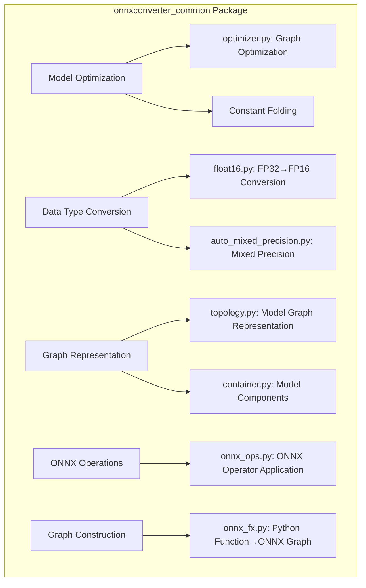
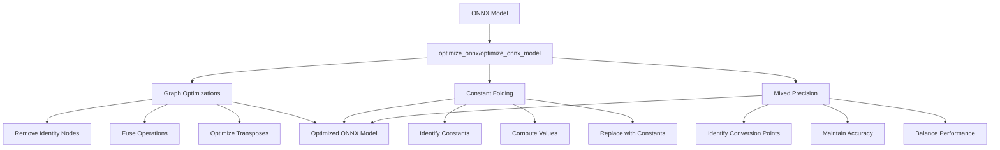
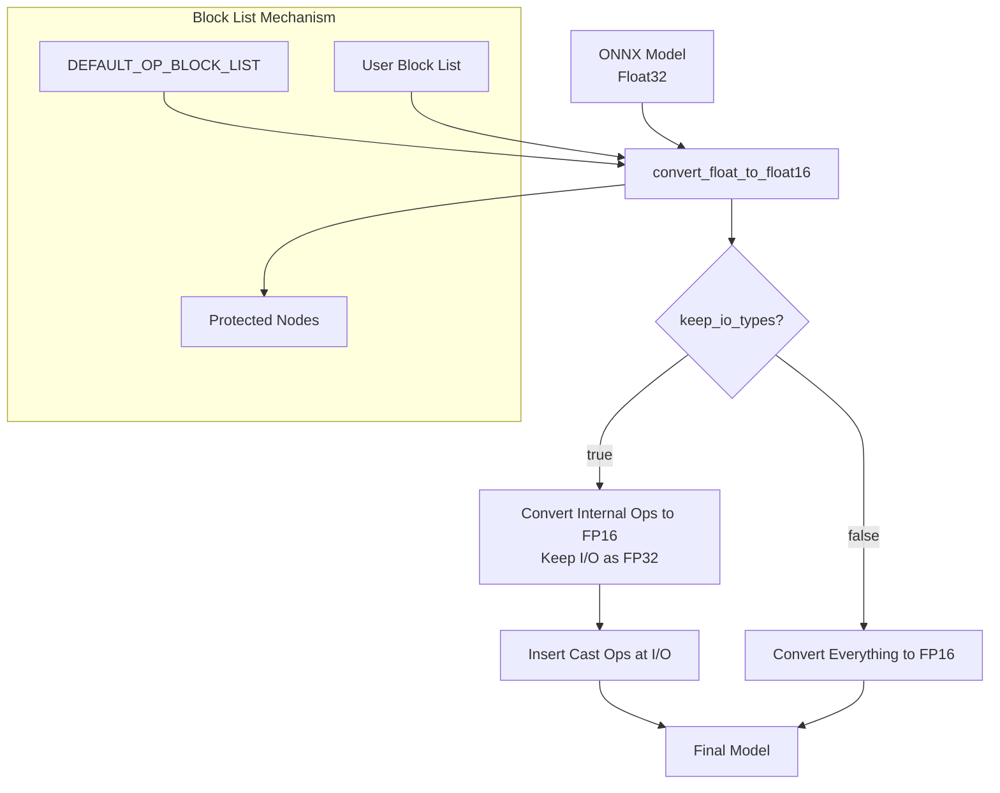
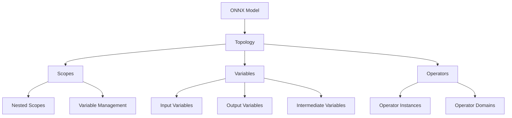
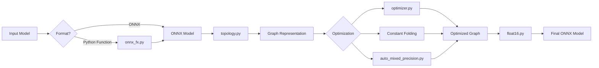
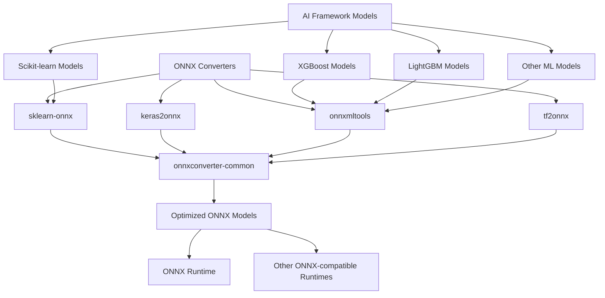

<!-- source: DeepWiki mcp.deepwiki.com · repo microsoft/onnxconverter-common · page 1 Overview · fetched 2026-10-26 -->

# Overview

Relevant source files

The following files were used as context for generating this wiki page:

- [README.md](README.md)
- [onnxconverter_common/__init__.py](onnxconverter_common/__init__.py)
- [setup.py](setup.py)

## Purpose and Scope

The onnxconverter-common package is a comprehensive toolkit for converting and optimizing ONNX (Open Neural Network Exchange) models. It provides common functions and utilities used by various ONNX converters, enabling different converters to work together for handling models from mixed frameworks (such as a scikit-learn pipeline embedding a XGBoost model).

This page introduces the core components and architecture of onnxconverter-common. For detailed information about specific subsystems, refer to these dedicated pages:
- For optimization capabilities, see [ONNX Optimization System](#2)
- For precision conversion, see [Data Type Conversion](#3)
- For graph representation, see [Model Representation](#4)
- For utilities that help construct ONNX graphs, see [Graph Construction Utilities](#5)

Sources: [onnxconverter_common/__init__.py:6-10](), [README.md:5-6]()

## System Architecture Overview

The onnxconverter-common package consists of several key subsystems that collectively provide a robust framework for ONNX model conversion and optimization.

This diagram illustrates the main components of the package and how they relate to the core functionalities.

Sources: [onnxconverter_common/__init__.py:18-32]()

## Core Components and Functionality

### Model Optimization

The optimization subsystem provides techniques to improve model performance:

Sources: [onnxconverter_common/__init__.py:30]()

### Data Type Conversion

The package provides robust tools for converting between different precision formats:

Sources: [onnxconverter_common/__init__.py:29]()

### Model Representation

The model representation components provide abstractions for working with ONNX computational graphs:

Sources: [onnxconverter_common/__init__.py:22]()

## Typical Data Flow

The following diagram illustrates the typical flow of data through the system:

This diagram shows how models flow through the system - from input (either as ONNX models or Python functions) through graph representation, optimization, and potentially precision conversion to produce the final optimized ONNX model.

Sources: [onnxconverter_common/__init__.py:6-32]()

## Key Functions and Classes

The table below lists the key functions and classes exported by the package:

| Function/Class | Description | Module |
|----------------|-------------|--------|
| `optimize_onnx`, `optimize_onnx_graph`, `optimize_onnx_model` | Functions for optimizing ONNX models | optimizer |
| `convert_float_to_float16`, `convert_tensor_float_to_float16` | Functions for converting models to float16 precision | float16 |
| `auto_convert_mixed_precision` | Function for automatic mixed precision conversion | auto_mixed_precision |
| `Topology`, `Scope`, `Variable`, `Operator` | Classes for representing ONNX computational graphs | topology |
| Various ONNX operations | Functions for applying ONNX operators | onnx_ops |
| `Container` | Class for storing model components during conversion | container |

Sources: [onnxconverter_common/__init__.py:18-32]()

## Integration with the ONNX Ecosystem

onnxconverter-common is designed to serve as a foundation for various ONNX converters:

This diagram shows how onnxconverter-common fits into the broader ONNX ecosystem, providing a common foundation for various converters that transform models from different AI frameworks into optimized ONNX models ready for deployment.

Sources: [README.md:5-6]()

## Version and Compatibility Information

The current version of onnxconverter-common is 1.16.0, with the following details:

| Attribute | Value |
|-----------|-------|
| Version | 1.16.0 |
| Author | Microsoft |
| Producer | OnnxMLTools |
| Domain | onnxconverter-common |

The package is compatible with Python 3.5 and above.

Sources: [onnxconverter_common/__init__.py:11-16](), [setup.py:52-54]()

## Summary

The onnxconverter-common package provides essential tools and utilities for:

1. Optimizing ONNX models to improve performance
2. Converting between different precision formats
3. Representing and manipulating ONNX computational graphs
4. Constructing and modifying ONNX graphs

As a fundamental component in the ONNX ecosystem, it enables the efficient conversion and optimization of models from various AI frameworks to ONNX format.

Sources: [onnxconverter_common/__init__.py:6-10](), [README.md:5-6](), [setup.py:36]()

---

