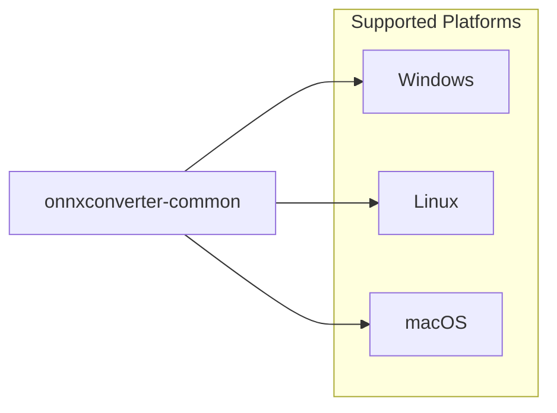
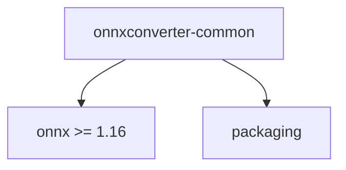
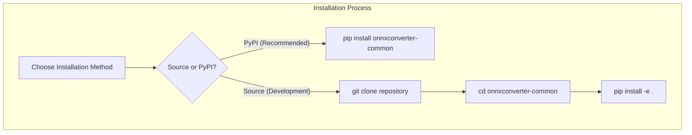
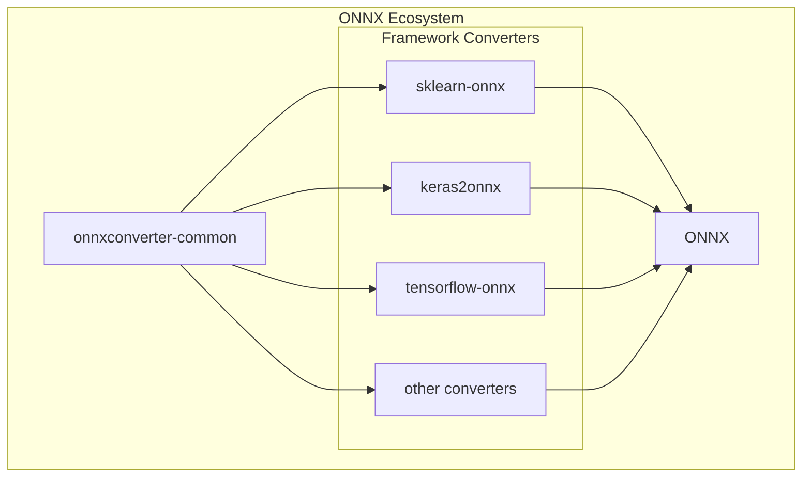

<!-- source: DeepWiki mcp.deepwiki.com · repo microsoft/onnxconverter-common · page 1.1 Installation and Requirements · fetched 2026-10-26 -->

# Installation and Requirements

<details>
<summary>Relevant source files</summary>

The following files were used as context for generating this wiki page:

- [README.md](README.md)
- [requirements.txt](requirements.txt)
- [setup.py](setup.py)

</details>


This document covers the installation process and system requirements for using the `onnxconverter-common` package. The `onnxconverter-common` library provides common utilities and functions for converting models from various AI frameworks to the ONNX format. For information about the overall package structure, see [Package Structure](#1.2).

## System Requirements

### Supported Operating Systems

The `onnxconverter-common` package is platform-independent and supports the following operating systems:

- Windows
- Linux
- macOS



Sources: [setup.py:49-51]()

### Python Version Requirements

The package is compatible with Python versions:

- Python 3.5+
- Python 3.6+ (recommended)

Note that newer versions of ONNX may require more recent Python versions than those listed in the setup file.

Sources: [setup.py:53-54]()

### Dependencies

The `onnxconverter-common` package has minimal direct dependencies:



Sources: [requirements.txt:1-2]()

## Installation Methods

### Installation via pip

The recommended method for installing `onnxconverter-common` is using pip:

```bash
pip install onnxconverter-common
```

For a specific version:

```bash
pip install onnxconverter-common==1.0.0
```

### Installation from Source

For the latest development version or to contribute to the project, you can install from source:

```bash
git clone https://github.com/microsoft/onnxconverter-common.git
cd onnxconverter-common
pip install -e .
```

The `-e` flag installs the package in development mode, which allows you to modify the source code and have the changes immediately available.



Sources: [setup.py:33-56]()

## Verifying Installation

You can verify the installation by importing the package in Python:

```python
import onnxconverter_common
print(onnxconverter_common.__version__)
```

## Integration with ONNX Ecosystem

The `onnxconverter-common` package functions as a foundational component in the ONNX model conversion ecosystem, providing shared utilities that other framework-specific converters can leverage.



Sources: [README.md:5-6]()

## Installation Requirements Summary

The following table summarizes the key installation requirements for using `onnxconverter-common`:

| Requirement | Details |
|-------------|---------|
| Python Version | 3.5+ (3.6+ recommended) |
| Operating Systems | Windows, Linux, macOS |
| Direct Dependencies | onnx >= 1.16, packaging |
| Installation Methods | pip (recommended), source installation |

Sources: [requirements.txt:1-2](), [setup.py:49-54]()

## Troubleshooting Common Installation Issues

### ONNX Compatibility

If you encounter issues with ONNX compatibility, ensure you're using a version of ONNX that's compatible with your Python version. The requirement `onnx>=1.16` may necessitate a more recent Python version than what's listed in the setup.py file.

### Development Installation

When installing for development:

1. Ensure all dependencies are installed: `pip install -r requirements.txt`
2. Install in development mode: `pip install -e .`

This allows changes to the source code to be immediately reflected without reinstallation.

Sources: [requirements.txt:1-2](), [setup.py:14-16]()

---

