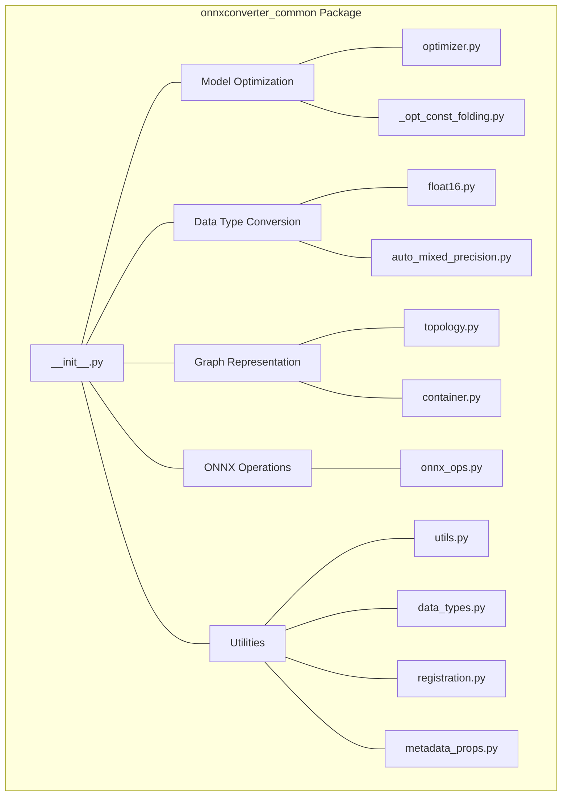
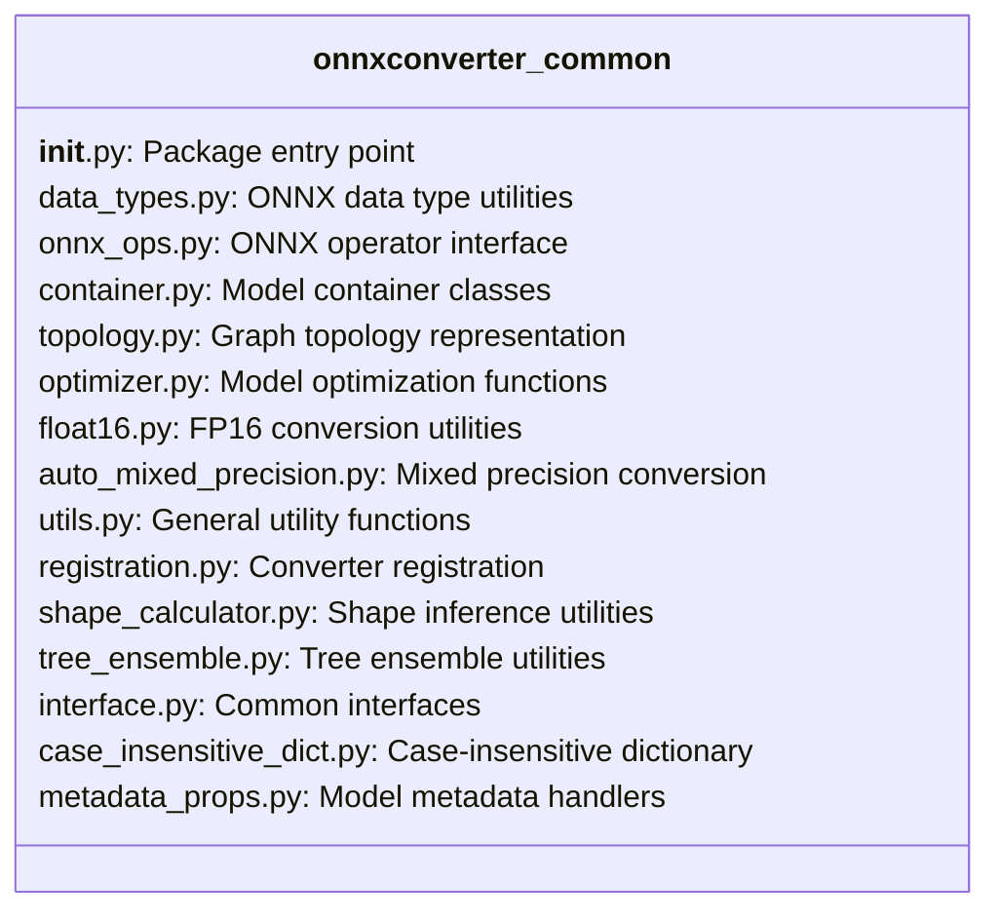
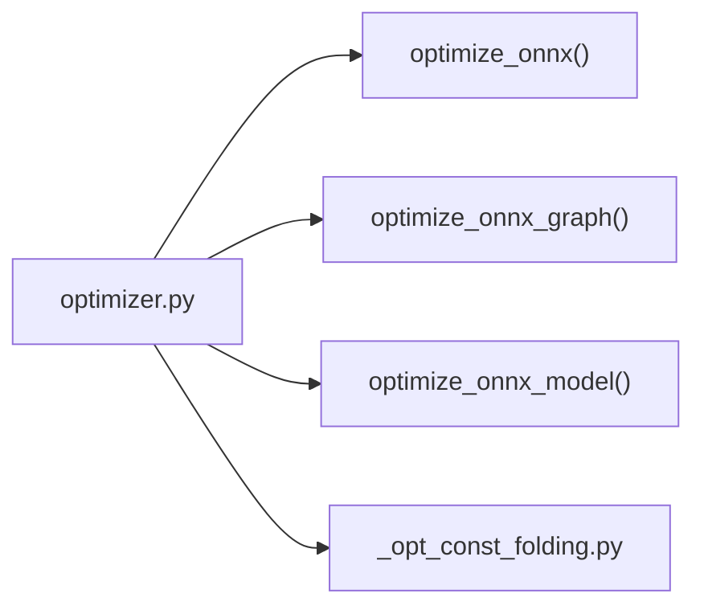
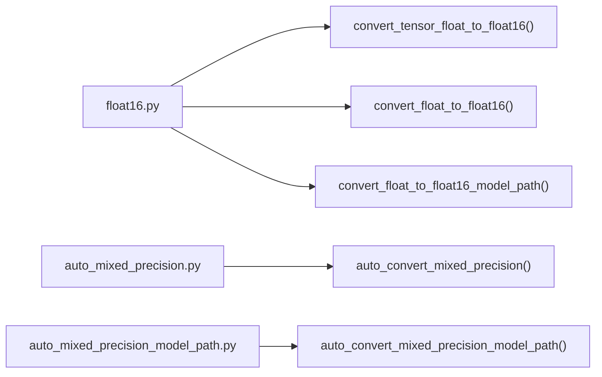
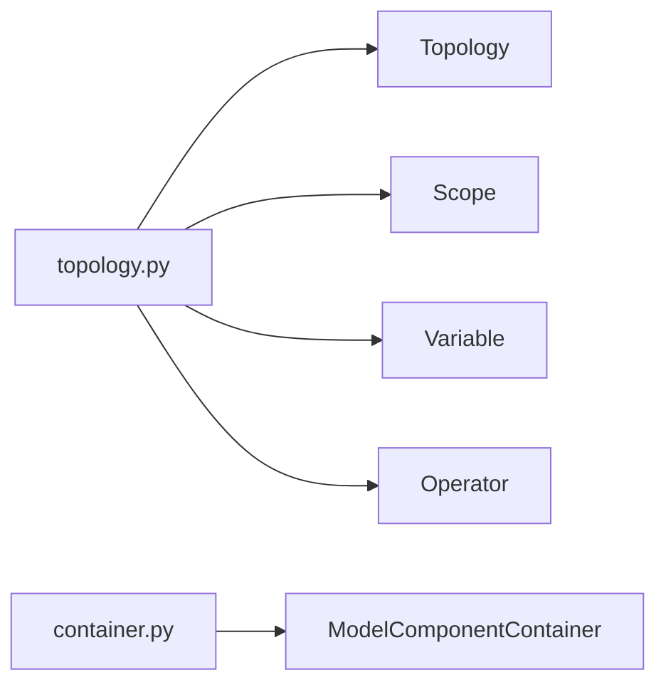
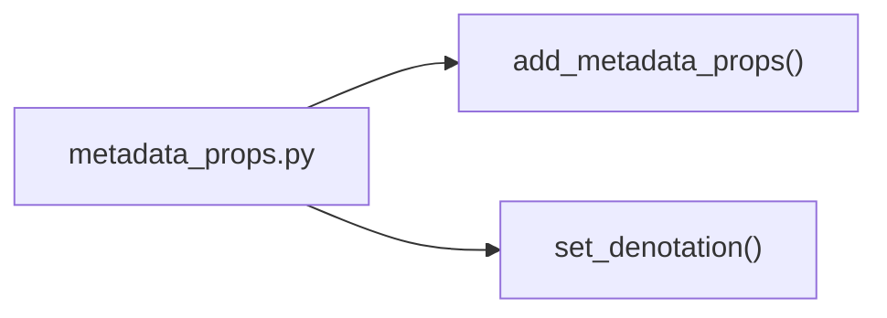
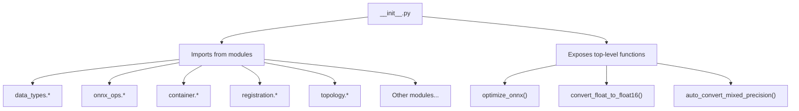
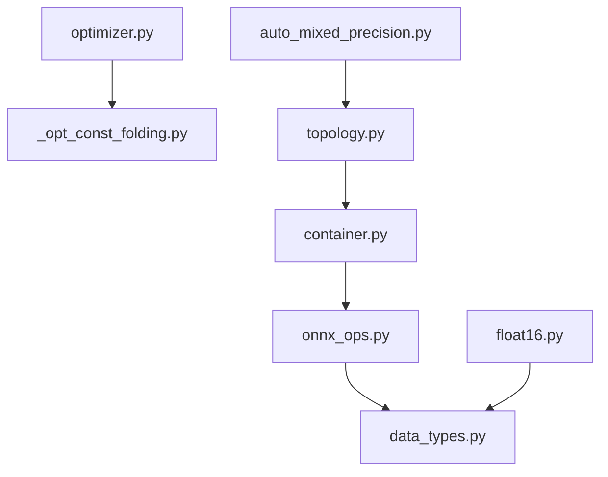

<!-- source: DeepWiki mcp.deepwiki.com · repo microsoft/onnxconverter-common · page 1.2 Package Structure · fetched 2026-10-26 -->

# Package Structure

<details>
<summary>Relevant source files</summary>

The following files were used as context for generating this wiki page:

- [onnxconverter_common/__init__.py](onnxconverter_common/__init__.py)

</details>


This document describes the organization and structure of the `onnxconverter-common` package, explaining how the various modules are arranged and how they relate to each other. For information about installation, see [Installation and Requirements](#1.1).

## Package Overview

The `onnxconverter-common` package is designed to provide utilities and optimization functions for ONNX models. It serves as a common foundation for various ONNX converters, offering standardized components for model transformation, optimization, and type conversion.



Sources: [onnxconverter_common/__init__.py:6-10](), [onnxconverter_common/__init__.py:18-32]()

## Module Organization

The package's functionality is distributed across several Python modules, each with a specific responsibility:



Sources: [onnxconverter_common/__init__.py:18-32]()

## Core Module Descriptions

| Module | Description |
|--------|-------------|
| `data_types.py` | Defines data type classes used for ONNX type representation and conversion |
| `onnx_ops.py` | Provides utilities for working with ONNX operators |
| `container.py` | Contains classes for model containment and management |
| `topology.py` | Provides classes for representing and manipulating computational graphs |
| `interface.py` | Defines interfaces used by the framework |
| `shape_calculator.py` | Utilities for calculating output shapes in ONNX models |
| `registration.py` | Handles registration of converter components and functions |
| `tree_ensemble.py` | Utilities for working with tree ensemble models |
| `utils.py` | General utility functions used throughout the package |
| `case_insensitive_dict.py` | Implements a case-insensitive dictionary class |

Sources: [onnxconverter_common/__init__.py:18-26]()

## Functional Module Groups

The package organizes its modules into several functional groups:

### 1. Model Optimization



Sources: [onnxconverter_common/__init__.py:30]()

### 2. Data Type Conversion



Sources: [onnxconverter_common/__init__.py:29-32]()

### 3. Graph Representation



Sources: [onnxconverter_common/__init__.py:20-22]()

### 4. Metadata Handling



Sources: [onnxconverter_common/__init__.py:28]()

## Package Exports and Entry Point

The `__init__.py` file serves as the entry point to the package and performs two key functions:

1. Defines package metadata:
   - `__version__`: "1.16.0"
   - `__author__`: "Microsoft"
   - `__producer__`: "OnnxMLTools"
   - `__domain__`: "onnxconverter-common"

2. Imports and exposes key functionality from the various modules to make them accessible at the package level.



Sources: [onnxconverter_common/__init__.py:11-32]()

This import structure allows users to import directly from `onnxconverter_common` without needing to reference the specific modules, simplifying usage patterns.

## Module Dependencies

The modules within the package have inter-dependencies that form the foundation of the package's architecture:



Sources: [onnxconverter_common/__init__.py:18-32]()

## Usage Patterns

The package structure facilitates two common usage patterns:

### 1. Direct Function Import

```python
from onnxconverter_common import optimize_onnx, convert_float_to_float16
```

### 2. Module Import

```python
import onnxconverter_common as occ
occ.optimize_onnx(model)
```

The module organization is designed to support both patterns while maintaining a clean separation of concerns between different components.

## Summary

The `onnxconverter-common` package structure is organized into functional modules that collectively provide:

1. ONNX model optimization capabilities
2. Data type conversion utilities (float16, mixed precision)
3. Graph representation and manipulation tools
4. ONNX operation utilities and abstractions
5. Common utilities for ONNX converters

This modular design allows for easy extension and maintenance while providing a comprehensive toolkit for working with ONNX models.

---

