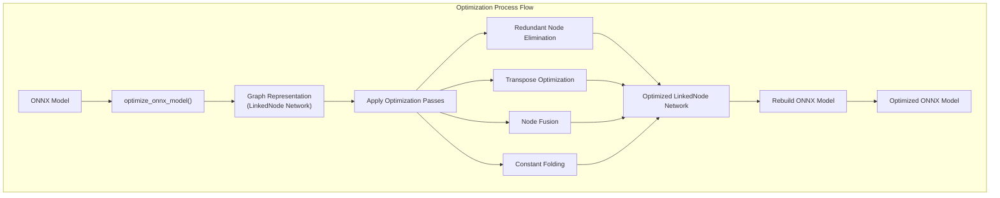
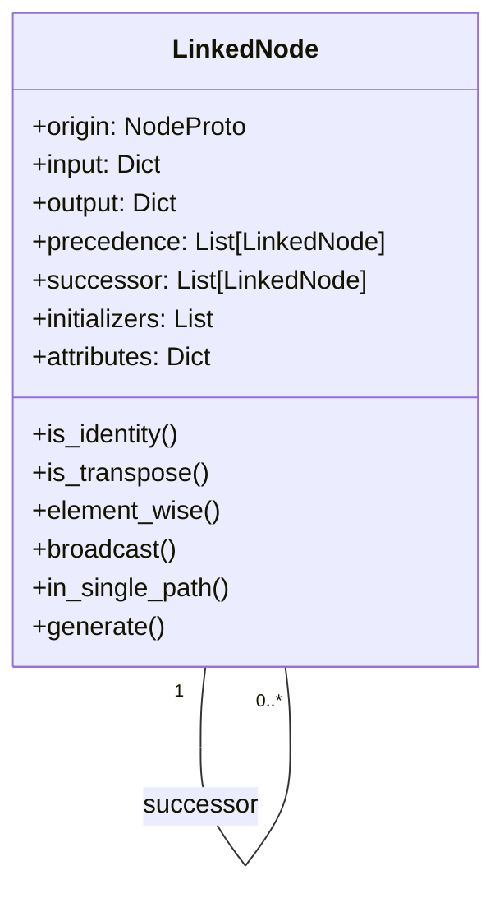
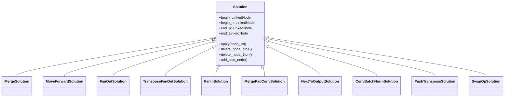
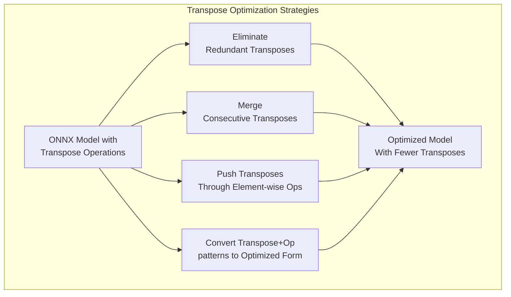
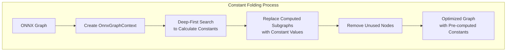
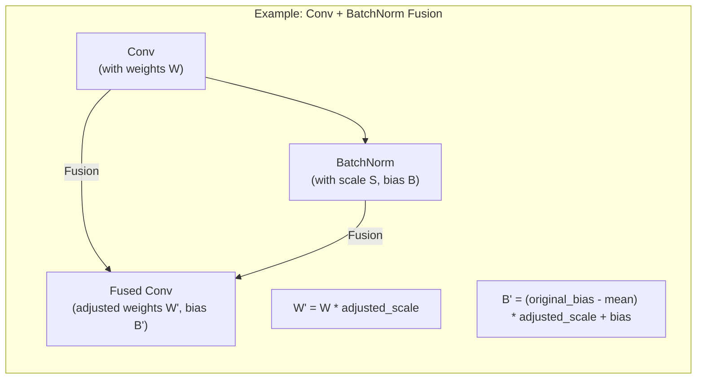
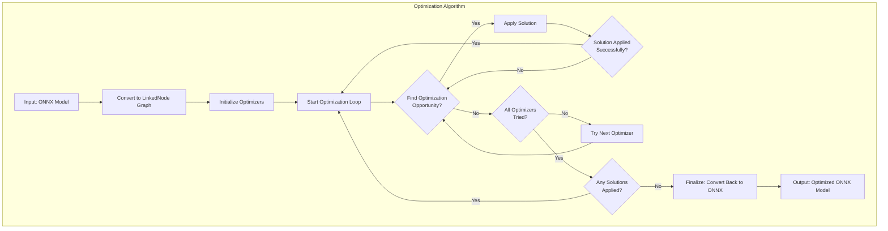

<!-- source: DeepWiki mcp.deepwiki.com · repo microsoft/onnxconverter-common · page 2 ONNX Optimization System · fetched 2026-10-26 -->

# ONNX Optimization System

<details>
<summary>Relevant source files</summary>

The following files were used as context for generating this wiki page:

- [onnxconverter_common/_opt_const_folding.py](onnxconverter_common/_opt_const_folding.py)
- [onnxconverter_common/optimizer.py](onnxconverter_common/optimizer.py)

</details>


This document provides a technical overview of the optimization system in `onnxconverter-common`, which is designed to improve the efficiency of ONNX models. The optimization system applies a series of transformations to ONNX computational graphs to reduce computational complexity, eliminate redundant operations, and improve inference performance.

For information about type conversion systems like Float16 conversion, see [Data Type Conversion](#3). For details about the graph representation used by these optimizations, see [Model Representation](#4).

## Core Architecture

The ONNX optimization system consists of multiple components that work together to transform ONNX models into more efficient forms while preserving their functionality.



Sources: [onnxconverter_common/optimizer.py:1789-1912]()

## Graph Representation for Optimization

The optimization system uses a specialized graph representation based on `LinkedNode` objects to facilitate the analysis and transformation of the computational graph.



The `LinkedNode` class provides methods to:
- Navigate the graph structure (through `precedence` and `successor` relationships)
- Identify node types and patterns for optimization
- Transform the graph by modifying connections between nodes
- Generate updated ONNX nodes

Sources: [onnxconverter_common/optimizer.py:13-362]()

## Optimization Techniques

The system implements multiple optimization techniques, each focusing on specific patterns in the computational graph.

### Solution Framework

All optimization techniques extend the `Solution` base class, which provides a framework for applying transformations to the graph.



Sources: [onnxconverter_common/optimizer.py:364-480]()

### Optimizer Classes

Each optimizer class is responsible for identifying specific optimization opportunities in the graph.

| Optimizer Class | Purpose |
|-----------------|---------|
| RedundantOptimizer | Eliminates identity nodes and other redundant operations |
| TransposeOptimizer | Optimizes or eliminates transpose operations |
| MergePadConvOptimizer | Fuses padding operations with convolutions |
| ConvBatchNormOptimizer | Fuses batch normalization into convolution weights and biases |
| MergeReshapeOptimizer | Optimizes chains of reshape operations |
| MergeCastOptimizer | Optimizes chains of type cast operations |
| MergeSqueezeUnsqueezeOptimizer | Eliminates unnecessary dimension changes |
| SwapOpOptimizer | Reorders operations to enable further optimizations |
| MergeCommonSequenceOptimizer | Identifies and merges duplicated computation sequences |
| MatmulOptimizer | Optimizes matrix multiplication operations |

Sources: [onnxconverter_common/optimizer.py:797-1702]()

## Transpose Optimization

The system places special emphasis on optimizing transpose operations, which are often introduced during model conversion but can be expensive at runtime.



Key transpose optimization strategies:
- Eliminating redundant transposes ([0,1,2,3] which do nothing)
- Merging consecutive transposes into a single operation
- Moving transposes forward or backward through operations that are transpose-invariant
- Recognizing common patterns involving transposes and replacing them with optimized versions

Sources: [onnxconverter_common/optimizer.py:1344-1471](), [onnxconverter_common/optimizer.py:1243-1341]()

## Constant Folding

Constant folding is a crucial optimization that pre-computes parts of the graph that depend only on constant inputs.



The system implements constant folding using the `OnnxGraphContext` class, which:
1. Identifies nodes with constant inputs
2. Executes these nodes at optimization time 
3. Replaces the subgraphs with pre-computed constant values
4. Prunes the computational graph of unused nodes

Sources: [onnxconverter_common/_opt_const_folding.py:10-297]()

## Node Fusion

The optimizer can identify and fuse common combinations of operations for better performance.



Common fusion patterns include:
- Conv + BatchNorm → Modified Conv
- Pad + Conv → Conv with padding parameters
- Squeeze + Unsqueeze with matching axes → No operation
- Consecutive Reshape operations → Single Reshape

Sources: [onnxconverter_common/optimizer.py:747-794](), [onnxconverter_common/optimizer.py:818-833]()

## Optimization Process

The overall optimization process follows a systematic approach to ensure that all applicable optimizations are applied efficiently.



The optimization process:
1. Converts the ONNX model to a LinkedNode graph representation
2. Iteratively applies optimizers to find and apply transformations
3. Continues until no more optimizations can be applied
4. Rebuilds the optimized ONNX model from the transformed graph

Sources: [onnxconverter_common/optimizer.py:1705-1740]()

## API Reference

The optimization system exposes three main functions for users:

| Function | Purpose | Key Parameters |
|----------|---------|----------------|
| `optimize_onnx` | Optimizes a list of ONNX nodes | `onnx_nodes`, `nchw_inputs`, `inputs`, `outputs`, `target_opset` |
| `optimize_onnx_graph` | Optimizes an ONNX graph | `onnx_nodes`, `nchw_inputs`, `inputs`, `outputs`, `initializers`, `stop_initializers`, `model_value_info`, `model_name`, `target_opset` |
| `optimize_onnx_model` | Optimizes a complete ONNX model | `origin_model`, `nchw_inputs`, `stop_initializers` |

Sources: [onnxconverter_common/optimizer.py:1794-1912]()

### Usage Example

```python
import onnx
from onnxconverter_common import optimize_onnx_model

# Load ONNX model
model = onnx.load("model.onnx")

# Optional: List input tensors that are in NCHW format
nchw_inputs = ["input_0"]

# Optimize the model
optimized_model = optimize_onnx_model(model, nchw_inputs=nchw_inputs)

# Save the optimized model
onnx.save(optimized_model, "optimized_model.onnx")
```

## Opset Compatibility

Some optimizations are only available for specific ONNX opset versions. For example, ConvBatchNormOptimizer is only applied for opset >= 9.

```python
# In _process_optimization function:
if target_opset is not None and target_opset >= 9:
    optimizers.append(ConvBatchNormOptimizer)
```

The system also handles version-specific implementations of operations, such as Squeeze and Unsqueeze which have different signatures in opset 13+.

Sources: [onnxconverter_common/optimizer.py:1706-1710]()

## Limitations and Considerations

- Some optimizations may not preserve the exact numeric precision of the original model
- Not all operations are supported for constant folding
- Optimizations are applied based on pattern matching, so novel patterns may not be optimized
- Some operations have specialized handling to maintain semantics across ONNX versions
- Reserved nodes (e.g., outputs or nodes used in sub-graphs) are protected from certain optimizations

Sources: [onnxconverter_common/optimizer.py:1878-1885](), [onnxconverter_common/_opt_const_folding.py:193-203]()

---

