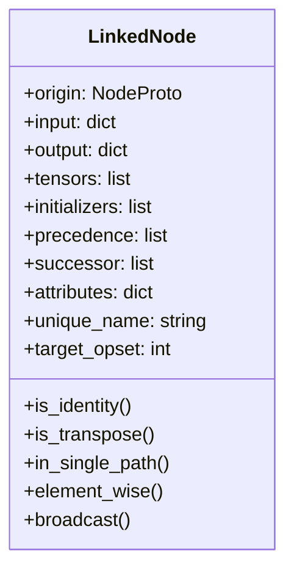
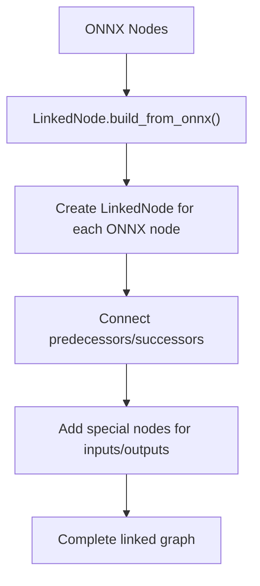
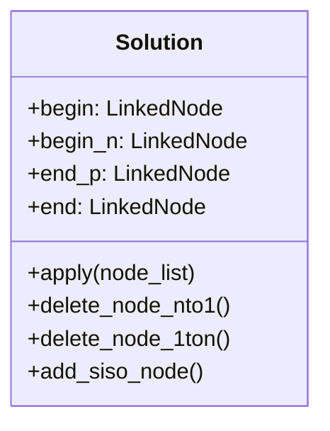
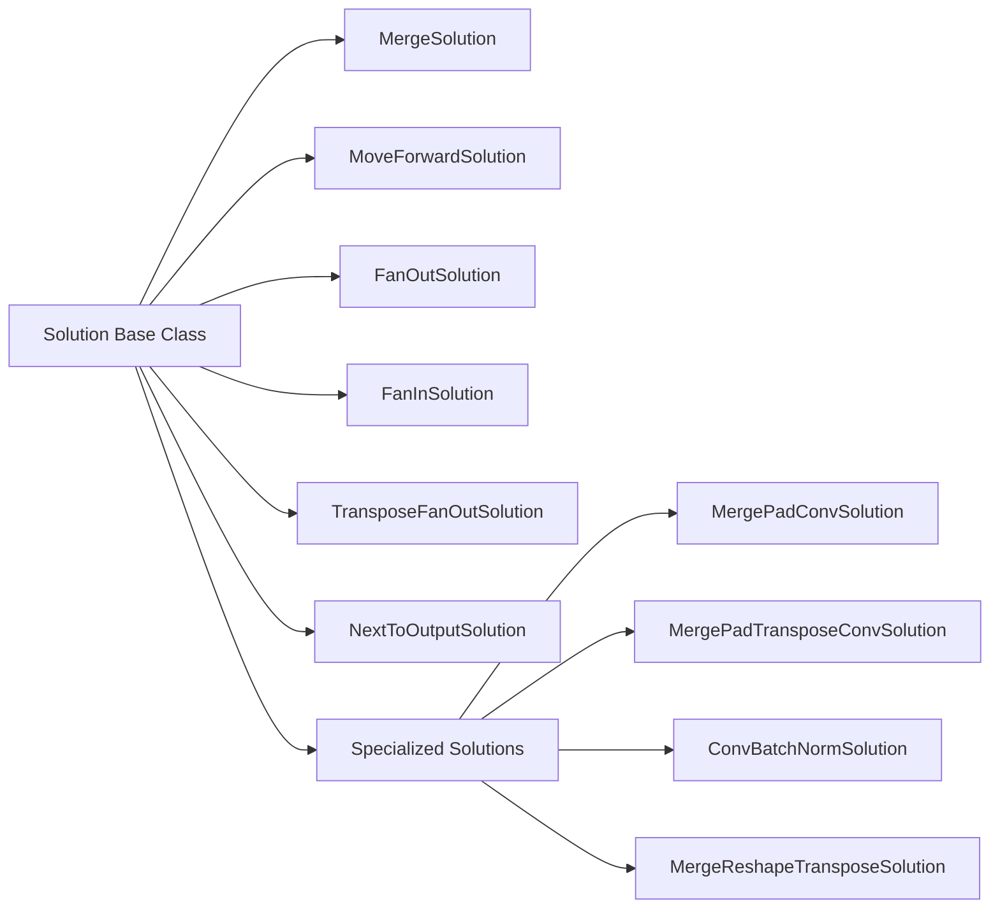
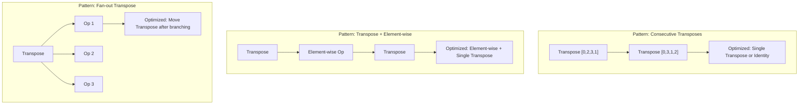
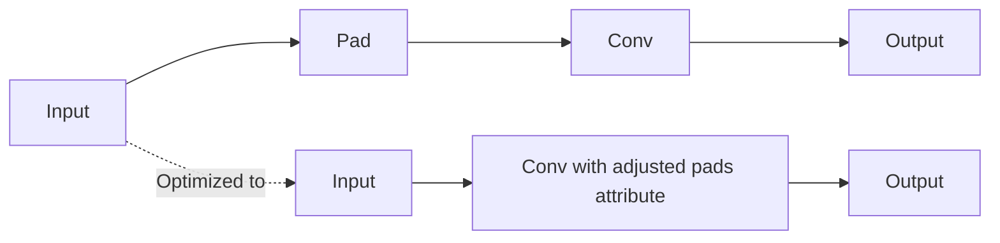
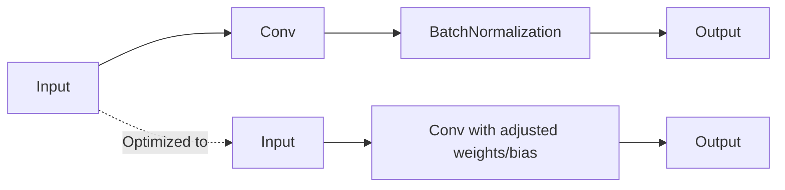
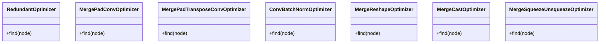
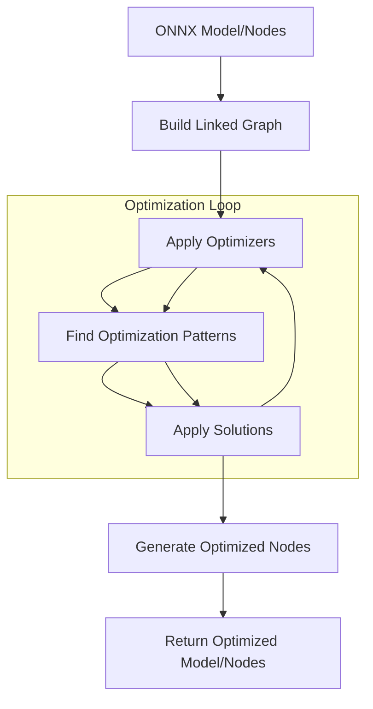

<!-- source: DeepWiki mcp.deepwiki.com · repo microsoft/onnxconverter-common · page 2.1 Graph Optimization · fetched 2026-10-26 -->

# Graph Optimization

<details>
<summary>Relevant source files</summary>

The following files were used as context for generating this wiki page:

- [onnxconverter_common/optimizer.py](onnxconverter_common/optimizer.py)
- [tests/data/test_model_0_no_opt.onnx](tests/data/test_model_0_no_opt.onnx)
- [tests/data/test_model_1_no_opt.onnx](tests/data/test_model_1_no_opt.onnx)
- [tests/test_opt.py](tests/test_opt.py)

</details>


## Purpose and Scope

This document details the graph optimization techniques implemented in the onnxconverter-common library. Graph optimization is a crucial step in the ONNX conversion process that improves model performance by reducing computational complexity and removing redundant operations.

The system focuses on optimizing ONNX graphs by:
- Removing redundant operations (like identity nodes)
- Merging compatible operations (such as consecutive transposes)
- Rearranging operations to reduce the computational overhead
- Performing structure-aware transformations

For constant folding optimizations, see [Constant Folding](#2.2), and for de-cast optimizations, see [De-Cast Optimization](#2.3).

## Graph Representation

Before diving into optimization techniques, it's important to understand how ONNX graphs are represented within the system.

### LinkedNode Representation

The system uses the `LinkedNode` class to represent ONNX computation nodes with their connections in a graph structure.



Sources: [onnxconverter_common/optimizer.py:13-165]()

Each `LinkedNode` maintains:
- References to predecessor and successor nodes
- Input and output tensor mappings
- Original ONNX NodeProto object
- Helper properties to determine node characteristics (e.g., is_identity, is_transpose)

### Graph Building

The system constructs a linked graph from an ONNX model using the `build_from_onnx` static method:



Sources: [onnxconverter_common/optimizer.py:284-336]()

## Optimization Solutions

The optimization system is built around the concept of "solutions" - classes that identify and transform specific patterns in the graph.

### Solution Base Class

The `Solution` class provides the foundation for all optimization techniques:



Sources: [onnxconverter_common/optimizer.py:364-480]()

The solution classes follow a pattern of:
1. Finding a sequence of nodes matching a specific pattern
2. Transforming this sequence to optimize the graph
3. Updating connections to maintain computational equivalence

### Key Solution Types

Several specialized solution classes handle different optimization scenarios:



Sources: [onnxconverter_common/optimizer.py:493-793]()

## Transpose Optimization

A key focus of the optimization system is optimizing transpose operations, which can significantly impact model performance.

### Transpose Pattern Recognition

The system identifies several transpose patterns that can be optimized:



Sources: [onnxconverter_common/optimizer.py:493-565](), [onnxconverter_common/optimizer.py:1000-1026]()

### Transpose Optimizations

The system applies several types of transpose optimizations:

1. **Merging consecutive transposes**: When two transpose operations can be combined or eliminated
2. **Moving transposes**: Repositioning transpose operations to optimize the overall graph
3. **Handling fan-in/fan-out situations**: Special handling for cases with multiple inputs or outputs

Sources: [onnxconverter_common/optimizer.py:534-631]()

## Operation Fusion

The system can fuse multiple operations into more efficient equivalents.

### Pad + Convolution Fusion



Sources: [onnxconverter_common/optimizer.py:658-720]()

### Convolution + BatchNorm Fusion



Sources: [onnxconverter_common/optimizer.py:747-793]()

## Optimizer Classes

The system includes several optimizer classes that identify optimization opportunities:



Each optimizer:
1. Evaluates if a node matches a specific optimization pattern
2. Returns an appropriate solution if applicable
3. Otherwise, returns None to indicate no optimization is possible

Sources: [onnxconverter_common/optimizer.py:797-996]()

## Optimization Process

The complete optimization process combines all these techniques:



## Public API

The package exposes two main functions for graph optimization:

1. **optimize_onnx**: Optimizes a list of ONNX nodes
   ```python
   from onnxconverter_common.optimizer import optimize_onnx
   
   # Takes nodes, inputs, and outputs and returns optimized nodes
   optimized_nodes = optimize_onnx(nodes, inputs, outputs)
   ```

2. **optimize_onnx_model**: Optimizes a complete ONNX model
   ```python
   from onnxconverter_common.optimizer import optimize_onnx_model
   
   # Takes an ONNX model and returns an optimized model
   optimized_model = optimize_onnx_model(model)
   ```

Sources: [tests/test_opt.py:9](), [tests/test_opt.py:50-55](), [tests/test_opt.py:257-258]()

## Optimization Strategies and Their Applications

The following table summarizes key optimization strategies and when they are applied:

| Strategy | Pattern | Benefit |
|----------|---------|---------|
| Remove Redundant Nodes | Identity nodes, no-op transposes | Reduces model size and execution time |
| Merge Consecutive Transposes | Transpose → Transpose | Eliminates unnecessary data movement |
| Move Transposes Past Element-wise | Transpose → Element-wise → Transpose | Reduces number of transpose operations |
| Fuse Pad + Conv | Pad → Conv | Improves memory locality and reduces operations |
| Fuse Conv + BatchNorm | Conv → BatchNorm | Eliminates a full tensor pass at runtime |
| Merge Reshape + Transpose | Reshape → Transpose | Reduces memory allocation and data movement |
| Optimize Fan-in/Fan-out | Multiple paths with transposes | Reduces total transpose operations |
| Merge Cast Operations | Cast → Cast | Eliminates unnecessary type conversions |

Sources: [onnxconverter_common/optimizer.py:797-996]()

## Conclusion

The Graph Optimization system in onnxconverter-common provides comprehensive capabilities for optimizing ONNX computational graphs. By identifying and transforming common patterns, it can significantly improve model performance without changing the mathematical behavior of the model.

The system is particularly effective at optimizing transpose operations, which are often a performance bottleneck in neural network execution. Additionally, its ability to fuse operations like convolution and batch normalization can lead to substantial improvements in both memory usage and execution time.

---

