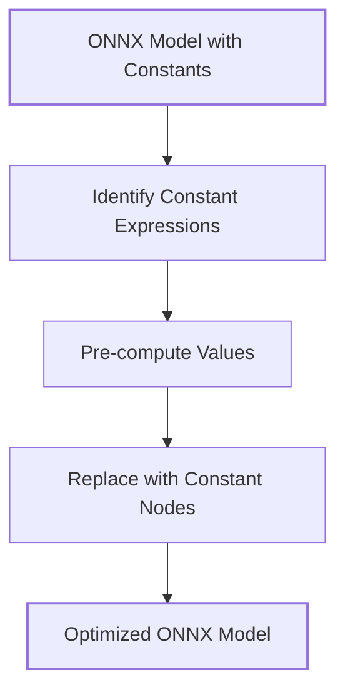
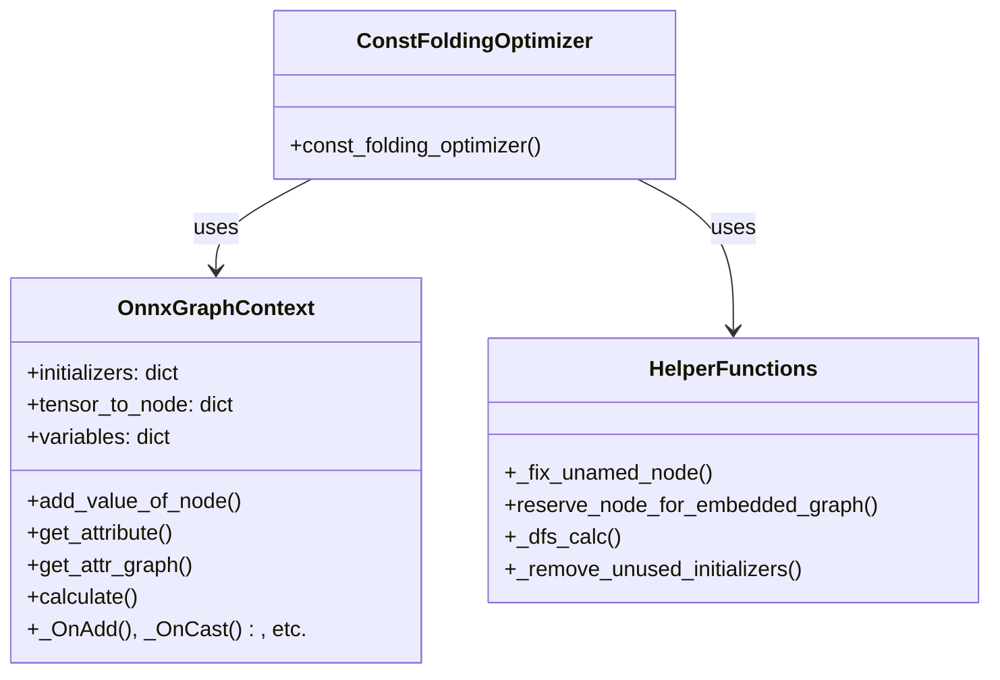
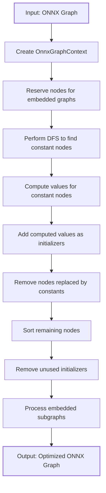
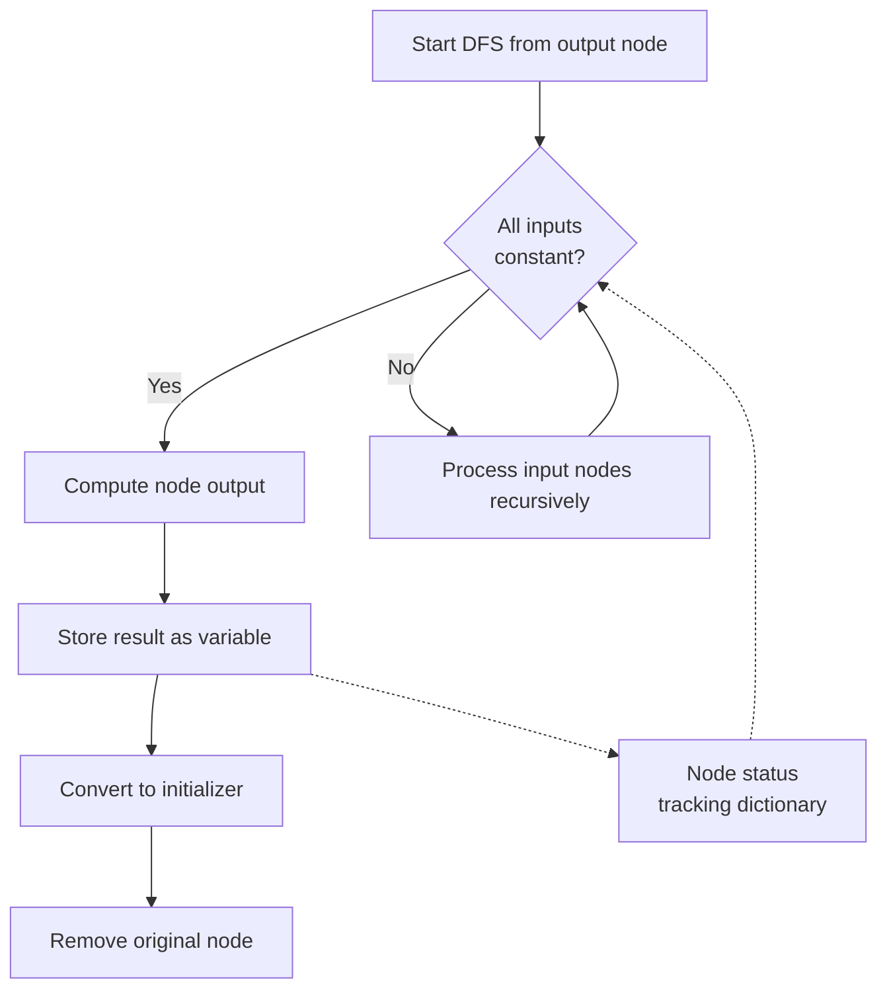
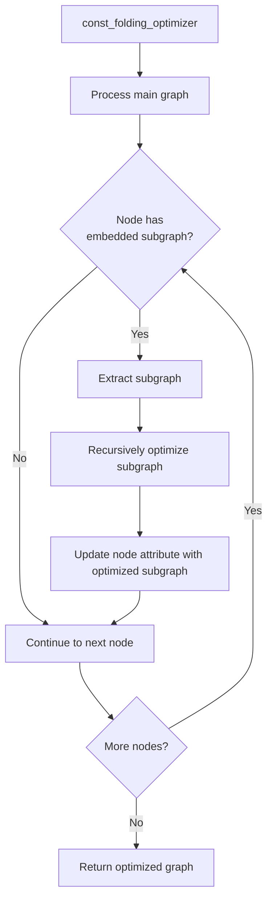

<!-- source: DeepWiki mcp.deepwiki.com · repo microsoft/onnxconverter-common · page 2.2 Constant Folding · fetched 2026-10-26 -->

# Constant Folding

<details>
<summary>Relevant source files</summary>

The following files were used as context for generating this wiki page:

- [onnxconverter_common/_opt_const_folding.py](onnxconverter_common/_opt_const_folding.py)

</details>


## Purpose and Scope

Constant folding is an optimization technique that improves the performance of ONNX models by identifying operations with constant inputs and pre-computing their results at conversion time rather than execution time. This document details the constant folding implementation in the onnxconverter-common package, explaining its architecture, workflow, and supported operations. For information about other optimization techniques like general graph optimization, see [Graph Optimization](#2.1).

## Overview

Constant folding identifies subgraphs where all inputs are constants, evaluates these subgraphs during the conversion process, and replaces them with equivalent constant nodes containing the pre-computed values. This optimization reduces model complexity, decreases inference time, and can lower memory usage.



Sources: [onnxconverter_common/_opt_const_folding.py:266-298]()

## System Architecture

The constant folding system consists of several components working together to analyze and transform ONNX graphs.



Sources: [onnxconverter_common/_opt_const_folding.py:10-171](), [onnxconverter_common/_opt_const_folding.py:173-190](), [onnxconverter_common/_opt_const_folding.py:193-262]()

### OnnxGraphContext

The `OnnxGraphContext` class is central to the constant folding system. It encapsulates the state of an ONNX graph and provides methods to:

1. Track initializers (constants defined in the model)
2. Map tensors to their producing nodes
3. Store computed variable values
4. Calculate outputs for supported operations

This class contains specialized methods (prefixed with `_On`) that implement the computation logic for different ONNX operations when all inputs are known at conversion time.

Sources: [onnxconverter_common/_opt_const_folding.py:10-171]()

### Supported Operations

The constant folding system can evaluate the following ONNX operations when their inputs are constants:

| Operation  | Method             | Description                                  |
|------------|-------------------|----------------------------------------------|
| Identity   | `_OnIdentity`     | Passes input unchanged to output             |
| Constant   | `_OnConstant`     | Extracts value from node attributes          |
| Add        | `_OnAdd`          | Performs element-wise addition               |
| Cast       | `_OnCast`         | Converts tensor to specified data type       |
| Gather     | `_OnGather`       | Gathers values along specified axis          |
| Greater    | `_OnGreater`      | Compares values (a > b)                      |
| Less       | `_OnLess`         | Compares values (a < b)                      |
| Mul        | `_OnMul`          | Performs element-wise multiplication         |
| Not        | `_OnNot`          | Performs logical NOT operation               |
| Transpose  | `_OnTranspose`    | Transposes input tensor                      |
| Range      | `_OnRange`        | Creates a sequence of numbers                |
| Slice      | `_OnSlice`        | Extracts a slice from input tensor           |
| Div        | `_OnDiv`          | Performs element-wise division               |
| Pow        | `_OnPow`          | Computes element-wise power                  |
| Sqrt       | `_OnSqrt`         | Computes square root                         |
| Sub        | `_OnSubtract`     | Performs element-wise subtraction            |
| Unsqueeze  | `_OnUnsqueeze`    | Inserts dimensions of size 1                 |
| Reshape    | `_OnReshape`      | Reshapes input tensor to new shape           |

Sources: [onnxconverter_common/_opt_const_folding.py:67-170]()

## Constant Folding Process

The constant folding process follows a systematic workflow to identify and process constant expressions.



Sources: [onnxconverter_common/_opt_const_folding.py:266-298]()

### Main Entry Point

The `const_folding_optimizer` function is the main entry point for the constant folding optimization. It takes an ONNX graph as input and returns an optimized version.

```python
def const_folding_optimizer(graph, outer_graph=None):
    # Process graph nodes
    # Optimize embedded subgraphs recursively
    # Return optimized graph
```

Sources: [onnxconverter_common/_opt_const_folding.py:266-298]()

### Node Traversal and Value Computation

The system uses a depth-first search approach to identify nodes that can be pre-computed:

1. Starting from the output nodes, traverse the graph backwards
2. For each node, determine if all its inputs are constant
3. If all inputs are constant, compute the result using the appropriate handler
4. Store the computed value in the graph context
5. Replace the node with a constant initializer



Sources: [onnxconverter_common/_opt_const_folding.py:206-242]()

### Calculation Process

When a node is identified as computable, the `calculate` method in `OnnxGraphContext` is called:

1. Find the appropriate calculation function based on the operation type
2. Extract input values from initializers or previously computed variables
3. Compute the result
4. Store the result in the variables dictionary

```python
def calculate(self, node):
    func_name = '_On' + node.op_type
    func = type(self).__dict__.get(func_name, None)
    if func is None:
        return None

    inputs = []
    for ts_ in node.input:
        if ts_ in self.initializers:
            inputs.append(numpy_helper.to_array(self.initializers[ts_]))
        elif ts_ in self.variables:
            inputs.append(self.variables[ts_])
        else:
            return None

    output_values = func(self, node, inputs)
    for idx_, ots_ in enumerate(node.output):
        self.add_value_of_node(ots_, output_values[idx_])

    return output_values
```

Sources: [onnxconverter_common/_opt_const_folding.py:46-65]()

### Handling Embedded Subgraphs

ONNX models can contain control flow operators like `If`, `Loop`, and `Scan` that have embedded subgraphs. The constant folding system handles these special cases by:

1. Identifying nodes with embedded subgraphs
2. Recursively optimizing each subgraph
3. Updating the parent node with the optimized subgraphs



Sources: [onnxconverter_common/_opt_const_folding.py:293-296](), [onnxconverter_common/_opt_const_folding.py:34-44]()

## Integration with ONNX Optimization System

Constant folding is one component of the broader ONNX optimization system in onnxconverter-common. It works alongside other optimization techniques to improve model performance.


Sources: [onnxconverter_common/_opt_const_folding.py:266-298]()

## Technical Considerations

### Reserved Names

Some nodes and tensors must be preserved even if they could be constant-folded, such as inputs to embedded subgraphs or operators that have side effects. The system maintains a set of "reserved names" that won't be optimized away.

Sources: [onnxconverter_common/_opt_const_folding.py:193-203]()

### Stopping Initializers

The class-level list `stopping_initializers` allows the system to specify initializers that should not be considered for constant folding, providing a way to control the optimization process.

Sources: [onnxconverter_common/_opt_const_folding.py:11](), [onnxconverter_common/_opt_const_folding.py:202]()

### Unique Node Naming

To ensure proper tracking and identification of nodes, the system assigns unique names to any unnamed nodes in the graph.

```python
def _fix_unamed_node(nodelist):
    node_id = [1]
    name_set = set(nd_.name if nd_.name else '' for nd_ in nodelist)
    
    # Assign unique names to unnamed nodes
    named_nodes = [_ensure_node_named(nd_, node_id) for nd_ in nodelist]
    return named_nodes
```

Sources: [onnxconverter_common/_opt_const_folding.py:173-190]()

## Conclusion

Constant folding is a powerful optimization technique that can significantly improve the performance of ONNX models by pre-computing parts of the computational graph that depend only on constants. The implementation in onnxconverter-common provides a systematic approach to identifying and replacing constant subgraphs while handling complex cases like embedded subgraphs.

For related optimization techniques, see [Graph Optimization](#2.1) and [De-Cast Optimization](#2.3).

---

