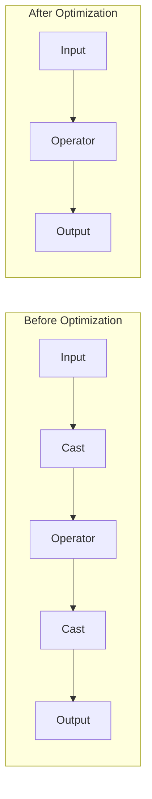
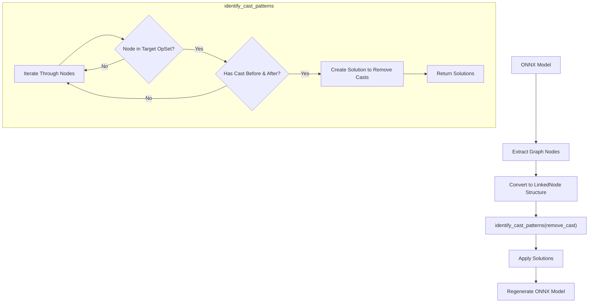
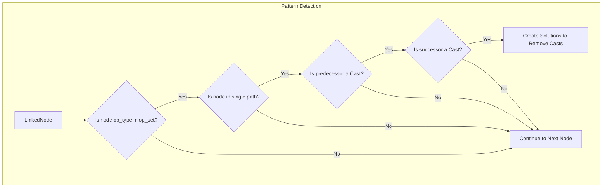
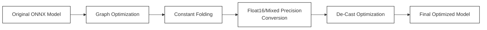

<!-- source: DeepWiki mcp.deepwiki.com · repo microsoft/onnxconverter-common · page 2.3 De-Cast Optimization · fetched 2026-10-26 -->

# De-Cast Optimization

<details>
<summary>Relevant source files</summary>

The following files were used as context for generating this wiki page:

- [onnxconverter_common/case_insensitive_dict.py](onnxconverter_common/case_insensitive_dict.py)
- [onnxconverter_common/decast.py](onnxconverter_common/decast.py)
- [onnxconverter_common/interface.py](onnxconverter_common/interface.py)
- [onnxconverter_common/shape_calculator.py](onnxconverter_common/shape_calculator.py)
- [tests/test_oopb.py](tests/test_oopb.py)

</details>


## Purpose and Scope

This document describes the De-Cast Optimization system in the onnxconverter-common repository. This optimization specifically targets and removes unnecessary Cast operators from ONNX models, particularly those that form patterns where operators are surrounded by redundant Cast nodes. For information about other optimization techniques like constant folding, see [Constant Folding](#2.2), or for general graph optimizations, see [Graph Optimization](#2.1).

Sources: [onnxconverter_common/decast.py:6-68]()

## Overview

The De-Cast optimization identifies and removes unnecessary Cast operators that often appear in pairs around other operators in ONNX models. This typically occurs after other optimization processes like float16 conversion, where Cast operators are inserted to maintain compatibility but might create redundant type conversions in certain parts of the graph.



Sources: [onnxconverter_common/decast.py:10-27]()

## Implementation Details

The De-Cast optimization is implemented in the `decast.py` module, which contains two main functions:

1. `remove_cast()`: Identifies and removes Cast operators surrounding specified operator types
2. `decast()`: Applies the cast removal to a complete ONNX model

### Internal Workflow

The optimization process follows these steps:



Sources: [onnxconverter_common/decast.py:11-27](), [onnxconverter_common/decast.py:30-50]()

### The `remove_cast` Function

This function analyzes the model's graph represented as `LinkedNode` objects. It specifically looks for nodes that:

1. Match the operator types specified in `op_set`
2. Are in a single path (have single input and output)
3. Have a 'Cast' operator directly before and after them

When such a pattern is found, the function creates `Solution` objects that represent the removal of these Cast operations.



Sources: [onnxconverter_common/decast.py:11-27]()

### The `decast` Function

This is the main entry point for applying the optimization to an ONNX model:

1. Takes an ONNX model and a list of operator types as input
2. Extracts the graph nodes from the model
3. Converts them to `LinkedNode` objects for easier manipulation
4. Calls `remove_cast` to identify and remove unnecessary Cast operators
5. Reconstructs the optimized ONNX model
6. Returns the optimized model

Sources: [onnxconverter_common/decast.py:30-50]()

## Usage

The De-Cast optimization can be used programmatically or via the command line:

### Programmatic Usage

```python
from onnxconverter_common.decast import decast
import onnx

# Load ONNX model
model = onnx.load("model.onnx")

# Apply de-cast optimization to specific operators
# For example, remove casts around "Conv" and "MatMul" operators
optimized_model = decast(model, ["Conv", "MatMul"])

# Save the optimized model
onnx.save(optimized_model, "optimized_model.onnx")
```

### Command-Line Usage

The module can also be run as a script:

```bash
python -m onnxconverter_common.decast model_in.onnx model_out.onnx Conv MatMul Relu
```

Where the arguments are:
- `model_in.onnx`: Input ONNX model file
- `model_out.onnx`: Output optimized model file
- Followed by a list of operator types to target for de-cast optimization

Sources: [onnxconverter_common/decast.py:53-68]()

## Integration with Optimization System

De-Cast optimization is part of the broader ONNX Optimization System in the onnxconverter-common framework. It can be particularly useful after Float16 conversion or Mixed Precision optimization, which often introduce Cast operators.



Sources: [onnxconverter_common/decast.py:1-68]()

## Implementation Details

The De-Cast optimization relies on the `LinkedNode` and `Solution` classes from the `optimizer.py` module, which provide the infrastructure for analyzing and transforming the graph structure.

### LinkedNode and Solution

- `LinkedNode`: Represents a node in the ONNX graph with information about its connections to other nodes
- `Solution`: Represents a transformation to be applied to the graph, such as removing a node

The optimization uses the pattern-matching capabilities provided by these classes to identify specific structures in the graph that can be optimized.

Sources: [onnxconverter_common/decast.py:8]()

## Summary

The De-Cast Optimization provides a targeted approach to removing unnecessary Cast operators from ONNX models. This optimization is particularly valuable after type conversion processes like float16 conversion, where redundant Cast operators might be introduced. By eliminating these redundancies, the optimization can improve both model size and inference performance.

---

