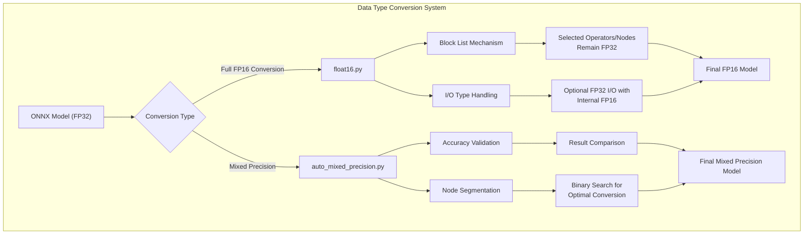
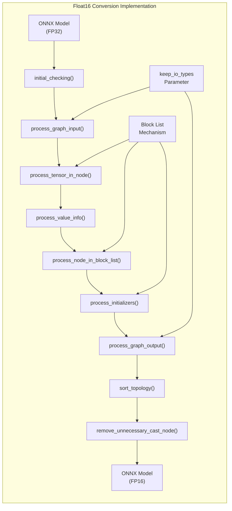
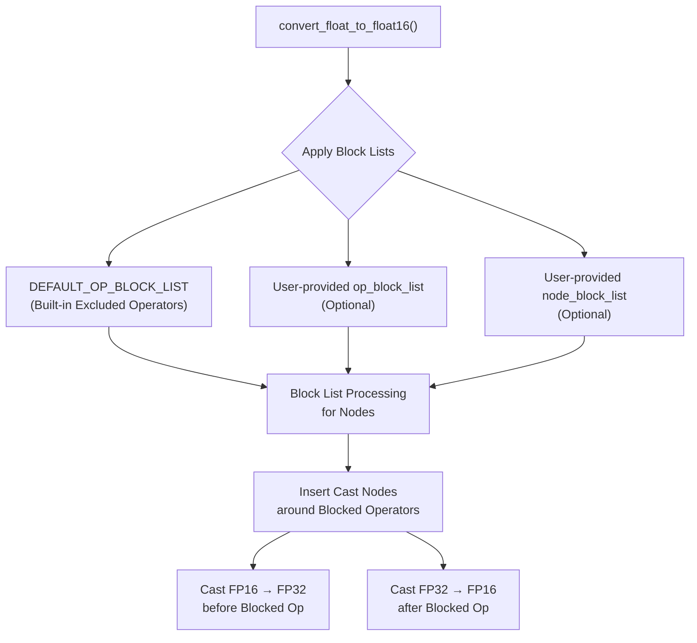
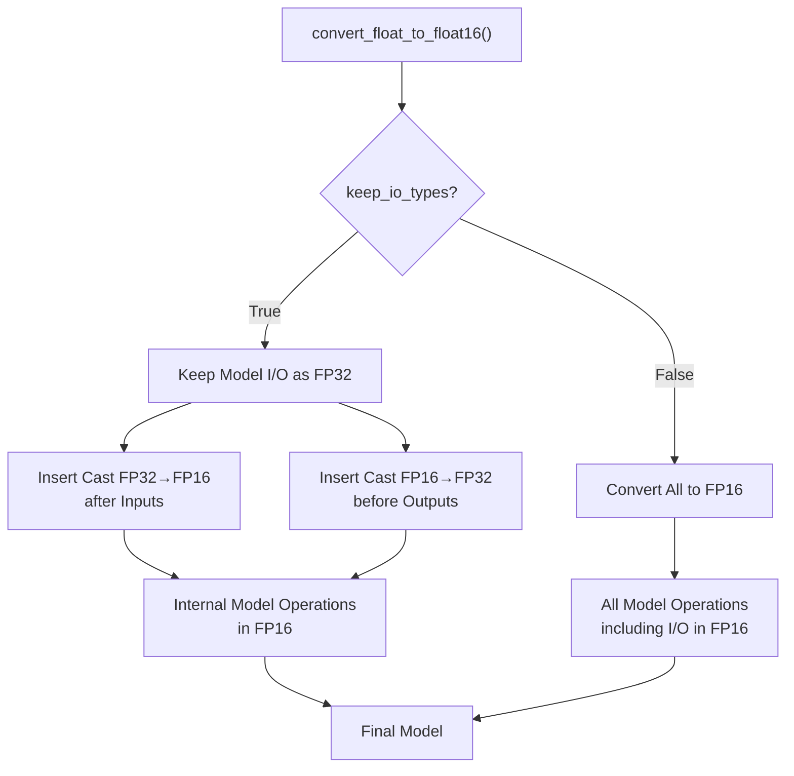
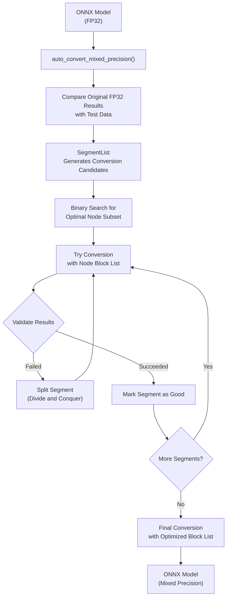
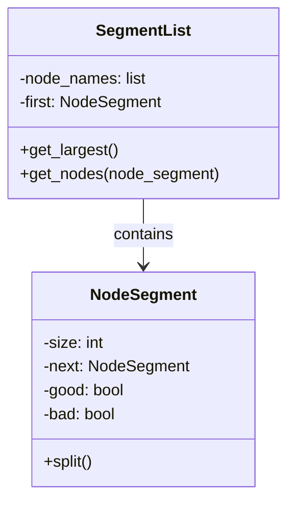

<!-- source: DeepWiki mcp.deepwiki.com · repo microsoft/onnxconverter-common · page 3 Data Type Conversion · fetched 2026-10-26 -->

# Data Type Conversion

<details>
<summary>Relevant source files</summary>

The following files were used as context for generating this wiki page:

- [.gitignore](.gitignore)
- [onnxconverter_common/auto_mixed_precision.py](onnxconverter_common/auto_mixed_precision.py)
- [onnxconverter_common/float16.py](onnxconverter_common/float16.py)
- [tests/test_auto_mixed_precision.py](tests/test_auto_mixed_precision.py)

</details>


## Purpose and Scope

This document details the Data Type Conversion system within the `onnxconverter-common` package. The system provides functionality to convert ONNX models between different numerical precision formats, primarily focusing on conversion from float32 to float16 and automatic mixed precision conversion. For model optimization techniques, see [ONNX Optimization System](#2).

The Data Type Conversion system enables users to reduce model size and improve inference performance while maintaining acceptable accuracy levels. This is particularly important for deployment scenarios with hardware that benefits from float16 operations, such as GPUs and specialized AI accelerators.

## Overview of Data Type Conversion System

The onnxconverter-common package provides two main approaches for data type conversion:

1. **Float16 Conversion**: A complete conversion of all eligible operations and tensors from float32 to float16
2. **Automatic Mixed Precision Conversion**: An intelligent conversion that converts only parts of the model to float16 to maintain accuracy



Sources: [onnxconverter_common/float16.py:135-177](), [onnxconverter_common/auto_mixed_precision.py:36-102]()

## Float16 Conversion System

The Float16 Conversion system provides a direct way to convert an ONNX model from float32 to float16 precision, with options to control which operators are converted and how input/output types are handled.

### Core Components and Data Flow



Sources: [onnxconverter_common/float16.py:135-177]()

### Key Functions and Parameters

The main entry point for float16 conversion is the `convert_float_to_float16` function, which accepts the following parameters:

| Parameter | Type | Description |
|-----------|------|-------------|
| `model` | ModelProto | The ONNX model to convert |
| `min_positive_val` | float | Minimum positive value to represent (default: 1e-7) |
| `max_finite_val` | float | Maximum finite value to represent (default: 1e4) |
| `keep_io_types` | bool | Whether to keep input/output types as float32 (default: False) |
| `disable_shape_infer` | bool | Whether to disable shape inference (default: False) |
| `op_block_list` | list | Operators to exclude from conversion (default: DEFAULT_OP_BLOCK_LIST) |
| `node_block_list` | list | Specific nodes to exclude from conversion (default: None) |
| `check_fp16_ready` | bool | Whether to check if model is already converted (default: True) |

Sources: [onnxconverter_common/float16.py:135-136]()

### Block List Mechanism

The Float16 Conversion system implements a block list mechanism to exclude certain operators or nodes from conversion. This is necessary because some operators may not support float16 inputs or may produce incorrect results when converted.



Sources: [onnxconverter_common/float16.py:108-112](), [onnxconverter_common/float16.py:233-270]()

The default block list includes operators that typically should not be converted to float16:

```
ArrayFeatureExtractor, Binarizer, CastMap, CategoryMapper, DictVectorizer,
FeatureVectorizer, Imputer, LabelEncoder, LinearClassifier, LinearRegressor,
Normalizer, OneHotEncoder, RandomUniformLike, SVMClassifier, SVMRegressor, Scaler,
TreeEnsembleClassifier, TreeEnsembleRegressor, ZipMap, NonMaxSuppression, TopK,
RoiAlign, Resize, Range, CumSum, Min, Max, Upsample
```

Sources: [onnxconverter_common/float16.py:108-112]()

### Input/Output Type Handling

The `keep_io_types` parameter controls how the converter handles the model's input and output types:



Sources: [onnxconverter_common/float16.py:191-230]()

When `keep_io_types=True`, the system:
1. Maintains float32 for input and output tensors
2. Inserts Cast nodes to convert between float32 and float16 at the model boundaries
3. Performs all internal operations in float16 where possible

This allows the model to be used with float32 data while benefiting from float16 performance internally.

### Example Usage

```python
import onnx
from onnxconverter_common import float16

# Load an ONNX model
model = onnx.load("model.onnx")

# Convert to float16, keeping I/O as float32
converted_model = float16.convert_float_to_float16(
    model, 
    keep_io_types=True,
    op_block_list=["Conv", "MatMul"]  # Optional custom block list
)

# Save the converted model
onnx.save(converted_model, "model_fp16.onnx")
```

For larger models, there's also a utility function that handles file paths directly:

```python
from onnxconverter_common import float16

# Convert large model specifying file path
converted_model = float16.convert_float_to_float16_model_path(
    "large_model.onnx",
    keep_io_types=True
)

# Save the converted model
onnx.save(converted_model, "large_model_fp16.onnx")
```

Sources: [onnxconverter_common/float16.py:388-420]()

## Automatic Mixed Precision Conversion

While the Float16 Conversion system provides a comprehensive approach to convert an entire model, the Automatic Mixed Precision system offers a more selective approach that maintains model accuracy by only converting parts of the model that don't significantly impact results.

### Core Components and Data Flow



Sources: [onnxconverter_common/auto_mixed_precision.py:36-102]()

### Validation Mechanism

The mixed precision system uses a validation function to ensure the converted model maintains acceptable accuracy. This can be provided in two ways:

1. A custom validation function that compares original and converted model outputs
2. Relative and absolute tolerance parameters (`rtol` and `atol`) for automatic comparison

The system runs the original and converted models on the provided test data and compares the results according to the validation criteria.

Sources: [onnxconverter_common/auto_mixed_precision.py:36-57]()

### Segmentation Approach

The automatic mixed precision conversion uses a binary search approach to find the optimal set of nodes to convert:

1. It starts by trying to convert all nodes except those in the specified block lists
2. If validation fails, it splits the nodes into segments and tries each segment
3. It recursively divides segments that fail validation until it identifies specific problematic nodes
4. The process results in a block list that excludes only the nodes that significantly impact accuracy

The `SegmentList` and `NodeSegment` classes manage this segmentation process:



Sources: [onnxconverter_common/auto_mixed_precision.py:152-212]()

### Example Usage

```python
import onnx
import numpy as np
from onnxconverter_common import auto_mixed_precision

# Load model and prepare test data
model = onnx.load("model.onnx")
test_data = {'input_name': np.random.rand(1, 3, 224, 224).astype(np.float32)}

# Option 1: Define custom validation function
def validate_results(original_outputs, converted_outputs):
    return np.allclose(original_outputs[0], converted_outputs[0], rtol=0.01, atol=0.001)

# Convert with custom validation
model_mixed = auto_mixed_precision.auto_convert_mixed_precision(
    model, 
    test_data, 
    validate_fn=validate_results,
    keep_io_types=True
)

# Option 2: Use tolerance parameters directly
model_mixed = auto_mixed_precision.auto_convert_mixed_precision(
    model, 
    test_data, 
    rtol=0.01,
    atol=0.001,
    keep_io_types=True
)

# Save the converted model
onnx.save(model_mixed, "model_mixed_precision.onnx")
```

Sources: [onnxconverter_common/auto_mixed_precision.py:11-26](), [tests/test_auto_mixed_precision.py:46-56]()

## Comparison: Float16 vs. Automatic Mixed Precision

| Feature | Float16 Conversion | Automatic Mixed Precision |
|---------|-------------------|---------------------------|
| **Conversion Scope** | All eligible operations | Selective conversion |
| **Accuracy Control** | Manual via block lists | Automatic via validation |
| **Optimization Level** | Maximum size reduction | Balanced accuracy/performance |
| **Complexity** | Simple one-step process | Iterative with testing |
| **Use Case** | When accuracy loss is acceptable | When accuracy is critical |
| **Required Input** | Just the model | Model and test data |

## Best Practices

1. **Start with Mixed Precision**: If accuracy is critical and you have test data available, begin with automatic mixed precision conversion.

2. **Use Block Lists Effectively**: When using float16 conversion, customize the block list based on your model's specific needs.

3. **Consider I/O Requirements**: Use `keep_io_types=True` when the model needs to interface with systems expecting float32 data.

4. **Test After Conversion**: Always validate converted models with real workloads to ensure acceptable accuracy.

5. **Check for Hardware Compatibility**: Ensure your target hardware supports float16 operations efficiently.

## Implementation Details

The onnxconverter-common package implements data type conversion through a series of steps:

1. **Initial Checking**: Performs shape inference and checks if the model is already converted

2. **Graph Processing**: Systematically processes each part of the graph:
   - Input processing
   - Node tensor processing
   - Value info processing
   - Block list node processing
   - Initializer processing
   - Output processing

3. **Cast Node Management**: Inserts and optimizes Cast nodes as needed

4. **Topology Sorting**: Ensures the graph remains properly ordered after changes

5. **Cleanup**: Removes unnecessary Cast nodes to optimize the final model

Sources: [onnxconverter_common/float16.py:135-177]()

---

