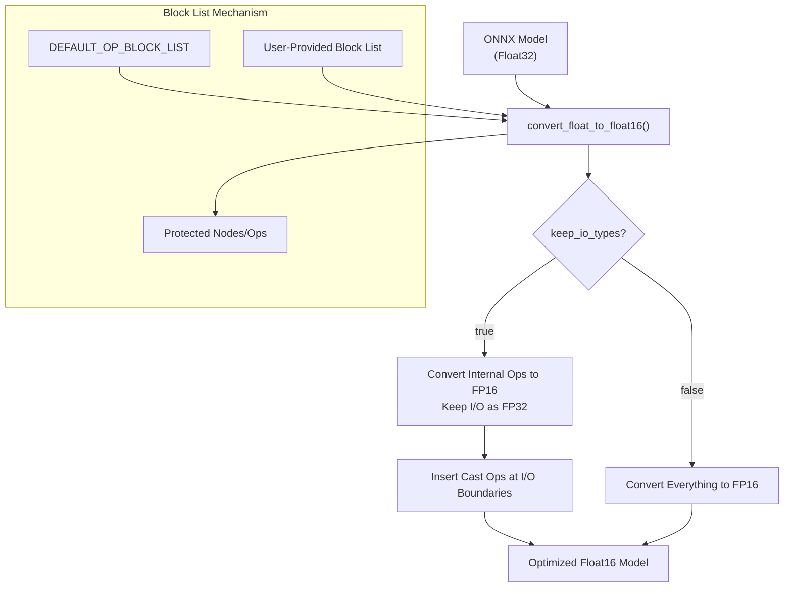
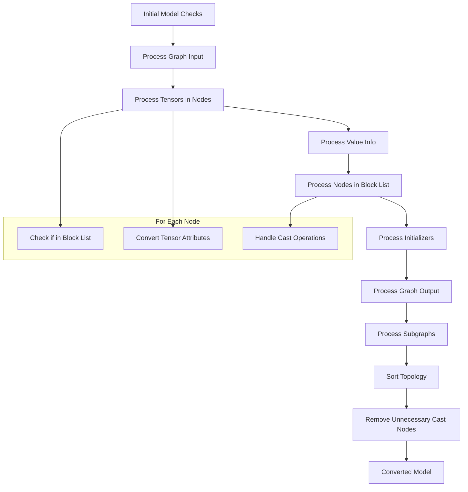
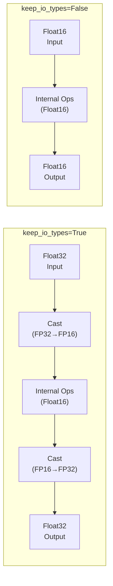

<!-- source: DeepWiki mcp.deepwiki.com · repo microsoft/onnxconverter-common · page 3.1 Float16 Conversion · fetched 2026-10-26 -->

# Float16 Conversion

<details>
<summary>Relevant source files</summary>

The following files were used as context for generating this wiki page:

- [onnxconverter_common/float16.py](onnxconverter_common/float16.py)
- [tests/test_float16.py](tests/test_float16.py)

</details>


## Purpose and Scope

This document describes the Float16 Conversion system in the onnxconverter-common library, which enables converting ONNX models from float32 to float16 precision. This conversion reduces model size and can improve inference performance on hardware that supports half-precision operations, while balancing accuracy requirements.

For information about mixed precision conversion that selectively converts portions of a model, see [Mixed Precision Conversion](#3.2).

## System Overview

The Float16 Conversion system converts float32 tensors, weights, initializers, and nodes in an ONNX model to float16 representation. The system provides flexibility to:

- Convert the entire model including inputs/outputs to float16
- Convert only internal operations while preserving float32 inputs/outputs
- Selectively exclude specific operators from conversion
- Handle nested subgraphs appropriately



Sources: [onnxconverter_common/float16.py:134-176]()

## Main Conversion Functions

The module provides two primary functions for model conversion:

### convert_float_to_float16

This is the core function that performs the actual conversion process on an in-memory ONNX model.

```
convert_float_to_float16(model, min_positive_val=1e-7, max_finite_val=1e4, 
                         keep_io_types=False, disable_shape_infer=False,
                         op_block_list=None, node_block_list=None, check_fp16_ready=True)
```

**Parameters:**
- `model`: The ONNX ModelProto to convert
- `min_positive_val`: Minimum positive value to represent in float16 (smaller values clipped)
- `max_finite_val`: Maximum finite value to represent (larger values clipped)
- `keep_io_types`: Whether to keep inputs/outputs as float32
- `disable_shape_infer`: Whether to disable shape inference during conversion
- `op_block_list`: List of operator types to exclude from conversion
- `node_block_list`: List of specific node names to exclude from conversion
- `check_fp16_ready`: Whether to check if the model is already converted to float16

### convert_float_to_float16_model_path

A convenience function that loads an ONNX model from a file path and converts it:

```
convert_float_to_float16_model_path(model_path, min_positive_val=1e-7, 
                                    max_finite_val=1e4, keep_io_types=False)
```

This function attempts to use `infer_shapes_path` for large models before conversion.

Sources: [onnxconverter_common/float16.py:134-176](), [onnxconverter_common/float16.py:388-420]()

## Conversion Process



Sources: [onnxconverter_common/float16.py:134-176]()

## Block List Mechanism

The system includes a block list mechanism to prevent certain operators from being converted to float16, as they may not support half-precision or may cause accuracy issues when converted.

### Default Block List

The following operators are excluded from conversion by default:

```
ArrayFeatureExtractor, Binarizer, CastMap, CategoryMapper, DictVectorizer,
FeatureVectorizer, Imputer, LabelEncoder, LinearClassifier, LinearRegressor,
Normalizer, OneHotEncoder, RandomUniformLike, SVMClassifier, SVMRegressor, 
Scaler, TreeEnsembleClassifier, TreeEnsembleRegressor, ZipMap, 
NonMaxSuppression, TopK, RoiAlign, Resize, Range, CumSum, Min, Max, Upsample
```

You can override this list by providing your own `op_block_list` parameter.

Sources: [onnxconverter_common/float16.py:108-112]()

## Input/Output Type Handling

One of the key features is the ability to preserve float32 inputs and outputs while converting internal operations to float16. This is controlled by the `keep_io_types` parameter.



When `keep_io_types` is `True`:
1. Graph inputs remain float32
2. Cast nodes are inserted after inputs to convert to float16
3. Internal operations use float16
4. Cast nodes are inserted before outputs to convert back to float32
5. Graph outputs remain float32

When `keep_io_types` is `False`:
1. All inputs, outputs, and internal operations use float16

Sources: [onnxconverter_common/float16.py:191-230]()

## Implementation Details

### Graph Traversal and Processing

The conversion process recursively traverses the main graph and all subgraphs to ensure comprehensive conversion:

1. For each graph (main and subgraphs):
   - Process inputs (add casts if needed)
   - Convert tensor data in node attributes
   - Update value info (tensor type information)
   - Process nodes in block list (add cast nodes around them)
   - Convert initializers
   - Process outputs (add casts if needed)
   - Recursively process any subgraphs

2. After conversion:
   - Sort the graph topology
   - Remove unnecessary cast nodes

Sources: [onnxconverter_common/float16.py:153-176]()

### Value Truncation

During conversion, float32 values outside the representable range of float16 are truncated:

- Values smaller than `min_positive_val` (default: 1e-7) are clipped to `min_positive_val`
- Values larger than `max_finite_val` (default: 1e4) are clipped to `max_finite_val`
- Warning messages are generated when values are truncated

This helps prevent significant accuracy loss while still gaining the benefits of float16 precision.

Sources: [onnxconverter_common/float16.py:29-63]()

## Helper Functions

### convert_tensor_float_to_float16

Converts a single TensorProto from float32 to float16.

### convert_np_to_float16

Converts a NumPy array from float32 to float16 with controlled value truncation.

### sort_topology and remove_unnecessary_cast_node

These functions clean up the graph after conversion:
- `sort_topology` ensures nodes are in the correct topological order
- `remove_unnecessary_cast_node` eliminates redundant cast operations (e.g., float32→float16→float32 sequences)

Sources: [onnxconverter_common/float16.py:66-100](), [onnxconverter_common/float16.py:459-476](), [onnxconverter_common/float16.py:473-575]()

## Usage Examples

### Basic Conversion

```python
import onnx
from onnxconverter_common.float16 import convert_float_to_float16

# Load your model
model = onnx.load("model.onnx")

# Convert to float16, keeping input/output as float32
fp16_model = convert_float_to_float16(model, keep_io_types=True)

# Save the converted model
onnx.save(fp16_model, "model_fp16.onnx")
```

### Custom Block List

```python
import onnx
from onnxconverter_common.float16 import convert_float_to_float16, DEFAULT_OP_BLOCK_LIST

# Load your model
model = onnx.load("model.onnx")

# Create a custom block list
custom_block_list = DEFAULT_OP_BLOCK_LIST + ["Conv", "MatMul"]

# Convert to float16 with custom block list
fp16_model = convert_float_to_float16(model, 
                                      op_block_list=custom_block_list,
                                      keep_io_types=True)

# Save the converted model
onnx.save(fp16_model, "model_fp16.onnx")
```

Sources: [tests/test_float16.py:1-147]()

## Performance and Accuracy Considerations

When converting models to float16:

1. **Precision loss**: Float16 has lower precision than float32, which may affect model accuracy
2. **Range limitations**: Float16 has a smaller representable range (approximately ±65504)
3. **Performance gain**: Float16 operations can be up to 2-4x faster on compatible hardware
4. **Size reduction**: Float16 models are approximately half the size of float32 models

For models with stability issues after conversion, consider:
- Using `keep_io_types=True` to maintain float32 at graph boundaries
- Adding critical operators to the block list
- Using mixed precision conversion (see [Mixed Precision Conversion](#3.2)) for more selective conversion

Sources: [onnxconverter_common/float16.py:29-63]()

---

