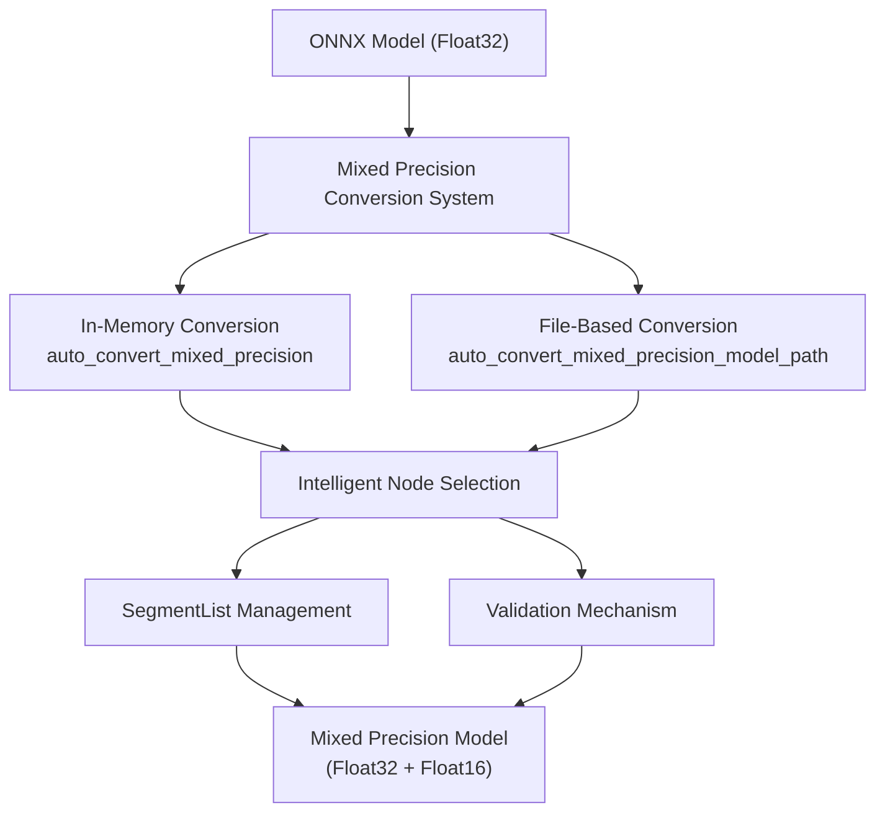
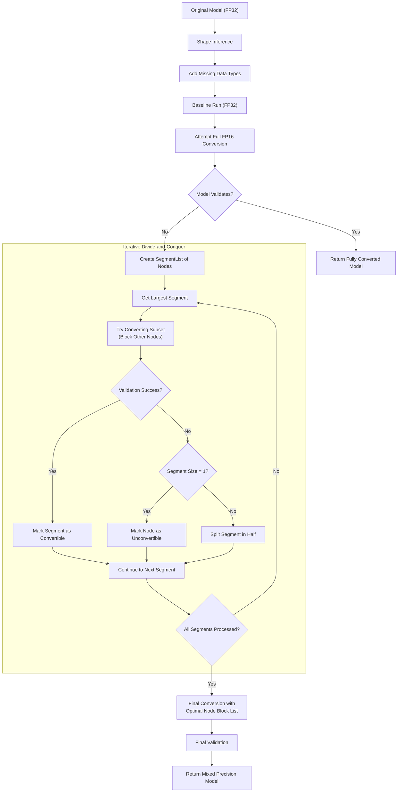
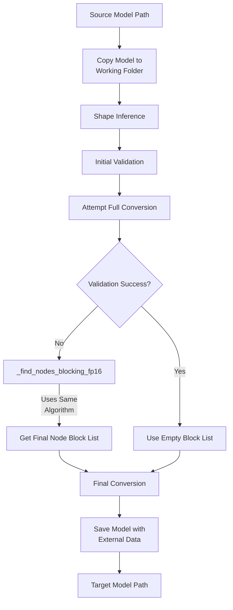
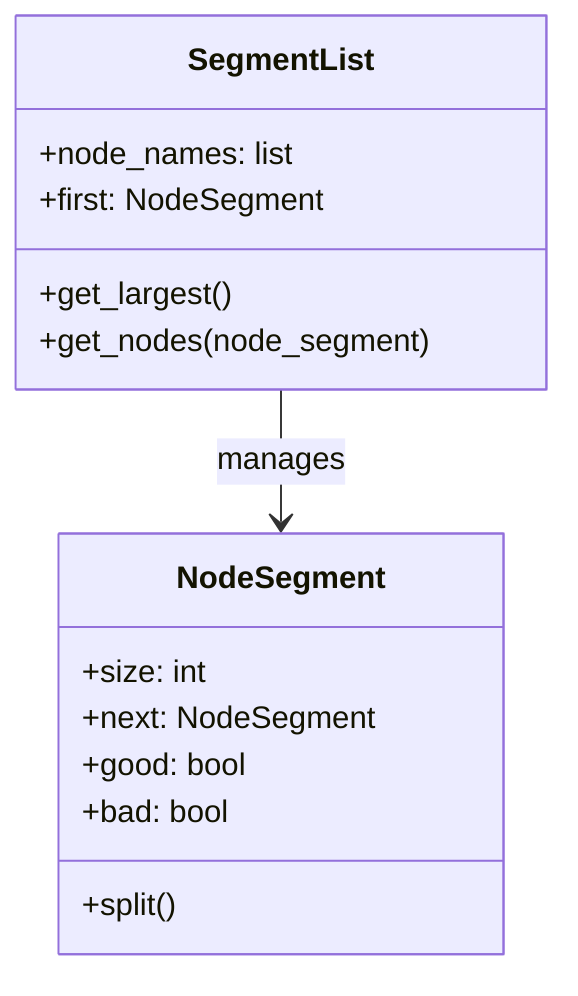

<!-- source: DeepWiki mcp.deepwiki.com · repo microsoft/onnxconverter-common · page 3.2 Mixed Precision Conversion · fetched 2026-10-26 -->

# Mixed Precision Conversion

<details>
<summary>Relevant source files</summary>

The following files were used as context for generating this wiki page:

- [.gitignore](.gitignore)
- [onnxconverter_common/auto_mixed_precision.py](onnxconverter_common/auto_mixed_precision.py)
- [onnxconverter_common/auto_mixed_precision_model_path.py](onnxconverter_common/auto_mixed_precision_model_path.py)
- [tests/test_auto_mixed_precision.py](tests/test_auto_mixed_precision.py)
- [tests/test_auto_mixed_precision_model_path.py](tests/test_auto_mixed_precision_model_path.py)

</details>


## Purpose and Scope

This document describes the mixed precision conversion system in the onnxconverter-common package, which automatically converts ONNX models from 32-bit floating point (float32) precision to a mix of float32 and 16-bit floating point (float16) precision while maintaining model accuracy. For information about pure float16 conversion, see [Float16 Conversion](#3.1).

Sources: [onnxconverter_common/auto_mixed_precision.py:6-27]()

## Overview

Mixed precision conversion optimizes neural network performance by selectively converting appropriate operations from float32 to float16 precision. This improves execution speed and reduces memory footprint while maintaining model accuracy by preserving critical operations in higher precision.

The onnxconverter-common package provides two implementations:
1. In-memory conversion (`auto_convert_mixed_precision`)
2. File-based conversion for large models (`auto_convert_mixed_precision_model_path`)

Both implementations use an intelligent approach to determine which operations are safe to convert to lower precision.

**Mixed Precision Conversion System Architecture**



Sources: [onnxconverter_common/auto_mixed_precision.py:36-102](), [onnxconverter_common/auto_mixed_precision_model_path.py:23-134]()

## Conversion Process

The mixed precision conversion system employs an adaptive algorithm that:
1. Starts with a baseline model
2. Attempts to convert all operations to float16
3. Uses an iterative divide-and-conquer approach to identify which operations must remain in float32 to maintain accuracy

**Mixed Precision Conversion Process Flow**



Sources: [onnxconverter_common/auto_mixed_precision.py:36-102](), [onnxconverter_common/auto_mixed_precision.py:152-212]()

## In-Memory Conversion API

The `auto_convert_mixed_precision` function is the primary API for in-memory conversion:

```python
auto_convert_mixed_precision(model, feed_dict, validate_fn=None, rtol=None, atol=None, keep_io_types=False)
```

Parameters:
- `model`: The input ONNX model (ModelProto)
- `feed_dict`: Dictionary mapping input names to numpy arrays for testing
- `validate_fn`: Custom validation function comparing original outputs to converted outputs
- `rtol`/`atol`: Relative and absolute tolerance for numerical validation
- `keep_io_types`: Whether to keep input/output tensors as float32 (adds necessary Cast operations)

Sources: [onnxconverter_common/auto_mixed_precision.py:36-102]()

### Example Usage

```python
from onnxconverter_common import auto_mixed_precision
import onnx
import numpy as np

# Load model
model = onnx.load("model.onnx")

# Prepare test data
test_data = {"input_name": np.random.rand(1, 3, 224, 224).astype(np.float32)}

# Define validation function (optional)
def validate(original_outputs, converted_outputs):
    for orig, conv in zip(original_outputs, converted_outputs):
        if not np.allclose(orig, conv, rtol=0.01, atol=0.001):
            return False
    return True

# Convert model to mixed precision
model_mixed = auto_convert_mixed_precision(
    model, 
    test_data, 
    validate_fn=validate, 
    keep_io_types=True
)

# Save the converted model
onnx.save(model_mixed, "model_mixed_precision.onnx")
```

Sources: [onnxconverter_common/auto_mixed_precision.py:10-27](), [tests/test_auto_mixed_precision.py:25-70]()

## File-Based Conversion for Large Models

For models larger than 2GB, the library provides `auto_convert_mixed_precision_model_path` which operates on model files rather than in-memory objects:

```python
auto_convert_mixed_precision_model_path(
    source_model_path, input_feed, target_model_path, provider, 
    location=None, customized_validate_func=None, rtol=None, atol=None,
    keep_io_types=True, verbose=False
)
```

Additional parameters:
- `source_model_path`: Path to the original FP32 model file
- `target_model_path`: Path where the converted model will be saved
- `provider`: ONNX Runtime execution provider (e.g., `['CPUExecutionProvider']`)
- `location`: Name for external data files
- `verbose`: Whether to print detailed progress information

**File-Based Conversion Process Flow**



Sources: [onnxconverter_common/auto_mixed_precision_model_path.py:23-134](), [onnxconverter_common/auto_mixed_precision_model_path.py:184-212]()

### Example Usage

```python
from onnxconverter_common import auto_mixed_precision_model_path
import numpy as np

# Prepare test data
input_x = np.random.rand(1, 3, 224, 224).astype(np.float32)
input_feed = {'model_input': input_x}

# Convert model to mixed precision
auto_convert_mixed_precision_model_path(
    source_model_path="model_fp32.onnx",
    input_feed=input_feed,
    target_model_path="model_mixed.onnx",
    provider=['CPUExecutionProvider'],
    rtol=0.01,
    atol=0.001,
    keep_io_types=True,
    verbose=True
)
```

Sources: [onnxconverter_common/auto_mixed_precision_model_path.py:6-65](), [tests/test_auto_mixed_precision_model_path.py:25-67]()

## Validation Mechanisms

The system provides two approaches to validate converted models:

1. **Custom Validation Function**: A user-provided function that compares original and converted outputs and returns True if they match acceptably.

2. **Numerical Tolerance**: Using relative tolerance (`rtol`) and absolute tolerance (`atol`) parameters for automatic numerical validation with `np.allclose()`.

Both mechanisms ensure the converted model maintains sufficient accuracy compared to the original model.

Sources: [onnxconverter_common/auto_mixed_precision.py:40-57](), [onnxconverter_common/auto_mixed_precision_model_path.py:145-158]()

## Core Components

### SegmentList and NodeSegment

The conversion uses a divide-and-conquer approach implemented through the `SegmentList` and `NodeSegment` classes:

- `NodeSegment`: Represents a group of nodes that are tried together for conversion
- `SegmentList`: Manages a linked list of segments and guides the search process

**SegmentList and NodeSegment Structure**



The conversion starts with one large segment containing all nodes and progressively splits segments that fail validation, marking segments as either:
- `good`: Can be converted to FP16
- `bad`: Must remain FP32

Sources: [onnxconverter_common/auto_mixed_precision.py:152-212]()

### Conversion Helper Functions

The system relies on several helper functions:

1. `add_missing_dtypes_using_ort()`: Infers and adds missing data types to intermediate tensors
2. `get_tensor_values_using_ort()`: Runs the model with ONNX Runtime to get output values
3. `_convert_and_check_inference_result()`: Performs test conversion and validation 
4. `_find_nodes_blocking_fp16()`: Implements the iterative algorithm in the file-based version

Sources: [onnxconverter_common/auto_mixed_precision.py:105-149](), [onnxconverter_common/auto_mixed_precision_model_path.py:184-244]()

## Integration with Float16 Conversion

The mixed precision system uses the Float16 conversion module to perform the actual conversions, but with a carefully selected block list to preserve critical operations in FP32:

```python
model = float16.convert_float_to_float16(
    copy.deepcopy(model0), 
    node_block_list=node_block_list,
    keep_io_types=keep_io_types, 
    disable_shape_infer=False
)
```

Sources: [onnxconverter_common/auto_mixed_precision.py:69-71](), [onnxconverter_common/auto_mixed_precision_model_path.py:229-231]()

## Performance and Accuracy Considerations

When using the mixed precision conversion system, consider:

1. **Validation Strategy**: Choose between custom validation and numerical tolerances based on model requirements
2. **Keep I/O Types**: Set to True if downstream applications expect FP32 inputs/outputs
3. **Test Data**: Use representative test data that exercises critical paths in the model
4. **Providers**: Select the appropriate execution provider matching your target deployment environment

The system balances performance improvements with accuracy preservation by selectively applying lower precision where it doesn't impact results.

Sources: [onnxconverter_common/auto_mixed_precision.py:36-102](), [onnxconverter_common/auto_mixed_precision_model_path.py:23-134]()

---

