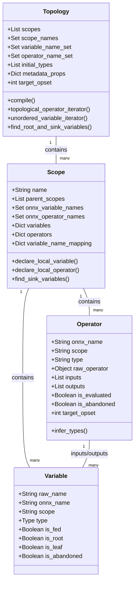
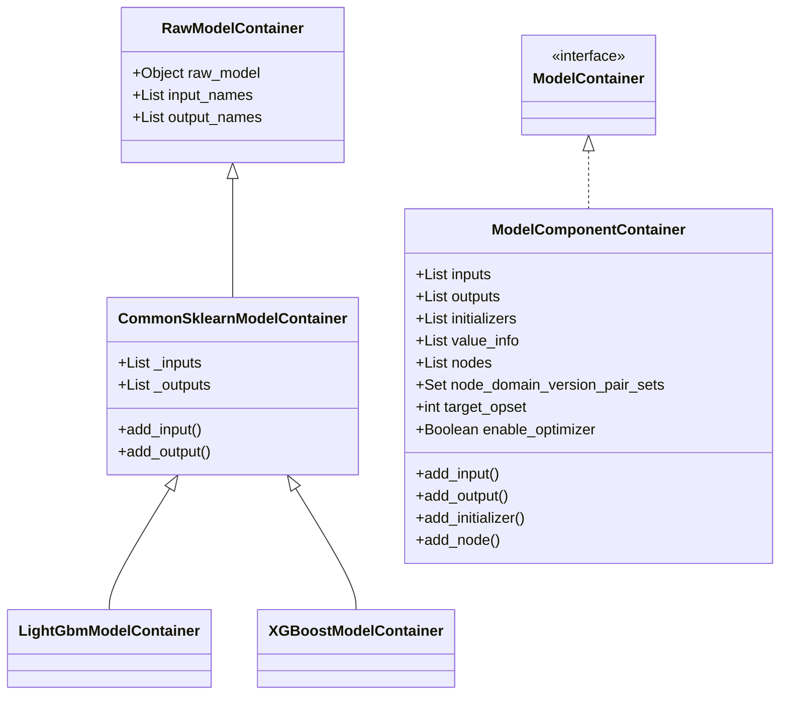
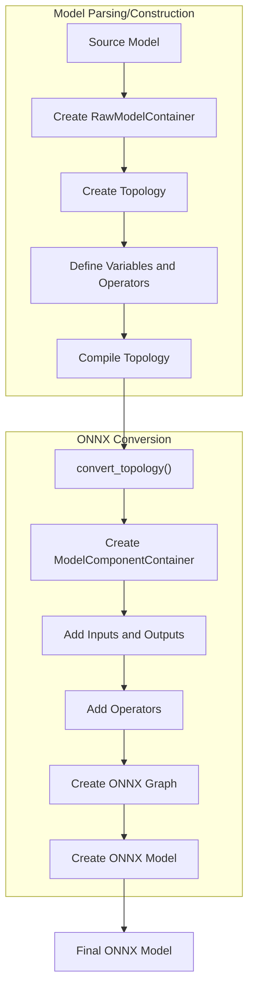
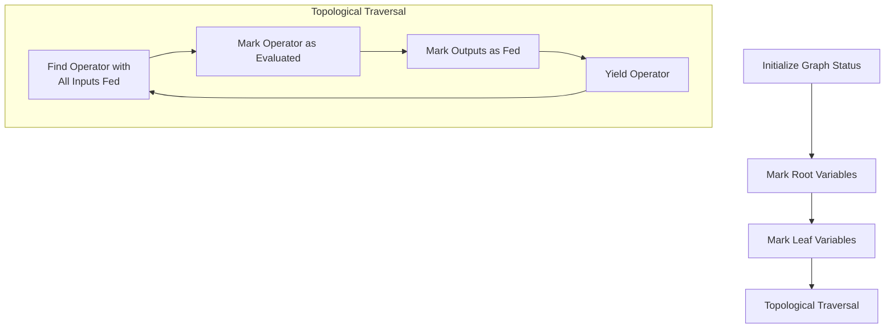
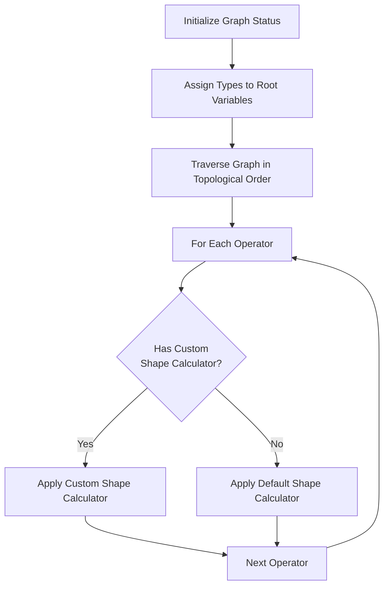

<!-- source: DeepWiki mcp.deepwiki.com · repo microsoft/onnxconverter-common · page 4 Model Representation · fetched 2026-10-26 -->

# Model Representation

Relevant source files

The following files were used as context for generating this wiki page:

- [onnxconverter_common/container.py](onnxconverter_common/container.py)
- [onnxconverter_common/metadata_props.py](onnxconverter_common/metadata_props.py)
- [onnxconverter_common/topology.py](onnxconverter_common/topology.py)
- [onnxconverter_common/tree_ensemble.py](onnxconverter_common/tree_ensemble.py)

This page provides an overview of the core systems used to represent and manipulate ONNX model graphs in the onnxconverter-common library. The model representation components facilitate the conversion of models between different formats, providing intermediate abstractions that make it easier to transform computational graphs.

For detailed information about specific parts of the model representation system, see the following pages:
- [Topology System](#4.1)
- [ONNX Operations](#4.2)
- [Container System](#4.3)
- [Data Types](#4.4)

## Core Components

The model representation system in onnxconverter-common consists of several key components that work together to represent computational graphs. These include:

**Model Representation Class Hierarchy**

Sources: [onnxconverter_common/topology.py:20-53](), [onnxconverter_common/topology.py:55-109](), [onnxconverter_common/topology.py:110-238](), [onnxconverter_common/topology.py:241-679]()

### Variable

The `Variable` class represents a variable (tensor or scalar) in the computational graph. Variables serve as inputs and outputs for operators.

Key attributes:
- `raw_name`: The original name of the variable in the source model
- `onnx_name`: The name assigned to the variable in the ONNX model
- `scope`: The scope where the variable is declared
- `type`: The data type of the variable (defined in `data_types.py`)
- Various flags (`is_fed`, `is_root`, `is_leaf`, `is_abandoned`) used during graph processing

Sources: [onnxconverter_common/topology.py:20-53]()

### Operator

The `Operator` class represents an operation in the computational graph, such as convolution, pooling, or normalization.

Key attributes:
- `onnx_name`: Unique identifier for the operator
- `scope`: The scope where the operator is declared
- `type`: The type of the operator (e.g., "Conv", "Pooling")
- `raw_operator`: Reference to the original operator from the source model
- `inputs`: List of input variables
- `outputs`: List of output variables
- `target_opset`: The target ONNX opset number for the converted model

Sources: [onnxconverter_common/topology.py:55-109]()

### Scope

The `Scope` class manages variables and operators within a specific namespace. It helps avoid naming conflicts and organizes components of the graph.

Key attributes:
- `name`: Unique identifier for the scope
- `parent_scopes`: List of parent scopes
- `variables`: Dictionary of variables defined in this scope
- `operators`: Dictionary of operators defined in this scope
- `variable_name_mapping`: Maps raw variable names to ONNX variable names

Key methods:
- `declare_local_variable()`: Creates a new variable in this scope
- `declare_local_operator()`: Creates a new operator in this scope
- `find_sink_variables()`: Finds output variables with no consumers

Sources: [onnxconverter_common/topology.py:110-238]()

### Topology

The `Topology` class represents the entire computational graph. It contains all the scopes, manages the compilation process, and provides methods for traversing the graph.

Key attributes:
- `scopes`: List of all scopes in the topology
- `raw_model`: The original model being converted
- `target_opset`: The target ONNX opset number

Key methods:
- `compile()`: Prepares the topology for conversion by applying various transformations
- `topological_operator_iterator()`: Iterates through operators in topological order
- `unordered_variable_iterator()`: Iterates through all variables
- `find_root_and_sink_variables()`: Identifies input and output variables of the graph

Sources: [onnxconverter_common/topology.py:241-679]()

## Model Containers

The model representation system includes containers that manage components during the conversion process:

**Container Class Hierarchy**

Sources: [onnxconverter_common/container.py:10-74](), [onnxconverter_common/container.py:76-176]()

### RawModelContainer

The `RawModelContainer` is an abstract class that provides a unified interface to work with models from different frameworks. It encapsulates the original model and provides access to input and output names.

Sources: [onnxconverter_common/container.py:10-39]()

### ModelComponentContainer

The `ModelComponentContainer` collects all the components needed to build an ONNX model:

- `inputs`: ONNX graph inputs (ValueInfoProto objects)
- `outputs`: ONNX graph outputs (ValueInfoProto objects)
- `initializers`: ONNX tensor initializers (TensorProto objects)
- `value_info`: Intermediate variables (ValueInfoProto objects)
- `nodes`: ONNX computation nodes (NodeProto objects)

Key methods:
- `add_input()`: Adds a variable to the input list
- `add_output()`: Adds a variable to the output list
- `add_initializer()`: Adds a tensor initializer
- `add_node()`: Adds a computation node

Sources: [onnxconverter_common/container.py:76-176]()

## Conversion Flow

The conversion process from the internal representation to an ONNX model follows these steps:

**Conversion Process Flow**

Sources: [onnxconverter_common/topology.py:670-679](), [onnxconverter_common/topology.py:682-815]()

The key steps in the conversion process are:

1. **Topology Compilation**: The `compile()` method in the `Topology` class performs several important transformations:
   - Prunes unused operators and variables
   - Resolves duplicate variables connected by identity operators
   - Fixes shapes for specific operators
   - Infers types for all variables in the graph
   - Checks the structure of the graph for isolated variables or operators

2. **Topology to ONNX Conversion**: The `convert_topology()` function performs the actual conversion:
   - Creates a `ModelComponentContainer` to collect ONNX components
   - Adds inputs and outputs from the topology to the container
   - Iterates through the operators in topological order, converting each one to ONNX format
   - Creates an ONNX graph from the collected components
   - Creates an ONNX model from the graph and additional metadata

Sources: [onnxconverter_common/topology.py:670-679](), [onnxconverter_common/topology.py:682-815]()

## Graph Traversal and Processing

The model representation system provides mechanisms for traversing and processing the graph:

**Graph Traversal Process**

Sources: [onnxconverter_common/topology.py:341-417](), [onnxconverter_common/topology.py:494-525]()

The `topological_operator_iterator()` method in the `Topology` class enables traversal of the operators in topological order (i.e., an operator is only visited after all its input variables are available). This is essential for operations like type inference and conversion to ONNX.

The graph traversal process:
1. Initializes the status of all variables and operators
2. Identifies root variables (inputs with no producers) and marks them as "fed"
3. Iteratively processes operators whose inputs are all "fed"
4. Marks the outputs of processed operators as "fed"
5. Continues until all operators are processed or no further progress can be made

Sources: [onnxconverter_common/topology.py:341-417](), [onnxconverter_common/topology.py:494-525]()

## Type Inference

The model representation system includes a type inference mechanism to determine the shapes and data types of all variables in the graph:

**Type Inference Process**

Sources: [onnxconverter_common/topology.py:526-554]()

The `_infer_all_types()` method in the `Topology` class performs type inference:
1. Initializes the status of all variables and operators
2. Assigns types to root variables based on user-specified initial types
3. Traverses the graph in topological order
4. For each operator, applies either:
   - A custom shape calculator for the operator type
   - The default shape calculator for the operator type

Type inference is a critical step in the conversion process, ensuring that all variables have properly defined shapes and data types before generating the ONNX model.

Sources: [onnxconverter_common/topology.py:526-554]()

## Metadata Handling

The model representation system supports adding metadata to the ONNX model:

1. **Metadata Properties**: Key-value pairs that provide additional information about the model.
2. **Denotations**: Type and dimension information that specifies the semantic meaning of tensors (e.g., IMAGE, AUDIO).

The `metadata_props` attribute in the `Topology` class stores metadata properties, which are added to the ONNX model during conversion.

Sources: [onnxconverter_common/metadata_props.py:1-94](), [onnxconverter_common/topology.py:246-268]()

## Summary

The model representation system in onnxconverter-common provides a rich set of abstractions for working with computational graphs:

- `Variable`, `Operator`, `Scope`, and `Topology` classes form the core of the representation.
- Containers like `RawModelContainer` and `ModelComponentContainer` manage model components during conversion.
- The system supports various graph operations including compilation, traversal, type inference, and metadata handling.

This system enables the conversion of models from different frameworks to ONNX, providing a flexible and extensible framework for model transformation.

Sources: [onnxconverter_common/topology.py:1-815](), [onnxconverter_common/container.py:1-176]()

---

