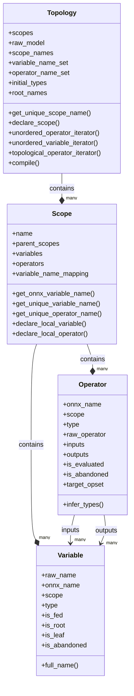
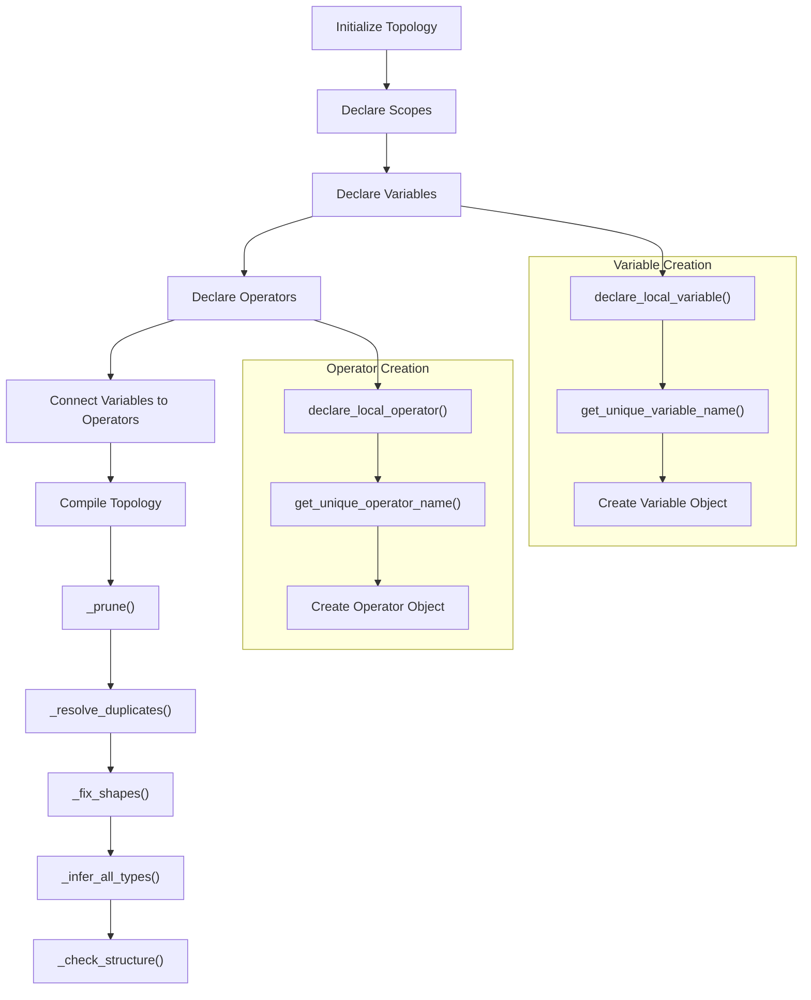
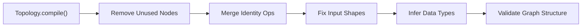
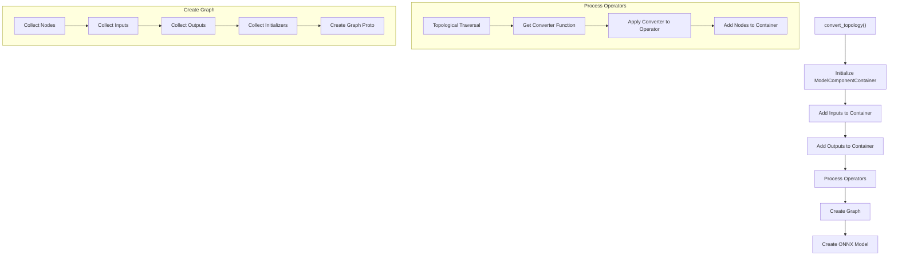
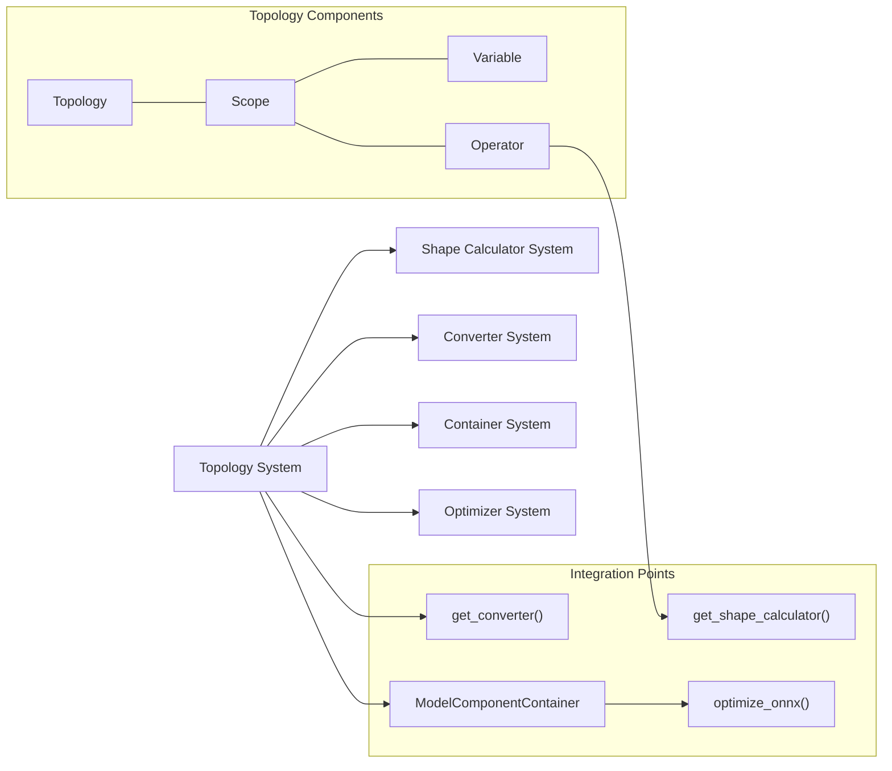

<!-- source: DeepWiki mcp.deepwiki.com · repo microsoft/onnxconverter-common · page 4.1 Topology System · fetched 2026-10-26 -->

# Topology System

Relevant source files

The following files were used as context for generating this wiki page:

- [onnxconverter_common/topology.py](onnxconverter_common/topology.py)

## Purpose and Scope

The Topology System provides the core representation of computational graphs in the onnxconverter-common library. It serves as a bridge between various model formats and ONNX by defining a flexible intermediate representation that can capture the structure and properties of a neural network model. This system enables the conversion, manipulation, and optimization of computational graphs before final ONNX serialization.

This document covers the internal structure of the Topology system, its core classes, and how they interact to represent and transform computational graphs. For information about the Container System which works alongside Topology, see [Container System](#4.3). For details about applying ONNX operations within this system, see [ONNX Operations](#4.2).

Sources: [onnxconverter_common/topology.py:241-680]()

## Core Classes

The Topology system consists of four primary classes that work together to represent computational graphs:

Sources: [onnxconverter_common/topology.py:20-109](), [onnxconverter_common/topology.py:110-239](), [onnxconverter_common/topology.py:241-303]()

### Topology Class

The `Topology` class represents the complete computational graph and provides methods to construct, traverse, and manipulate the graph. It serves as the main container for all `Scope`, `Variable`, and `Operator` instances.

Key attributes:
- `scopes`: List of `Scope` objects in the graph
- `raw_model`: The original model being converted
- `initial_types`: Types of root variables (inputs)
- `target_opset`: The target ONNX opset version

Key methods:
- `declare_scope()`: Create a new scope
- `compile()`: Prepare the topology for conversion to ONNX
- `topological_operator_iterator()`: Traverse operators in topological order

Sources: [onnxconverter_common/topology.py:241-303](), [onnxconverter_common/topology.py:670-680]()

### Scope Class

A `Scope` represents a namespace for variables and operators. It manages the naming and organization of variables and operators within a specific context.

Key attributes:
- `name`: Unique identifier for the scope
- `variables`: Dictionary of variables in this scope
- `operators`: Dictionary of operators in this scope
- `variable_name_mapping`: Maps raw names to ONNX names

Key methods:
- `declare_local_variable()`: Create a new variable in this scope
- `declare_local_operator()`: Create a new operator in this scope
- `get_unique_variable_name()`: Generate a unique ONNX variable name
- `get_unique_operator_name()`: Generate a unique ONNX operator name

Sources: [onnxconverter_common/topology.py:110-239]()

### Variable Class

The `Variable` class represents a data entity in the computational graph. It can be an input, output, or intermediate value.

Key attributes:
- `raw_name`: Original name from the source model
- `onnx_name`: Unique name in the ONNX model
- `scope`: The scope where this variable is declared
- `type`: Data type information (shape, element type)
- `is_root`: Flag indicating if it's an input variable
- `is_leaf`: Flag indicating if it's an output variable

Sources: [onnxconverter_common/topology.py:20-53]()

### Operator Class

The `Operator` class represents a computation node in the graph. It takes input variables and produces output variables.

Key attributes:
- `type`: Type of operation (e.g., "convolution", "pooling")
- `inputs`: List of input variables
- `outputs`: List of output variables
- `raw_operator`: The original operator from the source model
- `target_opset`: Target ONNX opset version

Key methods:
- `infer_types()`: Infer output types based on input types

Sources: [onnxconverter_common/topology.py:55-108]()

## Graph Construction and Traversal

### Graph Construction

The Topology system constructs a computational graph through a series of steps:

Sources: [onnxconverter_common/topology.py:670-680](), [onnxconverter_common/topology.py:138-151](), [onnxconverter_common/topology.py:171-218]()

### Graph Traversal

The Topology system provides two main ways to traverse the graph:

1. **Unordered Traversal**: Simple iteration over all operators or variables.
   - `unordered_operator_iterator()`
   - `unordered_variable_iterator()`

2. **Topological Traversal**: Traversing operators ensuring all inputs are processed before the operator itself.
   - `topological_operator_iterator()`

The topological traversal is crucial for operations like type inference and conversion to ONNX, where operators need to be processed in dependency order.

Sources: [onnxconverter_common/topology.py:314-324](), [onnxconverter_common/topology.py:341-417]()

## Graph Optimization and Validation

### Topology Compilation Process

The `compile()` method prepares the topology for conversion to ONNX by performing several optimization and validation steps:

Sources: [onnxconverter_common/topology.py:670-680]()

### Pruning

The `_prune()` method removes unused operators and variables from the graph by performing a dummy evaluation and marking reachable nodes.

Sources: [onnxconverter_common/topology.py:647-668]()

### Resolving Duplicates

The `_resolve_duplicates()` method identifies and merges variables connected by identity operators to reduce redundancy.

Sources: [onnxconverter_common/topology.py:555-623]()

### Shape Fixing

The `_fix_shapes()` method applies rules to adjust input shapes, particularly for certain operators that require specific dimensionality.

Sources: [onnxconverter_common/topology.py:625-645]()

### Type Inference

The `_infer_all_types()` method propagates type information through the graph by traversing operators in topological order and applying type inference rules.

Sources: [onnxconverter_common/topology.py:526-554]()

### Structure Validation

The `_check_structure()` method validates the graph structure by ensuring there are no isolated variables or operators.

Sources: [onnxconverter_common/topology.py:463-492]()

## Conversion to ONNX

The `convert_topology()` function transforms a `Topology` instance into an ONNX ModelProto object ready for serialization:

Sources: [onnxconverter_common/topology.py:682-815]()

## Variable Name Management

The Topology system maintains a careful tracking of variable names through the conversion process:

| Name Type | Purpose | Management |
|-----------|---------|------------|
| `raw_name` | Original name from source model | Used as reference and for lookups |
| `onnx_name` | Unique name in ONNX model | Generated to ensure uniqueness across model |
| `full_name` | Globally unique variable ID | Used for tracking variables across scopes |

The `variable_name_mapping` in `Scope` maintains a mapping from `raw_name` to multiple `onnx_name` values, allowing tracking of name evolution through the conversion process.

Sources: [onnxconverter_common/topology.py:20-53](), [onnxconverter_common/topology.py:138-151](), [onnxconverter_common/topology.py:277-303]()

## Integration with Other Systems

The Topology system integrates with other components of the onnxconverter-common library:

Sources: [onnxconverter_common/topology.py:12-17](), [onnxconverter_common/topology.py:107-107](), [onnxconverter_common/topology.py:709-776](), [onnxconverter_common/topology.py:795-798]()

## Summary

The Topology System provides a flexible intermediate representation for computational graphs that facilitates the conversion of various model formats to ONNX. Through its core classes (`Topology`, `Scope`, `Variable`, and `Operator`), it captures the structure and properties of neural networks and provides mechanisms for graph traversal, optimization, and validation before final conversion to ONNX format.

---

