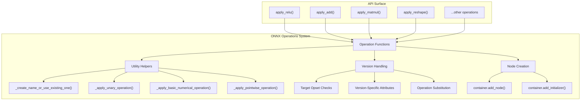
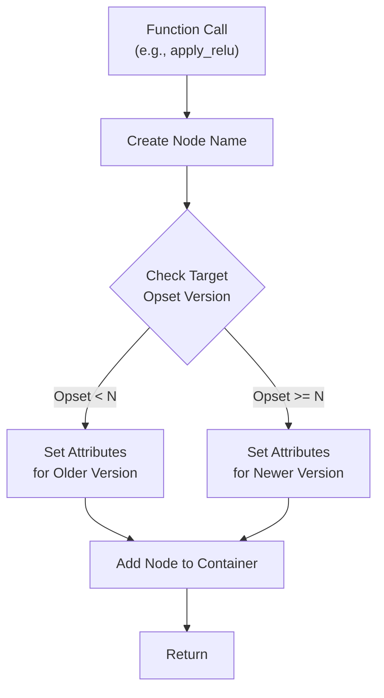
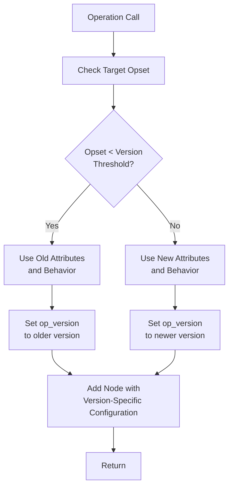
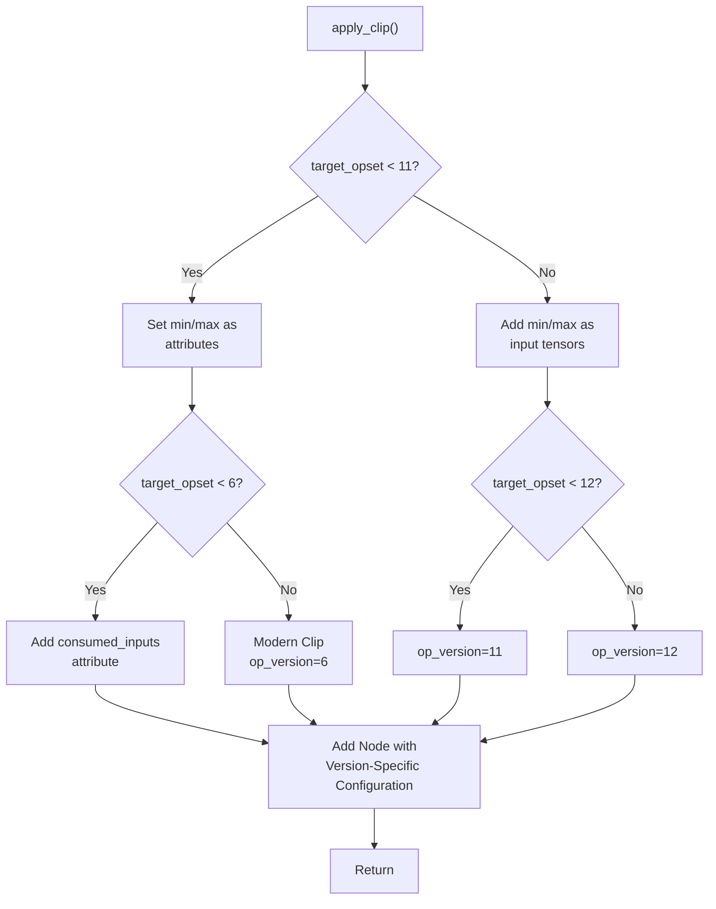
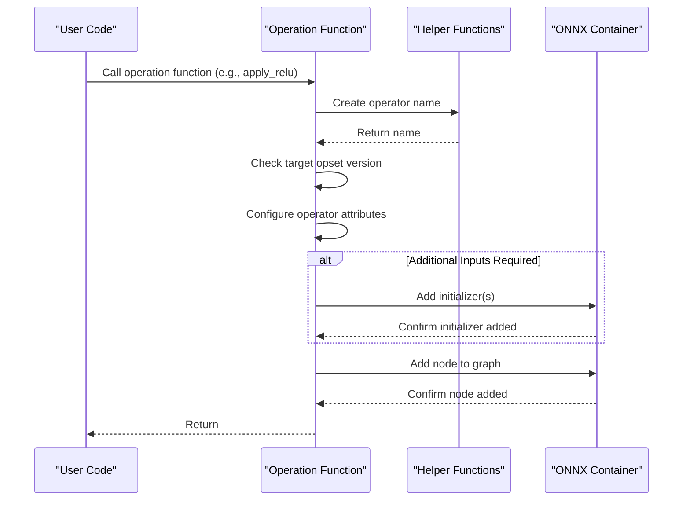

<!-- source: DeepWiki mcp.deepwiki.com · repo microsoft/onnxconverter-common · page 4.2 ONNX Operations · fetched 2026-10-26 -->

# ONNX Operations

<details>
<summary>Relevant source files</summary>

The following files were used as context for generating this wiki page:

- [onnxconverter_common/onnx_ops.py](onnxconverter_common/onnx_ops.py)

</details>


The ONNX Operations system provides a comprehensive collection of high-level APIs for applying ONNX operators in model conversion processes. These functions produce ONNX operators according to the ONNX version specified in the `container` argument, handling compatibility across different opset versions and standardizing the operator application interface.

For information about the container system that manages these operations, see [Container System](#4.3). For details on the topology structure that organizes the operations, see [Topology System](#4.1).

## Purpose and Scope

The ONNX Operations module (`onnx_ops.py`) serves the following purposes:

1. Provides a consistent API for applying ONNX operations during model conversion
2. Abstracts away version differences between ONNX opsets
3. Simplifies the process of adding operators with proper attributes and configurations
4. Manages operator names and versioning automatically

These operations are designed to be used within a conversion process where a model's computational graph is being constructed or transformed.

Sources: [onnxconverter_common/onnx_ops.py:5-8]()

## Architecture Overview

The ONNX Operations system follows a functional approach where each operation is implemented as a Python function. These functions handle the details of creating a properly configured node in the ONNX graph.

### ONNX Operations Architecture



Sources: [onnxconverter_common/onnx_ops.py:15-56]()

## Operation Function Structure

All operation functions follow a common pattern:

1. Create or use a provided name for the operator
2. Determine the correct opset version and attributes based on the container's target opset
3. Add the node to the container with appropriate inputs, outputs, and attributes



Sources: [onnxconverter_common/onnx_ops.py:22-32](), [onnxconverter_common/onnx_ops.py:35-56]()

## Operation Categories

The ONNX Operations module provides functions for the following categories of operations:

### Common Function Parameters

All operation functions share these common parameters:

| Parameter | Description |
|-----------|-------------|
| `scope` | The name scope for creating unique variable names |
| `container` | The container to which the ONNX node will be added |
| `operator_name` | Optional name for the operator (generated if not provided) |
| `input_name(s)` | Name(s) of input variable(s) |
| `output_name(s)` | Name(s) of output variable(s) |

Additional parameters are specific to each operation.

Sources: [onnxconverter_common/onnx_ops.py:77-82](), [onnxconverter_common/onnx_ops.py:81-83]()

### Unary Operations

These operations take a single input tensor and produce a single output tensor.

| Operation | Function | Description |
|-----------|----------|-------------|
| Abs | `apply_abs()` | Absolute value |
| Exp | `apply_exp()` | Exponential function |
| Floor | `apply_floor()` | Floor function |
| Identity | `apply_identity()` | Identity function |
| Log | `apply_log()` | Natural logarithm |
| Neg | `apply_neg()` | Negation |
| Relu | `apply_relu()` | Rectified Linear Unit |
| Sigmoid | `apply_sigmoid()` | Sigmoid function |
| Sqrt | `apply_sqrt()` | Square root |
| Tanh | `apply_tanh()` | Hyperbolic tangent |

Sources: [onnxconverter_common/onnx_ops.py:77-78](), [onnxconverter_common/onnx_ops.py:802-804](), [onnxconverter_common/onnx_ops.py:885-886]()

### Binary and Numerical Operations

These operations typically take two input tensors and perform element-wise operations.

| Operation | Function | Description |
|-----------|----------|-------------|
| Add | `apply_add()` | Addition |
| Sub | `apply_sub()` | Subtraction |
| Mul | `apply_mul()` | Multiplication |
| Div | `apply_div()` | Division |
| Pow | `apply_pow()` | Power function |
| Greater | `apply_greater()` | Element-wise greater comparison |
| Less | `apply_less()` | Element-wise less comparison |
| Equal | `apply_equal()` | Element-wise equality comparison |

Sources: [onnxconverter_common/onnx_ops.py:81-83](), [onnxconverter_common/onnx_ops.py:394-396](), [onnxconverter_common/onnx_ops.py:622-624]()

### Shape Manipulation Operations

These operations modify the shape or organization of a tensor.

| Operation | Function | Description |
|-----------|----------|-------------|
| Reshape | `apply_reshape()` | Changes the shape of a tensor |
| Transpose | `apply_transpose()` | Permutes the dimensions of a tensor |
| Flatten | `apply_flatten()` | Flattens a tensor to a 2D matrix |
| Squeeze | `apply_squeeze()` | Removes dimensions of size 1 |
| Unsqueeze | `apply_unsqueeze()` | Adds dimensions of size 1 |
| Slice | `apply_slice()` | Extracts a slice from a tensor |
| Concat | `apply_concat()` | Concatenates tensors along a dimension |
| Split | `apply_split()` | Splits a tensor into multiple tensors |

Sources: [onnxconverter_common/onnx_ops.py:813-835](), [onnxconverter_common/onnx_ops.py:1173-1175]()

### Neural Network Operations

These operations are commonly used in neural networks.

| Operation | Function | Description |
|-----------|----------|-------------|
| Conv | `apply_conv()` | Convolution |
| Gemm | `apply_gemm()` | General Matrix Multiplication |
| MatMul | `apply_matmul()` | Matrix Multiplication |
| BatchNormalization | `apply_batch_norm()` | Batch Normalization |
| InstanceNormalization | `apply_instance_norm()` | Instance Normalization |
| LSTM | `apply_lstm()` | Long Short-Term Memory |
| GRU | `apply_gru()` | Gated Recurrent Unit |
| RNN | `apply_rnn()` | Recurrent Neural Network |

Sources: [onnxconverter_common/onnx_ops.py:339-347](), [onnxconverter_common/onnx_ops.py:443-461](), [onnxconverter_common/onnx_ops.py:588-597]()

## Version Compatibility Handling

A key feature of the ONNX Operations system is its handling of version compatibility across different ONNX opsets. This is accomplished through conditional logic that adapts the operation's attributes and behavior based on the target opset version.

### Version Compatibility Approach



The system handles several types of version differences:

1. **Attribute Changes**: When attributes are renamed or removed in newer versions
2. **Behavior Changes**: When operator behavior changes across versions
3. **Input/Output Changes**: When the number or meaning of inputs/outputs changes
4. **Operator Replacements**: When operators are deprecated and replaced

Sources: [onnxconverter_common/onnx_ops.py:25-32](), [onnxconverter_common/onnx_ops.py:38-55]()

### Example: Clip Operation Version Handling

The `apply_clip` function demonstrates comprehensive version handling:



Sources: [onnxconverter_common/onnx_ops.py:198-283]()

## Operation Application Process

When applying an ONNX operation, the following process occurs:

1. A unique name is created for the operator (or the provided name is used)
2. The correct opset version is determined based on the container's target opset
3. Operation-specific attributes are configured according to the opset version
4. Any required initializers (constants) are added to the container
5. The node is added to the container with the appropriate configuration



Sources: [onnxconverter_common/onnx_ops.py:15-19](), [onnxconverter_common/onnx_ops.py:22-32]()

## Usage Examples

The ONNX Operations functions are used in model conversion processes to build or transform ONNX computational graphs. Here are some example usage patterns:

### Basic Operation Application

To apply a simple operation like ReLU:

```python
apply_relu(scope, input_var_name, output_var_name, container)
```

### Operations with Additional Parameters

For operations with specific parameters:

```python
apply_clip(scope, input_var_name, output_var_name, container, 
           operator_name='my_clip', min=0.0, max=6.0)
```

### Complex Graph Construction

For more complex operations requiring multiple inputs:

```python
apply_gemm(scope, [input_name, weight_name, bias_name], output_name, 
           container, alpha=1.0, beta=1.0, transA=0, transB=1)
```

Sources: [onnxconverter_common/onnx_ops.py:443-461](), [onnxconverter_common/onnx_ops.py:198-283]()

## Conclusion

The ONNX Operations system provides a comprehensive and consistent API for applying ONNX operators during model conversion. By abstracting away the details of version compatibility and properly configuring operators, it simplifies the process of building and transforming ONNX computational graphs.

The system's design ensures that models can be created with appropriate operator versions based on the target ONNX opset, making it easier to produce compatible models across different ONNX runtimes and versions.

---

