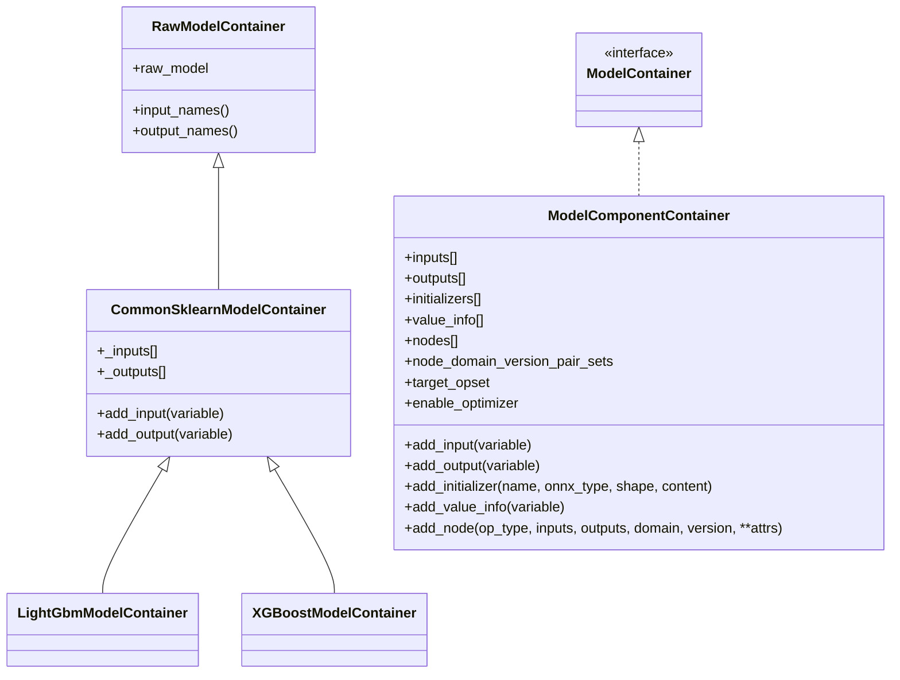
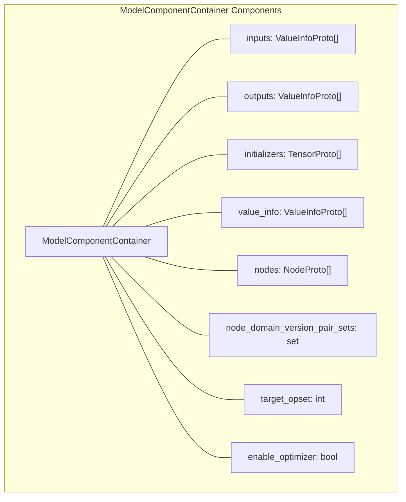
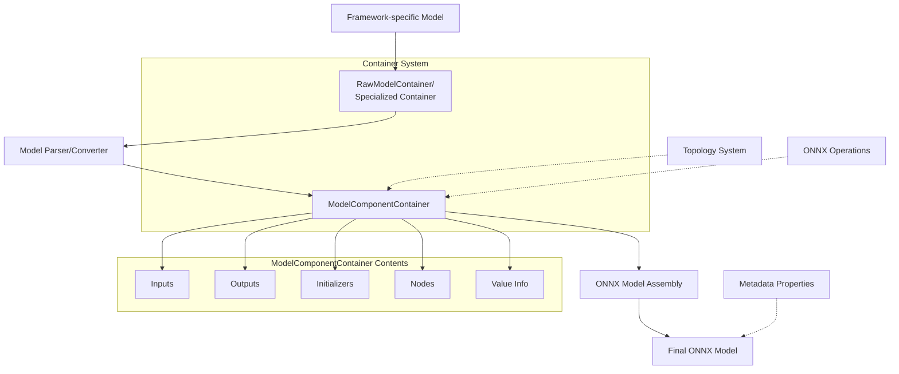

<!-- source: DeepWiki mcp.deepwiki.com · repo microsoft/onnxconverter-common · page 4.3 Container System · fetched 2026-10-26 -->

# Container System

<details>
<summary>Relevant source files</summary>

The following files were used as context for generating this wiki page:

- [onnxconverter_common/container.py](onnxconverter_common/container.py)
- [onnxconverter_common/metadata_props.py](onnxconverter_common/metadata_props.py)
- [onnxconverter_common/tree_ensemble.py](onnxconverter_common/tree_ensemble.py)

</details>


## Purpose and Scope

The Container System in onnxconverter-common provides a structured framework for encapsulating models and their components during the ONNX conversion process. This system abstracts away the specifics of different model frameworks and provides a unified interface for managing model components throughout the conversion pipeline.

The Container System serves as a bridge between input models from various frameworks (such as scikit-learn, LightGBM, XGBoost) and the ONNX format, facilitating consistent representation and manipulation of model data.

For information about representing computational graphs, see [Topology System](#4.1), and for applying ONNX operations, see [ONNX Operations](#4.2).

## Container Class Hierarchy



This diagram illustrates the inheritance relationships between the container classes in the system. The hierarchy provides increasing levels of specialization from the abstract `RawModelContainer` to framework-specific containers, while `ModelComponentContainer` implements the `ModelContainer` interface to support ONNX model construction.

Sources: [onnxconverter_common/container.py:10-76](onnxconverter_common/container.py:10-76)

## Container Classes

### RawModelContainer

`RawModelContainer` is an abstract base class that wraps a model from any supported framework. It defines the interface for accessing basic model information, particularly input and output variable names.

Key attributes and methods:
- `raw_model`: The original framework-specific model being converted
- `input_names()`: Abstract method that returns a list of input variable names
- `output_names()`: Abstract method that returns a list of output variable names

Sources: [onnxconverter_common/container.py:10-37](onnxconverter_common/container.py:10-37)

### CommonSklearnModelContainer

`CommonSklearnModelContainer` extends `RawModelContainer` specifically for scikit-learn models. Since scikit-learn models don't explicitly define their inputs and outputs, this container provides functionality to manually define them.

Key attributes and methods:
- `_inputs`: List to store input variables
- `_outputs`: List to store output variables
- `input_names()`: Returns the raw names of input variables
- `output_names()`: Returns the raw names of output variables
- `add_input(variable)`: Adds an input variable to the model
- `add_output(variable)`: Adds an output variable to the model

Sources: [onnxconverter_common/container.py:40-64](onnxconverter_common/container.py:40-64)

### LightGbmModelContainer and XGBoostModelContainer

These containers extend `CommonSklearnModelContainer` for specific model types:
- `LightGbmModelContainer`: For LightGBM models
- `XGBoostModelContainer`: For XGBoost models

These specialized containers currently inherit all functionality from `CommonSklearnModelContainer` without adding additional features, but their separate class definitions allow for future framework-specific extensions.

Sources: [onnxconverter_common/container.py:67-73](onnxconverter_common/container.py:67-73)

## ModelComponentContainer



`ModelComponentContainer` is the core class in the Container System, implementing the `ModelContainer` interface. It collects and organizes all components needed to build an ONNX graph during the conversion process.

### Key Components

| Component | Type | Description |
|-----------|------|-------------|
| `inputs` | List | Input variable definitions (ValueInfoProto) |
| `outputs` | List | Output variable definitions (ValueInfoProto) |
| `initializers` | List | Tensor initializers (TensorProto) for constants like weights |
| `value_info` | List | Intermediate variable definitions (ValueInfoProto) |
| `nodes` | List | ONNX operators (NodeProto) that define the computation |
| `node_domain_version_pair_sets` | Set | Domain-version pairs for all operators used |
| `target_opset` | Integer | Target ONNX operator set version |
| `enable_optimizer` | Boolean | Flag to enable/disable optimization |

### Key Methods

| Method | Description |
|--------|-------------|
| `add_input(variable)` | Add a variable to model inputs |
| `add_output(variable)` | Add a variable to model outputs |
| `add_initializer(name, onnx_type, shape, content)` | Add a tensor initializer |
| `add_value_info(variable)` | Add intermediate variable info |
| `add_node(op_type, inputs, outputs, op_domain, op_version, **attrs)` | Add an ONNX operation node |

Sources: [onnxconverter_common/container.py:76-176](onnxconverter_common/container.py:76-176)

## Container System in the Conversion Pipeline



This diagram illustrates how the Container System integrates into the overall ONNX conversion pipeline:

1. The original framework-specific model is wrapped in an appropriate container (`RawModelContainer` or specialized container)
2. The model parser/converter extracts information from the container
3. The extracted information is organized in a `ModelComponentContainer`
4. The `ModelComponentContainer` contents are used to assemble the final ONNX model

The Topology System and ONNX Operations components interact with the `ModelComponentContainer` to build the computation graph, while Metadata Properties can be added to the final ONNX model.

Sources: [onnxconverter_common/container.py:76-176](onnxconverter_common/container.py:76-176), [onnxconverter_common/metadata_props.py:33-56](onnxconverter_common/metadata_props.py:33-56)

## Implementation Details

### ValueInfo Creation

The `ModelComponentContainer` uses a helper method `_make_value_info` to create ONNX ValueInfoProto objects from internal Variable objects:

```python
def _make_value_info(self, variable):
    value_info = helper.ValueInfoProto()
    value_info.name = variable.full_name
    value_info.type.CopyFrom(variable.type.to_onnx_type())
    if variable.type.doc_string:
        value_info.doc_string = variable.type.doc_string
    return value_info
```

This method converts the internal type representation to ONNX type format and preserves documentation strings.

Sources: [onnxconverter_common/container.py:103-109](onnxconverter_common/container.py:103-109)

### Node Creation and Validation

The `add_node` method in `ModelComponentContainer` performs extensive validation of inputs and outputs before creating an ONNX NodeProto:

1. Ensures inputs and outputs are properly formatted as strings or lists of strings
2. Validates that attribute values are not None
3. Creates the node using ONNX helper functions
4. Sets the operator domain
5. Records the domain-version pair for later inclusion in the model's opset imports
6. Adds the node to the container's node list

Sources: [onnxconverter_common/container.py:144-175](onnxconverter_common/container.py:144-175)

## Integration with Metadata Properties

The Container System can be extended with metadata properties using functions from the `metadata_props` module:

```python
def add_metadata_props(onnx_model, metadata_props, target_opset):
    '''
    Add metadata properties to the model.
    '''
    if target_opset < 7:
        warnings.warn('Metadata properties are not supported in targeted opset - %d' % target_opset)
        return
    _validate_metadata(metadata_props)
    # Update model metadata
    onnx_model.metadata_props.extend(
        onnx_proto.StringStringEntryProto(key=key, value=value)
        for key, value in metadata_props.items()
    )
```

This function adds metadata properties to an ONNX model after it has been created using the components collected in the `ModelComponentContainer`.

Sources: [onnxconverter_common/metadata_props.py:33-56](onnxconverter_common/metadata_props.py:33-56)

## Usage in Tree Ensemble Conversion

The Container System, particularly `ModelComponentContainer`, is used in specific conversion scenarios like tree ensemble models. The `tree_ensemble.py` module defines functions that populate a container with the appropriate nodes and attributes for tree-based models:

```python
def add_tree_to_attribute_pairs(attr_pairs, is_classifier, tree, tree_id, tree_weight,
                                weight_id_bias, leaf_weights_are_counts):
    for i in range(tree.node_count):
        # Convert tree node to ONNX representation
        # Add node to container attributes
        add_node(attr_pairs, is_classifier, tree_id, tree_weight, node_id, feat_id, mode, threshold,
                 left_child_id, right_child_id, weight, weight_id_bias, leaf_weights_are_counts)
```

These attributes are later used to create TreeEnsembleClassifier or TreeEnsembleRegressor operators in the ONNX model.

Sources: [onnxconverter_common/tree_ensemble.py:52-112](onnxconverter_common/tree_ensemble.py:52-112)

## Summary

The Container System serves as a critical infrastructure component in the onnxconverter-common framework, enabling:

1. **Abstraction** - Hiding framework-specific details behind a common interface
2. **Organization** - Structuring model components in a coherent way
3. **Construction** - Building ONNX models piece by piece during conversion
4. **Validation** - Ensuring inputs, outputs, and attributes meet ONNX requirements

This system works in conjunction with the Topology System and ONNX Operations to facilitate the conversion of models from various frameworks to the standardized ONNX format.

---

