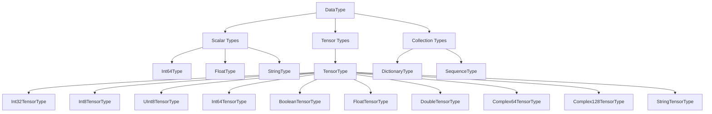
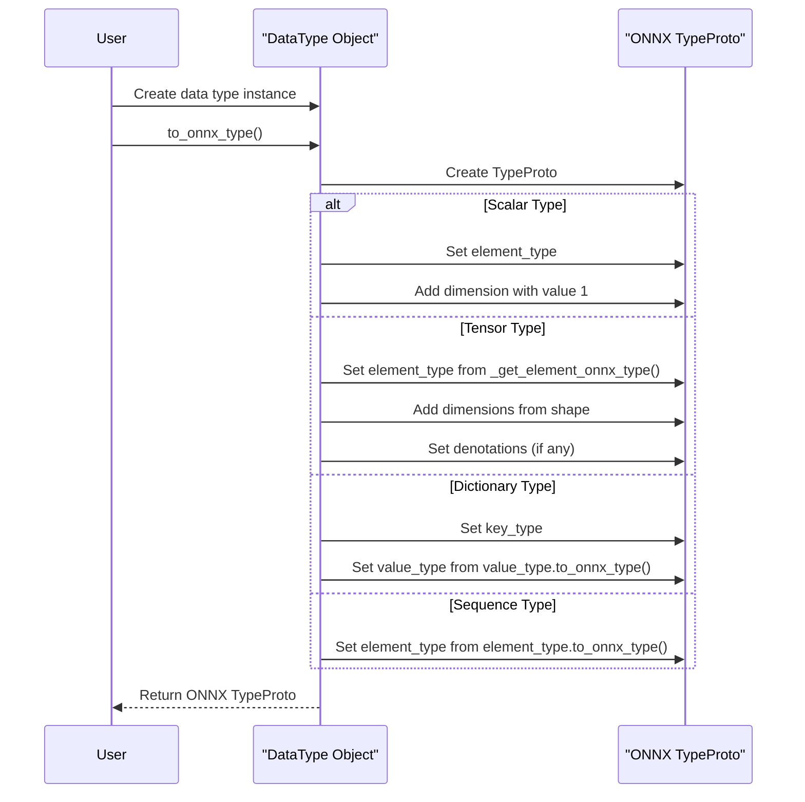
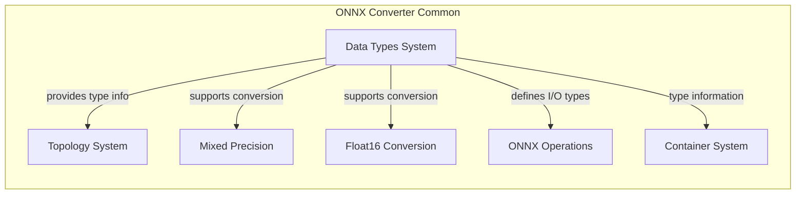

<!-- source: DeepWiki mcp.deepwiki.com · repo microsoft/onnxconverter-common · page 4.4 Data Types · fetched 2026-10-26 -->

# Data Types

<details>
<summary>Relevant source files</summary>

The following files were used as context for generating this wiki page:

- [onnxconverter_common/data_types.py](onnxconverter_common/data_types.py)

</details>


This document explains the data type system used in the `onnxconverter-common` package for representing and converting between ONNX data types. The data type system provides Python classes that map to the corresponding ONNX data types, allowing easy conversion between Python representations and ONNX type representations.

For information about the model representation system that uses these data types, see [Topology System](#4.1) and [Container System](#4.3).

## Data Type Class Hierarchy

The `onnxconverter-common` package implements a comprehensive type system that mirrors the data types available in the ONNX specification. These types are organized in a class hierarchy that enables easy conversion to ONNX type representations.

```mermaid
classDiagram
    class "DataType" {
        +shape
        +doc_string
        +to_onnx_type()
    }
    
    class "Int64Type" {
        +to_onnx_type()
    }
    
    class "FloatType" {
        +to_onnx_type()
    }
    
    class "StringType" {
        +to_onnx_type()
    }
    
    class "TensorType" {
        +denotation
        +channel_denotations
        +_get_element_onnx_type()
        +to_onnx_type()
    }
    
    class "Int32TensorType" {
        +_get_element_onnx_type()
    }
    
    class "Int8TensorType" {
        +_get_element_onnx_type()
    }
    
    class "UInt8TensorType" {
        +_get_element_onnx_type()
    }
    
    class "Int64TensorType" {
        +_get_element_onnx_type()
    }
    
    class "BooleanTensorType" {
        +_get_element_onnx_type()
    }
    
    class "FloatTensorType" {
        +color_space
        +_get_element_onnx_type()
    }
    
    class "DoubleTensorType" {
        +color_space
        +_get_element_onnx_type()
    }
    
    class "Complex64TensorType" {
        +color_space
        +_get_element_onnx_type()
    }
    
    class "Complex128TensorType" {
        +color_space
        +_get_element_onnx_type()
    }
    
    class "StringTensorType" {
        +_get_element_onnx_type()
    }
    
    class "DictionaryType" {
        +key_type
        +value_type
        +to_onnx_type()
    }
    
    class "SequenceType" {
        +element_type
        +to_onnx_type()
    }
    
    DataType <|-- Int64Type
    DataType <|-- FloatType
    DataType <|-- StringType
    DataType <|-- TensorType
    DataType <|-- DictionaryType
    DataType <|-- SequenceType
    
    TensorType <|-- Int32TensorType
    TensorType <|-- Int8TensorType
    TensorType <|-- UInt8TensorType
    TensorType <|-- Int64TensorType
    TensorType <|-- BooleanTensorType
    TensorType <|-- FloatTensorType
    TensorType <|-- DoubleTensorType
    TensorType <|-- Complex64TensorType
    TensorType <|-- Complex128TensorType
    TensorType <|-- StringTensorType
```

Sources: [onnxconverter_common/data_types.py:11-244]()

## Core Data Type Categories

The data type system consists of three main categories:

1. **Scalar Types**: Simple single-value types like `Int64Type`, `FloatType`, and `StringType`
2. **Tensor Types**: Multi-dimensional array types with specific element types
3. **Collection Types**: Container types like `DictionaryType` and `SequenceType` that can hold other types



Sources: [onnxconverter_common/data_types.py:11-244]()

## Base Data Type Class

The `DataType` class serves as the abstract base class for all data types in the system. It provides common attributes and methods that all data types should implement.

```python
class DataType(object):
    def __init__(self, shape=None, doc_string=''):
        self.shape = shape
        self.doc_string = doc_string

    def to_onnx_type(self):
        raise NotImplementedError()
```

Key properties of the `DataType` class:
- **shape**: The shape of the data type (if applicable)
- **doc_string**: Documentation string for the data type
- **to_onnx_type()**: Abstract method that must be implemented by subclasses to convert to ONNX type representation

Sources: [onnxconverter_common/data_types.py:11-21]()

## Scalar Types

Scalar types represent single values of a specific data type. The library provides three scalar types:

| Class | ONNX Type | Description |
|-------|-----------|-------------|
| `Int64Type` | INT64 | 64-bit integer scalar |
| `FloatType` | FLOAT | 32-bit floating point scalar |
| `StringType` | STRING | String scalar |

Each scalar type implements the `to_onnx_type()` method to convert to the corresponding ONNX type representation:

```python
def to_onnx_type(self):
    onnx_type = onnx_proto.TypeProto()
    onnx_type.tensor_type.elem_type = onnx_proto.TensorProto.INT64  # Example for Int64Type
    s = onnx_type.tensor_type.shape.dim.add()
    s.dim_value = 1
    return onnx_type
```

Sources: [onnxconverter_common/data_types.py:24-66]()

## Tensor Types

Tensor types represent multi-dimensional arrays with elements of a specific type. The base class for all tensor types is `TensorType`, which provides common functionality for all tensor types.

### TensorType Base Class

The `TensorType` class has the following key features:
- **shape**: The shape of the tensor (dimensions)
- **denotation**: Semantic information about the tensor (optional)
- **channel_denotations**: Semantic information about each dimension (optional)
- **_get_element_onnx_type()**: Abstract method to get the ONNX element type
- **to_onnx_type()**: Method to convert to ONNX type representation

Sources: [onnxconverter_common/data_types.py:69-103]()

### Tensor Type Implementations

The system provides a wide range of tensor types for different element types:

| Class | ONNX Element Type | Description |
|-------|-------------------|-------------|
| `Int32TensorType` | INT32 | Tensor with 32-bit integer elements |
| `Int8TensorType` | INT8 | Tensor with 8-bit integer elements |
| `UInt8TensorType` | UINT8 | Tensor with 8-bit unsigned integer elements |
| `Int64TensorType` | INT64 | Tensor with 64-bit integer elements |
| `BooleanTensorType` | BOOL | Tensor with boolean elements |
| `FloatTensorType` | FLOAT | Tensor with 32-bit floating point elements |
| `DoubleTensorType` | DOUBLE | Tensor with 64-bit floating point elements |
| `Complex64TensorType` | COMPLEX64 | Tensor with 64-bit complex elements |
| `Complex128TensorType` | COMPLEX128 | Tensor with 128-bit complex elements |
| `StringTensorType` | STRING | Tensor with string elements |

Each tensor type implements the `_get_element_onnx_type()` method to specify the element type:

```python
def _get_element_onnx_type(self):
    return onnx_proto.TensorProto.FLOAT  # Example for FloatTensorType
```

Sources: [onnxconverter_common/data_types.py:106-190]()

## Collection Types

Collection types are container types that can hold other data types. The system provides two collection types:

### Dictionary Type

The `DictionaryType` class represents a key-value mapping (dictionary/map):

- **key_type**: The type of the keys (limited to `Int64Type` or `StringType`)
- **value_type**: The type of the values (can be any DataType)

```python
class DictionaryType(DataType):
    def __init__(self, key_type, value_type, shape=None, doc_string=''):
        super(DictionaryType, self).__init__(shape, doc_string)
        self.key_type = key_type
        self.value_type = value_type
```

Sources: [onnxconverter_common/data_types.py:192-217]()

### Sequence Type

The `SequenceType` class represents a sequence (list) of elements:

- **element_type**: The type of the elements in the sequence

```python
class SequenceType(DataType):
    def __init__(self, element_type, shape=None, doc_string=''):
        super(SequenceType, self).__init__(shape, doc_string)
        self.element_type = element_type
        self.doc_string = doc_string
```

Sources: [onnxconverter_common/data_types.py:220-244]()

## Conversion to ONNX Types

A core feature of this type system is the ability to convert the Python representation to the corresponding ONNX type representation through the `to_onnx_type()` method:



Sources: [onnxconverter_common/data_types.py:16-244]()

## Type Conversion Utilities

The module provides utility functions for type conversion:

### find_type_conversion

The `find_type_conversion` function finds the appropriate operator to convert between different data types:

```python
def find_type_conversion(source_type, target_type):
    """
    Find the operator name for converting source_type into target_type
    """
    if isinstance(source_type, target_type):
        return 'identity'
    if isinstance(target_type, FloatTensorType):
        return 'imageToFloatTensor'
    raise ValueError('Unsupported type conversion from %s to %s' % (
                     source_type, target_type))
```

Sources: [onnxconverter_common/data_types.py:247-256]()

### onnx_built_with_ml

The `onnx_built_with_ml` function checks if ONNX was built with ML support, which is required for sequence and map types:

```python
def onnx_built_with_ml():
    """
    Tells if ONNX was built with flag ``ONNX-ML``.
    """
    seq = SequenceType(FloatTensorType())
    try:
        seq.to_onnx_type()
        return True
    except RuntimeError:
        return False
```

Sources: [onnxconverter_common/data_types.py:259-268]()

## Integration with ONNX Converter Common

The data type system serves as a foundation for other components in the `onnxconverter-common` package:

1. It provides input/output type information for the topology system ([Topology System](#4.1))
2. It supports data type conversions used in mixed precision and float16 conversion ([Mixed Precision Conversion](#3.2), [Float16 Conversion](#3.1))
3. It enables ONNX operations to define their expected input and output types ([ONNX Operations](#4.2))



Sources: [onnxconverter_common/data_types.py:11-268]()

## Summary

The data type system in `onnxconverter-common` provides a comprehensive representation of ONNX data types in Python. Key features include:

1. A class hierarchy that mirrors ONNX type system
2. Support for scalar, tensor, and collection types
3. Conversion to ONNX type representations
4. Utility functions for type conversion and compatibility checking

This system is essential for accurately representing the types of variables, parameters, and operations in ONNX models during conversion and optimization processes.

Sources: [onnxconverter_common/data_types.py:11-268]()

---

