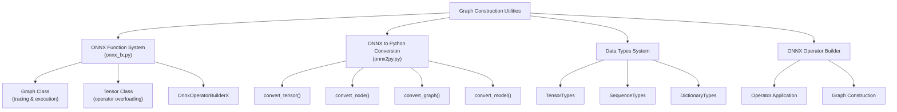
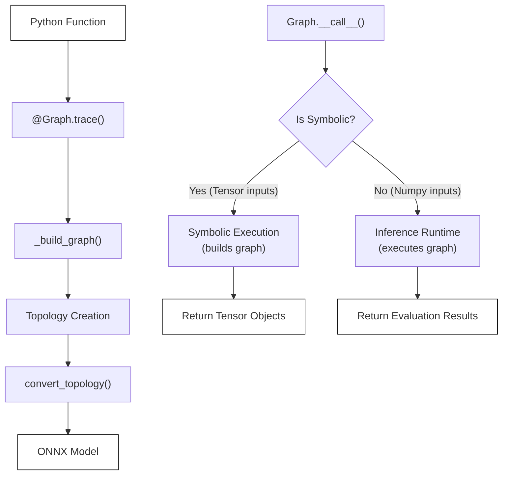
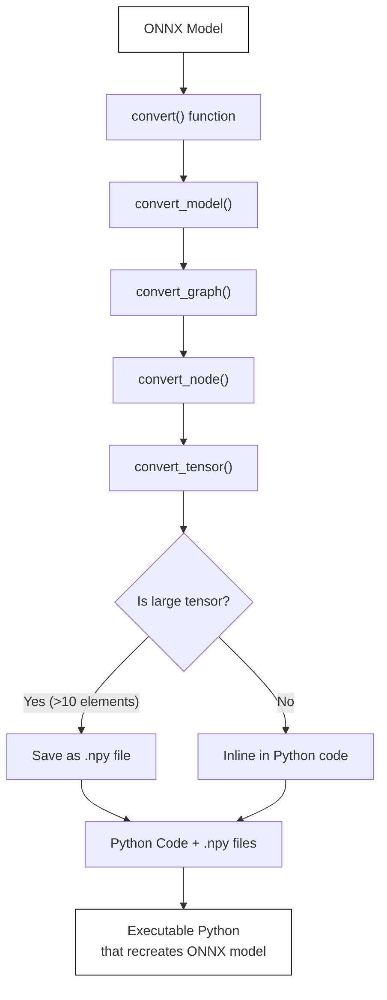
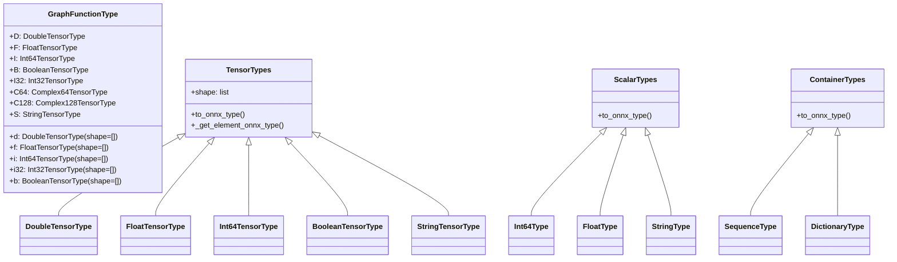

<!-- source: DeepWiki mcp.deepwiki.com · repo microsoft/onnxconverter-common · page 5 Graph Construction Utilities · fetched 2026-10-26 -->

# Graph Construction Utilities

<details>
<summary>Relevant source files</summary>

The following files were used as context for generating this wiki page:

- [onnxconverter_common/onnx2py.py](onnxconverter_common/onnx2py.py)
- [onnxconverter_common/onnx_fx.py](onnxconverter_common/onnx_fx.py)
- [tests/test_data_types.py](tests/test_data_types.py)

</details>


## Purpose and Scope

The Graph Construction Utilities provide tools for building, manipulating, and converting ONNX computational graphs. This module enables developers to convert between Python functions and ONNX models, programmatically construct ONNX graphs, and serialize/deserialize models in various formats. For details on specific graph representation used internally, see [Model Representation](#4) and for optimization of these graphs, see [ONNX Optimization System](#2).

## System Overview

The Graph Construction Utilities consist of several key components that work together to facilitate the creation and manipulation of ONNX graphs:



Sources: [onnxconverter_common/onnx_fx.py:1-523](), [onnxconverter_common/onnx2py.py:1-324]()

## Python to ONNX Conversion

### ONNX Function System

The ONNX Function System is the core component for converting Python functions to ONNX models. The process works by tracing the execution of a Python function and capturing the operations to build an equivalent ONNX graph.



Sources: [onnxconverter_common/onnx_fx.py:69-294]()

### Graph Class

The `Graph` class is the central component that manages the tracing and conversion process. It provides the following key functionalities:

1. **Tracing Python Functions**: Using the `@Graph.trace()` decorator to capture operations
2. **Building ONNX Graphs**: Converting traced operations to ONNX format
3. **Model Execution**: Running models symbolically or with actual values
4. **Model Serialization**: Saving and loading ONNX models

Example usage:
```python
from onnxconverter_common.onnx_fx import Graph, GraphFunctionType as GFT

@Graph.trace(outputs="logits", 
             input_types=[GFT.F(shape=['N', 3, 224, 224])],
             output_types=[GFT.F(shape=['N', 1000])])
def my_model(x):
    # Model operations here
    return x

# Get the ONNX model
model = my_model.to_model()

# Save the model
my_model.save("model.onnx")
```

Sources: [onnxconverter_common/onnx_fx.py:69-294]()

### Tensor Class

The `Tensor` class represents a tensor in the ONNX graph and provides operator overloading to enable natural Python syntax for building computational graphs:

| Operator Category | Supported Operators |
|-------------------|---------------------|
| Arithmetic        | `+`, `-`, `*`, `/`, `**`, `@` (matrix multiplication) |
| Comparison        | `<`, `<=`, `==`, `!=`, `>`, `>=` |
| Unary             | `-`, `not` |
| Indexing          | `[]` (supports slicing) |
| Method Chaining   | `.shape()`, `.transpose()`, etc. |

This enables intuitive graph construction, for example:

```python
@Graph.trace()
def computation(x, y):
    z = x * 2 + y
    return z[0:10]  # Slice operation
```

Sources: [onnxconverter_common/onnx_fx.py:297-400]()

### OnnxOperatorBuilderX

The `OnnxOperatorBuilderX` class extends the base operator builder to provide additional functionality for the ONNX Function System:

1. Converting between tensor objects and tensor names
2. Applying ONNX operators to tensors
3. Supporting graph inlining (embedding subgraphs)
4. Creating tensor arguments for functions

Sources: [onnxconverter_common/onnx_fx.py:403-522]()

## ONNX to Python Conversion

The ONNX to Python conversion system provides the reverse functionality - converting ONNX models to Python code that can recreate the original model.



Sources: [onnxconverter_common/onnx2py.py:1-324]()

### Conversion Process

The core of the ONNX to Python conversion is the `convert()` function, which:

1. Takes an ONNX model and converts it to Python code
2. Saves large constant tensors as separate `.npy` files
3. Generates Python code that uses `onnx.helper` to recreate the model
4. Handles complex model structures including graphs, nodes, tensors, and attributes

Example usage:
```python
from onnxconverter_common.onnx2py import convert

# Convert ONNX model to Python code
convert("model.onnx", "model.py")

# Later, recreate the model by running the Python file:
# python model.py output.onnx
```

Sources: [onnxconverter_common/onnx2py.py:242-299]()

### Conversion Components

The conversion system consists of several specialized functions for handling different ONNX components:

| Function | Purpose |
|----------|---------|
| `convert_tensor()` | Converts ONNX tensors to NumPy arrays |
| `convert_node()` | Converts ONNX nodes to Python function calls |
| `convert_graph()` | Converts ONNX graphs to Python objects |
| `convert_model()` | Converts the complete ONNX model |
| `make_external_tensor()` | Handles external data references |
| `make_node()` | Creates node representations |
| `make_graph()` | Creates graph representations |

Sources: [onnxconverter_common/onnx2py.py:37-75](), [onnxconverter_common/onnx2py.py:165-228]()

## Data Types

The Graph Construction Utilities include a comprehensive data type system for representing various tensor and scalar types in ONNX graphs.



Sources: [onnxconverter_common/onnx_fx.py:25-42](), [tests/test_data_types.py:1-78]()

The `GraphFunctionType` class provides convenient access to these types and is commonly used when specifying input and output types in the `Graph.trace()` decorator.

## Integration with Other Components

The Graph Construction Utilities integrate with other components in the `onnxconverter-common` repository:

1. **Model Representation**: Uses the Topology system to represent computational graphs internally
2. **ONNX Operations**: Utilizes the ONNX operator builder to apply operations to tensors
3. **Optimization System**: Generated models can be optimized using the optimization components
4. **Data Type Conversion**: Models can be converted between different precisions

This integration enables a comprehensive workflow from Python functions to optimized ONNX models.

## Example Use Cases

### Creating a Simple Neural Network

```python
from onnxconverter_common.onnx_fx import Graph, GraphFunctionType as GFT

@Graph.trace(outputs="output", 
             input_types=[GFT.F(shape=['N', 784])],
             output_types=[GFT.F(shape=['N', 10])])
def simple_nn(x):
    # Hidden layer with ReLU activation
    w1 = ox.constant(value=np.random.randn(784, 128).astype(np.float32))
    b1 = ox.constant(value=np.zeros(128).astype(np.float32))
    hidden = (x @ w1) + b1
    hidden = hidden.relu()
    
    # Output layer
    w2 = ox.constant(value=np.random.randn(128, 10).astype(np.float32))
    b2 = ox.constant(value=np.zeros(10).astype(np.float32))
    output = (hidden @ w2) + b2
    return output

# Save the model
simple_nn.save("model.onnx")
```

### Converting a Model to Python and Back

```python
# Step 1: Convert ONNX model to Python code
from onnxconverter_common.onnx2py import convert
convert("model.onnx", "model.py")

# Step 2: Import the generated model
from model import model

# Step 3: Save the recreated model
import onnx
onnx.save(model, "recreated_model.onnx")
```

## Summary

The Graph Construction Utilities provide a comprehensive set of tools for working with ONNX computational graphs:

1. **Python to ONNX Conversion**: Convert Python functions to ONNX models using the tracing mechanism
2. **ONNX to Python Conversion**: Convert ONNX models to Python code for modification or analysis
3. **Rich Data Type System**: Support for various tensor, scalar, and container types
4. **Natural Python Syntax**: Operator overloading for intuitive graph construction
5. **Integration with Other Components**: Seamless workflow with other parts of the onnxconverter-common package

These utilities enable developers to work with ONNX models at a higher level of abstraction, making it easier to create, modify, and optimize deep learning models for deployment.

---

