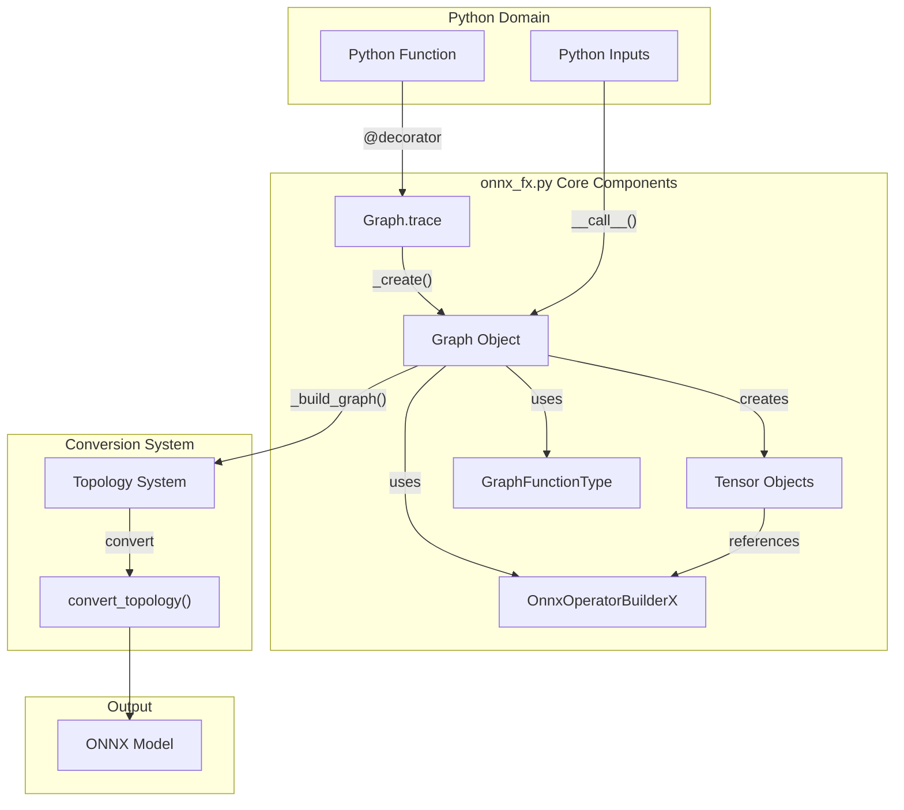
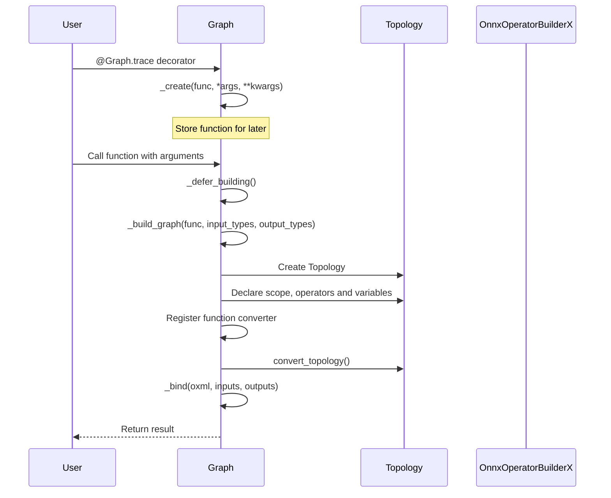
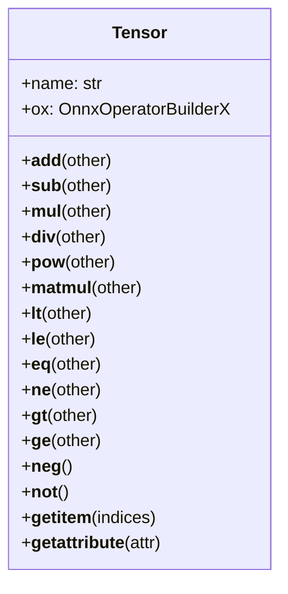

<!-- source: DeepWiki mcp.deepwiki.com · repo microsoft/onnxconverter-common · page 5.1 ONNX Function System · fetched 2026-10-26 -->

# ONNX Function System

<details>
<summary>Relevant source files</summary>

The following files were used as context for generating this wiki page:

- [onnxconverter_common/onnx_fx.py](onnxconverter_common/onnx_fx.py)
- [tests/test_data_types.py](tests/test_data_types.py)
- [tests/test_onnxfx.py](tests/test_onnxfx.py)

</details>


The ONNX Function System provides a way to convert Python functions to ONNX graphs with a simple, decorator-based API. It allows developers to define neural network computations in natural Python syntax while automatically tracing operations and generating ONNX models.

## Purpose and Scope

This system enables:
- Converting Python functions to ONNX graphs using a decorator pattern
- Executing operator overloading to allow intuitive Python syntax for tensor operations
- Loading, saving, and executing ONNX models
- Building complex control flow structures like loops in ONNX

For information about converting existing ONNX models to Python, see [ONNX to Python Conversion](#5.2). For details about the ONNX operator system, see [ONNX Operations](#4.2).

## System Architecture

The ONNX Function System consists of four primary components:

1. **Graph** - Main class that represents an ONNX computational graph
2. **Tensor** - Represents tensors with overloaded operators for natural syntax
3. **OnnxOperatorBuilderX** - Extended operator builder that works with Tensor objects
4. **GraphFunctionType** - Type system for ONNX functions

### ONNX Function System Architecture



Sources: [onnxconverter_common/onnx_fx.py:69-129](), [onnxconverter_common/onnx_fx.py:297-352](), [onnxconverter_common/onnx_fx.py:403-522]()

### Function Tracing Workflow



Sources: [onnxconverter_common/onnx_fx.py:120-141](), [onnxconverter_common/onnx_fx.py:184-214]()

## Core Components

### Graph Class

The `Graph` class is the central component that manages the conversion of Python functions to ONNX models.

Key Methods:
- `trace()` - Class method/decorator for converting Python functions to ONNX
- `to_model()` - Converts the Graph to an ONNX model
- `load()` - Loads an ONNX model into a Graph object
- `save()` - Saves the Graph as an ONNX model file
- `__call__()` - Executes the graph with given inputs

When a function is decorated with `@Graph.trace`, it creates a Graph instance that stores the function reference. The actual graph building is deferred until the function is first called.

```python
# Example usage
@Graph.trace
def my_function(x, y):
    return x + y

# The graph is built when the function is called
result = my_function(input_x, input_y)
```

Sources: [onnxconverter_common/onnx_fx.py:69-129](), [onnxconverter_common/onnx_fx.py:184-214]()

### Tensor Class

The `Tensor` class represents a tensor in the ONNX graph and provides overloaded operators for natural Python syntax.



The `Tensor` class overloads many Python operators to enable intuitive syntax:

| Python Operator | ONNX Operator | Method |
|-----------------|---------------|--------|
| `+` | Add | `__add__` |
| `-` | Sub | `__sub__` |
| `*` | Mul | `__mul__` |
| `/` | Div | `__div__` |
| `**` | Pow | `__pow__` |
| `@` | MatMul | `__matmul__` |
| `<` | Less | `__lt__` |
| `<=` | LessOrEqual | `__le__` |
| `==` | Equal | `__eq__` |
| `!=` | Not(Equal) | `__ne__` |
| `>` | Greater | `__gt__` |
| `>=` | GreaterOrEqual | `__ge__` |
| `-x` | Neg | `__neg__` |
| `not x` | Not | `__not__` |
| `x[...]` | Slice | `__getitem__` |

The class also implements a special `__getattribute__` method that allows calling ONNX operators as methods on tensors:

```python
# Instead of writing:
result = ox.relu([tensor])

# You can write:
result = tensor.relu()
```

Sources: [onnxconverter_common/onnx_fx.py:297-400]()

### OnnxOperatorBuilderX

`OnnxOperatorBuilderX` extends the base `OnnxOperatorBuilder` class to work with `Tensor` objects.

Key methods:
- `_output_names_to_tensors()` - Converts output names to Tensor objects
- `_tensors_to_input_names()` - Extracts input names from Tensor objects
- `apply_op()` - Applies an ONNX operator to inputs
- `apply_invoke_inline()` - Inlines another ONNX graph within the current graph
- `arg()` - Creates a Tensor representing a function argument

Sources: [onnxconverter_common/onnx_fx.py:403-522]()

### GraphFunctionType

`GraphFunctionType` provides type annotations for ONNX functions:

```mermaid
graph TD
    subgraph "GraphFunctionType"
        TensorTypes["Tensor Types"]
        ScalarTypes["Scalar Types"]
    end
    
    TensorTypes --> DoubleTensorType["D = DoubleTensorType"]
    TensorTypes --> FloatTensorType["F = FloatTensorType"]
    TensorTypes --> Int64TensorType["I = Int64TensorType"]
    TensorTypes --> BooleanTensorType["B = BooleanTensorType"]
    TensorTypes --> Int32TensorType["I32 = Int32TensorType"]
    TensorTypes --> Complex64TensorType["C64 = Complex64TensorType"]
    TensorTypes --> Complex128TensorType["C128 = Complex128TensorType"]
    TensorTypes --> StringTensorType["S = StringTensorType"]
    
    ScalarTypes --> DoubleScalar["d = DoubleTensorType([])"]
    ScalarTypes --> FloatScalar["f = FloatTensorType([])"]
    ScalarTypes --> Int64Scalar["i = Int64TensorType([])"]
    ScalarTypes --> BooleanScalar["b = BooleanTensorType([])"]
    ScalarTypes --> Int32Scalar["i32 = Int32TensorType([])"]
    ScalarTypes --> Complex64Scalar["c64 = Complex64TensorType([])"]
    ScalarTypes --> Complex128Scalar["c128 = Complex128TensorType([])"]
    ScalarTypes --> StringScalar["s = StringTensorType([])"]
```



Usage example:

```python
from onnxconverter_common.onnx_fx import Graph, GraphFunctionType as _Ty

@Graph.trace(
    input_types=[_Ty.F([None, 3])],  # Float tensor with shape [batch_size, 3]
    output_types=[_Ty.F([None, 1])]  # Float tensor with shape [batch_size, 1]
)
def my_model(x):
    # Function body
    return result
```

Sources: [onnxconverter_common/onnx_fx.py:25-42](), [tests/test_data_types.py:1-78]()

## Usage Examples

### Basic Usage

```python
from onnxconverter_common.onnx_fx import Graph

# Define a function to convert to ONNX
@Graph.trace
def add_function(x, y):
    return x + y

# Use the function with real values
result = add_function(np.array([1.0, 2.0]), np.array([3.0, 4.0]))
# result = [4.0, 6.0]

# Save the ONNX model
add_function.save("add_model.onnx")

# Load an ONNX model
loaded_model = Graph.load("add_model.onnx")
```

### Function Composition

```python
@Graph.trace
def f(x, y):
    return x + y

@Graph.trace
def g(x, y):
    return x.ox.abs(f(x, y) + 1.0)  # Use f inside g

result = g([2.0], [-5.0])  # result = [2.0]
```

Sources: [tests/test_onnxfx.py:24-34]()

### Loop Example

The ONNX Function System supports complex control flow like loops:

```python
@Graph.trace(
    outputs=['y1', 'y2', 'y3', 'y4'],
    input_types=[_Ty.I([1])],
    output_types=[_Ty.F([None]), _Ty.F([None]), _Ty.F([None, 1]), _Ty.F([None, 1])]
)
def loop_test(length):
    ox = length.ox
    squeezed_len = ox.squeeze(length, axes=[0])
    condition = ox.constant(value=True)
    
    # Define the loop body as a nested function
    @Graph.trace(
        outputs=['cond_out', 'i_out', 'j_out', 'all_i', 'all_j'],
        output_types=[_Ty.b, _Ty.f, _Ty.f, _Ty.f, _Ty.f],
        input_types=[_Ty.I([1]), _Ty.b, _Ty.F([1]), _Ty.F([1])]
    )
    def loop_body(iteration, cond, i, j):
        return (condition,
                i + i.ox.constant(value=1.0), 
                j + 2.0, 
                i, j)
    
    initial_value = ox.constant(value=-1.0)
    return ox.loop(
        squeezed_len,            # Max iterations
        condition,               # Loop condition
        loop_body,               # Loop body function
        inputs=[initial_value, initial_value],  # Initial values
        outputs=['y1_o', 'y2_o', 'y3_o', 'y4_o']  # Output names
    )
```

Sources: [tests/test_onnxfx.py:36-58]()

## Integration with Runtime

The `Graph` class can be configured to use different runtime engines for model execution by setting the `inference_runtime` static property:

```python
# Example with ONNX Runtime
import onnxruntime as _ort

def _ort_inference(model, inputs):
    sess = _ort.InferenceSession(model.SerializeToString())
    return sess.run(None, inputs)

Graph.inference_runtime = _ort_inference
```

Sources: [tests/test_onnxfx.py:11-16]()

## Advanced Features

### Operator Chaining

The `Tensor` class implements a special `__getattribute__` method that allows chaining operations:

```python
# Traditional way:
result = ox.relu([ox.add([x, y])])

# Using operator overloading and chaining:
result = (x + y).relu()
```

Sources: [onnxconverter_common/onnx_fx.py:385-400]()

### Deferred Building

Graphs are built lazily when first used, allowing for efficient creation and manipulation:

```python
@Graph.trace
def my_function(x, y):
    return x + y

# The graph isn't built yet
print(my_function.oxml)  # This triggers _defer_building()
```

Sources: [onnxconverter_common/onnx_fx.py:92-95](), [onnxconverter_common/onnx_fx.py:239-241]()

## Summary

The ONNX Function System provides a powerful and intuitive way to create ONNX models using Python code. By leveraging function decorators and operator overloading, it bridges the gap between imperative Python code and ONNX's declarative graph representation. The system integrates with the broader Topology system in the `onnxconverter-common` package to enable seamless conversion between Python functions and ONNX models.

Sources: [onnxconverter_common/onnx_fx.py:1-523]()

---

