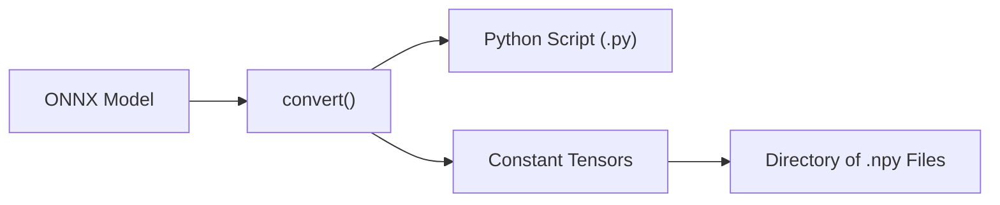
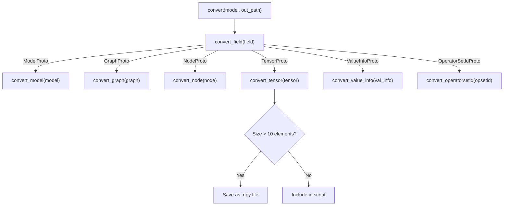
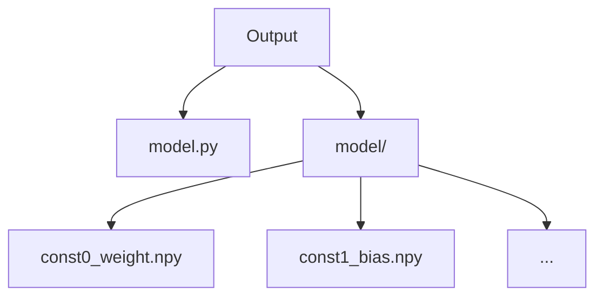

<!-- source: DeepWiki mcp.deepwiki.com · repo microsoft/onnxconverter-common · page 5.2 ONNX to Python Conversion · fetched 2026-10-26 -->

# ONNX to Python Conversion

<details>
<summary>Relevant source files</summary>

The following files were used as context for generating this wiki page:

- [onnxconverter_common/onnx2py.py](onnxconverter_common/onnx2py.py)
- [tests/data/image_classifier32.onnx](tests/data/image_classifier32.onnx)
- [tests/test_onnx2py.py](tests/test_onnx2py.py)
- [tests/test_pytracing.py](tests/test_pytracing.py)

</details>


This document describes the system for converting ONNX models to equivalent Python code in the `onnxconverter-common` package. For information about the reverse process (converting Python functions to ONNX), see [ONNX Function System](#5.1).

## Purpose and Overview

The ONNX to Python conversion system enables users to transform ONNX models into human-readable Python scripts that can recreate the original model. This provides several benefits:

- Easier inspection and debugging of ONNX model structures
- Simplified model modification and customization
- Better understanding of how ONNX models are structured
- Ability to share models in a more readable format than binary ONNX files

The conversion produces a Python script that uses the `onnx.helper` library to recreate the ONNX model, with large constant tensors saved as separate `.npy` files for efficiency.

## Conversion Workflow



The conversion process involves:

1. Converting ONNX model components (tensors, nodes, graphs) to Python code
2. Saving large constant tensors (>10 elements) as separate `.npy` files
3. Generating a Python script that can recreate the original model

Sources: [onnxconverter_common/onnx2py.py:253-299]()

## System Architecture

The ONNX to Python conversion system is built around recursive conversion of ONNX model components.



### Key Components

1. **Main Conversion Function**: `convert(model, out_path)` serves as the entry point
2. **Field Converter**: `convert_field(field)` recursively handles different types of ONNX objects
3. **Type-Specific Converters**:
   - `convert_model(model)`: Handles ONNX ModelProto objects
   - `convert_graph(graph)`: Handles ONNX GraphProto objects
   - `convert_node(node)`: Handles ONNX NodeProto objects
   - `convert_tensor(tensor)`: Handles ONNX TensorProto objects
4. **Code Generation**: Uses the `TracingObject` class to generate executable Python code

Sources: [onnxconverter_common/onnx2py.py:79-228]()

## TracingObject System

The `TracingObject` class is central to the conversion process, as it enables the system to generate Python code that reconstructs the original ONNX model.


TracingObject wraps Python objects and produces string representations of operations performed on them. For example:

- `helper_traced.make_tensor_value_info(name, elem_type, shape)` generates a string like `"helper.make_tensor_value_info('input', TensorProto.FLOAT, [1, 3, 224, 224])"`

These string representations are combined to generate the final Python script.

Sources: [onnxconverter_common/onnx2py.py:30-34](), [onnxconverter_common/pytracing.py]()

## Output Structure

The conversion produces two types of output:

1. **Python Script**: A `.py` file containing code to recreate the ONNX model
2. **Constant Tensors**: A directory containing `.npy` files for large tensors



The Python script includes:
- Import statements for required libraries
- Helper functions for ONNX operations
- Code to reconstruct the model
- Main block to save the model if executed directly

Sources: [onnxconverter_common/onnx2py.py:246-295]()

## Usage

### Command Line Usage

You can use the converter from the command line:

```
python -m onnxconverter_common.onnx2py input_model.onnx output_model.py
```

This generates `output_model.py` and a directory `output_model/` containing any large constant tensors.

Sources: [onnxconverter_common/onnx2py.py:302-321]()

### Programmatic Usage

You can also use the converter in your Python code:

```python
import onnx
from onnxconverter_common.onnx2py import convert

# Load ONNX model
model = onnx.load("model.onnx")

# Convert to Python
convert(model, "model.py")
```

Sources: [tests/test_onnx2py.py:22-34]()

### Using the Generated Script

The generated Python script can be used in two ways:

1. **Run directly** to create an ONNX file:
   ```
   python model.py output.onnx
   ```

2. **Import in Python code**:
   ```python
   from model import model
   
   # Use model as a regular ONNX model
   ```

Sources: [onnxconverter_common/onnx2py.py:246-250]()

## Implementation Details

### Constant Tensor Handling

Large constant tensors (more than 10 elements) are saved as separate `.npy` files:

```python
# For large tensors
np.save(const_path, np_data)
data_path = os_traced.path.join(DATA_DIR_TRACED, name + '.npy')
np_array = np_traced.load(data_path).astype(np_dtype).reshape(np_shape)
```

For small tensors, they're included directly in the script:

```python
# For small tensors
numpy_helper_traced.from_array(np_data, name=tensor.name)
```

Sources: [onnxconverter_common/onnx2py.py:175-199]()

### Verification

The converter verifies that the converted model is identical to the original by comparing their serialized binary representations:

```python
if TracingObject.get_py_obj(model_trace).SerializeToString() == model.SerializeToString():
    print("\nConversion successful. Converted model is identical.\n")
else:
    print("\nWARNING: Conversion succeeded but converted model is not identical. "
          "Difference might be trivial.\n")
```

Sources: [onnxconverter_common/onnx2py.py:310-314]()

## Summary

The ONNX to Python conversion system provides a powerful way to transform binary ONNX models into human-readable Python code. It handles all aspects of the ONNX model, including operators, graphs, tensors, and attributes, producing a Python script that can faithfully recreate the original model. Large constant tensors are efficiently stored as separate `.npy` files to keep the Python script concise and readable.

Sources: [onnxconverter_common/onnx2py.py:6-13]()

---

