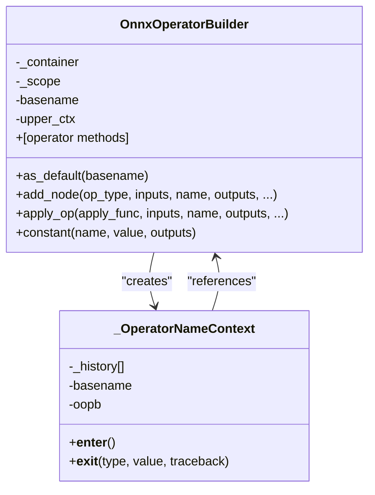
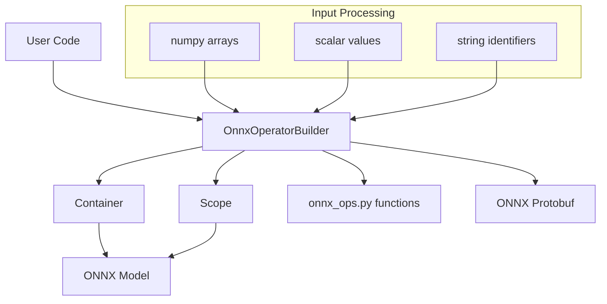
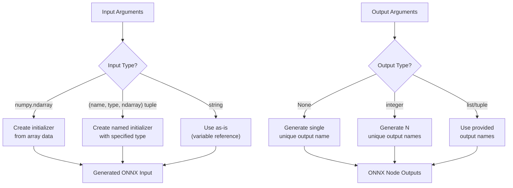
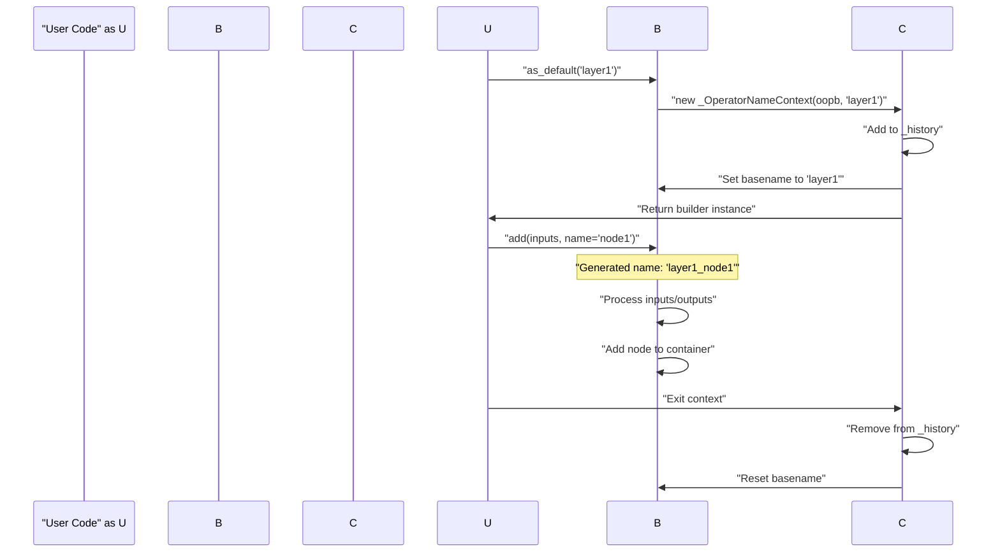
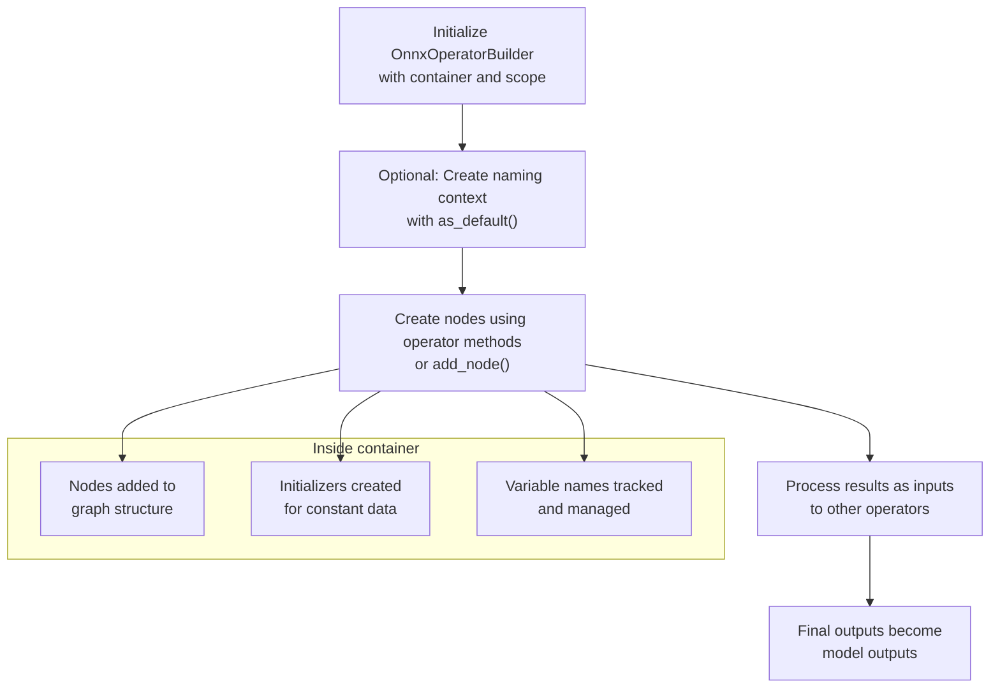

<!-- source: DeepWiki mcp.deepwiki.com · repo microsoft/onnxconverter-common · page 5.3 ONNX Operator Builder · fetched 2026-10-26 -->

# ONNX Operator Builder

Relevant source files

The following files were used as context for generating this wiki page:

- [onnxconverter_common/oopb.py](onnxconverter_common/oopb.py)

The ONNX Operator Builder provides a systematic way to programmatically construct ONNX operators and build computational graphs. It simplifies the process of creating ONNX nodes by offering a higher-level API over the raw ONNX protobuf operations, while managing operator naming, inputs/outputs processing, and initializer creation.

For information about converting Python functions to ONNX graphs, see [ONNX Function System](#5.1). For details on applying ONNX operators, see [ONNX Operations](#4.2).

## Architecture Overview

The ONNX Operator Builder system consists of two primary classes:

1. `OnnxOperatorBuilder`: The main class for creating ONNX operators
2. `_OperatorNameContext`: A helper class for managing operator naming contexts

### Class Structure Diagram

Sources: [onnxconverter_common/oopb.py:12-31](), [onnxconverter_common/oopb.py:32-47]()

### System Integration

Sources: [onnxconverter_common/oopb.py:32-47](), [onnxconverter_common/oopb.py:54-83]()

## Core Functionality

### Node Creation

The OnnxOperatorBuilder provides three main methods for creating ONNX nodes:

1. `add_node()`: Generic method for adding any ONNX operator
2. `add_node_with_output()`: Adds a node with pre-specified output names
3. `apply_op()`: Applies operators using functions from the `onnx_ops` module

Additionally, the class provides specialized methods for common ONNX operators (add, mul, conv, etc.), which are implemented as wrappers around `apply_op()`.

Sources: [onnxconverter_common/oopb.py:134-151](), [onnxconverter_common/oopb.py:152-158](), [onnxconverter_common/oopb.py:190-407]()

### Input/Output Processing

The OnnxOperatorBuilder handles various input types and automatically creates outputs:

Sources: [onnxconverter_common/oopb.py:54-83](), [onnxconverter_common/oopb.py:85-98]()

### Naming Contexts

The OnnxOperatorBuilder implements a context management system for operator naming using the `as_default()` method:

Sources: [onnxconverter_common/oopb.py:12-31](), [onnxconverter_common/oopb.py:47-48](), [onnxconverter_common/oopb.py:100-110]()

### Constants and Value Handling

The OnnxOperatorBuilder provides methods for creating constant nodes and handling different value types:

1. `constant()`: Creates a constant node with a given value
2. `constant_of_shape()`: Creates a tensor with a specified shape and constant value
3. `value_to_ndarray()`: Converts Python scalars to numpy arrays
4. `_value_to_tensor()`: Converts values to ONNX tensors

Sources: [onnxconverter_common/oopb.py:160-170](), [onnxconverter_common/oopb.py:112-132]()

## API Reference

### Core Methods

| Method | Description |
|--------|-------------|
| `as_default(basename)` | Creates a naming context with the specified basename |
| `add_node(op_type, inputs, name, outputs, op_domain, op_version, **attrs)` | Adds a node of the specified type with given attributes |
| `add_node_with_output(op_type, inputs, outputs, name, op_domain, op_version, **attrs)` | Adds a node with pre-specified outputs |
| `apply_op(apply_func, inputs, name, outputs, **attrs)` | Applies an operator using a function from onnx_ops |
| `constant(name, value, outputs)` | Creates a constant node with the given value |
| `constant_of_shape(inputs, name, outputs, value)` | Creates a tensor with specified shape and value |
| `loop(trip_count, cond, body, inputs, outputs, name)` | Creates a Loop operator with a subgraph body |

Sources: [onnxconverter_common/oopb.py:47-48](), [onnxconverter_common/oopb.py:134-142](), [onnxconverter_common/oopb.py:144-150](), [onnxconverter_common/oopb.py:152-158](), [onnxconverter_common/oopb.py:160-163](), [onnxconverter_common/oopb.py:165-170](), [onnxconverter_common/oopb.py:176-185]()

### Operator Methods

The OnnxOperatorBuilder provides numerous methods for specific ONNX operators. These are generated automatically (note the "CODE-AUTOGEN" comment in the source) and follow a consistent pattern. Here's a sampling of common operators:

| Category | Operators |
|----------|-----------|
| Mathematical | `add`, `sub`, `mul`, `div`, `pow`, `exp`, `log`, `sqrt` |
| Neural Network | `conv`, `gemm`, `relu`, `sigmoid`, `tanh`, `softmax`, `lstm`, `gru` |
| Shape Operations | `reshape`, `transpose`, `flatten`, `squeeze`, `unsqueeze` |
| Data Movement | `concat`, `split`, `slice`, `gather`, `tile` |
| Logical | `greater`, `less`, `equal`, `not_op` |
| Reduction | `reducesum`, `min`, `max`, `mean` |

Sources: [onnxconverter_common/oopb.py:187-407]()

## Usage Workflow

The typical workflow for using the OnnxOperatorBuilder follows these steps:

Sources: [onnxconverter_common/oopb.py:32-47](), [onnxconverter_common/oopb.py:134-158]()

## Implementation Details

### Name Generation

The OnnxOperatorBuilder generates names for operators using the following logic:

1. If a basename is set (via `as_default()`), it's used as a prefix
2. If a name is provided by the user, it's appended to the prefix
3. If no name is provided, the operator type is used
4. The scope ensures name uniqueness through `get_unique_operator_name()`

Sources: [onnxconverter_common/oopb.py:100-110](), [onnxconverter_common/oopb.py:134-142]()

### Data Type Constants

The OnnxOperatorBuilder provides convenient access to ONNX data type constants:

| Attribute | ONNX Data Type |
|-----------|---------------|
| `int32` | `TensorProto.INT32` |
| `int64` | `TensorProto.INT64` |
| `float` | `TensorProto.FLOAT` |
| `float16` | `TensorProto.FLOAT16` |
| `double` | `TensorProto.DOUBLE` |
| `bool` | `TensorProto.BOOL` |

Sources: [onnxconverter_common/oopb.py:40-45]()

## Relationship with Other Components

The OnnxOperatorBuilder is part of a larger ecosystem for ONNX model creation and manipulation:

- It works with the **Container** system to store nodes, initializers, and other model components
- It uses the **Scope** system to manage variable naming and uniqueness
- It leverages the **ONNX Operations** module for applying specific operators
- It provides building blocks used by the **ONNX Function System** for converting Python functions to ONNX graphs

Sources: [onnxconverter_common/oopb.py:32-36](), [onnxconverter_common/oopb.py:152-158]()

---

