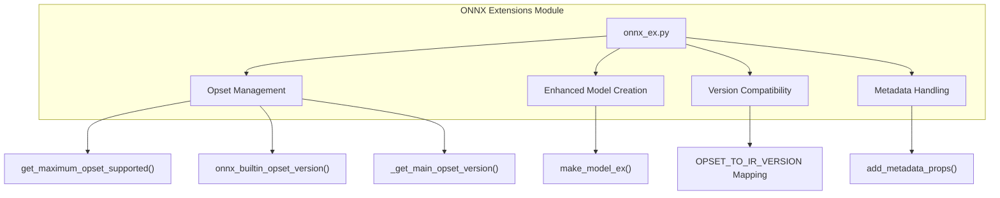
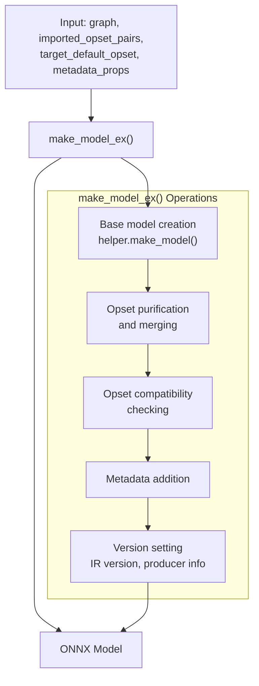
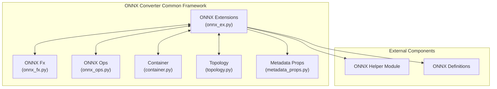

<!-- source: DeepWiki mcp.deepwiki.com · repo microsoft/onnxconverter-common · page 5.4 ONNX Extensions · fetched 2026-10-26 -->

# ONNX Extensions

<details>
<summary>Relevant source files</summary>

The following files were used as context for generating this wiki page:

- [onnxconverter_common/onnx_ex.py](onnxconverter_common/onnx_ex.py)

</details>


## Purpose and Scope

This document describes the ONNX Extensions module within the `onnxconverter-common` framework. These extensions provide enhanced capabilities for creating and managing ONNX models with specific focus on opset versioning, IR version compatibility, and metadata management. 

This module specifically handles the complexity of working with different ONNX operator set (opset) versions, ensuring compatibility between various versions, and providing a way to create ONNX models with proper version configurations. For information about building ONNX operators, see [ONNX Operator Builder](#5.3) and for information about general ONNX operations, see [ONNX Operations](#4.2).

## Overview of ONNX Extensions Components



Sources: [onnxconverter_common/onnx_ex.py]()

## ONNX Opset Management

ONNX models are defined using operator sets (opsets), which specify the available operators and their behavior. The ONNX Extensions module provides several utilities for managing opsets, ensuring compatibility, and handling version differences.

### Key Constants and Mappings

```python
DEFAULT_OPSET_NUMBER = 15  # Maximum opset supported by the converter
OPSET_TO_IR_VERSION = {
    1: 3, 2: 3, 3: 3, 4: 3, 5: 3, 6: 3,
    7: 3, 8: 3, 9: 4, 10: 5, 11: 6, 12: 7,
    13: 7, 14: 7, 15: 8
}
```

This mapping is crucial as it defines the relationship between ONNX opset versions and the required IR (Intermediate Representation) versions.

Sources: [onnxconverter_common/onnx_ex.py:11-17]()

### Opset Version Detection and Management

The module provides several functions for working with opset versions:

| Function | Purpose |
|----------|---------|
| `_get_main_opset_version(model)` | Extracts the main opset version from an ONNX model |
| `onnx_builtin_opset_version()` | Returns the current ONNX built-in opset version |
| `get_maximum_opset_supported()` | Returns the maximum opset version supported by the converter |

These functions are used to determine compatibility and select appropriate versions when creating or modifying ONNX models.

Sources: [onnxconverter_common/onnx_ex.py:20-35]()

## Enhanced Model Creation with ONNX Extensions

The primary functionality provided by the ONNX Extensions module is `make_model_ex()`, an enhanced version of ONNX's `helper.make_model()` function that adds capabilities for opset management, metadata addition, and version compatibility checks.



Sources: [onnxconverter_common/onnx_ex.py:38-85]()

### Opset Purification and Merging

A key feature of `make_model_ex()` is its ability to merge operator sets for the same domain while keeping the largest version number:

```python
# Merge operator sets for the same domain, the largest version number would be kept
purified_operator_set = dict()
for op_domain, op_version in imported_opset_pairs:
    if op_domain not in purified_operator_set:
        # Special handling for empty domain and IR version compatibility
        purified_operator_set[op_domain] = op_version
    else:
        purified_operator_set[op_domain] = max(purified_operator_set[op_domain], op_version)
```

This ensures that the ONNX model uses the most appropriate opset version for each domain while eliminating duplicates.

Sources: [onnxconverter_common/onnx_ex.py:42-52]()

### Version Compatibility Management

The function also performs compatibility checks to ensure that the target opset version is sufficient for the model:

```python
if op_domain == '' or op_domain == 'ai.onnx':
    if target_default_opset < op_version:
        raise RuntimeError(('The specified opset %d is too low to convert this model, ' +
                            'which requires at least opset %d.') % (target_default_opset, op_version))
    elif target_default_opset > op_version:
        getLogger('onnxmltools').warning('The maximum opset needed by this model is only %d.' % op_version)
```

This helps prevent compatibility issues by ensuring that the target opset version is appropriate for the model's requirements.

Sources: [onnxconverter_common/onnx_ex.py:66-73]()

## ONNX Model Properties and Metadata

The function also sets important model properties:

| Property | Description |
|----------|-------------|
| `ir_version` | IR version based on opset version |
| `producer_name` | Name of the producer (tool that created the model) |
| `producer_version` | Version of the producer |
| `domain` | Model domain |
| `model_version` | Model version |
| `metadata_props` | Custom metadata properties |

These properties provide important context for the model, making it easier to understand its origin, compatibility, and purpose.

Sources: [onnxconverter_common/onnx_ex.py:76-84]()

## Integration with Other Components



The ONNX Extensions module interacts with several other components of the system:

1. It uses the ONNX helper module for basic model creation
2. It references ONNX definitions for opset versioning
3. It utilizes the metadata_props module for adding metadata to models
4. It provides services to other components like ONNX Fx and Topology

Sources: [onnxconverter_common/onnx_ex.py:6-8](), [onnxconverter_common/onnx_ex.py:77]()

## Usage Example

Here's how the ONNX Extensions can be used to create a model with specific opset configurations:

```python
# Create an ONNX graph using other components
graph = create_onnx_graph()  # Placeholder for actual graph creation

# Define the opset requirements for different domains
imported_opset_pairs = [
    ('', 11),                # Main ONNX domain with opset 11
    ('ai.onnx.ml', 2),       # ML domain with opset 2
    ('com.microsoft', 1)     # Microsoft domain with opset 1
]

# Define target default opset
target_default_opset = 11

# Define metadata properties
metadata_props = {
    'model_type': 'classification',
    'framework': 'scikit-learn'
}

# Create the model with extended capabilities
onnx_model = make_model_ex(
    graph=graph,
    imported_opset_pairs=imported_opset_pairs,
    target_default_opset=target_default_opset,
    metadata_props=metadata_props,
    producer_name='onnxconverter-common',
    doc_string='Model created with ONNX Extensions'
)
```

This example shows how the `make_model_ex()` function provides enhanced capabilities for creating ONNX models with proper version configuration and metadata.

Sources: [onnxconverter_common/onnx_ex.py:38-85]()

## Conclusion

The ONNX Extensions module provides essential functionality for creating and managing ONNX models with proper version configurations, ensuring compatibility between different ONNX versions, and adding important metadata. It serves as a bridge between basic ONNX functionality and the more advanced capabilities needed for model conversion and optimization in the `onnxconverter-common` framework.

---

