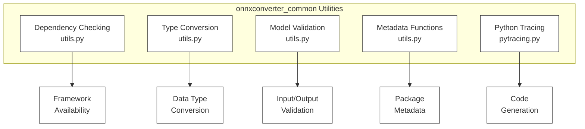
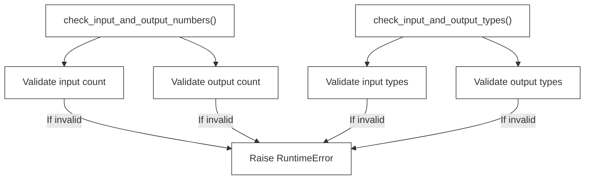
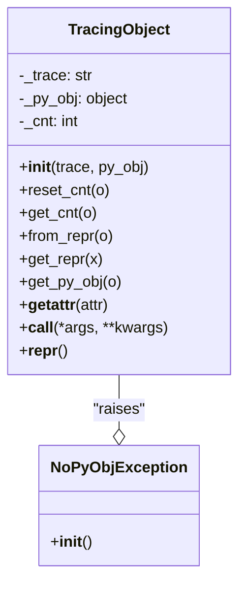
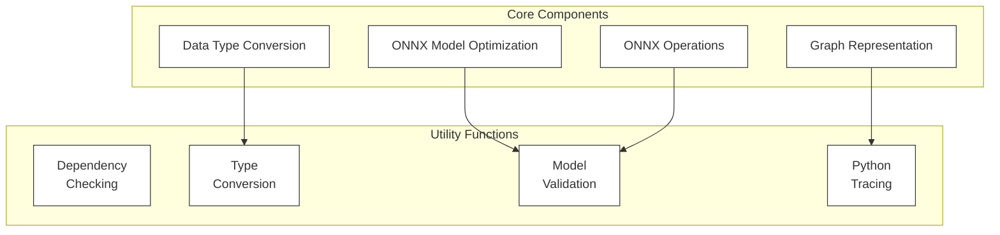

<!-- source: DeepWiki mcp.deepwiki.com · repo microsoft/onnxconverter-common · page 5.5 Utility Functions · fetched 2026-10-26 -->

# Utility Functions

<details>
<summary>Relevant source files</summary>

The following files were used as context for generating this wiki page:

- [onnxconverter_common/pytracing.py](onnxconverter_common/pytracing.py)
- [onnxconverter_common/utils.py](onnxconverter_common/utils.py)

</details>


This page provides an overview of the utility functions in the `onnxconverter_common` package that support various operations including dependency checking, type conversion, model validation, and Python object tracing. These utilities serve as helper functions for the core components of the package, enabling seamless integration with different ML frameworks and proper handling of data types.

For information about ONNX Function conversion systems, see [ONNX Function System](#5.1).

## Overview of Utility Categories

The utility functions in `onnxconverter_common` can be grouped into several categories based on their purpose:



Sources: [onnxconverter_common/utils.py:1-332](), [onnxconverter_common/pytracing.py:1-93]()

## Dependency Checking Functions

The package provides a set of utility functions to check whether specific ML frameworks, tools, or converters are available in the current environment. These functions help in making conditional decisions based on available dependencies.

```mermaid
classDiagram
    class "Dependency Checking" {
        +sparkml_installed() bool
        +sklearn_installed() bool
        +skl2onnx_installed() bool
        +coreml_installed() bool
        +keras2onnx_installed() bool
        +torch_installed() bool
        +caffe2_installed() bool
        +libsvm_installed() bool
        +lightgbm_installed() bool
        +xgboost_installed() bool
        +h2o_installed() bool
        +hummingbird_installed() bool
    }
```

Each function follows a similar pattern - attempting to import the required module and returning a boolean indicating success or failure. Most functions simply check if the import succeeds, but some like `xgboost_installed()` perform additional version compatibility checks.

### Example Usage

```python
from onnxconverter_common import utils

if utils.sklearn_installed():
    # Use scikit-learn specific conversion logic
else:
    # Use an alternative approach or raise an error
```

Sources: [onnxconverter_common/utils.py:12-155]()

## Type Checking and Conversion Functions

These functions help with type verification and conversion between different data formats, particularly when working with various input/output types in ONNX models.

| Function | Description | Input Types | Output Types |
|----------|-------------|-------------|--------------|
| `is_numeric_type(item)` | Checks if an item is numeric | Any | Boolean |
| `is_string_type(item)` | Checks if an item is a string type | Any | Boolean |
| `cast_list(type, items)` | Casts all items in a list to a specified type | List, Type | List |
| `convert_to_python_value(var)` | Converts a value to Python primitive | Numbers, Strings | int, float, str |
| `convert_to_python_default_value(var)` | Gets default value for a Python type | Numbers, Strings | int(), float(), str() |
| `convert_to_list(var)` | Converts a variable to a list format | Various | List |

### Key Implementation Details

- Type checking functions handle not only primitive types but also collections (lists and numpy arrays)
- `convert_to_list()` implements complex flattening logic for nested structures
- These functions ensure consistent type handling across the framework

Sources: [onnxconverter_common/utils.py:190-258]()

## Model Validation Functions

The validation utilities help ensure that ONNX operators have the correct structure, number of inputs/outputs, and appropriate types.



### Function Details

- `check_input_and_output_numbers(operator, input_count_range, output_count_range)`: Validates that an operator has the correct number of inputs and outputs. The count ranges can be specified as integers or as [min, max] lists.
- `check_input_and_output_types(operator, good_input_types, good_output_types)`: Validates that the types of an operator's inputs and outputs match the expected types.

Sources: [onnxconverter_common/utils.py:261-331]()

## Metadata Functions

These functions provide access to package metadata:

- `get_producer()`: Returns the producer name
- `get_producer_version()`: Returns the producer version
- `get_domain()`: Returns the model domain
- `get_model_version()`: Returns the model version

Sources: [onnxconverter_common/utils.py:158-187]()

## Python Tracing Utilities

The `pytracing.py` module provides tools for recording Python function calls, which is particularly useful for converting between ONNX models and equivalent Python code.



### TracingObject Usage

The `TracingObject` class enables mocking of modules like numpy or onnx.helper and recording calls on those modules. For example:

```python
np = TracingObject("np")
x = np.array(np.prod([1, 2, 3]), np.int32)
assert repr(x) == "np.array(np.prod([1, 2, 3]), np.int32)"
```

This mechanism is used by the [ONNX to Python Conversion](#5.2) system to generate equivalent Python code from ONNX models.

Sources: [onnxconverter_common/pytracing.py:1-93]()

## Integration with Other Components

The utility functions are integrated with other components of the framework as illustrated below:



### Key Integration Points

1. **Model Validation** utilities are used by optimization components to ensure valid transformations
2. **Type Conversion** utilities support the data type conversion systems
3. **Python Tracing** utilities enable graph construction and representation
4. **Dependency Checking** utilities allow conditional imports across the framework

Sources: [onnxconverter_common/utils.py:1-332](), [onnxconverter_common/pytracing.py:1-93]()

## Summary

The utility functions in `onnxconverter_common` provide essential support for the core functionality of the package. They facilitate:

- Framework availability checking for conditional functionality
- Type checking and conversion for consistent data handling
- Model validation to ensure correct structure and types
- Python tracing for code generation and model conversion

These utilities are designed to be simple, reusable components that follow consistent patterns, making them easy to incorporate into different parts of the ONNX conversion workflow.

---

